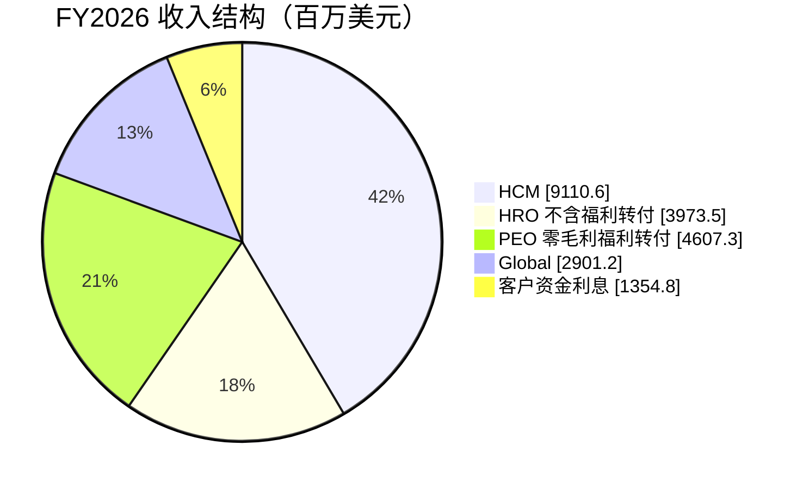
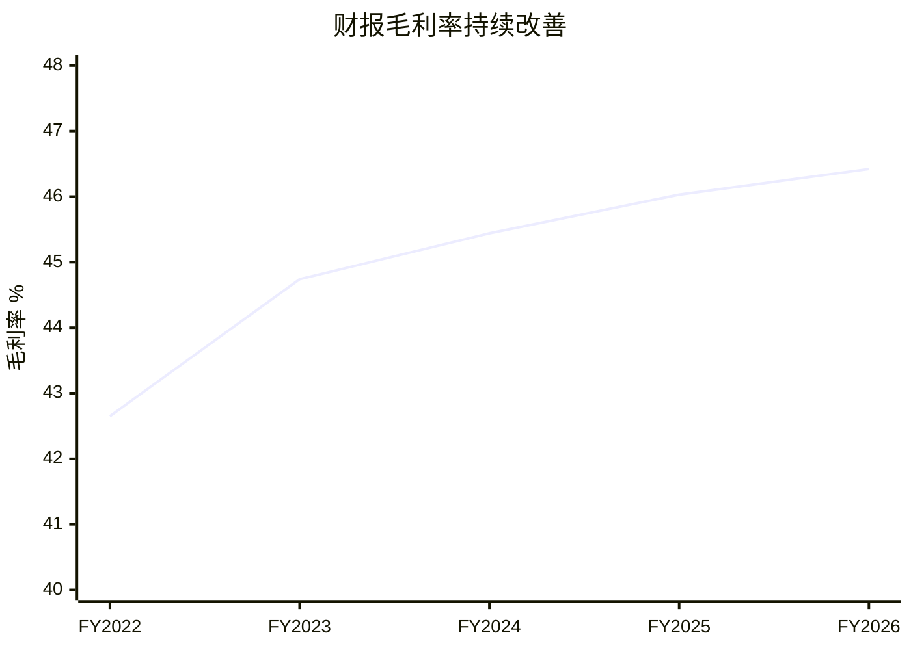

# ADP（NASDAQ:ADP）研究报告

**研究及数据截止日：2026-11-26（北京时间）**  
**公司：Automatic Data Processing, Inc.（自动数据处理公司）；美国普通股，非 ADR，非巴黎机场集团。**  
**价格：316.72 美元（纽约 2026-11-25 正常收盘）；估算市值：1,250.2821 亿美元。**  
**估值：GAAP TTM PE 28.08 倍；审慎 FCF 收益率 3.80%；最新宣派股息年化收益率 2.40%。**  
**财务范围：FY2026 已审计年报、截至 2026-09-30 的 FY2027Q1，以及截至研究日的新披露。**

ADP 把雇主每期必须正确完成的发薪、报税和人事事务做成持续收费的基础设施。它的优势仍在，但当前价格需要比“收入稳定增长、服务提效”更强的盈利兑现；本次研究的核心是分清经营改善与价格提供的回报。

价格由 [StockAnalysis 收盘记录](https://stockanalysis.com/stocks/adp/history/)与 [Yahoo 报价](https://finance.yahoo.com/quote/ADP/)交叉核对；股本采用 [最新 10-Q](https://www.sec.gov/Archives/edgar/data/8670/000000867026000044/adp-20260930.htm)封面截至 10 月 27 日的 394,759,432 股，与第三方 394.76M 一致。市值是该股本与最新收盘价的组合快照，研究日实时股本可能继续受回购影响。

---

## AI研究偏见自觉

**信息丰富度评级：A。** 年报、季报、电话会和竞争者资料充分，最容易出现的偏差是把“高留存、长历史、股息增长”直接换成“任何价格都值得买”。

AI研究局限性声明：公开资料无法充分观察分客群竞争胜负、真实迁移报价、AI 提效后的净利润归属，以及 ZenBusiness 的购买价和转化经济性。管理层自报使用量不能替代独立验证的增量现金回报。本文区分事实、计算和判断；分部季度数据等只有一手披露的项目单独标示，不把 SEC 和公司网站的同一份公告算成两个独立源。

- [x] 公司质地判断主要来自重复收费、交付责任和现金创造，而非资料数量。
- [x] 把 AI 降低成本与 AI 降低竞争者进入门槛同时纳入分析。
- [x] 不用当前市场愿意支付的高倍数证明十年后仍可支付相同倍数。
- [x] 不能把旧台账的买入判断机械搬到新的价格，也不能反过来改写旧结论。

> 研究追问：资料减少一半后，仍能确认的是发薪需求与转换成本；不能确认的是未来定价权能否完整保留。

---

## 第一步：核心数据总览

### 收入从哪里来

下表单位为百万美元，采用 FY2026 按收入类型披露，五项可直接加总；它与 ES/PEO 两个管理分部口径不同。

| 收入类型 | FY2026 | 经济含义 |
|---|---:|---|
| HCM | 9,110.6 | 发薪及人力资本管理产品 |
| HRO，不含 PEO 零毛利福利转付 | 3,973.5 | 人事外包等服务 |
| PEO 零毛利福利转付 | 4,607.3 | 相关支出按总额入账；收入不等于新增经济价值 |
| Global | 2,901.2 | 跨国发薪及相关服务 |
| 客户资金利息 | 1,354.8 | 代收代付期间的投资收益，不是客户本金归公司所有 |
| 总收入 | 21,947.4 | 与已审计合并收入一致 |



来源：[FY2026 10-K，收入附注及业务说明](https://www.sec.gov/Archives/edgar/data/8670/000000867026000030/adp-20260630.htm)，并以 [第三方收入类型表](https://stockanalysis.com/stocks/adp/financials/)核对舍入数。PEO 的工资与工资税已净额剔除，福利转付仍总额列示；因此 ADP 的合并毛利率不能直接与纯软件公司比较。

按管理分部，FY2026 的 ES 收入为14,831.4百万美元、同比约+7%，PEO为7,128.1百万美元、约+7%；扣除内部收入抵销12.1百万美元后得到合并收入。公司披露分部税前利润率，未完整披露可与上述五种收入类型一一对应的毛利率，本文不补造该明细。

### 五年财务与盈利趋势

单位：百万美元；EPS 为美元。FY 为截至当年 6 月的财年。毛利率按财报收入减 cost of revenues 计算，包含成本中的研发和折旧摊销。

| 指标 | FY2022 | FY2023 | FY2024 | FY2025 | FY2026 |
|---|---:|---:|---:|---:|---:|
| 收入 | 16,498.3 | 18,012.2 | 19,202.6 | 20,560.9 | 21,947.4 |
| GAAP 净利润 | 2,948.9 | 3,412.0 | 3,752.0 | 4,079.7 | 4,413.5 |
| 稀释 EPS | 7.00 | 8.21 | 9.10 | 9.98 | 10.94 |
| 财报毛利率 | 42.65% | 44.74% | 45.44% | 46.03% | 46.42% |
| 经营现金流 | 3,099.5 | 4,207.6 | 4,157.6 | 4,939.7 | 5,441.2 |
| 有形资本开支 | 174.4 | 206.3 | 208.4 | 168.7 | 196.6 |
| 无形资产新增现金支出 | 379.0 | 365.3 | 355.0 | 378.3 | 468.5 |
| 简化 FCF | 2,925.1 | 4,001.3 | 3,949.2 | 4,771.0 | 5,244.6 |
| 审慎 FCF | 2,546.1 | 3,636.0 | 3,594.2 | 4,392.7 | 4,776.1 |
| 公司现金等价物 | 1,436.3 | 2,083.5 | 2,913.4 | 3,347.8 | 4,230.1 |

简化 FCF＝经营现金流－有形资本开支；审慎 FCF 另扣无形资产新增现金支出。后者包含软件等投资，全部扣除偏保守，但比把资本化支出当作可分配现金更稳妥；两者均未扣收购价款，也不是公司发布的非 GAAP 指标。



来源：[FY2024 10-K](https://www.sec.gov/Archives/edgar/data/8670/000000867024000024/adp-20240630.htm)、[FY2026 10-K](https://www.sec.gov/Archives/edgar/data/8670/000000867026000030/adp-20260630.htm)，与 [StockAnalysis 损益表](https://stockanalysis.com/stocks/adp/financials/income-statement/)、[现金流表](https://stockanalysis.com/stocks/adp/financials/cash-flow-statement/)、[资产负债表](https://stockanalysis.com/stocks/adp/financials/balance-sheet/)核对。Macrotrends 的收入及毛利率页面作补充；个别页面直接访问受限，不能声称所有指标都完整覆盖该平台。

**毛利口径差异已解释。** StockAnalysis 的 FY2026 标准化毛利率为 48.65%，排除了财报成本中的折旧摊销；本文财报口径为 46.42%。这不是超过误差阈值后仍混用的数据。经营效率主要参考公司调整后 EBIT 利润率：FY2026 为 26.8%，FY2025 为 26.0%；不把第三方标准化 operating margin 当成同一指标。

### 最近四季：增长仍在，收入质量要拆开

单位：百万美元；分部利润率为分部税前利润率，非毛利率。分部之间存在内部抵销，ES 与 PEO 不能直接相加代替合并收入。

| 财季 | 合并收入 | ES收入 | ES同比 | ES利润率 | PEO收入 | PEO同比 | PEO利润率 | GAAP EPS |
|---|---:|---:|---:|---:|---:|---:|---:|---:|
| FY2026Q2 | 5,359.3 | 3,607.4 | +6% | 35.4% | 1,755.2 | +6% | 14.4% | 2.62 |
| FY2026Q3 | 5,939.2 | 4,036.1 | +7% | 41.1% | 1,906.0 | +7% | 13.0% | 3.38 |
| FY2026Q4 | 5,473.8 | 3,696.7 | +7% | 34.4% | 1,779.5 | +7% | 12.2% | 2.45 |
| FY2027Q1 | 5,490.7 | 3,685.4 | +6% | 36.5% | 1,808.1 | +7% | 13.0% | 2.83 |

来源：[Q2公告](https://www.sec.gov/Archives/edgar/data/8670/000000867026000006/q2fy26exhibit99.htm)、[Q3公告](https://www.sec.gov/Archives/edgar/data/8670/000000867026000016/q3fy26exhibit99.htm)、[Q4公告](https://www.sec.gov/Archives/edgar/data/8670/000000867026000025/q4fy26exhibit99.htm)、[最新Q1公告](https://www.sec.gov/Archives/edgar/data/8670/000000867026000033/q1fy27exhibit99.htm)。合并数据有第三方核对，季度分部利润率目前是完整的一手单源，信心低于已双源核验的合并财务。

首季最值得注意的不是单一 EPS 数字，而是以下组合：[Q1演示材料](https://s205.q4cdn.com/887941133/files/content_files/ADP-1Q27-Earnings-Deck.pdf)显示 ES 有机收入增长约 +6%、每控制支付人数增长 +2%；PEO 总收入 +7%，剔除零毛利转付仅 +4%，WSE +2% 至约 77.1 万。Q1 调整后 EPS 为 2.82 美元，与 GAAP 2.83 美元分开使用。

FY2027 最新收入指引约 +6%，调整后 EPS +10%—+12%；以 FY2026 调整后 EPS 11.12 美元计算为 12.232—12.4544 美元。客户资金利息收入指引提高，但 [电话会](https://s205.q4cdn.com/887941133/files/content_files/Transcript-FY27-Q1.pdf)也说明退休、保险和外包业务较强，不能把上调全部归因于利息。首季收入留存同比微升、未披露绝对值；全年仍预计较 FY2026 的 92.1% 下降 10—30bp。

### 客户资金不是股东的现金

截至 2026-09-30，单位：百万美元。

| 项目 | 数额 | 处理方式 |
|---|---:|---|
| 公司现金等价物 | 3,277.0 | 公司资金；仍需经营流动性 |
| 公司短期证券 | 50.0 | 纳入现金与短投口径 |
| 公司长期证券 | 195.2 | 已质押支持回购融资，不称为自由现金 |
| 公司受限现金 | 22.2 | 不加入自由净现金 |
| 非租赁金融债务 | 5,178.4 | 长债净账面、流动部分及 reverse repo 合计 |
| 含经营租赁总债务 | 5,589.3 | 与第三方总债务口径对照 |
| 现金＋短投－非租赁金融债 | -1,851.4 | 本文净现金口径；实际上为净债 |
| 第三方净现金口径 | -2,067.1 | 加入长期证券，同时扣含租赁债务 |
| 客户资金资产 | 44,733.3 | 全部排除企业可分配现金 |
| 客户资金义务 | 46,039.6 | 与客户资产配对看，差额涉及融资和计量等 |

来源：[10-Q 资产负债表及附注6、9、10](https://www.sec.gov/Archives/edgar/data/8670/000000867026000044/adp-20260930.htm)、[第三方资产负债表](https://stockanalysis.com/stocks/adp/financials/balance-sheet/)。第三方现金及证券 3,522.2 百万美元包含已质押长期证券；不可全部用来推断新增回购能力。期末商票为零也不代表期间没有短期融资依赖。

截至 Q1 的 TTM 经营现金流为 5,449.9 百万美元，有形支出 202.6 百万美元、无形支出 491.5 百万美元，故简化 FCF 为 5,247.3 百万美元，审慎 FCF 为 **4,755.8 百万美元**。按当前实际股本折算，审慎每股 FCF 为 12.0473 美元，支持以 GAAP EPS 11.28 美元作为估值起点，但不支持无限资本回馈。[现金流依据](https://stockanalysis.com/stocks/adp/financials/cash-flow-statement/)

> 数据追问：如果扣掉维持软件竞争力的现金投入，这门生意是否仍能稳定产生现金？答案是能，但余量小于常见简化 FCF 给人的印象。

---

## 第二步：生意本质分析

**一句话：雇主为“每次发薪都准确合规、出了问题有人负责”持续付费，ADP 把合规知识、软件和服务网络的固定成本摊到大量客户上。**

| 经营要素 | 机制 | 利润真正受什么影响 |
|---|---|---|
| 客户与收费 | 雇主购买发薪、报税、考勤、福利及外包服务 | 客户数、发薪人数、产品渗透与价格实现 |
| 复购 | 发薪持续发生，历史数据与流程积累 | 留存、客户倒闭、竞争迁移 |
| 成本 | 技术、销售实施、服务人员及合规维护 | 服务接触频率、自动化、上线效率 |
| PEO | 较深度的人事外包和共同雇佣安排 | 净服务收入、医疗与工伤风险、WSE |
| 资金收入 | 代收代付时差产生可投资余额 | 工资和资金余额、梯形投资到期、融资成本 |

客户锁定来自更换系统时必须迁移工资档案、税务申报、权限、福利与接口，并验证多个发薪周期。对大型客户，失败造成的员工信任和合规成本可能超过软件费节省。这是强转换成本；小客户更易迁移、也更易倒闭，不能一概而论。[业务流程依据](https://www.sec.gov/Archives/edgar/data/8670/000000867026000030/adp-20260630.htm)

ADP 同时有经营杠杆和维护成本。更多客户分摊平台投入有利于利润率，AI 可减少查询、录入和支持工作；但工资计算规则、产品迁移与安全不能停止投入。因此“轻有形资产”成立，“不需要再投资”不成立。与纯软件相比，PEO 福利转付压低合并毛利率，服务交付也需要人工；这并不自动说明护城河较弱。

> 段永平式追问：这门生意好在哪？客户需要持续把低容错的工作做好，供应商因此可以反复收费；前提是可信交付持续存在。

---

## 第三步：护城河评估

| 来源 | 判断 | 可验证证据与弱点 |
|---|---|---|
| 转换成本 | 强 | 记录、接口、合规与并行测试；但 AI 也可能降低迁移成本 |
| 品牌与定价权 | 较强 | 发薪责任重、留存高；提价单独贡献未充分披露，不能由总收入倒推 |
| 合规与规模 | 强 | 跨地区规则维护和交付经验可摊薄成本；规模也集中系统事故风险 |
| 直接网络效应 | 弱 | 新增雇主不会直接提升另一雇主的发薪价值；数据和渠道属于间接优势 |
| 技术壁垒 | 中等、需要维护 | 权限、规则、执行流程与产品集成有积累，基础模型本身不独占 |

过去数年的盈利和现金表现支持护城河仍有效，但不充分证明其不断变宽。新的考验出现在获客和产品入口：统一 HR、IT、财务数据的平台可能让新客户先选择竞争者，而留存在数年后才显现压力。FY2027 留存指引略降应继续跟踪，单凭首季微升不能结束讨论。

技术方面，[ADP与AWS合作公告](https://mediacenter.adp.com/2026-09-08-ADP-Partners-with-AWS-to-Accelerate-AI-Powered-Innovation-in-Human-Capital-Management)披露 Assist 使用 Bedrock，代理使用 AgentCore；优势更可能在数据、权限、合规规则和实际执行。它既可成为 AI 的后端，也面临前端价值被其他代理截取的风险。这是推理，不是已发生的份额结论。

FY2026损益表研发费用为1,028.8百万美元，公司广义研发投入为1,405百万美元，后者还含软件许可、并购取得软件等，不能全部视为当期费用，也不能在审慎FCF之外重复扣一遍。[年报技术投入说明](https://www.sec.gov/Archives/edgar/data/8670/000000867026000030/adp-20260630.htm)

> 巴菲特式追问：十年后护城河还在吗？大概率仍有，但最可能摧毁它的是持续交付失误，或竞争平台在不牺牲合规的情况下显著降低整体使用与迁移成本。

---

## 第四步：逆向思考与风险清单

最强的空方论点是：ADP 可能仍然增长，但增长的一部分来自利率、福利转付和提价；AI 原生平台先争夺新增客户，存量留存掩盖早期竞争变化。若收入中个位数增长对应的股票仍按接近三十倍盈利定价，经营没有崩溃也可能带来较低回报。

以下概率是定性的研究判断，观察期约五年，不是统计频率；路径可以同时发生，不应相加。

| 失败或低回报路径 | 概率判断 | 影响 | 可观测信号 |
|---|---|---|---|
| 增速放缓、估值回落 | 中高 | 股东回报偏低，未必永久损失 | 有机收入连续两季低于 +4%，新签持续弱于预期 |
| AI 新平台侵蚀获客及定价 | 中 | 中长期利润池受损 | 年度新签停滞，竞争丢单、让价与留存转差同时出现 |
| 资金利息增益回落 | 中 | EPS 增速下台阶 | 净投资策略贡献下降、核心服务不能补足 |
| PEO 福利成本与储备恶化 | 中 | 利润及现金波动 | 剔转付增长低于指引，WSE 转负，储备调整上升 |
| 重大错付、泄露或监管事故 | 低，但非零 | 信任受损、赔付及客户流失，可能永久损失 | 正式事件披露及后续留存、赔偿、监管要求 |
| 并购买贵、交叉销售不兑现 | 中、价格资料不足 | 资本回报下降 | 商誉、对价、获客成本与转化指标无法支持投入 |

利率风险不能用客户资金余额乘降息幅度简单处理。官方投资组合包含梯形到期及融资安排；FY2026 年报给出的短端与中端同步变动 25bp、未来十二个月税前利润影响约 21 百万美元，是特定组合下的敏感性，不是永久风险上限。[年报市场风险说明](https://www.sec.gov/Archives/edgar/data/8670/000000867026000030/adp-20260630.htm)

历史类比应克制。伯克希尔由便宜纺织资产转向高质量业务的经历，说明经营经济性比低估值叙事更持久；同一份信也提醒充分定价限制未来回报。这只是质量与价格的类比，不能证明工资系统会走相同路径。[巴菲特1989年股东信](https://www.berkshirehathaway.com/letters/1989.html)

最可能的分析错误，是把复杂合规等同于永久定价权，或把 AI 使用增长等同于股东获得等额利润。反过来，要求 AI 必须独立收费才承认价值也不合理：效率提高、续约增强同样可以创造回报。

> 芒格式追问：聪明人为什么不买？他可能相信 ADP 是好公司，却认为当前盈利收益率和增长不足以补偿估值收缩与机会成本。

---

## 第五步：管理层评估

Maria Black 在 1996 年加入 ADP，2023 年初接任 CEO，是熟悉销售、服务和外包业务的内部职业经理人。履历由 [ADP官方资料](https://www.adp.com/about-adp/leadership/maria-black)与 [Delta独立董事资料](https://ir.delta.com/governance/person-details/default.aspx?ItemId=65fa3b96-27ec-4457-a6c5-be6a4b0658e2)交叉核对。经营体系比单一创始人更重要，交接风险可控并不代表管理质量无须检验。

| 时间 | 决策 | 已知结果 | 本报告评价 |
|---|---|---|---|
| FY2025—FY2026 | 提高回购力度 | FY2026 约860万股、均价242.92美元；前期约440万股、均价289.11美元 | 较低价格买入更多是正面证据；不以后续涨价替代内在价值判断 |
| 2024年10月 | 收购 WorkForce Software | 购买价1,170.8百万美元，补充考勤与排班能力 | 战略适配；独立回报尚未证实，暂不评为成功 |
| FY2026—FY2027 | Assist、Lyric与服务平台投入 | 已出现使用及服务效率数据 | 方向合理，需看净成本和续约的持续兑现 |
| 2026年11月 | 季度股息提高至1.90美元 | 年化7.60美元，连续52年提高 | 现金创造稳定；分红不能取代估值纪律 |
| 2026年11月19日 | 完成 ZenBusiness 收购 | 获客入口前移，对价及盈利未披露 | 保留判断，估值中不给协同溢价 |

依据：[年报资本配置及收购附注](https://www.sec.gov/Archives/edgar/data/8670/000000867026000030/adp-20260630.htm)、[股息公告](https://investors.adp.com/news/news-details/2026/ADP-Increases-Cash-Dividend-Marks-52nd-Consecutive-Year-of-Dividend-Increases/default.aspx)、[ZenBusiness官方公告](https://mediacenter.adp.com/2026-11-19-ADP-Acquires-ZenBusiness)。FY2026 现金分红与回购合计约47.10亿美元，已接近审慎FCF的47.76亿美元；它们不是可以在并购之外无限加速的两笔独立资金。

[2026 Proxy](https://www.sec.gov/Archives/edgar/data/8670/000130817926000409/adp015474-def14a.htm)显示，8月15日 Black 受益持股为102,151股，26名董事、高管及候选人合计599,811股，均低于总股本的1%；[Stoqly分发](https://stoqly.net/companies/adp)核对相符。两者上游同为Proxy，并非两次独立原始披露。受益持股包含将归属RSU等，不能直接当成当天投票权；公司普通股一股一票，没有AB股放大控制。

Proxy披露 Black FY2026 SEC汇总薪酬约2,545万美元，其中大部分是股票授予日价值，非全部当年现金。长期激励目标结构为75% PSU、25% RSU，CEO持股要求为工资六倍。激励与利润及收入有关，但经济权益较小，仍要防止通过调整后指标、并购和回购追求表面增长。

> 段永平式追问：如果CEO退休，竞争力还在吗？客户流程、合规和服务网络应能延续；需要检验的是继任者是否维持资本纪律和交付文化。

---

## 第六步：行业与文明趋势

工资与人事外包的长期需求来自就业、工资水平、法规复杂性和外包渗透。AI 改变交互和单位服务成本，也可能减少可收费岗位、压低部分软件功能价格。它是行业生产方式的变化，不自动等于 ADP 收入指数增长。

新的量化证据已经出现。[FY2026股东信](https://www.sec.gov/Archives/edgar/data/8670/000130817926000411/adp015474-ars.pdf)披露 Assist 超过300万活跃用户、超过1,200万次交互，部分 payroll 功能平均每次节省约30分钟；这些属于管理层自报。Q1电话会称已全面部署 The Zone 的小企业核心服务团队每客户联系数同比减少约7%，该范围不能外推为全公司成本减少7%。目前更强的结论是“产品被使用，部分流程有效率证据”，更弱的结论是“利润因此增加多少”。

| 竞争者或路径 | 竞争位置 | 对 ADP 的含义 |
|---|---|---|
| Paychex | 小企业发薪、外包及PEO；已纳入Paycor | 客群重叠显著；不能把并购增长当作有机抢份额 |
| Workday | 大企业HCM及AI工作流 | 既可能竞争，也可能与ADP发薪后端共存 |
| Paylocity、Paycom | 中型客户、自动化 | 新客体验和实施效率有压力，规模较小不等于没有威胁 |
| Rippling | HR、IT、财务统一数据与权限 | 可能改变采购入口；未上市，缺同口径审计财务，不造精确份额 |

竞争更新参考 [Paychex最新季度](https://investor.paychex.com/sec-filings/all-sec-filings/content/0000723531-26-000004/payx-ex99_1.htm)、[Workday 11月24日业绩](https://investor.workday.com/news-and-events/press-releases/news-details/2026/Workday-Announces-Fiscal-2027-Third-Quarter-Financial-Results/default.aspx)、[Paylocity最新季度](https://investors.paylocity.com/news-releases/news-release-details/paylocity-announces-first-quarter-fiscal-2027-financial-results)、[Rippling产品说明](https://www.rippling.com/en-CA/blog/introducing-rippling-ai)。Workday也已报告AI产品新ACV；ACV不是当季确认收入，不能直接与ADP使用量比较。

市场空间方面，可核验的旧版公司演示曾估计广义HCM市场为1,750亿美元，基准为2024年6月，属于公司估计，覆盖软件、外包和支付等多项业务；不冒充2026年的独立TAM。由于收入含福利转付和利息，本文不以合并收入除该TAM宣称精确份额。[原始演示第3页](https://investors.adp.com/files/doc_presentations/2025/05/ADP-Investor-Presentation-May-2025-vF.pdf)

公司收入客户分散，年报披露没有单一客户或关联客户组超过收入2%；技术与资金层面仍依赖云、银行和融资市场。供应链风险主要体现为系统、资金和第三方服务连续性，而非原材料短缺。[年报依据](https://www.sec.gov/Archives/edgar/data/8670/000000867026000030/adp-20260630.htm)

> 李录式追问：二十年后留下来的是什么？大概率是工资规则、权威记录、支付责任和可信执行；未必是今天的软件界面，也未必是今天的估值倍数。

---

## 第七步：估值与安全边际

### 当前价格买到了什么

| 指标 | 本文口径 | 解释 |
|---|---:|---|
| 现价 | 316.72美元 | 正常收盘，不用盘后价 |
| 估算市值 | 1,250.2821亿美元 | 现价×最新已披露实际股本 |
| TTM收入 | 222.629亿美元 | 年报＋最新Q1－上年Q1 |
| TTM GAAP净利润 | 45.257亿美元 | 同期桥接，非调整后 |
| TTM GAAP EPS | 11.28美元 | 各期公布EPS桥接，有舍入影响 |
| TTM PE | 28.08倍 | 现价/EPS；不混用期末股数与加权稀释股数 |
| PS | 5.62倍 | 市值/TTM收入 |
| EV/收入 | 5.70倍 | 金融债－公司现金短投口径，排除客户资产及义务，不含租赁 |
| 审慎 P/FCF | 26.29倍 | 扣有形及无形现金投入 |
| 审慎 FCF收益率 | 3.80% | 不额外把回购当成另一笔现金收益 |
| 最新年化股息 | 7.60美元 | 已宣派季度股息年化，未来四季支付仍非保证 |
| 年化股息率 | 2.40% | 股息/现价 |
| FY2027指引中点调整后PE | 25.66倍 | 以11.12×1.11计算，非GAAP预测 |

第三方 [估值快照](https://stockanalysis.com/stocks/adp/statistics/)的 PEG 为2.67倍，仅作依赖预测增速的辅助指标，不参与价格裁决。本文审慎FCF倍数高于该站简化FCF倍数，来源是扣除了软件等无形投资，不是算错。

历史与同业只能帮助理解定价。Macrotrends记录的ADP 2024、2025、2026年6月末PE约25.00、30.07、20.47倍；当前不属历史极端，但也没有重复前期低倍数机会。第三方标准化历史PE存在EPS/股数口径差异，不据此造精确估值分位。[历史PE](https://www.macrotrends.net/stocks/charts/ADP/adp/pe-ratio)

截至同一收盘日，[Paychex](https://stockanalysis.com/stocks/payx/statistics/)的TTM PE约23.50倍、P/FCF约20.92倍；[Workday](https://stockanalysis.com/stocks/wday/statistics/)约36.83倍、14.39倍。三者的业务、股付、并购和资本化不同，比较不能证明谁更便宜，更不能用同业今天的PE指定十年终值。

### 三年三情景：回答贵不贵

统一起点为GAAP每股盈利11.28美元，未来净回购/稀释设为零，不另加回购收益。三年后EPS分别按+3%、+8%、+12%增长；它们是研究假设。基准来自收入中个位数增长叠加有限效率提升，低于最新一年调整后EPS指引；乐观需要更强产品和效率兑现，悲观考虑就业、利息和价格压力。

三年PE分别18、24、28倍，是过渡期定价情景，参考质量、增长和历史范围；它们不进入十年永续模型。年末现金股息第一年7.60美元，随后随情景增速增长，未计税费和分红再投资。折现率统一10%。

| 情景 | 主观权重 | EPS年增速 | 三年后PE | 三年后EPS | 三年后股价 | 含股息今日价值 | 当前价含息年化IRR |
|---|---:|---:|---:|---:|---:|---:|---:|
| 悲观 | 25% | +3% | 18倍 | 12.3260 | 221.87美元 | 186.13美元 | -8.39% |
| 基准 | 50% | +8% | 24倍 | 14.2096 | 341.03美元 | 276.57美元 | +5.02% |
| 乐观 | 25% | +12% | 28倍 | 15.8476 | 443.73美元 | 354.49美元 | +14.30% |

概率加权今日价值为273.44美元。三年后的341.03美元是基准退出价格，不能直接拿来与今天股价比较后宣称低估；要扣时间成本并纳入股息。现价高于基准今日价值，安全边际不足。

反向估值：若三年后仍给24倍PE、要求10%回报并保留同样股息规则，现价隐含约+13.24%的年度EPS增长。它明显高于本文基准+8%；这不是“公司不可能做到”，而是买方需要更强证据。若坚持维持当前更高倍数，隐含增长要求会下降，但承担了更高估值延续风险。

上述情景使用financial_rigor三情景工具；股息现金流、逐年折现与IRR另用高精度Decimal复算，参数和未舍入结果保存在[模型文件](ADP-research-20261126-model.json)。

### 十年折现：只约束仓位

输入判断如下：

- r＝10%，现金流币种USD；美国财政部11月25日十年期国债约4.85%，加上主观ERP 5.15%、β＝1，得到10%。β取1而非短期价格回归值，避免用低波动机械降低商业回报要求。[财政部原始期限表](https://home.treasury.gov/resource-center/data-chart-center/interest-rates/TextView?type=daily_treasury_yield_curve&field_tdr_date_value=2026)
- 稳态增量ROIC＝25%。成熟合规平台仍可高效再投资，但新增一美元不能保证复制历史无形资产回报；同时，它高于“所有新增软件支出均无回报”的隐含极端。本值是判断，不是已观测未来ROIC。
- 永续g分别2%、3%、4%，只描述第十年之后；不随r移动。基准不高于美元长期名义增长约束，乐观4%已用到本技能允许上沿。
- 十年内每股盈利增速仍用+3%、+8%、+12%，概率沿用25%/50%/25%。不增加ZenBusiness协同收益。离散的网络、合规和重大事故属于尾部风险，不放进r或β。

终值PE只有一个来源：PE＝(1－g/ROIC)/(r－g)。第十年的每股盈利分别为15.1594、24.3527、35.0340美元；工具以每股金额作为统一单位计算，不能把输出误读为公司总利润。

| 情景 | 永续g | r－g | 模型终值PE | 工具近似IRR | 完整逐年股息IRR |
|---|---:|---:|---:|---:|---:|
| 悲观 | 2% | 8个百分点 | 11.50倍 | -3.40% | -2.19% |
| 基准 | 3% | 7个百分点 | 12.5714倍 | +2.06% | +3.12% |
| 乐观 | 4% | 6个百分点 | 14.00倍 | +6.87% | +7.76% |

terminal_value工具以“退出价几何回报＋固定股息率”近似现金收益，故仍按要求运行并保留；它不能替代逐年现金流IRR。本文另将每年股息和第十年退出价逐笔折现求根，基准r下各情景IRR的概率加权值为**+2.95%**，工具近似为+1.90%。二者都是各情景IRR的加权平均，不声称等于加权现金流的IRR。

三年PE24倍与十年终值12.5714倍不同，反映三年仍在增长阶段、十年后进入稳态的压力设定。它暴露了高价购买成熟业务时对长期高倍数延续的依赖，不是宣称十年后的市场一定按12.5714倍成交。

### 折现率敏感性与翻转检查

g、ROIC、经营增速与股息规则不变，只改变r及由r推导的终值。前一列来自强制flip工具，后一列来自完整年度现金流。

| r | flip期望IRR | 完整现金期望IRR | 相对IRR≥r | 币种区间 |
|---|---:|---:|---|---|
| 8% | +5.37% | +5.92% | 未通过 | 区间外，仅供参考 |
| 9% | +3.47% | +4.28% | 未通过 | USD合理区间 |
| 10% | +1.90% | +2.95% | 未通过 | USD合理区间 |
| 11% | +0.56% | +1.84% | 未通过 | USD合理区间 |
| 12% | -0.60% | +0.90% | 未通过 | 区间外，仅供参考 |

已先做r±2pp，因两侧均在美元9%—11.5%合理区间之外，再做±1pp。**在合理区间内的9%、10%、11%采样，仓位压力测试结论不翻转。** 基准及区间内最窄分母满足5个百分点约束；8%档的乐观分母仅4个百分点，除币种区间外，还只能作情景参考。离散事故风险未被折现率伪装吸收。

### 估值分歧对账

旧台账锚定约209美元，建议可建仓、约190美元加仓；这只是旧记录，不在本研究重新认证其历史成交、完整触发或执行结果。原财报中的持续收费、高留存和现金创造判断仍有支持，最新Q1也未显示论文崩溃。

本次对空仓者转为等待，定价依据是当前316.72美元高于三年基准含息今日价值276.57美元，以及正常盈利增速要求已偏高；并非用十年IRR未覆盖r单独否决。持仓者保留有条件持有，因为业务、护城河和经营证据仍支持继续复利。

十年模型回答重仓的回报压力。即使未来价格进入研究买入带，也仅支持小额分批验证，仓位参考上限收紧至组合约2%—3%，首笔约0.5%；这些是未了解个人组合时的研究额度，不是个人最优配置。重大现金需求、税费或其他资产机会需要另行纳入。

> 巴菲特式追问：r错2个百分点是否翻转？区间外结果仅参考；合理区间内再检仍未翻转。它收紧仓位，不代替六维判断。
>
> 段永平式追问：股市关闭五年愿意持有吗？对经营质量可以有信心；以当前价格新投入大额资金，预期回报还不够有吸引力。

---

## 第八步：最终决策与行动清单

| 维度 | 结论 | 信心度 |
|---|---|---|
| 生意质量 | 重复、低容错、客户分散；软件和服务共同交付 | 高 |
| 护城河 | 转换成本、合规与交付规模强；新客竞争压力须验证 | 中高 |
| 管理层 | 经营延续性较好，回购价格纪律有正面证据；新并购回报待核 | 中 |
| 最大风险 | 高倍数遇增速回落；重大系统事故可能造成永久损失 | 中 |
| 文明趋势 | 外包和复杂合规长期存在，AI价值由效率与竞争共同分配 | 中 |
| 估值 | 三年基准今日276.57美元，现价安全边际不足；十年完整现金期望+2.95%，仅限仓，合理r采样不翻转 | 中 |

估值不是唯一裁决维度。**最终建议：空仓者观望新增；合理小仓有条件持有、暂停加仓。** 优质业务支持持有判断，价格与机会成本限制新增，十年压力进一步限制集中度。

| 策略 | 建议 |
|---|---|
| 空仓者 | 等待230—250美元研究性分批带，进入后重新核验最新披露；不机械挂单买入 |
| 持仓者 | 服务质量、合规、留存与现金未结构恶化时继续持有；若已超配，结合税费和替代机会复核，不因模型单独清仓 |
| 加仓信号 | 230—250美元且ES有机增长仍约≥4%、全年留存未差于原指引下沿、PEO剔转付与WSE未同步转负、滚动审慎FCF正且支持分红；确认并购资金安排 |
| 卖出信号 | 重大交付或治理事故导致持续流失，或多期定价/新签/现金证据共同破坏论文；不是某一个季度EPS低于预期 |

| 价格区域 | 行动解释 |
|---|---|
| 低于230美元 | 下破研究带先查永久损失；基本面完整时才重新估值，不自动加大仓位 |
| 230—250美元 | 附经营条件的小仓分批研究带；相对当前基准价值折价约9.61%—16.84% |
| 高于250、低于350美元 | 空仓者等待，已有合理仓位跟踪；若盈利模型显著提高，重算价带 |
| 350美元及以上 | 不追价并复核超配，模型未增强时优先考虑回收过高仓位；不是自动卖出线 |

价带取代旧约190美元单一加仓监控线；变化来自最新盈利、现金口径和估值方法重建，不代表发生了对应幅度的经营恶化或提升。350美元是本报告明确设置的仓位复核阈值，不是把乐观退出价改名为卖出价。

下一步人工检查：2026-12-31复核ZenBusiness对价/资金与正式季报日程；2027-02-15作为FY2027Q2信息检查兜底，**不是已获公司确认的财报预约日**，若提前披露则提前复检。已宣派股息的官方登记日为2026-12-11，支付日为2027-01-01；不据此假定研究日买入可无风险获利。

### 四位大师原则的有限延伸

未找到四人针对ADP的可核验直接观点。以下先给真实短引，再给研究者的原则应用，后者不放入引号，不冒充本人选股意见。

| 人物 | 已核验短引与出处 | 本报告的有限应用 |
|---|---|---|
| 巴菲特 | “Time is the friend of the wonderful business”——[1989年股东信](https://www.berkshirehathaway.com/letters/1989.html) | 复利依赖持续经济性，不能由好公司推出任意买价 |
| 芒格 | “wonderful businesses purchased at fair prices”——[2023年股东信第1页，巴菲特转引芒格](https://www.berkshirehathaway.com/letters/2023ltr.pdf) | 质量与价格要同时成立；不是芒格给ADP评级 |
| 段永平 | “你投自己能理解的好公司就好。”——[雪球原帖](https://xueqiu.com/1247347556/123089890)，已读[仓库存档第23条](../拼多多/段永平雪球发言-PDD相关.md) | 看懂资金与服务经济性，才谈长期持有；网页原帖本次直读受限 |
| 李录 | “you always want to require a margin of safety”——[哥大官方2026-10-05对谈第3页](https://business.columbia.edu/sites/default/files-efs/imce-uploads/36th%20Annual%20Graham%20%26%20Dodd%20Luncheon%20Transcript%20%2820261005%29%20CBS.pdf) | AI与并购回报不确定，情景和买价必须容纳预测偏差 |

> 综合追问：如果必须靠倍数继续维持高位才能获得满意收益，是否应等待价格，而不是为已知好生意降低纪律？

---

## AI分析置信度与投资确定性

**AI分析置信度：合并历史财务较高，业务和护城河中高，长期增长、终值和收购回报中等或偏低。** 已审计收入、净利润、股本与现金有原始披露和第三方核对；季度分部、产品运营与部分竞争指标主要依赖公司披露，不能称为全部独立双源证实。

**投资确定性：中等。** 发薪需求和客户流程持续性较强，但在当前买价下获得理想回报的确定性弱于公司继续盈利的确定性。AI资料丰富提高分析的可复核性，并不消除定价风险。

限制：未建模ZenBusiness未披露对价及其增量负债/商誉/现金流；网络事故、监管重击和极端资金冻结没有可验证概率，列为未量化尾部风险，三情景权重不是完整灾难分布。未获取分客群竞争胜负、独立AI增量利润或严格可比2026TAM。未掌握用户持仓成本、税率和机会集合。上述缺口不能用多写小数位补齐。

本报告用于学习和研究，不构成个人投资建议。

---

## 数据来源与审计记录

### 关键数据交叉验证记录

来源分层：公司/SEC为原始财报，StockAnalysis为独立采集分发；并不意味着存在两套独立审计。优先保留财报精度，不取工具中位数覆盖财报。下列为financial_rigor输出记录；工具默认一致阈值为2%，本研究另按技能更严格的1%复核，所列可比数均满足。

```text
市值验算
  股价 (Price):       316.72 USD
  总股本 (Shares):    394.76M
  计算市值:           125.03B USD
  报告市值:           125.03B USD
  偏差:               0.00%
  ✅ 验证通过, 偏差仅 0.00%

FY26收入
  ✅ SEC_10K             : 21,947.40 USD_M  (偏差 0.00%)
  ✅ Macrotrends         : 21,947.00 USD_M  (偏差 0.00%)
  ✅ StockAnalysis       : 21,947.00 USD_M  (偏差 0.00%)
FY26净利
  ✅ SEC_10K             : 4,413.50 USD_M  (偏差 0.01%)
  ✅ StockAnalysis       : 4,414.00 USD_M  (偏差 0.01%)
最新现金
  ✅ SEC_10Q             : 3,277.00 USD_M  (偏差 0.00%)
  ✅ StockAnalysis       : 3,277.00 USD_M  (偏差 0.00%)
股本
  ✅ SEC_10Q             : 394.76M shares  (偏差 0.00%)
  ✅ StockAnalysis       : 394.76M shares  (偏差 0.00%)
TTM无形支出
  ✅ SEC_rollforward     : 491.50 USD_M  (偏差 0.00%)
  ✅ StockAnalysis       : 491.50 USD_M  (偏差 0.00%)

估值指标验算
  PE (TTM):  316.72 / 11.28 = 28.08x
  盈利收益率: 3.56%
  P/FCF:     316.72 / 12.047337224864584 = 26.29x
  FCF Yield: 3.80%
  股息率:    7.6 / 316.72 = 2.40%
```

另核对：TTM审慎FCF原始桥接4,755.8百万美元，第三方舍入字段重算4,755.9百万美元；净债两种口径已在主文逐项对账。Proxy受益股数102,151由SEC与Stoqly核对，但上游为同一原始披露。估值中的金额和比例使用工具复算；共享calc子命令内部有浮点末位，本文关键市值、场景及现金流另以Decimal保存，不引用虚假长尾精度。

定稿已完成百分之十五随机抽检：从一百六十五个识别项中抽出二十五项，全部通过，零警告、零失败，数值相对偏差均不超过百分之一。样本包含财务事实、计算结果、主观假设和一项被误识别的引文年份，已逐项分类；假设核对只证明前后一致，不证明预测正确。完整来源、字段算式与复算保存在[抽检记录](ADP-research-20261126-audit.json)。季度分部的部分交叉来源只是第三方对同一原始公告的分发，限制仍然保留。

最终参数已再次通过terminal_value的币种、分母和风险归属审计，十年压力测试与三年定价角色已分开。金额、情景、完整年度股息及敏感性未舍入结果见[计算模型](ADP-research-20261126-model.json)。

跟踪收尾已新增本报告建议事件，旧ADP活跃事件接续关闭并保留历史，未追溯判定命中；沿用原ADP监控ID。已用临时状态和临时报表验证每日价格流程读取到新报告及230—250美元区间，腾讯行情316.72美元，状态为P2/FAR。当前活跃日报排除above上涨警戒线，因此350美元线虽已登记，仍仅作人工复核；登记的股息和研究日期也不自动扫描或提醒。本次没有改动正式机器运行状态，也没有提交或推送。
