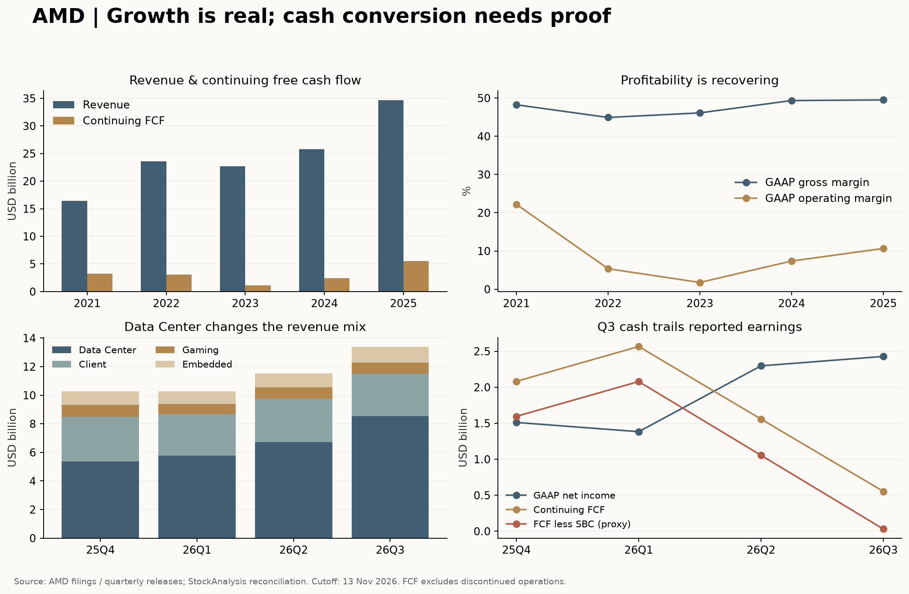

# AMD（NASDAQ:AMD）研究报告

**数据截止日：2026-11-13（北京时间）**  
**行情锚点：2026-11-12 美东常规盘收盘 US$585.30；不混入 11/13 盘中价格**  
**公司：Advanced Micro Devices, Inc.（超威半导体／美国超微）；NASDAQ 普通股，并非 ADR**  
**复算市值：US$959.943B；TTM 摊薄 EPS PE 126.96 倍，持续经营 P/FCF 142.00 倍**  
**研究主线：AMD 已证明能交付有竞争力的数据中心平台，接下来要证明增长能留下足够的每股现金，而不是由股东承担客户的融资成本。**

金额除另注外均为百万美元（USD m）；B 表示十亿美元。历史数据为事实，管理层预期、研究假设分别标明。市值采用 10-Q 披露的 2026-10-28 流通股数 1,640,087,251 股，属于最新已披露股数快照，不声称是 11/12 逐日股本。价格由 [StockAnalysis 历史页](https://stockanalysis.com/stocks/amd/history/)与[公司报价页](https://ir.amd.com/stock-data/stock-data)核对。

## AI研究偏见自觉

**信息丰富度评级：A。** 财报、客户公告和技术材料充裕，最大的陷阱是把“AI 第二供应商”这一共识当成投资优势。真正需要反证的是：客户为什么愿意付给 AMD 足以覆盖研发、股份支付、权证、库存和融资支持的价格？

**AI研究局限性声明：** 本报告没有供应链访谈、机架实测或客户利用率数据。厂商性能声明不等于独立测试，部署上限不等于无条件订单。公开披露足以核验收入和现金，却不能保证未来盈利。Macrotrends 财务表访问受限，本次采用公司原始文件与 StockAnalysis 核验；不同会计口径先对账，不强行制造一致。

- [x] 将资料丰富与经营确定性分开判断。
- [x] 不把数据中心全部收入或增量归为 AI GPU；公司没有完整单列其收入、毛利和现金流。
- [x] 主动检查权证、客户融资、应收、库存和被出售业务的影响。
- [x] 不把 NVIDIA 的短期管理层变化视为 AMD 已取得永久垄断。

---

## 第一步：核心数据总览

### 收入和利润从哪里来

| 业务 | FY2025 收入 | 2025Q4 | 2026Q1 | 2026Q2 | 2026Q3 | Q3 经营含义 |
|---|---:|---:|---:|---:|---:|---|
| 数据中心 | 16,635 | 5,380 | 5,775 | 6,718 | 8,546 | EPYC 与 Instinct 共同增长；同比 +97% |
| Client | 10,640 | 3,097 | 2,885 | 3,062 | 2,949 | Ryzen PC；同比 +7%，环比回落 |
| Gaming | 3,910 | 843 | 720 | 779 | 773 | 独显、游戏主机半定制；同比 -40% |
| Embedded | 3,454 | 950 | 873 | 977 | 1,109 | FPGA、自适应计算；同比 +29% |
| 合计 | 34,639 | 10,270 | 10,253 | 11,536 | 13,377 | Q3 总收入同比 +45% |

来源：[FY2025 10-K](https://ir.amd.com/financial-information/sec-filings/content/0000002488-26-000018/amd-20251227.htm)、[Q1 公告](https://ir.amd.com/news-events/press-releases/detail/1284/amd-reports-first-quarter-2026-financial-results)、[Q2 公告](https://ir.amd.com/news-events/press-releases/detail/1295/amd-reports-second-quarter-2026-financial-results)、[Q3 公告](https://ir.amd.com/news-events/press-releases/detail/1303/amd-reports-third-quarter-2026-financial-results)，分部收入与[独立季度表](https://stockanalysis.com/stocks/amd/financials/?p=quarterly)逐项核对。

数据中心占比从 FY2025 的 48.02% 升至本季 63.89%。这已经改变公司的利润来源，但“收入更像 AI 公司”不等于“利润质量已像软件平台”。

| 季度指标 | 2025Q4 | 2026Q1 | 2026Q2 | 2026Q3 |
|---|---:|---:|---:|---:|
| 数据中心分部经营利润 | 1,752 | 1,599 | 2,103 | 2,882 |
| Client + Gaming 分部经营利润 | 725 | 575 | 582 | 573 |
| Embedded 分部经营利润 | 357 | 338 | 386 | 453 |
| All Other 经营亏损 | -1,082 | -1,036 | -1,081 | -1,076 |
| 集团 GAAP 经营利润 | 1,752 | 1,476 | 1,990 | 2,832 |
| GAAP 毛利 | 5,577 | 5,416 | 6,203 | 7,210 |
| GAAP 毛利率（公司取整） | 54% | 53% | 54% | 54% |
| GAAP 净利润 | 1,511 | 1,383 | 2,297 | 2,428 |
| GAAP 摊薄 EPS（美元） | 0.92 | 0.84 | 1.38 | 1.46 |
| 非 GAAP 摊薄 EPS（美元） | 1.53 | 1.37 | 1.66 | 2.09 |
| 持续经营 CFO | 2,304 | 2,955 | 2,366 | 1,202 |
| 现金资本支出 | 222 | 389 | 808 | 648 |
| 持续经营 FCF | 2,082 | 2,566 | 1,558 | 554 |
| SBC（股份支付） | 486 | 487 | 503 | 523 |
| FCF 减 SBC，股东现金代理 | 1,596 | 2,079 | 1,055 | 31 |

分部利润不能直接当集团利润，需扣 All Other；公司未单列 Client 与 Gaming 各自经营利润，也未披露分部毛利率，故不填造。非 GAAP 数字取公司调整表，未获得逐季独立双源，置信度低于已双源核验的 GAAP 收入。FCF 减 SBC 是保守代理，不是公司定义，也不是已支付股息；估值再按员工股数稀释时应避免重复惩罚。

### 五年趋势：利润恢复，研发和资本义务也在扩张

| 财年 | 收入 | GAAP 净利 | GAAP 毛利率 | GAAP 经营率 | 持续 FCF | 现金及短投 | 研发 |
|---|---:|---:|---:|---:|---:|---:|---:|
| 2021 | 16,434 | 3,162 | 48.25% | 22.20% | 3,220 | 3,608 | 2,845 |
| 2022 | 23,601 | 1,320 | 44.93% | 5.36% | 3,115 | 5,855 | 5,005 |
| 2023 | 22,680 | 854 | 46.12% | 1.77% | 1,121 | 5,773 | 5,872 |
| 2024 | 25,785 | 1,641 | 49.35% | 7.37% | 2,405 | 5,132 | 6,456 |
| 2025 | 34,639 | 4,335 | 49.52% | 10.66% | 5,519 | 10,552 | 8,091 |

2021–2025 收入复合增长约 +20.49%，但盈利路径并不平滑。Xilinx 并表、并购摊销、PC 周期与研发投入都会改变账面利润；不能把 2021 的经营率直接当新业务稳态。

来源：[2022 10-K](https://ir.amd.com/financial-information/sec-filings/content/0000002488-23-000047/amd-20221231.htm)、[2023 全年业绩](https://ir.amd.com/news-events/press-releases/detail/1180/amd-reports-fourth-quarter-and-full-year-2023-financial-results)、FY2025 10-K，交叉核验 [StockAnalysis 利润表](https://stockanalysis.com/stocks/amd/financials/income-statement/)、[资产负债表](https://stockanalysis.com/stocks/amd/financials/balance-sheet/)与[现金流量表](https://stockanalysis.com/stocks/amd/financials/cash-flow-statement/)。毛利和现金流的标准化差异见附录。



### Q3 最重要的财务判断

经营杠杆是真实的：本季 GAAP 经营利润 2,832，同比 +123%，数据中心分部经营率约 33.72%。不过，净利不能直接年化。Q3 有所得税收益 555，其中股份支付相关离散税收收益 772；同时，客户权证合计非现金影响 1,179 压低利润，其中公允价值重估损失 1,097 属于非经营，收入抵减则属于经营。向上和向下的因素不会自动互相抵消成为“正常利润”。依据为 [Q3 10-Q](https://www.sec.gov/Archives/edgar/data/2488/000000248826000191/amd-20260926.htm)税务、权证和现金流附注。

现金是本期弱项：CFO/净利约 49.51%，FCF 率约 4.14%；季度现金流中应收占用 1,928、库存占用 2,995，应付贡献 2,313。备货可能服务 Helios 放量，也可能先于需求，必须等回款区分。不能仅凭连续几个季度利润增长宣布现金问题已经解决。

| 资产负债项目 | 2025 年末 | 2026Q3 末 | 判断 |
|---|---:|---:|---|
| 现金及短投 | 10,552 | 15,776 | 充裕，但部分增加来自发债 |
| 有息债务账面额 | 3,222 | 7,079 | 净现金不能忽略融资增加 |
| 不含租赁净现金 | 7,330 | 8,697 | 现金加短投减有息债务 |
| 应收 | 6,315 | 9,209 | 年初至今 +45.83% |
| 库存 | 7,920 | 11,463 | 年初至今 +44.73% |
| 应付 | 2,929 | 7,756 | 供应商信用支持了扩张现金流 |
| 股东权益 | 62,999 | 68,389 | 含大量商誉和并购无形资产 |

年初至今的资产增长不能与单季同比收入增长直接比较。应采用可比季度、回款和周转共同验证。以上原值已与 [StockAnalysis 季度资产表](https://stockanalysis.com/stocks/amd/financials/balance-sheet/?p=quarterly)复核。

> 段永平式追问：这次增长最终留下的是现金，还是需要下一轮扩产和融资才能兑现的应收与库存？

---

## 第二步：生意本质分析

**一句话：云厂商、企业和设备商持续付费给 AMD，购买兼容现有软件、能降低每单位计算成本的芯片与系统；AMD 靠架构、工程执行和软件支持赚取设计利润。**

| 环节 | 客户为什么付钱 | 复购来源 | 主要经济约束 |
|---|---|---|---|
| EPYC 服务器 CPU | 每机架性能、能耗、核心密度和验证稳定性 | 已验证平台扩容、云实例、企业更新 | x86/Arm 竞争、先进制程与供给 |
| Instinct + Helios | 模型算力、内存容量、带宽及供应多元化 | 同客户模型扩容、下一代部署 | ROCm 工程成本、整机可靠性、HBM/封装 |
| Ryzen / Radeon / 半定制 | PC 性能、游戏体验、主机设计 | OEM 更新和消费者换机 | 需求周期、价格和元件成本 |
| Embedded | 长生命周期设备所需的可编程计算 | 设计导入后的多年出货 | 工业/通信去库存、客户项目周期 |

收入仍主要来自硬件交付，不是无须再开发的订阅年金。ROCm 和参考架构的价值，首先体现在卖得出去、部署更快与续购，而不是单独的软件许可收入。高研发投入是竞争门票：Q3 研发 2,803，占收入约 20.95%。

公司的 [Q3 准备发言](https://newsroom.amd.com/documents/2026/11/84f4476b-f064-4f0f-957c-fe484853e178.pdf)确认 MI455X 已开始规模出货、首批 Helios 客户上线、Venice 已开始收入性出货。CPU 与 GPU 并非替代关系：AI 代理和定制加速器也需要 host CPU，AMD 因而可能在 GPU 竞争之外获得收入。

真正的利润变量只有三组：数据中心量价与产品组合；研发和系统支持费用的摊薄；扩张所需现金及股数。前两组变好、第三组变坏，仍可能出现“公司很成功，股东回报一般”。

> 段永平式追问：这门生意好在哪？在于能以可复用架构满足客户持续增长的计算需求；前提是每一代都能交付，而且客户愿意承担合理成本。

---

## 第三步：护城河评估

| 护城河 | 强度 | 已有证据 | 如何证伪 |
|---|---|---|---|
| 品牌与定价权 | 中等 | EPYC 企业验证与性能声誉 | 份额增长必须持续降价、分部利润率恶化 |
| 转换成本 | CPU 中强；AI GPU 尚在建设 | OEM 平台、软件兼容、模型优化和运维经验 | 客户每代重新竞价，重复部署无法复用 |
| 网络效应 | AI 软件中弱到中等 | 多客户共同适配有助扩充 ROCm 支持 | 客户越多，定制工程成本仍同比例增长 |
| 规模效应 | 中强 | 研发摊销、芯粒和跨产品 IP 共用 | 收入大增但研发/支持费用无法摊薄 |
| 技术与专利 | 中强，需不断维护 | Zen、芯粒、互连、FPGA 与网络组合 | 系统 TCO 被 NVIDIA、Arm 或 ASIC 超越 |

过去五年，AMD 的服务器 CPU 护城河变宽；AI GPU 则从“可能的替代卡”走到实际部署，仍未证明能收取与 CUDA 生态相当的经济租金。[ROCm 10 官方资料](https://newsroom.amd.com/news/rocm-10-software-ai-native-developer-experiences/)证明软件工具在迭代，却不能独立证明跨平台迁移已经容易。

未来五年的关键是客户能否把第一次部署的工程成果复用到第二次、第三次。若必须持续用股权和融资补贴才能维持采购，份额增长并不等于护城河扩大。开放性有助进入客户，也让客户更容易保持多供应商议价。

本次未获得可直接读取的最新 Mercury 原始份额表，因此不把二手报道中的 x86 份额作为 Q3 已验证结论，也不编造 Instinct 的独立市场份额。公司对技术性能的表述均按厂商声明看待。

> 巴菲特式追问：十年后什么还在？客户验证、软件经验和可复用 IP 可以积累；某一代芯片的性能领先不能自动存续十年。

---

## 第四步：逆向思考与风险清单

最强空方论点不是“AMD 没有好产品”，而是：**客户需要第二供应商，所以 AMD 能获得收入；客户同时要求股权、资金和信用支持，因此收入增加未必以同样幅度增加现有股东的现金。**

| 失败路径 | 主观发生可能性 | 影响 | 可观测预警 |
|---|---|---|---|
| 机架爬坡和软件迁移成本高于预期 | 中 | 高 | 交付推迟、返工、毛利和现金连续弱于出货 |
| 需求增长但客户融资不足 | 中 | 极高 | 部署推迟、预付款缺失、担保开始支付 |
| 定制 ASIC 与 TPU 分走利润池 | 中高 | 高 | 客户多供应商采购中 GPU 预算占比下降 |
| 权证和并购让每股利润落后 | 中高 | 高 | 总利润升、稀释后每股现金改善有限 |
| PC/游戏衰退抵消数据中心增长 | 中 | 中 | Client/Gaming 收入与利润继续回落 |
| 出口限制再扩大 | 中，难精确量化 | 高 | 可销售市场、库存可回收价值被重置 |
| 台海或先进制造/封装中断 | 低频，概率不可可靠估计 | 极高 | 生产与交付中断，替代产能不足 |
| 并购与生态投资偏离核心能力 | 中 | 高 | 现金投入、人才流失或减值，却无产品回报 |

上述定性概率是研究判断，不是统计频率，风险之间可能高度相关。

### 不能继续只用“无晶圆厂”描述资金风险

| 披露项目 | 金额 | 正确解释 |
|---|---:|---|
| 经营采购承诺 | 48,761 | 对应未来晶圆、产品及经营采购；包括 2027 年 22,206 |
| 商业伙伴生态云算力承诺 | 6,175 | 随第三方支付等条件变化，不等同今天全额支出 |
| 尚未开始、拟转租/分配给伙伴的数据中心租约 | 13,300 | 预计 2027Q2 起生效，存在空置与对手方风险 |
| 伙伴租约担保最高敞口 | 7,700 | 或有付款，非已发生亏损 |
| 伙伴债务担保最高敞口 | 750 | 最长剩余期限约六个月；与租约担保合计披露约 8,500 |
| 股权投资承诺 | 至多 5,100 | 附条件，预计至 2028 年；不代表已全部投资 |

以上取 [Q3 10-Q Notes 8、10、11](https://ir.amd.com/financial-information/sec-filings/content/0000002488-26-000191/amd-20260926.htm)。不能把这些项目简单加总为净债，也不能把它们彼此完全独立相加作为确定损失。9 月底无人违约、未支付担保款；不过收入、客户融资与供应商订单可能在同一次需求下滑中同时出问题。表内净现金足够，不代表承诺链条没有风险。

客户侧也有独立证据：[Anthropic 11/11 SEC 材料 5.12.8](https://www.sec.gov/Archives/edgar/data/2130357/000162828026073040/anthropicpbc-fwpxeeaprospea.htm)说明初始 AMD 容量包含价格、融资及部署条件，没有固定美元承诺。若全额采购初始容量，预计支出超过 20B；这仍不能提前计入 AMD 确定收入。AMD 拟参与的 2.5B IPO 同步私募抵扣既有 5B 投资承诺，不能再重复加一次。

历史类比宜看机制而非照抄结局：通信设备繁荣期也曾由客户融资加速采购，需求回落后信用风险回到供应商。AMD 当前尚未出现同样结果；类比的用途是要求检查最终用户现金和可取消条款，而不是预测必然崩溃。

跨学科看，客户多供应商采购属于议价博弈；开放软件有助 AMD 跨过采纳门槛，也可能压低长期租金。最可能的分析错误，是把机架上线当成客户已经获得足够经济回报，从而低估后续融资和使用效率的约束。

> 芒格式追问：聪明人为什么不买？因为在高起点估值下，产品成功仍可能不够，还需要大客户资金、软件效率和每股现金同时成功。

---

## 第五步：管理层评估

Lisa Su 自 2014 年起担任 CEO。工程与产品执行记录支持较高能力评价，但新阶段的资本配置要重新评分，不能让过去的 CPU 成功替未来所有并购背书。[任命原文](https://ir.amd.com/news-events/press-releases/detail/568/amd-appoints-dr-lisa-su-as-president-and-chief-executive-officer)。

| 时间与决策 | 结果/现状 | 研究评分 |
|---|---|---|
| 2022 Xilinx 并购 | 扩充 FPGA、自适应计算与客户基础；嵌入式仍受周期影响 | 战略协同较强，财务回报需跨周期看 |
| 2025 ZT Systems 收购后出售制造业务 | 保留系统设计和导入能力，避免长期持有全部制造资产 | 方向合理；Helios 可检验执行结果 |
| 2025–26 OpenAI/Meta 权证 | 换来规模部署机会与客户协同 | 获客强，现有股东成本高，须逐股核验 |
| 2026 Taalas 收购协议 | 总对价约 2.9B，含至多约 1.4B 或有对价；年末前预计交割 | 可补推理技术，回报未验证 |
| 2026 World Labs 收购协议 | 约 8.2B 全股票；年末前预计交割 | 技术协同有可能，跨入模型研究的执行和稀释风险上升 |
| 2026 生态投资、租约和担保扩张 | 用资产负债表支持客户部署 | 必须按资本回报审计，不能只看收入 |

交易事实取 [Q3 10-Q 并购附注](https://www.sec.gov/Archives/edgar/data/2488/000000248826000191/amd-20260926.htm)及[ZT 制造业务出售公告](https://ir.amd.com/news-events/press-releases/detail/1252/amd-announces-agreement-to-divest-zt-systems-data-center-infrastructure-manufacturing-business-to-sanmina)。协议不等于已交割，本报告不预记并购利润。

### 持股、激励和稀释

[2026 Proxy](https://ir.amd.com/financial-information/sec-filings/content/0001193125-26-129057/d85856ddef14a.htm)披露 3/19 Lisa Su 实益持有 4,305,973 股，含可于 60 日内行权的 413,529 股期权。按该规则分母计算约 0.264%，不是截至今天的即时普通股持仓，也不是超级投票权；AMD 没有靠 AB 股让 CEO 获得多倍投票控制。管理层个人持股本次仅完成一手核验，第三方最新数字日期、期权口径不同，未声称双源一致。

截至 Q3 末，OpenAI、Meta 权证各至多 160M 股，合计 320M，行权价 0.01 美元。尚无股份归属或行权，**但已有财务影响**：权证负债约 1.2B；另有尚未确认的授予日价值约 4.5B，将随相关客户收入确认冲减收入。4.5B 是未来待确认价值，并非 1.2B 负债的组成部分；后续公允价值重估会使 GAAP 利润波动。

相对已披露流通股，最大权证股数增加约 19.51%，完全归属后原有持股比例机械下降约 16.33%。保持 Q3 利润不变、在 1,661M 已摊薄加权股数上再加 320M，机械 EPS 约 1.23 美元；这不是盈利预测。World Labs 若按 585.30 美元示意换股，约另增 14.01M 股，实际发行数量取决于交易条款。不能把该示意值当已披露最终股数。

本报告的三年 EPS 是包含未来更大股数的假设；十年只单列客户/收购稀释压力，员工 SBC 已作为费用保留。权证公允价值重估损失不再作为永久现金损失重复扣除，但商业价格优惠与真实融资成本仍须进入未来经济利润。

团队与组织是否足以脱离个人尚无结论。多产品执行显示组织能力，但机架、软件、模型并购和信用支持同时扩张，会增加管理跨度。没有证据可以预先保证继任后保持同样资本配置纪律。

> 段永平式追问：如果 CEO 退休，平台和研发机制可以延续；但客户关系、路线选择和资本配置是否同样可靠，需要继任制度提供证据。

---

## 第六步：行业与文明趋势

AI 训练、推理及代理工作负载让计算成为更广泛的生产投入，这是长期需求的强支撑。公司 Q3 发言预计服务器 CPU TAM 到 2030 年约 220B；这是厂商预测，不是独立确认的可得收入。更大的 AI 市场预测也不能直接乘 AMD 份额当利润。

管理层预计 2027 总收入增长超过 +80%、数据中心占比超过 80%。以已披露 9M 收入加 Q4 17B 指引中值，2026 全年约 52.166B，对应 2027 大于约 93.899B 的量级；后两者是计算结果，未把管理层预期变成确定业绩。[Q3 官方准备发言](https://newsroom.amd.com/documents/2026/11/84f4476b-f064-4f0f-957c-fe484853e178.pdf)。

| 产业环节 | 谁可能获取利润 | AMD 的位置 |
|---|---|---|
| 先进制造、HBM、封装 | 稀缺产能供应商 | 技术受益者，也受产能分配制约 |
| 通用 CPU/GPU 与互连 | 有架构、生态和规模的设计商 | EPYC 基础较稳；Instinct 正在建立部署规模 |
| 定制加速器 | 云厂商、模型客户、ASIC 设计伙伴 | 可能被分流；也可能提供 host CPU 和专用推理技术 |
| 云与模型应用 | 取决于单位推理成本和最终客户付费 | AMD 是供应商，也日益承担生态资金支持 |

OpenAI 自身公告确认 [AMD 多年合作](https://openai.com/index/openai-amd-strategic-partnership/)，但它也有[定制芯片合作](https://openai.com/index/openai-and-broadcom-announce-strategic-collaboration/)。这说明供应多元化是真的，采购的排他性却不存在。Meta 的[官方协议说明](https://about.fb.com/news/2026/02/meta-amd-partner-longterm-ai-infrastructure-agreement/)也采用多供应商策略。客户集中度提高可能帮助迅速起量，也可能把议价权交给少数买家；目前不能凭公开资料计算 Instinct 独立前五客户比例。

截至本次截止日，还有一项不能忽略的新信息：NVIDIA [11/12 官方公告](https://investor.nvidia.com/news/press-release-details/2026/NVIDIA-Announces-CEO-Transition/default.aspx)确认 Jensen Huang 辞去 CEO、总裁及董事，Colette Kress 任临时 CEO 并继续担任 CFO。这使对手短期治理和执行不确定性上升，是 AMD 潜在机会；它并不取消 CUDA、互连、安装基础或既有客户合同。任何新增份额仍须通过 AMD 自己的交付与回款验证。

电力、互联网等历史技术革命都扩大了总市场，却没有让每一代设备供应商永久保有利润。AMD 更接近必须持续投入的计算平台竞争者，距离可不经再竞争长期收租的“标准石油”仍远。

> 李录式追问：二十年后需求可能更大，但利润会留在 AMD、制造端，还是少数自研芯片的大客户？文明趋势不能替代价值分配分析。

---

## 第七步：估值与安全边际

### 当前价格已经要求什么

| 指标 | 本报告重算 | 口径 |
|---|---:|---|
| 市值 | 959.943B | 585.30 × 1,640,087,251 |
| TTM 收入 | 45.436B | 最近四个财季 |
| TTM GAAP 净利 | 7.619B | 含终止业务；不等于正常利润 |
| TTM 持续经营净利 | 7.725B | 剔终止业务，但仍含投资、税收及权证影响 |
| TTM 摊薄 EPS PE | 126.96 倍 | EPS 4.61；加权股数及四舍五入使其与市值/净利略异 |
| 市值 / TTM 净利 | 125.99 倍 | 现股本对应历史总净利 |
| P/S | 21.13 倍 | 市值 / 收入 |
| P/B | 14.04 倍 | 权益 68.389B，含并购无形资产 |
| 持续 FCF | 6.760B | CFO 8.827B 减 CapEx 2.067B |
| P/持续 FCF | 142.00 倍 | FCF 收益率 0.70% |
| 持续 FCF 减 SBC | 4.761B | 股东现金代理收益率 0.50% |
| EV / Revenue | 20.94 倍 | EV 951.246B；仅按有息债务减现金，不含租赁与或有义务 |

前瞻 PE 和 PEG 依赖分析师预测及增长期间，不把供应商一个滚动数当可核验的内在价值。StockAnalysis 当日页面显示 PEG 约 0.56，但其 EPS 增长基数、调整口径及股数与本报告不同，故只记录外部预期，不用于决定买入。

历史上，[StockAnalysis 比率页](https://stockanalysis.com/stocks/amd/financials/ratios/)的年末 P/S 从 2022 的 4.43 倍、2023 的 10.50 倍、2024 的 7.88 倍到 2025 的 10.11 倍。当前约 21 倍明显支付了业务转型溢价。这不是历史分位统计；年末快照和业务结构均不同，不能简单均值回归。

同行参考：同日读取的 [NVIDIA 比率页](https://stockanalysis.com/stocks/nvda/statistics/)约 21 倍 TTM PE、13 倍 P/S，[Intel 页](https://stockanalysis.com/stocks/intc/statistics/)TTM 净亏、P/S 约 5 倍。页面会随盘中改变，因此只用于数量级比较。NVDA 面临刚披露的治理变化，Intel 含重制造业务，PE 调整口径也不同，不能借任何一个同行倍数直接证明 AMD 合理。

### 反向现金流折现

以 TTM 持续 FCF 减 SBC 4.761B 为起点，未来十年以同一增速增长，r=10%，十年后现金永续增长 3%，不加回现金、不计额外稀释，反解现市值需要约 **+39.29% 年复合现金增长**，第十年现金流约 130.90B。

这个结果可能被当前备货压低的现金基数夸大。因此另作更宽松的假设：起始股东现金直接恢复至 9B，其他条件相同，仍需要约 **+30.05%** 年复合增长。9B 是研究假设，非公司已实现现金流。两组都是价格隐含条件，既不是预测，也不意味着 AMD 不可能做到；它们说明安全边际需要依赖很强的长期兑现。

### 三年三情景：回答当前贵不贵

先建立常态盈利起点。9M GAAP 营业利润 6.298B，加 Q4 公司收入指引中值 17B × **研究假设** GAAP 营业率 25%，再按 **研究假设** 15% 税率、最新已披露股数计算，EPS 约 5.47，模型取整为 **5.50 美元**。保留 SBC 与并购摊销，移除非经营投资、权证重估和离散税收收益；这与公司 non-GAAP EPS 不可互换。Q4 营业率和税率均非公司指引。

下表增长为未来稀释后经济 EPS 的研究假设；2029 股数以 2.0–2.05B 作含最大客户权证、收购及其他净变化的保守桥接，非已发行股数。三年 PE 是价格比较假设；十年终值 PE 则严格用永续模型另算。

| 情景 | 主观权重 | EPS 年增长 | 2029 EPS | 2029 PE | 三年末价格 | 相对现价总变化 | 年化价格回报 | 按 10% 折回今天 |
|---|---:|---:|---:|---:|---:|---:|---:|---:|
| 悲观 | 30% | +10% | 7.32 | 20 倍 | 146.41 | -74.99% | -36.99% | 110.00 |
| 基准 | 50% | +45% | 16.77 | 28 倍 | 469.49 | -19.79% | -7.09% | 352.73 |
| 乐观 | 20% | +75% | 29.48 | 35 倍 | 1,031.68 | +76.27% | +20.80% | 775.12 |

零股息假设；没有把未来股息偷偷当额外回报。加权现值约 364.39 美元，不能把主观权重包装为统计期望。

| 对 EPS 假设的经营约束 | 悲观 | 基准 | 乐观 |
|---|---:|---:|---:|
| 2029 股数假设（B 股） | 2.00 | 2.00 | 2.05 |
| 对应经济净利（B） | 14.64 | 33.53 | 60.43 |
| 经济净利率假设 | 15% | 22% | 27% |
| 对应收入（B） | 97.61 | 152.43 | 223.80 |

基准假设已允许 2027 强增后继续扩张，并非低增长保守情景。乐观情景要求系统生态、软件、供给和客户融资同时成功；净利率 27% 也要求明显经营杠杆。若无法解释收入与利润率桥，不能只把 EPS 增长率向上调。

据此，**260–300 美元**对应较基准现值约 26.29%–14.95% 的折让，只构成附条件的小仓研究带；350–365 美元附近接近本模型基准/加权现值，不足以弥补全部技术、融资与稀释风险。585.30 美元高于基准定价结果；乐观路径虽有上行，失误空间有限。

### 十年终值与仓位压力测试

美元现金流采用 r=10%：已读取 [FRED DGS10](https://fred.stlouisfed.org/series/DGS10)最新可见观测为 2026-11-10 的 4.98%，加研究 ERP 5.02%，β=1。β 是基本面模型中性规范化参数，不是观测到的 AMD 价格 beta；真实波动不因此下降。工具内美元参考 Rf 仍为 8 月的 4.70%，本次显式传入 4.98%，未为迎合买入调低 r。

稳态增量 ROIC 取 25%，理由是设计 IP 与研发复用有潜力，但规模增大、客户支持和系统资本占用会压低边际回报；它是有条件判断，不是当前报表 ROIC。g 分别为美元 2%/3%/4%，基准不超过美元长期名义增长约束，且不随 r 改变。

退出 PE = (1 − g / ROIC) / (r − g)。三档分母为 8/7/6 个百分点，全部不少于 5 个百分点；PE 来自现金再投资公式，未使用同行类比。

| 十年研究情景 | 权重 | 2036 经济净利（B） | 收入/经济净利率示意 | 永续 g | 终值 PE | 十年回报近似 |
|---|---:|---:|---|---:|---:|---:|
| 悲观 | 30% | 20 | 约 133B / 15% | 2% | 11.50 倍 | -15.11% |
| 基准 | 50% | 70 | 280B / 25% | 3% | 12.57 倍 | -2.67% |
| 乐观 | 20% | 140 | 约 467B / 30% | 4% | 14.00 倍 | +5.60% |

这里的利润为保留员工 SBC 成本后的经济税后利润；2036 利润不再扣本次客户权证已授予股票对价的非现金收入抵减，而通过股数处理该成本，客户真实价格折扣和融资成本仍须保留。k=股息率减额外稀释率，取 -1.8%：以最大客户权证及 World Labs 示意换股的十年摊薄数量级作近似；未再对同一员工 SBC 重复添加稀释。三年模型已在未来股数内计入客户稀释，十年 k 属另一模型，不能叠加扣两遍。2026 常态 EPS 起点尚保留当期权证收入抵减，属于保守起点，不能据此声称已精确还原客户经济价格。

`terminal_value.py irr` 的实现是终值几何年化加 k，属于**回报近似**，不是含逐年支付、动态股本的完整现金流 IRR。为压力测试，前十年现金股息取零，未另计留存现金累积、资产处置或回购时点。若未来有可分配现金，此模型可能偏严；因此不得据此单独否定股票持有价值。

| 折现率敏感性 | 期望回报近似 | 是否覆盖该 r | 合法使用范围 |
|---|---:|---|---|
| r=8% | -1.40% | 未通过 | 美元区间外，仅供参考；乐观档分母不足 5pct |
| r=10% | -4.75% | 未通过 | 基准，美元合理区间内 |
| r=12% | -7.16% | 未通过 | 美元区间外，仅供参考 |
| r=9% | -3.23% | 未通过 | 补做 ±1pp，区间内 |
| r=11% | -6.04% | 未通过 | 补做 ±1pp，区间内 |

工具 `flip` 已执行 ±2pp，并因两端都在区间外补做 ±1pp。**在本次覆盖的美元合理区间内，仓位压力测试结论不随折现率翻转。** 这只能收紧仓位，不能成为空仓/持有建议的唯一否决票。

### 估值分歧对账

业务证据与管理层预期偏积极；当前三年定价却没有足够折让，十年无中期分配压力测试也不支持重仓。这是“经营好”与“价格已预付很多”的分歧，不应把后者改写成产品失败。

三年模型是定价判断，现价观望已有独立依据；十年模型是仓位压力测试，作用是把经营条件通过后的建仓限制为小额，而不是再投一次否决票。若价格回到 260–300 且经营条件完成，三年有折让，可以重新研究首笔；十年模型仍要求重建现金分配与资本回报，不能直接放大成重仓。

与[8 月旧研究](AMD-research-20260804.md)相比，本次不是机械沿用旧 220–300 价带：产品交付证据增强，现金、担保和并购信息更完整，估值方法补入持续口径、常态利润与股数桥，因此改用 260–300 条件研究带。低端上调不代表安全性提高；低于 260 会继续提醒，但应先检查论文是否受损。历史报告保留，不回填改写旧结论。

> 巴菲特式追问：r 错 2 个百分点会翻转吗？本次合理区间复核没有翻转；更大的不确定性其实在未来利润与资金义务，而非折现率的小数点。
>
> 段永平式追问：股市关闭五年，愿意以 585.30 美元持有吗？按现有现金证据和价格，尚不愿为长期价值仓作此承诺。

---

## 第八步：最终决策与行动清单

| 维度 | 综合结论 | 信心度 |
|---|---|---|
| 生意质量（段永平） | 服务器与 AI 平台已具有真实客户价值；仍需持续研发与现金投入 | 中高 |
| 护城河（巴菲特） | EPYC 更成熟，AI 软件和系统护城河在形成，长期租金未锁定 | 中 |
| 管理层（段永平、巴菲特） | 产品执行强；模型并购、融资支持和客户权证需单独验证 | 中高/资本配置中 |
| 最大风险（芒格） | 客户融资、资本承诺与每股稀释在同一需求下行时相互放大 | 中；尾部难量化 |
| 文明趋势（李录） | 计算需求受益长期范式变化，但利润归属存在多条技术路线竞争 | 趋势高、公司获利中 |
| 估值（巴菲特、段永平） | 三年基准现值 352.73，现价缺折让；十年仅限仓，合理 r 内未翻转 | 算术高、假设中低 |

估值维度与其他五项并列。十年未覆盖 r 只降低仓位上限；当前不新建价值仓，还基于三年价格、软件租金未锁定、回款不足及信用支持扩张的合并判断。

**明确结论：观望，回避以当前价格新增长期价值仓；保留对 AMD 产品和经营执行的积极评价。**

| 策略 | 建议 |
|---|---|
| 空仓者 | 585.30 美元不追。260–300 美元且下述经营条件通过，才研究首笔约组合 0.5%，条件完整时参考总上限 1%–2%；非个性化配置指令 |
| 持仓者 | 未知用户成本、仓位和税务，不给卖股数量。适度小仓可持有复检，不加仓；明显超出上述研究上限者先审视集中风险，不因短期对手事件抬高上限 |
| 加仓信号 | 后续连续两次正式披露：数据中心增长与分部利润率未结构恶化，滚动持续 FCF 减 SBC 为正且改善，应收/库存周转趋稳，Helios 回款、权证归属、并购股数及信用敞口可解释；并满足价格折让 |
| 卖出/减仓信号 | 生态担保实质付款且回收机制不可信、核心产品持续失去客户、订单与库存错配恶化，或新增交易破坏每股回报；先重估，论文破坏不等价格止损线 |
| 高价警戒 | ≥650 美元且经营只达到本报告基准，复核已有超配、停止追价；不是自动卖出信号 |

300 美元以上不意味着永不买入：若经营数据使 2029 经济利润、现金与稀释假设有证据地提高，应重建模型；不能仅因股价上涨而提高估值。

| 复检节点 | 性质与待验证事项 |
|---|---|
| 2026-12-31 | 研究检查日：Helios/Venice 放量、Taalas/World Labs 是否交割、实际换股及资金使用；不是公司财报预约日 |
| 2027-02-15 | FY2026 业绩日历检查；下一次财报日期未获公司确认，若提前公告则提前复核 |
| 2027-06-30 | 上半年客户部署、融资与拟转租数据中心租约启动检查；这是研究窗口，不是保证到期日 |

所有价格与日期已纳入既有 AMD 触发记录，价格触发只启动研究，不自动买入；本地临时状态验证不替代正式每日监控的后续运行。

### 四位大师原文与边界

巴菲特 1996 年股东信原话：“You can, of course, pay too much for even the best of businesses.” [原文](https://www.berkshirehathaway.com/letters/1996.html)。本报告的方法延伸是：认可产品能力，也要为价格和资本需求留余量；这不是巴菲特对 AMD 的判断。

芒格、段永平、李录：本次检索与仓库存档读取未取得足够针对 AMD 或其客户融资、芯片生态议题的一手原文，**资料不足，不模拟代言**。各章“式追问”是框架化分析问题，不是他们说过的话。不得据此推断任何大师买入或回避 AMD。

---

## AI分析置信度与投资确定性

财报原值、股数快照、已公告产品和合同的 AI 分析置信度较高；部署经济性、2029 利润和 2036 增量资本回报的置信度明显较低。当前价的投资确定性属于中低：它需要强增长兑现，也需要为客户提供支持后仍能留下股东现金。

剩余限制包括：没有客户实测 TCO/利用率、订单取消权全量审阅、Instinct 独立利润和最新一手份额；个人持股及公司 non-GAAP 季度数据缺完全同口径独立第二源。台海断供、全面出口禁令、生态融资连锁违约未进入定量概率模型，不能把三情景当作包含全部永久损失的分布。十年零分配近似未计留存现金累积，也不是完整动态现金流 IRR。

若继续一手验证，优先询问：新机架从验收到正常利用率需多久；软件迁移和运维成本谁承担；客户若融资失败谁支付上游承诺；去除权证、股权投资及担保支持后，采购需求是否仍成立。

*本报告用于学习与研究，不构成投资建议。*

---

## 数据来源与审计记录

### 关键口径对账

| 字段 | 公司原始值 | 独立来源与调整 | 结论 |
|---|---:|---|---|
| FY2025 收入 | 34,639 | StockAnalysis 34,639 | 一致 |
| FY2025 GAAP 净利 | 4,335 | StockAnalysis 4,335 | 一致；含终止业务净利 66 |
| Q3 现金加短投 | 15,776 | StockAnalysis 15,776 | 一致 |
| 最新披露流通股数 | 1,640,087,251 | StockAnalysis 约 1.64B | 四舍五入可比；不是精确逐股独立确认 |
| FY2025 GAAP 毛利 | 17,152 | 标准化毛利 18,183，减销售成本中并购摊销 1,031 | 原始差异约 6.01%，已解释；采用公司 GAAP |
| FY2025 GAAP 营业利润 | 3,694 | 标准化值 3,741，重分类部分并购/重组支出 | 不混用 |
| FY2025 持续 FCF | 5,519 | StockAnalysis 合计 FCF 6,735，减终止业务 CFO 1,216 | 口径还原后相同 |
| TTM 持续 FCF | 6,760 | StockAnalysis 7,056，减 2025Q4 终止 CFO 296 | 原值差异约 4.38%，还原后相同 |
| Q3 不含租赁净现金 | 8,697 | StockAnalysis 净现金 6,565，含租赁债务差额 2,132 | 债务范围不同，均非算错 |

TTM 持续 CFO=6,493+6,523−4,189=8,827；CapEx=974+1,845−752=2,067；SBC=1,638+1,513−1,152=1,999。净利合计=4,335+6,108−2,824=7,619；持续净利=4,269+6,105−2,649=7,725。

Macrotrends 收入和净利正文未成功读取，因此未冒充为本次已完整核验的来源。财报数遵循原始文件，第三方标准化表用于独立核对及识别口径差异。旧报告中 FY2025 FCF 及部分季度口径不再沿用。

### 程序化验证摘录

以下直接节选共享工具输出；完整模型参数、衍生数与审计文件见同目录 [模型记录](AMD-model-20261113.json)。共享工具用于市值、交叉验证、估值、三情景和终值；补充的百分比及反解以 Decimal 计算复核，未用语言模型心算。

```text
计算市值: 959.94B USD
报告市值: 959.94B USD
偏差: 0.00%
✅ 验证通过, 偏差仅 0.00%

交叉验证: FY2025收入
✅ AMD10K: 34,639.00 USD m (偏差 0.00%)
✅ StockAnalysis: 34,639.00 USD m (偏差 0.00%)
交叉验证: FY2025净利
✅ AMD10K: 4,335.00 USD m (偏差 0.00%)
✅ StockAnalysis: 4,335.00 USD m (偏差 0.00%)
交叉验证: 2026Q3现金及短投
✅ AMD10Q: 15,776.00 USD m (偏差 0.00%)
✅ StockAnalysis: 15,776.00 USD m (偏差 0.00%)

PE (TTM): 585.30 / 4.61 = 126.96x
P/FCF: 585.30 / 4.121731935833455240973640127393441948047 = 142.00x
FCF Yield: 0.70%

三情景：乐观 +75% / 35x / EPS 29.48 / 目标 1031.7 / +76.3%
三情景：中性 +45% / 28x / EPS 16.77 / 目标 469.5 / -19.8%
三情景：悲观 +10% / 20x / EPS 7.32 / 目标 146.4 / -75.0%

退出PE：11.5x / 12.5714285714x / 14.0x
十年回报近似：-15.11% / -2.67% / +5.60%
flip ±2pp：-1.40% / -4.75% / -7.16%；两端区间外，仅供参考
flip ±1pp：-3.23% / -4.75% / -6.04%；区间内始终未通过
```

数据抽检与定稿估值复检的最终结果见 [审计记录](AMD-audit-20261113.md)。数值检查通过只证明引用与算术，不保证预测和权重正确。
