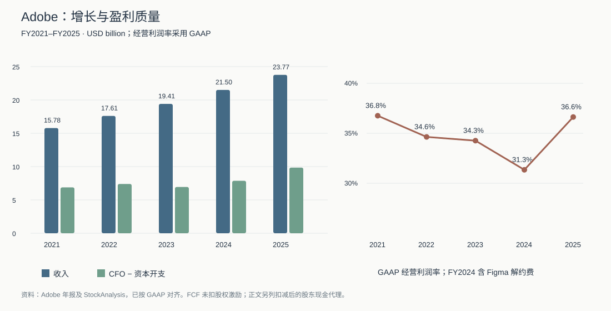
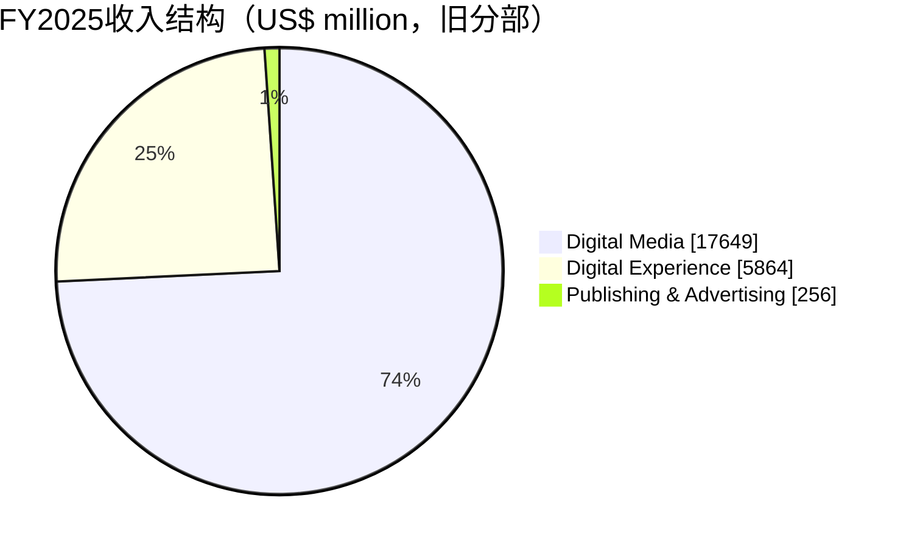

# Adobe（ADBE）研究报告

> **研究日与资料截止日**：2026-11-07，Asia/Shanghai。研究启动时美国仍在11月6日交易时段；统一采用最近完整交易日 **2026-11-05 常规盘收盘价 US$246.44**，不把盘中报价称为收盘价。  
> **身份**：Adobe Inc.，中文常称奥多比，原名 Adobe Systems Incorporated；NASDAQ: ADBE，美国普通股，非 ADR。沿用仓库 `reports/Adobe/` 与监控 ID `Adobe`。  
> **估值快照**：以最新已披露389.2百万股复算，市值US$95.914448 billion；TTM GAAP EPS口径PE13.75倍，扣股权激励后的现金收益代理率8.88%。股数为9月18日披露值，并非11月5日实时登记股数。  
> **研究主线**：Adobe仍能把专业创作、文档和营销工作流变成持续现金流；投资问题在于AI带来的新收费，能否覆盖席位、入口和定价权承受的压力。

股价由 [StockAnalysis 历史行情][S-price] 与 [Yahoo Finance][S-yahoo] 双源确认；市值与 [StockAnalysis 市值页][S-mcap] 对齐。财务最新正式期间为FY2026 Q3，截至2026-08-28，10-Q于9月22日提交。历史报告保留原样，本报告接续六月研究与九月财报精读。

## AI研究偏见自觉

**信息丰富度评级：A级。** 公开财报、产品文档与投资者材料充足，但付费客户队列、席位变化和AI单位经济的透明度远低于资料总量。

AI研究局限性声明：本报告没有访问Adobe内部合同、留存队列，也未进行创意团队访谈。不能由免费活跃用户、生成次数或模型演示直接推导未来利润。公开资料对传统业务的核验较强，对AI是否能长期保住收费入口的判断只有中等把握。

- [x] 区分资料多带来的分析信心与生意长期确定性。
- [x] 检验“AI会摧毁Adobe”和“AI必然强化Adobe”两种叙事。
- [x] 不以历史高PE作为必须回归的估值锚。
- [x] 不把公司公布的AI-first ARR当成Firefly独立收入或增量利润。

> 研究追问：如果只保留财报和真实客户支付行为，我还会得出同样的判断吗？

---

## 第一步：核心数据总览

### 五年现金与盈利

下表单位均为US$ million，百分比除外。财年依次结束于2021-12-03、2022-12-02、2023-12-01、2024-11-29、2025-11-28，不能与自然年混用。依据 [FY2025 10-K][S-10k]、[FY2023 10-K][S-2023]、[FY2022 10-K][S-2022]，并与 [StockAnalysis 损益表][S-income]、[现金流表][S-cashflow]、[资产负债表][S-balance] 交叉核对。

| 指标 | FY2021 | FY2022 | FY2023 | FY2024 | FY2025 |
|---|---:|---:|---:|---:|---:|
| 收入 | 15,785 | 17,606 | 19,409 | 21,505 | 23,769 |
| GAAP净利润 | 4,822 | 4,756 | 5,428 | 5,560 | 7,130 |
| 毛利率 | 88.18% | 87.70% | 87.87% | 89.04% | 89.27% |
| GAAP经营利润 | 5,802 | 6,098 | 6,650 | 6,741 | 8,706 |
| GAAP经营利润率 | 36.76% | 34.64% | 34.26% | 31.35% | 36.63% |
| 经营现金流 | 7,230 | 7,838 | 7,302 | 8,056 | 10,031 |
| 资本开支 | 348 | 442 | 360 | 183 | 179 |
| 简单FCF：经营现金流减资本开支 | 6,882 | 7,396 | 6,942 | 7,873 | 9,852 |
| 现金流股权激励加回 | 1,069 | 1,440 | 1,718 | 1,833 | 1,942 |
| 现金及短期投资 | 5,798 | 6,096 | 7,842 | 7,886 | 6,595 |



2024年的利润率下降含Figma交易终止费；不能把2025年的反弹全部视为可重复的经营杠杆。研发和营销仍是维持产品竞争力的经常投入，轻资产不代表无需再投资。

**口径差异已排查。** StockAnalysis的FY2024经营利润7,819，相比GAAP的6,741多1,078，为终止费及租赁减值等标准化重分类；其TTM经营利润9,433也高于GAAP的9,271，差额162对应损失准备92与商誉减值70。本报告统一用GAAP，未把差异当作数据一致。Macrotrends主页面未能取得完整逐项表格，审计时补用其[经营利润可读索引][S-macroop]核验GAAP值；主体仍采用“公司原报表＋StockAnalysis”，不声称完成Macrotrends全表验证。

### 收入结构及披露变化

FY2025旧分部如下；毛利率为收入与毛利的工具计算值。分部细项以官方披露为主，独立第三方对完整分部成本的覆盖不足。[FY2025年报，Note 2][S-10k]

| 旧分部 | FY2025收入 | 收入占比 | 毛利率 | 收费机制 |
|---|---:|---:|---:|---|
| Digital Media | 17,649 | 74.25% | 95.23% | 创作工具与文档订阅，个人、团队、企业套餐 |
| Digital Experience | 5,864 | 24.67% | 72.29% | 企业内容、数据、营销和客户体验合同 |
| Publishing & Advertising | 256 | 1.08% | 66.80% | 出版、技术文档及其他存量业务 |



**FY2026起，三个旧分部合为单一经营及报告分部。** 公司仍在投资者数据表提供旧类别的订阅收入参考，但不再公布可与过去连续拼接的独立分部总收入和毛利；更不能由客户群订阅收入反推出Creative Cloud利润率。[FY2026 Q3 10-Q，Note 15][S-10q]

最近四季采用可比的客户群订阅口径；这些是收入分类，不是两个报告分部。FY25Q4由年报减当年前三季得到，其余取对应10-Q；总收入包含未列入两客户群订阅的其他收入。客户群毛利率均未披露。[FY26Q1][S-q1]、[FY26Q2][S-q2]、[FY26Q3][S-10q]、[投资者数据表][S-sheet]

| 指标（US$ million） | FY25Q4 | FY26Q1 | FY26Q2 | FY26Q3 |
|---|---:|---:|---:|---:|
| 总收入 | 6,194 | 6,398 | 6,618 | 6,760 |
| Creative & Marketing Professionals订阅 | 4,245 | 4,389 | 4,537 | 4,651 |
| Business Professionals & Consumers订阅 | 1,718 | 1,782 | 1,853 | 1,905 |

最后一个仍有旧分部完整毛利的FY25Q4，Digital Media收入4,618、毛利率95.19%；Digital Experience收入1,517、毛利率73.30%。FY26Q1至Q3的同口径数据存在披露缺口，不填估计数。[FY25 Q3 10-Q][S-q325] 与 [FY25年报][S-10k] 差额计算。

### 最新经营信号与现金桥

| 指标 | 最新可核值 | 投资含义 |
|---|---|---|
| Q3收入／GAAP净利 | 6,760／1,827 million | 同比+12.89%／+3.10%，利润跟随弱于收入 |
| Q3毛利率／经营利润率 | 88.71%／34.82% | 毛利仍高，但AI与营销投入增加 |
| TTM收入／GAAP净利 | 25,970／7,284 million | 长期模型从实际净利润起步 |
| TTM经营现金流／资本开支 | 10,806／214 million | 简单FCF为10,592 million |
| TTM现金流SBC／FCF减SBC | 2,071／8,521 million | 后者为股东现金代理，非GAAP指标 |
| 现金／短投／表内有息债务 | 4,359／1,280／6,363 million | 净债务724 million；另有经营租赁399 million |
| 总ARR／RPO | 27.50／22.16 billion | ARR同比+11.2%，RPO+8%、cRPO+9% |

现金与短投官方合计5,639，StockAnalysis为5,642，后者多包含交易证券3；债务6,363不含经营租赁，不能与第三方广义债务6,787直接比较。TTM SBC使用现金流加回口径：1,942＋1,582－1,453＝2,071；Q3附注中的九个月费用1,584与现金流加回1,582不同，不能混加。[正式10-Q][S-10q]、[StockAnalysis现金流][S-cashflow]

**AI证据已经超过演示阶段，但未达到完整单位经济可验证阶段。** AI-first ARR超过650 million、同比超过150%；Firefly App和积分包ARR环比+40%；创意免费MAU超过100 million。650除以总ARR的比例约2.36%，只是最低规模参考，且不代表全部为净增收入。独立Firefly收入、留存、付费转化、推理后毛利仍未披露。[Q3官方准备稿][S-script]

> 段永平式追问：客户支付的究竟是软件操作费，还是完成专业交付的可靠性？

---

## 第二步：生意本质分析

一句话定义：**Adobe向需要反复完成专业内容和文档交付的个人与机构，出售可控、兼容、可协作的工作环境，并以订阅和企业合同持续收费。**

Photoshop生成一张图不是完整生意。客户还需要图层、蒙版、精确修改、色彩管理、字体、素材授权、多人审阅、历史文件和最后交付。只要重做这些流程的代价大于订阅费，收入就有重复性。Acrobat的逻辑相似：阅读PDF很容易，稳定编辑、签署、保护和组织文档才更接近收费需求；PDF是开放标准，不能将文件格式本身当成Adobe独占产权。

| 经济环节 | 核心变量 | AI改变什么 |
|---|---|---|
| 创作 | 付费用户数、套餐价格、团队采购 | 降低上手门槛，也可能减少同一项目需要的席位 |
| 文档 | 商务用户渗透、企业标准、增值服务 | 摘要与问答可能变成新收费，也可能被通用助手打包 |
| 企业体验 | 合同规模、续约、内容和数据工作流 | 内容产量上升扩大编排需求，但实施复杂度并未消失 |
| 成本 | 研发、获客、算力、模型分成 | 传统软件低边际成本会受到推理费用挤压 |
| 股东回报 | 真实现金、SBC、回购价格及并购纪律 | non-GAAP EPS和回购金额都需还原成每股经济利益 |

收入扩大可摊薄研发，但最新Q3经营费用同比+14.81%，超过收入+12.89%，尚未显示AI带来的新增收入足以压低总体费用率。其高毛利来自复制成本低和专业工作流收费；不应机械把旧Digital Media毛利率用于企业体验业务或未来AI产品。

真正需要连续验证的只有三个变量：付费关系是否增加、每段工作流能收多少钱、扣算力及股权激励后还剩多少现金。当前披露不能将收入增长拆成席位、提价、并购和用量的完整桥，因此不能声称专业席位未受冲击。

> 段永平式追问：这门生意好在哪？它能让客户不断完成付费工作，而客户不愿为省一笔订阅费重建整套交付流程。

---

## 第三步：护城河评估

以下强弱为研究判断，不是第三方评级。

| 类型 | 证据与边界 | 趋势判断与证伪点 |
|---|---|---|
| 品牌与定价权 | 专业客户接受度强；免费和低价工具限制入门市场提价 | 专业端仍强，入门端收窄；需看续约和实际价格而非标价 |
| 转换成本 | 技能、历史项目、插件、模板、协作和交付规范 | 目前最强；若竞品稳定完成真实项目且成本更低，护城河下降 |
| 网络效应 | 协作对象、培训和文件生态形成间接优势 | 中等；不是社交平台式强网络效应，格式兼容可削弱锁定 |
| 规模效应 | 研发与全球分销覆盖广，现有客户可交叉销售 | 传统软件显著；AI推理仍需按量付费，成本优势不能直接照搬 |
| 技术与知识产权 | 专业编辑控制、跨软件连接、品牌安全与交付能力 | 工程积累深；基础模型不具永久独占，不能量化成领先几年 |

过去五年，订阅、文档及企业工作流提高了经常性收入，云端协作也强化了使用习惯；与此同时，Canva和AI原生产品削弱了新用户必须先学习Adobe的必要性。本次未取得口径一致且可独立验证的专业创作、文档与营销市场份额，不引用“Adobe占据整个设计市场”等宽泛比例。未来五年预计出现分化：专业交付与企业治理相对稳固，初稿生成及低复杂度设计竞争更激烈。

Adobe已将Google、OpenAI、BFL、Runway、Luma等伙伴模型接入产品。多模型策略可降低押错底层技术的风险，却说明竞争优势要落在工作流与商业化上，不能只押Firefly底模。上游模型收费和下游入口竞争也可能共同压缩Adobe利润。[伙伴模型官方文档，10月23日更新][S-partner]

拿一大笔钱能开发新的图像工具；能否让大型团队迁移其历史项目和交付流程，是另一道门槛。护城河最危险的侵蚀路径是新增创作者逐渐绕过Adobe，而非所有老客户同时停订。

> 巴菲特式追问：十年后护城河还在吗？若专业交付仍依赖其工作环境，就可能在；若智能体能在别处同样可靠地完成全流程，旧技能壁垒会明显贬值。

---

## 第四步：逆向思考与风险清单

最强空方观点是：**现有收入的韧性可以与未来新增用户入口的丢失同时发生。** AI提高单人产出，内容数量增长与付费席位减少并不矛盾。免费AI使用可能只是防守订阅所需的成本。若第三方模型拿走技术溢价、Canva拿走新用户，Adobe仍有现金流，却可能成为缓慢衰退的收费层。

Canva官方已将新版Affinity定位为免费专业创作应用，覆盖矢量、照片和排版，并支持多种Adobe相关格式。格式支持不等于复杂项目无损迁移，但足以攻击新增用户和中小团队预算。[Canva公告][S-affinity]。与之相反，严肃客户需要的精修、控制、版本、法务与企业交付尚不能由第一稿生成能力直接替代。

下表概率只是主观风险排序；事件互相重叠，不可相加，也不是统计预测。十年估值另采用互斥的悲观／基准／乐观三情景权重。

| 失败路径 | 主观可能性 | 影响 | 观察指标 |
|---|---|---|---|
| 新创作者形成非Adobe工作流 | 中高 | 获客成本上升，长期提价受限 | 付费用户、转换队列、个人与团队续约 |
| agent减少席位，用量收费不足以补偿 | 中 | 收入增长持续下降 | 订阅增长与AI实收收入的桥接 |
| 推理和模型分成侵蚀利润 | 中 | 高毛利叙事弱化 | GAAP毛利、AI收入与直接成本披露 |
| 企业合同转弱、增长依赖并购 | 中 | ARR和现金放缓 | RPO/cRPO、有机增长、递延收入与应收 |
| 高价回购、反复补洞式并购 | 中 | 现金流强却每股价值不增 | 净股数、收购回报、净债务 |
| 版权、监管或网络安全重大事件 | 低至中，无法可靠量化 | 尾部损失可显著 | 正式诉讼、赔偿条款、客户流失和安全通告 |

历史类比只能提醒机制：Quark等出版工具说明专业标准也可能迁移；成熟企业软件则说明新平台出现后，旧工作流仍可能长期收费。Adobe同时带有两种特征，不宜套用单一历史结局。

跨学科看，效率提升后的需求扩张类似杰文斯效应，但需求扩张不保证原供应商独占收益；转换成本可以延缓迁移，却不能阻止新一代用户从另一套工具开始。最可能犯的分析错误，是把当前现金流的强度误认为十年定价权已经得到证明。

> 芒格式追问：聪明人为什么不买？因为他们无法判断付费席位和工作流入口将如何变化，而当前价格还不足以补偿这种判断误差。

---

## 第五步：管理层与资本配置

截止研究日，Narayen仍是CEO。公司已宣布Anil Chakravarthy于2026-12-01接任总裁及CEO，Narayen转执行董事长。Anil此前负责企业体验业务及全球企业销售，属于内部接班；连续性较好，但需要验证创意产品、企业销售与AI成本之间的资源分配。[官方继任公告][S-ceo]

| 时间／决策 | 已见结果 | 研究评价 |
|---|---|---|
| Creative Cloud订阅转型 | 建立高重复收入与现金流 | 历史资本配置与商业模式选择成功 |
| Figma收购终止 | FY2024发生1,000 million终止费 | 对战略威胁有判断，交易可执行性及代价较差 |
| FY2026延续回购并新增授权 | 九个月现金回购6,820 million，交付约26.1百万股 | 股数确实减少；现金支出与交付并非逐笔同日匹配，不能简单当精确回购均价 |
| Semrush与Topaz | Semrush于4月28日交割；Topaz于9月23日完成 | 技术／营销入口补强，回报尚需观察，不提前计协同利润 |
| CEO与财务团队过渡 | CEO生效日明确；9月10日稿及9月22日10-Q中的Steve Day仍为interim CFO | 财务签署与交接机制需跟踪；未找到后续正式任命不能等同于断言没有任命 |

来源：[年报][S-10k]、[Q3 10-Q][S-10q]、[Topaz完成公告][S-topaz]。Q3商誉减值70 million对应Publishing & Advertising相关业务，不能误说成Firefly或Semrush已经失败。

FY2025研发4,294 million，占收入18.07%；投入规模可核，独立AI项目回报率不可核。新增回购授权不是额外现金，不能把授权金额加入资产价值；回购用于抵消SBC的部分也不能再被算作额外收益率。

管理层经济权益不高。2026 proxy以2月17日407.6百万股为分母：Narayen438,975股，占0.108%；Anil61,788股，占0.015%。普通股经济权益与一般投票权同向，无需作AB股权重转换；该快照包含按代理书规则认定的受益持股，不是11月最新Form 4汇总。[公司Proxy][S-proxy] 与 [StockAnalysis整体内部人持股统计][S-stats] 交叉看，仅能确认内部人总体持股较低；后者0.17%为不同日期／不同人群，不能声称对个人持股完成了逐人双源验证。个人持股最新变动属于数据缺口。

文化评估也不能只看利润。3月的订阅取消相关和解包括75 million付款和75 million免费服务，并涉及条款与取消流程整改；Adobe否认不当。真正的护城河应来自客户愿意留下，而不是取消困难。法律和解金额与财务损失准备不必逐项相等。[DOJ公告][S-doj]、[Adobe声明][S-statement]

> 段永平式追问：如果CEO退休，竞争力还在吗？产品生态可以继续，但管理层是否用合适价格回购、是否把AI投入变成每股现金，仍会影响投资结果。

---

## 第六步：行业与文明趋势

生成式AI是内容生产方式的重大变化：草稿更便宜、非专业用户更容易参与、专业人员可以完成更多项目。文明趋势与Adobe股东收益之间还隔着收费入口、市场份额、竞争定价与算力成本。

| 价值链位置 | 主要参与者 | Adobe的机会与压力 |
|---|---|---|
| 模型与算力 | 云、模型厂商、芯片公司 | 可采购能力加快产品化，也需支付使用成本 |
| 创作与文档工作环境 | Adobe、Canva、AI原生工具 | 保住专业交付入口，争取新增用户 |
| 内容分发与营销编排 | 平台、CRM及企业体验供应商 | 内容数量增长扩大编排需求，跨平台竞争强 |
| 最终客户 | 创作者、品牌、企业、消费者 | 客户首先获得效率提升，供应商并非全部受益 |

本次没有采用一个“创意AI总TAM”直接外推公司收入：不同机构对广告预算、软件收入、创作者人数与内容产值的定义重叠，缺少独立可比验证。能明确看到的市场地板是Adobe已实现的25,970 million TTM收入；天花板取决于用户、付费率和每段工作流收费。模型的利润增速是情景判断，非行业预测机构给出的确定增长率。

截至最新披露，没有单一客户足以解释全部收入韧性的证据，但本次未完成最新各客户集中度逐项双源核验，不给精确比例。供应链的关键不在硬件零件，而在云算力、外部模型、授权内容与企业数据接入；伙伴之间的完整分成条款没有公开，不能准确预测AI长期毛利。

10月15日Adobe与NVIDIA扩大合作，可能提高端侧与专业工作流效率；性能宣称仍需实际验证。Adobe MAX的美国当地日期为11月10日至12日，截止研究时尚未召开，不能把未来发布提前计入收入。[官方合作公告][S-nvidia]

> 李录式追问：二十年后Adobe是这个时代的关键工具，还是被工作方式变化绕过的软件层？答案取决于它能否继续控制可靠交付这一环节。

---

## 第七步：估值与安全边际

### 当前价格包含什么

所有复算使用同一收盘价246.44和已披露股数389.2百万；资产负债表为8月28日，存在时间差。当前估值依据 [官方财报][S-10q]、[市值双源页][S-mcap]、[独立行情页][S-yahoo]，经金融严谨性工具验算。

| 估值指标 | 工具复算 | 口径说明 |
|---|---:|---|
| 股权市值 | 95,914.448 million | 价格乘已披露流通股 |
| TTM PE，稀释EPS口径 | 13.75倍 | EPS17.92，报告期加权稀释股数 |
| 市值／TTM GAAP净利 | 13.17倍 | 最新披露股数与历史加权股数不同，故不等于上一行 |
| FY26 GAAP前瞻PE | 13.58倍 | 指引18.12—18.17的中点18.145 |
| FY26 non-GAAP前瞻PE | 10.07倍 | 指引24.45—24.50中点；不能当成完整股东利润 |
| P/S／EV/Revenue | 3.69倍／3.72倍 | EV含表内有息净债务724，不含经营租赁 |
| 含经营租赁的EV/Revenue | 3.74倍 | EV增加399，作为口径敏感性参考 |
| P/B | 8.15倍 | 回购及费用化无形投资影响净资产解释力 |
| 简单FCF收益率 | 11.04% | 尚未扣SBC |
| FCF减SBC收益代理率 | 8.88% | 8,521除以市值，不等于可立即分红现金 |
| PEG，研究假设口径 | 1.72倍 | TTM PE除以未来EPS年增8%；非一致预期数据 |

股权DCF从扣利息后的GAAP净利起步，不重复扣债务或把全部现金加回来；保留经营现金及并购需求，避免“利润中的现金收益＋再加全部现金”重复。FCF减SBC仅作现金质量校验，不与GAAP利润再次扣SBC。

自身历史上，StockAnalysis FY2021、FY2023、FY2025年末PE分别60.84、51.37、18.80倍；这些是年末快照而非年度平均。今天较低的倍数反映增长与竞争预期变化，不能以重返过去五十倍为目标。[历史比率][S-ratios]

同行只作方向比较：11月6日盘中StockAnalysis显示Salesforce约19.93倍TTM PE、DocuSign约47.11倍，前瞻约14.67／15.59倍。其期间、回购、税项和调整口径不同，且本次未把两家财务重建为严格同日双源模型，因此这些数字属于低置信度辅助快照，不参与Adobe目标价或终值PE的确定。[CRM统计][S-crm]、[DOCU统计][S-docu]。Adobe估值更低是真实值得研究的现象，仍需为其增长质量差异找解释。

### 三年三情景：当前不昂贵，但中性目标不是今天的内在价值

起点为FY2026 GAAP指引EPS中点18.145，预测三年后。乐观／中性／悲观EPS增长分别+13%／+8%／-5%，退出PE分别22／16／10倍；均为研究假设，不是公司承诺。三年PE用于比较中期定价，不能移用于十年终值。

| 情景 | EPS年增 | 三年后EPS | 三年后价格 | 对246.44价差 | 以10%要求回报折回今天 |
|---|---:|---:|---:|---:|---:|
| 乐观 | +13% | 26.18 | 575.99 | +133.72% | 432.75 |
| 中性 | +8% | 22.86 | 365.72 | +48.40% | 274.77 |
| 悲观 | -5% | 15.56 | 155.57 | -36.87% | 116.88 |

单位为美元；未加未来现金股息，回购对EPS的影响已隐含在EPS增长判断，不能再叠加回购收益率。中性折现值相对现价有空间，悲观损失也显著；不能把三年后的365.72直接称为今天的安全价值。

### 十年折现：把再投资与可分配利润一起列出来

**美元资本成本r=10%。** 已读美联储H.15于11月5日发布的数据，最近一列为11月4日十年期美债4.90%；采用β=1和研究ERP5.10%，合成10%。ERP是要求回报判断，并非精确可观测常数；不把AI替代或法律风险塞进β。美元r合理区间遵循仓库9%—11.5%，美元基准永续g上限4%。[美联储H.15][S-rf]

稳态增量ROIC取25%，低于第三方按账面资产计算的约57%，避免直接复制存量无形资产回报；同时高于低效并购情景。研发已经费用化，ROIC只能作再投资纪律的代理，无法观察到真实增量回报。悲观／基准／乐观永续g为0%／2%／3%，描述2036年之后，不与前十年增长混淆。

终值唯一按永续模型计算：PE＝(1−g/ROIC)/(r−g)。三档分母分别10／8／7个百分点，均通过至少5个百分点的约束；对应终值PE10.00／11.50／12.57倍。

完整现金模型使用TTM GAAP净利7,284 million，前十年整体利润年增-3%／+6%／+10%。增长再投资按max(增速,0)/25%扣除，故每年可分配利润比例为100%／76%／60%。不假设收缩能释放额外资本。第十年同时有当年可分配利润和退出价值；终值PE已包含之后的留存需求，不再重复增加第十一年利润。财报并未承诺这些分配比例。

这里的“可分配”是估值现金能力，可通过合理回购或股息兑现，并非Adobe已经承诺发放股息。模型不另加股数减少、不加独立回购收益率，也不把并购视为无成本；若持续并购超出模型留存额，估值需要下调。

| 十年情景 | 主观权重 | 整体利润年增 | 2036利润（million） | 终值PE | 含期内可分配利润现值／股 | 完整现金流IRR |
|---|---:|---:|---:|---:|---:|---:|
| 悲观 | 30% | -3% | 5,371.40 | 10.00倍 | 153.15 | +2.57% |
| 基准 | 50% | +6% | 13,044.53 | 11.50倍 | 265.28 | +11.04% |
| 乐观 | 20% | +10% | 18,892.82 | 12.57倍 | 347.57 | +14.60% |

概率加权价值248.10美元，三档IRR算术加权9.21%。这是主观情景的摘要，不是保证回报，也不是把多个未来现金流合成后求得的唯一组合IRR。当前246.44接近该加权价值，未提供厚实的错误容忍度。

反向DCF在同一r10%、ROIC25%、终值g2%、同样的增长再投资规则下，反解前十年整体净利润增速约 **+4.55%**。这说明价格已包含放缓，但并未普遍按业务消失计价。若把11.04%的简单FCF收益率当作无成本可分配收入，会夸大便宜程度。

### 折现率敏感性及翻转

仓库 `terminal_value.py` 的 `irr` 只计算退出市值的几何回报，加一个恒定payout。强现金流公司若设payout=0，会遗漏持有期间的全部分配。本报告保留它作为更严格的“只看退出价值”压力测试，另用逐年现金流求根核对完整回报，不能将两者混称。

| r | 工具：只退出价值加权回报 | 是否覆盖r | 完整现金流加权IRR | 是否覆盖r | 加权现值／股 |
|---|---:|---|---:|---|---:|
| 8% | +5.41% | 未通过；区间外，仅供参考 | +11.43% | 通过；区间外，仅供参考 | 343.88 |
| 9% | +3.84% | 未通过 | +10.22% | 通过 | 288.68 |
| 10% | +2.50% | 未通过 | +9.21% | 未通过 | 248.10 |
| 11% | +1.32% | 未通过 | +8.35% | 未通过 | 217.05 |
| 12% | +0.29% | 未通过；区间外，仅供参考 | +7.61% | 未通过；区间外，仅供参考 | 192.56 |

已跑r±2pp，并因两侧均在区间外，再跑r±1pp。**只退出价值的工具压力测试在币种合理区间不翻转；完整现金流压力测试在9%到10%之间发生翻转。** 因而不能用区间外8%的通过证明买入，也不能为了提高估值选择9%。本结论对折现率和期内分配兑现敏感，仓位建议须降级。

### 估值分歧对账

三年中性折现值274.77及十年基准265.28均高于现价，支持“当前不贵”；十年加权248.10则几乎等于现价，且完整现金流加权IRR9.21%未覆盖基准r10%，只退出价值压力更严。差异来自悲观权重、终值回落和期内资本回报，不是计算上互相替代。

三年模型回答中期定价，十年模型检验能否把仓位加重。前者没有显示明显高估，后者收紧仓位；十年未通过不单独构成买入否决。综合业务仍好、护城河分化、管理层过渡、竞争证据及不厚的安全边际，空仓者等待更有余量的价格，已有合理小仓可继续持有复检。

相对六月／九月约247美元研究线，本次将首笔条件带收紧至190—210美元。原因是以最新GAAP、SBC、再投资和资本回报重建后，当前仅接近概率加权价值；不是断言Q3论文转坏，更不是单用十年未覆盖r否决旧论文。

> 巴菲特式追问：r错两个百分点会怎样？完整模型现值变化明显，合理区间内9%与10%的压力判断也会翻转，因此不支持重仓。  
> 段永平式追问：市场关闭五年还愿意持有吗？对合理小仓可以，但前提是专业工作流和现金回报未被破坏，不能靠短期PE修复完成投资理由。

---

## 第八步：最终决策与行动清单

| 维度 | 结论 | 信心度 |
|---|---|---|
| 生意质量 | 高现金、专业交付复购强；AI提高成本并改变收费单位 | 较高 |
| 护城河 | 专业与企业工作流较强，新增创作者与初稿生成端变窄 | 中等 |
| 管理层 | 历史订阅转型成功；并购／回购纪律和新CEO资源分配待验证 | 中等 |
| 最大风险 | 新用户入口迁移与席位效率变化，不是当季利润骤停 | 中等 |
| 文明趋势 | AI扩大内容与文档使用，但价值未必全部归Adobe股东 | 较高／公司捕获份额中等 |
| 估值 | 三年中性折现274.77；十年基准265.28、加权248.10；完整现金压力在合理r内翻转，只退出压力不翻转 | 模型计算高，输入判断中等偏低 |

估值维度与其他五项并列。**最终结论：空仓者观望；合理小仓持有、现价不加仓。** 十年压力测试仅收紧仓位，不是一票否决；当前不新增的主要理由是竞争与资本配置不确定性尚需更厚安全边际。

以下为学习研究中的参考配置，未获得用户个人成本、仓位及风险约束，不能视为其现有账户的直接执行指令。

| 策略／价位 | 建议与共同条件 |
|---|---|
| 空仓者，现价约246 | 暂不新建；等待价格或证据改善，不追逐MAX演示 |
| 190—210美元 | 条件式研究首笔，约组合0.5%—1%；总研究仓参考不超过3%，不升级为高确定性核心仓 |
| 低于190美元 | 先查论文破坏、指引下修及现金质量，不因更便宜自动加仓 |
| 210—275美元 | 观察／持有区；若经营证据增强，重算估值后再决定，不机械沿用旧247线 |
| 275—330美元 | 缺乏模型上调时不追高；检查机会成本与仓位集中 |
| 330美元及以上 | 若仍只实现基准路径，评估降低过高仓位；是估值警戒，不是自动卖出 |
| 持仓者 | 合理小仓持有复检；若已超参考上限，结合个人约束评估集中风险，不以成本价决定动作 |
| 卖出信号 | 连续可比披露显示付费关系恶化、AI收入无法补席位／提价损失、GAAP现金质量持续走弱，或治理与资本配置出现重大损害 |
| 加仓信号 | 价格进入条件带，且下面的经营和资本回报检查共同通过 |

经营条件是研究门槛，不是公司指引：至少连续两个可比季度保持订阅／ARR约双位数增长，且能区分并购影响；RPO/cRPO不持续失速；GAAP经营利润率大体守住约35%，若短期低于须有可验证投资回收解释；滚动FCF减SBC至少维持约8 billion并能解释税款和预收波动；AI实收收入／转化与留存证据增强；净债务不因防守性并购持续上升。单季未达不机械卖出，但必须重新研究。

### 接下来的正式节点

| 日期 | 事件 | 复检内容 |
|---|---|---|
| 美国2026-11-10至12日 | Adobe MAX，官方合作稿已列明 | 产品能否形成真实付费工作流；不把发布当收入 |
| 2026-12-01 | CEO交接生效 | 创意／企业体验资源、人员安排和资本配置承诺 |
| 美国2026-12-09／北京12-10 | Q4及FY2026电话会，IR确认14:00 Pacific | 全年ARR目标、FY2027指引、AI实收和现金／SBC／回购桥接 |
| 2026-12-31 | 研究者设置的补充复检 | 新CEO首月、完整全年披露、财务团队任命及数据缺口；不是公司财报日 |

财报电话会日期由 [Adobe IR首页][S-ir] 确认，避免把第三方“预计”继续标作未官宣。价格下行带与估值警戒线统一维护在现有target `Adobe`；历史已完成事件保留。

### 四位大师原文与研究者延伸

以下只借用已读原文的方法，不代表本人对Adobe的投资意见，也不推断其持仓。

**巴菲特**：原文“Growth benefits investors only when the business in point can invest at incremental returns that are enticing”。[1992股东信][M-buffett]。研究者延伸：AI收入增长须扣除为增长支付的成本与再投资，才能成为股东价值。

**芒格**：原文“one of my favorite tricks is the inversion process.”。[2020年Daily Journal问答，第33页][M-munger]。研究者延伸：先验证Adobe会如何逐步失去新增用户和定价权，再判断存量现金是否足够补偿。

**段永平**：本人原话仅为“这个非常有道理。”，2026-03-25 11:26，回应球友关于agent降低Photoshop使用难度、现有工具难重造的观点。[雪球原文][M-duan]；本地已读[存档第9356条](../段永平/段永平雪球全量原发言.md)。长段论述是球友所写，不能归给段本人；这条回应支持认真检验AI增强既有工具的路径，不证明其持有Adobe或认可任何价格。本报告的等待价位不冒用其背书。

**李录**：原文“The basic principle is discounted future cash flow”。[2026-10-05哥大演讲实录，第19页][M-lilu]。研究者延伸：AI的用途与股东能取得的现金流需要分别证明；文明进步不自动决定哪家公司最值得买。

> 四人共同追问的研究化表达：我是否理解客户为什么继续付费、什么会让它停止，以及今天为这些现金支付了多少钱？

---

## AI分析置信度与投资确定性

**AI分析置信度：财务事实较高，长期竞争判断中等；实际投资确定性：中等。** 五年报表、Q3正式披露、股份、现金与估值计算有充分资料。未来席位变化、免费漏斗转化、AI推理后毛利、新CEO资本配置及竞争路径，主要是有限披露下的推理，不能给出同样置信度。

模型未单独量化重大版权诉讼、网络安全灾难及突然全面替代的极端尾部；常规AI侵蚀和资本配置压力放在情景中，未通过提高折现率掩盖。第三方标准化报表、部分个人持股及同行时点存在明确限制。现金模型还假定留存投入之外的利润能够被有效返还；若资本配置无法兑现，该假定失效。

本项目用于学习和研究，不构成投资建议。

---

## 数据来源与审计记录

### 关键数据交叉验证记录

以下摘录为金融严谨性工具直接输出；完整结果保存在[程序化验算记录](Adobe-validation-20261107.md)，模型参数和逐年现金流见[模型JSON](Adobe-model-20261107.json)。交叉工具默认容差为2%，本报告采用技能更严格的1%标准；下面关键同口径数据均满足1%。

```text
股价 (Price):       246.44 USD
总股本 (Shares):    389.20M
计算市值:           95.91B USD
报告市值:           95.91B USD
偏差:               0.00%
✅ 验证通过, 偏差仅 0.00%

交叉验证: FY2025收入 (Cross-Validation)
✅ Adobe官方          : 23,769.00 USD_m或shares_m  (偏差 0.00%)
✅ StockAnalysis       : 23,769.00 USD_m或shares_m  (偏差 0.00%)

交叉验证: FY2025净利润 (Cross-Validation)
✅ Adobe官方          : 7,130.00 USD_m或shares_m  (偏差 0.00%)
✅ StockAnalysis       : 7,130.00 USD_m或shares_m  (偏差 0.00%)

交叉验证: Q3现金及短投 (Cross-Validation)
✅ Adobe官方          : 5,639.00 USD_m或shares_m  (偏差 0.03%)
✅ StockAnalysis       : 5,642.00 USD_m或shares_m  (偏差 0.03%)

【准出】三条硬约束全部通过，可以把估值写进报告。
```

现金两源相对官方值的差异为0.0532%，上列0.03%是工具相对中位数的输出；本报告采用官方5,639，不取两者平均。个人持股及旧分部成本的独立双源缺口已标明，不用程序通过掩盖资料缺失。

> **最终抽检**：固定种子抽取22项，排除并保留2项季度／年份误识别，再补抽2项实际财务数据；22项数值／数学核验通过，警告及失败均为零。分部成本、客户群细项、个人持股与同行等独立双源缺口仍保留标注；模型复算不证明预测会实现。详见[审计JSON](Adobe-audit-20261107.json)。
> **终值复检**：定稿参数r10%、ROIC25%、g0%／2%／3%通过币种、分母和离散风险归属检查；版权与网络安全未建模警告保留。
> **跟踪登记**：沿用现有Adobe target，更新190—210条件带及330警戒线；在非重点标的跟踪表新增同日报告事件，关闭旧建议接续，不计历史命中。临时状态定点运行成功，正式运行状态未修改；每日扫描只触发研究复核。

[S-price]: https://stockanalysis.com/stocks/adbe/history/
[S-yahoo]: https://finance.yahoo.com/quote/ADBE/?authuser=0
[S-mcap]: https://stockanalysis.com/stocks/adbe/market-cap/
[S-10k]: https://www.sec.gov/Archives/edgar/data/796343/000079634326000003/adbe-20251128.htm
[S-2023]: https://www.sec.gov/Archives/edgar/data/796343/000079634324000006/adbe-20231201.htm
[S-2022]: https://www.sec.gov/Archives/edgar/data/796343/000079634323000007/adbe-20221202.htm
[S-10q]: https://www.sec.gov/Archives/edgar/data/796343/000079634326000156/adbe-20260828.htm
[S-q1]: https://www.sec.gov/Archives/edgar/data/796343/000079634326000056/adbe-20260227.htm
[S-q2]: https://www.sec.gov/Archives/edgar/data/796343/000079634326000112/adbe-20260529.htm
[S-q325]: https://www.sec.gov/Archives/edgar/data/796343/000079634325000107/adbe-20250829.htm
[S-income]: https://stockanalysis.com/stocks/adbe/financials/income-statement/
[S-cashflow]: https://stockanalysis.com/stocks/adbe/financials/cash-flow-statement/
[S-balance]: https://stockanalysis.com/stocks/adbe/financials/balance-sheet/
[S-stats]: https://stockanalysis.com/stocks/adbe/statistics/
[S-sheet]: https://www.adobe.com/cc-shared/assets/investor-relations/pdfs/01906202/b75st5a4rwea.pdf
[S-script]: https://www.adobe.com/cc-shared/assets/investor-relations/pdfs/01906202/c6yetrerew.pdf
[S-partner]: https://helpx.adobe.com/creative-cloud/apps/generative-ai/non-adobe-models-in-adobe-products.html
[S-affinity]: https://www.canva.com/newsroom/news/all-new-affinity/
[S-ceo]: https://news.adobe.com/news/2026/09/adobe-announces-anil-chakravarthy-to-become-president-and-ceo
[S-topaz]: https://blog.adobe.com/en/publish/2026/09/23/adobe-completes-acquisition-of-topaz-labs
[S-proxy]: https://www.adobe.com/cc-shared/assets/investor-relations/pdfs/adbe-2026-proxy.pdf
[S-doj]: https://www.justice.gov/opa/pr/adobe-agrees-150-million-settlement-and-injunction-resolve-alleged-violations-restore-online
[S-statement]: https://news.adobe.com/news/2026/03/adobe-statement
[S-nvidia]: https://news.adobe.com/news/2026/10/adobe-and-nvidia-expand-collaboration-to-speed-agentic-creation
[S-ratios]: https://stockanalysis.com/stocks/adbe/financials/ratios/
[S-crm]: https://stockanalysis.com/stocks/crm/statistics/
[S-docu]: https://stockanalysis.com/stocks/docu/statistics/
[S-rf]: https://www.federalreserve.gov/releases/h15/
[S-ir]: https://www.adobe.com/investor-relations.html
[M-buffett]: https://www.berkshirehathaway.com/letters/1992.html
[M-munger]: https://assets.empirefinancialresearch.com/uploads/2020/03/Munger-transcript-2-12-20.pdf
[M-duan]: https://xueqiu.com/1247347556/381030853
[M-lilu]: https://business.columbia.edu/sites/default/files-efs/imce-uploads/36th%20Annual%20Graham%20%26%20Dodd%20Luncheon%20Transcript%20%2820261005%29%20CBS.pdf

[S-macroop]: https://www.macrotrends.net/stocks/charts/ADBE/adobe/operating-income
