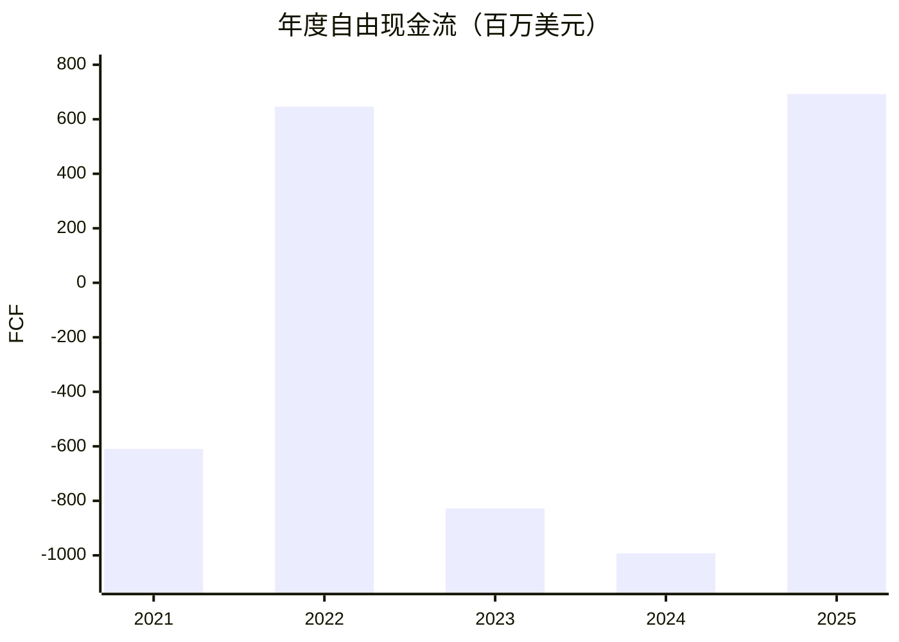

# Albemarle（NYSE:ALB）研究报告

**研究及数据截止日：2026-10-31（Asia/Shanghai）。** 最新正规盘为10月30日收盘91.00美元；最近正式经营期仍为2026Q2。按7月29日披露的118,005,057股普通股复算，普通股市值107.3846亿美元；期末股本不是十月实时登记册。普通股TTM EPS约0.49美元，机械PE约185.71倍；周期、特殊损益及优先股使该指标解释力有限。[行情](https://stockanalysis.com/stocks/alb/history/)、[独立行情](https://query1.finance.yahoo.com/v8/finance/chart/ALB?range=5d&interval=1d)、[官方股本](https://www.sec.gov/Archives/edgar/data/915913/000091591326000102/alb-20260630.htm)

一句话论文：电池客户需要合格锂盐，ALB靠资源成本和转化能力供应它，但能留下多少现金主要由行业价格和资本纪律决定。低成本资源值得研究，普通股的长期复利能力仍需验证。

本报告接续[9月1日研究](Albemarle-research-20260901.md)和[10月8日复核](Albemarle-thesis-drift-20261008.md)，重新执行完整研究流程。未假定读者持仓、成本或风险承受能力。用于学习研究，不构成投资建议。

## AI研究偏见自觉

信息丰富度评级：财务资料A，矿山成本、可实现锂价及长期股东回报B。AI研究局限性声明：财报能核实历史现金，不能替代矿山现场、客户合同和未来供给曲线调查。资料数量不等于盈利确定性。

- [x] 不把储能需求增长直接等同于锂生产商定价权。
- [x] 区分公司归母利润、普通股利润、调整后EBITDA和可分配现金。
- [x] 现金流改善要检查预付款、合资公司分红时点及资本开支收缩。
- [x] 不把价格进入旧区间视为经营条件已经满足。

---

## 第一步：核心数据总览

### 五年轨迹：利润率和现金流摆幅很大

金额均为百万美元。毛利率、经营利润率使用原始GAAP报表；净利润为归属ALB、尚未扣优先股股息。FCF为CFO减资本开支，不扣普通股和优先股股息。

| 年度 | 收入 | 公司归母净利 | GAAP毛利率 | GAAP经营利润率 | FCF | 年末现金 |
|---|---:|---:|---:|---:|---:|---:|
| 2021 | 3,327.957 | 123.672 | 29.99% | 23.99% | -609.410 | 439.272 |
| 2022 | 7,320.104 | 2,689.816 | 42.00% | 33.74% | 646.203 | 1,499.142 |
| 2023 | 9,617.203 | 1,573.476 | 12.33% | 2.62% | -827.959 | 889.900 |
| 2024 | 5,377.526 | -1,179.449 | 1.16% | -33.04% | -992.653 | 1,192.230 |
| 2025 | 5,142.733 | -510.628 | 13.00% | -7.14% | 692.466 | 1,618.001 |

来源：[2023年报](https://www.sec.gov/Archives/edgar/data/915913/000091591324000016/alb-20231231.htm)、[2025年报及重列比较数据](https://www.sec.gov/Archives/edgar/data/915913/000091591326000018/alb-20251231.htm)、[独立收入/利润](https://stockanalysis.com/stocks/alb/financials/income-statement/)、[独立现金流](https://stockanalysis.com/stocks/alb/financials/cash-flow-statement/)、[独立现金余额](https://stockanalysis.com/stocks/alb/financials/balance-sheet/)。2023现金流采用2025年报比较值，未沿用早期版本。2025 CFO还包含3.5亿美元客户预付款，相关交付在未来，因此正FCF不能直接永久资本化。



### 最近四季及分部

| 季度 | 总收入 | Energy Storage收入 | Specialties收入 | 其他业务收入 | GAAP毛利 | 公司归母净利 |
|---|---:|---:|---:|---:|---:|---:|
| 2025Q3 | 1,307.829 | 708.755 | 344.960 | 254.114 | 117.610 | -160.694 |
| 2025Q4 | 1,428.031 | 759.059 | 348.901 | 320.071 | 197.934 | -414.179 |
| 2026Q1 | 1,428.731 | 891.165 | 358.413 | 179.153 | 500.966 | 319.091 |
| 2026Q2 | 1,743.313 | 1,276.684 | 423.484 | 43.145 | 590.301 | 479.959 |

来源：[2025Q3](https://investors.albemarle.com/news-and-events/news/news-details/2025/Albemarle-Reports-Third-Quarter-2025-Results/default.aspx)、[2025全年](https://investors.albemarle.com/news-and-events/news/news-details/2026/Albemarle-Reports-Fourth-Quarter-and-Full-Year-2025-Results/default.aspx)、[2026Q1](https://investors.albemarle.com/news-and-events/news/news-details/2026/Albemarle-Reports-First-Quarter-2026-Results/default.aspx)、[2026Q2](https://investors.albemarle.com/news-and-events/news/news-details/2026/Albemarle-Reports-Second-Quarter-2026-Results/default.aspx)。2025其他为Ketjen，2026为Corporate and All Other；出售Ketjen控制权后不可按同范围解释下降。分部未披露可比GAAP毛利率，不能用调整后EBITDA率冒充。

六月现金1,631.688，带息债务1,876.784，净债务245.096；H1 CFO1,056.241，CapEx170.407，FCF885.834。长期权益法投资不算现金。Q2 CFO和FCF受到Talison分红时点及非重复营运资本因素推动，不能外推成年化长期现金流。[Q2原始报表及管理层解释](https://www.sec.gov/Archives/edgar/data/915913/000091591326000102/alb-20260630.htm)

交叉核验中发现两个重要差异：StockAnalysis标准化2025经营利润为+79.1，官方GAAP为-367.084，数据库将特殊项目重新分类，本文采用GAAP；其普通股净亏损-677.38与官方-677.378相符，而公司归母-510.628还没扣166.750优先股股息。数据库含租赁等总债务约1,999，不能与公司带息债务1,876.784当作同一口径。

> 段永平式追问：现金增加来自稳定重复的客户需求，还是预付款、分红时点和少花资本开支？本期三者都要拆开。

---

## 第二步：生意本质分析

ALB是一家资源与化学加工结合的商品供应商。客户按电池材料规格、纯度、稳定供货和价格采购锂盐；通过认证有转换摩擦，但不等于客户只能向ALB购买。收入重复来自电池生产，而非软件式锁定订阅。

| 关键环节 | 赚钱机制 | 最需要验证的变量 |
|---|---|---|
| 上游矿山与盐湖 | 资源品位、开采成本和规模 | 许可、水权、权益份额、实际产量 |
| 锂盐转化 | 纯度、良率、可靠交付 | 单位成本、加工价差、利用率 |
| 合同与客户 | 长期协议及认证关系 | 指数联动、价格滞后、最低价条款 |
| Specialties | 溴及特种锂应用缓冲锂周期 | 终端需求、定价和经营现金 |

Q2 Energy Storage销量65千吨LCE，实现价19.53美元/公斤；Specialties收入423.484。全年情景假设长期合同约占盐产品量40%、全部销量约三分之一，其余敞口较大。实现价的提升能迅速放大利润，价格回落时同样反向作用。这解释了五年利润率剧烈摆动。[公司Q2经营资料](https://investors.albemarle.com/news-and-events/news/news-details/2026/Albemarle-Reports-Second-Quarter-2026-Results/default.aspx)

> 段永平式追问：这门生意好在哪？稀缺、可生产的低成本资源和合格转化能力有价值；其价值需要经受商品低谷和再投资检验。

## 第三步：护城河评估

| 来源 | 判断 | 可验证证据与破坏路径 |
|---|---|---|
| 品牌与定价权 | 弱至中 | 质量信誉有用，但指数联动合同限制独立提价 |
| 转换成本 | 中 | 电池级认证和供应稳定有摩擦，双供应商可削弱锁定 |
| 网络效应 | 弱 | 多一个客户并不会自然提高所有客户的产品价值 |
| 规模与资源成本 | 中强 | Greenbushes、Wodgina及Atacama资源组合；须扣合资及政策约束 |
| 技术与专利 | 中 | 转化、工艺和客户开发积累；竞争者仍能建设加工能力 |

过去五年资源基础仍有价值，但减值、加工闲置与价格暴露否定了“宽阔稳定利润率护城河”。未来五年壁垒能否加宽，取决于新增吨位的现金成本和资本回报，不能用产能数字替代。2025研发51.398百万美元，低于上一年；研发投入下降有成本纪律的一面，也需防止削弱工艺改善。[年报业务与研发](https://www.sec.gov/Archives/edgar/data/915913/000091591326000018/alb-20251231.htm)

> 巴菲特式追问：十年后资源可能仍在，但许可、资本开支和低价供给，是否会把资源租金留给客户或政府？

## 第四步：逆向思考与风险清单

以下概率为研究者对未来十年风险的定性判断，不是统计测算；路径会重叠，不可相加。

| 失败路径 | 概率判断 | 影响 | 可观察信号 |
|---|---|---|---|
| 需求增长但供给更快，锂价长期偏低 | 中高 | 正常化利润落空 | 实现价、库存、竞争者复产和成本曲线 |
| 景气恢复后再次高价扩产 | 中 | FCF和ROIC下降 | 项目预算、资本开支、融资与减值 |
| 矿山火灾、投产延迟和合资分配不顺 | 中 | 出货/现金落后EBITDA | CGP3进度、合资分红和实际产量 |
| 资源许可、水权与贸易限制 | 中低、影响极高 | 部分资产价值永久损失 | 官方许可、配额、监管公告 |
| 优先股转换及后续融资稀释 | 转换为既定条款，最终数量未定 | 每股回报低于公司利润增长 | 转换VWAP、实际股数、SBC |

最强反方观点是：ALB可以是最后退出的低成本生产商，却未必给普通股足够回报。供给会对高价作出反应，低谷资本开支被延后也不是消失。历史类比更接近矿业与基础材料的资本周期；不能类比具有持续提价能力的消费品牌。最可能的分析错误是把2026上半年利润恢复和低CapEx当作中周期常态。

> 芒格式追问：聪明人为何不买？他们可能认可矿源，却不愿同时押注锂价、扩产纪律和转换后的每股现金回报。

## 第五步：管理层评估

| 决策 | 已知结果 | 评价 |
|---|---|---|
| 高景气阶段扩大加工投入 | 后续发生闲置、封存与减值 | 资本配置有明显教训 |
| 缩减资本开支、降债及处置非核心业务 | 流动性改善，仍需确认可持续现金 | 正向，但不得重复资本化出售所得 |
| 2026年宣布CEO接班 | Ragnar Udd拟于2027-02-01就任，Masters转执行董事长 | 交接可见性提高，ALB任内回报记录尚不存在 |

新CEO有BHP资源行业经验，但履历不能直接兑换为ALB未来ROIC。现管理层最有价值的下一项证明，是在价格恢复时继续约束新增资本，而非只在低谷削支出。[官方继任公告](https://investors.albemarle.com/news-and-events/news/news-details/2026/Albemarle-Announces-CEO-Succession-Plan/default.aspx)

2026代理书披露Masters截至3月11日受益持股316,435股、低于1%。不能将其视为控股创始人，也不能把含未来可取得股份的受益持股当作纯已发行实股；经济权益和表决权须按代理书定义。独立转录与原代理书相符，十月实时持股仍待最新Form 4逐项桥接。[代理书](https://s201.q4cdn.com/960975307/files/doc_financials/2025/ar/ALBEMARLE-CORP_2026_Proxy_Statement.pdf)、[独立转录](https://www.stocktitan.net/sec-filings/ALB/def-14a-albemarle-corp-definitive-proxy-statement-05bb75de9438.html)

> 段永平式追问：CEO退休后资源和工艺仍在；资本配置质量能否成为制度，目前证据不足。

## 第六步：行业与文明趋势

电气化和储能扩大锂的用途，但产业总需求增长不会自动转化为每吨利润增长。ALB位于资源和加工环节，主要竞争涉及SQM及中国、澳洲等地供给；竞争核心是质量可接受条件下的交付成本及新增资本回报。未取得同一时点、同产品口径的可靠市场份额，本文不沿用精确份额数字。

IEA最新关键矿物研究强调需求增长和供应集中风险；这支持研究供应韧性，也说明贸易限制会改变区域成本。本文不把产业长期供需缺口当作未来每年锂价的承诺。[IEA 2026展望](https://www.iea.org/reports/global-critical-minerals-outlook-2026/outlook)

替代化学体系、回收技术、材料强度下降和新矿供应都可能降低单位终端需求对应的新采锂利润。Greenbushes等资源有寿命，但Atacama许可和水资源约束应逐资产评估；没有合理依据把它整体当作“时代标准石油”。客户地域和中国加工链暴露仍重要，未取得十月同口径客户/供应商集中度的新披露，不能声称风险已下降。

> 李录式追问：二十年后行业可能更大，ALB普通股能否分享增长，取决于供给反应与再投资，不只取决于锂的用途。

---

## 第七步：估值与安全边际

### 先把优先股和普通股放进同一经济账

2,299,826股优先股预计2027年3月1日强制转换，每股对应7.618至9.140股普通股，最终按约定VWAP及反摊薄条款确定。由此新增约17.520至21.020百万股。本模型保守使用最大转换后的139.025百万股，并在每股盈利假设中一次性计入；不再从权益价值重复扣整笔优先股本金。当前118.005百万普通股的市值与转换后的全部股权价值不可直接混用。[原始条款](https://www.sec.gov/Archives/edgar/data/915913/000119312524059947/d807761dfwp.htm)、[Q2余额](https://www.sec.gov/Archives/edgar/data/915913/000091591326000102/alb-20260630.htm)

| 指标 | 本次复算 | 解释 |
|---|---:|---|
| 普通股市值 | 10,738.460百万美元 | 91美元乘最近披露普通股数 |
| TTM机械PE | 185.71倍 | EPS0.49已取整，不能当中周期估值 |
| P/B | 1.34倍 | 先扣优先股账面权益后，每股普通股净资产68.133美元 |
| TTM FCF收益率 | 12.50% | 尚未扣优先股现金分红，且受周期与现金时点影响 |
| 年化普通股股息率 | 1.80% | 每股1.64美元，非未来保证 |
| 正常化EPS假设下PE | 13.00倍 | EPS7美元为研究假设，绝非已实现利润 |

数据库TTM PE186.67与取整EPS复算值有差异，源于底层EPS精度，未用二者差异推断低估。2025亏损、2022高盈利使自身历史PE极易失真；SQM等同业的现价倍数不能独立证明ALB便宜。未取得同日一致利润口径的完整同业表，保留缺口，不报伪精确分位。

### 三年三情景：当前价格是否留出余地

起点正常化EPS7美元，是优先股完全转换后的中周期假设，对应约973百万美元股东利润。它低于旧报告9.36美元假设，不是十月已发生的盈利下降。公司在锂价10/20/30美元每公斤情景下给出的全年调整后EBITDA分别约0.9—1.0/2.4—2.6/4.2—4.4十亿美元，说明盈利敏感性很大；还需扣折旧、融资成本、公司及Windfield对应税负，并检查合资现金分配差异；该EBITDA以归属ALB利润为起点，不再重复扣同一少数权益，不能从EBITDA直读EPS。7美元取自对中档经济利润的审慎折扣，置信度中低。

以下增长、倍数和概率均为研究假设，预测期三年；现值按美元10%折现，不含三年现金分红。

| 情景 | 概率 | EPS年增速 | 第三年PE | 第三年股价 | 折现现值 | 相对91美元价差 |
|---|---:|---:|---:|---:|---:|---:|
| 乐观 | 20% | +26% | 18倍 | 252.05美元 | 189.37美元 | +176.98% |
| 中性 | 50% | +5% | 13倍 | 105.34美元 | 79.15美元 | +15.76% |
| 悲观 | 30% | -29% | 9倍 | 22.55美元 | 16.94美元 | -75.22% |

概率加权现值82.53美元，低于91美元；远期股价105.34美元不可当今天内在价值。反向估值看，在第三年仍给13倍PE、要求10%价格年化回报时，EPS须从假设7美元以约10%年增速增长；本报告中性仅5%。这并非完整DCF：缺少逐年矿山维持CapEx和可分配现金路径，不给伪精确反向DCF结果。三年模型已说明安全边际不足，无需借十年模型单独否决。

### 十年折现：仓位压力测试

美元现金流取r=10%，由工具统一参考Rf4.7%加研究要求ERP5.3%、β=1构成。Rf是本仓库校验基准，**不是声称10月30日国债即时报价**；β也不是数据库历史价格β。13%稳态增量ROIC是对资源成本优势与重资产约束的判断，并非当前报表ROIC。永续g取0%/2%/3%，美元基准不超过4%；三档分母分别为10/8/7个百分点，均通过5个百分点约束。r变化时g保持不变。

终值PE仅使用 `(1−g/ROIC)/(r−g)`。2036每股盈利2/10/18美元均已按完全转换口径考虑；用每股利润及当前每股价格计算，与两边同乘当前普通股数等价，避免把未来优先股转换所得股份误归现普通股股东。十年普通股股息减后续常规摊薄取净1%年化假设；强制转换已经单独计入每股基数，不重复扣。工具IRR采用几何价格回报加净股息的近似，并非逐笔现金流XIRR。

| 情景 | 概率 | 2036 EPS假设 | 永续g | r−g | 公式终值PE | 十年年化近似 |
|---|---:|---:|---:|---:|---:|---:|
| 悲观 | 30% | 2美元 | 0.0% | 10.0个百分点 | 10.00倍 | -13.06% |
| 基准 | 50% | 10美元 | 2.0% | 8.0个百分点 | 10.58倍 | +2.52% |
| 乐观 | 20% | 18美元 | 3.0% | 7.0个百分点 | 10.99倍 | +9.07% |

| 折现率r | 期望年化近似 | 相对资本成本压力测试 |
|---|---:|---|
| 8% | +1.96% | 未通过；区间外，仅供参考 |
| 10% | -0.85% | 未通过 |
| 12% | -2.97% | 未通过；区间外，仅供参考 |
| 9%补检 | +0.45% | 未通过，处于美元合理区间 |
| 11%补检 | -1.97% | 未通过，处于美元合理区间 |

美元合理区间为9%—11.5%。±2个百分点两侧均在区间外，因此另做±1个百分点复核；**区间内压力测试结论不翻转**。三档年化的概率加权只是情景比较，不能当保证收益或完整组合期望复利。未通过约束长期重仓，不能单独推出必须卖出或永久回避。

### 估值分歧对账及限制

旧报告90—110美元为研究性分批区，当前91美元触及该区；本次三年模型用更审慎、明确完全转换后的EPS，基准现值约79美元，未支持旧区间自动新增。调整来自正常化盈利及每股口径判断，而非已确认的新季度恶化。十年模型回答仓位承压问题，进一步压低长期核心仓上限；最终观望来自定价余地、周期不确定性及资本配置证据共同作用。

许可、水权、停产和贸易中断分别进入经营情景/尾部讨论，不塞进r或β。永久性本金损失的完整概率尚未建模，三档悲观情景不等于归零尾部，期望值可能偏高。缺少实时全稀释登记股本、当前实现价序列、矿山维持CapEx及十月客户集中度，也限制模型精度。

> 巴菲特式追问：r错两个百分点会翻转吗？本次区间内复核仍未通过仓位压力测试，结论主要更依赖周期利润假设。
>
> 段永平式追问：关市五年愿意以91美元持有吗？只有能承受商品周期且仓位很小的投资者才适合继续研究；目前不足以作为稳健核心资产。

---

## 第八步：最终决策与行动清单

| 维度 | 结论 | 信心度 |
|---|---|---|
| 生意质量 | 有价值的资源/加工资产，现金回报周期性强 | 中高 |
| 护城河 | 成本、资源与认证有壁垒，独立定价权有限 | 中高 |
| 管理层 | 降债有进展；高景气资本配置和交接仍待验证 | 中 |
| 最大风险 | 供给压价叠加资本开支、许可及每股摊薄 | 中 |
| 文明趋势 | 电气化有利需求，利润归属仍取决于供需 | 中 |
| 估值 | 三年中性现值约79美元，91美元余地不足；十年压力未通过，区间内不翻转，限制重仓 | 中低 |

估值不是唯一裁决，十年未覆盖r也不等于单独否决。资源价值支持继续研究；当前价格和经营证据的组合尚不足以支持稳健型新增。

| 策略 | 建议 |
|---|---|
| 空仓者 | 91美元观望；60—75美元且Q3量价、现金与资本纪律均可接受时，才研究性分批 |
| 持仓者 | 小型周期仓可限仓观察，财报前不据下跌加仓；研究组合单家公司上限暂按约2%，不是针对未知个人组合的交易指令 |
| 卖出/降仓信号 | 净债务持续上升、FCF主要靠预付款、低回报扩产恢复，或许可/供应红线实质触发；≥150美元但中周期证据未增强时复核估值与仓位 |
| 加仓信号 | 价格60—75美元只是入口；同时须实现价/单位现金利润稳定、剔时点因素现金可信、CGP3与CapEx纪律可核且转换后股本桥接清晰 |

75—90美元继续比较机会成本；低于60美元先查资产或流动性损坏，不能机械加大仓位。此前75—110美元宽监控带由本次60—75美元条件带接续；价格触发不自动交易。

下一节点是官方11月4日纽约收盘后Q3及11月5日08:00 EST电话会；北京时间分别为11月5日清晨及11月5日21:00。2027-02-01复核CEO接任，2027-03-01按条款复核优先股转换，两者属于预定安排而非已完成事实。[官方Q3日程](https://investors.albemarle.com/news-and-events/news/news-details/2026/Albemarle-Corporation-to-Release-Third-Quarter-2026-Earnings-Results-on-Wednesday-November-4-2026/default.aspx)

四位大师均未取得足以核验其针对ALB的公开立场，本报告不模拟代言。各模块追问仅是分析问题，不是引语。

## AI分析置信度与投资确定性

历史收入、利润、现金、已披露转换条款的数据置信度较高；未来实现价、正常化EPS、十年ROIC和情景概率为中低置信推理。实际投资确定性中低，主要受商品周期和再投资约束，不能因公司公开资料丰富而上调。

## 数据来源与审计记录

主源Macrotrends访问受限且部分最新期滞后，本次采用SEC/公司IR与独立StockAnalysis、Yahoo核对，未将无法读取的页面冒充已核证据。历史GAAP利润率按原报表计算，数据库标准化差异已单独解释。

市值、收入、普通股净利润、现金及股数交叉验证输出已留存在[验证记录](Albemarle-验证记录-20261031.json)，三年、十年参数另见[估值参数](Albemarle-估值参数-20261031.json)。

关键工具输出摘要：市值10738460187美元，对独立10.74B偏差0.01%；FY2025收入5142.733对5143、普通股净利-677.378对-677.38、六月现金1631.688对1632，均小于1%。终值C1/C2/C3准出；未建模本金永久损失警告已在限制披露。固定种子20261031，提取51项、随机抽8项，并追加5项历史事实双源核验；13项通过、零警告、零失败、零跳过。定稿终值复审准出；明示的未建模尾部警告保留。见[审计记录](Albemarle-审计记录-20261031.json)。抽检不验证预测能否实现。

### 关键数据交叉验证原始输出

<details>
<summary>展开市值与双源核验结果</summary>

```text
============================================================
市值验算 (Market Cap Verification)
============================================================
  股价 (Price):       91.0 USD
  总股本 (Shares):    118.01M
  计算市值:           10.74B USD
  报告市值:           10.74B USD
  偏差:               0.01%

  ✅ 验证通过, 偏差仅 0.01%

============================================================
交叉验证: FY2025收入 (Cross-Validation)
============================================================
  数据来源数: 2
  参考中位数: 5,142.87 百万美元

  ✅ SEC                 : 5,142.73 百万美元  (偏差 0.00%)
  ✅ StockAnalysis       : 5,143.00 百万美元  (偏差 0.00%)

  ✅ 所有来源偏差 ≤ 2.0%, 数据一致

  共识值 (加权中位数): 5,142.87 百万美元

============================================================
交叉验证: FY2025普通股净利 (Cross-Validation)
============================================================
  数据来源数: 2
  参考中位数: -677.38 百万美元

  ✅ SEC                 : -677.38 百万美元  (偏差 -0.00%)
  ✅ StockAnalysis       : -677.38 百万美元  (偏差 -0.00%)

  ✅ 所有来源偏差 ≤ 2.0%, 数据一致

  共识值 (加权中位数): -677.38 百万美元

============================================================
交叉验证: 2026H1现金 (Cross-Validation)
============================================================
  数据来源数: 2
  参考中位数: 1,631.84 百万美元

  ✅ SEC                 : 1,631.69 百万美元  (偏差 0.01%)
  ✅ StockAnalysis       : 1,632.00 百万美元  (偏差 0.01%)

  ✅ 所有来源偏差 ≤ 2.0%, 数据一致

  共识值 (加权中位数): 1,631.84 百万美元

============================================================
交叉验证: 期末普通股 (Cross-Validation)
============================================================
  数据来源数: 2
  参考中位数: 118.01M 股

  ✅ SEC                 : 118.01M 股  (偏差 0.00%)
  ✅ StockAnalysis       : 118.01M 股  (偏差 0.00%)

  ✅ 所有来源偏差 ≤ 2.0%, 数据一致

  共识值 (加权中位数): 118.01M 股
```

</details>
