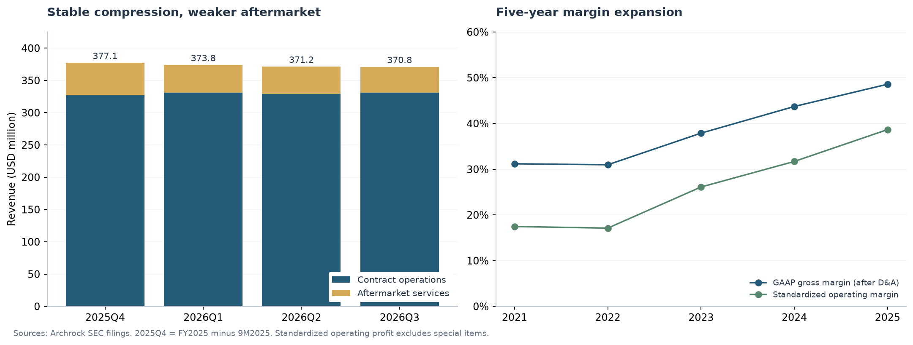
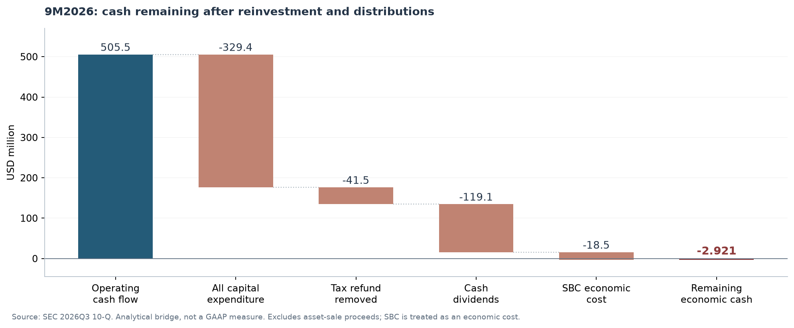

# Archrock（AROC）研究报告

> **数据截止日：2026-11-18，北京时间。** 研究开始时已执行系统日期核验；彼时美东11月17日尚在交易，行情统一采用**11月16日常规盘收盘26.96美元**。最新财务为截至9月30日的2026Q3，纳入11月10日HiVolt收购公告，尚未把交易当作已完成。最新披露普通股175,354,040股，复算市值47.2754亿美元；TTM PE 13.90倍、简单FCF收益率6.40%。除每股值另注外，财务表单位均为百万美元。
>
> **研究主线：** 压缩服务的收费能力仍在，但股东现金回报要同时穿过增长设备投入、分红和新增并购融资三道关。新业务的合同质量值得研究，2028年预期利润尚不足以证明今天的安全边际。
>
> 公司身份：Archrock, Inc.，美国普通股，NYSE:AROC；中文常译“阿奇洛克”，本报告沿用英文正式名称。复用原公司目录与触发器ID `Archrock`。[8月研究](Archrock-research-20260805.md)保留为历史记录。本报告用于学习研究，不构成投资建议。

## AI研究偏见自觉

**信息丰富度评级：A。** SEC文件、公司业绩、交易材料和第三方财报比较充分，信息优势主要来自拆清口径与现金约束，不能把“天然气+电力+AI”三个关键词相加当作增长预测。

**AI研究局限性声明：** 无法直接核实机组状态、客户续约谈判、HiVolt口头授标转为书面合同的概率、项目资本预算及现场维护成本。Macrotrends完整页受访问限制，仅取得部分搜索缓存；主值以SEC原文为准，关键历史财务与StockAnalysis交叉。当前管理层集体持股和同业财务仍有核验缺口，见附录。

- [x] 区分必要服务与必然超额回报：竞争者也能买到机器。
- [x] 不把资料数量当确定性：公开资料充裕，长期资本回报仍有判断成分。
- [x] 反查多头叙事：退税、资产出售、激励费用变化都可能美化当期表现。
- [x] 不机械沿用旧价带：新稿补齐现金口径、三年折现与十年仓位压力测试。

---

## 第一步：核心数据总览

### 五年财务：统一扣除折旧再谈利润率

| 指标 | 2021 | 2022 | 2023 | 2024 | 2025 | TTM至2026Q3 |
|---|---:|---:|---:|---:|---:|---:|
| 收入 | 781.461 | 845.568 | 990.337 | 1,157.591 | 1,489.818 | 1,492.889 |
| GAAP毛利，已扣折旧摊销 | 243.598 | 261.825 | 375.077 | 505.896 | 723.632 | 726.268 |
| GAAP毛利率 | 31.17% | 30.96% | 37.87% | 43.70% | 48.57% | 48.65% |
| 标准化经营利润率¹ | 17.46% | 17.11% | 26.10% | 31.68% | 38.65% | — |
| 公司总净利润 | 28.217 | 44.296 | 104.998 | 172.231 | 322.290 | 341.752 |
| 普通股可归属净利润 | 27.045 | 42.867 | 103.120 | 169.952 | 318.956 | 338.156 |
| 经营现金流CFO | 237.400 | 203.450 | 310.187 | 429.591 | 622.107 | 719.937 |
| 全部现金资本开支 | 97.885 | 239.867 | 298.632 | 359.032 | 502.465 | 417.153 |
| 简单FCF＝CFO−全部CapEx | 139.515 | -36.417 | 11.555 | 70.559 | 119.642 | 302.784 |
| 期末现金 | 1.569 | 1.566 | 1.338 | 4.420 | 1.553 | 4.147 |

¹ 收入减不含折旧销售成本、折旧摊销及SG&A，剔除减值、重组、交易费和资产处置收益；SEC没有单列此经营利润小计，不能称为其直接披露的GAAP营业利润。TTM财务一律按“2025全年＋2026前九月−2025前九月”计算；末列现金为季度末余额。

来源：[2023年10-K](https://www.sec.gov/Archives/edgar/data/1389050/000138905024000007/aroc-20231231x10k.htm)、[2025年10-K](https://www.sec.gov/Archives/edgar/data/1389050/000138905026000009/aroc-20251231x10k.htm)、[Q3 10-Q](https://www.sec.gov/Archives/edgar/data/1389050/000138905026000039/aroc-20260930x10q.htm)，与[StockAnalysis损益](https://stockanalysis.com/stocks/aroc/financials/income-statement/)、[现金流](https://stockanalysis.com/stocks/aroc/financials/cash-flow-statement/)、[资产负债表](https://stockanalysis.com/stocks/aroc/financials/balance-sheet/)交叉。

**对旧稿的实质修正：** 8月稿把2021—2024年扣折旧前的adjusted gross margin与2025年GAAP毛利放在同一行。统一后，毛利率仍有明显改善，但不能沿用原表讨论改善幅度。2025年资产处置回款也不应混入总额CapEx口径的FCF。

### 最近四季：核心收费稳定，售后仍弱

| 指标 | 2025Q4² | 2026Q1 | 2026Q2 | 2026Q3 |
|---|---:|---:|---:|---:|
| 合同运营收入 | 327.088 | 330.880 | 329.260 | 331.155 |
| 售后收入 | 49.985 | 42.887 | 41.978 | 39.656 |
| 总收入 | 377.073 | 373.767 | 371.238 | 370.811 |
| GAAP毛利 | 199.695 | 177.689 | 173.034 | 175.850 |
| 公司总净利润 | 116.772 | 73.794 | 66.720 | 84.466 |
| 稀释EPS，美元 | 0.67 | 0.41 | 0.38 | 0.48 |

² Q4采用全年减九个月。其净利润含资产出售和税务收益，不宜年化。普通股利润逐季合计与累计法相差0.003百万美元，来自参与分红证券分配的累计调整；精确模型统一采用累计法338.156，表中公司总净利不受混用。

来源：上述10-K、[2026Q1 10-Q](https://www.sec.gov/Archives/edgar/data/1389050/000138905026000019/aroc-20260331x10q.htm)、[Q2 10-Q](https://www.sec.gov/Archives/edgar/data/1389050/000138905026000028/aroc-20260630x10q.htm)、Q3 10-Q；与StockAnalysis季度财务交叉。



Q3总收入同比-3.04%，合同运营+1.50%，售后-29.39%；公司净利+18.55%，调整EBITDA+3.38%。这不是收入全面加速：SG&A下降11.627，其中股价变化带来的现金结算激励费用减少7.0，另有高管协议相关激励费用减少3.4。Q3低费用不能直接外推全年。公司维持2026调整EBITDA指引865—885，未恢复此前被下调的上限。[Q3公司业绩](https://www.globenewswire.com/news-release/2026/11/02/3393755/0/en/archrock-reports-third-quarter-2026-results.html)、[10-Q费用解释](https://www.sec.gov/Archives/edgar/data/1389050/000138905026000039/aroc-20260930x10q.htm)。

### 股息覆盖：把不同定义分开

| 现金桥 | 2026前九月 |
|---|---:|
| CFO | 505.459 |
| 减全部现金CapEx | -329.355 |
| 简单FCF | 176.104 |
| 再剔除退税回款 | -41.479 |
| 现金FCF，剔退税后 | 134.625 |
| 减已付股息 | -119.094 |
| 剩余现金 | 15.531 |
| 再视SBC为经济成本 | -18.452 |
| **剩余经济现金** | **-2.921** |

该桥是研究调整，未加资产出售回款；SBC不是本期现金支出，扣除是为了计入股权激励的经济成本，不能再对同一现金流模型重复扣一次稀释。退税是真实到账现金，但不应当作以后每年重复发生。



公司Q3“可用于股息的现金”153.009，覆盖约3.8倍，扣了维持及其他CapEx，**未扣增长CapEx**，且作了营运资金等调整。同期CFO减全部CapEx仅40.917，对已付股息40.563的覆盖约1.01倍，余0.354。两者回答不同问题；不能以3.8倍证明并购、扩建和股息可以同时轻松覆盖。[公司现金指标定义及调节表](https://www.globenewswire.com/news-release/2026/11/02/3393755/0/en/archrock-reports-third-quarter-2026-results.html)。

> 芒格式追问：利润和现金都在增长时，有多少来自可以再现的收费，有多少来自退税、费用重估和资产腾挪？

---

## 第二步：生意本质分析

**一句话：** Archrock替产气商和中游客户持有压缩设备并负责持续运转，按月收取把天然气送得动的服务费；设备、维修和融资都由股东先付钱。

| 商业环节 | 客户与股东真正承担什么 |
|---|---|
| 付费理由 | 客户避免自建设备、维修团队和备用机队，停机损失往往高于节省的月费。 |
| 收费机制 | 合同运营以固定月费为主，燃气或电力通常由客户提供；气流受限时可能减费，收入并非完全免疫客户减产。 |
| 合同与留存 | 标准首期通常12—36个月，大机组可到60个月，此后常按月延续并可提前30天通知终止；平均现场运行约六年，不等于六年不可撤销订单。 |
| 资产底座 | 2025年末5,319台、4.788百万马力，较大机组和区域维修网点有规模价值；这是设备服务平台。 |
| 成本与现金 | 零部件、人工、润滑油、折旧、维持CapEx和增长CapEx都是真实成本；维护与增长分类有管理判断。 |

以上合同与资产数据来自[2025年10-K业务章节](https://www.sec.gov/Archives/edgar/data/1389050/000138905026000009/aroc-20251231x10k.htm)。

最重要的三个变量是：**有效收费马力、每马力收费、每单位新增资本能带来的现金回报。** Q3平均运营马力4.528百万，合同运营月收入/平均马力的粗略代理约24.38美元，上年同期约23.40美元。此比值包含机队结构变化，不能当作同一机组续约涨价率。

Q3期末运营马力4.537百万、利用率94.3%，上年同期4.651百万、96.0%；同比减少部分受出售非战略设备影响，不能全部认定需求流失。环比运营马力回升但利用率略降，说明新增可用设备也在增加。合同运营扣折旧前毛利率约72.09%，售后约22.89%，合并GAAP毛利率约47.42%；前两项与最后一项不应直接比较。[公司季度运营表](https://www.globenewswire.com/news-release/2026/11/02/3393755/0/en/archrock-reports-third-quarter-2026-results.html)。

这门生意有复购和客户摩擦，盈利改善也真实存在。它的弱点是每轮增长先增加设备与融资需求，现金不能像软件收入那样低成本复制。

> 段永平式追问：好在哪？客户持续需要可靠压缩，外包比自建方便；难在哪？每份新增服务收入都要先检验新增资本能否赚回成本。

---

## 第三步：护城河评估

| 来源 | 判断 | 可证伪的观察 |
|---|---|---|
| 品牌与定价权 | 中等。可靠性与安全记录影响客户选择，定价仍受行业供需约束。 | 老客户续约价格、投标折扣和停机赔偿。 |
| 转换成本 | 中等。停机、现场匹配、重装调试与运维交接有成本。 | 合同期满续约与客户改为自建的比例。 |
| 网络效应 | 无直接证据。新增客户不会自动提高其他客户的服务价值。 | 不为“平台”二字支付网络效应溢价。 |
| 规模和服务密度 | 最有价值。设备调拨、备件、技师、采购与客户覆盖可摊薄单位成本。 | 区域利润率、每马力维护成本及设备周转。 |
| 技术和专利 | 有工程经验，缺乏不可替代的核心专利证据。 | 同业能否按相近资本成本复制同等可靠性。 |

过去五年的利润率与资产升级支持经营壁垒有所增强；是否足以跨周期维持高回报，证据为中等。未来五年，长期订单和设备供给约束有利，竞争者扩机队、客户自建及维护成本上涨会侵蚀这份优势。公司10-K本身也将市场描述为竞争激烈、进入壁垒较低，不能只引用规模优势而忽略这段风险披露。[2025年10-K竞争章节](https://www.sec.gov/Archives/edgar/data/1389050/000138905026000009/aroc-20251231x10k.htm)。

与USA Compression、Kodiak相比，三者都依赖机队、服务网络及资本配置；并没有证据表明AROC拥有可长期脱离行业回报的垄断地位。外包服务市场份额缺乏本次可独立验证的统一分母，不填写精确份额。

> 巴菲特式追问：十年后仍需压缩，但届时的稀缺是天然气压缩能力，还是资本愿意低价提供的机器？后者会压低股东回报。

---

## 第四步：逆向思考与风险清单

最强空方论点是：**市场用增长的EBITDA讲述基础设施复利，用尚未赚到的项目利润证明收购便宜，却低估了税款正常化、再投资和融资对普通股现金的竞争。** 当前未发现足够证据把该判断升级为财务造假指控。

| 失败路径 | 主观可能性³ | 对股权影响 | 预警指标 |
|---|---|---|---|
| 行业增量放慢、闲置和折价续约 | 中 | 高；固定资产和利息难同步缩减 | 利用率连续两季低于92%，同口径收费转弱。 |
| 新机组或微电网资本回报不足 | 中高 | 高；盈利增长但每股现金不增长 | 增长CapEx超预算、项目延期，剔一次性现金后覆盖持续不足。 |
| HiVolt预测未兑现，新增债务先落地 | 中 | 中高 | 口头授标未签约，2028 EBITDA范围下调，交割后杠杆长期高于3.5倍。 |
| 客户信用恶化、集中度上升 | 中低 | 高 | 应收逾期、大客户再议合同或产区活动下降。 |
| 维修、润滑油、工资和融资成本抬升 | 中 | 中高 | 费用增速超过提价；浮息借款与利息支出上升。 |
| 重大事故、环境与电力监管变化 | 低频、不能量化 | 尾部损失可能大 | 安全事件、保险追偿、排放及微电网许可变化。 |
| 管理层继任或新领域整合失控 | 中低 | 中高 | 关键人员流失、资本纪律变化、关联交易或信息披露转差。 |

³ 定性主观判断，不是统计概率，行与行相关，不能加总。十年估值另列互斥情景权重。

历史类比应看设备租赁的资产负债机制：景气上行时，利用率和租金上升会放大利润；下行时，设备不再收费，折旧、债务和维护并不会消失。AROC的月费及中游属性提供缓冲，不能消除这个机制。没有为这段类比虚构某家公司的破产概率。

跨学科上，这是可靠性工程与资本供给博弈：客户珍惜在线率，竞争者却可在高回报吸引下扩张供给。设备交付短缺保护当期租金，也可能迫使公司提前下单、把需求判断锁进多年CapEx。

**最可能的分析错误**：把维持设备竞争力所需支出全部接受为“可随时停掉的增长”，从而高估所有者收益。反方向也要警惕：把全部增长CapEx永久扣除，会低估新设备确有正回报的公司；因此估值同时看正常化EPS与现金对照。

> 芒格式追问：聪明人为什么不买？因为EBITDA可增长，股东未必拿到相同比例的现金；且新增业务把公司带入仍需验证的能力范围。

---

## 第五步：管理层评估

CEO Brad Childers拥有长期行业经验。6月公告的CFO Mohit Singh已于7月6日上任，不能继续把旧CFO当现任。委托书中“达到62岁后符合条件退休可保留部分激励”是合同条款，**不等于已经宣布退休**。[CFO正式公告](https://www.sec.gov/Archives/edgar/data/1389050/000110465926077839/tm2618970d1_ex99-1.htm)、[2026委托书](https://www.sec.gov/Archives/edgar/data/1389050/000110465926029581/aroc-20260430xdef14a.htm)。

| 时间与决策 | 已知结果 | 研究评价 |
|---|---|---|
| 2024 TOPS、2025 NGCS并购 | 扩大资产和收入，也引入整合、折旧及融资成本；不能把并表增量全当内生增长。 | 有产业逻辑，回报仍须逐股验证。 |
| 2025非核心资产出售 | 有利机队升级并带来现金与处置收益；利润和FCF口径需要剔清。 | 中性偏正面，不能重复资本化处置收益。 |
| 2026债务置换 | 2028票据已置换，主要固定票据延至2032/2034；浮息额度仍在。 | 降低到期集中风险，未消除杠杆。 |
| 2026提高季度股息至0.23美元 | 现金回报上升，Q3没有公开市场回购。 | 股息需服从增长与并购资金，不能只看CAD覆盖。 |
| 2026-11 HiVolt收购 | 新增微电网能力，拟全现金、主要由ABL融资；尚待交割。 | 暂不评分为成功，核项目合同、总投资及现金回报。 |

截至2026年3月2日，委托书披露CEO受益持股2,368,723股、占1.4%；其中已直接持有2,151,882股，另含216,841股限制股/单位。董事高管14人合计5,127,490股、2.9%，含未归属部分。这是明确日期的受益拥有口径，不能等同今天可自由出售持股。公司为单一普通股，无AB股差异。[委托书第29页](https://www.sec.gov/Archives/edgar/data/1389050/000110465926029581/aroc-20260430xdef14a.htm)。

第三方当期insider统计2.67%与2.83%不一致，范围及时间不同，故不宣称现时管理层精确持股已完成双源验证。Form 4中用于股权归属税款代扣的F类交易也不能写成管理层主动看空减持。

长期激励与CAD、股东回报有关，提供一定对齐；CAD未扣增长CapEx，因此仍需用扣完整资本投入后的每股现金约束管理层。技术能力主要来自设备配置、现场维护和排放控制；未发现可用于比较的独立R&D强度披露，不用“零研发”或虚构研发回报率评价。

> 段永平式追问：CEO离开后还能做下去吗？维修与调度靠系统，选项目和并购靠资本纪律；新CFO与HiVolt团队的首轮预算，将比留任条款更有信息量。

---

## 第六步：行业与文明趋势

美国天然气流量有结构支撑。EIA十一月预测美国LNG出口2025年15.1、2026年17.6、2027年19.0 Bcf/d，同时预计2027年Henry Hub均价2.88美元。**气量增长与气价下跌可以同时发生**：前者有利压缩需求，后者仍可能削弱部分客户的投资和信用。[EIA十一月天然气展望](https://www.eia.gov/outlooks/steo/report/natgas.php)。

AROC处于气源、集输处理与终端需求之间，主要赚设备可用性和服务费，不直接拥有LNG出口利润。AI电力需求只是可能推动气流或现场电力的因素；需穿过建厂、许可、管道和客户融资，才能落到AROC的合同。

### HiVolt：有合同价值，也有估值陷阱

| 正式披露 | 应怎样理解 |
|---|---|
| 首付415，另有最多35的员工earnout；预计2027Q1交割。 | 交易仍待条件满足，不能把预测利润并入2026已实现业绩。earnout可能列薪酬费用，不会因名称改变而失去经济成本。 |
| 预计ABL借款425，包括约10交易费用。 | “debt-free transaction”指收购标的交付口径，不是AROC不借债；公司预计备考杠杆回到3.0—3.5倍。 |
| 公司引用约6.1倍2028预期EBITDA，中点来自70—75区间。 | 分母是未来利润，且新增项目还需资本投入；缺少完整项目CapEx与收购会计，不能把6.1倍当成全投资成本倍数。 |
| 长约以容量付费、含燃料成本调整，通常首期五至八年。 | 收入结构有吸引力；仍须查合同执行、对手方信用、可用率赔偿与再投资。 |

交易条款来源：[11月10日8-K](https://www.sec.gov/Archives/edgar/data/1389050/000110465926125218/tm2629454d1_8k.htm)、[公司交易公告](https://www.sec.gov/Archives/edgar/data/1389050/000110465926125218/tm2629454d1_ex99-1.htm)。

交易演示显示，HiVolt当前运营约61MW，规划2028年约177MW；约70%的2028预期EBITDA得到“运营中及已签约/已授标”机会支持，**其中“授标”包括口头授标**。超过95%的预期EBITDA来自上游和中游客户，因此本次交易首先延伸油气客户服务。500MW以上采购框架是设备获取能力，不是500MW已经投运或已签客户。[交易演示第6—11页](https://www.sec.gov/Archives/edgar/data/1389050/000110465926125218/tm2629454d1_ex99-2.htm)。

演示中的美国油气现场电力TAM约10—13GW是管理层估计，并非本报告独立验证的市场分母。电网接入困难能创造现场供电机会，但电网到位、客户自建、设备供应商提价，都可能分走利润。压缩与微电网又共同暴露于油气客户、燃气发动机、维护人员及资本供给，业务扩张并未完全分散风险。

公司Q3电话会重申2027—2030累计增长设备投入约14—16亿美元；此为管理层资本框架，并非全部已支出的现金或不可撤销订单，HiVolt未来追加投资更需分开披露。[Q3管理层电话会实录](https://www.fool.com/earnings/call-transcripts/2026/11/03/archrock-aroc-q3-2026-earnings-call-transcript/)。

> 李录式追问：二十年后能源系统仍需要可靠性，但股东赚的是承接稀缺需求的回报，还是替客户承担了设备和融资账单？

---

## 第七步：估值与安全边际

### 当前价格：表面便宜了，正常化后没有那么便宜

| 指标 | 统一11月16日收盘口径 | 限制 |
|---|---:|---|
| 股价，美元 | 26.96 | 不使用11月17日盘中报价。 |
| 市值 | 4,727.545 | 采用10月27日披露在外股数，非实时股本。 |
| TTM披露稀释EPS，美元 | 1.94 | 加权股数与当期股数不同，含历史特殊收益。 |
| TTM PE | 13.90倍 | 市值/普通股利润约14倍，小差来自EPS与加权股数口径。 |
| 正常化研究EPS，美元 | 1.70 | 对应约298.102普通股利润，为估值假设，不是公司EPS指引。 |
| 正常化PE | 15.86倍 | 参考2026公司总净利指引290.750—310.750，再考虑参与证券与正常费用。 |
| PB | 2.96倍 | 重资产账面价值不等于可出售价值。 |
| PS | 3.17倍 | 对高折旧行业，PS解释力较弱。 |
| 金融债务，账面/本金 | 2,343.100 / 2,360.300 | 前者净融资成本；本金更适合偿债与EV分析，均不含经营租赁。 |
| 金融净债务，账面/本金 | 2,338.953 / 2,356.153 | 只减现金4.147，不把流动性额度当现金。 |
| EV，本金债务口径 | 7,083.698 | 不含经营租赁，未加尚未发生的HiVolt借款及业务。 |
| EV/收入 | 4.74倍 | TTM收入。 |
| EV/2026调整EBITDA指引中点 | 8.10倍 | 前瞻non-GAAP，不能称为TTM GAAP EBITDA倍数。 |
| 简单FCF / 收益率 | 302.784 / 6.40% | 尚含一次性退税，未扣SBC经济成本。 |
| 调整经济现金 / 收益率 | 238.182 / 5.04% | 简单FCF减退税41.479、TTM SBC23.123；研究口径。 |
| 当前年化股息，美元/收益率 | 0.92 / 3.41% | 维持未来派息是条件，不是承诺。 |

数据来自前述SEC文件；行情由[StockAnalysis历史](https://stockanalysis.com/stocks/aroc/history/)与[独立行情快照](https://www.coinglass.com/stocks/AROC)核对，股数另与[Yahoo统计](https://finance.yahoo.com/quote/AROC/key-statistics/)交叉。计算经financial_rigor复核，完整输出附后。

历史上公司PE随盈利基数、收购与设备周期变化，未取得统一复权价格和当期EPS匹配序列，**不报历史估值分位**，也不以股价离高点多远作为便宜证据。同日辅助比较中，USAC披露EPS对应约21.72倍PE、KGS约24.24倍，均高于AROC；但USAC为LP，KGS近期股本变化明显，这两个单源辅助倍数不能证明AROC应获得同样估值。[USAC财务](https://stockanalysis.com/stocks/usac/financials/)、[KGS财务](https://stockanalysis.com/stocks/kgs/financials/)。PEG未使用：并购、特殊收益和周期使单一增长率失去可比性。

### 反向DCF：现价需要现金增长兑现

以剔退税及SBC后的238.182作为首年之前的经济FCFE基数，美元股权折现率10%，十年后永续增速2.5%，不另加现金或减债务，因为起点是利息后的股权现金流。求解结果是：**未来十年该现金流须年增约7.61%**，才能支持当前市值。若仅年增6%，现有业务资本结构下的对照价值约**23.96美元/股**。

这是假设现金持续可实现、增长投资已包括在现金流路径里的反推，不是“增长CapEx全部取消后仍增长”的模型。它暂未纳入HiVolt借款、经营现金或新增扩建支出，不能当作收购后完整目标价。若计入交易，必须把三者一起加入；只加2028 EBITDA、不加购价及后续投资会高估价值。DCF扣SBC后不再另扣稀释，避免双重惩罚。

### 三年三情景：回答贵不贵

采用正常化EPS 1.70美元。基准增长8%包含核心收费、新设备及有限新业务贡献兑现；乐观12%要求规模、合同与成本控制同时兑现；悲观-5%反映利用率、定价与融资压力。终点PE 10/14/17倍是三年市场重估假设，用于定价判断，不用作十年终值倍数。

| 情景 | EPS年增速 | 三年末PE | 三年末EPS，美元 | 三年末价格，美元 | 含股息现值⁴，美元 | 三年现金流年化回报⁵ |
|---|---:|---:|---:|---:|---:|---:|
| 悲观 | -5% | 10倍 | 1.458 | 14.58 | 12.09 | -16.42% |
| **基准** | **+8%** | **14倍** | **2.142** | **29.98** | **24.81** | **+6.90%** |
| 乐观 | +12% | 17倍 | 2.388 | 40.60 | 32.79 | +17.63% |

⁴ 以10%折现到今天，年末收取股息：基准及乐观每年0.92美元，悲观减半为0.46美元。**29.98美元是三年后的价格，不是今天的公允价值。**

⁵ 用逐年股息与第三年退出价格求现金流IRR，非把总回报简单除以三。三年终点由financial_rigor三情景工具计算，现值与现金流求解另以Decimal计算并用工具代入复核。

维持14倍退出PE并要求10%回报时，现价隐含三年EPS年增约11.33%，高于本报告8%基准。20—22美元带相对基准现值留出缓冲，前提是现金与融资条件成立；32美元以上若没有盈利基准提高，则进入复核仓位区。

### 十年折现：只做仓位压力测试

美元要求回报r取10%，以11月16日美国十年国债5.12%＋β 1.0×假设ERP 4.88%校准；ERP是研究判断，不是市场直接报价。美元合理检验区间9%—11.5%，永续基准g不得高于4%。[美国财政部曲线](https://home.treasury.gov/resource-center/data-chart-center/interest-rates/TextView?field_tdr_date_value=2026&type=daily_treasury_yield_curve)。

稳态增量ROIC取10%，低于2025年标准化税后经营利润/年末投入资本约11%的粗略代理，高于按当前股息与基准g机械反解约5.45%的低端参照。两者都有会计及再投资假设局限，10%是长期判断，不能拿管理层项目IRR直接替换。

永续g分别为1.0%、2.5%、3.5%，指2036年以后，而非未来十年增长；三档r−g分别9.0、7.5、6.5个百分点，均通过分母检查。终值严格用：

$$PE_{终值}=\frac{1-g/ROIC}{r-g}$$

本次ROIC恰等于r，三档终值PE均为10倍，这是公式结果；没有用同业现价指定退出PE。若未来证据证明增量ROIC可长期高于资本成本，可重新建模，不能为迎合买入先提高它。

| 十年情景 | 主观权重 | 利润年增速 | 2036普通股利润 | 永续g | 终值PE | 工具近似IRR⁶ |
|---|---:|---:|---:|---:|---:|---:|
| 悲观 | 30% | -2% | 243.571 | 1.0% | 10倍 | -3.92% |
| 基准 | 50% | +8% | 643.580 | 2.5% | 10倍 | +5.63% |
| 乐观 | 20% | +12% | 925.859 | 3.5% | 10倍 | +9.45% |

起点利润与三年一致，为1.70美元×当前股数。权重是主观互斥情景，不代表统计精度。客户违约、并购和资本回报不足进入悲观经营情景；重大事故及法律突变尚未单列损失概率。

⁶ terminal_value工具按“退出市值几何年化＋净分配率k”近似。本次k取2.5%，低于当前3.41%股息率，给未来派息变化和稀释留余地；**这不是逐年分红再投资的严格XIRR**。熊市下仍用统一k可能乐观。三档加权是情景IRR的算术均值，也不是概率加权现金流的单一IRR。

| r敏感性 | 加权近似IRR | 能否覆盖该档r | 有效性 |
|---|---:|---|---|
| 8%（-2pp） | +6.67% | 未通过 | 区间外，仅供参考 |
| 10% | +3.53% | 未通过 | 有效基准 |
| 12%（+2pp） | +1.20% | 未通过 | 区间外，仅供参考 |
| 9%（补充-1pp） | +4.97% | 未通过 | 区间内 |
| 11%（补充+1pp） | +2.29% | 未通过 | 区间内 |

**在已检验的币种合理区间9%、10%、11%内，仓位压力测试结论未翻转，均未覆盖资本成本。** 这不是对全部连续区间的数学证明；它说明结果不能仅靠把r微调一点来改善。未通过只收紧仓位，不单独否决买入或持有。

### 估值分歧对账

三年基准含息年化约6.90%、今天现值24.81，现有业务现金对照23.96；两者都显示26.96缺乏明显安全边际。十年基准约5.63%、加权3.53%，更弱，原因包括退出PE从三年14倍回到永续公式10倍、尾部经营情景及净分配假设。

**三年和现金对照用于定价，十年用于仓位上限。** 必要服务、客户摩擦与行业流量支持保留合理小仓；完整现金偏薄、融资并购和当前价格共同支持空仓者观望。持有判断与十年未覆盖r有方向差异，因此将已有观察仓参考上限压到组合约2%，暂停加仓；不能据十年模型一项要求清仓。20—22美元条件满足后仍可研究性分批，长期测试继续约束仓位。

> 巴菲特式追问：r错两个百分点会怎样？已实际运行±2pp及有效区间±1pp测试，压力结论未翻转；真正需要证实的是每股现金和增量资本回报。
>
> 段永平式追问：股市关闭五年能否接受？业务可理解，但26.96美元还要求增长兑现且新增融资可控，我不愿据此建立大仓位。

---

## 第八步：最终决策与行动清单

| 维度 | 结论 | 信心度 |
|---|---|---|
| 生意质量 | 必要收费服务，复购较好；增长需要持续设备投入。 | 中高 |
| 护城河 | 机队、网点与可靠性构成中等壁垒，竞争和客户自建限制长期定价权。 | 中 |
| 管理层 | 有经营经验与股权对齐；新CFO、并购回报及资本纪律继续验证。 | 中 |
| 最大风险 | 剔退税后的现金余量偏薄，新增并购借款与后续项目支出竞争股东现金。 | 高 |
| 文明趋势 | 气流和现场电力有需求支撑，客户与设备风险仍集中于能源链。 | 中 |
| 估值 | 三年基准现值24.81，现金对照23.96；十年有效区间测试未通过且未翻转，仅限仓。 | 中 |

估值与其他五个维度并列。最终观望是现金、资本配置、风险和价格共同的判断，**不是十年IRR低于r的一票否决**。

| 策略 | 建议 |
|---|---|
| **空仓者** | **现价观望，不新增长期价值仓。20—22美元且下列条件同时成立后，才研究首笔约组合0.5%，总参考上限约2%。** 用户实际资产和风险约束未知，比例仅为研究仓位示例。 |
| 持仓者 | 合理小仓可持有复检、暂不加；已有超过约2%的配置先复核集中度，不据此假设用户真实仓位或机械卖出。 |
| 加仓条件 | 后续连续两次正式披露核心收费稳定、利用率约≥94%，剔一次性现金后的滚动CFO覆盖全部CapEx和现金股息且有余量；HiVolt交割资金、后续资本预算和书面客户合同可核；备考杠杆≤3.5倍且去杠杆路径可信。 |
| 卖出或降风险信号 | 现金红线持续恶化、利用率连续两季<92%、交割后杠杆持续>3.5倍且无可信改善、重大信用/安全/治理问题；32美元以上模型未增强则复核超配，非自动卖出。 |
| 跌破20美元 | 先查永久损坏、融资和客户，不能因低于价带自动加大仓位。 |

20—22美元替代旧22.20—25.90美元建仓评估带。变化来自补全正常化利润、三年折现及交易融资约束；不把这次方法修正全部归因于经营转坏，也不把旧建议的历史触价认作投资成功。

复检设置为**2026-12-31研究检查**（并购许可、融资与项目预算）、**2027-03-01全年披露日历检查**（不是已确认财报日）、**2027-03-31交易进展检查**（不是承诺交割日）；若更早发布财报或交割文件，立即提前复核。

### 四位大师的方法延伸

以下均是本报告依据原文作的方法应用，**不是四位对Archrock的实际评价，也不声称他们持有或支持该投资**。

| 原始依据 | 本报告的应用 |
|---|---|
| 巴菲特：“you shouldn't add (b) without subtracting (c)”。[1986股东信附录](https://berkshirehathaway.com/letters/1986.html)，(b)为折旧等加回、(c)为维持竞争力所需再投入。 | 检验压缩机现金时，同时讨论维护与增长支出；不能只资本化EBITDA。 |
| 芒格：“getting the incentives right is a very, very important lesson.” [《穷查理宝典》出版社公开原文](https://www.stripe.press/poor-charlies-almanack/book)。 | CAD激励有其用途，但仍须用全部资本投入后的每股现金评价并购。 |
| 段永平：“我把这个叫‘未来现金流折现’”。[2011-09-07雪球原帖](https://xueqiu.com/1247347556/20385649)，已读[仓库原文归档第76条](../段永平/段永平雪球全量原发言.md)。 | 三年后的30美元不能不折现就当成今天的30美元。 |
| 李录：“只投资能力圈范围内、自己能理解的优质公司，并长期持有”。已读[2024-12-07北大演讲归档](../李录/李录-北大演讲-20241207.md)，能力圈段落附首发与官方英文来源。 | HiVolt把能力范围从压缩扩到现场电力，应重新验证合同和资本经济，不能自动沿用旧业务确定性。 |

> 综合追问：我愿意为什么买单——今天可重复的股东现金，还是尚未完成融资和交付的增长计划？

---

## AI分析置信度与投资确定性

**AI分析置信度：财务事实与会计对账较高，长期增长与项目回报中等，尾部损失判断较低。投资确定性：中等偏低，尚不足支持重仓。** 前者受资料量和核验质量影响，后者受竞争、资产回报、合同执行与价格约束影响；两者不能互相替代。

充分数据支持：公司身份、历史/季度财务、现金债务、退税、激励费用变化、收购条款和当前股数。有限信息推理：正常化EPS、未来项目增长、稳态ROIC、三档主观概率及价格带。

限制仍包括：HiVolt经审计历史现金流、完整增长CapEx与收购后净利润桥未取得；口头授标和合同取消条款不可逐份核实；当前管理层持股双源不一致；同业辅助估值未逐项回到其SEC再验；没有统一复权历史PE序列；重大事故及法律变化未单列量化情景；十年工具使用近似年化而非逐年XIRR。上述缺口都不能因数值审计通过而消失。

---

## 数据来源与审计记录

### 关键数据交叉验证记录

工具输出摘录如下；[完整验算输出](证据-20261118/financial-validation.txt)、[模型输入及精确结果](证据-20261118/model-data.json)、[十年敏感性配置](证据-20261118/terminal-config.json)保留供复核。

```text
市值：26.96 × 175,354,040 = USD 4,727,544,918.40
对第三方报告USD 4.73bn：✅ 偏差约0.05%，通过。
总股本：SEC 175,354,040；StockAnalysis / Yahoo 175.35m：✅ 一致。
2025收入：SEC / StockAnalysis 1,489.818m；Macrotrends缓存1,490m：✅ 一致。
2025公司总净利：SEC / StockAnalysis 322.290m；Macrotrends缓存322m：✅ 一致。
2025现金：SEC / StockAnalysis 1.553m：✅ 一致。
Q3现金：SEC / StockAnalysis 4.147m：✅ 一致。
2025总额CapEx口径FCF：SEC / StockAnalysis 119.642m：✅ 一致。
2025净CapEx口径FCF：SEC重算240.481m；Macrotrends缓存240.48m：✅ 一致。
现时管理层持股：SA 2.67% vs Yahoo 2.83%：未通过同口径交叉，保留缺口。
terminal_value C1/C2/C3：准出；重大事故及法律变化未建模，已在限制列示。
```

Macrotrends FCF差异已对账：2025 CFO 622.107−CapEx 502.465＋设备及其他资产处置回款120.839＝240.481，不能拿这一口径直接替换119.642。其完整页受限，缓存取数状态见[来源与口径记录](证据-20261118/来源与口径.md)。

财务审计核验的是数值与计算，不认证投资假设。**数值抽检准出；作者参数另作一致性检查，来源缺口继续保留。** 15%随机抽检及终值最终审计结果见[数据抽检记录](证据-20261118/report-audit.txt)。原始输入、事实来源与估值假设分开留存，未保存完整公告、下载PDF或模型提示词。
