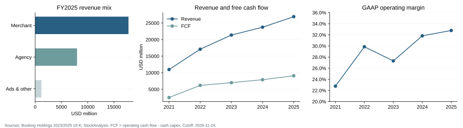

# Booking Holdings（BKNG）研究报告

> **研究及信息截止日：2026-11-24，北京时间。** 财务截至2026-09-30；行情统一采用美国2026-11-23收盘144.94美元，避免混入11/24盘中价格。NASDAQ普通股BKNG，英文全称Booking Holdings Inc.，中文常称Booking控股、缤客集团；不是单独的Booking.com，也不是另一只ADR。
>
> 最新官方披露在外股本743,701,257股（10/26），复算市值1,077.9206亿美元；价格/第三方滚动稀释EPS为15.77倍，TTM自由现金流收益率8.57%。本报告全部价格与每股数据统一为1股拆为25股（25-for-1，2026-04-02生效）后的口径。
>
> 研究主线：Booking仍能为分散的住宿供给提供全球客源、支付与服务，但AI入口和监管正在检验这套能力究竟能保住多少利润。低估值值得认真研究，回购本身不能证明回报安全。

## AI研究偏见自觉

**信息丰富度评级：A级。** 年报、季报和经营指标较充分；最容易发生的错误，是把大量“轻资产、网络效应、回购”的相似叙事当成投资确定性。

**AI研究局限性声明：** 未访谈酒店、未取得AI渠道分成或酒店单店贡献数据。正常化股东盈利、未来回购、稳态资本回报和风险概率都是研究假设。公开渠道不能独立测量AI是否已经削弱客户关系；本报告也未核定统一口径的全球住宿可交易TAM。资料多不意味着十年结果容易预测。

- [x] 财务事实与估值假设分列；不以管理层调整后口径取代GAAP。
- [x] 不把免费搜索计作完全独立于Google的自有客户。
- [x] 不把FCF收益率和用同一FCF支付的回购率相加。
- [x] 即使资料减半，核心问题仍是每笔住宿交易的增量价值与获客成本，而非报告数量。

本次复用既有Booking目录和监控ID `Booking`。[5月旧稿](最终报告.md)保留为历史记录；其约55美元股价、部分历史财务数据和“保底回报”算法不能沿用。本稿替代其当前估值与行动依据。

---

## 第一步：核心数据总览

### 收入来自交易组织，而不是拥有酒店

以下金额单位均为百万美元。Merchant、Agency是交易及收款模式，不是住宿与机票等产品分部；公司没有披露这些分类各自的营业利润率。

| 2025收入分类 | 收入 | 占比 | 同比 | 谁为什么付费 |
|---|---:|---:|---:|---|
| Merchant | 17,755 | 65.96% | +25.5% | 平台参与收款结算，获得住宿等交易的服务收入 |
| Agency | 7,968 | 29.60% | -6.5% | 主要由供应商向旅客收费，平台赚取佣金 |
| 广告及其他 | 1,194 | 4.44% | +11.3% | 元搜索、餐饮预订等服务 |
| 集团 | 26,917 | 100% | +13.4% | 约89%收入来自住宿预订 |

2025年间夜12.35亿、总预订额1,861.07亿美元。收入/总预订额为14.46%，只是跨产品、跨确认时点的综合变现比，不能称为统一酒店佣金率。来源：[2025年报][K25]、[独立收入分类核对][SAF]。

### 五年趋势

| 年度 | 收入 | GAAP净利 | GAAP营业利润 | 营业利润率 | CFO | 现金CapEx | FCF | 现金及等价物 |
|---|---:|---:|---:|---:|---:|---:|---:|---:|
| 2021 | 10,958 | 1,165 | 2,496 | 22.78% | 2,820 | 304 | 2,516 | 11,127 |
| 2022 | 17,090 | 3,058 | 5,102 | 29.85% | 6,554 | 368 | 6,186 | 12,221 |
| 2023 | 21,365 | 4,289 | 5,835 | 27.31% | 7,344 | 345 | 6,999 | 12,107 |
| 2024 | 23,739 | 5,882 | 7,555 | 31.83% | 8,323 | 429 | 7,894 | 16,164 |
| 2025 | 26,917 | 5,404 | 8,825 | 32.79% | 9,409 | 322 | 9,087 | 17,203 |

FCF定义为CFO减现金购置物业设备，含已资本化的软件投入；不扣收购，也不是可无条件全部派发的现金。2021—2023现金以外另有短期投资25、175、576。2023—2025收入复合增速12.24%；2025 FCF率33.76%。疫情恢复低基数不能代表稳态增长。来源：[2023年报][K23]、[2025年报][K25]及[损益][SAF]、[现金流][SAC]、[资产负债表][SAB]交叉核验。



**毛利率不作为证据。** 公司按费用性质呈报，没有可比传统毛利。Macrotrends的毛利率列为100%，StockAnalysis将人员费用映射入营业成本后得到2025年87.36%，不能当两份独立证据证明“87%毛利护城河”。SA标准化2025营业利润9,487也不同于GAAP 8,825，差额662对应减值457与转型成本205。本表采用原始GAAP，不平均不同口径。

### 最近四季度

| 指标 | 2025Q4 | 2026Q1 | 2026Q2 | 2026Q3 |
|---|---:|---:|---:|---:|
| Merchant收入 | 4,249 | 3,698 | 5,127 | 6,998 |
| Agency收入 | 1,791 | 1,528 | 1,903 | 2,463 |
| 广告及其他 | 309 | 306 | 322 | 332 |
| FTC收入冲减 | 0 | 0 | 0 | -900 |
| GAAP收入 | 6,349 | 5,532 | 7,352 | 8,893 |
| GAAP收入同比 | +16.05% | +16.17% | +8.15% | -1.28% |
| GAAP净利 | 1,428 | 1,083 | 1,950 | 2,717 |

来源：[全年业绩][R25]、[Q1][Q1]、[Q2][Q2]、[Q3][Q3]与[独立季度财务表][SAQ]。Q3前三类收入合计9,793，再减900才得到GAAP 8,893；不能把分项直接加总后称GAAP。公司调整后收入同比约+9%、间夜约+7%、总预订额约+10%；这些较好的经营增长与GAAP收入下降同时成立。[Q3业绩公告][R3]

Q4指引则是间夜仅+1%—3%、调整后收入+0%—2%、调整后EBITDA大致持平。管理层提及国际旅行放缓、中东冲突及机票价格等影响。不能只外推Q3表现。[管理层准备稿][RM]

### 现金是真实的，但有对应义务

| 截至9/30的项目 | 百万美元 | 解释 |
|---|---:|---|
| 非受限现金 | 15,814 | 不含受限现金230 |
| 有息债务 | 20,061 | 短债1,987加长债18,074，不含租赁 |
| 净现金 | -4,247 | 实为净债务 |
| 递延Merchant预订负债 | 6,450 | 客户和供应商对应义务，不能再当额外股东现金 |
| TTM经营现金流 | 9,561 | 全年加本期累计减上年同期 |
| TTM FCF | 9,237 | 再减CapEx 324 |
| TTM SBC | 594 | 采用现金流表口径 |
| TTM FCF减SBC | 8,643 | 经济成本对照，仍需正常化营运资金 |

现金和债券采用[Q3原始报表][Q3]，现金、FCF和SBC由[SA独立核对][SAC]。SA标准化总债务21,319比上述债券口径多1,258，其租赁映射与官方表不能完整对账，**该差异尚未解决**；不据此复制其EV。官方长期经营租赁负债另列515，短期租赁包含于其他应计负债，因此也不把简单再减515称为完整租赁后净债。

> 段永平式追问（本报告提问）：把预收款、回购和一次性项目全部拆开，这门生意持续给股东留下的现金还有多少？本稿用80亿美元作为保守研究锚，尚非已证实的稳态数。

---

## 第二步：生意本质分析

**一句话：Booking替分散住宿商家找到全球旅客，并把“能找到房”组织成“能成交、能收付、出问题能处理”，从重复发生的住宿交易中收费。**

旅客可以同时比较多家平台，酒店也能同时上架。复购主要来自便利、可选库存、价格、评价和服务，而不是合同锁定。Merchant渗透提高，使平台参与更多支付、退款与风控；收入增长的一部分也来自模式迁移，不能全部解释为提佣或份额增长。

| 经营变量 | 利润为何随之变化 | 需要防止的误读 |
|---|---|---|
| 间夜与房价 | 带动交易额及佣金基数 | 美元增速同时受汇率、目的地组合影响 |
| 消费者渠道效率 | 更多高质量复购可降低每笔订单的获客支出 | Direct包含SEO，集团与B2C分母不同 |
| 支付和产品组合 | 改善转化、交叉销售，也增加处理成本 | B2B、机票更快增长不保证同等利润率 |
| 固定费用与软件投入 | 规模增长快于人员、系统费用时产生杠杆 | 低现金CapEx不代表研发免费，研发人员主要已费用化 |

Q3集团营销费用/总预订额4.8%，上年4.7%；B2C营销效率改善与集团营销率上升可以同时发生，B2B组合变化需要分开看。技术投入分散在人员、IT、资本化软件等科目，没有独立可比研发费用，不能把IT费用全称作研发或AI开支。[Q3报表][Q3]

公司披露TTM集团直接渠道间夜占比约五成半，B2C约六成半；App约五成多，Genius较高等级客户占间夜约五成多，Connected Trip交易增速接近+20%。这些指标有各自分母，不能相加。**直接渠道定义包含免费搜索，因此其中仍有Google依赖。** [经营演示稿第5页][P3]

经营杠杆的正面证据是五年营业利润率总体提高；反面证据是2026Q4量减速时EBITDA指引趋平。持续创造复购价值、控制获客成本，比再提高一个百分点Merchant占比更关键。

> 段永平式追问（本报告提问）：这门生意好在哪？好在住宿供给的碎片化持续产生撮合与履约需求；能否保住佣金，取决于平台每次仍能解决真实问题。

---

## 第三步：护城河评估

| 来源 | 强度判断 | 可以验证的机制 | 什么会破坏它 |
|---|---|---|---|
| 品牌与定价权 | 中强 | 用户愿在陌生目的地依赖平台 | 酒店直销持续更优惠，平台补贴侵蚀净佣金 |
| 转换成本 | 消费者低、商家中低 | 评价、运营工具、支付与会员形成使用习惯 | 用户把比价决策交给AI，商家多平台经营 |
| 网络效应 | 强但非排他 | 更多合适库存与客源互相促进 | 供给同质化、AI跨平台聚合弱化独占关系 |
| 规模效应 | 强 | 全球收付、反欺诈、客服与异常处理可摊薄固定成本 | 大渠道拿走利润，平台退化成低毛利履约商 |
| 技术与专利 | 工程和数据强，专利锁定弱 | 实验、排序、交易系统与真实履约反馈 | 基础模型可采购，单独聊天界面不构成排他壁垒 |

过去五年，支付和交易组织能力变宽；入口控制和价格约束受到侵蚀。未来五年最可能出现的是“交易能力仍强、获客租金更贵”，而不是整个网络突然消失。这是研究推论，尚无AI渠道利润数据证明其幅度。

Google已推出美国英语AI Mode酒店会话内预订，合作名单同时包括Booking、其他OTA与大型酒店集团；酒店或OTA仍负责商户责任和售后。这既说明AI暂时需要真实交易网络，也说明酒店直销获得了新的同屏入口。所谓Google为保护广告收入而必然不竞争，已不能当作安全前提。[Google官方产品说明][GOOG]

欧盟2026/9/28披露的DMA实施安排进一步明确，Booking的EEA商家资格评价不得参考站外价格。住宿方可以提供不同直销价格，平台必须靠增量订单和服务证明收费价值。[欧委会说明][DMA]

> 巴菲特式追问（本报告提问）：十年后还在的，可能是跨境交易与服务网络；最值得警惕的是用户关系转移后，这张网络只能收取较低的费用。

---

## 第四步：逆向思考与风险清单

**最强反方：Booking可以继续增长，却成为利润率更低的库存和履约供应商。** AI控制选择，酒店直连接口改善，平台仍承担客服、支付和取消责任，却需为入口支付更多费用。B2B扩张和回购会让交易额与每股数字显得良好，掩盖单位经济走弱。

下表概率为研究者的定性判断，期限约三至五年，各事件重叠，不能相加，也不是统计频率。

| 失败路径 | 概率判断 | 影响 | 观察什么 |
|---|---|---|---|
| AI入口重分配利润 | 中高 | 高，可能是缓慢压缩而非突然归零 | B2C direct下降并伴营销/预订额上升；AI渠道每单净贡献 |
| 需求放缓持续 | 中 | 中高 | Q4低增长是否延续、是否持续落后同口径同行 |
| FTC与分销治理扩散 | 已计提事项；超额损失概率未知 | 高 | 最终协议、现金支付、跨品牌同类问题 |
| DMA削弱价格竞争力 | 中高 | 中 | 站外低价增多后，平台自付优惠及净变现是否恶化 |
| 回购过快、净债继续上升 | 中 | 中高 | 完整FCF能否覆盖回购分红、未来到期债务 |
| 系统、网络安全或全面旅行中断 | 低频且无法可靠量化 | 极高 | 事故披露、赔付与恢复能力；未单列概率估值 |

FTC调查涉及Priceline及B2B关联合作方的披露、收费、客服和账单行为。已计提总额10亿美元，其中9亿冲减收入、1亿计入费用；**尚未最终和解，不能称为已付清罚款或最大损失。** [10-Q附注13][FTC]

历史类比更像从桌面搜索向移动入口迁移时的利润再分配：服务需求没有消失，谁控制分发却会改变。这个机制比“OTA必成下一个3Com”的公司类比更有解释力；后者并无足够可比数据。

最可能的分析错误，是把App/Genius占比提高自动解释为低成本客户关系变强。如果会员增长依赖折扣，或App用户仍由高价广告导入，占比会比经济价值好看。另一个错误是锚定2025的高倍数，认为只要恢复历史PE就能获利。

> 芒格式追问（本报告提问）：聪明人为什么不买？因为今天较低的倍数，可能正补偿未来单位利润与渠道控制力的下降；我们尚不能证明市场多算了多少损失。

---

## 第五步：管理层评估

Glenn Fogel自2017年任集团CEO，2000年加入公司；CFO Ewout Steenbergen自2024年任职。公司仍由职业经理体系经营，CEO离开不至于令库存、支付或客服网络消失，但AI转型及合规执行存在继任风险。[官方领导层][MGMT]

| 时期/决策 | 可验证结果 | 本报告评价 |
|---|---|---|
| Merchant与整行程投入 | 交易参与加深，2025 Merchant收入占65.96% | 经营执行较强；不把模式迁移全算增长 |
| KAYAK等并购 | 2025Q3商誉减值180、无形资产减值277百万美元 | 资本配置有失败记录；不能只看成功品牌 |
| Etraveli收购计划 | 欧盟普通法院2026/9/9维持禁购决定 | 不计入已拥有资产或既成协同 |
| 持续回购与分红 | 每股权益可受益，但需检验成交价与资金来源 | 积极回报不等于价格纪律已被证明 |
| 2027起整合B2B部门 | 11/18已公告，尚未产生独立可核利润 | 先看净贡献，不预支新业务溢价 |

依据：[年报][K25]、[欧盟法院新闻稿][ETR]、[Booking Partner Division公告][B2B]。

2025现金回购付款64.40亿美元、分红12.48亿美元。2026前九月分别为99.00亿与9.78亿美元，合计108.78亿美元，对比同期FCF78.20亿美元，达到139.10%；期间发行长期债现金29.75亿美元、偿债10亿美元。不能说所有回购都由当期自由现金流覆盖。[现金流原表][Q3]、[独立现金流核验][SAC]

### 股权与激励

2026 proxy以3/16为持股基准，Fogel受益持股537,900股，占当时783,191,550股的0.0687%；15名董高合计0.1676%，集体数字仅有公司申报源。公司一股一票，没有AB股经济权益与投票权分离。[Proxy][PROXY]

CEO持股另以本人Form 4核验：12,596×25直接股加13,820×25 GRAT，减未归属奖励122,500股，得到537,900。Form 4把未归属RSU列在普通股表，proxy受益持股排除该项，未经调整会误报冲突。这是3月已核快照，**不是11月实时持股**。[3/17本人申报][F4]、[3/4奖励申报][F4G]

2025 CEO总薪酬35,418,102美元，含股票授予会计价值26,202,279美元，不能当成全部现金收入。薪酬足够大而自有经济权益比例小，应继续检查指标是否鼓励通过回购提高每股结果，而不是忽略总利润、净债与合规。结论是经营能力中高置信、资本配置纪律中等置信，不给“管理层优秀”无条件通行证。

> 段永平式追问（本报告提问）：如果CEO退休，生意大体仍能运行；如果回购停止，每股增长还有多少，才是判断体系能力的更好测试。

---

## 第六步：行业与文明趋势

旅游长期需求与收入、交通可达性及休闲时间相关，线上化降低跨境搜索与交易成本。AI确实可能改变界面与选择方式，却不会自动增加旅客预算，也不会保证价值由OTA取得。

公司位于“酒店库存—分销获客—支付履约—旅客”之间。碎片化独立住宿更依赖外部客源，大连锁更有品牌与直连能力；Booking能否同时服务两者，决定其利润池，而非旅游业对GDP贡献的总量。

本稿不采用旅游GDP贡献或含交通餐饮的超大市场数作为OTA TAM，亦不从混杂市场口径推导份额。集团客户与住宿供给较分散，但入口服务商具有集中度；公司没有公布足够数据让我量化Google或AI平台的单一经济依赖。

| 对手 | 最新官方经营信号 | 含义 |
|---|---|---|
| Expedia | Q3间夜+7%，B2B预订额+19%、收入+23% | B2B并非Booking独享蓝海 |
| Airbnb | Q3收入+19%、GBV+21%，Nights and Seats Booked +16% | 指标含席位，不能与酒店间夜直接计算份额差 |
| Trip.com | Q3拟12/1美国时间发布；截至本稿仍以Q2为最新 | 不把尚未披露Q3写成事实 |

来源：[Expedia官方业绩][EXPE]、[Airbnb官方业绩][ABNB]、[Trip.com公告][TRIP]。这些运营数仅用于竞争判断，未将不可比增长率代入估值。

> 李录式追问（本报告提问）：二十年后仍需要有人解决真实住宿交易；但“行业存在”与“今天这家平台仍拿主要利润”是两项需要分别验证的命题。

---

## 第七步：估值与安全边际

### 当前价格买到了什么

| 指标 | 11/23口径 | 说明 |
|---|---:|---|
| 收盘价 | 144.94美元 | Yahoo与SA历史记录一致 |
| 复算股权市值 | 1,077.9206亿美元 | 官方10/26在外股数；其后回购暂不可知 |
| TTM GAAP净利 | 71.78亿美元 | 官方年度与累计数据桥接 |
| 市值/TTM净利 | 15.02倍 | 使用当前在外股数 |
| 价格/滚动稀释EPS | 15.77倍 | SA EPS 9.19；历史加权股数与当前股数不同 |
| PS | 3.83倍 | GAAP收入281.26亿美元 |
| 债券口径EV/收入 | 3.98倍 | EV=股权市值+净债42.47亿美元，未含租赁 |
| FCF收益率 | 8.57% | 尚未扣SBC与营运资金正常化 |
| FCF减SBC收益率 | 8.02% | 不再额外加上回购率 |
| 年化宣告股息率 | 1.16% | 0.42×4；未来股息可改变 |

来源：[收盘记录][HIST]、[Yahoo行情][YAHOO]、[股本原表][Q3]及[SA统计][SAS]。SA的Forward PE约12.36、PEG约0.71依赖分析师预测，未独立验证其完整底稿，不作为本稿买入依据。

历史上SA按年末口径列示2022—2025 GAAP PE约25.56、28.86、27.96、31.94倍，现在明显更低；但2025有汇兑及减值影响，跨年利润并不平滑，不能据此认定应回到30倍。[历史估值表][SAR]

同一11/23收盘的第三方快照中，Expedia PE约14.15倍、P/FCF约7.58倍，Airbnb约32.73倍、20.39倍；Booking并非所有同行中最便宜。这组仅为单一数据供应商的描述性比较，现金定义、SBC、产品和净债不同，未做完整双源同行估值审计，亦不据此决定终值倍数。[Expedia][EXS]、[Airbnb][ABS]

### 正常化盈利锚：假设，不是新披露

以TTM FCF减SBC 86.43亿美元为起点，留出6.43亿美元年度正常化余量，选**80亿美元股东盈利等价额**，按当前股数为每股10.7570美元。这不是GAAP EPS，也不是公司指引。它假定支付浮存金增长不全部归股东、费用化技术投入保持，且已在SBC经济成本后计量；真实可持续数可能更低。

FTC现有10亿美元计提另作一次性现金准备，每股1.3446美元；三年现值直接扣除。该损失不每年重复扣。超额赔付及合规成本升级放入悲观情景；若最终支出更大，需要再减值。当前现金也不再额外加到估值上，避免把营运资金当剩余现金。

三年模型中每股盈利增长已包含回购净缩股的作用，**不再叠加回购收益率**；十年同理。未来净缩股只有在扣分红、再投入及偿债后有资金，且回购价格合理时才成立。

### 三年三情景：判断贵不贵

工具以正常化每股盈利代入；表中“倍数”是研究者设定的三年股东盈利倍数，不冒充GAAP PE。假设每年股息1.68美元，按美元10%折现；今日价值包括三次股息，并扣上述一次性FTC准备。概率是主观研究权重。

| 情景 | 权重 | 每股年增速 | 第三年倍数 | 第三年每股盈利 | 第三年价格 | 含息、扣准备的今日价值 |
|---|---:|---:|---:|---:|---:|---:|
| 悲观 | 20% | -3% | 11倍 | 9.82美元 | 107.99美元 | 83.97美元 |
| 基准 | 55% | +8% | 16倍 | 13.55美元 | 216.81美元 | 165.73美元 |
| 乐观 | 25% | +12% | 20倍 | 15.11美元 | 302.26美元 | 229.92美元 |

概率加权今日值165.42美元，不能把216.81美元的三年价格当今天合理价。基准假定需求恢复、经营盈利增长加温和净缩股；悲观反映需求、AI分流、费率和监管成本共同挤压；乐观需要复购与跨产品效率兑现。

反向定价：在同一80亿美元起点、第三年16倍、股息与FTC准备下，144.94美元要求未来三年每股盈利年增约+3.20%。这不是唯一市场隐含预期，而是一组可复算条件。若起点盈利判断错了，所谓便宜也会消失。

因此给出的**130—145美元条件式分批研究带**，是对约165.73美元基准今日值预留折价后的执行区间，不是模型精确下限。低于130先检查永久损失，不能机械加码；高于145暂不扩大新仓。200美元以上、模型没有同步增强时复核估值与超配，不是自动卖出。

### 十年折现：判断仓位能有多重

美元资本成本取 **r=10%**：采用11/23美国10年国债4.92%，β=1，研究ERP取5.08%，两者相加；ERP为本稿要求的权益补偿，非直接观测事实。合理区间沿用工具的9%—11.5%，不通过调低r迎合买入。[美国财政部][UST]

稳态增量ROIC取25%。负权益和轻资产结构使当前账面ROIC失真，不能外推SA的高读数。25%是成熟交易网络仍有优势、但新增支付和AI投入回报逊于老网络的判断，不声称已由派息反解验证；稳态g为1%/3%/4%，基准低于美元4%的上限。g是十年以后永久增长，与前十年增速不同，敏感性检验时保持g不动。

终值倍数全部来自 `(1-g/ROIC)/(r-g)`。三档r−g分别为9、7、6个百分点，均高于5个百分点；对应终值10.67、12.57、14.00倍，没有用同业现价决定十年后倍数。

十年情景每股盈利年增0%/+9%/+12%。基准约由经营增长与2%—3%左右净缩股共同支撑，这是资金和回购价格均有条件的假设；不再假定另赚一份回购收益。为适配工具，以当前股数保持不变的“每股盈利等价总额”输入终值，它**不是2036实际集团净利预测**。

FTC一次性准备按现在出资处理，压力测试投入为股权市值1,077.9206亿加准备10亿，即1,087.9206亿美元；实际报价市值不变。股息增益k=1.68/(144.94+1.3446)=1.1484%，稀释经济成本已在SBC和净缩股假设内，不再额外奖惩。

| 情景 | 2036每股盈利等价总额 | 永续g | 退出倍数 | 工具十年近似IRR |
|---|---:|---:|---:|---:|
| 悲观 | 80.00亿美元 | 1% | 10.67倍 | -1.25% |
| 基准 | 189.39亿美元 | 3% | 12.57倍 | +9.30% |
| 乐观 | 248.47亿美元 | 4% | 14.00倍 | +13.47% |

主观概率仍为20%/55%/25%，期望近似IRR **+8.23%**，低于10%。工具把股息率直加在价格几何回报上，不是逐年现金流求根的精确IRR；不预测税、交易费或外汇收益。它是仓位压力测试，不能声称8.23%为可保证回报。

| 折现率r | 期望近似IRR | 是否覆盖r | 判定资格 |
|---|---:|---|---|
| 8% | +11.93% | 通过 | 区间外，仅供参考 |
| 9% | +9.90% | 通过 | 合理区间内 |
| 10% | +8.23% | 未通过 | 基准 |
| 11% | +6.81% | 未通过 | 合理区间内 |
| 12% | +5.57% | 未通过 | 区间外，仅供参考 |

先执行r±2pp，两侧均在合理区间外，不能据单点称结论稳定；再执行±1pp，**压力测试在合理美元区间内翻转**。本结论对折现率敏感，仓位建议必须降级；保持10%基准，不用9%的通过单独证明可以买。

### 估值分歧对账

三年定价判断认为144.94美元相对约165美元有折价，支持有限分批；十年压力测试则认为更低的永续倍数、长期入口风险和回购假设不能支持核心重仓。它们回答的问题不同，方向分歧必须保留。

最终综合生意、护城河、管理层、风险、趋势和估值，维持**条件式小额分批买入研究、合理仓位持有**。十年未覆盖r只把研究参考总仓上限收紧至2%，并要求下一季度验证后才考虑加大；没有把它当作单独回避票。若无法理解AI分销、无法承受悲观价值或需要确定性现金收益，主动放弃这一标的也合理。

> 巴菲特式追问（本报告提问）：r错一个百分点，仓位压力结论就翻转，因此不能重仓依赖这份估值。
>
> 段永平式追问（本报告提问）：若股市关闭五年，愿意持有的应是受限的小仓与可跟踪生意，不是“回购保证赚钱”的承诺。

---

## 第八步：最终决策与行动清单

| 并列维度 | 结论 | 信心度 |
|---|---|---|
| 生意质量 | 真实全球住宿撮合、支付与服务需求；强现金创造但非全部可派发 | 中高 |
| 护城河 | 交易执行与规模仍强，入口和价格约束变弱 | 中 |
| 管理层 | 经营执行较好，回购资金纪律、并购回报及渠道治理须检验 | 中 |
| 最大风险 | AI分销攫取利润，需求放缓与FTC问题相互叠加 | 中低，损失幅度不明 |
| 文明趋势 | 跨境和线上交易有长期需求，AI价值归属未定 | 中 |
| 估值 | 三年有有限折价；十年期望8.23%未覆盖10%，合理r内翻转，只支持限仓 | 中低 |

估值维度不是最终决策的唯一裁决。以下为学习研究的参考规则，仓位未结合读者现有组合、现金需求或美元风险预算。

| 策略 | 建议 |
|---|---|
| 空仓者 | **130—145美元可条件式分批研究买入**，首笔参考组合0.5%；144.94处于上沿，只适合首笔，不能一次建满；须接受FTC未决及AI渠道不透明，资金无需近期使用 |
| 持仓者 | **合理小仓继续持有**；已接近2%研究上限者暂停加仓，超配者先复核集中度；低成本不是单独持有理由 |
| 加仓信号 | 价格仍在研究带，下一完整季度验证FCF减SBC的滚动年化能力约80亿美元未被破坏、B2C获客经济未显著转坏，FTC支付和净债可承受后，再研究增加约0.5%；参考总仓≤2% |
| 卖出或减仓复核 | 确认持续利润外流、重大诚信/渠道治理问题、回购继续靠加债且现金能力恶化时，先重估可持续盈利；≥200美元而模型未增强，复核估值与超配，非自动清仓 |
| 价带下沿失守 | <130美元先区分错杀与永久损失；经营红线触及则停用原价带 |
| 145美元以上 | 新增资金等待价格或新证据，不因上涨机械追入；持仓策略仍按生意证据 |

建议的经营红线为研究者设置：连续两次完整季度披露显示滚动FCF减SBC低于70亿美元且非可解释的一次性支付，或连续四季B2C direct回落并伴同口径获客费率恶化，必须重做80亿美元锚。实际FTC付款须先剔除一次性影响，不能同一笔损失触发两次。

**复检安排：** 2026/12/31核FTC、Q4正式日程与B2B准备；2027/2/28作为全年财报披露窗口的研究检查日，未确认公司具体预约日期，提前披露则提前复核。12/11是官方股息登记日，12/31支付每股0.42美元。事件登记只供人工复核，当前每日监控只扫描价格。

### 四位大师原则的有据延伸

未找到四位对Booking的足够专属一手观点，**不模拟其本人买卖立场**。下面先列可核验一般原话，再列本报告的延伸判断，两者不能混为真实点评。

- 巴菲特：“when a company overpays for repurchases, the continuing shareholders lose.” 出自[2022股东信第6页][BUFF]。本报告延伸：回购是否有益，取决于价格与资金纪律。
- 芒格：“pay a fair price for a good business”。出自[2014亲笔副主席回顾第40页][MUNG]，原文谈伯克希尔制度。本报告延伸：Booking的生意质量支持研究，买价仍需留余地。
- 段永平：“钱多（相关业务用不掉）就应该回购或派息”。出自[2011/9/13原帖](https://xueqiu.com/1247347556/20392583)，已读[本地原始发言档案](../段永平/段永平雪球全量原发言.md)。本报告延伸：先确定现金是否真有余，不以回购规模替代判断；没有证据据此声称段永平看多Booking。
- 李录：“investors need to build their own circle of competence”。出自[官方2024/12/7讲稿，第21页][LI]。本报告延伸：若不能判断AI入口与酒店供应关系，资料丰富也不能替自己建立能力圈。

---

## AI分析置信度与投资确定性

财务历史、FTC计提结构、现金债券余额及当前市值为较高置信；GAAP与标准化利润差异已经识别，管理层持股做了RSU调节。高管集体持股仅单源、第三方债务映射与AI渠道单位经济仍有缺口。

投资确定性为中等偏低：正常化80亿美元、未来净缩股、25%增量ROIC与永续g均有判断成分，十年压力测试随合理r翻转。全面停航、重大数据泄露的离散尾部损失未单独赋概率，税、汇率、账户限制及个人组合相关性未建模。

需要继续取得的一手证据是AI渠道订单净贡献、B2B新增利润而非交易额、酒店站外优惠对转化的影响，以及FTC最终约束。此类缺口不会因多生成一份报告消失。本报告用于学习研究，不构成投资建议。

---

## 数据来源与审计记录

### 关键数据交叉验证记录

财务主源采用SEC原表，独立供应商采用StockAnalysis；Macrotrends直访受403限制，仅搜索索引作辅助，未虚称全文读取。估值由 `financial_rigor.py` 与 `terminal_value.py` 计算，分数幂和折现另以Decimal复核。工具复现参数及计算结果见[模型记录](Booking-research-20261124-model.json)。

以下保留关键工具输出数值，不把不同会计口径硬判成一致：

```text
市值验算：144.94 USD × 743701257股
计算市值：107792060189.58 USD；对比第三方107792000000 USD，偏差0.00%，通过。
2025收入：10-K 26917 / StockAnalysis 26917 百万美元，偏差0.00%。
2025净利润：10-K 5404 / StockAnalysis 5404 百万美元，偏差0.00%。
2026Q3现金：10-Q 15814 / StockAnalysis 15814 百万美元，偏差0.00%。
股本：10-Q 743701257 / StockAnalysis 743700000 股，偏差0.00%。
TTM FCF：官方桥接9237 / StockAnalysis 9237 百万美元，偏差0.00%。
估值复算：价格/EPS=15.77倍，FCF收益率8.57%，年化股息率1.16%。
TTM营业利润：8825+7189-6795=9219 百万美元；标准化表不替代GAAP。
CEO持股：12596×25+13820×25-122500=537900股；proxy与本人申报调节后一致。
十年准出：USD；r=10%；ROIC=25%；g=1%/3%/4%；β=1。
C1币种通过；C2分母9/7/6个百分点通过；C3离散风险不进入r或β，通过。
限制：全面停航、重大数据泄露标为未建模，已在正文保留。
```

**审计结论：【准出】。** 固定种子20261124，在工具可识别的一百零二个点中随机抽十六项：两项是把Q3编号误认成财务数字的解析噪声，保留原记录并排除；八项为事实或财务派生数，六项为模型输出、假设或仓位政策的复现。另补查十一项核心财务事实，弥补工具跳过年份行的问题。共二十五项数值核查均无超限或警告；模型与政策复现不等于预测已获外部证实。[完整抽检记录](Booking-research-20261124-audit.json)保留分类、原样本及双源路径；正文已列明的单源或口径缺口不冒充双源通过。
+
+定稿参数再次执行终值C1/C2/C3审计，全部通过；两个未建模尾部风险仍保留。监控配置及临时状态的Booking定点运行通过。临时预检的腾讯行情快照为147.90美元，状态NEAR，已高于145美元上沿；它与本稿统一采用的11/23收盘144.94美元是不同时间快照，**不能据收盘锚在带内就声称执行时仍可买入**。
+
+已沿用原监控ID登记新价格带、200美元复核线及人工事件，并在[跟踪表](../标的跟踪表.md)新增本次建议事件、关闭被接续旧事件；未按旧55美元锚计算回报或命中。当前每日监控只扫描价格，事件不自动提醒。

[K25]: https://www.sec.gov/Archives/edgar/data/1075531/000107553126000009/bkng-20251231.htm
[K23]: https://www.sec.gov/Archives/edgar/data/1075531/000107553124000014/bkng-20231231.htm
[R25]: https://d18rn0p25nwr6d.cloudfront.net/CIK-0001075531/96823fd4-4a58-468f-9ac3-f53ae3364be3.pdf
[Q1]: https://www.sec.gov/Archives/edgar/data/1075531/000107553126000025/bkng-20260331.htm
[Q2]: https://www.sec.gov/Archives/edgar/data/1075531/000107553126000037/bkng-20260630.htm
[Q3]: https://www.sec.gov/Archives/edgar/data/1075531/000107553126000045/bkng-20260930.htm
[R3]: https://www.bookingholdings.com/wp-content/uploads/2026/11/Q3-26-BKNG-Earnings-Release-Final.pdf
[RM]: https://s25.q4cdn.com/383369491/files/content_files/Q3_26-Prepared-Remarks-for-Website.pdf
[P3]: https://s25.q4cdn.com/383369491/files/content_files/BKNG-Quarterly-Earnings-Presentation-_Q3-2026_.pdf
[FTC]: https://www.sec.gov/Archives/edgar/data/1075531/000107553126000045/R21.htm
[SAF]: https://stockanalysis.com/stocks/bkng/financials/income-statement/
[SAC]: https://stockanalysis.com/stocks/bkng/financials/cash-flow-statement/
[SAB]: https://stockanalysis.com/stocks/bkng/financials/balance-sheet/
[SAQ]: https://stockanalysis.com/stocks/bkng/financials/?p=quarterly
[SAS]: https://stockanalysis.com/stocks/bkng/statistics/
[SAR]: https://stockanalysis.com/stocks/bkng/financials/ratios/
[HIST]: https://stockanalysis.com/stocks/bkng/history/
[YAHOO]: https://finance.yahoo.com/quote/BKNG/
[GOOG]: https://blog.google/products-and-platforms/products/search/book-travel-ai-mode/
[DMA]: https://digital-markets-act.ec.europa.eu/factsheet-how-dma-ensures-businesses-using-bookingcom-are-free-set-their-prices-and-bookingcom-2026-09-28_en
[MGMT]: https://www.bookingholdings.com/about/leadership/
[PROXY]: https://www.sec.gov/Archives/edgar/data/1075531/000130817926000310/bkng-20260420.htm
[F4]: https://www.sec.gov/Archives/edgar/data/1516908/000151690826000014/xslF345X05/form4-03172026_040301.xml
[F4G]: https://www.sec.gov/Archives/edgar/data/1516908/000151690826000012/xslF345X05/form4-03042026_040301.xml
[ETR]: https://curia.europa.eu/site/upload/docs/application/pdf/2026-09/cp260125en.pdf
[B2B]: https://ir.bookingholdings.com/news/news-details/2026/Booking-Holdings-Unveils-Booking-Partner-Division-to-Accelerate-B2B-Travel-Innovation/default.aspx
[EXPE]: https://ir.expediagroup.com/news-and-events/news/news-details/2026/Expedia-Group-Reports-Third-Quarter-2026-Results/default.aspx
[ABNB]: https://news.airbnb.com/airbnb-q3-2026-financial-results
[TRIP]: https://investors.trip.com/node/15756/pdf
[EXS]: https://stockanalysis.com/stocks/expe/statistics/
[ABS]: https://stockanalysis.com/stocks/abnb/statistics/
[UST]: https://home.treasury.gov/resource-center/data-chart-center/interest-rates/TextView?field_tdr_date_value=2026&type=daily_treasury_yield_curve
[BUFF]: https://www.berkshirehathaway.com/letters/2022ltr.pdf
[MUNG]: https://www.berkshirehathaway.com/letters/2014ltr.pdf
[LI]: https://cdn.prod.website-files.com/5ef3c7300432b40ed865991a/67a4f75703627bd3a927077e_Global%20Value%20Investing%20in%20Our%20Era%20(2024-12-07).pdf
