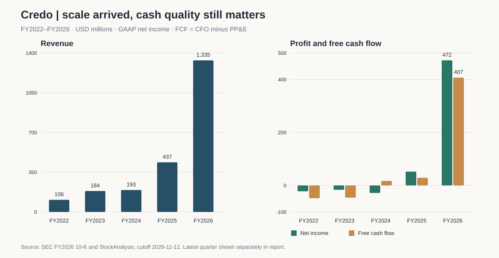
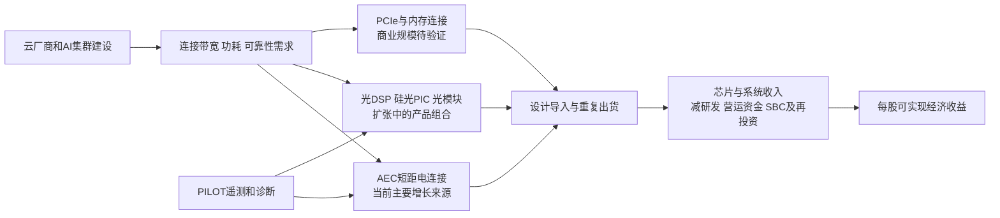

# Credo Technology（CRDO）研究报告

**研究日期 / 数据截止日**：2026-11-12，Asia/Shanghai；行情采用 2026-11-11 美东常规盘收盘，正式披露检索截至研究日。  
**公司与证券**：Credo Technology Group Holding Ltd，NASDAQ: CRDO，开曼注册普通股，并非 ADR；中文媒体亦称克雷多，本文沿用 Credo。  
**收盘价 / 复算基本市值**：US$141.41 / US$26.5783B。股数采用最新可核验的 2026-08-25 已发行 187,951,918 股，不能视为研究日实时法定股本。  
**关键估值**：TTM GAAP P/E 49.97x，P/S 16.70x，EV/Revenue 16.24x，简单 FCF 收益率 1.65%。  
**研究主线**：客户为 AI 集群的连接可靠性和功耗付费；光互连产品证据增强，但新增产品能否变成每股现金收益，仍是现价最重要的未解问题。

> 本报告用于学习研究，不构成投资建议。价格带是附带经营条件的研究阈值，不是自动交易指令。全文金额均为美元；m 为百万，B 为十亿。

---

## AI 研究偏见自觉

**信息丰富度评级：A 级；产品经济性透明度仅中等。** SEC 报表和公告充足，AI 连接叙事也高度一致；公司却没有披露 AEC、光模块、光 DSP、内存连接的完整收入和利润拆分。资料多，仍不能直接证明第二增长曲线已经盈利。

**AI 研究局限性声明：** 财务、持股和公告日期可核验；客户匿名代号、产品 ASP、客户实际切换成本、现场可靠性及并购回报缺乏一手经营验证。本文严格区分「披露事实」「历史观点」「本次计算」「情景假设」。情景概率代表研究判断，并非统计发生率。

- [x] 不把 AEC 对收入增量的贡献，误写成 AEC 占总收入的比例。
- [x] 不把产品发布、演示或开放标准通过，写成订单和量产收入。
- [x] 不因价格低于旧研究锚点，就自动认定风险已经下降。
- [x] 不把低税率全部归为一次性收益，也不把非 GAAP 盈利当作可直接分配的现金。

## 已有研究与本次更新

本次为持续覆盖，复用 `reports/Credo/`，保留触发配置既有 ID `CRDO`。仓库未发现独立的更新一期财报精读。

| 历史材料 | 研究时点 / 数据范围 | 本次用途 |
|---|---|---|
| [最近完整研究](Credo-research-20260903.md) | 2026-09-03；财务至 FY2027 Q1、行情至 9/2 | 重新验证 AEC、客户集中、DustPhotonics、SBC 和旧价格带 |
| [AI 产业链研究](../AI产业研究/AI行业产业链投资研究报告-20260714.md) | 2026-07-14；各公司口径不一 | 仅作为产业链位置的历史观点 |
| [大师持仓 Q2 跟踪](../大师持仓追踪-13F-2026Q2-20260815.md)及[Q1 跟踪](../大师持仓追踪-13F-2026Q1-20260516.md) | 2026-08-15 / 05-16；对应历史季末 13F | 不能代表研究日持仓，也不能替代本人个股观点 |
| [Marvell 数据材料](../Marvell/MRVL_data_collection.md) | 原始抓取时点及口径不足以支撑本次份额认定 | 原文的 DSP 份额估计不进入估值 |
| [建议跟踪表](../标的跟踪表.md)与既有每日监控 | 原建议来自 9/3 | 只记录触价与建议，不构成独立财务来源 |

9/3 后已重新检查公司 IR 新闻、产品公告及 SEC 最近申报。最新已公布财务仍为截至 8/1 的 FY2027 Q1；截至 10/31 的 Q2 **尚未公布**。公司 11/11 正式确认，Q2 于 **12/1 美东盘后**发布，电话会为北京时间 **12/2 06:00**。[正式日程][S4]

| 旧判断 / 未解决问题 | 最新证据及性质 | 本次标记 | 对估值和行动的影响 |
|---|---|---|---|
| SerDes/DSP 驱动可靠、低功耗连接 | 现有财务仍支持；无新增财报 | 维持 | 保留优质技术供应商判断 |
| 正在由铜扩展到光 | 9/15 光模块、10/12 ALC、11/4 OCP 遥测标准；均为正式产品或生态公告 | 强化技术证据 | 不提前确认光学收入和利润 |
| 四个终端客户占 Q1 收入 84% | 最新仍是同一 Q1 数据，没有更新的集中度表 | 维持，改善待验证 | 不给分散化溢价 |
| Q2 收入与毛利率指引可兑现 | 财报日已经确认，结果尚未发布 | 待验证 | 12/2 后逐项复核 |
| Dust 并购能产生协同回报 | 产品整合可见，收入、现金回报仍无拆分 | 技术强化，财务待验证 | 不按协同利润加价 |
| 旧 US$120–140 为常规分批研究带 | 旧模型用 TTM EPS 2.83、三年 +40% 增长、25x；缺少税率及完整长期压力测试 | 修正方法 | 改为 US$90–100 条件研究带；旧带只保留历史解释 |
| 预设减持计划不能视为已卖出 | 新 Form 4 已记录 9/14、10/19 的实际出售 | 更新事实 | 监测激励与稀释，不据此猜测经营内幕 |

价格比旧锚点 US$165.22 低 **14.41%**，来自同一证券的收盘价比较；这改变价格，不证明任何经营条件已经满足。[行情交叉核对][S5]

> 方法边界：旧报告末尾四段署名“大师”的文字没有可核验引文，本次不沿用为真人原话。旧报告未执行十年模型，本次属于补齐方法，不能写成公司基本面突然恶化。

---

## 第一步：核心数据总览

### 五年经营趋势

单位：US$m；利润率为 GAAP；简单 FCF＝经营现金流－购建固定资产。FY2026 截至 2026-05-02，FY2025 含 53 周，跨年增长不能无限外推。[年报][S1] / [独立数据整理][S6]

| 财年 | 收入 | 净利润 | 毛利率 | 营业利润率 | 经营现金流 | 简单 FCF | 现金及短投 |
|---|---:|---:|---:|---:|---:|---:|---:|
| FY2022 | 106.48 | -22.18 | 60.12% | -17.69% | -30.83 | -48.41 | 259.32 |
| FY2023 | 184.19 | -16.55 | 57.65% | -10.22% | -24.62 | -46.33 | 217.81 |
| FY2024 | 192.97 | -28.37 | 61.89% | -19.20% | 32.74 | 17.09 | 410.00 |
| FY2025 | 436.78 | 52.18 | 64.77% | 8.50% | 65.08 | 29.02 | 431.34 |
| FY2026 | **1,335.116** | **472.279** | **68.03%** | **33.33%** | **464.294** | **406.996** | **1,443.286** |



转折已经发生：收入超过固定研发和销售成本后，经营杠杆很强。需要防止的错误是把刚完成的规模跃迁，当作已穿越需求周期的稳定利润率。FY2026 研发 US$279.381m，最新 Q1 研发 US$114.524m，仍需不断投入下一代连接能力。[S1][S2]

### 最近四季：增速高，收入结构仍不透明

| 财季 | 期末 | 收入（US$m） | GAAP 净利润（US$m） | GAAP 毛利率 |
|---|---|---:|---:|---:|
| FY2026 Q2 | 2025-11-01 | 268.027 | 82.636 | 67.5% |
| FY2026 Q3 | 2026-01-31 | 407.012 | 157.142 | 68.5% |
| FY2026 Q4 | 2026-05-02 | 437.003 | 169.102 | 68.2% |
| FY2027 Q1 | 2026-08-01 | **479.003** | **129.425** | **64.5%** |

来源：[Q2][Q2]、[Q3][Q3]、[Q4][Q4]、[Q1][S3]，并与 [StockAnalysis 季度表][S7]核对。最新 Q1 收入同比 +114.7%、环比 +9.6%；GAAP 毛利下降主要受收购无形资产摊销影响。Q2 指引收入 US$525–535m、GAAP 毛利率 62.9%–64.9%、非 GAAP 毛利率 67%–69%。指引不是已实现业绩。[S3]

公司只有一个报告分部。FY2026/Q1 未找到足以重建各产品收入比例的正式表格，因此下图只表示赚钱路径，**不表示收入占比**。



FY2026 AEC 贡献逾 99% 的收入同比增量，Q1 贡献逾 90%；两者均不是总收入占比。PILOT 主要服务硬件可靠性，未有证据支持独立订阅收入估值。[S1][S2]

### 股本、现金与利润质量

| 项目 | 数值 | 时点与解释 |
|---|---:|---|
| 已发行普通股 | 187,951,918 股 | 8/25 10-Q 封面；StockAnalysis 显示 187.95m |
| Q1 摊薄加权股数 | 194.378m 股 | EPS 分母；不是期末普通股或实时股本 |
| Q1 现金及短投 | 764.258m | 现金 466.869m，加短投 297.389m |
| 有息借款 | 0 | 不等于没有租赁或采购义务 |
| 租赁负债 | 26.205m | 为保证可比，从净现金扣除 |
| 净现金 | 738.053m | 不抵销营运性应付和供应承诺 |
| Q1 应收 / 库存 | 288.798m / 313.051m | 需求爬坡需要资金，不宜只看利润表 |
| TTM 收入 / GAAP 净利 | 1,591.045m / 538.305m | FY2026 加最新季度、减去年同期 |
| TTM 简单 FCF | 438.598m | CFO 500.357m，减 PP&E 61.759m |
| TTM SBC | 235.162m | 真实经济成本，不因不付现金而消失 |
| TTM FCF 减 SBC | 203.436m | 经济收益压力指标；不是另一项 GAAP 现金流 |

上述关键数据由 SEC 和 StockAnalysis 对照，纯舍入偏差不超过 1%。两者是不同的数据处理渠道，但财务经济事实均源自公司；不把公告转载伪装为独立原始来源。Macrotrends 正文访问受限，仅使用可核实的收入索引，不冒称已重新读取全表。[S1][S2][S6][S8]

最新 Q1 简单 FCF 为 US$82.949m，减 SBC 后为 **-US$5.030m**；若再扣融资现金流中的技术许可付款 US$5.172m，现金支出更完整的 FCF 为 US$77.777m。单季受营运资金时点影响，不能据此认定生意不赚钱；但这足以说明“GAAP 净利很高”与“每股现金已经成熟”之间仍有距离。FCF 减 SBC 质检不与估值中的稀释再次叠扣。[S2]

> 段永平式追问：这门生意好在哪里？客户愿为昂贵算力设备的稳定连接付钱；真正要验证的是这份价值能否在再投资和员工分成之后，持续留给每一股。

---

## 第二步：生意本质分析

**一句话定义：Credo 把高速信号的功耗、距离与可靠性难题做成可重复部署的连接方案，由云厂商及供应链为集群上线速度和 GPU 利用率买单。**

它不是线缆代工厂。稀缺能力在自研 SerDes、DSP、模拟设计和系统调试；但它也不是订阅软件公司。收入主要随客户平台设计导入、数据中心扩容和新代际部署发生，采购订单通常没有长期最低采购保证。[S1][S2]

| 经营环节 | 钱如何产生或消耗 | 必须验证的变量 |
|---|---|---|
| 设计导入 | 可靠性与低功耗换来平台资格 | 从样品到量产需要多久，下一代是否续用 |
| 重复出货 | 同平台部署更多机架、更多链路 | 链路数量、产品组合、ASP，而非 GPU 数量单一变量 |
| 规模杠杆 | 更大收入摊薄研发与应用工程成本 | 毛利是否被大客户议价或价格竞争侵蚀 |
| 生产交付 | Fabless 降低自建晶圆厂投资 | TSMC、封测、线缆制造及产能预付款依赖 |
| 价值留存 | 经营现金减设备、许可、并购及员工经济分成 | 每股现金增长是否跟上总收入增长 |

复购依赖持续创造价值和系统认证；标准化接口并不提供永久排他权。TSMC 制造、Amkor/ASE 等封测及 BizLink 的 AEC 生产配合，支持扩张，也使供应中断无法单靠资产负债表解决。[S1]

比较毛利率时还应考虑产品组合：卖 DSP 芯片、完整线缆、光模块的收入和成本边界不同。最新 Q1 非 GAAP 毛利率 68.0% 表明核心产品经济性仍好；GAAP 64.5% 则提醒投资者购买光学能力已经有真实成本，不能只接受有利口径。[S3]

> 段永平式追问：如果客户明年不再扩集群，利润靠什么维持？目前主要靠存量平台继续部署和升级，尚没有足够订阅收入或长期采购承诺作底。

---

## 第三步：护城河评估

| 护城河来源 | 判断 | 可证伪的依据 | 破坏它的条件 |
|---|---|---|---|
| 品牌与定价权 | 中等 | 可靠性影响整套集群，客户不只比较芯片采购价 | 同等可靠性与功耗的第二供应商低价量产 |
| 转换成本 | 中等偏强 | 板级设计、线缆验证、系统调试和部署经验 | 下一代架构重新认证，客户愿意承担迁移 |
| 网络效应 | 弱 | 遥测与部署经验可积累，尚非典型网络效应 | 开放标准使竞品可互通；用户增长不会自动排除竞争 |
| 规模和成本 | 中等 | 自有 IP 复用、研发摊薄、供应链协同 | Broadcom/Marvell 更强规模及打包竞争 |
| 技术与专利 | 中等偏强 | 高速模拟/混合信号、DSP 和系统可靠性能力有积累 | 224G/lane、新光学架构或封装变化使旧优势失效 |
| 跨产品系统能力 | 正在增强 | 光 DSP、硅光 PIC、光模块及 PILOT 开始整合 | 客户只买单点产品，组合方案未改善成本与上线时间 |

过去五年护城河总体变宽，最有力的证据是收入规模和高毛利产品的量产，而非专利数量。未来五年最重要的考验是标准代际与跨产品商业化。11/4 与 Oracle 推动的 OCP 遥测规范获批，增加生态影响力；开放互通本身也可能降低专有锁定，两种作用应同时考虑。[OCP 公告][P5]

本次没有取得同口径、可独立交叉验证的最新 AEC 或光 DSP 市占率；不采用旧同行材料和卖方预测中的份额作为事实。竞争判断是“具有优势的专业供应商”，不是已证明的互连垄断者。

> 巴菲特式追问：十年后优势还在吗？只有在新一代平台仍被客户选中，而且选择理由持续是更好的可靠性和总成本时才在；接口标准或今天的市场份额不能替它保证。

---

## 第四步：逆向思考与风险清单

最强的不买理由是：客户可以把下一代流量交给别的架构，员工分成和并购资本已经先发生，而股东今天仍支付十几倍销售额。收入高增长即使没有造假，也可能无法转化成足够的每股回报。

以下概率为定性判断，风险可共同发生，不应相加；估值三情景的概率另行声明。

| 失败路径 | 概率判断 | 影响 | 可观察预警 |
|---|---|---|---|
| 大客户调整订单、改用竞品或自研 | 中等 | 极高 | 收入指引下修、客户占比变化、应收回款与库存背离 |
| 铜距受限、光学迁移却未被 Credo 捕获 | 中等 | 高 | AEC 增长放慢；自家光学产品无量产或利润验证 |
| AI 基建支出减速 | 中等 | 高 | 采购延期、供货承诺与库存去化变慢，收入和估值同时收缩 |
| Dust 收购协同不足 | 中等 | 中高 | 无形资产摊销长期压利润，光学收入不透明，减值或追加收购 |
| SBC 持续增长，单股收益落后 | 中高 | 中高 | SBC/收入、实际发行、RSU 扣税现金和每股 FCF 同时恶化 |
| 台海、出口管制或关键供应中断 | 低概率、极高后果 | 极高 | 晶圆/封装/交付中断，产品销售地域受到限制 |
| 税务结构及抵免变化 | 中低、难精确量化 | 中高 | 实际税率和现金税持续上升，海外利润结构变化 |

Q1 四个主要终端客户占比为 33%、28%、13%、10%，合计 **84%**；合同客户口径又不同。不能把任何代号直接认定为 Oracle、Amazon 或另一家云厂商。分散客户是待验证目标，不是已经实现的事实。[S2]

历史上，网络设备和光通信需求增长曾让组件企业迅速扩张，也会在客户去库存时反转。3Com、上一轮信息网络基础设施可用作“架构与渠道地位会变化”的反面提醒；本文不以未经统一口径验证的历史股价跌幅，计算 Credo 的失败概率。技术采纳曲线解释需求扩张，采购方集中与代际竞标解释利润未必随需求永久扩张。

**最可能的分析错误**：高估新光学方案量产速度，以及低估客户再认证时对价格、供应商和架构的选择权。反方向也可能错：若 ALC 与光模块使 Credo 持续赢得平台，过低的增速和太早的估值收敛会低估它。价格带因而必须随实际每股现金证据更新。

> 芒格式追问：聪明人为什么不买？因为连接需求可以确定上升，特定供应商十年后的利润份额却未必确定；目前价格并未为这种差异留下宽裕余地。

---

## 第五步：管理层评估

Bill Brennan 自 2014 年任 CEO，CTO Lawrence Cheng 和 COO Job Lam 保持技术团队连续性。评价管理层的依据是产品与资本配置，而非股价涨跌。[年报][S1] / [代理文件][S9]

| 时间 | 关键决策 | 结果与评价 |
|---|---|---|
| 早期至今 | 将 SerDes/IP 能力延伸为 AEC 与系统方案 | 已有量产收入和经营杠杆支持；执行良好 |
| FY2026 | ATM 净募集 US$736.327m，发行约 4.8m 股 | 利用高价格取得资本合理；不能省略稀释成本 |
| 2025–2026 | 收购 Hyperlume、CoMira | 补充微发光和链路层能力，回报仍需产品验证 |
| 2026-05 | 收购 DustPhotonics，购买会计总对价 US$1,251.111m | 产品组合增强；对价含股权和或有对价公允价值，不等于当期全部付现 |
| 2026-09 至 11 月 | 光模块、ALC、内存连接演示及开放遥测标准 | 技术整合取得进展；未能据此计算收购 IRR |

Dust 收购确认商誉 US$895.839m、无形资产 US$361.700m；收购取得的现金、递延税和其他负债使其不能与总对价机械逐项相加。应问的不是“会计摊销能不能加回”，而是为这些能力支付的现金和股份，能否赚回更高的每股现金收益。[S2]

最新代理文件的董事和高管受益持股为 17,014,593 股，公布比例 9.06%，含信托及部分短期可归属权益。StockAnalysis 当前 insiders 8.92% 的时点和覆盖人群不同，不能当作同口径误差，也不能解读为精确减持幅度。普通股没有需要按 A/B 双层结构另计的超级投票权；受益所有权亦不等于可自由支配的个人现金经济权益。[S9][S8]

原报告提到的预设出售计划已有部分执行：CEO 在 9/14 出售 16,672 股、10/19 出售 16,666 股，均为 6/10 建立的 10b5-1 计划；另有 F 代码扣税交付，不应统称为公开抛售。[9 月 Form 4][F1] / [10 月 Form 4][F2]

本次查询区间内新 8-K 主要为 10/12 股东会结果，未发现新增公开融资公告；不意味着员工激励股数不再变化。[10/16 8-K][F3] 最新完整总股本仍待下一次 10-Q 确认。

**资本配置判断：中等偏积极，但尚不能评为已验证的长期优秀。** 核心研发成功已见成果；大额光学收购、激励费用和新增产品现金回报仍需共同过关。

> 段永平式追问：CEO 退休以后还能维持吗？工程能力依赖团队和验证体系，具备延续基础；客户合作、光学整合与资本纪律能否制度化，仍需观察。

---

## 第六步：行业与文明趋势

AI 训练与推理需要在更多计算、内存和网络节点之间搬运数据，连接功耗和故障成本会限制有效算力。这个需求具有长期性，Credo 位于解决瓶颈的价值链，但采购预算仍由云厂商、加速器及网络平台掌握。

| 路径 | 新证据 | 能证明什么 | 不能证明什么 |
|---|---|---|---|
| 光 DSP＋硅光 PIC＋模块 | 9/15 发布 224G/lane 的 1.6T ZeroFlap 模块 | Dust 的产品整合正在发生 | 分项收入、出货毛利或收购回报 |
| 微发光光缆 ALC | 10/12 发布 1.6T ALC，宣布 2027 年出货 | 主动布局更长距离及新光学路线 | 2026 年已有规模收入；指标均已获第三方部署验证 |
| 内存连接 | 10/13 AMD Versal 上的 Weaver 演示 | 可运行技术验证 | 重大商业订单或未来收入确定性 |
| 遥测与诊断 | 11/4 OCP 两项规范获批 | 进入开放系统规范的能力增强 | 独占标准、Oracle 匿名客户对应关系或订阅收费 |

来源：[光模块][P1]、[ALC][P2]、[SRMO 标准化][P3]、[AMD 演示][P4]、[OCP][P5]。ALC 目标距离、功耗和可靠性属于公司声明，本文不把设计指标当作独立实测。

**TAM 处理。** 发行人的 9/15 公告转述 CignalAI 对 1.6T 模块在 2026 年约 1,100 万只、次年超过翻倍的预测；它是行业预测，不是市场已实现销量，亦非本次独立核验的可服务收入。模块、DSP、AEC、PIC 的价值重叠，不能把多个市场金额相加后再乘“份额”。因此本文用实际收入、利润和每股现金的路径估值，不虚构完整 TAM 金额或当前市占率。[P1]

上行的关键不只是 AI 支出增加，而是互连密度提高时 Credo 在低功耗、可靠性及客户验证速度上继续胜出。下行的关键是标准化和更高集成度把利润池转移到别处；LPO/CPO、交换芯片和近封装光学可能改变现有器件需求，影响方向应按部署距离和具体架构判断。

> 李录式追问：二十年后是时代基础设施，还是被新架构替代的组件？行业有长期进步，公司需要不断证明能捕获其中的利润；两者没有等号。

---

## 第七步：估值与安全边际

### 当前价格买到了什么

| 指标 | 本次计算 | 口径说明 |
|---|---:|---|
| 基本市值 | US$26.5783B | 141.41 × 187,951,918；第三方显示 26.58B |
| 企业价值 | US$25.8402B | 扣净现金，经营租赁保留为债务 |
| TTM P/E | 49.97x | 价格 / 已报告摊薄 EPS 2.83；第三方 49.94x 差异来自 EPS 舍入 |
| P/S | 16.70x | 市值 / TTM 收入 |
| EV/Revenue | 16.24x | 不把净现金重复加回 |
| P/FCF | 60.60x | 基于 TTM 简单 FCF |
| 简单 FCF 收益率 | 1.65% | 不扣收购，仍含 SBC 加回 |
| FCF 减 SBC 收益率 | 0.77% | 经济质检，不是公司指导口径 |
| Q2 指引中点简单年化 EV/S | 12.19x | 530m × 四季，仅敏感性，非全年指引 |

**低税率须如实解释。** FY2026 税前利润 475.435m、税费 3.156m；Q1 税前 128.840m，反而有 0.585m 税收益。年报解释涉及开曼税差、股权激励扣除和研发抵免；美国递延税资产仍全额计提估值备抵，**不是备抵释放制造了利润**。Q1 又含 Dust 购买会计影响。将来低税结构可能持续，但不应无条件永久化。[S1][S2]

当前页面前瞻 PE 19.39x、PEG 0.39 是第三方混合预测指标；未来年份、调整利润及增速定义会影响它。本文不以“只有十九倍”取代 GAAP/SBC/现金核验。同行同日公开口径如下，属于估值背景，未对同行逐项审计。[S8]

| 公司 | TTM P/S | 前瞻 P/E | 可比局限 |
|---|---:|---:|---|
| Credo | 16.70x | 19.39x | AEC 及客户较集中；GAAP 与调整盈利差异大 |
| [Marvell](https://stockanalysis.com/stocks/mrvl/statistics/) | 15.68x | 29.92x | ASIC、DSP 和多业务组合 |
| [Astera Labs](https://stockanalysis.com/stocks/alab/statistics/) | 25.93x | 33.57x | PCIe/CXL 和连接产品，组合不同 |

自身历史 P/S 为 FY2024 15.71x、FY2025 18.76x、FY2026 25.47x，当前已回落；这些是财年末快照，不是完整历史估值分位。收入结构和盈利阶段已变化，不能证明 16.70x 就便宜。[历史比率][S10]

### 三年三情景：回答贵不贵

以下全部为**研究假设**，不是公司指引或市场一致预期。以 TTM 税前利润约 539.59m、假设税率 10%、最新摊薄股数 194.378m 得到约 2.50 的正常化 EPS 起点。10% 是介于现有低税与较高税负之间的研究中值，不是宣称公司必然适用该税率。SBC 保留在经营成本中。

EPS 增长已包含每股稀释后的结果。三年后用约 200m 摊薄股数检查经营可实现性；新增股份超过这个水平、且总利润未补足时必须下调 EPS，不能再凭现有股数推估。三年退出倍数只是接近阶段性交易估值的假设，**不用于十年终值**。

| 情景 | 三年后经营路径假设 | EPS 年增速 | 三年 EPS | 三年 P/E | 三年价格 | 较现价 | 年化价差 |
|---|---|---:|---:|---:|---:|---:|---:|
| 悲观 | 收入约 2.8B；净利约 0.50B，产品/订单降速 | 0% | 2.5000 | 16x | **40.00** | -71.71% | -34.36% |
| 基准 | 收入约 4.5B；净利约 1.10B，客户扩张但利润逐步正常化 | +30% | 5.4925 | 25x | **137.31** | -2.90% | -0.98% |
| 乐观 | 收入约 6.0B；净利约 1.69B，铜光双线获平台成功 | +50% | 8.4375 | 35x | **295.31** | +108.83% | +27.82% |

三年指约至 2029 年 11 月的正常年度能力，不冒称某个已披露财年的预测。对应约 18%、24%、28% 净利率，已是需要兑现的经营假设。基准三年价格以 10% 年回报要求折回今日为 **US$103.16**；再留 15% 误差缓冲约 **US$87.69**。悲观/基准/乐观主观权重 35%/50%/15% 下，三年价格加权 126.95，折回今日 95.38；概率并不来自统计模型。

仅改变税负、保留相同经营路径：基准零税率现值约 114.63、20% 税率现值约 91.70。即使保留零税率，也没有自动证明 141.41 的安全边际。旧研究带下移来自 EPS 增长、税负、每股价值和风险缓冲的重新推导，而非仅因长期模型压低了价格。

### 十年折现：只约束仓位

十年模型为 2036 年附近的成熟状态压力测试。它不能单独决定买、持、回避，特别是高成长公司过早进入稳态会低估价值。

| 输入 | 本次假设 | 理由与限制 |
|---|---|---|
| 币种与 r | USD；10% | 使用美联储 11/10 发布、对应 11/9 的十年国债 4.88%，加研究 ERP 5.12%，β＝1；不是实时 WACC |
| β | 1.0 | 方法内统一基准；不照搬历史股价 β，也不将离散灾难风险塞进 β |
| 稳态增量 ROIC | 20% | 承认 IP/认证优势，同时低于成长阶段高存量回报；并购商誉及新增竞争使历史回报不可直接复制 |
| 永续 g | 1% / 2.5% / 4% | 终值年以后增速；美元基准上限 4%，不随 r 调整 |
| 十年末净利 | 0.8B / 3.0B / 7.5B | 对应成熟收入约 4B/12B/25B 和净利率 20%/25%/30%；不是直接照搬三年增速十年 |
| 概率 | 35% / 50% / 15% | 客户与路线集中使悲观权重较高；主观判断 |
| 现金与稀释 | 工具 k＝-1.5%/年 | 无股息起点、假设稀释 1.5%；与 FCF 减 SBC 指标不重复扣减 |

无风险利率引用有明确交易日，未把 11/10 的二级市场 4.98% 混入同一输入。[美联储 H.15][S11] 工具内置文字的默认利率和国别 ERP 并非本报告 CAPM 输入，报告采用本表声明值。

终值 P/E 仅来自 `(1−g/ROIC)/(r−g)`。在 r＝10% 时：

| 情景 | 留存率 g/ROIC | 分母 r−g | 终值 P/E | 工具十年近似 IRR |
|---|---:|---:|---:|---:|
| 悲观 | 5.0% | 9.0pct | 10.56x | -12.33% |
| 基准 | 12.5% | 7.5pct | 11.67x | +1.29% |
| 乐观 | 20.0% | 6.0pct | 13.33x | +12.67% |

该工具按终点财富几何回报再线性加 k，未逐年计现金分配。为防止遗漏分红导致过度悲观，另做完整现金流补充：前三年不分配；第 4–10 年分别分配净利的 40%/25%/10%，集团利润在起点、三年和十年锚点间几何插值；用每年 1.5% 股数增长精确折算持有人份额，第十年加按同一永续公式所得的股权价值。分配假设不是公司股息承诺，未另加当前净现金，也未给未分配现金建立额外终值，结果应视为仓位约束而非精确报价。保留利润必须支持模型内增长；若实际积累超额现金或支付更早分红，应调整。

完整现金流模型在 r＝10% 下，三档 IRR 约为 **-10.76% / +2.35% / +12.95%**，加权约 **-0.65%**。期望 IRR 是情景 IRR 的概率加权，不是把期望终值当作确定收益。

| r | 工具期望 IRR | 工具覆盖 r？ | 完整现金流期望 IRR | 完整模型覆盖 r？ |
|---|---:|---|---:|---|
| 8% | +1.35% | 未通过；区间外，仅供参考 | +2.25% | 未通过；区间外，仅供参考 |
| 10% | -1.77% | 未通过 | -0.65% | 未通过 |
| 12% | -4.08% | 未通过；区间外，仅供参考 | -2.75% | 未通过；区间外，仅供参考 |
| 9% | -0.35% | 未通过 | +0.67% | 未通过 |
| 11% | -3.00% | 未通过 | -1.77% | 未通过 |

±2pp 两侧均不在 USD 合理区间 9%–11.5% 内，故再执行 ±1pp 检验。**在参与检验的合理区间 9%/10%/11% 内，仓位压力结论没有翻转。** 不是对区间内每一连续点的数学证明，也不能用区间外的结果论证买入。r＝9% 时乐观分母恰为 5pct，其余有效档均不低于下限；8% 的乐观分母仅 4pct，只作情景参考。

### 反向 DCF 与估值分歧对账

在同一 USD 10%、ROIC 20%、g 2.5%、稀释 1.5% 和第 4 年后分配 25% 利润的设定下，固定正常化起点净利约 US$486m，反向求解现价，需要集团净利连续十年约 **+29.05%** 增长，十年末约 **US$6.23B**。若终期净利率 25%，收入约 **US$24.91B**，相对 TTM 的十年复合增长约 **+31.66%**。这是依赖上述条件的一条隐含路径，不是市场唯一预期，更不是不可能完成的证明。

三年价格模型的基准现值 103.16，高于完整十年现金流模型的基准现值约 70.28。分歧来源是：三年模型仍允许成长公司以 25x 交易；十年模型要求净利达到 3B 后进入成熟状态，P/E 降至 11.67x。不能把更短模型的高倍数永久延长，也不能假装 2036 年必然成熟。

两者目前对“现价安全边际不足”的方向一致，但与“好生意、技术路线增强”的前六步倾向有张力：**三年模型承担定价判断，十年模型承担仓位压力。** 最终观望由三年回报不足、客户集中、现金转化及并购尚待验证共同支持；十年结果只把合理持仓限制在研究性小仓，不作为卖光或禁止未来买入的否决票。

### 从价值到价格纪律

| 价位或事件 | 本次行动含义 |
|---|---|
| **US$90–100** | 条件式研究首笔；更严格安全边际可要求接近或低于 90，仍须排除论文破坏 |
| US$100–115 | 观察区，等待每股现金或模型升级；低税率持续本身不足以解除全部约束 |
| 旧 US$120–140 | 原常规分批含义撤销，保留为历史比较；不能因再次进入就照旧买 |
| 现价 US$141.41 | 空仓者观望；适度小仓持有者等待 Q2 核验 |
| **≥US$180 且经营只到本次基准** | 重新评估已有仓位和机会成本，不自动构成卖出 |
| 低于 US$90 | 提醒继续有效；先检查订单、路线与现金是否恶化，不自动扩大仓位 |

> 巴菲特式追问：r 错两个百分点会翻转吗？本次工具结果未见合理区间内翻转；更重要的敏感项是未来利润份额与终期成熟时间。
>
> 段永平式追问：股市关闭五年，愿意按现价持有吗？对能直接验证客户和产品的技术投资者或可成立；对只依赖公开披露、要求较清晰安全边际的稳健投资者，现价尚不足以支持新仓。

---

## 第八步：最终决策与行动清单

| 维度 | 本次结论 | 信心度 |
|---|---|---|
| 生意质量 | 为昂贵算力系统解决真实瓶颈，复购依赖部署与升级 | 中高 |
| 护城河 | 技术与认证有价值，代际再竞标、开放标准和大厂竞争限制持久性 | 中等 |
| 管理层 | 产品执行较强；并购与激励的每股回报未完成验证 | 中等 |
| 最大风险 | 少数客户、AEC 增长来源和现金质量集中，可能同时冲击利润与估值 | 高 |
| 文明趋势 | AI 互连需求长期向上；利润池归属仍有路线竞争 | 中高 |
| 估值 | 三年：基准价格 137.31，现值 103.16，现价缺安全边际；十年：仓位压力未通过，合理区间 flip 未翻转 | 模型可复现；预测信心中低 |

**明确结论：空仓者观望；适度小仓可持有复检，现价不加仓。** 这不是十年 IRR 一票否决。产品路线增强值得继续研究，新增资金则应要求更好的价格或更强的每股现金证据。

| 策略 | 建议 |
|---|---|
| 空仓者 | 不按旧 120–140 带自动建仓；90–100 且经营条件通过后，才研究首笔约组合 0.5%–1% |
| 持仓者 | 若为约 2% 以内研究性小仓且能承受波动，可持有等 Q2；集中或杠杆仓位先按组合承受力降风险，不以成本价决定 |
| 仓位上限参考 | 公开信息约束下总仓约 2%；十年压力和客户集中限制重仓，待新增证据再议；并非针对未知个人组合的精确优化 |
| 卖出 / 降风险信号 | 大客户永久流失；连续披露经营或现金弱于合理解释；光学迁移失败；治理或资本配置破坏每股收益；180 以上且基准未升级时复核超配 |
| 加仓信号 | 到达 90–100，或经营升级使重算后有安全边际；同时收入、毛利、现金、客户及稀释均可解释 |

**下一次必须交账的证据**：12/1 美东盘后 Q2 报告及 12/2 北京时间电话会后，核收入 525–535m、GAAP 毛利 62.9%–64.9%；核营运资金与 CFO、SBC 和实际股数；核客户集中度与光学出货。研究门槛是滚动 FCF 减 SBC 为正且改善、没有无法解释的应收/库存积累、客户集中不再显著恶化。门槛是研究者条件，不是公司的业绩承诺。2027-03-31 另复核 ALC 宣布的 2027 年出货路径，届时尚未出货不等于违反全年时间表。

### 四位大师原文与方法应用

以下短引是可核验的一般原则；后面的应用是本报告判断，**不是四位对 Credo 的真实评价、推荐或持仓声明**。

- **巴菲特原话**：“You can, of course, pay too much for even the best of businesses.” [1996 股东信](https://www.berkshirehathaway.com/letters/1996.html)。本报告的应用：技术优势要与买入价格分别检验，不能只凭增长叙事。
- **芒格原话**：“seek to pay a fair price for a good business that the Chairman could pretty well understand.” [2014 年报本人撰写的 Vice Chairman’s Thoughts，印刷页 40](https://www.berkshirehathaway.com/letters/2014ltr.pdf)。本报告的应用：理解客户迁移、路线和资本分配，才能评价好生意与合理价格。
- **段永平原话**：“不懂不投，哪天搞懂了，看见便宜的还是可以投的。” [2011-07-14 雪球原帖](https://xueqiu.com/1247347556/20317351)，已读[本地原发言存档第 28 条](../段永平/段永平雪球全量原发言.md)。该话原本回答金融股，并非 Credo；本报告只应用能力圈原则。历史 13F 不能替本人解释投资动机。
- **李录原话（权威转载）**：“投资必须要有充足的安全边际。” [2024-12 交流与演讲整理](https://finance.sina.com.cn/cj/2024-12-28/doc-ineaztum1153613.shtml)，另已读[本地演讲存档](../李录/李录-北大演讲-20241207.md)。本报告的应用：时代需求的上升必须落到可理解、可留存的每股价值；不能声称李录已认可本报告估值。

---

## AI 分析置信度与实际投资确定性

**AI 分析置信度：财务与正式事件中高，技术商业化和估值预测中低。实际投资确定性：中等偏低。** 公开资料足以确认成长、盈利和技术进展；不足以确认十年利润池、匿名客户行为和量产产品回报。

充分数据支持：已披露财务、截止日期、客户集中、并购会计、管理层受益持股口径、已执行出售、产品发布与财报日程。有限信息推理：长期市场份额、产品 ASP、客户迁移成本、稳态 ROIC、税率、情景概率、所有未来盈利和价格。

需要直接向客户、供应链或管理层验证：光学收入及现金毛利的独立贡献；新代际认证和切换时间；ALC 实际量产与成本；PILOT 是否形成额外收费；产能保证金、许可付款和库存回收；并购后持续 SBC 与最终摊薄股数。信息缺口不应被当成负面事实，也不应被合理叙事填满。

**未建模限制**：台海供应完全中断、出口监管重击均未赋予数值概率，也未进入 r 或 β；模型可能高估这类尾部下的价值。季度时点、宏观风险及个人税费未完整模拟。最新股本尚未更新到研究日；Macrotrends 全文受限；未取得可验证最新产品份额；同行前瞻倍数未经完整公司级复核。十年中途现金与终值现金积累的处理仍简化，已提供年度分配补充，不能称为唯一合理 DCF。

---

## 数据来源与审计记录

主要财务事实采用 SEC 原文，StockAnalysis/S&P 为独立处理渠道；Macrotrends 搜索索引仅辅助。Yahoo 与 StockAnalysis 的 11/11 常规盘收盘一致，盘后 138.02 未参与估值。年报/季报和公告转载共享原始来源，不作为额外独立来源计数。

模型及逐年现金流见[计算参数与结果](Credo-research-20261112-model.json)，完整数值核验输出见[验证记录](Credo-research-20261112-validation.txt)。本文所有市值、收益率、估值和情景数值均由工具或基于其 Decimal 引擎的计算生成，没有心算填数。

### 关键数据交叉验证记录

以下为 `financial_rigor.py` 实际输出摘录；详细记录保留在上述文件。

```text
============================================================
市值验算 (Market Cap Verification)
============================================================
  股价 (Price):       141.41 USD
  总股本 (Shares):    187.95M
  计算市值:           26.58B USD
  报告市值:           26.58B USD
  偏差:               0.01%

  ✅ 验证通过, 偏差仅 0.01%
```

收入、净利和现金的多源结果在完整验证记录中逐项展开。

价格乘股本使用同一货币和证券；流通盘、期末股份、加权基本股数及摊薄股数没有混用。管理层 9.06% 为历史代理文件口径，与 8.92% 当前 insiders 不作同口径通过声明。

**随机抽检准出。** 固定随机种子抽取机器候选的百分之十五，共二十三条，所有数值比对误差不超过百分之一；详见[逐项抽检记录](Credo-research-20261112-audit.json)。其中六项为财务事实双渠道核验，一项为单渠道同行估值抄录；其余为五项计算、六个日期片段、两项情景假设和三项行动阈值的一致性检查。日期、假设和价格纪律不冒充已验证的盈利事实；同行前瞻倍数仍保留单渠道限制。

以下保留实际工具判决摘要：

```text
抽检总数: 23 | 通过: 23 | 警告: 0 | 不通过: 0
【准出】所有抽检数据通过，报告可发布。
```

**估值准出。** 最终定稿参数再次通过 terminal_value 的 C1/C2/C3；台湾供应中断与出口监管未建模的警告已列入限制。±2pp、±1pp 均已执行，完整现金流补充亦保留在模型文件中。工具的通过只表示口径和计算满足检查，不证明预测会实现。

**自动跟踪已接续。** 既有 CRDO target 已更新价格与正式财报日期，并新增 ALC 研究检查；建议跟踪表新增本次事件，旧事件关闭为无法判定，未重复创建公司或覆盖旧报告。配置与本地临时目录定点运行的结果见验证记录；正式机器状态与历史监控报告不在本次修改范围。

[S1]: https://www.sec.gov/Archives/edgar/data/1807794/000162828026043303/crdo-20260502.htm
[S2]: https://www.sec.gov/Archives/edgar/data/1807794/000162828026060111/crdo-20260801.htm
[S3]: https://www.sec.gov/Archives/edgar/data/1807794/000162828026059795/credoq12027ex-991.htm
[S4]: https://investors.credosemi.com/news-events/news/news-details/2026/Credo-Schedules-Second-Quarter-Fiscal-Year-2027-Financial-Results-Conference-Call/default.aspx
[S5]: https://finance.yahoo.com/quote/CRDO/history/
[S6]: https://stockanalysis.com/stocks/crdo/financials/
[S7]: https://stockanalysis.com/stocks/crdo/financials/?p=quarterly
[S8]: https://stockanalysis.com/stocks/crdo/statistics/
[S9]: https://www.sec.gov/Archives/edgar/data/1807794/000162828026058936/crdo-20260825.htm
[S10]: https://stockanalysis.com/stocks/crdo/financials/ratios/
[S11]: https://www.federalreserve.gov/releases/h15/
[Q2]: https://www.sec.gov/Archives/edgar/data/1807794/000162828025054428/credoq22026ex-991.htm
[Q3]: https://www.sec.gov/Archives/edgar/data/1807794/000162828026013205/credoq32026ex-9911.htm
[Q4]: https://www.sec.gov/Archives/edgar/data/1807794/000162828026039474/credoq42026ex-991.htm
[P1]: https://investors.credosemi.com/news-events/news/news-details/2026/Credo-Expands-ZeroFlap-Portfolio-with-224G-Based-1-6T-Optical-Transceivers-Addressing-the-Growing-Demand-for-AI-Network-Infrastructure/default.aspx
[P2]: https://investors.credosemi.com/news-events/news/news-details/2026/Credo-Unveils-1-6T-ZeroFlap-Active-Light-Cable-Industrys-First-Row-Scale-Wide-Parallel-Optical-Interconnect-for-AI-Data-Centers/default.aspx
[P3]: https://investors.credosemi.com/news-events/news/news-details/2026/Credo-Launches-Short-Reach-Micro-Emitter-Optics-SRMO-Standardization-for-AI-Data-Center-Scale-Up-and-Scale-Out-Applications/default.aspx
[P4]: https://investors.credosemi.com/news-events/news/news-details/2026/Credo-Breaks-the-Memory-Wall-Using-AMD-Programmable-Logic-Based-AI-Accelerators/default.aspx
[P5]: https://investors.credosemi.com/news-events/news/news-details/2026/Credo-and-Oracle-Advance-Optical-Transceiver-Telemetry-Standardization-with-OCP-Community/default.aspx
[F1]: https://www.sec.gov/Archives/edgar/data/1807794/000162828026062295/wk-form4_1789591996.xml
[F2]: https://www.sec.gov/Archives/edgar/data/1807794/000162828026066716/wk-form4_1792613628.xml
[F3]: https://www.sec.gov/Archives/edgar/data/1807794/000162828026066139/crdo-20261016.htm

补充来源：[SEC 结构化历史财务](https://data.sec.gov/api/xbrl/companyfacts/CIK0001807794.json)、[StockAnalysis 现金流](https://stockanalysis.com/stocks/crdo/financials/cash-flow-statement/)、[Macrotrends 收入索引](https://www.macrotrends.net/stocks/charts/CRDO/credo-technology/revenue)、[FinanceCharts 现金及短投](https://www.financecharts.com/stocks/CRDO/balance-sheet/cash-and-short-term-investments)。
