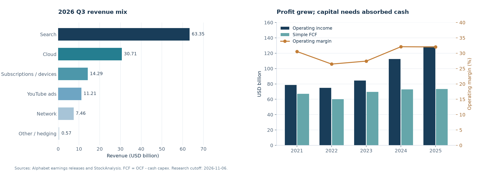

# Alphabet／Google（GOOGL / GOOG）研究报告

> **研究日与信息截止**：2026-11-06，北京时间；行情取 2026-11-05 美股常规盘收盘，完整财务截至 2026-09-30。  
> **价格与估值**：GOOGL 282.57 美元；按全部普通股折算集团市值约 3.474 万亿美元；报表 TTM PE 约 14.75 倍，市值／自建经营税后盈利代理约 27.66 倍。  
> **研究主线**：Google 正把分发、模型和自研算力优势变成更大的收入，但普通股股东最终获得多少现金，仍取决于资本开支、硬件营运资金和融资纪律。  
> **信息丰富度评级：A 级**。本报告用于学习研究，非投资建议；未获得用户现有仓位、成本、资产负债和风险承受能力。

## AI研究偏见自觉

Alphabet Inc. 是母公司，Google 是其主要业务。NASDAQ 的 GOOGL 是有一票投票权的 A 类普通股，GOOG 是无一般投票权的 C 类普通股，B 类每股十票且不公开交易。它们对应同一集团，不能把 A 类流通股数量当集团总股本。GOOGM／GOOGN 是新发行的可转优先股存托证券，不是另一家 Google，也不等于普通股。[S2]

**AI研究局限性声明**：资料丰富使报表更容易核验，却无法证明未来 AI 算力回报。公司未披露足够的 AI Mode 单位查询利润、TPU 系统单独毛利率、维持性资本开支和新增算力批次 ROIC。模型排名、用户量和订单规模只能提供部分证据。报告中的长期增长、现金转化、证券折价及概率判断均是研究假设。

- [x] 将“会做 AI”与“新投资本能为普通股创造回报”分开检验。
- [x] 既有报告只作为论文记录，不当作独立财务来源。
- [x] 不以低 GAAP PE、查询增长或 Cloud 高增速直接证明便宜。
- [x] 正面处理最强反方：新业务可能替代更轻、更赚钱的旧搜索。

### 本次怎样接续既有研究

复用 `reports/Google/`；“美股七姐妹”目录保留为组合专题，不搬动原文件。

| 既有研究 | 可以保留 | 本次修正或更新 |
|---|---|---|
| [6月研究](Google-Alphabet投资研究报告-20260623.md) | 搜索、YouTube、Cloud 的经营机制 | 旧文部分年度数据和利润率存在错误；本次重新取数，不向旧文回写 |
| [Q2精读](Google-earnings-2026Q2.md)、[7月checklist](Google-checklist-20260723.md) | AI 能力强与现金回报承压可以同时成立 | 更新 Q3、股数、融资和现金构成；不再沿用 250—300 美元的分批含义 |
| [10月19日单篇研究](../美股七姐妹-20261019/谷歌/谷歌投资研究报告-20261019.md) | 经营盈利与投资重估分离 | 339.23 美元现值依赖三年增长及退出倍数，不能当长期确定价值 |
| [10月19日团队研究](../美股七姐妹-investment-team-20261019/03-谷歌-GOOGL-研究报告.md) | 用经济现金率检验资本投入 | 与单篇估值分歧主要来自模型假设；本次统一现金、优先股及终值口径 |

相比 10 月研究采用的 340.59 美元快照，本次价格低约 17.04%；但相比 Q2 的 TTM FCF 53.273，本次只有 19.747，下降约 62.93%。**价格下跌与投资价值改善不能画等号。** 两个历史快照均为当时实际价格，不用于计算含分红总回报。[S1][S5][S7]

> 追问：假如媒体和研报少一半，我是否仍能解释客户为什么付钱，以及钱最终去了哪里？

---

## 第一步：核心数据总览

除每股数据、股数和另有注明外，全文财务表单位均为 **十亿美元，USD B**；1 B 等于 10 亿美元。财年为自然年。FCF 在历史表中统一指 OCF 减现金购置物业设备，未扣并购、融资租赁本金和普通股薪酬的经济成本，不能直接等同普通股可分配现金。

### 五年趋势

| 年度 | 收入 | 净利润 | 毛利率 | 经营利润率 | OCF | 现金CapEx | 简单FCF | 现金及短投 |
|---|---:|---:|---:|---:|---:|---:|---:|---:|
| 2021 | 257.637 | 76.033 | 56.94% | 30.55% | 91.652 | 24.640 | 67.012 | 139.649 |
| 2022 | 282.836 | 59.972 | 55.38% | 26.46% | 91.495 | 31.485 | 60.010 | 113.762 |
| 2023 | 307.394 | 73.795 | 56.63% | 27.42% | 101.746 | 32.251 | 69.495 | 110.916 |
| 2024 | 350.018 | 100.118 | 58.20% | 32.11% | 125.299 | 52.535 | 72.764 | 95.657 |
| 2025 | 402.836 | 132.170 | 59.65% | 32.03% | 164.713 | 91.447 | 73.266 | 126.843 |

来源：历年公司报表、StockAnalysis 损益／现金流／资产负债表；Macrotrends 索引交叉核验最新年度收入、净利润、OCF、FCF及现金短投。[S3][S4][S5][S6] 表中净利润包括投资损益，不以其增速推演主营。

收入持续扩张，现金资本投入也在上升。2025 年经营利润率约 32.03%，不是部分旧文写的约 39.4%；2022 年收入采用 282.836。五年表已重算毛利率和经营利润率。

| 收入结构，B | FY2025 | 2026Q3 |
|---|---:|---:|
| Search & other | 224.532 | 63.350 |
| YouTube广告 | 40.367 | 11.207 |
| Network | 29.792 | 7.455 |
| 订阅、平台与设备 | 48.030 | 14.290 |
| Google Cloud | 58.705 | 30.709 |
| Other Bets | 1.537 | 0.372 |
| 对冲收益／损失 | -0.127 | +0.194 |

年度结构来自公司全年披露，Search、YouTube、Network、订阅与Cloud另与[Teleco独立编表](https://teleco.com.br/vendors/google.asp)核对；该站标注其底层来自Google，属于独立整理渠道，不是第二次企业测量。[S2][S3]

### 最近四季：Cloud 增长与现金缺口同时扩大

| 项目 | 2025Q4 | 2026Q1 | 2026Q2 | 2026Q3 |
|---|---:|---:|---:|---:|
| 集团收入 | 113.828 | 109.896 | 119.796 | 127.577 |
| Search & other | 63.073 | 60.399 | 63.271 | 63.350 |
| YouTube广告 | 11.383 | 9.883 | 11.055 | 11.207 |
| Network | 7.828 | 6.971 | 7.303 | 7.455 |
| 订阅、平台与设备 | 13.578 | 12.384 | 12.911 | 14.290 |
| Google Cloud | 17.664 | 20.028 | 24.768 | 30.709 |
| Other Bets | 0.370 | 0.411 | 0.382 | 0.372 |
| 对冲收益／损失 | -0.068 | -0.180 | +0.106 | +0.194 |
| 集团经营利润 | 35.934 | 39.696 | 40.770 | 40.576 |
| Services经营利润 | 40.132 | 40.589 | 39.544 | 39.157 |
| Cloud经营利润 | 5.313 | 6.598 | 8.814 | 11.121 |
| Cloud经营利润率 | 30.08% | 32.94% | 35.59% | 36.21% |
| OCF | 52.402 | 45.790 | 39.069 | 42.290 |
| 现金CapEx | 27.851 | 35.674 | 44.924 | 51.355 |
| 简单FCF | +24.551 | +10.116 | -5.855 | -9.065 |

来源：[2025Q4公告][S3]、[2026Q1公告][S8]、[2026Q2公告][S9]、[2026Q3公告][S1]。分项与总额可能有百万美元级四舍五入差异；TTM收入采用年度滚动桥 402.836−289.007+357.269＝471.098，独立季度公告相加为471.097，差0.001，不掩盖也不人为改写原披露。

Q3 收入同比约 +24.65%，Search 约 +11.99%，Cloud 约 +102.61%。Q3 收入中 Search 占 49.66%，Cloud 占 24.07%；Cloud 已足以改变集团结构。[S1][S2]

技术和使用量也有进展：Q3公告披露Gemini 4系列、Gemini App用户达到十亿。它们降低“Google已失去AI竞争资格”的担忧，但用户定义、独立付费和单位利润并未一一披露，不能据此直接增加现金流估值。[S1]

分部不单独披露毛利率，因此不补造 Search 或 Cloud 毛利。集团 Q3 毛利率约 59.70%、经营利润率约 31.81%。Cloud 的 36.21% 是分部经营利润率，未承担全部集团共享 AI 研发。Q3 集团层面费用／亏损为 7.655，同比约 +71.37%，不能在评估 AI 回报时省略。[S2]

### 三个容易看错的财务事实

| 项目 | 最新核验 | 应怎样理解 |
|---|---|---|
| 报表利润 | TTM集团净利235.694；投资处置／重估收益税前约129.109 | 高净利率并非主营稳定盈利能力；Q3转为投资损失也不等于主营崩塌 |
| 现金回报 | TTM OCF179.551、CapEx159.804、FCF19.747；前三季FCF -4.804 | 经营现金仍强，但基础设施投入吸收了大部分现金 |
| 股东资本 | 前三季普通股回购为零，普通股发行净现金42.870，优先股发行净现金19.063 | “持续回购缩股”不能作为当前投资前提；普通股较2025末增加约1.70% |

来源：公司10-Q与第三方报表交叉核对。[S2][S4][S5] StockAnalysis融资段存在标准化缺项，例如TTM分红与官方前三季数据不一致，因此资本回报以公司现金流原表为准。

最新电话会维持2026全年CapEx **195—205 B**，并预计2027年继续显著增加，具体金额待Q4电话会。管理层还提示外购计算容量将在Q4增加、对Cloud近期利润率形成压力。Q3的高增长和高分部利润率不能直接外推成现金拐点。[S10]

> 巴菲特式追问：利润增长之后，股东能拿走的钱增加了多少，又有多少必须继续留在机器和库存里？

---

## 第二步：生意本质分析

**这门生意的本质：把用户意图、注意力和企业计算需求组织起来，让广告主与企业为可衡量的结果持续付费，再用分发和规模提高下一次交易的效率。**

| 业务 | 谁付钱、为什么复购 | 定价与锁定 | 真正影响利润的变量 |
|---|---|---|---|
| 搜索广告 | 商家为接近购买决策的客户付费，获客有效就复投 | 竞价、相关性、转化率；用户切换搜索工具的直接成本低 | 商业查询量、每次查询变现、分发费用、AI推理成本 |
| YouTube | 广告主买触达；用户为免广告／音乐等订阅付费 | 创作者、观众与广告主形成多边循环 | 观看时长、广告加载、订阅、内容分成 |
| Cloud／Workspace | 企业按计算使用量、平台服务或席位付费 | 数据迁移、权限、应用流程及开发工具形成转换成本 | 利用率、价格、折旧、能源、客户信用及续约 |
| TPU系统 | 客户购买含硬件与软件的算力系统 | 合同、交付和适配；不等于永续订阅 | 库存、供应链、交付验收、收款和售后成本 |
| Other Bets／Waymo | 乘客及其他客户购买服务 | 安全、运营及许可积累 | 扩张投入、单车经济性、责任风险；当前仍亏损 |

AI 扩大查询和计算需求，Google 在分发、模型、芯片、网络和商业化上都有参与位置。这是好生意的基础。问题是过去新增搜索往往不需要同步投入同等规模实物资本；现在新增 AI 收入常要求先建设、先备货，并承担折旧和技术迭代。

TPU 系统销售尤其值得单列。管理层说明先签合同，再采购零件形成库存，交付后确认收入和收款；不是所有新增算力需求都落在 Google 自有数据中心 CapEx。该模式可能减轻自建机房需求，也可能引入硬件收入波动及营运资金风险。公司没有量化 TPU 销售收入与独立毛利，不能把 Cloud 全部 +103% 都看作相同质量的经常性收入。[S10]

本次最关键的三个盈利变量是：搜索商业化能否跟上查询增长；Cloud 在外购容量、折旧和共享研发后的真实回报；资本开支和库存需求何时允许每股现金回升。集团毛利率较高反映广告和软件平台经济性，但与 Microsoft、Meta 的会计分类和业务组合并不一致，不能凭毛利率高低直接排序护城河。

> 段永平式追问：好在客户愿意反复为结果付钱；难在不能为了守住入口，无限制地用股东资本补贴每一次 AI 使用。

---

## 第三步：护城河评估

| 护城河 | 验证证据 | 当前判断与可证伪条件 |
|---|---|---|
| 品牌／定价权 | 默认习惯、搜索广告竞价、YouTube品牌与内容库 | 强，但竞价收入不等于可无损提价；广告主ROAS下降会限制价格 |
| 转换成本 | 企业数据、工作流和应用迁移复杂 | Cloud中高；消费者搜索低于企业云，不能混为一谈 |
| 网络效应 | YouTube创作者—观众—广告主循环，广告转化反馈 | YouTube强；搜索更多是规模和数据反馈，不能假设边际数据永远有同样价值 |
| 规模与成本 | TPU、全球网络、机房与多产品共享研发 | 强；若利用率不足或推理降价快于成本下降，优势会转成负担 |
| 技术／专利 | 模型、编译器、分布式系统、TPU全栈 | 能力强，领先年数无法可靠量化；开源及竞争者可持续压低租金 |

过去五年，YouTube和企业云的商业化基础更深，模型和自研硬件增加了选择；搜索独占入口的稳定性却受 AI 界面及监管挑战。未来五年更可能出现护城河组成变化，而非所有业务一起变宽或变窄。

Statcounter 2026年10月网页转介口径下 Google 传统搜索份额约91.05%，只能说明传统网页转介仍强，不能反证 AI 助手已抢走多少问答、购物决策或高商业价值任务。[S11] 云基础设施方面，Synergy Q3份额为AWS26%、Microsoft19%、Google16%；这个市场口径不含完整Workspace，也不能直接拿来除Google Cloud财报收入。[S12]

摧毁价值的路径不必是Google技术落败：若AI把付费点击变成低价自动代理任务，即使Google仍掌握界面，也可能丢失原有超额利润。

> 巴菲特式追问：十年后需求大概率还在，但Google能否继续取得今天这样高的经济租金？应监控商业化与现金回报，而不只看用户数。

---

## 第四步：逆向思考与风险清单

最强反方不是“Google不会做AI”，而是“Google必须主动用更贵的计算，改造自己原本极赚钱的搜索，同时用融资建设越来越大的供给；收入可以增长，普通股回报却长期偏低”。

| 失败路径 | 主观概率等级／时间窗 | 影响 | 可观察信号 |
|---|---|---|---|
| AI查询增加，但商业化未能补偿推理成本 | 中高／未来数年 | 搜索经济利润率下降 | Search增速落后使用量、Services利润率下降、分发或推理成本增加 |
| 算力过度建设与价格竞争 | 中高／未来数年 | FCF和增量ROIC偏低 | CapEx持续快于OCF、利用率及定价承压、折旧后利润下降 |
| TPU硬件与AI大客户带来回款／集中度风险 | 中／未来数年 | 收入质量、库存和融资需求恶化 | 应收与库存增速持续快于收入、订单兑现推迟、客户依赖融资 |
| 监管削弱分发及广告闭环 | 中／长期 | 规模、数据和捆绑优势受限 | 数据共享、非歧视和互操作义务；上诉与执行变化 |
| 融资、薪酬与优先分配侵蚀每股价值 | 中／持续 | 集团增长慢于每股回报 | 普通股净增、回购停滞、利息／优先分红增加 |
| 严重模型责任、安全事件或新结构性拆分 | 低频、难估／长期 | 尾部永久损失 | 法院正式命令、重大产品事故、无法保险的赔偿 |

概率等级是判断，事件可能同时发生，不能相加成统计概率。本报告不编造精确发生率。

监管已有新事实：DOJ于2026年9月16日说明广告技术案的行为性补救，包括互操作、数据导出及非歧视竞价。搜索案上诉／补救进程仍在推进。现阶段既不能写“确定拆分”，也不能写“监管风险已经消失”。[S13][S14]

云订单同样需要反面检验。10-Q披露总未履约合同567.7，其中Cloud560.8；2026Q1起口径加入原期限一年以内合同，历史增长不能完全视作同口径增量。总订单中16.8与关联合营企业Crux AI有关。合同不是现金，也不是利润；不能把资金支持客户形成的需求一概当独立外部支付能力。[S2]

还有尚未进入资产负债表的资金约束：未起租租赁的未来付款130.5 B，以及未合并VIE未来融资／支持承诺31.9 B，后者包括有条件投入及基础设施支持，并非都已经支付。它们不能直接等同当前债务，也不应忽略；未来履约负担应进入现金率和压力情景，不能在预测现金已扣除后再按面值重复扣一次。[S2]

历史类比可借鉴IBM在计算范式迁移中的利润池变化，以及电信网络建设中“使用量上升但投资者回报偏弱”的路径。Google的广告现金与资产负债表更强，不能照搬结局；类比的用途是提醒检查资本回报。

最可能的分析错误是：在看到Cloud增长和利润率后，过早假定下一轮资本投入能复制旧搜索回报；另一个错误是把当前低FCF永久化，忽视扩张投入与营运资金回收的可能。

> 芒格式追问：聪明人可以承认Google的产品优秀，同时拒绝为尚未验证的算力经济性支付确定性溢价。

---

## 第五步：管理层评估

Sundar Pichai负责集团及Google经营，创始人通过B股保持控制。2026年proxy显示Page与Brin投票权分别27.4%和25.3%，合计52.7%。这是投票权，不是经济权益；该表只覆盖有投票股份，未完整呈现C股经济持有量，因此本报告不沿用未经完整核对的创始人经济持股百分比。官方与镜像的同值是披露核对，不是两个独立测量。[S15]

| 时间／决策 | 可核结果 | 资本配置评价 |
|---|---|---|
| 长期建设TPU与统一AI研发 | Cloud增长、模型与多产品复用能力增强 | 技术选择有价值；尚不能据此宣布整个新投入周期回报达标 |
| 2026年3月收购Wiz与Intersect | 官方最终购买价分别29.467 B与5.868 B；前者并入Cloud，后者增强能源／数据中心能力 | 不沿用最初Wiz32 B交易标题作最终价格；整合回报尚未证明，Cloud同比也不等于全为有机增长 |
| 2025—2026扩大基础设施投入 | CapEx提高，近两季简单FCF为负 | 必须用未来现金回报评估；收入增长只完成第一步 |
| 2026普通股、债券和优先股融资 | 前三季零回购，普通股期末数量上升 | 增强融资能力，也改变了股东回报结构；不能给予自动缩股红利 |
| 扩张Other Bets／Waymo | Q3 Other Bets收入0.372、经营亏损2.047 | 保留技术期权，但目前不另给Waymo额外估值 |
| 进入TPU系统外售 | 机房部署选择增加，同时产生库存需求 | 潜在提高资本效率，须看交付收款和客户回报，暂不评为成功投资 |

优先股条款对普通股不能忽略：2026年6月发行的存托份额对应19.25 B清算优先权，累积股息率6.25%，完整年度股息约1.203 B，2029年5月强制转换。当前12.294 B普通股不含未来转换股份。模型把优先权作为独立索偿储备，不同时再扣一遍全额转股稀释；实际条款及capped-call会使结果不同。[S2]

研发投入与人才组织是必要条件，但不直接等于研发回报。TTM研发74.463 B、SBC30.409 B；SBC已经在经营利润中作为费用，估值不再将其无条件加回。未核实所有管理人员最新交易和人才流动，因此不以“没有减持／没有流失”作结论。[S4][S5]

系统、分发、数据和工程团队使Google不只依赖一个CEO；创始人控制和长期投资能力是双刃剑，外部普通股股东对低回报扩张的制约有限。

> 段永平式追问：CEO退休后平台大概率仍在，但资本纪律不会自动继承；应以每股现金和投资回报来检验“对的人”。

---

## 第六步：行业与文明趋势

AI是信息处理成本下降的长期变化。Google位于模型、算力、企业平台、消费者入口与广告多个环节，既可能取得价值，也可能通过竞争把技术进步让利给客户。

Synergy估计2026Q3全球云基础设施收入167.7 B，TTM558 B，单季同比增长55%。这是已发生市场规模，不能把55%延长十年，也不能把整个广告、软件、机器人和交通市场简单相加成Google收入空间。[S12]

| 长期方向 | Google的机会 | 价值被谁拿走的风险 |
|---|---|---|
| 信息从链接转向直接答案与代理执行 | 在现有入口改造搜索、购物和任务服务 | 用户获得便利，但广告展示机会或单位变现下降 |
| 企业计算向AI工作负载迁移 | Cloud、数据库、安全、Workspace及模型协同 | 芯片、电力与机房供应商先取得回报，平台承担资本风险 |
| 自研加速器规模化 | 同时服务自有机房及客户设施 | 软件兼容、供应链与客户议价限制硬件租金 |
| 自动驾驶扩张 | Waymo运营与技术积累 | 安全责任、许可和车辆运营成本使规模不等于利润 |

技术路线风险在于计算需求继续增加，但每单位价格下降更快，或者应用从大模型转向更便宜的专用模型。供应端先进制造、封装、电力及关键设备具有集中性；需求端AI实验室可能成为大客户，也可能成为平台竞争者。未取得完整采购集中度和Cloud客户占比，不补造百分比。

本报告长期基准假设NOPAT十年增长12%，到期约390.035 B；若税后经营利润率为25%，需要约1,560.140 B收入支持。这个收入量级只是检验假设所需的条件，不是公司指引。它说明基准也需要长期商业成功，并不保守到“只要不倒闭就能实现”。

> 李录式追问：二十年后计算和信息组织会更重要，但投资者要买到能留住利润、并以合理资本取得利润的企业。

---

## 第七步：估值与安全边际

### 先把经营与投资资产分开

| 指标 | 本次值 | 口径 |
|---|---:|---|
| GOOGL价格，美元 | 282.57 | 11月5日常规盘收盘，非盘后 |
| 全类别普通股，十亿股 | 12.294 | 10月21日封面A/B/C合计，与9月末总量一致 |
| A类价格折算集团市值，B | 3473.91558 | 价格乘全部普通股；不是逐类按各自价格相加 |
| TTM收入，B | 471.098 | 年度减上年前三季加本年前三季 |
| TTM报表EPS，美元 | 19.16 | 官方季度稀释EPS之和；第三方标准化为19.15，差异低于1% |
| TTM报表PE | 14.75倍 | 投资收益使比较意义受限 |
| TTM经营利润，B | 156.976 | 已扣SBC及集团共享费用 |
| 自建NOPAT，B | 125.5808 | EBIT乘80%；20%税率为研究假设，不是公司调整后净利 |
| NOPAT／当前普通股，美元 | 10.2148 | 无杠杆经营盈利代理，不能称普通股EPS |
| 市值／NOPAT | 27.66倍 | 只用于直观展示，非严格普通股PE |
| 市销率 | 7.37倍 | 市值除TTM收入 |
| 自定义EV／收入 | 7.33倍 | 加债、融资租赁、优先权及NCI，扣现金债券；不扣风险股权投资 |
| TTM简单FCF收益率 | 0.5684% | 尚未扣SBC经济成本及融资租赁本金 |
| 当前季度股息年化收益率 | 0.3114% | 0.22美元乘四；不保证未来不变 |

来源：[S1][S2][S4][S5][S7]；市值、估值与跨源核验已调用项目金融工具，另用Decimal重算，结果见附录文件。

现金及短投265.098 B并非全是无风险现金，其中上市权益90.384 B，包含受短期出售限制的SpaceX持仓。Q3末纯现金与债券证券174.714 B；扣有息债126.118 B与融资租赁3.705 B后44.891 B，尚未扣优先股和非控权益。不能把265.098 B直接加到普通股价值上。[S2]

本次采用同一权益桥：

| 项目，B | 加减值 | 处理理由 |
|---|---:|---|
| 现金与债券证券 | +174.714 | 排除上市股票；仍有利率／信用及经营资金用途风险 |
| 有息债务 | -126.118 | 债务账面值，不含融资租赁 |
| 融资租赁 | -3.705 | 另列融资索偿 |
| 可转优先股储备 | -19.250 | 以清算优先权替代明确转股模拟，不重复扣稀释 |
| 非控权益储备 | -6.900 | 从全合并经营价值桥接，账面储备只是近似 |
| 上市权益折价后价值 | +45.192 | 账面90.384按五折，综合考虑限售、税费与波动 |
| 非上市权益折价后价值 | +33.8075 | 账面135.230按四分之一，反映不透明和流动性 |
| 净加回 | 97.7405 | 每股约7.95美元；折价系判断，不是独立评估值 |

经营租赁费用已包含在经营盈利和现金率假设中，不重复减经营租赁负债。金融投资收益不乘经营倍数；Waymo等合并业务不额外重复加价。若将净资产加回整体置零，长期基准现值从213.34降至205.39美元，投资证券不是主结论的支柱。

11月已有新增60亿欧元债券发行文件，预期11月5日交割；债务发行同时带来现金，不能单边扣债。由于未取得交割后完整余额，本表明确为9月末资产桥，不冒称11月6日实时净现金。[S16]

### 三年情景：区分未来价格与今日现值

以10.2148美元经营盈利代理为基期，假设普通股经济股数不额外变化，倍数用于三年过渡期市场定价，而非永续终值。期间可分配现金不另加，属于简化交叉检查。第三年经营价格先按10%折现，再加当前折价净资产7.95美元；不得把第三年价格直接称为今日价值。

| 情景 | 三年经营盈利年增 | 三年退出倍数 | 第三年经营价格，美元 | 折现并加静态资产后的今日值，美元 |
|---|---:|---:|---:|---:|
| 悲观 | +2% | 16倍 | 173.44 | 138.26 |
| 基准 | +12% | 22倍 | 315.72 | 245.16 |
| 乐观 | +20% | 28倍 | 494.23 | 379.27 |

这些不是目标价承诺。基准退出22倍反映较长期成熟状态更高的过渡期增长，仍有压缩风险，故不让三年模型独占决策。相对于10月报告16%增长、28倍退出的组合，本次约束更严格；估值降低既有新现金证据，也有主动纠正模型过于宽松的原因。

历史与同行仅作背景：第三方年末GAAP PE在2021—2025年约25.28、19.09、23.79、23.21、28.61倍；当前投资收益污染分母，不能据此说处在历史便宜区。[S17]

| 公司 | 同日供应商TTM PE | 供应商Forward PE | 可比性限制 |
|---|---:|---:|---|
| Alphabet | 14.75倍 | 20.50倍 | 证券收益与资本开支使两者都不能独立定价 |
| Microsoft | 27.98倍 | 25.82倍 | 企业软件与云组合不同，亦受AI资本投入影响 |
| Meta | 20.63倍 | 18.37倍 | 广告更集中，AI投入与亏损业务不同 |
| Amazon | 21.03倍 | 26.27倍 | 零售与AWS混合，净利润口径不同 |

同行数字为StockAnalysis同日标准化参考，未逐家完成双源底稿，置信度低于本公司核心数据，不用于推出终值倍数。Alphabet供应商PEG也依赖被投资损益污染的增长口径，本次不采用PEG定价。[S18]

### 十年折现：把资本投入放回模型

主模型采用**经营价值DCF加净金融资产桥**，而非把GAAP净利乘一个永远不变的高PE。

美元经营资产要求回报主档r＝10%，用约5%的无风险利率锚加5%的权益风险溢价、β＝1作透明研究设定，不声称5%是11月5日精确收盘收益率，也不将这个简化要求回报冒称精算WACC。可访问的Fed H.15近期数据在这一量级。β＝1是规范化假设，非供应商历史回归β。另检验9%与11%。美元永续增长上限4%，本模型悲观／基准／乐观g固定2%／3%／3.5%，不随r变化。[S19]

稳态增量ROIC取20%。旧平台的无形资产可能支持高回报，但新机房、芯片和硬件营运资金不能直接套旧搜索ROIC；当前派息又受融资与扩张影响，不能可靠反解稳态回报。因此20%是有约束的判断，另测试15%和25%，并不伪装成已经实现的新增算力ROIC。

| 假设 | 悲观 | 基准 | 乐观 |
|---|---:|---:|---:|
| 未来十年NOPAT复合增长 | +3% | +12% | +18% |
| 第1—3年NOPAT现金转化 | 5% | 20% | 30% |
| 第4—6年NOPAT现金转化 | 20% | 45% | 60% |
| 第7—10年NOPAT现金转化 | 45% | 65% | 80% |
| 十年末NOPAT，B | 168.770 | 390.035 | 657.269 |
| 永续g | 2% | 3% | 3.5% |
| r−g，主档 | 8个百分点 | 7个百分点 | 6.5个百分点 |
| 终值前瞻经营盈利倍数 | 11.2500倍 | 12.1429倍 | 12.6923倍 |
| 今日每股现值，美元 | 84.99 | 213.34 | 375.03 |

现金转化是扣必要再投资后的经济FCFF／NOPAT，不是报表净利率，也不是实际分红比例。基准早期只有20%，考虑当前简单FCF仅约NOPAT的15.72%，且该简单FCF仍含SBC加回等差异，20%已经要求改善；后期65%仍需产能消化、资本效率提升。库存回收不能在现金率中计入后再额外加一次。

终值唯一来自永续模型：`M=(1−g/ROIC)/(r−g)`。由于这里的利润是NOPAT，M的准确名称是“经营价值／前瞻NOPAT”，不是普通股PE。第十年末经营终值为`NOPAT第10年×(1+g)×M`；再折现十年，避免把前瞻倍数和当年利润混用。逐年现金加上终值，再加97.7405 B净资产、除12.294 B股数。SBC已在经营利润扣除，不再加回；不额外叠加分红或回购收益。

终值还隐含现金释放：基准从第7—10年的65%现金转化，转为稳态`1−3%/20%＝85%`，即增长放缓后只需较少再投资。该切换明显抬高终值，是模型假设，尚未得到公司现金表现验证，不能把它藏在倍数里。

| 美元r | 悲观现值 | 基准现值 | 乐观现值 | 三档r−g |
|---|---:|---:|---:|---|
| 9% | 101.38 | 259.24 | 461.16 | 7／6／5.5个百分点 |
| 10% | 84.99 | 213.34 | 375.03 | 8／7／6.5个百分点 |
| 11% | 72.58 | 179.55 | 312.81 | 9／8／7.5个百分点 |

基准排序在各档不变，三档基准价值均低于282.57美元；本研究只有一家公司，不作跨公司排名。折现率上下变动会显著影响绝对值，所以采用约210—245美元作为主档长期DCF与三年检查的中性参考区间，而非精确的单点“内在价值”。基准ROIC改为15%／25%时，长期主档价值约204.34／218.74美元，现金转化与增长的影响更关键。

### 反向DCF与模型边界

保持基准现金转化、r10%、ROIC20%、永久g3%和资产桥不变，需要未来十年NOPAT年增约**15.59%**，才能支持现价。这不是“15.59%必然实现”，也不是当前FCF需要的增速，而是特定现金率路径下经营利润的隐含要求。

基准经营价值约74.48%来自折现终值，说明模型仍高度依赖遥远未来。3%永久增长与十年12%增长是不同概念，不能把高成长期增速延续到永远。

离散风险直接进经营情景或尾部：搜索入口迁移、融资及算力回报不足体现在悲观增长和低现金率中；强制结构性拆分另保留尾部压力，不靠提高β处理。严重模型诉讼／安全事件未量化，也未得到精确概率；**本报告没有给出风险调整后的期望价值或十年实际股东IRR**。其他限制包括维持性CapEx未知、优先股用储备近似、未来增发未明确逐年模拟、证券税基／限售未知及资产桥非实时。

> 巴菲特式追问：若资本成本错两个百分点，估值会大幅变化；现价需要增长和现金转化共同兑现，不能只靠调低折现率得到安全边际。
>
> 段永平式追问：若市场关闭五年，可以理解适度持有这门生意，但目前现金回报证据不足以支持新增重仓。

---

## 第八步：最终决策与行动清单

**结论：空仓者观望；已有适度仓位者可继续持有、暂停新增。旧250—300美元复核带的建仓含义撤回，价格触及旧带不构成本次买入理由。**

| 维度 | 本次结论 | 信心度 |
|---|---|---|
| 生意质量 | 平台和企业基础仍强，但现金需求明显变重 | 高 |
| 护城河 | YouTube、云和全栈算力强；搜索经济租金面临迁移 | 中高 |
| 管理层 | 技术执行有成绩，新周期资本配置尚待现金验证 | 中 |
| 最大风险 | 守住用户和收入，却未守住每股可分配现金 | 中高 |
| 文明趋势 | AI与计算需求持续扩张，Google具备多环节价值获取能力 | 中高 |
| 估值 | 报表低PE失真；282.57美元缺少本模型要求的安全边际 | 中 |

| 价格／条件 | 研究动作 |
|---|---|
| 高于240美元 | 新资金观望；不因低报表PE追买 |
| 180—240美元 | 继续观察，核增长及现金率；中性参考约210—245不等于买点 |
| **160—180美元** | 仅在下列经营条件同时改善时，研究性小额分批；不是自动买入 |
| 低于160美元 | 先查是否论文破坏；不能假定越跌越值得重仓 |
| **达到330美元且经营只达基准** | 警戒复核估值与仓位，考虑减仓；不是无条件卖出 |

160—180美元相对长期基准估值折价约16%—25%，属于针对资本回报不确定性的研究门槛；不是预测股价必到。价位按GOOGL普通股登记，GOOG应核当时价差后另行判断。

| 投资者／信号 | 具体处理 |
|---|---|
| 空仓者 | 现价不建立新增仓位，等待现金证据或明显更低价格 |
| 已有持仓者 | 不因Q3证券损失机械卖出；适度仓位可持有，不以摊低成本为理由加仓；重仓者按自身集中度复核 |
| 分批必要条件 | 最近两次披露显示滚动简单FCF回升，并向40 B以上恢复；搜索收入保持约双位数增长且Services利润率未持续下降；外购容量投入后Cloud利润率仍大体守住30%；TPU库存／应收及交付回款可解释，融资及普通股净增受控 |
| 论文重审／减仓信号 | 搜索连续多个季度低增长并伴Services利润率下破35%；FCF持续恶化且CapEx与融资继续加速；大客户付款能力、库存、数据共享或产品责任出现实质问题 |
| 加强持有而非仅靠价格 | 公开单位AI经济性、CapEx趋于可覆盖、每股经营现金恢复，同时正常化估值仍有空间 |

以上40 B、30%、35%等是研究阈值，不是公司承诺。资料未披露时要求补证，不能用估计默认通过。

2026-12-31进行一次研究检查：核Q4披露安排、Search变现、库存回款及债券资金用途。2027-02-15只作全年业绩／10-K披露日历检查，**不是已确认财报发布日期**；正式公告出现时以实际披露优先。

> 巴菲特式模拟点评：能持续赚钱的资产值得研究，但要分清利润表上的收益和可以拿走的现金。
>
> 芒格式模拟点评：最危险的误判，是把“Google一定会赢AI”当成“股东一定获得高回报”。
>
> 段永平式模拟点评：生意值得懂；价格要让自己不依赖每一项乐观假设。
>
> 李录式模拟点评：文明进步创造巨大需求，资本的职责是识别谁能以合理投入保留价值。

以上为分析框架模拟，非四位投资者的真实言论或背书。

## AI分析置信度与投资确定性

财务核验、证券身份、CapEx和融资变化的分析置信度较高；现金转化恢复速度、TPU系统经济性和十年经营利润的置信度为中或偏低。**投资确定性低于资料完整性所带来的分析置信度**：目前能确认Google仍有强经营基础，不能确认新资本周期将创造与旧搜索同样的超额回报。

本报告最需要一手补证的是AI查询单位贡献利润、TPU系统交付后的现金回收、维持性资本开支，以及新一批AI投资的独立回报。正式披露缺失时维持“不知道”，不把叙事补成数据。

---

## 数据来源与审计记录

### 关键数据交叉验证记录

| 字段 | 官方／主来源 | 独立对照 | 处理 |
|---|---|---|---|
| 11月5日价格 | StockAnalysis 282.57美元 | ChartExchange 282.64美元，15:59:59 | 时点差约0.025%；选16:00收盘，不混用 |
| 全类别普通股 | SEC 12,294百万股 | StockAnalysis 12,294百万股 | 一致；不含未来优先股转换 |
| FY2025收入 | SEC 402.836 B | StockAnalysis／Macrotrends 402.836 B | 一致 |
| FY2025净利 | SEC 132.170 B | StockAnalysis／Macrotrends 132.170 B | 一致；含投资收益 |
| FY2025现金短投 | SEC 126.843 B | StockAnalysis／Macrotrends 126.843 B | 一致 |
| Q3现金短投 | SEC 265.098 B | StockAnalysis 265.098 B | 一致；股权证券另拆 |
| Q3广义净现金 | SEC重算114.767 B | StockAnalysis 114.767 B | 均扣全部租赁；该统计数不直接用于经营DCF权益桥 |
| TTM简单FCF | 官方四季相加19.747 B | StockAnalysis 19.747 B | 一致 |
| TTM稀释EPS | 官方季度和19.16美元 | StockAnalysis 19.15美元 | 低于1%；官方季度和作为近似TTM |
| 创始人投票权 | 官方proxy 27.4%／25.3% | 披露镜像同值 | 镜像非独立测量；全部经济持股仍有来源缺口 |

市值工具：282.57美元×12,294,000,000股＝3,473,915,580,000美元；与第三方约3,473,916,000,000美元的差异属于显示舍入。Macrotrends正文访问受403限制，已读取其搜索索引可见值；本次没有把索引当完整原表，核心数字另以SEC及StockAnalysis校核。

项目工具的原始输出保存在[financial-rigor.txt](validation/20261106/financial-rigor.txt)，包含市值、收入／利润／现金／股数／价格交叉核验、估值和三情景。复杂DCF另以Decimal重算，参数和完整结果见[model-results.json](validation/20261106/model-results.json)。终值工具打印的静态币种参考文案含通用模板；本报告实际使用USD、r9%／10%／11%、Rf研究锚5%、β1、ROIC20%、g2%／3%／3.5%，以显式参数为准。

**数据抽检准出**：固定随机抽样二十七项，三项为季度编号、月份或容差边界的解析误识别，逐项保留排除原因；余下二十四项经历史事实、历史引用或模型一致性核验全部通过，无警告和不通过项。底稿见[audit-results.json](validation/20261106/audit-results.json)、[排除记录](validation/20261106/audit-excluded.json)及[准出输出](validation/20261106/audit-verdict.txt)。模型假设只核对参数与计算，不伪称获得外部信源对未来的认证。

最终三档折现率均通过终值硬约束审计，见[terminal-audit.txt](validation/20261106/terminal-audit.txt)。重大模型诉讼／安全事件仍未量化，准出不代表风险消失。

已沿用Google原有触发标的更新价格带和复检事件；新研究作为非重点建议事件入台账，旧建议关闭接续，未把历史触价记作收益命中。配置校验及临时状态定点运行均通过；测试使用临时目录，没有写入正式监控运行状态。工作日既有每日监控会按所登记条件继续扫描。

### 来源索引

- S1：[Alphabet 2026Q3业绩公告，2026-10-28][S1]。
- S2：[Alphabet 2026Q3 10-Q，2026-10-29][S2]，含财务原表、权益证券、合同、租赁、债务、优先股和股数。
- S3：[Alphabet 2025全年及Q4公告][S3]；[全年10-K](https://www.sec.gov/Archives/edgar/data/1652044/000165204426000018/goog-20251231.htm)。
- S4：[StockAnalysis损益表][S4]。
- S5：[StockAnalysis现金流量表][S5]。
- S6：[StockAnalysis资产负债表][S6]；Macrotrends[收入](https://www.macrotrends.net/stocks/charts/GOOGL/alphabet/revenue)、[净利](https://www.macrotrends.net/stocks/charts/GOOGL/alphabet/net-income)、[经营现金](https://www.macrotrends.net/stocks/charts/GOOGL/alphabet/cash-flow-from-operating-activities)、[FCF](https://www.macrotrends.net/stocks/charts/GOOGL/alphabet/free-cash-flow)、[现金短投](https://www.macrotrends.net/stocks/charts/GOOGL/alphabet/cash-on-hand)，本次读取索引。
- S7：[StockAnalysis历史行情][S7]；[ChartExchange历史行情](https://chartexchange.com/symbol/nasdaq-googl/historical)。
- S8：[Alphabet 2026Q1公告][S8]。
- S9：[Alphabet 2026Q2公告][S9]。
- S10：[Alphabet Q3官方电话会及文字稿][S10]，2026-10-28；管理层用户量、TPU性能与回报判断均视为公司陈述。
- S11：[Statcounter全球搜索引擎份额][S11]，2026年10月网页转介口径。
- S12：[Synergy Q3云基础设施市场报告][S12]，2026-10-29。
- S13：[DOJ广告技术补救说明][S13]，2026-09-16。
- S14：[DOJ搜索案文件目录][S14]，含2026年10月诉讼进展。
- S15：[Alphabet 2026 Proxy][S15]；[披露镜像](https://www.stocktitan.net/sec-filings/GOOGL/def-14a-alphabet-inc-definitive-proxy-statement-5428f485f4af.html)。
- S16：[11月欧元债券最终招股书][S16]，2026-11-04；[相关8-K](https://www.sec.gov/Archives/edgar/data/1652044/000119312526449835/d174184d8k.htm)。
- S17：[StockAnalysis历史估值][S17]；按各年末数据，非统一复权价格回测。
- S18：[Alphabet估值统计][S18]、[Microsoft](https://stockanalysis.com/stocks/msft/statistics/)、[Meta](https://stockanalysis.com/stocks/meta/statistics/)、[Amazon](https://stockanalysis.com/stocks/amzn/statistics/)。同行仅单源背景参考。
- S19：[Fed H.15近期利率发布][S19]。模型Rf5%为量级取整假设，未冒称即时国债收益率。

[S1]: https://www.sec.gov/Archives/edgar/data/1652044/000165204426000080/googexhibit991q32026.htm
[S2]: https://www.sec.gov/Archives/edgar/data/1652044/000165204426000084/goog-20260930.htm
[S3]: https://www.sec.gov/Archives/edgar/data/1652044/000165204426000012/googexhibit991q42025.htm
[S4]: https://stockanalysis.com/stocks/googl/financials/income-statement/
[S5]: https://stockanalysis.com/stocks/googl/financials/cash-flow-statement/
[S6]: https://stockanalysis.com/stocks/googl/financials/balance-sheet/
[S7]: https://stockanalysis.com/stocks/googl/history/
[S8]: https://www.sec.gov/Archives/edgar/data/1652044/000165204426000043/googexhibit991q12026.htm
[S9]: https://www.sec.gov/Archives/edgar/data/1652044/000165204426000066/googexhibit991q22026.htm
[S10]: https://abc.xyz/investor/events/event-details/2026/2026-Q3-Earnings-Call-2026-Ujou16CTw9/default.aspx
[S11]: https://gs.statcounter.com/search-engine-market-share/monthly/worldwide
[S12]: https://www.srgresearch.com/articles/cloud-market-growth-rate-surges-to-well-over-50-per-year-q3-revenues-reach-168-billion
[S13]: https://www.justice.gov/opa/pr/department-justice-again-wins-substantial-relief-against-google
[S14]: https://www.justice.gov/atr/case/us-and-plaintiff-states-v-google-llc
[S15]: https://www.sec.gov/Archives/edgar/data/1652044/000130817926000342/goog-20260424.htm
[S16]: https://www.sec.gov/Archives/edgar/data/1652044/000119312526447343/d125079d424b2.htm
[S17]: https://stockanalysis.com/stocks/googl/financials/ratios/
[S18]: https://stockanalysis.com/stocks/googl/statistics/
[S19]: https://www.federalreserve.gov/releases/H15/Current/
