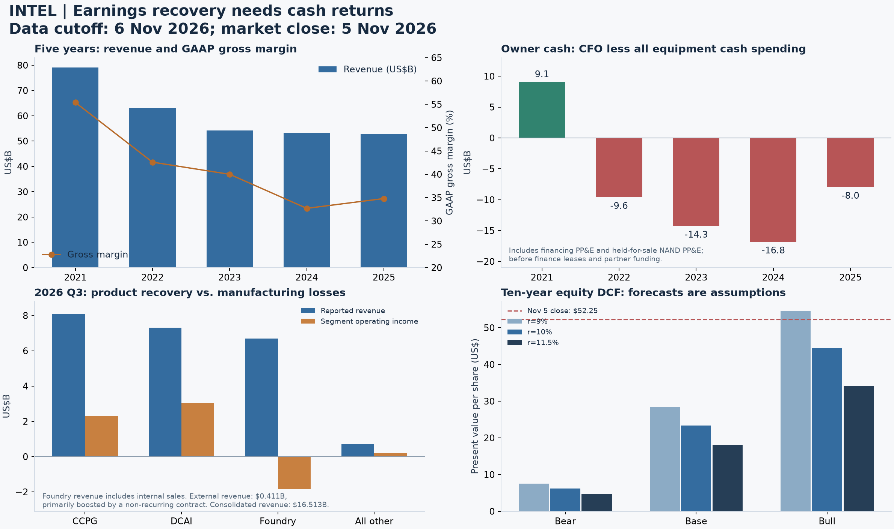

# 英特尔（Intel，NASDAQ: INTC）研究报告

**研究日期与数据截止日**：2026-11-06，Asia/Shanghai；财务截至 2026-09-26，采用 10 月 29 日业绩、10 月 30 日 10-Q，以及截至研究日已公开的信息。  
**行情基准**：2026-11-05 美东常规盘收盘 52.25 美元；按 10 月 23 日最新披露的 53.15 亿普通股，复算市值 2,777.0875 亿美元。盘后报价不进入估值。  
**估值快照**：TTM P/S 4.64 倍；GAAP PE 不适用；四季 Non-GAAP EPS 简单合计对应 37.86 倍；P/B 2.42 倍；扣全设备现金支出后的 TTM FCF 收益率约 0.58%。  
**研究主线**：产品复苏已经发生，代工技术也在推进，但扩大制造投入之后，普通股能留下多少现金仍是决定价值的问题。

金额表格除特别注明外，统一使用**十亿美元（US$B）**；每股金额为美元。本文用于学习研究，非投资建议；价格带只触发研究复核，不是自动交易指令。

---

## AI研究偏见自觉

**信息丰富度评级：A级。** Intel Corporation，中文英特尔，NASDAQ 代码 INTC；本报告研究美国普通股。沿用 `reports/Intel/`，复用触发配置中既有 `Intel` 标的，不把其他市场同名代码、存托凭证或子公司当成另一份股权价值。

**AI研究局限性声明**：财务与技术公告充裕，但真实良率、单片成本、客户设计的量产时间、约束性采购承诺及未来资本开支回报，公开资料不足以完全核实。报告把“已发布产品”“客户设计工具成熟”“量产订单”“可分配现金”作为四种不同证据。没有披露实名重大外部客户，不等于没有保密客户；同样不能反向认定保密客户已经兑现。

- [x] 不因美国制造的重要性而假定普通股必然获得高回报。
- [x] 不把内部代工结算、Altera 去并表后的收入、一次性合同当成外部先进节点的持续收入。
- [x] 不以大幅下跌替代估值，也不锚定旧报告的研究价格带。
- [x] 区分数据源的标准化财务、原始 GAAP、Non-GAAP 与资金合作口径。

### 与已有研究相比，什么变了

既有材料为 [6 月研究](Intel-investment-research-20260623.md) 与 [8 月研究](Intel-research-20260826.md)。旧文保留为历史快照，本次结论以下列新证据接续。

| 旧判断或待验证事项 | 最新证据 | 对判断的影响 |
|---|---|---|
| 产品端修复，仍待持续性 | Q3 DCAI 收入 7.318、同比 +78%；CCPG 收入 8.097、同比 -5% | 服务器修复增强，但 PC 转弱；不能外推为全面增长 |
| 外部 Foundry 尚未规模化 | Q3 外部收入 0.411，主要增量来自一次性合同 | 金额增加，持续商业化证据未相应升级 |
| 14A 缺大客户可能停止 | 最新 10-Q 已说明 Q2 承诺完成 14A 开发；扩产速度仍取决于承诺需求 | 旧表述不再完整；技术承诺更强，也增加先投资后回报的风险 |
| 8 月融资尚未完整反映在报表 | 净募资 22.617 已进入 Q3；现金短投 54.005，借款 50.134 | 流动性改善，但不是等额经营现金创造 |
| 87.48 美元的高预期定价 | 现价较旧报告基准下降约 -40.27% | 价格改善；仍须重算绝对价值 |
| 25—35 美元研究性分批带 | 本次补足十年折现、设备支出及稀释约束 | 旧带改为观察区，新的小仓复核带收紧至 15—18 美元，并保留经营前提 |

依据：[Q3 官方业绩](https://www.intc.com/news-events/press-releases/detail/1786/intel-reports-third-quarter-2026-financial-results)、[Q3 10-Q](https://www.intc.com/filings-reports/all-sec-filings/content/0000050863-26-000191/intc-20260926.htm)、[StockAnalysis 历史行情](https://stockanalysis.com/stocks/intc/history/)、[Finviz](https://finviz.com/stock?t=INTC)。

---

## 第一步：核心数据总览

### 五年：盈利底盘尚未恢复为现金复利

| 财年 | 收入 | GAAP 归母净利 | GAAP 毛利率 | GAAP 经营利润 | CFO | 全设备现金 FCF | 现金与短投 |
|---|---:|---:|---:|---:|---:|---:|---:|
| FY2021 | 79.024 | 19.868 | 55.4% | 19.456 | 29.456 | 9.127 | 29.253 |
| FY2022 | 63.054 | 8.014 | 42.6% | 2.334 | 15.433 | -9.617 | 28.338 |
| FY2023 | 54.228 | 1.689 | 40.0% | 0.093 | 11.471 | -14.279 | 25.034 |
| FY2024 | 53.101 | -18.756 | 32.7% | -11.678 | 8.288 | -16.834 | 22.062 |
| **FY2025** | **52.853** | **-0.267** | **34.8%** | **-2.214** | **9.697** | **-7.975** | **37.416** |

本表 FCF 定义为 CFO 减投资活动及融资活动中设备现金支出，并在 FY2021—2022 纳入另列的待售 NAND 设备支出；未扣融资租赁偿还，未加政府补助和合作方出资。它是统一设备负担的研究指标，不等于公司 Adjusted FCF，也不能把历史各年视为恒定业务边界。

需要统一旧文口径：FY2021 的 11.258 可由[当年 10-K](https://www.sec.gov/Archives/edgar/data/50863/000005086322000007/intc-20211225.htm)披露 CFO 29.991 减设备支出 18.733 得出，不能直接判为算错；本表改用后续报表重分类后的 CFO 29.456，并纳入另列待售 NAND 设备支出，结果为 9.127。若在本表 CFO 基础上排除 NAND，FY2021 为 10.723，FY2022 为 -9.411；纳入后 FY2022 为 -9.617。旧文 FY2022 的 -9.562、FY2023 的 -14.229 未按本次原始报表重现，FY2023 应为 -14.279。FY2025 的 -7.975 有原始依据；数据商常见 -4.949 少扣了融资栏设备支出 3.026。历史业务边界和重分类使同比有限制，不把口径差异当经营变化。

原始来源：[FY2025 10-K](https://www.intc.com/filings-reports/annual-reports/content/0000050863-26-000011/intc-20251227.htm)、[FY2023 10-K](https://www.intc.com/filings-reports/all-sec-filings/content/0000050863-24-000010/intc-20231230.htm)；交叉来源：[StockAnalysis 现金流](https://stockanalysis.com/stocks/intc/financials/cash-flow-statement/)、[资产负债表](https://stockanalysis.com/stocks/intc/financials/balance-sheet/)、[Macrotrends 毛利](https://www.macrotrends.net/stocks/charts/INTC/intel/gross-profit)、[经营利润](https://www.macrotrends.net/stocks/charts/INTC/intel/operating-income)。历史净利包含资产处置、减值及税务等影响，不是正常化盈利。

### 收入结构与最近四季

分部收入包含内部结算，不能直接相加为集团收入；CCPG 在早期披露称 CCG。较早季度分部金额使用公司公告的一位小数。

| 指标 | FY2025 | 2025Q4 | 2026Q1 | 2026Q2 | 2026Q3 |
|---|---:|---:|---:|---:|---:|
| 合并收入 | 52.853 | 13.674 | 13.577 | 16.128 | 16.513 |
| CCPG / CCG 收入 | 32.228 | 8.2 | 7.7 | 8.9 | 8.097 |
| DCAI 收入 | 16.919 | 4.7 | 5.1 | 6.3 | 7.318 |
| Foundry 收入，含内部交易 | 17.826 | 4.5 | 5.4 | 5.8 | 6.697 |
| GAAP 毛利率 | 34.8% | 36.1% | 39.4% | 40.4% | 43.0% |
| GAAP 稀释 EPS | -0.06 | -0.12 | -0.73 | -2.16 | 0.60 |
| Non-GAAP 稀释 EPS | 0.42 | 0.15 | 0.29 | 0.42 | 0.52 |

来源：[2025Q4](https://www.intc.com/news-events/press-releases/detail/1759/intel-reports-fourth-quarter-and-full-year-2025-financial)、[2026Q1](https://www.intc.com/news-events/press-releases/detail/1767/intel-reports-first-quarter-2026-financial-results)、[2026Q2](https://www.intc.com/news-events/press-releases/detail/1776/intel-reports-second-quarter-2026-financial-results)、[2026Q3](https://www.intc.com/news-events/press-releases/detail/1786/intel-reports-third-quarter-2026-financial-results)，合并收入及 GAAP EPS 与 [StockAnalysis 季度表](https://stockanalysis.com/stocks/intc/financials/?p=quarterly) 核对。

| Q3 分部 | 收入 | 经营利润 | 本期真正值得关注的事 |
|---|---:|---:|---|
| CCPG | 8.097 | 2.285 | 客户端单位同比 -14%，ASP +9%；提价和高端组合未抵消量的下降 |
| DCAI | 7.318 | 3.039 | 服务器单位同比 +10%，ASP +54%；其他业务也受定制硅需求拉动 |
| Intel Foundry | 6.697 | -1.853 | 外部收入仅 0.411；增量主要为一次性合同，制造仍亏损 |
| All Other | 0.692 | 0.179 | 主要含 Mobileye 等，受 Altera 去并表影响 |
| 分部间抵销 | -6.291 | -0.070 | 消除内部交易，不代表外部客户流失 |
| 公司未分配 | — | -1.058 | 不能用分部利润之和替代归母利润 |
| **合并** | **16.513** | **2.522** | 经营修复真实，归母盈利仍有重大非经营项目 |

Foundry 的外部收入披露与“分部收入减集团全部抵销”不是严格同一口径，不能用相减后的 0.406 替换披露的 0.411。Q3 GAAP 归母净利 3.320 包含托管股衍生负债公允价值重估等影响；Non-GAAP 归母净利为 2.756，但又剔除了股权激励等真实股东成本。两者均不宜直接年化为稳态盈利。[Q3 10-Q](https://www.intc.com/filings-reports/all-sec-filings/content/0000050863-26-000191/intc-20260926.htm)

### 现金、融资与设备支出的桥接

| 项目 | Q3 单季 | 2026 前九月 | 解读 |
|---|---:|---:|---|
| CFO | 5.082 | 13.184 | 产品业务改善已反映为经营现金流 |
| 全设备现金支出 | 4.219 | 11.834 | 九个月为投资栏 10.216 加融资栏 1.618 |
| 减设备后的现金余额 | 0.863 | 1.350 | 仍未扣融资租赁和资产交易 |
| 再减融资租赁后 | 0.744 | 0.399 | 自我造血比公司调整口径薄弱 |
| 公司 Adjusted FCF | 1.639 | 不用于常态估值 | 单季含资本补助 0.048、合作方净贡献 0.847 |

Q3 调整 FCF 的算式为：5.082 − 4.219 − 0.119 + 0.048 + 0.847 = 1.639。经营改善不能抹去，但合作方出资不等同于股东赚到的自由现金。

期末现金与短投 54.005，借款总额 50.134，**窄口径净现金 3.871**；不含租赁及其他类债务。现金改善的重要来源是公开发行净募资 22.617。4 月回购爱尔兰 SCIP 少数股权另花费 14.2，属于重大资产权益交易，不应混入经常性 FCF，也不能在讨论资金需求时忽略。

Q3 资本开支采购承诺为 19.6，多数未来十二个月到期；季后基板供应安排预计总资金需求 5.3—6.1，其中约 3.3 预计在 2027 年底前支付。前者是承诺存量，后者是季后安排，均不是本期费用；也不能不加区分地把它们与当年 CapEx 指引相加。管理层维持 2026 gross CapEx 约 20，预计 2027 显著增加。[Q3 10-Q](https://www.intc.com/filings-reports/all-sec-filings/content/0000050863-26-000191/intc-20260926.htm)、[电话会转录](https://stockanalysis.com/stocks/intc/transcripts/714242-q3-2026/)

### 四季度：服务器繁荣未消除客户端周期

公司 Q4 收入指引 15—16，中值相对 Q3 约 -6.13%；GAAP 毛利率指引 37.1%，Non-GAAP 毛利率 38.0%；Non-GAAP EPS 指引 0.25，环比约 -51.92%。公司预计 PC 放缓至少延续至 2027 上半年。电话会称 2027 是投资年、正 FCF 实现困难；30 十亿美元 CapEx 是分析师提问假设，不能当公司正式指引。转录还出现 CFO 数字误录，本报告取官方 5.082。[Q3 财报](https://www.intc.com/news-events/press-releases/detail/1786/intel-reports-third-quarter-2026-financial-results)、[电话会](https://stockanalysis.com/stocks/intc/transcripts/714242-q3-2026/)

> 段永平式追问：这些增长最终变成了谁的现金？  
> 产品端已创造更好的经营现金；融资、合作方出资和未来扩产仍使普通股可留下的现金显著小于 headline 盈利。

---

## 第二步：生意本质分析

**一句话定义：Intel 向需要兼容、可靠通用计算的客户出售处理器，同时用产品现金和外部资本，建设客户可以信任的先进制造平台。**

| 环节 | 谁付钱、为什么重复 | 决定利润的变量 |
|---|---|---|
| PC 平台 | OEM、企业与消费者换机；软件兼容、管理和认证带来重复需求 | 单位、ASP、产品组合、内存成本和渠道库存 |
| 服务器与定制硅 | 云厂商、企业、AI 系统需要 host CPU、通用计算和特定功能 | 性价比、功耗、核心密度、客户自研、供应约束 |
| 先进制造 | 目前主要服务内部产品，外部客户将为工艺、交付及封装付费 | 良率、利用率、折旧吸收、外部订单和持续再投资 |

PC 的安装基础是资产，但客户买的是新产品的性价比；AMD 同样能承接大量 x86 工作负载。服务器 ASP 大升既包含高端组合，也有供需驱动的定价，不能把 +54% 永久写入增长。制造的经营杠杆更大：满载能够摊薄折旧，成本较高的新节点也会在放量初期压低利润。

关键资产应逐项看：Oregon 承担先进研发与量产学习，Arizona 承担美国领先节点量产，Ireland Fab 34 的经济权益已回归 Intel，封装和基板能力决定能否把晶圆变为可交付系统。资产稀缺性不等于资产回报；爱尔兰权益回购和基板资金承诺正说明控制能力有现金代价。

Q3 R&D 为 3.490，占收入约 21.13%。工艺、CPU、封装需要持续投入，不能按轻资产软件公司估值；削减研发又可能破坏几年后的竞争力。[Q3 10-Q](https://www.intc.com/filings-reports/all-sec-filings/content/0000050863-26-000191/intc-20260926.htm)

> 段永平式追问：这门生意好在哪里？  
> 兼容计算平台与先进制造都难以复制；目前尚欠缺的是把两者结合后，仍能长期留下足够现金的证明。

---

## 第三步：护城河评估

| 来源 | 当前判断 | 证据与证伪方式 |
|---|---|---|
| 品牌和定价 | 中等 | Core/Xeon 渠道深；客户端量跌、ASP 涨，说明品牌尚不足以保护销量 |
| 转换成本 | 中等 | 企业兼容与认证有价值；迁移到 AMD 的门槛通常低于迁移架构 |
| 网络效应 | 中等、共享 | x86 软件生态惠及 Intel 和 AMD；Intel 无法独占生态收益 |
| 规模与成本 | 混合 | 有全球制造网络，但 Foundry 持续亏损表明规模尚未成为成本优势 |
| 工艺和封装 | 修复中 | 18A 产品已商业化；14A 仍处设计生态与工艺成熟阶段 |
| 美国制造地位 | 战略价值高 | 可以吸引支持和客户分散需求，仍需经合同、利润及资本回报兑现 |

过去五年，产品和成本护城河整体变窄，最近技术执行有修复；未来五年能否变宽，取决于客户愿不愿把关键设计长期交给 Intel，以及量产经济性。

18A 的 Panther Lake / Core Ultra Series 3 已上市，Clearwater Forest / Xeon 6+ 于 6 月宣布 availability，18A-P 已进入风险生产。14A 在 10 月发布 PDK 0.9，11 月官方问答预计 PDK 1.0 于 2027Q1 推出。**PDK 是允许客户设计芯片的工具集；它不是已交付的晶圆收入，也不是良率与盈利认证。** [Core Ultra](https://www.intel.com/content/www/us/en/newsroom/news/artificial-intelligence/postcard-ces-2026-intel-launches-series-3-cpus-with-200-laptop-designs.html)、[Computex](https://www.intel.com/content/www/us/en/newsroom/news/artificial-intelligence/intel-announces-new-ai-innovations-at-computex.html)、[14A 官方说明](https://www.intel.com/content/www/us/en/newsroom/news/intel-foundry/what-is-the-intel-14a-pdk-0-9-and-why-it-matters.html)

最新 10-Q 表明，公司已承诺完成 14A 开发，并用内部路线图及潜在重大外部客户支持扩产计划；投入规模仍取决于承诺需求。相较旧报告，风险应改写为“投入已增强，外部商业回报尚未充分可见”，不应仍只写“没客户就暂停”。

> 巴菲特式追问：十年后护城河还在吗？什么会摧毁它？  
> 兼容存量可能仍在；若客户持续转向 AMD/Arm、制造回报低于资本成本，这些稀缺资产也可能无法保护每股价值。

---

## 第四步：逆向思考与风险清单

下列概率为研究者定性判断；事件彼此相关，不可相加，也不是统计预测。

| 失败路径 | 主观发生可能性 | 影响 | 最早可观察信号 |
|---|---|---|---|
| PC 放缓延长、单位份额继续流失 | 中高 | 高 | 单位、渠道库存与 ASP；不能只看收入 |
| 服务器繁荣靠组合和紧缺定价，随后回落 | 中等 | 高 | 单位增速、竞争报价、云客户自研替代 |
| 14A 能开发却拿不到足额高回报外部订单 | 中高 | 极高 | PDK、客户流片、约束性产能承诺、持续外部收入逐级验证 |
| 新节点量产成本高、产能折旧过早 | 中等 | 极高 | Foundry 亏损、存货减记、设备闲置及新增减值 |
| 扩产再次吞噬现金、普通股继续稀释 | 中高 | 高 | 全设备 FCF、资本承诺、股数、SBC、净借款 |
| 地缘、出口许可、海外厂事故或供应中断 | 中等，难定量 | 极高 | 官方披露、交付推迟、供应预付款与替代成本 |
| 治理与关联投资损害资本纪律 | 中等 | 中高 | 关联交易、董事回避、薪酬与实际现金回报脱节 |

最强空方论点：产品业务复苏与制造平台创造超额回报是两件事。客户每选择一次新节点都在重新竞争；政府与战略投资者能缓解融资问题，却不能保证原有普通股获得足够的每股收益。即使技术成功，买入价格仍可能让长期回报不佳。

最强多方论点：市场可能低估 host CPU 在 AI/agentic 工作负载中的价值、美国备用制造平台的稀缺性，以及 18A/14A 从技术学习转向成本改善的速度。外部客户因保密而迟迟不公布，也不代表订单不存在。本报告最可能低估的，是服务器盈利和现金流上台阶的幅度。

GlobalFoundries 退出领先节点可用于提醒资本纪律，IBM 的技术能力可用于提醒技术与股东回报不等价；这些是机制类比，不能据此给 Intel 的结局赋予历史频率。

> 芒格式追问：我最可能在哪里犯错？聪明人为什么不买？  
> 本报告可能低估 AI CPU 需求；聪明的不买者则担心，再次出现“需求越强、投资越多、股东可拿现金却迟迟不到”的循环。

---

## 第五步：管理层与资本配置

Lip-Bu Tan 的半导体设计生态背景适合修复客户关系，但判断应落在资金投向和每股结果。11 月 2 日，他通过家族信托以均价 64.7312 美元买入 150,000 股，金额约 970.968 万美元；11 月 4 日 Form 4 披露，交易后信托持股 1,464,669，另直接持有 16,471、401(k) 持有 500，合计 1,481,640 股，约占最新股本 0.02788%。这是已持普通股口径，不含未归属激励，也不能用信托单行或数据商的 insider 分类代替总经济权益。[原始 Form 4](https://www.intc.com/filings-reports/all-sec-filings/content/0000050863-26-000195/form4.html)、[Finviz 交易核对](https://finviz.com/stock?t=INTC)

| 时间 | 决策 | 目前评价 |
|---|---|---|
| 2025 | 业务收缩、出售 Altera 控股权、调整组织 | 聚焦核心；也说明历史投资需要纠错 |
| 2025 | 引入 SoftBank、美国政府和 NVIDIA 股权资金 | 增强流动性及产业关系，代价是股数及治理结构改变 |
| 2026Q2 | 回购爱尔兰制造合作权益、承诺完成 14A 开发 | 收回长期经济权益，同时提高现金与执行责任 |
| 2026Q3 | 约 242m 股、95 美元发行价，毛募资 23、净额 22.617 | 对仍持有的股东而言，较高价格融资有价值；经营改善不能因此免于每股考核 |
| 2026Q4 初 | CEO 真金白银买股 | 正面激励信号，不能当成内在价值下限或买入指令 |

美国政府交易中的 9.9% 是当时安排口径，不是经过本次增发后自动不变的持股比例；政府附条件权证及托管股另有复杂条款。NVIDIA 和 SoftBank 的入股均不等于 GPU 代工订单。2026 Proxy 中 CEO 薪酬包含大量授予日股权估值，不能全部当现金支出，但也不能把激励完全视作免费。[美国政府安排](https://www.intel.com/content/www/us/en/newsroom/news/corporate/intel-and-trump-administration-reach-historic-agreement.html)、[NVIDIA 合作公告](https://investor.nvidia.com/news/press-release-details/2025/NVIDIA-and-Intel-to-Develop-AI-Infrastructure-and-Personal-Computing-Products/)、[SoftBank 公告](https://group.softbank/en/news/press/20250819)、[2026 Proxy](https://www.intc.com/filings-reports/all-sec-filings/content/0000050863-26-000061/proxy2026.htm)

> 段永平式追问：如果 CEO 离任，公司还能保持竞争力吗？  
> 目前仍有关键人物依赖；客户信任、工艺执行及资本审批纪律需要成为制度，不能仅凭 Tan 的履历与增持下结论。

---

## 第六步：行业与文明趋势

AI 扩张提升 CPU、GPU、内存、封装、基板及先进晶圆需求，但它们的议价能力不同。Intel 的机会首先是卖出更多高价值 CPU 与定制硅，其次才是争取外部先进制造利润。NVIDIA 采用 Xeon 6 作为部分 Rubin 系统 host CPU，是产品机会；不能把它推导为 NVIDIA GPU 晶圆转单。Oracle 最新公告属于计划中的多年合作，未披露不可撤销采购金额。[NVIDIA host CPU 公告](https://www.intel.com/content/www/us/en/newsroom/news/artificial-intelligence/intel-xeon-6-used-as-host-cpus-in-nvidia-dgx-rubin-nvl8-systems.html)、[Oracle 合作](https://www.intel.com/content/www/us/en/newsroom/news/corporate/intel-oracle-collaborate-on-enterprise-and-agentic-ai.html)

| 竞争位置 | 新信息 | 对 Intel 的含义 |
|---|---|---|
| AMD | Q3 总收入 13.377，Data Center 8.546；含 EPYC 与 Instinct GPU | 竞争者同样强劲；不能用两家的数据中心收入算 CPU 份额 |
| TSMC | Q3 收入 46.72，毛利率 66.4%，2nm 占晶圆收入 8% | 工艺竞争已进入真实量产收入阶段，Intel 的 PDK 进展还需经济验证 |
| Arm / 客户自研 | Arm 推出 AGI CPU，Meta 参与共同开发 | x86 兼容成本仍有价值，长期替代路线增加 |
| Intel | DCAI 受 AI 基建支持，PC 受需求与高成本压制 | 行业繁荣不平均分配，集团内也可能两极分化 |

来源：[AMD Q3](https://ir.amd.com/financial-information/sec-filings/content/0000002488-26-000188/q32026991.htm)、[TSMC Q3](https://pr.tsmc.com/english/news/3346)、[Arm 官方](https://newsroom.arm.com/news/arm-agi-cpu-launch)。同业数字用于描述竞争机制；未经相同口径完整复核的同业数据不进入 Intel 估值。

代工 TAM 已足够大：TrendForce 与 Counterpoint 对 2026Q2 TSMC 份额的估计约为 72.5% 和 73%，可见客户、良率与规模已经高度集中。对 Intel 更有价值的提问是“能从哪些客户获得多少有回报的订单”，而非把全球半导体 TAM 乘一个任意份额。CPU 最新精确份额的收费原始资料本次未取得，不使用二手、定义不同的服务器份额补齐模型。[TrendForce](https://www.trendforce.com/presscenter/news/20260909-13225.html)、[Counterpoint](https://counterpointresearch.com/en/insights/global-pure-foundry-market-share-q2-2026)

> 李录式追问：二十年后看，它能占住哪个利润池？  
> 当前更清楚的是通用计算与美国先进制造的战略位置；要成为长期复利资产，还须把这个位置转换为超出持续资本投入的现金。

---

## 第七步：估值与安全边际

### 当前价格隐含什么

| 指标 | 本次复算 | 使用限制 |
|---|---:|---|
| 普通股市值 | 277.70875 | 52.25 × 5.315B 股；非季度加权平均股数 |
| TTM 收入 | 59.892 | 最近四季已披露收入合计 |
| TTM GAAP 归母净利 | -12.032 | GAAP PE 不适用，不把负数写成“便宜” |
| P/S | 4.64 倍 | 相对 8 月约 8.06 倍下降，但收入不等于现金 |
| TTM Non-GAAP EPS 简单和 | 1.38 美元 | 各季加权股数不同，剔除 SBC；只是盈利尺度，不是完全统一股数的法定 TTM EPS |
| 上述 EPS 对应价格倍数 | 37.86 倍 | 与以单季 0.52 年化不同；Q4 指引也提示年化风险 |
| 归属 Intel 股东的账面净资产 / 股 | 21.6207 美元 | 排除少数股权，股数采用最新披露 |
| P/B | 2.42 倍 | 设备值钱不代表能够按账面变现 |
| TTM 全设备 FCF | 1.617 | CFO 17.472 减投资栏设备 13.704、融资栏设备 2.151；尚未扣租赁 |
| P/FCF / FCF 收益率 | 171.74 倍 / 0.58% | 与数据商只扣投资栏得到的约 73.7 倍不可混用 |
| 简式 EV / Sales | 4.57 倍 | 市值加借款减窄口径现金，未含少数股权和租赁 |
| 加少数股权 EV / Sales | 4.85 倍 | 加期末少数股权 16.642；仍未加租赁，属于口径明确的近似 |

净债务和 EV 必须自己重算：简式 EV 为 273.83775，加入少数股权为 290.47975。数据商出现约 273.53 与 290.48 的 EV 差异，主要包含现金范围及少数股权差别，并不是同一字段可以直接取平均。[StockAnalysis](https://stockanalysis.com/stocks/intc/statistics/)、[Finviz](https://finviz.com/stock?t=INTC)、[Q3 10-Q](https://www.intc.com/filings-reports/all-sec-filings/content/0000050863-26-000191/intc-20260926.htm)

反向盈利门槛：若希望三年后获得年化 10% 价格回报，并以 20 倍盈利退出，52.25 美元要求届时 EPS 约 3.477。相较当前四季调整 EPS 简单和，仍需显著增长；若最终只有下表中性的 2.099，则不足以支撑这一回报。

与同业比较时，Intel 需要按产品盈利与代工投资分别判断；AMD 的 GPU 成长与轻资产结构、TSMC 已兑现的外部代工利润，使同一个 P/S 或 PE 并不具有相同含义。本次两家数据商对远期 EPS、ADR 换算及更新时间仍有差异，不取未经统一的同业倍数给 Intel 设终值。与自身历史相比，2021 的高毛利和现金回报也不能直接恢复为当下正常化基准。

### 三年三情景：交易上的上行与长期价值不同

起点为四季 Non-GAAP EPS 简单和 1.38。以下是研究假设，不是公司指引；增长按每股口径理解，须已吸收稀释，不能再把同一稀释扣一次。

| 情景 | EPS 年增速假设 | 三年后 EPS | 阶段性 PE 假设 | 三年后价格 | 对现价价差 | 价格年化回报 |
|---|---:|---:|---:|---:|---:|---:|
| 乐观 | +35% | 3.3953 | 30 倍 | **101.86** | +94.95% | +24.92% |
| 中性 | +15% | 2.0988 | 20 倍 | **41.98** | -19.66% | -7.04% |
| 悲观 | -5% | 1.1832 | 12 倍 | **14.20** | -72.83% | -35.23% |

乐观情景要求高增长与高阶段性倍数同时存在；中性要求服务器增长被 PC、制造投入部分抵消；悲观允许产品修复受阻，但尚未覆盖永久亏损等极端尾部。阶段性 PE 只描述 2029 市场可能出价，**不作为十年终值倍数的来源**。中性三年价格按 10% 折现仅约 31.54 美元，因此即使只看三年，也不能把 41.98 视作今天的安全买点。

### 十年股权现金流：2036 年之后靠什么继续增长

美元模型主用资本成本 r=10%，以无风险利率约 4.84% 加长期标准化 β=1、ERP=5.16% 构建；9% 与 11.5% 是回报要求敏感性。11 月 5 日十年期美债约 4.84%，参考 [美国财政部](https://home.treasury.gov/) 与 [YCharts](https://ycharts.com/indicators/10_year_treasury_rate)。短期行情 β 约 2.4，标准化 β=1 是跨周期研究假设，不是当前回归值或公司真实 WACC 的测定；采用它可能低估波动所要求的回报，因此需读较高 r 的结果。

稳态**增量 ROIC 取 15%**：假设产品业务保持高回报、制造最终有合理回报，低于优秀平台型业务，也高于今天被亏损和重组压低的资本回报；这一参数本身已要求转型取得一定成功。永续增长 g 分别取悲观 1%、基准 2.5%、乐观 3.5%，均为美元名义增长，基准低于美元口径 4% 上限。它们不是前十年的增速，敏感性中也不随 r 改变。

终值 PE 只取永续模型：`(1 − g / ROIC) / (r − g)`。

| r | 悲观终值 PE / r−g | 基准终值 PE / r−g | 乐观终值 PE / r−g |
|---|---|---|---|
| 9% | 11.67 倍 / 8.0pct | 12.82 倍 / 6.5pct | 13.94 倍 / 5.5pct |
| **10%** | **10.37 倍 / 9.0pct** | **11.11 倍 / 7.5pct** | **11.79 倍 / 6.5pct** |
| 11.5% | 8.89 倍 / 10.5pct | 9.26 倍 / 9.0pct | 9.58 倍 / 8.0pct |

各格分母均不低于 5pct。14A 商业化失败、PC 长期衰退归入经营情景；稀释单列股数增长。地缘断供、政府股权处置或特殊条款的变化未定量建模，不塞进 r 或 β。

下面给出完整假设，防止用一个终值利润掩盖扩产期现金亏损。FCFE 指满足全设备投入、融资租赁及少数股东经济利益后可归普通股的现金，不加股权募资或合作方资本；不靠持续净增借款补成正数。期间负现金流在模型中扣减价值；未来若由融资填补，还须额外重估。股数另假设每年净增 1%，主要覆盖 SBC 等持续稀释，并非为资本缺口提供资金。

| 年份 / 终值参数 | 悲观 FCFE | 基准 FCFE | 乐观 FCFE |
|---|---:|---:|---:|
| 2027 | -3 | -2 | 0 |
| 2028 | -2 | 0 | 2 |
| 2029 | -1 | 2 | 5 |
| 2030 | 0 | 4 | 9 |
| 2031 | 1 | 6 | 13 |
| 2032 | 2 | 8 | 17 |
| 2033 | 3 | 10 | 21 |
| 2034 | 4 | 12 | 25 |
| 2035 | 5 | 14 | 29 |
| 2036 | 6 | 16 | 33 |
| 2036 归母利润假设 | 8 | 24 | 40 |
| 永续 g | 1% | 2.5% | 3.5% |

基准的含义已经不保守到“公司不增长”：它要求 2036 归母利润达到 24、可分配现金达到 16，明显高于当下正常化盈利尺度。乐观 40 利润、33 现金要求产品强增长、制造外部化与成本改善共同兑现；不能因为模型标为乐观，就称它已经被订单支持。

折现公式为：逐年 FCFE 除以当年增长后的股数，再折现；2036 终值为该年利润乘上述 PE，再按同一股数和折现率折现。期末净现金留作经营与承诺资金，不额外加作闲置资产；避免把庞大现金余额直接作为股东可分配盈余。终值年之后不再净稀释，是简化假设。

| 现金流情景 | r=9% 每股现值 | r=10% 每股现值 | r=11.5% 每股现值 |
|---|---:|---:|---:|
| 悲观 | 7.54 | 6.16 | 4.64 |
| **基准** | **28.40** | **23.35** | **18.02** |
| 乐观 | 54.46 | 44.43 | 34.21 |

这是现金流情景的价值排序，不是概率加权目标价。情景排序在三档 r 下稳定；基准值随 r 明显变动，说明无法给出狭窄精确价值。**现价仅在乐观现金流与较低 9% 回报要求同时成立时，才接近模型价值；没有形成宽安全边际。**

终值工具另核算了“期间不分配现金、只看终值，并近似扣每年 1% 稀释”的十年价格回报：r=10% 时，悲观约 -12.38%、基准 -1.40%、乐观 +4.44%。它不是完整 FCFE 模型的投资 IRR，不包含上述期间可分配现金，也不代表实际会发股息；仅用于显示给终值利润过高倍数会如何美化回报。

### 价位如何转为动作

| 价格或条件 | 空仓者 | 持仓者 |
|---|---|---|
| **当前 52.25；高于 35** | 观望，回避新增 | 小型转型仓可观察、不加；若已按成熟复利核心仓配置，应降低风险暴露 |
| 25—35 | 继续观察；旧研究性分批含义取消 | 不因跌入旧带自动补仓，更新现金模型 |
| 18—25 | 深入复核，等待更高可分配现金或更低价格 | 复核现金与订单，不把账面价值当底 |
| **15—18** | 仅在下列条件通过后，小仓研究性分批；严格回报要求者等不高于 15 | 条件通过才讨论加仓；不升级为核心仓 |
| 低于 15 | 先查价值永久破坏与融资压力 | 跌价本身不推翻减仓纪律 |
| **不低于 60、证据未增强** | 不追价 | 复核估值、集中度及减仓必要性 |

15—18 只是在 10% 基准下提供较明显折价；以 11.5% 的 18.02 估值看，18 美元几乎没有安全垫。这个差异必须保留，不能把价位包装为硬底。

新的条件包括：连续两个季度按同一口径 CFO 覆盖全部设备现金支出及融资租赁；客户端单位下降收敛、服务器单位和竞争地位未明显恶化；Foundry 亏损改善具有成本及利用率依据，外部收入能够剔除一次性合同后仍持续；14A 出现可验证的外部客户设计/产能承诺；没有破坏每股价值的重大新增融资或减值。这些是研究者门槛，不是公司承诺。公司不披露产品分部 FCF，旧文“连续两季产品 FCF”不具备可直接观测性，本次改为集团统一口径。

> 巴菲特式追问：r 错一点，结论会翻转吗？  
> 基准现值会显著变动，但三档均低于现价；只有低 r 配乐观经营才接近当前价格。  
> 段永平式追问：股市关闭五年，愿意按现价持有吗？  
> 按当前现金证据，不适合作为无需持续验证的核心仓。

---

## 第八步：最终决策与行动清单

**结论：观望，现价不新增。** 相比 8 月，产品盈利更强、融资风险下降、技术里程碑推进；PC 周期和再投资压力同时上升。价格下跌提高潜在回报，却没有把这家公司变成已确认的低资本现金复利资产。

| 维度 | 判断 | 置信度 |
|---|---|---|
| 生意质量 | 有价值的产品平台，加上仍需证明回报的制造转型 | 中高 |
| 护城河 | x86 与制造资产有壁垒，客户和资本回报的保护仍有限 | 中 |
| 管理层 | 客户关系与融资能力有进展，回报纪律待持续验证 | 中 |
| 最大风险 | 在收入增长时继续加大投入，普通股现金与每股收益迟迟不兑现 | 中高 |
| 文明趋势 | AI 与制造多元化受益者之一，利润分配仍在竞争 | 高 / 公司捕获能力为中 |
| 估值 | 三年中性不足、十年基准 18.02—28.40，现价无宽安全边际 | 中，参数敏感 |

| 策略 | 建议 |
|---|---|
| 空仓者 | 观望；不把高位跌幅、CEO 买入或战略合作当买入信号 |
| 持仓者 | 未取得用户现仓及成本，不推定已有持仓；若持有，小仓观察不加，大仓按风险承受力降至可承受转型失败的规模 |
| 加仓信号 | 15—18 美元且现金、单位、外部客户、稀释条件共同通过；或新证据足以抬高现金流模型后重新定价 |
| 卖出 / 减仓信号 | 节点量产或客户承诺逻辑失效、核心单位与现金持续恶化、扩产回报无着落；或 ≥60 美元而经营证据未同步增强 |

### 下一次核查

- 2026-12-31：研究检查点，核外部订单、18A-P、基板承诺和融资变化，不是公司披露日。
- 2027-01-31：检查 Q4/FY2026 是否已经发布；本次未取得官方确认的发布日期，实际正式披露优先，不能把该日当财报预约日。
- 2027-03-31：核 14A PDK 1.0 的 Q1 目标及外部设计、资金承诺；技术工具发布并不自动触发加仓。

触发配置沿用 `Intel`，将 Q3 旧待确认事件以实际披露日期完成留档；新价位、警戒线和复检节点登记到 `data/triggers.json`。自动扫描发现触价只要求复核，不执行交易。

以下为方法论模拟，非本人原话或对 Intel 的真实评价：

> 巴菲特：只有能够留下来的现金，才能替股东支付投资回报。  
> 芒格：应当同时检验技术成功和买入价格，任何一个失败都可能让投资失败。  
> 段永平：知道自己在买什么，也知道什么证据还没有。  
> 李录：看见时代方向之后，还要找到能持续拿到利润的企业。

---

## AI分析置信度与投资确定性

**AI 分析置信度：财务事实较高，长期估值中等。** 已披露收入、净利、现金、借款、股数及设备支出可复核；收入和盈利双源验证不能替代对估值假设的判断。第三方重分类、转录和历史报告错误已逐项处理。

**实际投资确定性：中低。** 真实良率成本、外部客户绑定需求、制造增量 ROIC、未来稀释和可分配现金，是决定十年回报的核心未知。财务充分支持“产品修复、外部代工尚未充分证明、再投资要求高”；2036 利润、现金路径与未来买入带是有限信息下的推演，不是已知事实。

限制：未量化地缘断供和政府股权特殊处置；未取得最新收费 CPU 份额原始资料及客户保密合同；未来资本承诺与基板付款的精确重叠未完全披露；稳态 15% 增量 ROIC、每年 1% 净稀释和终值后不再净稀释均可能偏乐观或偏悲观。若这些假设失效，应重建模型，不能只改目标价。

---

## 数据来源与审计记录

年度数据以公司 10-K 为主，季度数据以 10-Q 为主；StockAnalysis 核对合并收入、归母净利、现金、股数及现金流，Macrotrends 核对年度原始 GAAP 盈利。Macrotrends 部分页直接访问受限，使用可检索表格并以原始披露确认，未声称全部页面完整取得。本文未使用网络流传的模型报告作为事实证据。

| 程序化验证字段 | 主源 | 独立核对 | 工具结果与处理 |
|---|---:|---:|---|
| 市值，十亿美元 | 股价×最新股数 277.70875 | StockAnalysis / Finviz 277.71 | 偏差约 0.00%，通过 |
| 股数，百万股 | 10-Q 5,315 | Schwab 5,315；两行情站显示约 5.31 / 5.32B | 舍入差异低于 1%，采用 10-Q |
| FY2025 收入 | 10-K 52.853 | StockAnalysis / Macrotrends 52.853 | 差异 0%，通过 |
| FY2025 归母净利 | 10-K -0.267 | StockAnalysis / Macrotrends -0.267 | 差异 0%，通过；不混集团净利 |
| Q3 收入 / 归母净利 | 10-Q 16.513 / 3.320 | StockAnalysis 16.513 / 3.320 | 差异 0%，通过 |
| Q3 现金短投 / 借款 | 10-Q 54.005 / 50.134 | StockAnalysis balance 54.005 / 50.134 | 差异 0%，净现金复算 3.871 |
| CEO 信托普通股 | Form 4 1,464,669 股 | Finviz 1,464,669 股 | 差异 0%；另加直接及 401(k)，不混未归属权益 |
| Q3 经营利润口径 | GAAP 2.522 | StockAnalysis 标准化 2.576 | 原始差异超过 1%；减重组 0.054 后一致，报告采用 GAAP |
| TTM FCF 口径 | 全设备 FCF 1.617 | 数据商只减投资栏 3.768 | 差异有定义桥接；融资栏设备 2.151，未将异口径平均 |

全部估值与情景经 `financial_rigor.py`、`terminal_value.py` 复算；以 Decimal 保留模型计算，并与工具结果交叉核对。退出 PE 的币种、分母及离散风险归属通过 audit。三年阶段性倍数是价格情景，不进入十年永续估值。

随附：[完整估值输入与结果](validation/Intel-valuation-20261106.json)、[关键数据和工具输出](validation/Intel-calculation-log-20261106.txt)、[报告抽检记录](validation/Intel-report-audit-20261106.json)。抽检中的模型假设只验证取值和数学一致性，不冒充第三方对未来的独立确认。最终抽检已准出：随机提取的 28 项中，7 项是季度、制程、架构名称或审核阈值等误识别，逐项列明后排除；有效随机样本 21 项，加补充核查 16 项，共 37 项通过（35 项事实及口径复算、2 项模型取值与数学检查），无警告、无失败。所有实际财务样本均完成核查；预测假设没有被当作外部事实。最终终值 audit 与触发配置校验均通过，Intel 临时状态的每日监控定点运行状态为 OK；未改正式机器状态。
