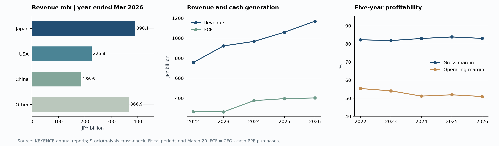

# 基恩士（KEYENCE，6861.T）研究报告

**研究日期与信息截止：2026-11-24，Asia/Shanghai。** 财务更新至2026-09-20中期，行情为11月24日东京15:30收盘。金额默认日元，股价与每股数全部采用本次1拆5之后的口径。

| 当前锚点 | 数值 |
|---|---:|
| 股价 | 14,750日元 |
| 扣库存股后的股数 | 1,212,624,645股 |
| 复算市值 | 17.8862万亿日元 |
| TTM EPS / PE | 448.53日元 / 32.89倍 |
| TTM自由现金流收益率 | 2.69% |
| 预期全年每股股息 / 股息率 | 130日元 / 0.88% |

基恩士的价值来自把工厂的检测、测量和调试问题变成可重复销售的产品。最新两季的当地币增长与利润率证明这套机制仍有效；现在需要判断的是，复苏能持续多久，以及股价已经预付多少增长。[行情交叉来源：Yahoo](https://finance.yahoo.com/quote/6861.T/history/)、[StockAnalysis](https://stockanalysis.com/quote/tyo/6861/)。

证券身份为株式会社キーエンス / KEYENCE CORPORATION / 基恩士，东京证券交易所Prime市场6861，ISIN JP3236200006；本文估值针对日本普通股，不把海外场外证券报价另加到股本。沿用仓库的 `Keyence` 目录及触发监控ID。

---

## AI研究偏见自觉

**信息丰富度评级：A级。** 整体报表资料充足，但产品级信息并不透明。AI研究局限性声明：没有客户访谈、现场投标数据、产品ASP、销售工程师分地区人效原始表；不能把大量公开材料转换成对未来竞争的虚假确定性。本文情景增速、终值与仓位都是研究判断。

- [x] 不把高毛利自动等同于客户无法替代。
- [x] 不用历史高估值证明今天便宜。
- [x] 将当期当地币增长与汇率贡献分开。
- [x] 对缺失的产品分部、市场份额和复购率明确留白。
- [x] 即使资料减半，直销与现金转化判断仍有财报支持；AI替代速度和未来海外人效判断会显著减弱。

### 与7月旧研究对账

| 旧研究锚点 | 本次更新 | 含义 |
|---|---|---|
| 7月17日70,880日元、约38.61倍PE | 等值拆后14,176日元；本次14,750日元，价格约+4.05%，PE却降至32.89倍 | 倍数降低主要因为盈利增长，并非股价暴跌 |
| 64,200 / 55,100日元旧价位 | 拆后仅等值12,840 / 11,020日元 | 原监控不可直接沿用五倍的旧股价；本次重新评估条件带 |
| 年度营业利润率约51%，担忧费用扩张 | 最新单季升至56.9% | 本期证据反驳“利润率继续下滑”的机械外推 |
| “极少乱并购” | 10月完成TraceParts收购，资金政策允许战略并购 | 应检验成交价格与回报，不能只沿用保守管理层标签 |

公司公告的拆股登记日为11月20日，法律生效日为11月21日；行情服务记录11月19日为交易除权日，三个日期不可混称。拆股不改变公司价值。[官方拆股公告](https://www.keyence.co.jp/pdf/PressRelease_20261029_02.pdf)。

旧台账把7月20日建议链接到7月下旬Q1材料；根据[官方IR日历](https://www.keyence.co.jp/investor/calender.jsp)，该短信与说明资料分别在7月28日、29日发布，不能作为7月20日已知信息来回测。本次保留历史文件与记录，以新建议接续，不据此判定旧建议命中。

> 研究追问：我的确信来自已经验证的客户价值，还是来自基恩士的质量声誉？

---

## 第一步：核心数据总览

### 财年与双源口径

以下按“截至某年3月20日全年”命名。公司说明资料的FY2026指截至2027年3月的财年，而StockAnalysis的FY2026指截至2026年3月全年，不能直接拼接同名FY。正式英文报表以百万日元向下截位，官网部分业绩表四舍五入，产生一百万日元差异时不代表基本面冲突。

财务主源为[2026英文年报](https://www.keyence.co.jp/pdf/AnnualReport_2026_en.pdf)、[年度证券报告](https://www.keyence.co.jp/pdf/AnnualSecuritiesReport_202606_ja.pdf)、[2024年报](https://www.keyence.co.jp/pdf/AnnualReport_2024_en.pdf)、[2023年报](https://www.keyence.co.jp/pdf/AnnualReport_2023_en.pdf)；独立交叉源为[StockAnalysis利润表](https://stockanalysis.com/quote/tyo/6861/financials/income-statement/)、[现金流表](https://stockanalysis.com/quote/tyo/6861/financials/cash-flow-statement/)与[资产负债表](https://stockanalysis.com/quote/tyo/6861/financials/balance-sheet/)。日股不硬套港股或美股的ADR模板。

### 五年盈利与现金流

单位：十亿日元；四舍五入至一位小数，百分比由报表金额计算。FCF定义为经营现金流减购建有形固定资产现金支出，未减收购支出，也不是分红后的现金。

| 3月期末年份 | 收入 | 归母净利 | 毛利率 | 营业利润率 | CFO | 现金CapEx | FCF | 现金及流动证券 |
|---|---:|---:|---:|---:|---:|---:|---:|---:|
| 2022 | 755.2 | 303.4 | 82.26% | 55.36% | 271.5 | 6.2 | 265.3 | 1,004.6 |
| 2023 | 922.4 | 363.0 | 81.82% | 54.09% | 302.6 | 39.3 | 263.3 | 940.5 |
| 2024 | 967.3 | 369.6 | 82.96% | 51.18% | 387.9 | 12.5 | 375.4 | 1,132.8 |
| 2025 | 1,059.1 | 398.7 | 83.81% | 51.91% | 409.5 | 14.3 | 395.2 | 1,219.2 |
| **2026** | **1,169.3** | **445.2** | **83.02%** | **50.95%** | **430.7** | **28.4** | **402.3** | **1,493.9** |

五年利润率足以证明产品与组织的经济价值，也显示收入增长不必然转成同比例利润增长。年度归母增长与现金流增长并非始终同步，不能只观察利润表。



### 最新半年与近四季度

[截至2026-09-20英文中报](https://www.keyence.co.jp/pdf/ConsolidatedFinancialResultsForThe2ndQuarterEndedSeptember_20_2026%28JP_GAAP%29.pdf)与[半期证券报告](https://www.keyence.co.jp/pdf/HalfReport_202610_ja.pdf)：半年收入735.399十亿日元、同比+34.9%；营业利润408.262十亿、同比+50.0%；归母298.675十亿、同比+49.4%。半年CFO273.988十亿、现金CapEx9.977十亿，简单FCF264.011十亿，约为归母的88.39%。

下表采用[10月说明材料](https://www.keyence.co.jp/pdf/FinancialResults_202610_en.pdf)的季度原始展示精度；金额单位为亿日元，不能拿粗数相加后要求等于精确TTM。

| 季末 | 收入 | 毛利率 | 营业利润 | 营业利润率 | 日本收入同比 | 海外当地币同比 |
|---|---:|---:|---:|---:|---:|---:|
| 2025-12-20 | 2,893 | 83.1% | 1,442 | 49.8% | +0.3% | +13.3% |
| 2026-03-20 | 3,347 | 83.5% | 1,794 | 53.6% | +8.6% | +16.4% |
| 2026-06-20 | 3,466 | 85.0% | 1,871 | 54.0% | +19.9% | +24.0% |
| 2026-09-20 | 3,888 | 86.2% | 2,212 | 56.9% | +22.8% | +30.5% |

季度交叉核验发现，[StockAnalysis季度表](https://stockanalysis.com/quote/tyo/6861/financials/income-statement/?p=quarterly)的2025年12月列收入311,995百万、营业利润161,790百万，与官方约2,893亿、1,442亿不符；该第三方列还存在股本未复权，且四季加总不能对齐年度的异常，故弃用该列，并用[当时发布的1月原始资料](https://www.keyence.co.jp/pdf/FinancialResults_202601_en.pdf)复核后以正式披露为准，不能标作双源一致。当地币增长、部分季度毛利以及现金同等物细分仍主要来自发行人，单源限制保留；整体年度和TTM关键财务另有独立核对。

半年海外日元收入+41.8%，当地币+27.3%。公司估计汇率增加收入约519亿、营业利润约384亿日元：经营改善真实，汇率也显著放大了结果。半年库存较3月末+37.54%、贸易应收+15.46%，需要结合备货和销售加速解释，尚不能仅凭余额上升认定渠道积压。

### 收入结构能看到哪一层

截至2026年3月全年，日本390.066、美国225.751、中国186.550、其他366.920十亿日元；与独立第三方地区表一致。最新单季日本占31.9%、海外68.1%；美洲35.3%、亚洲46.1%、欧洲其他18.5%是**海外内部**比例，不能直接当集团占比。

公司为单一经营分部，未披露传感器、机器视觉、显微镜等各自收入与毛利；也没有可核验的近四季产品分部利润。不编造产品饼图。年报显示无单一客户占收入超过一成，但并未因此消除客户共同受制造业资本开支影响的相关性。

### 现金、债务与股本

| 2026-09-20项目 | 百万日元 | 使用边界 |
|---|---:|---|
| 现金及存款 | 698,507 | 包含较长期限定存，不等于现金流表同等物 |
| 现金及现金同等物 | 520,748 | 现金流表定义，不再与上一行相加 |
| 流动有价证券 | 803,618 | 与现金及存款相加才得到流动金融资产口径 |
| 现金及流动证券合计 | 1,502,125 | 本文流动净现金近似口径 |
| 长期投资证券 | 1,691,841 | 含联营权益，不能整行当现金 |
| 长期定存 | 20,405 | 与流动现金分列 |
| 总负债 | 250,179 | 包含税款、应付和其他项目，不是有息债务 |
| 净资产 | 3,704,958 | 用于复算PB与BVPS |

正式年报借款及公司债明细均为不适用，第三方也报零债务；这支持“无披露借款及公司债”，不证明所有租赁承诺为零。现行报表未单列完整租赁负债，新租赁准则拟于2029年3月期开始采用，影响仍评估中。EV减现金口径存在租赁与长投边界，不能称为完整可清算价值。

拆后发行总股数为1,216,038,420；按9月20日库存股682,755旧股同步乘五，扣库股数为1,212,624,645。官方与StockAnalysis精确股数字段一致，不把公众自由流通盘误作市值分母。

> 数据追问：若收入增长明天放缓，能从现金回收而不只是利润表确认韧性吗？

---

## 第二步：生意本质分析

**工厂为减少停线、报废与调试时间付钱；基恩士用直销工程师发现共性问题，再把解决方案做成标准产品，重复赚取客户节省的一部分成本。**

| 环节 | 收入与成本机制 | 投资含义 |
|---|---|---|
| 客户需求 | 检测、定位、尺寸测量、追溯、产线控制 | 需求分散，但新线和改造预算有周期 |
| 产品 | 传感器、视觉、测量、打标、显微镜、控制设备与软件 | 以设备销售为主，不能按订阅收入估值 |
| 直销 | 工程师诊断、演示、售后，现场反馈给研发 | 服务费用进期间费用，不能把毛利全当无成本租金 |
| 无厂制造 | 委外生产，保留关键生产技术与工艺支持 | 固定资产需求低，供应质量责任仍在 |
| 复购 | 新产线、更多工位、换代和应用扩展 | 依靠持续创造价值；没有披露经常性收入比例 |

[公司商业模式页](https://www.keyence.co.jp/investor/business-model/)称新品约七成含世界或行业首创功能，属于公司自述；[增长策略](https://www.keyence.co.jp/investor/strategy.jsp)披露每年约十个新品系列，上市两年内产品贡献销售约10%—20%。这解释持续创新，但不是独立专利质量鉴定。

全年研发32.839十亿日元，约占收入2.81%；最新半年研发17.466十亿。比例低不能推出研发不重要：它主要围绕应用、光学、机械、电控、软件与易用性组合，直销发现需求的支出也没有全部记入研发科目。

经营杠杆来自产品毛利和直销组织费用之间的差额。最新收入增长快于销售管理费用，利润率抬升；若海外人员扩张先于收入，杠杆可以反转。公司称海外人均生产性约为日本一半，显示提升空间，也说明不能用软件式边际成本假设海外复制。

### 同业对照

| 公司及期间 | 收入 | 毛利率 | 营业利润率 | 可比限制 |
|---|---:|---:|---:|---|
| 基恩士，2026年9月单季 | 3,888亿日元 | 86.2% | 56.9% | 产品组合较广 |
| Cognex，2026年10月4日止单季 | 313.387百万美元 | GAAP 70.8% | GAAP 32.2% | 机器视觉更集中；调整EBITDA不混作营业利润 |
| Omron IAB，2026年4—9月 | 2,602亿日元 | 分部未披露 | 15.64% | IFRS重述及分部变化；集团毛利不冒充IAB毛利 |

来源：[Cognex官方SEC业绩附件](https://www.sec.gov/Archives/edgar/data/851205/000085120526000079/a10042026-xex991xq32026ear.htm)、[Omron中期业绩材料](https://www.omron.com/global/en/assets/file/ir/irlib/20261110_financial_results.pdf)。盈利差距支持质量优势；同行也在复苏，因此不能把基恩士增长全解释为夺取份额。

> 段永平式追问：好在哪里？把客户现场节省的时间和损失，转成可复制产品的售价，而不是按工程师工时收费。

---

## 第三步：护城河评估

| 类型 | 判断 | 支持证据 | 可证伪边界 |
|---|---|---|---|
| 品牌与定价 | 强，但提价能力未被直接识别 | 高毛利、多年现金转化和高利润 | 无同品ASP、销量序列，无法区分价格、组合与汇率 |
| 转换成本 | 中到强，依应用而异 | 产线重新验证、调试和停线风险 | 新项目和简单传感器仍可多供；没有留存率数据 |
| 网络效应 | 原设备业务弱 | 客户反馈带来学习效率 | 这是组织学习，不是用户越多就直接提升他人效用 |
| 规模与组织 | 中强 | 产品规划、现场知识、全球供货和培训结合 | 海外人效差距表明复制有人员与时间成本 |
| 技术与专利 | 中强、需要更新 | 光机电算集成、可靠性、交付和操作体验 | 没有可靠“领先几年”或独立市场份额数字 |

过去五年，高毛利与现金流支持护城河仍宽；营业利润率并非持续扩张，不能写成单向变宽。最新两季改善有积极证据，尚不足证明下一轮周期也一样。未来五年的关键是把AI用于更易部署的产品，而不是只靠现有硬件封闭性维持价格。

对手拿巨资可以购买算法与传感硬件，也可以雇销售；困难在于把客户问题、商品化、培训和供货同时做好。但如果通用模型让普通集成商也能低成本达到足够可靠的结果，这条组织护城河会先在新项目中被削弱。

> 巴菲特式追问：十年后仍在吗？大概率仍有现场价值，但必须持续证明客户愿意为可靠性与省时支付溢价。

---

## 第四步：逆向思考与风险清单

聪明的不买者可以这样反驳：你买到的是优秀工业设备公司，却按长久稳定的稀缺资产定价；眼前利润率处于复苏和汇率共同有利时点。若现金长期低回报沉淀、产品价格透明化，再好的资产负债表也不能替高买价创造足够回报。

以下概率是定性研究判断，没有可统计频率基础；各风险相关，不能相加成失败概率。

| 失败路径 | 可能性 | 影响 | 应观察的证据 |
|---|---|---|---|
| 半导体及电子投资前置后回落 | 中高 | 高，利润和倍数双降 | 按当地币行业增长回落、订单转化与库存变化 |
| AI视觉与中国本地替代压价 | 中，长期不确定 | 高 | 新线投标失利、毛利持续回落；现无产品级公开验证 |
| 海外直销训练和人效失灵 | 中 | 中高 | 费用增长持续快于当地币收入，海外人效无改善 |
| 日元反转、金融资产损益 | 中高 | 中高 | 恒汇率增长、汇率敏感性；对外币投资者另有换汇回报 |
| 并购价格过高或中立平台客户流失 | 中、低置信度 | 中高 | 收购金额、商誉、现金支出、CAD供应商及用户留存 |
| 委外质量、出口限制及供应中断 | 低到中 | 高、可能非线性 | 质量事故、出口许可、供应商与区域集中披露 |
| 长期以低回报保留盈余 | 中高 | 中，积累性机会成本 | 资本回报政策、投资收益率与每股长期回报 |

历史类比首先采用公司自身：2024年3月期收入增长放缓时，营业利润未同步增长；这比把工业自动化硬套互联网平台更有解释力。Cognex和Omron本期共同复苏又说明行业因子真实。类比只能提示周期，不能证明下个季度拐点。

跨学科上，产线可靠性的切换风险形成交易成本优势；人才培养和现场服务形成组织规模约束；通用AI降低某些技术门槛，却不自动承担误检、停线与验收责任。最可能的分析错误，是把总量高毛利掩盖的产品差异忽略，再把当期半导体景气外推成长期结构增长。

> 芒格式追问：最可能错在哪里？在所有人都认可的好公司上，把“不会破产”误当成“价格不会带来长期损失”。

---

## 第五步：管理层评估

现任总裁中野铁也（Tetsuya Nakano）于2025年12月上任，2004年入职，历任控制系统及海外业务相关岗位；前任中田有转董事特别顾问。[官方董事履历](https://www.keyence.co.jp/investor/en/compliance/officers.jsp)。制度化内部接班降低创始人依赖，但现CEO任期仍短，不能把过去全部业绩归功于他。

| 时间与决策 | 已见结果 | 评价 |
|---|---|---|
| 长期坚持直销、产品化及委外 | 多年高利润、低现金资本开支 | 积极；回报来自组织与产品，不只是财务工程 |
| 截至2026年3月股息提高至旧股550日元 | 增加现金回报，仍保留大量利润 | 温和积极；未解决全部闲置资本问题 |
| 2025年12月内部接班 | 此后两个季度经营强 | 初步积极，无法隔离行业与汇率贡献 |
| 2026年10月收购TraceParts全部股权 | 拓展CAD数据分发和工程师营销平台 | 尚不能评分：支付额、收入和利润未披露 |
| 2026年10月宣布1拆5、旧股全年股息预计650日元 | 降低交易单位，对应拆后全年等值130日元 | 股息有现金意义；拆股本身不创造内在价值 |

[TraceParts官方收购公告](https://www.keyence.co.jp/pdf/PressRelease_20261023.pdf)确认10月22日完成交易，平台连接超过650万工程师，预计当期损益影响轻微。该用户数不是付费客户，损益影响轻微也不代表成交金额小。[被收购方说明](https://info.traceparts.com/news/traceparts-news/traceparts-joins-keyence-group/)承诺品牌、团队及独立合作关系延续；这仍需实际留存与回报验证。

[资金政策](https://www.keyence.co.jp/investor/capital-allocation-policy.jsp)优先增长投资，不预设战略并购金额与时机，并保留灵活回购可能性。应将旧文“少并购”改成可检验的问题：收购价格和增量回报是否足够透明，平台中立性是否保持。

### 股东与激励

[9月半期书](https://www.keyence.co.jp/pdf/HalfReport_202610_ja.pdf)披露T.T.持股15.07%、基恩士财团4.57%、创始人泷崎武光个人3.15%；[3月股东表](https://www.keyence.co.jp/investor/stock/info.jsp)提供另一时点核对。后者是同一发行人的重复披露，不能冒充独立所有权穿透。第三方[StockAnalysis](https://stockanalysis.com/quote/tyo/6861/statistics/)的Insiders 18.24%是聚合分类，不能等同于CEO或创始人个人经济权益。

公司为普通股结构，未见AB股差异安排。T.T.最终实益与表决控制未完成独立穿透，不把其与创始人、财团相加宣称个人持股。现CEO披露直接持股栏为“—”；不能据此评价全部家庭或间接经济权益。

[治理报告](https://www.keyence.co.jp/pdf/CorporateGovernance_20260615_01.pdf)及[薪酬政策](https://www.keyence.co.jp/sustainability/governance/)显示利润挂钩激励，但这不等于直接约束每股回报和增量资本效率。高权益比率说明偿付安全，不自动证明治理优良。本次未完成全面劳动、监管、诉讼与关联交易排查，不沿用“无重大丑闻”的绝对背书。

> 段永平式追问：CEO退休还能保持吗？产品规划、培训与现场反馈可以传承；并购扩张后的资本纪律仍须重新验证。

---

## 第六步：行业与文明趋势

制造业缺工、质量追溯、复杂工艺和柔性生产为检测测量创造长期需求；AI降低使用门槛可能扩大部署，也可能让普通视觉功能更便宜。文明方向向上，不保证每个供应商都能保留原来的利润份额。

公司在价值链中承担检测、测量和控制部件的价值实现，不直接拥有终端制造利润，也不是所有工业AI算力投入的收款方。半年度半导体/LCD销售在日本约+45%、海外约+65%，行业数据以五个百分点刻度披露，既支持需求也提醒景气集中。不能因为客户分散就忽视共同资本开支周期。

TAM不采用把传感器、视觉、显微镜、PLC和数字平台市场预测简单相加的口径：这些统计有交叉，且产品收入未披露，无法稳健计算统一份额。公司披露的海外人效和地区制造业增加值比较可提示渗透空间，却不是独立总市场测算。未来增长主要取决于新增工位、应用渗透、新品、销售人员生产性与售价组合，本文没有可核验的单一TAM及预测CAGR。

客户端无单一收入占比超过一成的年度证据；供应商集中、地区产能、最新中国本地替代输单率没有充分公开分解。技术路线风险不是机器会否需要眼睛，而是客户是否还需要为同样的眼睛支付今天的溢价。

> 李录式追问：二十年后回看？更可能是持续受益于工业精细化的工具供应商；“时代标准石油”式利润垄断尚无证据。

---

## 第七步：估值与安全边际

### 当前定价与历史比较

TTM按截至2026年3月全年，加本期半年、减上年同期重建：收入1,359,388、营业利润731,842、归母543,901、CFO507,786、现金CapEx26,749、FCF481,037，单位均为百万日元；归母与FCF同时得到独立第三方确认。EPS由精确股数计算，未再除五一次。

| 指标 | 统一口径复算 |
|---|---:|
| PE | 32.89倍 |
| PB | 4.83倍 |
| PS | 13.16倍 |
| P/FCF | 37.18倍 |
| FCF收益率 | 2.69% |
| 流动净现金每股 | 1,238.74日元 |
| 流动现金口径EV | 16.3841万亿日元 |
| EV/收入 | 12.05倍 |
| EV/营业利润 | 22.39倍 |

第三方当前页面有PS12.99、PB4.77等与收盘价和报表不能相容的数值，故不用这些异步比率。第三方Forward PE28.47和PEG2.08仅为未经完整穿透的共识参考，不作为估值输入；前者对应隐含预测EPS约518.09日元，后者依赖未核实的预测增长口径。

[年度证券报告](https://www.keyence.co.jp/pdf/AnnualSecuritiesReport_202606_ja.pdf)列示2022至2026年3月期末PE分别为43.81、40.26、46.77、37.07、32.19倍。现在低于多数历史点，但接近最近年度期末；这五个点不是五年完整分位，也不能据此算平均估值折价。历史价格与每股数如跨拆股须同向复权，本报告不使用未对齐的历史价格涨幅。

同业最新同日、相同GAAP盈利口径的PE未完成双源核验，因此不列伪精确倍数排名。Cognex、Omron的商业可比性见第二步；其今天股价不能作为十年退出倍数依据。

### 三年三情景：当前价格需要什么

基期拆后TTM EPS448.53日元。增长与PE是研究假设：悲观盈利不增长、退出24倍；基准年增8%、30倍；乐观年增13%、36倍。30倍反映三年后仍有较高增长与质量溢价，不能永久沿用。股息以130日元为起点、随各档盈利同速增长；忽略税费、换汇与再投资。

| 情景 | 盈利年增 | 三年退出PE | 第三年股价 | 股价累计变化 | 含息年化回报 | 按10%要求回报折现的含息现值 |
|---|---:|---:|---:|---:|---:|---:|
| 悲观 | 0% | 24倍 | 10,764.72 | -27.02% | -8.98% | 8,410.98 |
| 基准 | +8% | 30倍 | 16,950.56 | +14.92% | +5.73% | 13,111.19 |
| 乐观 | +13% | 36倍 | 23,298.57 | +57.96% | +17.43% | 17,916.23 |

价格是三年末价格，最后一列才是今日价值，不能互相替代。基准含息年化不足研究要求，且依赖仍有30倍的三年退出价，因此现价没有足够可见的安全边际。这一判断独立于下述十年测试。

### 十年终值：明确美元视角与模型边界

仓库终值工具不支持JPY的资本成本护栏。本文不把日元数据贴上USD标签过关：将市值及利润统一按[美联储H.10最新已发布11月20日参考汇率158.76日元/美元](https://www.federalreserve.gov/releases/h10/current/)转换，未来也假设同一汇率，构成**固定汇率、美元投资者的情景模型**，不是日元本币WACC，也不是11月24日即期汇率。

| 输入 | 本文判断与理由 |
|---|---|
| 资本成本r | 美元10%；[11月23日美国十年国债4.92%](https://home.treasury.gov/resource-center/data-chart-center/interest-rates/TextView?type=daily_treasury_yield_curve&field_tdr_date_value=2026) + β1 × 假设ERP5.08%。β1是中性建模选择，并非回归测得 |
| 币种边界 | 按工具USD区间9%—11.5%；基准永续g上限4%。本文采用更低的1% / 2% / 3%，固定汇率下同一增长映射到美元现金流 |
| 稳态增量ROIC | 25%，对轻资产经营的判断；它不是把账面ROE或去现金存量ROIC直接照搬，也非公司指引 |
| g与分母 | 悲观1%、基准2%、乐观3%；r−g分别9、8、7个百分点。g不随r变化 |
| 十年盈利增长 | +2% / +8% / +12%；不把当前复苏同比延长十年 |
| 概率 | 悲观30%、基准50%、乐观20%，主观权重而非统计频率 |
| k | 股息率减稀释率，固定0.88136%，假设无净稀释；未计税费、汇率变化和新增回购 |

25%的稳态ROIC高于受大量金融资产压低的整体账面资本回报，而低于剔除大量现金、以很小运营资本作分母的高回报估计；上下界均受口径影响，未获得可独立验证的增量ROIC，故置信度中低。它只用于终值的必要再投资约束，不是证明经营永续高增的事实。

终值PE只能由 `(1−g/ROIC)/(r−g)` 得到，不能来自同行类比。

| 情景 | 第十年利润，百万美元 | 终值PE | 工具终值回报近似 |
|---|---:|---:|---:|
| 悲观 | 4,176.19 | 10.67倍 | -7.98% |
| 基准 | 7,396.33 | 11.50倍 | -1.89% |
| 乐观 | 10,640.43 | 12.57倍 | +2.61% |

**这些是工具的“终值几何回报+固定股息率”近似，不是逐年现金流IRR。** 工具未显式计入未来十年未分配盈余积累，亦没有单独清算所有现有金融资产；对低派息、净现金公司的结果偏严。不能据此宣称基准实际投资必亏。

### 补充完整经营现金流模型与反向DCF

为检验上述近似偏严是否决定结论，另做完整年度现金流折现。以TTM营业利润731,842百万日元乘假设税后系数70%，得到经营NOPAT512,289.4百万，剔除非经营投资收益；预测期ROIC假设25%，每年可分配现金为当年NOPAT × `(1−十年增长/ROIC)`。第十年末终值采用第十一年NOPAT乘同一永续倍数，即NOPAT₁₀ × (1+g) × (1−g/ROIC)/(r−g)；加回1,502,125百万流动金融资产，不再给这部分利息收益资本化。股息包含在可分配现金中，不另加一次。

| 情景 | 十年增长 | 预测期可分配比例 | 按美元10%折现每股价值 | 逐年完整现金流收益率 |
|---|---:|---:|---:|---:|
| 悲观 | +2% | 92% | 6,004.29日元 | -3.71% |
| 基准 | +8% | 68% | 7,964.08日元 | +1.34% |
| 乐观 | +12% | 52% | 10,218.00日元 | +5.09% |

完整现金流收益率将流动金融资产视作期初可回收资产、从净投资额扣除；未来现金假设可以全部分配，实际股息政策未承诺如此执行。这是与终值近似不同的模型，不能拿其输出替换工具flip的锚点。

这里保守漏掉长期投资与长期定存价值；若将这两行全部按账面额加回，最多机械增加每股1,412.02日元，但其中含联营权益，不能把这个上限叫可分配现金。预测期固定资产/营运资金再投资也可能比25%增量ROIC假设更高效；基准现金转化若改为90%，每股值为8,805.45日元。因此模型区间说明假设影响，而非精确清算价格。

反向DCF在上述25%预测期ROIC、2%永续增速、10%美元资本成本和只加流动金融资产条件下，当前价格需要经营NOPAT未来十年年增约20.35%。这是“这些假设组合下的隐含增长”，不等于市场真实一致预期；降低资本成本、提高资本效率、计入更多金融资产，都能降低所需增长。当前当地币增长接近该水平，不意味着十年都能维持。

### 折现率翻转检查

先执行规定的±2个百分点；8%和12%均在USD护栏外，再执行±1个百分点，保留全部结果。以下“期望”是主观概率加权的终值回报近似，不是完整路径的期望复利。

| r | 概率加权回报近似 | 是否覆盖r | 资格 |
|---|---:|---|---|
| 8% | -0.01% | 未通过 | 区间外，仅供参考 |
| 9% | -1.52% | 未通过 | 区间内复核 |
| 10% | -2.82% | 未通过 | 基准 |
| 11% | -3.94% | 未通过 | 区间内复核 |
| 12% | -4.94% | 未通过 | 区间外，仅供参考 |

**在已测试的币种合理区间9%—11%内，覆盖资本成本的压力测试结论不随Δr翻转。** 这支持限制集中度，不是买入或持有的唯一否决票。并未穷举每个可能的r或证明实际收益为负。

### 估值分歧对账

| 判断 | 依据与职责 | 对行动的影响 |
|---|---|---|
| 三年相对定价 | 基准含息现值13,111.19；依赖三年末30倍质量溢价 | 现价偏贵；更低价格可以恢复中期回报 |
| 十年终值近似 | 永续增长推导的约11.5倍终值、低实际派息 | 压力很大，但低派息积累漏项使其偏严 |
| 完整经营现金流 | 显式分配可用经营现金、另加流动金融资产 | 结果仍偏低；长期金融资产和实际再投资效率是关键敏感项 |
| 旧thesis与前六步 | 一流生意，当前恒汇率增长及利润率增强 | 不把模型低值直接等同于商业论文破坏或持仓清零 |

本报告保留“合理小仓有条件持有”，同时暂停新增，依据为经营质量、组织护城河、内部接班、周期/并购风险、长期需求和三年定价六维合议。十年测试把未来条件买入限制为很小的质量卫星，不能把三年相对现值包装成十年绝对安全边际。**11,000—12,000日元只是更低价格下重新调查的区间，尚非完整DCF显示的深度低估区间。**

未显式量化的离散风险为出口限制、TraceParts整合与汇率制度突变；工具audit已列为未建模，不塞进β或r。制造资本开支回落、AI与本地替代只体现在较弱增长情景，未单列断供/产品事故的灾难尾档，故不支持核心重仓。

> 巴菲特式追问：r错两个百分点会怎样？±2的两端区间外；±1的有效检查均未覆盖r，压力结论不翻转，但现金分配与资本效率假设比这更值得验证。
>
> 段永平式追问：股市关闭五年愿意现价持有吗？有合理小仓可承受经营兑现；若今天从零开始，三年可见回报和证据还不足以付出现价。

---

## 第八步：最终决策与行动清单

| 维度 | 结论 | 信心度 |
|---|---|---|
| 生意质量 | 强，客户节省成本、产品化与现金转化获证 | 高 |
| 护城河 | 宽，依靠组织、应用和验证成本；非普遍不可替代 | 中高 |
| 管理层 | 内部接班延续，新增并购与长期资本效率仍待证 | 中 |
| 最大风险 | 周期与汇率共振、AI/替代压价、付价过高 | 中 |
| 文明趋势 | 工业精细化长期受益，价值捕获仍需持续创新 | 中高 |
| 估值 | 三年基准含息现值低于现价；十年压力未过、有效r扰动不翻转，且需识别低派息近似偏严 | 中低 |

估值一格不是唯一裁决。**当前结论：空仓者观望；合理小仓者有条件持有，暂停加仓。** 没有用户成本、风险预算和其他日元资产信息，以下仓位仅为研究用的组合比例参考，不是已知用户仓位建议。

| 策略 | 建议 |
|---|---|
| 空仓者 | 14,750日元不新增；等待拆后11,000—12,000日元并重新检查经营，而非预埋无条件买单 |
| 持仓者 | 若为可承受的小仓、期限足够且经营红线未触，继续持有、不加杠杆；超配者结合成本和税费复核集中度 |
| 条件加仓 | 未来连续两次正式季度披露仍有海外当地币增长至少约10%、营业利润率至少约50%；滚动FCF/归母至少约80%，应收和库存增长可解释，收购现金与资本分配可核；同时进入11,000—12,000带后才重估首笔约0.5%，总研究参考不高于2% |
| 低于下沿 | 11,000以下先核永久损坏、利润是否处于峰值；不自动扩大仓位 |
| 估值警戒 | 18,000日元以上且盈利假设没有增强，复核超配与兑现部分收益；价格单独到线不等于卖出 |
| 卖出信号 | 若连续披露显示当地币销售持续走弱、利润率与现金转化共同跌破上述门槛且无法解释；或发生重大财务/治理问题、实质性技术失位，则重审并视证据退出 |

11,000—12,000带对应目前TTM PE约24.52—26.75倍，比三年基准含息现值保留一定折扣；它是比旧拆后12,840上沿更严格的研究起点。当前盈利增强不等于可忽略回报要求。保留小仓的理由是生意与护城河证据，限制总仓位的理由包含十年资本回报压力、未建模风险及产品级盲区。

### 复检安排

| 时间 | 属性 | 应核事项 |
|---|---|---|
| 2026-11-26 | 官方中期股息预计支付日 | 支付公告与账户实际到账；旧股登记权利对应325日元，不能与新股65日元混加 |
| 2026-12-31 | 本报告设定的人工研究检查 | TraceParts对价/现金披露、股本与数据源拆股口径、是否出现实质经营新证据 |
| 2027-01-31 | Q3披露窗口人工检查日 | 正式Q3日程尚未确认；提前披露即提前复检，不把月末检查日写成预约财报日 |

[官方IR日历](https://www.keyence.co.jp/investor/calender.jsp)和中报支持已发布节点；未来Q3确切日期仍是缺口。价格带登记到既有 `Keyence` target，事件仅保存供人工复检，现行每日流程只监控价格。旧10月中报复检事件完成留档，旧建议由本报告接续。

### 四位大师原文与方法论延伸

以下只延伸其已公开方法，不代表他们评价、持有或建议交易基恩士。

- **巴菲特**：“The size of that circle is not very important; knowing its boundaries, however, is vital.” [1996股东信](https://www.berkshirehathaway.com/letters/1996.html)。本报告延伸：整体财务可以核实，产品ASP与替代速度没有同等证据，能力圈应止于此。
- **芒格**：“It’s not a competency if you don’t know the edge of it.” [Stanford Lawyer，2009春季，印刷页19](https://law.stanford.edu/wp-content/uploads/2015/07/sl80_articles.pdf)。本报告延伸：先排除拆股、分部、现金、股息与终值模型的普通错误，再谈质量溢价。
- **段永平**：资料不足，不模拟代言。原账号[相关帖](https://xueqiu.com/1247347556/347302257)正文直读受限；不把搜索摘要、评论转述当完整原文，不发明“他会买/不会买”的引语。
- **李录**：“One common problem for investors is that they tend to swing too often.” [喜马拉雅资本官网Investment Philosophy](https://www.himcap.com/)。同段也提醒遇到真正好机会却不投入同样有害。本报告延伸：耐心等待需要价格与证据标准，不应把耐心变成永久不行动，也不声称当前已到重仓好球。

> 决策追问：现在决定不新增，未来什么事实会改变它？更低的价格、持续当地币增长、可核验的现金回报与并购纪律，需要一起出现。

---

## AI分析置信度与投资确定性

AI分析置信度：已公布整体财务、拆股与当前行情较高；护城河机制中高；十年增长、增量ROIC、竞争份额和资本回报预测中低。投资确定性：生意持续存在与有竞争力的把握高于现价长期回报的把握，两者不能互换。

充分数据支持的是多年盈利和现金流、最新半年经营增长、股本与流动金融资产。有限信息推理包括未来海外人效、AI对价格的净影响、并购回报、未来派息、增长与终值。重要待补材料是客户投标/替代访谈、区域销售人效、产品留存与ASP、收购价格和长期金融资产可变现性。本报告用于学习研究，不构成投资建议。

---

## 数据来源与审计记录

财务与商业来源已随各表列示；同一公司的年报与官网不算两个独立经济信息源。第三方交叉源主要为StockAnalysis/S&P Global；Yahoo用于独立行情核对，其底层供应商可能重叠，不能把网站数等同于完全独立数据链。

关键数据使用 `financial_rigor.py` 执行市值、股本、收入、归母、现金及流动证券、CFO与FCF交叉验证，容差统一收紧至一个百分点；估值与三情景重新计算。下附工具原始输出节录。模型参数与Decimal计算结果保存在[模型记录](Keyence-research-20261124-model.json)，数据抽检结果见[审计记录](Keyence-research-20261124-audit.json)。情景/阈值只能复算一致性，不能经外部来源“证明未来会实现”。

抽检裁定：数值检查准出；保留第三方异常季度列警告，已回读原始披露并弃用该列。单源和模型重算另列，不宣称全部双源一致。

下列工具输出的ROE为EPS除期末每股净资产，不是按平均权益计算的会计ROE。

### 关键数据交叉验证记录

```text
============================================================
市值验算 (Market Cap Verification)
============================================================
  股价 (Price):       14750.0 JPY
  总股本 (Shares):    1.21B
  计算市值:           17.89T JPY
  报告市值:           17.89T JPY
  偏差:               0.00%

  ✅ 验证通过, 偏差仅 0.00%
```

```text
============================================================
交叉验证: 2026年3月期收入 (Cross-Validation)
============================================================
  数据来源数: 2
  参考中位数: 1.17M 百万JPY

  ✅ 官方英文年报              : 1.17M 百万JPY  (偏差 0.00%)
  ✅ StockAnalysis       : 1.17M 百万JPY  (偏差 0.00%)

  ✅ 所有来源偏差 ≤ 1.0%, 数据一致

  共识值 (加权中位数): 1.17M 百万JPY
```

```text
============================================================
交叉验证: 2026年3月期归母净利 (Cross-Validation)
============================================================
  数据来源数: 2
  参考中位数: 445,185.00 百万JPY

  ✅ 官方英文年报              : 445,185.00 百万JPY  (偏差 0.00%)
  ✅ StockAnalysis       : 445,185.00 百万JPY  (偏差 0.00%)

  ✅ 所有来源偏差 ≤ 1.0%, 数据一致

  共识值 (加权中位数): 445,185.00 百万JPY
```

```text
============================================================
交叉验证: 现金及流动证券20260920 (Cross-Validation)
============================================================
  数据来源数: 2
  参考中位数: 1.50M 百万JPY

  ✅ 官方英文中报相加            : 1.50M 百万JPY  (偏差 0.00%)
  ✅ StockAnalysis       : 1.50M 百万JPY  (偏差 0.00%)

  ✅ 所有来源偏差 ≤ 1.0%, 数据一致

  共识值 (加权中位数): 1.50M 百万JPY
```

```text
============================================================
估值指标验算 (Valuation Verification)
============================================================
  当前股价: 14750.0

  PE (TTM):  14750.0 / 448.5320352366746 = 32.89x
  盈利收益率: 3.04%
  PB:        14750.0 / 3055.3213768799824 = 4.83x
  ROE:       448.5320352366746 / 3055.3213768799824 = 14.68%
  P/FCF:     14750.0 / 396.69076658094804 = 37.18x
  FCF Yield: 2.69%
  股息率:    130.0 / 14750.0 = 0.88%
  PS:        14750.0 / 1121.0295004353966 = 13.16x

  ✅ 以上指标均使用精确十进制计算, 无浮点误差
```

```text
============================================================
三情景估值模型 (Three-Scenario Valuation)
============================================================
  当前股价: 14750.0 JPY
  当前EPS:  448.53
  预测期:   3年

  情景                年增速     目标PE      目标EPS       目标股价      涨跌幅
  ------------ -------- -------- ---------- ---------- --------
  乐观 (Bull)         13%      36x     647.18   23298.6   +58.0%
  中性 (Base)          8%      30x     565.02   16950.6   +14.9%
  悲观 (Bear)          0%      24x     448.53   10764.7   -27.0%

  ✅ 所有计算使用精确十进制, 结果可审计复现
```

终值口径最终复检与价格监控配置校验结果随审计记录留存。模型的准出仅证明所声明口径符合护栏，不证明假设为真。
