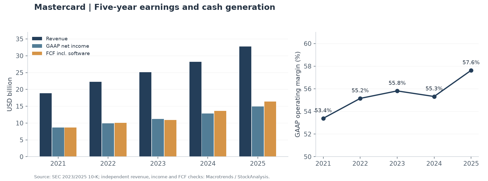
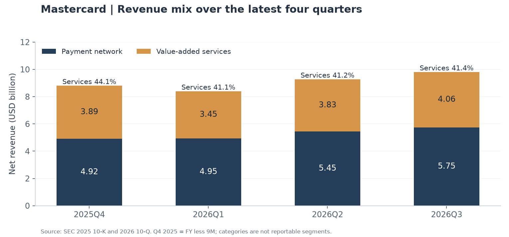

# Mastercard（MA）研究报告

**研究及数据截止日：2026-11-24（北京时间）**  
**标的：** Mastercard Incorporated／万事达，NYSE:MA，直接上市普通股，非ADR。  
**估值价格：** 635.48美元，2026-11-23美东16:00完整收盘；研究期间11/24盘中报价不混入模型。  
**股本与市值：** 2026-10-26最新披露A+B股871,176,114股，复算市值5,536.15亿美元；价格较新、股数较旧，后续回购可能使实际市值略有变化。  
**关键估值：** 桥接TTM GAAP EPS约19.11美元，PE 33.25倍，完整FCF收益率2.79%。  
**研究主线：** 全球可信支付网络仍有复利能力，但服务增长不能替代现金回收，优质生意也需要合适的买入价格。

本次承接用户指定的[2026Q2精读](Mastercard-earnings-2026Q2.md)，更新至10月29日已披露的2026Q3。保留旧报告作为历史记录，当前判断、静态价带和现金口径以本报告为准。[股价双核：StockAnalysis](https://stockanalysis.com/stocks/ma/statistics/)、[Yahoo](https://finance.yahoo.com/quote/MA/)；[准确股本](https://investor.mastercard.com/stock-information/classes-of-stock/default.aspx)。

---

## AI研究偏见自觉

**信息丰富度评级：A。** 年报、季报、支付量和监管材料丰富，最容易犯的错是把“全球支付收费站”的共识叙事，当作当前价格仍能产生高回报的证据。

**AI研究局限性声明：** 未接触银行和收单机构的非公开合同，不能确认逐客定价、客户激励回报率、服务类别利润率或BVNK真实增量收益。下文情景概率、增长率、估值倍数与仓位均为研究假设，不是公司指引，也没有统计意义上的胜率保证。

- [x] 将“资料充分”与“买价有安全边际”分开判断。
- [x] 检查强多头叙事：稳定币接入不等于消除绕开卡网络的风险。
- [x] 不把交换费全额当成Mastercard收入，不把支付金额当成可获得的收入市场。
- [x] 资料减少一半，网络优势的判断仍成立；具体增长率与目标价的可信度会下降。

## 第一步：核心数据总览

### 五年盈利与现金趋势

金额统一为**百万美元**；现金仅为现金及等价物。完整FCF＝经营现金流（CFO）−固定资产支出（PPE）−资本化软件，不扣并购，也不把它直接等同于可分配给股东的现金。

| 财年 | 净收入 | GAAP净利润 | GAAP经营利润率 | CFO | 完整FCF | 期末现金 |
|---|---:|---:|---:|---:|---:|---:|
| 2021 | 18,884 | 8,687 | 53.39% | 9,463 | 8,649 | 7,421 |
| 2022 | 22,237 | 9,930 | 55.15% | 11,195 | 10,098 | 7,008 |
| 2023 | 25,098 | 11,195 | 55.81% | 11,980 | 10,892 | 8,588 |
| 2024 | 28,167 | 12,874 | 55.32% | 14,780 | 13,586 | 8,442 |
| **2025** | **32,791** | **14,968** | **57.63%** | **17,648** | **16,433** | **10,566** |

来源：[2023年10-K](https://www.sec.gov/Archives/edgar/data/1141391/000114139124000022/ma-20231231.htm)、[2025年10-K](https://www.sec.gov/Archives/edgar/data/1141391/000114139126000013/ma-20251231.htm)，2021现金另核[2022年10-K](https://www.sec.gov/Archives/edgar/data/1141391/000114139123000020/ma-20221231.htm)；收入、净利及完整FCF与[Macrotrends收入](https://www.macrotrends.net/stocks/charts/MA/mastercard/revenue)、[净利](https://www.macrotrends.net/stocks/charts/MA/mastercard/net-income)、[FCF](https://www.macrotrends.net/stocks/charts/MA/mastercard/free-cash-flow/1000)索引及[StockAnalysis现金流](https://stockanalysis.com/stocks/ma/financials/cash-flow-statement/)交叉核对。Macrotrends直接访问受限，缓存部分只到Q2，未用于最新报价。



利润率提高和高现金创造能力有数据支持；持续、无代价地维持这一水平没有保证。公司未单列传统销售成本和可比研发费用，数据网站显示的“100%毛利率”不能解释为没有运行成本。没有可核验的服务类别毛利率，不沿用旧文“服务利润率更高／几乎纯利润”的判断。

### 最近四季：两类收入共同增长

金额为百万美元，EPS为美元。公司只有一个报告分部Payment Solutions；支付网络与增值服务是收入类别，不能据此虚构两套分部利润率。

| 季度 | 净收入 | 支付网络 | 增值服务 | GAAP净利润 | GAAP EPS | 完整FCF |
|---|---:|---:|---:|---:|---:|---:|
| 2025Q4 | 8,806 | 4,920 | 3,886 | 4,060 | 4.52 | 4,712 |
| 2026Q1 | 8,398 | 4,948 | 3,450 | 3,882 | 4.35 | 2,664 |
| 2026Q2 | 9,277 | 5,451 | 3,826 | 4,388 | 4.97 | 3,295 |
| **2026Q3** | **9,807** | **5,749** | **4,058** | **4,628** | **5.28** | **4,759** |

来源：[2025Q4业绩稿](https://www.sec.gov/Archives/edgar/data/1141391/000114139126000003/ma12312025-exx991xearnings.htm)、[Q1](https://www.sec.gov/Archives/edgar/data/1141391/000114139126000031/ma-20260331.htm)、[Q2](https://www.sec.gov/Archives/edgar/data/1141391/000114139126000083/ma-20260630.htm)、[Q3 10-Q](https://www.sec.gov/Archives/edgar/data/1141391/000114139126000124/ma-20260930.htm)；净收入、净利和EPS由[StockAnalysis季度数据](https://stockanalysis.com/stocks/ma/financials/?p=quarterly)复核，现金由[季度现金流](https://stockanalysis.com/stocks/ma/financials/cash-flow-statement/?p=quarterly)复核并补扣软件。Q4类别收入和季度现金流由全年减累计数还原。两类收入的完整独立供应商复核不足，标为一手披露单源，不作独立利润预测依据。



Q3总收入同比+14%，恒汇率同为+14%；支付网络与增值服务恒汇率分别+11%、+19%。增长继续，但不能只拿收入增速就宣布“超预期”。[Q3官方业绩稿](https://www.sec.gov/Archives/edgar/data/1141391/000114139126000122/ma09302026-exx991xearnings.htm)

### 现金与负债：旧报告留下的问题尚未解除

| 指标（百万美元） | 2025全年／年末 | 2026前九月／9月末 |
|---|---:|---:|
| CFO | 17,648 | 11,859 |
| PPE支出 | 489 | 667 |
| 资本化软件 | 726 | 474 |
| 完整FCF | 16,433 | 10,718 |
| 现金及等价物 | 10,566 | 10,147 |
| 短期投资 | 332 | 317 |
| 金融债务，不含租赁 | 19,000 | 23,938 |
| 狭义净债务 | 8,102 | 13,474 |
| 现金回购＋已付股息 | 14,483 | 14,204 |

前九月CFO同比**−6.22%**，完整FCF同比**−8.56%**，FCF／净利润83.10%。回购及股息超过完整FCF **3,486百万美元**，还未计入并购；年末至9月末净债增加5,372百万美元。这不是偿债危机的证明，却说明当前回报强度不能无条件外推。现金时点、客户激励、税款和诉讼支付需要逐项追踪，不能一概归为“临时因素”。来源：[10-K](https://www.sec.gov/Archives/edgar/data/1141391/000114139126000013/ma-20251231.htm)、[10-Q](https://www.sec.gov/Archives/edgar/data/1141391/000114139126000124/ma-20260930.htm)、[第三方资产负债表](https://stockanalysis.com/stocks/ma/financials/balance-sheet/)。

> 巴菲特式追问：账面利润最终能有多少留给股东？本次回答是现金能力仍强，但前三季度回购和股息已超过同期完整FCF。

---

## 第二步：生意本质分析

**一句话：银行、收单机构和其他客户反复付费，让万事达维护跨机构、跨境的支付接受网络，并为交易提供认证、防欺诈和争议处理等服务。**

| 生意要素 | 实际机制 | 投资上应看什么 |
|---|---|---|
| 付款方 | 发卡行、收单机构及服务客户，消费者通常不直接向MA支付网络费 | 银行议价与续约激励会侵蚀收入增长质量 |
| 收入重复 | 交易金额、交易笔数、跨境活动和服务使用驱动，并非统一订阅 | 支付增长与净收入增长的差额能否解释 |
| 收入结构 | 2025网络19,476、服务13,315百万美元 | 服务增加收入来源，但不代表与网络完全脱钩 |
| 成本 | 人员、技术、网络、销售激励、折旧摊销、合规及诉讼 | 软件资本化与客户预付款不能被轻资产标签遮住 |
| 资本投入 | 维护网络和软件、预付激励、并购，不是大量贷款资产 | 完整FCF、净股数与净债必须一起看 |

买一杯咖啡时，商户承担的总受理成本包含发卡行交换费、收单及处理费用和网络相关费用。**交换费不是Mastercard的直接收入。** 费率监管仍会通过发卡行奖励、持卡人行为、商户导流和续约议价传导到它。[2025 10-K业务及风险说明](https://www.sec.gov/Archives/edgar/data/1141391/000114139126000013/ma-20251231.htm)

信用损失主要由发卡行承担，这使MA比放贷机构轻；公司仍存在结算担保、客户违约、网络安全及诉讼敞口。“没有信用卡贷款簿”不能推导成“完全无信用风险”。利润杠杆来自把更多交易放到现有基础设施上；服务业务需要人才、获客和收购投入，不能全部按网络交易的边际成本推算。

> 段永平式追问：这门生意好在哪？它把大量客户分散建设的跨境接受、信任与处理能力，变成可以重复收费的公共连接层。

---

## 第三步：护城河评估

| 来源 | 强度判断 | 可验证的机制 | 使判断失效的证据 |
|---|---|---|---|
| 品牌与定价权 | 强，但受制约 | 全球接受与安全信誉降低支付摩擦 | 净费率需要更高激励才能维持，监管限制提价 |
| 转换成本 | 银行端高、消费者端低 | 银行和收单系统接入、风控、清算及合规流程嵌入 | 大客户把新增交易持续转给替代网络 |
| 网络效应 | 强 | 发卡规模与商户接受相互增强，尤其跨境 | 大规模账户直连形成同等便利及保障 |
| 规模效应 | 强 | 基础设施、安全与合规支出分摊 | 持续增加成本却不能维持交易份额及净收入 |
| 技术与数据 | 有价值，非不可复制 | 交易级风控、令牌及身份服务嵌入流程 | 数据权限收窄，独立风控服务更便宜且同等有效 |

过去五年，收入、利润与现金规模一起增长，支持网络经济仍有效；服务拓展提高产品覆盖，但不能仅凭规模证明客户黏性一定增强。公司披露截至Q3拥有超过38亿张卡及凭证、超过5亿接受地点和数字接入点；这是公司定义的接入指标，**不能与旧报告“独立商户数”直接同比**。[Q3经营说明](https://www.mastercard.com/global/en/news-and-trends/stories/2026/mastercard-earnings-report-for-q3-2026.html)

未来五年判断是“网络仍强，价值分配承压”：银行和商户可以同时接多个网络，增加用户并不赋予无限定价权。若替代轨道拿走最赚钱的跨境或大额支付，剩余卡交易仍增长，也可能伴随利润池缩小。

> 巴菲特式追问：十年后护城河还在吗？大概率仍有全球接受与信任网络；真正要监控的是它还能保留多少收费权。

---

## 第四步：逆向思考与风险清单

**最强空方论点：** 你可能用约33倍盈利买入一家仍增长的好公司，却同时遇到净费率受限、回购难以维持和估值回落。公司不必失败，股东回报就可能多年低于预期。

下表概率为研究者对未来五年的粗略条件判断，各路径重叠，不相加，也不直接当作估值情景概率。

| 失败或低回报路径 | 主观概率 | 影响 | 可观察信号 |
|---|---|---|---|
| 网络费／路由／商户规则限制收费能力 | 中高，约30%—50% | 增长与终值倍数受压 | 客户激励、净费率、受影响市场交易与正式规则 |
| A2A或稳定币拿走高利润交易 | 中，约20%—35% | 新轨道收入不能弥补卡网络损失 | 卡外交易增长、MA实际净收入及单位收益，而非只看端点 |
| 消费和跨境旅行衰退 | 中，约25%—40% | 数季收入放缓、经营杠杆反向 | 跨境量连续下滑、客户信用与结算风险 |
| 回购依赖负债、并购回报不足 | 中，约25%—40% | 每股增长质量降低 | 完整FCF不足以覆盖资本回报，净债继续上升 |
| 网络故障、数据或重大合规事件 | 低但不可精确量化 | 极端尾部损失 | 官方处罚、赔偿与客户流失；未作独立损失分布建模 |
| 倍数回落且增长无法补偿 | 中高，约35%—55% | 生意没坏，投资仍低回报 | 现金收益率低，实际增长弱于买价隐含要求 |

监管必须区分阶段。截至本次取得的[CCCA官方议案文本](https://www.govinfo.gov/content/pkg/BILLS-119s3623is/html/BILLS-119s3623is.htm)及状态记录，竞争路由要求是提案，不能写成生效法律。[美国规则救济和解官方通知](https://www.interchangeequitablereliefsettlement.com/en)载明已初步批准，11月16日听证节点已过；本次**未核实最终裁定**，也不能与此前现金赔偿和解混为一谈。

英国[PSR实施文件](https://www.psr.org.uk/news-and-updates/latest-news/news/psr-strengthens-oversight-of-mastercard-and-visa-as-card-fees-review-moves-to-implementation/)涉及定价治理和透明度，治理节点为2026-11-30，主要透明要求节点为2027-07-30；部分费用逻辑项目依[延期决定](https://www.psr.org.uk/media/nqoettxg/ps26-1-sp-fees-market-review-extensions-decision-aug-2026.pdf)另有安排。它不是已经实施的全面网络费上限。

历史类比更适合看监管约束的电信互联和交易所网络：网络可以持续存在，超额利润仍会重新分配。该类比用于识别机制，不用来直接套估值。网络效应模型解释进入困难，多归属与博弈模型解释客户议价；技术采纳模型则提醒我们，新支付轨道先渗透某些场景，不必一次性替换全球卡网络。

本报告最可能的错误，是把服务增速视为独立的新利润池，同时低估为银行续约、软件与收购付出的持续成本。旧文用“全球国家必须同时替代才会失败”支持高确定性，门槛过高：部分利润池流失已足以使投资不达标。

> 芒格式追问：聪明人为什么不买？因为网络仍在和当前买价有足够回报，是两道不同的判断题。

---

## 第五步：管理层评估

Michael Miebach仍任CEO。其优势是推进网络、服务和新支付能力的组合；评价应落在投入后的每股现金，而不是产品发布次数。[官方履历](https://www.mastercard.com/global/en/news-and-trends/press/executive-bios/michael-miebach.html)

| 时间／决策 | 已见结果 | 研究评价 |
|---|---|---|
| 网络叠加安全、数据及其他服务 | 收入两类共同增长，类别利润未披露 | 方向合理，不能先认定所有服务都高回报 |
| 2025持续回购 | 现金回购11,727百万美元，均价555.78美元；SBC 597百万美元 | 净股数减少，但回购授权不是回报保证 |
| 2026前九月回购与发债 | 回购11,893百万、股息2,311百万；6月发行50亿美元债 | 超过同期完整FCF，资本纪律需降温观察 |
| 2026-08-03完成BVNK收购 | 现金对价约14亿美元，另有最高3亿美元或有对价 | 获得新轨道能力；整合、商誉及商业回报待证 |

来源：[2025 10-K回购与现金流](https://www.sec.gov/Archives/edgar/data/1141391/000114139126000013/ma-20251231.htm)、[Q3 10-Q现金流及收购附注](https://www.sec.gov/Archives/edgar/data/1141391/000114139126000124/ma-20260930.htm)。3月交易公告的“最高18亿美元”与交割会计的现金及或有对价口径不同，本报告采用交割披露，不把公告上限当已付现金。

截至2026-04-21，Miebach直接／间接实际持有53,144股，另有60天内可取得157,126股，合计SEC beneficial ownership为210,270股。以当时Class A 877,780,670股为分母，实际持有约0.00605%，含可取得部分约0.02395%；不能将后者全部称为已持有经济权益。该持股表晚于年末、早于研究日，本次未独立重建其后全部Form 4交易。[2026 Proxy，股权表](https://www.sec.gov/Archives/edgar/data/1141391/000114139126000021/ma-20260427.htm)

Class A一股一票；Class B客户股没有一般投票权。Foundation／MFAM在同一Proxy披露约7.4%的A股持有及共享权利，不能误写成CEO超级投票权。CEO持股要求为基本工资六倍，2026长期激励主要由绩效股、期权和限制股组成；所有权比例仍很低，需继续核激励是否奖励收入增长而忽略资本成本。

目前倾向“组织与网络驱动，个人依赖低于创始人企业”。尚无充分证据给并购成功率或研发回报率打精确分数，也没有在本次独立调查人才流失与文化；这部分信心中等。

> 段永平式追问：CEO退休后还行吗？网络、规则和银行合作关系可延续；能否保持资本配置纪律，需要下一任管理层继续证明。

---

## 第六步：行业与文明趋势

从现金到数字支付是长期趋势，AI代理商务、实时账户支付和稳定币会改变入口与结算方式。**支付活动增加，并不保证卡网络对每笔资金流保留原有收费。** 历史上互联网扩大了通信量，也改变了传统电信的价值分配；类比提示应跟踪利润归属，而不只预测交易总量。

| 价值链位置 | 长期机会 | 价值捕获的限制 |
|---|---|---|
| 卡网络 | 电子化渗透、跨境及线上消费 | 本地实时网络与监管路由竞争 |
| 安全、身份及数据服务 | 欺诈复杂化、代理支付需要可信授权 | 第三方竞争、数据保护和客户预算 |
| Move／稳定币等新轨道 | 连接账户、钱包和不同资金形式 | 交易额、端点数不等于可获得收入或利润 |

不将全球数百万亿美元资金流按固定费率机械折算TAM。本次未取得同口径、可独立复核的细分可收费收入池，因此不用漂亮的总支付额支持估值。基准模型依赖的是既有业务持续增长，而非把新增轨道全算成净增量。

2025前五大客户贡献约6,900百万美元、占收入约21%，显示大银行的议价不能忽视；该集中度来自公司披露，缺少独立客户合同验证。关键依赖还包括银行、收单与通信及云基础设施；公司未给出足以量化全部供应商集中度的数据。[2025 10-K](https://www.sec.gov/Archives/edgar/data/1141391/000114139126000013/ma-20251231.htm)

> 李录式追问：二十年后它仍是关键基础设施吗？可能是，但我们应购买可信连接创造的每股现金，不能把所有数字支付增长都当成MA专属利润。

---

## 第七步：估值与安全边际

### 当前定价及可比口径

TTM均截至2026-09-30，金额为百万美元。收入＝32,791＋27,482−23,985＝36,288；净利＝14,968＋12,898−10,908＝16,958；完整FCF＝16,433＋10,718−11,721＝15,430。桥接EPS约19.11美元；直接加总四季已公布EPS得到19.12，期间均股及四舍五入使两种近似不完全一致。

| 指标 | 本报告统一口径 | 解读 |
|---|---:|---|
| 股价／TTM稀释EPS | 33.25倍 | 635.48／19.11 |
| 市值／TTM净利润 | 32.65倍 | 实际期末股数与稀释期间均股不同，不强行调成相同 |
| PS | 15.26倍 | 以净收入计算 |
| 狭义EV／收入 | 15.63倍 | 市值加金融净债；不含租赁及其他估值调整 |
| 完整FCF收益率 | 2.79% | 15,430／553,614.997 |
| 完整P／FCF | 35.88倍 | 网站仅扣PPE的约34.42倍不能直接照搬 |
| 年化股息率 | 0.55% | 最近季度0.87美元年化3.48，未来未保证 |
| 研究假设PEG | 2.56倍 | 33.25／13%；13%是模型假设，不是共识 |

同一收盘截面，Visa价格409.40美元、官方FY2026稀释EPS 12.32美元，对应PE约33.23倍，与MA接近。[Visa官方10-K](https://www.sec.gov/Archives/edgar/data/1403161/000140316126000134/v-20260930.htm)、[Visa报价](https://finance.yahoo.com/quote/V/)。其数据网站部分EPS采用扣参与证券分配后的口径，不与官方EPS混用。网站预测PE为MA 28.59倍、Visa 27.23倍，仅作供应商快照参考，不能据此声称MA值得固定溢价。[MA](https://stockanalysis.com/stocks/ma/statistics/)、[Visa](https://stockanalysis.com/stocks/v/statistics/)

MA近五个年末的PE，供应商大致落在2021年约40倍、2022年约33—34倍、2023年约35—36倍、2024年约37—38倍、2025年约34倍。年末价格与EPS口径不同，存在超过1%的差异，本报告只给区间，不构造“精确历史分位”。当前约33倍接近这些年末截面的低端；它不能证明便宜，也不是十年终值倍数的依据。[Macrotrends](https://www.macrotrends.net/stocks/charts/MA/mastercard/pe-ratio)、[StockAnalysis](https://stockanalysis.com/stocks/ma/financials/ratios/)

### 三年情景：回答“贵不贵”

基数采用GAAP EPS 19.11，不加回SBC。基准EPS年增+13%，包含业务利润增长与净回购的每股效果；**不再另加回购收益率**。悲观+6%体现收费、现金及周期压力，乐观+17%需要服务和经营杠杆持续兑现。三年退出PE 20／26／30是定价假设，低于目前倍数；仅用于中期市场定价，不用于十年终值。

| 情景 | 主观权重 | EPS年增长 | 三年后EPS | 三年退出PE | 三年后价格 | 含息现金流年化 | 按10%折回今日含息值 |
|---|---:|---:|---:|---:|---:|---:|---:|
| 悲观 | 25% | +6% | 22.76 | 20倍 | 455.21美元 | −9.83% | 351.70美元 |
| **基准** | **55%** | **+13%** | **27.57** | **26倍** | **716.92美元** | **+4.77%** | **549.65美元** |
| 乐观 | 20% | +17% | 30.61 | 30倍 | 918.20美元 | +13.72% | 701.69美元 |

股息假设为未来每年年末支付，首年以当前年化3.48美元随本情景EPS增长，其后同速增长；不是已宣派承诺。含息年化通过逐年现金流求根，今日值将每期股息和三年退出价格分别折现。概率加权今日值**530.57美元**，不作为精确公允价值。模型输入与精确小数结果见[估值参数文件](Mastercard-valuation-20261124.json)。

反向DCF采用同一三年现金流：要在635.48美元买入后取得10%年化，若三年退出26倍，EPS须年增约**18.64%**；若退出仍有30倍，须约**13.18%**。这说明当前价格需要更快增长，或更高的退出倍数。反推是条件命题，不是市场对未来的唯一预测。

### 十年折现：只用于仓位压力测试

美元资本成本取**r＝10%**：本次取得的美联储11月23日H.15表中，最新列为11月20日美国十年期国债**4.92%**，配研究ERP **5.08%**、β＝1.0。β是规范化模型选择，没有采用网站历史回归β；不将监管、稳定币等离散风险塞进r。[美联储H.15](https://www.federalreserve.gov/releases/h15/)

稳态增量ROIC取**35%**，是有意保守的判断：不照搬轻资产账面及回购压低资本基数后很高的存量ROIC，也不假设新并购复制历史网络回报。未来十年EPS增速悲观／基准／乐观为+7%／+13%／+17%；与三年悲观+6%不同，假定短期冲击后部分恢复。十年之后永续g分别**2%／3%／4%**，均为美元名义增速，基准低于4%上限，g不随r变化。

用于校准这项判断的两端都不宜直接套用。StockAnalysis的2025账面ROIC为93.57%，受资本基数及口径影响；另一端，2025现金股息／净利约18.41%，若把其余利润一概当再投资，以稳态g＝3%反解增量ROIC仅约3.68%。后者又把回购误归为再投资，刻意压低了回报。35%置于这两端之间，仍是需要未来现金验证的判断值，不是公司已实现的新增项目回报率。[ROIC供应商口径](https://stockanalysis.com/stocks/ma/financials/ratios/)

终值PE仅由 `(1−g／ROIC)／(r−g)` 产生。为避免虚构未来法定股数，用每股等价式调用终值工具：终值年“利润”输入EPS，今日“市值”输入每股价格，两者同为美元／股；与乘同一参考股数后计算代数等价。EPS增长已含净回购，k只取当前股息率0.5476%，不重复奖励回购。

| 情景 | 十年后EPS | 永续g | r−g分母 | 模型终值PE | 终值工具回报近似 | 逐年股息现金IRR |
|---|---:|---:|---:|---:|---:|---:|
| 悲观 | 37.59 | 2% | 8个百分点 | 11.79倍 | −3.00% | −2.57% |
| 基准 | 64.87 | 3% | 7个百分点 | 13.06倍 | +3.47% | +3.89% |
| 乐观 | 91.86 | 4% | 6个百分点 | 14.76倍 | +8.42% | +8.82% |

终值工具口径是“终值价格几何回报＋恒定当前股息率”，严格说是回报近似，不能冒充完整现金IRR。右栏额外用逐年增长股息与终值求根；概率加权分别为**2.84%／3.26%**，是情景IRR的加权平均，不是组合或概率混合现金流的唯一IRR。强制成熟化后的终值倍数明显低于近年市场倍数，是压力来源之一，不能把这种模型要求表述成公司一定会如此定价。

| r敏感性 | 期望工具回报近似 | 相对该档r | 合理区间与压力测试 |
|---|---:|---:|---|
| 8%（−2个百分点） | +6.38% | −1.62个百分点 | 区间外，仅供参考；未通过 |
| 10%（基准） | +2.84% | −7.16个百分点 | 区间内；未通过 |
| 12%（+2个百分点） | +0.29% | −11.71个百分点 | 区间外，仅供参考；未通过 |
| 9%（补做−1个百分点） | +4.44% | −4.56个百分点 | 区间内；未通过 |
| 11%（补做+1个百分点） | +1.48% | −9.52个百分点 | 区间内；未通过 |

已运行`flip`的±2个百分点和±1个百分点两轮；**在已检验的美元合理区间9%—11%内，仓位压力测试不随r翻转，均未覆盖资本成本。** 8%及12%不参与翻转裁决，不用调低r来证明买入。基准audit三档分母均不小于5个百分点；低r压力档的较窄分母只作敏感性，不替代基准估值。

### 估值分歧对账

旧Q2精读强化生意论文并延续分批，但并未给当前静态价格。旧完整研究以约29倍PE讨论首仓；本次约33.25倍，且现金转化问题仍在。旧文59.2%全年经营率属于调整口径，**2025 GAAP为57.63%**；旧文176亿美元股东回报，本报告按现金流表采用**144.83亿美元**。两项口径校正不等于Q3突然恶化。

三年基准含息现值549.65美元、加权530.57美元，说明当前价没有足够安全边际；这是**定价判断**。十年近似回报未覆盖10%，说明不宜据长期网络叙事把仓位加重；这是**仓位压力测试**。生意、护城河、管理与长期趋势仍支持合理小仓继续持有，不能由十年模型直接推导出清仓。

因此，新资金的观望同时来自中期买价偏高、现金与资本配置待确认；持仓者有条件持有、暂停加仓。未来450—500美元只开放研究性分批，首笔约0.5%—1%、参考总上限2%；这个较小上限承认十年压力尚未解除，而非把模型遗忘。若希望升为核心仓，必须重建更完整的长期现金、再投资与回购模型，并取得足以覆盖资本成本的经营证据。

> 巴菲特式追问：r错两个百分点会翻转吗？本次工具在8%／10%／12%均未通过，合理区间补检9%／10%／11%亦不翻转；它只限制仓位，不能单独裁决卖出。
>
> 段永平式追问：市场关闭五年，愿以现价持有吗？已有合理小仓可以承受经营兑现过程；新增资金缺乏足够收益缓冲，不急于加价购买。

---

## 第八步：最终决策与行动清单

| 六个并列维度 | 结论 | 信心度 |
|---|---|---|
| 生意质量 | 经常交易驱动、轻贷款资产、现金能力强 | 高 |
| 护城河 | 全球连接与信任难复制，收费权受多方制约 | 中高 |
| 管理层 | 战略适应性较好；超FCF回购、并购回报需验证 | 中 |
| 最大风险 | 监管及替代轨道改变利润分配，价格放大回报风险 | 中 |
| 文明趋势 | 数字支付扩张有利，轨道变化可能稀释价值捕获 | 中高 |
| 估值 | 三年缺安全边际；十年压力未过且合理r内不翻转，仅收紧仓位 | 中 |

估值不是唯一裁决。**综合建议：现价观望新增；合理小仓有条件持有，暂停加仓。** 这并非对用户实际持仓作判断，本次未获知成本、仓位、税务或组合结构。

| 策略 | 明确动作 |
|---|---|
| 空仓者 | 等待450—500美元且经营门槛通过，再按当时财报重估首笔0.5%—1%；参考总上限2% |
| 持仓者 | 合理小仓继续持有、暂停加仓；已明显超配先核组合承受力，不把历史买价当合理价值 |
| 加仓信号 | 价位进入研究带；下一正式财务披露滚动完整FCF／GAAP净利恢复至约≥95%，资本回报由完整FCF覆盖且狭义净债不再上升；恒汇率网络与服务仍增长，监管及并购无实质不利改变 |
| 卖出／减仓复核 | 收费或路由规则造成持续盈利受损，重大合规／安全事件，或持续借债回购且现金无法修复；价格≥750美元而模型未增强时核超配，不自动卖出 |
| 低于450美元 | 先查永久损失与假设破坏，不沿用旧文“越跌越大胆” |
| 500—750美元 | 原则上不新增，按现金与估值更新；区间内不是自动持有保证 |

450—500美元约对应当前EPS的23.55—26.16倍，相对三年基准今日值折让约18.13%—9.03%。这只是研究窗口，上沿安全边际有限，仍需经营门槛；95%现金转化门槛是本报告设定，非公司承诺，也不能以单季季节性机械判失败。

下一步人工复检：**2026-11-30**核英国治理要求及美国和解正式裁定；**2026-12-31**核净债、回购与BVNK整合证据；**2027-02-15**检查全年／Q4披露并及时复核，属于自定研究兜底日，非已确认财报预约日；**2027-07-30**核英国主要透明要求与适用例外。若提前正式披露则提前复核。事件只存档供人工复核，当前每日监控仅扫描注册价格。

### 根据大师原文原则作本报告延伸

以下均不是四人对当前MA的个股观点，本次未找到足以支持其当前买卖立场的原文，**不模拟个股背书**。

- 巴菲特原话：“It's far better to buy a wonderful company at a fair price”。出处：[1989股东信](https://www.berkshirehathaway.com/letters/1989.html)。本报告延伸：质量成立后，仍要比较买价与未来回报。
- 芒格原话：“a seamless web of deserved trust”。出处：[喜马拉雅资本官方转载](https://www.himcap.com/)。本报告延伸：可信连接有价值，但不能因此推导无限收费权。
- 段永平原话：“不懂不投，哪天搞懂了，看见便宜的还是可以投的。”出处：[雪球原帖](https://xueqiu.com/1247347556/20317351)，2011-07-14；已读取[仓库原发言存档](../段永平/段永平雪球全量原发言.md)。本报告延伸：先理解完整现金与激励，价格才有意义。
- 李录原话：“One common problem for investors is that they tend to swing too often.” 出处：[喜马拉雅资本官方转载，《穷查理宝典》第三版第61页](https://www.himcap.com/)。同段也提醒错失好机会的代价；本报告延伸：保持持有与新增资金的不同纪律，不能借此断言MA不值得投资。

---

## AI分析置信度与投资确定性

对披露收入、GAAP利润、现金、股数和完整FCF桥接，AI分析置信度较高；对全球网络仍有价值，商业判断信心中高。对逐客净费率、服务类别利润、BVNK收益、新轨道单位经济和十年增长，只有有限信息下的推理，信心中等或更低。

**资料丰富提高的是可核验程度，不保证投资结果。** 重大网络、数据与合规事件没有单独损失分布；美国和解听证后的最终司法状态未核实；没有对全部客户合同、管理层后续交易和供应商集中度完成独立调查。概率表不是预测精度。币种为美元，人民币投资者还需自行核汇率、税务和交易条件。

## 数据来源与审计记录

### 关键数据交叉验证记录

已实际调用共享`financial_rigor.py`；以下摘录工具输出，金额单位统一后再比较，容差按本项目1%执行。

```text
市值验算：635.48 × 871176114 = 553614996924.72 USD
对比Yahoo报告市值553615000000 USD：偏差0.00%，验证通过。
FY2025收入：SEC / Macrotrends / StockAnalysis = 32791 / 32791 / 32791，偏差0.00%。
FY2025净利：SEC / Macrotrends / StockAnalysis = 14968 / 14968 / 14968，偏差0.00%。
FY2025现金：SEC / StockAnalysis = 10566 / 10566，偏差0.00%。
2026Q3现金：SEC / StockAnalysis = 10147 / 10147，偏差0.00%。
2026Q3金融债：SEC / StockAnalysis = 23938 / 23938，偏差0.00%。
FY2025完整FCF：SEC复算 / Macrotrends = 16433 / 16433，偏差0.00%。
总股份：公司IR 871176114 / StockAnalysis 871180000，差异仅显示舍入。
PE：635.48 / 19.11 = 33.25x；完整FCF每股17.71168855，收益率2.79%。
```

须保留的差异和来源缺口：

- StockAnalysis的FCF只扣PPE：FY2025为17,159，扣726软件后为16,433；TTM为16,082，扣652软件后为15,430。差异为口径，不得混用。
- Macrotrends的2025 cash on hand为11,459，包含现金10,566、短投332与受限现金561；可动用现金＋短投为10,898。9月客户保证金和受限现金均不充作偿债现金。
- 第三方标准化经营利润会重分类诉讼费用，例如Q3页面5,936对比SEC GAAP 5,862，差74，偏差约1.26%。本报告采用SEC GAAP；利润率不直接套标准化表。旧报告的GAAP／调整口径在正文另已纠正。
- 2025网站含租赁债务19,833与本报告金融债19,000差833；不将租赁差异当财务造假。狭义EV不是完整企业价值审计。
- StockAnalysis标准化回购还含SBC代扣税：2025为12,018，扣291后对应实际回购11,727；前九月季度加总12,101，扣208后对应11,893。本报告现金回购与分红合计不重复计入代扣税。
- 双源供应商核对不意味着二次审计；SEC的8-K与10-Q虽是两份文件，发行人仍相同，不能称为两个独立来源。CEO实持股、细分类别收入及客户集中度未获独立第二原始证据，已保留单源标签。

本次15%固定种子抽检14项，另补关键事实10项，共24项通过、零警告；其中日期误识别已单独标记，模型点仅验证回算。最终终值audit的C1／C2／C3均通过，保留重大网络／合规事件未单独建模的限制。

完整财务与情景精算参数随[估值JSON](Mastercard-valuation-20261124.json)保存；抽检记录及最终准出结果见[数据抽检文件](Mastercard-research-20261124.audit.json)。抽检包括已披露事实和模型回算，假设回算通过不表示外部验证了未来预测。

*本报告用于学习和研究，不构成投资建议。*
