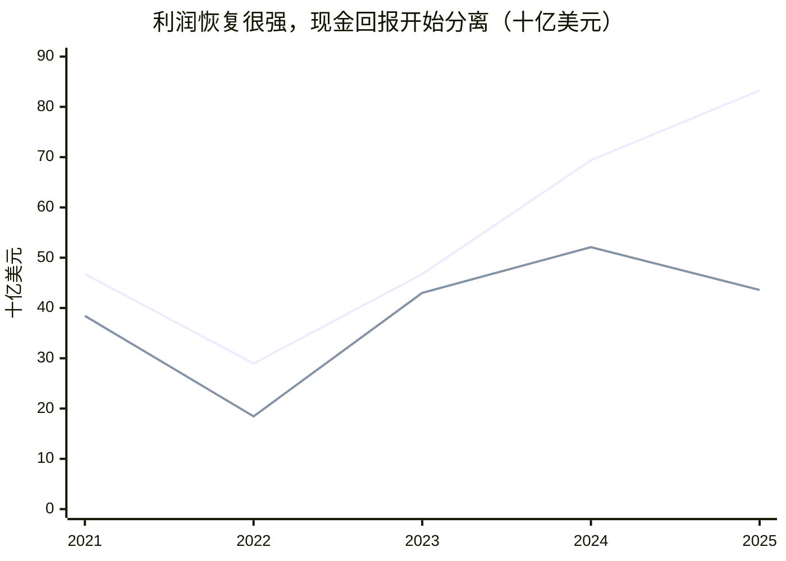
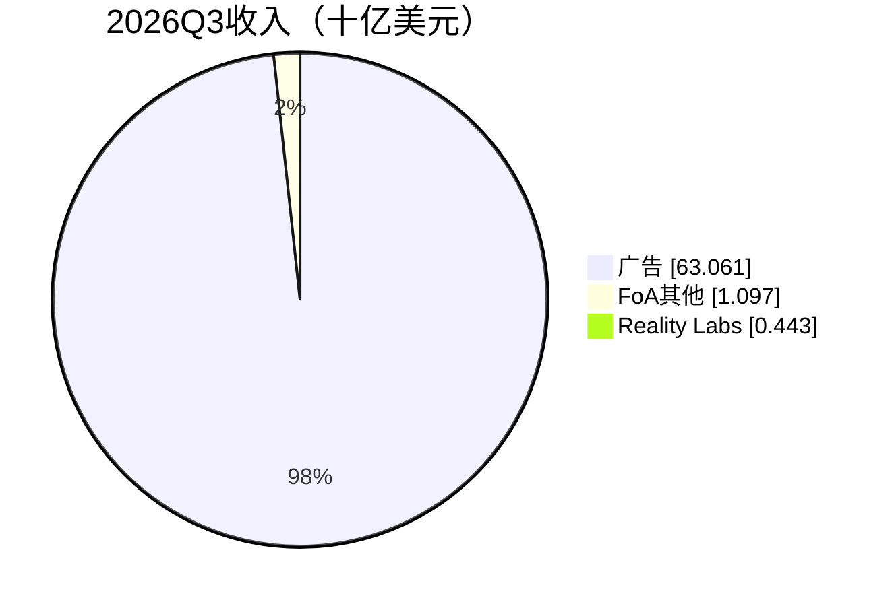

# Meta Platforms（META）研究报告

> **研究及信息截止：2026-11-24（Asia/Shanghai）。**行情统一锚定11月23日美国正常交易收盘597.60美元，未混入11月24日盘中报价；最新完整财务截至2026年9月30日，期后融资与诉讼更新至11月23日。证券为美国纳斯达克上市的Meta Platforms, Inc. A类普通股，代码META，原Facebook，中文常称脸书／元宇宙平台公司；不是ADR，也不是优先股存托证券METAM。全部估值使用美元。
>
> **价格与估值：**按最新披露普通股数估算市值1.52761万亿美元；市场惯用近似TTM PE为20.38倍，公司口径FCF收益率为1.64%。
>
> **研究主线：**Meta仍能把社交、内容与通信流量转化为高效广告，但新增算力、法律现金支出和融资安排决定这些收益最终能留给每股多少。

本报告承接用户指定的[2026Q2财报精读](Meta-earnings-2026Q2.md)，重新核查Q3及期后事项，不改写历史结论。既有公司目录与触发ID均沿用`Meta`；分散的10月19日研究已归入本目录，[独立研究存档](研究存档-20261019/Meta投资研究报告-20261019.md)及[团队研究](Meta-team-20261019.md)保留原日期。本文用于学习研究，不构成投资建议。

## AI研究偏见自觉

**信息丰富度：A级；AI研究局限性：未来资本回报的可见度明显低于广告经营数据的可见度。**大量报道容易让研究者把“AI改善广告”自动推成“全部超级智能投资都值得”。本报告没有内部投放实验、付费用户队列或逐数据中心项目回报数据。新墨西哥诉讼计提金额和11月完整资产负债表也不公开。

- [x] 社交关系、内容供给和广告效果反馈支持生意质量判断；媒体数量不支持高ROIC判断。
- [x] 即使减少一半报道，广告商业模式判断仍成立；Muse长期单位经济仍不确定。
- [x] 主动检验聪明人不买的理由：资本配置权集中，广告利润增长可能无法转化为每股现金增长。
- [x] 事实、公司指引、第三方标准化数据与研究假设分别标示；没有把资料充分写成投资确定。

---

## 第一步：核心数据总览

下表金额均为**百万美元**；比例、EPS和特别标注项目除外。采用公司原始GAAP数据。独立对照来自StockAnalysis；Macrotrends仅取得年度和较旧季度资料，不能声称它已复核Q3。

### 五年利润与现金

| 指标 | 2021 | 2022 | 2023 | 2024 | 2025 |
|---|---:|---:|---:|---:|---:|
| 收入 | 117,929 | 116,609 | 134,902 | 164,501 | 200,966 |
| GAAP净利润 | 39,370 | 23,200 | 39,098 | 62,360 | 60,458 |
| GAAP营业利润 | 46,753 | 28,944 | 46,751 | 69,380 | 83,276 |
| 毛利率 | 80.79% | 78.35% | 80.76% | 81.67% | 82.00% |
| 营业利润率 | 39.65% | 24.82% | 34.66% | 42.18% | 41.44% |
| 经营现金流 | 57,683 | 50,475 | 71,113 | 91,328 | 115,800 |
| 公司定义FCF | 38,439 | 18,439 | 43,010 | 52,103 | 43,585 |
| 现金及可交易证券 | 47,998 | 40,738 | 65,403 | 77,815 | 81,592 |

原始历史数据见[2022全年结果](https://investor.atmeta.com/investor-news/press-release-details/2023/Meta-Reports-Fourth-Quarter-and-Full-Year-2022-Results/default.aspx)、[2024年10-K](https://www.sec.gov/Archives/edgar/data/1326801/000132680125000017/meta-20241231.htm)、[2025年10-K](https://www.sec.gov/Archives/edgar/data/1326801/000162828026003942/meta-20251231.htm)；[StockAnalysis年度表](https://stockanalysis.com/stocks/meta/financials/)对照收入、净利润和现金，[Macrotrends收入](https://www.macrotrends.net/stocks/charts/META/meta-platforms/revenue)与[净利润](https://www.macrotrends.net/stocks/charts/META/meta-platforms/net-income/1000)复核年度数据。部分公司FCF扣租赁或净PPE，须先桥接口径，不能要求异口径金额机械一致。



图中第一条为GAAP营业利润，第二条为公司FCF。过去的经营杠杆确实存在；2025年利润继续提高时，FCF已经下降。

### 最近四季与收入结构

| 项目 | 2025Q4 | 2026Q1 | 2026Q2 | 2026Q3 |
|---|---:|---:|---:|---:|
| 收入 | 59,893 | 56,311 | 60,801 | 64,601 |
| 广告收入 | 58,137 | 55,024 | 59,363 | 63,061 |
| FoA其他收入 | 801 | 885 | 1,007 | 1,097 |
| Family of Apps收入 | 58,938 | 55,909 | 60,370 | 64,158 |
| Reality Labs收入 | 955 | 402 | 431 | 443 |
| FoA营业利润 | 30,766 | 26,900 | 23,394 | 17,117 |
| RL营业亏损 | -6,021 | -4,028 | -4,619 | -4,129 |
| GAAP营业利润 | 24,745 | 22,872 | 18,775 | 12,988 |
| GAAP净利润 | 22,768 | 26,773 | 15,848 | 9,860 |
| 经营现金流 | 36,214 | 32,226 | 31,862 | 32,786 |
| 现金购买PPE | 21,383 | 18,997 | 30,116 | 33,942 |
| 融资租赁本金 | 754 | 843 | 962 | 964 |
| 公司定义FCF | 14,077 | 12,386 | 784 | -2,120 |
| 股权薪酬SBC | 5,890 | 6,032 | 7,658 | 7,363 |

季度取自[2025Q4](https://investor.atmeta.com/investor-news/press-release-details/2026/Meta-Reports-Fourth-Quarter-and-Full-Year-2025-Results/default.aspx)、[2026Q1](https://investor.atmeta.com/investor-news/press-release-details/2026/Meta-Reports-First-Quarter-2026-Results/default.aspx)、[Q2](https://investor.atmeta.com/investor-news/press-release-details/2026/Meta-Reports-Second-Quarter-2026-Results/default.aspx)、[Q3公司结果](https://investor.atmeta.com/investor-news/press-release-details/2026/Meta-Reports-Third-Quarter-2026-Results/default.aspx)，并以[独立季度损益](https://stockanalysis.com/stocks/meta/financials/income-statement/?p=quarterly)、[季度现金流](https://stockanalysis.com/stocks/meta/financials/cash-flow-statement/?p=quarterly)交叉。分部利润和融资租赁细项仍以公司单源为主，未冒充全面双源通过。部分季度相加与累计主表相差1百万美元，滚动计算优先用累计报表。

2025全年广告196,175、FoA其他2,584、RL为2,207。到2026Q3，广告仍占集团收入97.62%；FoA其他收入增加有价值，但还不能把Meta改称订阅或AI代理公司。



Q3收入同比+26%，DAP为36.4亿、同比+3%；广告展示量+10%、平均价格+14%，乘积隐含+25.40%，与广告增长方向相符。价格变动也包含客户和地域组合，不能全部归功于模型。Q3毛利率79.31%，GAAP营业利润率20.10%；仅剔除公司披露的9,890州和解费用，营业利润率为35.41%，仍不能因此忽略真实付款义务。

### 滚动数据和必须纠正的口径

| TTM项目 | 公司报表重建 | 解释 |
|---|---:|---|
| 收入 | 241,605 | 2025全年减2025前九月，加2026前九月 |
| GAAP营业利润 | 79,380 | 不是数据库标准化的91,270 |
| GAAP净利润 | 75,249 | 税惠和法律费用影响较大 |
| 经营现金流 | 133,087 | 原始现金流表重建 |
| 现金PPE | 104,438 | 不含融资租赁本金 |
| 融资租赁本金 | 3,523 | FCF需另扣 |
| 公司定义FCF | 25,126 | CFO－现金PPE－融资租赁本金 |
| SBC | 26,943 | FCF减SBC为-1,817，仅作经济成本压力标尺 |

StockAnalysis的TTM FCF为28,649，与公司数额差异来自融资租赁本金；扣3,523后完全对上。其TTM标准化营业利润高于GAAP数11,890，涉及法律费用重分类；2022标准化营业利润33,555也高于GAAP的28,944，差额为重组调整。上述均不当成可直接替代的GAAP值，也不把标准化处理简单称为数据库错误。

### 现金、借款和11月融资

9月末现金及可交易证券为82,449；借款须把非流动80,922和列在应计负债内的流动2,747合并，得83,669，不含租赁净现金为-1,220。第三方含经营租赁债务口径为114,842，对应净债32,393；不能拿两个口径直接做误差判断。82,449已排除受限资金，不能再扣一次10,800基建托管子项。[Q3 10-Q资产负债表及附注4、8—10](https://www.sec.gov/Archives/edgar/data/1326801/000162828026066773/meta-20260930.htm)

| 日期／事项 | 已核事实 | 对股东的意义 |
|---|---|---|
| 10月29日强制可转优先股交割 | 初始250百万份存托股；名义规模12,500；票息6.50% | 普通股之前有分配权；未来转为普通股 |
| 11月4日远期超额配售行使 | 原40百万股增加6百万股，共46百万股 | 初始借股出售不等于公司已收到远期款；最迟2027年11月19日预期结算 |
| 11月5日美元债交割 | 新增15,000美元债 | 借款和资金同时增加，不能只增加债务推当前净债 |
| 11月12日欧元债交割 | 新增90亿欧元债 | 保留欧元量纲，未用未核汇率伪造当前美元总债 |
| 11月23日C股诉讼披露 | 审前及审判期间不发行C股，含股票股息；开庭拟于2027年4月19日 | 最高600亿美元ATM须待C股开始交易，融资时点延后 |

交割和条款分别见[10月29日8-K](https://www.sec.gov/Archives/edgar/data/1326801/000119312526438017/d183592d8k.htm)、[11月5日8-K](https://www.sec.gov/Archives/edgar/data/1326801/000119312526450074/d166273d8k.htm)、[11月12日8-K](https://www.sec.gov/Archives/edgar/data/1326801/000119312526458525/d177728d8k.htm)、[11月23日8-K](https://www.sec.gov/Archives/edgar/data/1326801/000162828026075541/meta-20261118.htm)。因此本报告只提供9月末净现金快照，不把它写成11月24日实时净债；当前完整现金桥尚不可得。

> 巴菲特式追问：这笔利润有没有变成普通股股东真正可支配的现金，还是必须持续借钱、发股才能维持增长？

---

## 第二步：生意本质分析

**一句话：Meta用免费社交、通信与内容产品聚集用户，向商家持续出售可衡量的顾客触达和转化机会。**用户、创作者和广告主共同构成反馈系统；商家为销售效果反复投放，复购来自投资回报，而非多年合同保底。

| 经营环节 | 钱怎样流动 | 真正的利润变量 |
|---|---|---|
| Facebook、Instagram等分发 | 用户免费；商家通过拍卖买广告 | 有效时长、广告负载、转换率、每次展示价值 |
| WhatsApp商业服务与订阅 | 商业消息、付费功能和订阅收费 | 企业使用深度、付费留存、服务毛利 |
| 推荐和广告模型 | 内容理解、排序与效果优化提高分发效率 | 每单位新增收入对应的算力、人才和折旧 |
| Muse及前沿模型 | 目前以订阅等早期路径探索变现 | 真实付费、每任务成本、留存、可靠性 |
| Reality Labs | 眼镜、XR设备、软件与内容 | 设备采用、重复使用和亏损收窄 |

公司Q3主电话会称GEM扩展改善广告转换；这些公司自报实验支持广告AI有用。追问电话会同时明确Muse除订阅外尚未变现，十倍效率目标仍需技术进步，早期美加用户的价值不能外推全球。账户数、周活购物行为和广告ARPU不能直接相乘当作代理新增收入。[Q3主电话会](https://s21.q4cdn.com/399680738/files/content_files/META-Q3-2026-Earnings-Call-Transcript.pdf)、[追问电话会第6、10页](https://s21.q4cdn.com/399680738/files/content_files/META-Q3-2026-Follow-Up-Call-Transcript.pdf)

技术优势在于模型、分发和广告反馈闭环，而非一个模型榜单。2026前九月研发费用59,409，Q3单季20,054；研发并不全部等于前沿AI投资。新的数据中心、第三方云与人才支出，一部分已经进入费用，一部分未来通过折旧进入损益。不能因为当下利润尚可，就把现金CapEx称为无需付出的可选增长支出。

公司最新指引为Q4收入730亿—760亿美元、2026全年费用1,750亿—1,790亿美元、含融资租赁本金CapEx为1,350亿—1,450亿美元；2027完整资本预算尚未给出。它们是指引，不能放进已实现财务表。

商业模式仍优秀，资本结构却更重了。用户关系和商业反馈的资产寿命可能长于服务器，但服务器更新、能耗和推理开销必须反复支付；只看互联网平台的历史毛利率，会低估新业务的资本需求。

> 段永平式追问：这门生意好在能持续帮助商家卖货；如果维持这种效果需要越来越多资本，好处还剩多少给每股所有者？

---

## 第三步：护城河评估

| 类型 | 证据与判断 | 可推翻的观察 |
|---|---|---|
| 品牌／定价权 | 中强。广告效果和覆盖支持拍卖价格；不是消费品牌式自由提价 | 价格提升后广告主独立增量回报和复投是否下降 |
| 转换成本 | 中强。关系、私信、商业账号和工作流有黏性 | 用户把新增时长、商家把新增预算迁向其他入口 |
| 网络效应 | 强。社交关系、创作者、广告主互相吸引 | 推荐流降低好友关系的重要性，多平台使用削弱排他性 |
| 规模效应 | 强，但收益归属待检验 | 分发规模提高时，算力及人才成本是否增长更快 |
| 技术壁垒 | 广告反馈闭环强，前沿模型领先的持续性未知 | 模型可替代、流量入口外移、权限或数据受限 |

过去五年，广告推荐和商业匹配能力增强；仅靠好友关系形成的壁垒相对弱化。未来五年最可能继续有效的是跨产品分发、广告学习和商家工作流，而非保证某一模型永远领先。十年后的Meta可以仍然重要，却给今天买入者提供普通回报。

竞争者拿到巨额资本仍难复制关系网、创作者和广告反馈历史；但它不必完整复制Meta，只要拿走边际用户时长或高价值商业意图，就可能压缩增长。TikTok、YouTube争时长，搜索、电商争购买意图，AI助手争新的任务入口，三种竞争不能用一个“社交份额”概括。

> 巴菲特式追问：十年后护城河可能还在；真正能摧毁股东回报的，会不会是维持护城河所需的资本越来越多？

---

## 第四步：逆向思考与风险清单

**最强空方观点：不需要假设用户逃离或广告崩溃，也可能得到差的每股投资回报。**控制股东可以把新增广告收益长期投入尚无清晰回收期的模型、服务器和设备；普通股同时承受资本需求、优先分配和新股稀释。

| 失败路径 | 概率判断／置信度 | 影响 | 观察与应对 |
|---|---|---|---|
| AI投入回收慢于折旧和融资成本 | 中高，定性判断 | 利润增长而现金或每股价值不增 | 完整预算、滚动FCF、每股现金与独立单位经济 |
| 推荐与代理竞争侵蚀时长或商业意图 | 中，定性判断 | 增长和广告单价受压 | 连续季度量价、用户时长及商家复投同时趋弱 |
| 监管整改限制数据使用与青少年产品 | 中高，已有现实案件 | 收入能力和经营方式改变 | 法院禁令、产品改动、合规成本，而不只看罚款 |
| 融资时间错配或发行条件恶化 | 中，融资事实确定、未来条件未知 | 稀释、利息及流动性压力 | 远期结算、C股诉讼、抵押担保和资本支出日程 |
| RL或新入口继续消耗广告现金 | 中高，尚未盈利 | 机会成本持续 | 2027亏损是否向公司约150亿美元目标收窄 |
| 强制拆分、严重事故或供电中断 | 低频高损失，无法可靠定量 | 可能永久损失 | 单列尾部限制，不塞入折现率 |

这些是研究者的定性风险判断，不能与估值情景的30%／50%／20%混成统计概率，也不能彼此相加。

### 两笔法律风险必须分开

多州青少年案件协议最高18,590，其中约12,700分十年支付，约5,300附先决条件，另有调查费用；利润加回并不会取消现金责任。**新墨西哥另案**于10月21日被判25,000及15%判后利息；公司称已计提一笔金额、拟上诉，并可能需要保函或担保，但未披露该案具体计提额。不能说25,000已全额付出、完全未计提或已被多州协议覆盖。[Q3 10-Q附注10及法律程序](https://www.sec.gov/Archives/edgar/data/1326801/000162828026066773/meta-20260930.htm)

未开始租约355,730、不可撤销合同承诺454,520及附条件云容量14,720，说明资本投入具有多年刚性；其时间跨度、折现口径、重叠及经营性质不同，不能机械加总成当前债务。2027年到期的合同承诺121,410值得重点核对资金来源。

历史类比可借鉴电信和网络基础设施扩张：需求增长不自动带来资本提供者的好回报。Meta比单纯设备买家多了自己的流量与广告变现渠道，这是优势；竞争性投资却仍可能把利润让给硬件、能源或用户。类比用来提问，不用于预测相同结局。

本报告最容易犯的错误，是把暂时建设期判断成永久资本陷阱，或反过来把竞争所必需的投入统称增长投资。必须用现金、预算和单位回报区分两者。

> 芒格式追问：如果广告仍然增长而投资失败，我最可能漏掉的是哪笔资本、哪项义务或哪种稀释？

---

## 第五步：管理层评估

Zuckerberg是创始人、董事长及CEO；产品调整和长期投入能快速执行，资本配置权也高度集中。2026年11月信息声明显示，其受益持股约13.40%、投票权约60.60%；其中CZ Biohub的A股不属于其个人经济收益权，排除此项的经济股权代理约13.35%。受益所有权、个人经济权益和表决权不可互换。该精确拆分主要为公司披露单源，独立媒体只支持四舍五入的约13.4%／60.6%。[信息声明股权表](https://www.sec.gov/Archives/edgar/data/1326801/000162828026068935/meta-20261102.htm)

| 决策／阶段 | 可观察结果 | 研究评价 |
|---|---|---|
| 收购与经营Instagram、WhatsApp | 已成为FoA产品体系的重要组成；独立产品利润未充分拆分 | 产品和长期整合能力强，不能伪造独立并购IRR |
| 应对移动、推荐和短视频变化 | 广告与内容效率继续提高 | 执行力有证据，需继续以商家回报验证 |
| 效率调整及人员重组 | 成本结构能调整；2026Q2仍有遣散费用 | 能纠错，但调整本身也有现金和组织成本 |
| RL长期投资 | 亏损持续，2027目标收窄 | 尚未证明股东回报，不能按愿景资本化 |
| 前沿模型与基建扩张 | 研发、CapEx和多年承诺上升 | 核心广告回报与外延AI回报需分别披露 |
| 停止回购并引入优先股、债务、远期及C股计划 | 资金来源更加复杂 | 资本纪律和治理的评价降级，融资能力不等于回报能力 |

SBC是人才报酬，不能一边从利润中加回，一边把员工持股当作免费资金。本报告的平滑盈利保留SBC，长期模型不再额外叠加同一项常年稀释；已公布远期和强制转股另作一次性股本调整。未假定回购会消除稀释。

组织已经具备大规模广告工程与分发能力，CEO退休不会让这些资产消失；但前沿AI方向、资本预算和治理结构仍高度依赖创始人。长期思维是一种能力，是否创造每股价值还需要资本回报来证明。

> 段永平式追问：如果CEO退休，我仍愿意拥有广告系统；如果他继续掌握资本配置，我是否同样信任每一笔新增投入？

---

## 第六步：行业与文明趋势

AI降低内容理解、创作和商业服务成本，可能扩大线上交易及自动化任务。这是产业趋势；Meta能否捕获利润，还取决于推理成本、用户入口、商家授权、竞争和收费方式。

IAB／PwC披露2025年美国互联网广告规模294,600、同比+13.9%，社交广告117,700、同比+32.6%。分类可能重叠，不能相加；也不能用Meta全球收入除以美国市场规模制造全球份额。未获得充分同口径证据，本报告不采用“Meta已经超过Google”等份额叙事。[IAB年度报告发布说明](https://www.iab.com/news/digital-ad-revenue-climbs-to-nearly-300b-as-iab-celebrates-30-year-anniversary/)

| 利润池 | Meta的位置 | 获利条件 |
|---|---|---|
| 广告和商业分发 | 已有规模、产品与反馈 | 效果提升大于增加的算力成本 |
| 商业消息和订阅 | 已有收入，仍相对小 | 商家持续付费，服务成本可控 |
| 通用代理与模型 | 有流量分发及产品，单位经济尚未验证 | 留存、可靠性、付费率和每任务成本共同改善 |
| 数据中心和基础设施 | 大买家及建设者 | 利用率、资产寿命与供给成本匹配收入 |
| 眼镜与新设备 | 新入口机会 | 日常使用及生态价值足以覆盖亏损 |

广告客户具有分散的需求基础，但本次没有足够一手数据给出精确客户集中度。高端芯片、云、能源与关键人才的供给约束增强；也没有可核数据把某一家供应商采购占比写成确定值。未知份额应留白。

从二十年后看，Meta既可能成为覆盖通信、发现和商业代理的重要入口，也可能把广告积累的资本投入低回报基础设施。收入TAM本身不提供估值下限；利润池究竟留给平台、供应商还是用户，要靠单位经济判断。

> 李录式追问：AI的社会价值增加以后，资本提供者能否保留回报，而非仅仅承担更高资本需求？

---

## 第七步：估值与安全边际

### 当前价格买到什么

最新披露实股为2026年10月16日A股2,214,472,367加B股341,768,886，合计2,556,241,253股。以597.60美元相乘，普通股市值为1,527,609,772,792.80美元。它是最新披露股本的估算，不是假装掌握11月23日实时精确股数；季度稀释加权股数只用于EPS。

| 指标 | 验算值 | 口径限制 |
|---|---:|---|
| 近似TTM PE | 20.38倍 | 597.60／29.33；29.33是四季稀释EPS之和，并非公司正式TTM披露 |
| 普通股市值／GAAP净利 | 20.30倍 | 期末实股与加权稀释分母不同，因此不强求等于上行 |
| 平滑盈利PE | 19.93倍 | 下述研究代理盈利，非公司调整后指标 |
| PS | 6.32倍 | TTM收入241,605 |
| PB | 5.61倍 | 9月末净资产272,386；不是平均净资产ROE |
| 公司口径P／FCF | 60.80倍 | FCF已扣融资租赁本金 |
| 公司口径FCF收益率 | 1.64% | 尚未按现金替代SBC或扣完未来法律支付 |
| 年化普通股息率 | 0.35% | 最近每季0.525美元年化，未来未保证 |
| 混合时点EV／收入 | 6.33倍 | 11月23日估算市值＋9月末借款－现金；仅桥接参考，非当前完整EV |

PE看起来温和，P／FCF却很高。关键不是选一个更好看的指标，而是判断投资高峰何时过去，以及未来新增利润是否需要同等强度的资本。

### 平滑盈利与未来股本

市场惯用29.33美元TTM EPS含2026Q1税惠；扣其3.13美元影响后为26.20，再仅加回Q3州和解3.57美元影响为29.77。这只是部分调整，仍保留其他已知一次费用，不将其直接当作完全正常化盈利。

最终模型改从原始营业利润出发：79,380，加回Q3州和解9,890、Q2法律费用2,400与遣散费1,180，得平滑营业利润92,850；加滚动净利息及其他-517，得税前92,333；按**研究正常税率17%**折为76,636.39。SBC全部保留。它是研究代理，不能写成实际净利润；净其他收益可能含非经常投资影响，新墨西哥已计提额未知，不能完整恢复。

已行使超额配售后的远期为46百万股；初始优先股按最大转换20百万股计，模型未来等值普通股数为2,622,241,253，较最新实股多2.58%。故平滑每股基数为29.22553美元。未假定C股送股已发生；一送一本身不产生经济稀释，之后ATM增发才产生额外稀释。优先股额外超额配售是否发生未充分核实，仍属限制。

三年增长率和十年利润假设均须在新增债息、折旧及竞争成本后兑现；不是先预测税前增长，再漏扣融资成本。新增借款、优先股和远期款也没有被当成无成本利润或重复加进市值。

### 三年三情景：当前价格贵不贵

下表是未来三年的盈利估值情景，**目标价不等于今日价值**。概率为作者判断：悲观30%、基准50%、乐观20%；今日价值按10%折现并计每年2.10美元普通股息。三年PE是周期内定价假设，不能用作十年成熟期终值倍数。

| 情景 | 每股盈利年增速 | 三年PE | 第三年EPS | 第三年股价 | 含息今日价值 | 现价含息年化 |
|---|---:|---:|---:|---:|---:|---:|
| 悲观 | -5% | 16倍 | 25.06 | 400.92 | 306.44 | -12.05% |
| 基准 | +12% | 22倍 | 41.06 | 903.31 | 683.90 | +15.07% |
| 乐观 | +20% | 26倍 | 50.50 | 1,313.04 | 991.73 | +30.28% |

悲观情景对应广告放缓、费用刚性及回报推迟；基准需要广告AI、商业服务和资本效率共同支持每股增长；乐观要求较强增长和市场继续接受增长溢价。概率加权今日价值为632.23美元，现价接近它，尚不足以覆盖宽阔的经营与融资结果范围。

三年模型把平滑会计盈利当作定价基础，不能证明这笔盈利都能分配。优先股在转换前的现金分配、诉讼、未来新增发行仍需现金和股本模型复检；本表不是完整所有者现金DCF。

### 反向现金DCF：市场要求什么

以TTM公司FCF25,126为起点，连续十年等速增长，美元折现率10%、终值现金永续增长3%，使自由现金流现值覆盖当前普通股市值，隐含所需年增长约**22.20%**。

这是有利于多方的简化检验：起点没有扣SBC现金替代，未逐笔计未来法律、融资或新增股数，且不建立期后资产负债桥。它不是精确反解当前股价的唯一增长率，更不是未来预测。其意义是：若资本强度长期停留当前水平，单凭“20倍PE”不能充分论证便宜。

### 历史与同行

StockAnalysis列示2021—2025年末PE约23.77、13.60、23.28、23.70、27.52倍。2022低位伴随经营调整，2025利润受特殊税费影响；不能把历史平均数直接当作公平价格。当前资本开支和承诺结构也已改变。[历史估值表](https://stockanalysis.com/stocks/meta/financials/ratios/)

| 参考公司 | 第三方远期PE | 主要可比性限制 |
|---|---:|---|
| Meta | 18.39倍 | 分析师预测口径，非本报告平滑盈利 |
| Alphabet | 20.20倍 | 搜索、YouTube和云混合，投资损益也影响GAAP PE |
| Pinterest | 8.86倍 | 规模、增长、SBC与调整后利润不同 |
| Snap | 6.66倍 | GAAP仍亏损，不能把调整后远期PE当成熟现金回报 |

同行为11月24日页面快照，各页面更新时间不同，只有比较用途；属第三方单源估计，未进入本报告计算或终值PE。数据见[Meta比率](https://stockanalysis.com/stocks/meta/financials/ratios/)、[Alphabet](https://stockanalysis.com/stocks/googl/statistics/)、[Pinterest](https://stockanalysis.com/stocks/pins/statistics/)、[Snap](https://stockanalysis.com/stocks/snap/statistics/)。便宜的预测PE不能替代现金回报和治理比较。

### 十年折现：只作仓位压力测试

**r采用美元10%，β为1.0。**11月23日美国十年国债为4.92%，配研究假设ERP5.08%；监管、融资和拆分等离散风险单列，未塞入β或r。[美国财政部利率表](https://home.treasury.gov/resource-center/data-chart-center/interest-rates/TextView?field_tdr_date_value=2026&type=daily_treasury_yield_curve)

稳态增量ROIC取18%，低于资产较轻时期的回报。以2025营业利润、17%正常税率和期末净经营资本构造的粗略回报代理约35.56%，但它遗漏无形资产、租赁和平均资本变化，不能直接外推新算力项目。当前低现金回收又说明新增资本的回报尚未得到证明。18%是介于历史账面优势和当前现金压力之间的判断，**不是已测出的项目IRR**。

永续g取1%、3%、4%，描述2036年之后，而非前十年的增长；基准低于美元长期名义增长4%上限。只按永续公式计算终值倍数：`PE=(1-g/ROIC)/(r-g)`，不采用同业倍数。

| 十年情景 | 2036税后利润假设（百万美元） | 从平滑盈利起的年增速 | 永续g | r-g | 留存率g／ROIC | 公式终值PE | 终值代理年化 |
|---|---:|---:|---:|---:|---:|---:|---:|
| 悲观 | 90,000 | +1.62% | 1% | 9个百分点 | 5.56% | 10.49倍 | -4.59% |
| 基准 | 180,000 | +8.91% | 3% | 7个百分点 | 16.67% | 11.90倍 | +3.53% |
| 乐观 | 300,000 | +14.62% | 4% | 6个百分点 | 22.22% | 12.96倍 | +9.87% |

终值利润已按新增66百万股对现有股东的归属比例调整，之后加0.35%近似股息率；保留SBC费用，未再扣同一项常年稀释。**这里是终值几何回报加固定股息率的代理，未逐年模拟所有现金流，不是完整DCF IRR。**概率仍为30%／50%／20%，期望代理年化为2.36%。未来额外ATM、法律现金时点等尚未完整建模，实际结果范围更宽。

| r敏感性 | 期望代理年化 | 是否覆盖对应r | 有效性 |
|---|---:|---|---|
| 8% | +5.76% | 未通过 | 区间外，仅供参考；乐观分母仅4个百分点 |
| 10% | +2.36% | 未通过 | 美元合理区间内 |
| 12% | -0.11% | 未通过 | 区间外，仅供参考 |
| 9%复核 | +3.90% | 未通过 | 合理区间内 |
| 11%复核 | +1.04% | 未通过 | 合理区间内 |

已先执行r±2个百分点，再因两侧均在合理区间外而执行±1个百分点。**在已检验的美元合理区间9%—11%内，仓位压力测试结论不翻转，均未覆盖r。**这只支持限制仓位，不能单独否决买入或持有。

### 估值分歧对账

三年盈利模型给出基准今日价值683.90、概率加权632.23，说明当前会计盈利定价并非极端昂贵；十年成熟期终值代理没有覆盖资本成本，说明不能把近期增长和较高退出倍数持续外推。两者分别是**定价判断**和**仓位压力测试**。

不新增的独立理由是：三年加权安全边际有限，现金收益率低，新增融资与法律现金日程尚不透明；并非因为十年2.36%低于10%就一票否决。广告质量和护城河仍支持合理小仓有条件持有；十年压力把研究总仓参考收紧至2%，而非将其机械改成清仓。

**450—480美元是附条件研究带。**它相对三年加权现值提供约28.82%—24.08%折让，用于吸收资本回报和治理的不确定性，不是承诺到价即买。原10月研究的500—600美元吸引区由本次新证据和完整估值接续；下调来自Q3现金、融资及承诺评估，不能只归因于股价变化。

> 巴菲特式追问：折现率错两个百分点，合理区间内的仓位结论没有翻转；但终值利润、资本回收和融资股数错了，结果仍会显著改变。
>
> 段永平式追问：若股市关闭五年，我愿意拥有其广告业务；以597.60美元新增并承担尚不透明的资本承诺，目前安全边际仍不足。

---

## 第八步：最终决策与行动清单

| 维度 | 结论 | 信心度 |
|---|---|---|
| 生意质量 | 广告匹配和商业分发优秀，收入复购有机制 | 高 |
| 护城河 | 网络、分发、广告反馈仍强；资本强度削弱经济轻资产属性 | 中高 |
| 管理层 | 产品执行强；资本配置、治理约束和新证券安排需折价 | 中 |
| 最大风险 | 广告增长不能转为每股现金，叠加法律与资金时点 | 中高（风险存在）；低（终局金额） |
| 文明趋势 | AI有用，Meta能捕获多少利润仍待验证 | 中 |
| 估值 | 三年加权现值632.23，安全边际有限；十年代理压力未过且合理r采样不翻转，只限仓 | 中低 |

估值只是六个维度之一；十年未覆盖r只能收紧仓位。本次“新增观望、合理小仓持有”的决定同时来自现金回收、融资治理、法律风险及价格，已完成上节分歧对账。

| 策略 | 建议 |
|---|---|
| 空仓者 | **观望现价新增。**450—480美元且下列经营／资金条件核准、届时重算仍成立，才考虑首笔约组合0.5%；通用研究总仓参考不超过2% |
| 持仓者 | **合理小仓有条件持有，暂停加仓。**未掌握用户实际成本和仓位，不推定已超配；若实际超过自身风险预算，应先复核集中度 |
| 加仓条件 | 后续连续两次正式季度披露均有正公司口径FCF，滚动FCF在计入SBC经济成本后恢复非负；广告效果／需求保持，2027预算及融资、优先权、股本、法律担保现金可核，无实质业务红线；到价后重新估值 |
| 卖出／降级信号 | 广告时长、量价和复投同步结构转弱；新增利润长期不能改善每股现金；资本项目或治理安排破坏回报；法律禁令改变核心模式或融资无法覆盖义务。非单季噪音即清仓 |
| 价格上行复核 | ≥750美元而正常化盈利、现金回收与风险证据未增强时，不追高，复核超配和是否减仓；不是自动卖出指令 |
| 价格跌破研究带 | <450美元先排查永久损失和资金事件，不因更低价格自动提高仓位 |

价带均为当前A股普通股的美元等值口径。若未来C股股息或拆分实际发生，应先按官方条款调整每股基数和监控价格，不能将机械除权误判为触发便宜。

### 复检日程

- 2026年12月31日：自定研究检查，核现金、2027预算、融资交割和法律担保进展。
- 2027年2月15日：全年／Q4披露窗口兜底检查；**不是已确认的财报预约日**，若提前发布则提前复检。
- 2027年4月19日：官方8-K所列C股诉讼拟开庭日，日期可能变更。
- 2027年11月19日：远期预期最迟结算日；2029年8月15日：强制可转优先股预计转换日，均按最终条款及后续变化复核。

### 四位投资者原文与方法论应用

以下为原话及本报告的应用，**不模拟他们在2026年对Meta的买卖建议**。

| 人物 | 已读短引与出处 | 可支持的应用／边界 |
|---|---|---|
| 巴菲特 | “It's far better to buy a wonderful company at a fair price than a fair company at a wonderful price.” [1989股东信](https://www.berkshirehathaway.com/letters/1989.html) | 生意质量与价格都要检查；该信没有评价Meta |
| 芒格 | “Wisdom acquisition is a moral duty.” [USC对2007年演讲的官方报道](https://gould.usc.edu/news/300-graduate-from-usc-law/) | 用新融资和法律事实更新判断；Meta专属原文不足，不模拟代言 |
| 段永平 | “上次国会质询后就不再那么尊重Mark了。” [2025年3月17日原帖](https://xueqiu.com/1247347556/327662543)，亦见[仓库原发言存档](../段永平/段永平雪球全量原发言.md) | 对管理层有明确保留；不能只用2019年正面评价为今天背书，也不能把旧帖当2026估值指令 |
| 李录 | “资本需求和财务纪律始终都会发挥作用。” [2026年10月5日哥大官方中文稿第8页](https://cdn.prod.website-files.com/5ef3c7300432b40ed865991a/6ad7b4cf2ac73b22ef7bccf4_36th%20Annual%20Graham%20%26%20Dodd%20Luncheon%20Transcript%2020261005%20CBS%20Chinese.pdf) | AI技术价值与投资回报分开看；并非Meta专属立场 |

> 综合追问：如果没有AI叙事，我愿意为这套广告网络付多少钱；加上AI之后，股东得到的是更好的现金回报，还是更多资本义务？

---

## AI分析置信度与投资确定性

**AI分析置信度：经营事实和已披露融资较高；长期估值中低。投资确定性：中等，低于核心广告生意的质量。**收入、现金流、证券条款和股权控制有充分文件；稳态ROIC、增长情景、监管终局、Muse单位经济与未来稀释依赖有限信息和判断。资料丰富不消除这些不确定性。

本次未完整建模的限制包括：法律本金与利息的逐年现金、新增禁令和罚款、强制拆分、算力／供电中断、额外ATM与再融资失败。还缺11月完整资产负债桥、优先股额外配售确认、新墨西哥具体计提及担保、逐合同承诺去重、独立产品付费队列。十年代理没有完整覆盖上述现金尾部，不能作为实际收益承诺。

---

## 关键数据交叉验证记录

所有金额及估值已通过本仓库`financial_rigor.py`与Decimal模型计算；长期参数通过`terminal_value.py`审查。完整的[模型输入与计算](evidence-20261124/model.py)、[精确结果](evidence-20261124/model-output.json)、[金融及终值工具原始输出](evidence-20261124/tool-validation.txt)随报告保存。原始网页和PDF未写入仓库。

| 核心字段 | 公司／原始来源 | 独立来源 | 处理结果 |
|---|---:|---:|---|
| 2025收入 | 200,966 | StockAnalysis 200,966；Macrotrends 200,966 | 一致 |
| 2025净利润 | 60,458 | StockAnalysis 60,458；Macrotrends 60,458 | 一致 |
| Q3现金证券 | 82,449 | StockAnalysis 82,449 | 一致 |
| 最新披露实股 | 2,556,241,253股 | StockAnalysis约25.6亿股 | 舍入差小于1%；不是实时股本 |
| 11月23日收盘 | 597.60美元（IR／TickerTech） | Yahoo、StockAnalysis 597.60美元 | 行情日一致 |
| TTM营业利润 | GAAP 79,380 | 标准化91,270 | 异口径；采用GAAP，差额解释后排除混用 |
| TTM FCF | 公司25,126 | StockAnalysis 28,649 | 减融资租赁3,523后对齐 |

以下直接摘录工具输出；市值对照金额仅为量纲及四舍五入检查，未冒充独立来源：

```text
市值验算 (Market Cap Verification)
============================================================
  股价 (Price):       597.6 USD
  总股本 (Shares):    2.56B
  计算市值:           1.53T USD
  报告市值:           1.53T USD
  偏差:               0.03%

  ✅ 验证通过, 偏差仅 0.03%

交叉验证: Q3_cash_securities (Cross-Validation)
============================================================
  数据来源数: 2
  参考中位数: 82,449.00 USD_m_or_shares

  ✅ Meta_10Q            : 82,449.00 USD_m_or_shares  (偏差 0.00%)
  ✅ StockAnalysis       : 82,449.00 USD_m_or_shares  (偏差 0.00%)

  ✅ 所有来源偏差 ≤ 1.0%, 数据一致

  共识值 (加权中位数): 82,449.00 USD_m_or_shares
```

双源通过只适用于已列明同口径数据，不扩展为每个分部、法务细节或预测假设都已独立证实。同行前瞻PE仅单源参考；预测数字核算属于模型复算，不能充当外部事实核验。

**数据抽检与终值口径准出。**固定随机种子20261124按15%抽出30项；其中1项为年份误识别，明确排除。29项有效检查全部在1%容差内，零失败、零口径警告；含外部事实13项、外部数据推导4项、单源交易事实1项、模型复算7项、研究假设2项、第三方单源预测2项。假设与预测只核对口径，不声称取得独立事实证明。详见[抽检结果及来源](evidence-20261124/audit-results.json)、[工具判决](evidence-20261124/audit-verdict.txt)与[覆盖分类](evidence-20261124/audit-coverage.json)。

Macrotrends部分网页及Proactive直连受限，抽检采用可读检索缓存；分部精度按独立来源显示的四舍五入数验证，未伪造更细精度。最新股本、交易条款与法律附注明确保留单源及未披露边界。最终稿的USD r10%、ROIC18%、g1%／3%／4%再次通过C1／C2／C3；未建模风险保持披露。

已沿用Meta触发ID登记研究价带和上行警戒线，旧Q3事件保留并标记完成；非重点[标的跟踪表](../标的跟踪表.md)新增本次建议，旧建议关闭接续。每日流程只自动扫描价格，事件保留供人工复核。

AI能较有把握解释已经披露的广告经营与融资事实；长期资本回报、监管终局和实际投资确定性仍需要后续证据，不能由资料数量替代。
