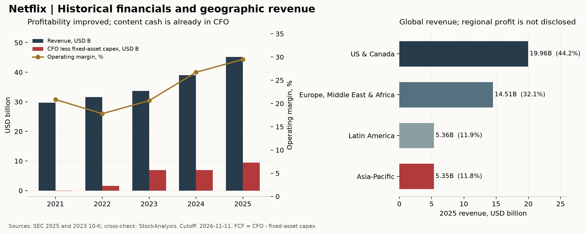

# 奈飞（Netflix，NFLX）研究报告

**研究日与资料截止日：2026-11-11，北京时间。** 已执行系统日期核对。公司为 Netflix, Inc.，NASDAQ: NFLX；研究对象是美国普通股，非 ADR。财务覆盖至 2026-09-30，最新 10-Q 于 10 月 21 日提交；行情采用 11 月 10 日美股常规盘收盘 **63.26 美元**，不混入盘后价格。以最近披露的实际普通股计算，股权市值约 **2,597.66 亿美元**。本文统一美元口径，B 表示十亿美元。

**研究命题：** 奈飞把全球内容投入转化为重复订阅收入的能力已经得到证明；现在需要判断，观看增长放缓、广告产品延期和内容团队调整，会不会削弱下一阶段的每股现金回报。当前约 18 倍的表面市盈率包含一次性收益，不能直接当作买入理由。

行情来自 [StockAnalysis 历史行情](https://stockanalysis.com/stocks/nflx/history/)，并与 [ChartExchange](https://chartexchange.com/symbol/nasdaq-nflx/historical/) 的 63.25 美元核对，差约 0.016%。市值使用 SEC 9 月末股本，并非已取得 11 月 10 日实时股东名册。[S1—S6]

---

## AI研究偏见自觉

**信息丰富度评级：A，资料充裕。** 奈飞的订阅、规模经济、广告和提价逻辑早已被市场充分讨论。信息多有助于核对报表，却不能自动提供超额收益。

**AI研究局限性声明：** 本文可以验证已披露的收入、利润、现金流及交易状态，不能直接观察内容项目真实回收率、广告客户续约、未披露会员数、全设备流失率或未来爆款。情景概率、正常化税率、增长率及价格带属于研究判断，不是公司承诺或统计预测。本项目仅供学习研究，不构成投资建议。

- [x] 不以资料数量替代生意确定性；即使资料减半，现金内容投入、留存和定价仍是核心问题。
- [x] 不以股价下跌和旧价格带作为估值锚。
- [x] 同时检验“广告是增长引擎”和“广告能力未如期兑现”。
- [x] 保留公司披露与第三方观看、流失样本的冲突，不把无法核实的数据填进模型。

## 已有研究与本次更新

这是**首次在 reports/ 建立奈飞公司研究目录，但不是首次研究奈飞**。检索了 Netflix／NFLX／奈飞／网飞、公司目录、触发配置、重点看板及建议台账；没有发现同公司的既有专属目录或 target。原筛选报告保留在原处，不迁移、不覆盖。

| 既有资料 | 时点与用途 | 本次处理 |
|---|---|---|
| [Netflix 投资研究](../../筛选公司/美股召回池/Netflix-投资研究-20260517.md) | 研究日 2026-05-17；行情标为 5/16，但该日为周六，未说明实际交易时点 | 核心历史基线；价格和估值全部重新取数，旧模拟引语不作证据 |
| [核心公司 P/FCF 对比](../拼多多/核心公司P-FCF对比-20260626.md) | 截止 2026 年 6 月；奈飞约 32 倍 P/FCF | 历史判断，不能作为当前估值或独立来源 |
| [短剧与 AI 短剧研究](../短剧与AI短剧研究-20261019/短剧与AI短剧深度研究报告-20261019.md) | 研究日 2026-10-19 | 沿用“制作成本、获客成本、全端观看、收入与利润分开”的方法；数值不代替本次查证 |

| 旧判断或未解决问题 | 本次验证 | 最新证据及对行动的影响 |
|---|---|---|
| 内容规模经济是生意核心 | 维持 | 收入和经营利润率继续提升；但内容投入不能停，不按轻维护软件估值 |
| 华纳交易已经终止，却仍列“谈判中／完成并购”的上行 | 推翻 | 2/27 协议终止且取得终止费；10/6 Paramount 完成 WBD 收购。删除奈飞收购 HBO 的期权，不再等待旧交易落地。[S3、S12] |
| 2025 EPS 约 2.61，可直接称 TTM EPS | 修正 | 2025 GAAP 稀释 EPS 为 2.53；旧数以近似净利除期末股本，不是同一口径。[S1、S4] |
| 2022 自由现金流为负 | 推翻 | 统一 CFO 减固定资产支出口径后，2022 为正 1.619B。[S2、S5] |
| 2025 净债约 4.5B | 修正 | 旧数漏短债；2025 账面净债为 5.400B，最新为 6.909B。[S1、S3] |
| 广告 2026 年达到 3B，增长第二曲线确定性高 | 削弱 | 最新指引 2.7B，下调 10%；广告产品能力上线慢，不能以覆盖人数替代变现。[S7] |
| 提价后留存强，足以支持持续提价 | 维持但待验证 | 公司称 Q3 全球及美国流失同比改善；第三方移动样本相反，口径无法对齐。[S7、S11] |
| AI 制作降本是最大单向颠覆风险 | 修正 | 奈飞已收购 InterPositive，AI 同时可能降低自身成本；更直接的风险是注意力、内容回报和提价能力。[S14] |
| 历史约 62 倍 PE 说明估值低 | 删除该估值证据 | 未找到可复现的旧中位数与分位底稿；改用可验证年末截面及现金流 |

本次正式财务覆盖 2025 年报、2026 Q1—Q3 及 Q4 指引，并查询 SEC submissions：截至本次取数，最新 10-Q 为 10/21、最新业绩 8-K 为 10/20；同时覆盖 11/10 已可得的管理层交易样本和公司公告。未做全部历史 Form 4、全球司法诉讼或所有地区定价的逐条审计。最新可核实 Nielsen 完整月份为 8 月，不能称作 11 月即时份额。

---

## 第一步：核心数据总览

### 五年财务：规模经济成立，现金流要统一口径

下表金额单位 B，比例由原始数计算；简单 FCF 统一为经营现金流减固定资产支出。财务来自 SEC，使用 StockAnalysis 独立整理渠道交叉核对；Macrotrends 对可取得的年度指标再核验。[S1—S5]

| 年度 | 收入 | 净利润 | 毛利率 | 经营利润率 | 经营现金流 | 简单 FCF | 现金及短投 |
|---|---:|---:|---:|---:|---:|---:|---:|
| 2021 | 29.698 | 5.116 | 41.64% | 20.86% | 0.393 | -0.132 | 6.028 |
| 2022 | 31.616 | 4.492 | 39.37% | 17.82% | 2.026 | 1.619 | 6.058 |
| 2023 | 33.723 | 5.408 | 41.54% | 20.62% | 7.274 | 6.926 | 7.138 |
| 2024 | 39.001 | 8.712 | 46.06% | 26.71% | 7.361 | 6.922 | 9.584 |
| **2025** | **45.183** | **10.981** | **48.49%** | **29.49%** | **10.149** | **9.461** | **9.062** |

2021 年历史公司 FCF 还扣其他资产变动，报告为 -0.159B；本文为跨年可比统一采用 CFO−Capex，因此是 -0.132B。2023 年罢工压低内容付款，不能把该年现金转化率当永久水平。内容投入主要进入经营现金流，固定资产 Capex 小不等于这门生意不需要再投资。



### 最近四季：利润率上升不等于每季都能维持

金额单位 B；季度数来自报表，Q4 用全年减前九月得到。稀释 EPS 为美元。各地区未披露毛利，以下毛利率仅为集团口径。[S1、S3、S7]

| 季度 | 收入 | 净利润 | 毛利率 | 经营利润率 | 简单 FCF | 稀释 EPS |
|---|---:|---:|---:|---:|---:|---:|
| 2025Q4 | 12.051 | 2.419 | 45.87% | 24.54% | 1.872 | 0.56 |
| 2026Q1 | 12.250 | 5.283 | 51.93% | 32.30% | 5.094 | 1.23 |
| 2026Q2 | 12.560 | 3.401 | 51.93% | 33.38% | 1.525 | 0.80 |
| 2026Q3 | 12.874 | 3.664 | 52.78% | 34.63% | 2.884 | 0.87 |

Q1 净利及现金流包含 2.8B 终止费。Q3 经营率受费用时点帮助，比较基期 2025Q3 又包含巴西税项费用；不能把 34.63% 直接外推全年。公司 Q4 经营率预测为 26.0%，包含裁员成本及季节性支出，不宜以“季度跌破 30%”机械认定恶化。

### 地区结构：一套内容与产品系统，面对不同支付能力

单位 B。公司只有一个报告分部，地区数据是收入拆分，不是四个可独立估值的利润分部。[S1、S3、S7]

| 地区 | 2025全年 | 2025Q4 | 2026Q1 | 2026Q2 | 2026Q3 | Q3收入同比，公司圆整 |
|---|---:|---:|---:|---:|---:|---:|
| 美国及加拿大 | 19.957 | 5.339 | 5.245 | 5.432 | 5.628 | +11% |
| 欧洲、中东及非洲 | 14.515 | 3.873 | 3.998 | 4.034 | 4.107 | +11% |
| 拉丁美洲 | 5.358 | 1.418 | 1.497 | 1.584 | 1.603 | +17% |
| 亚太 | 5.354 | 1.421 | 1.509 | 1.510 | 1.537 | +12% |

自 2025 年起停止定期披露会员数及每户收入；不能把旧 3.25 亿会员写成 2026Q3 的已核期末数字。公司披露广告档月活观众超过 2.5 亿，指的是观众而非付费账户，也不等于广告收入。[S9]

### 最新指引与资产负债

| 项目 | 最新口径 | 数据性质 |
|---|---|---|
| 2026 收入、经营率 | 51.1B；31.5% | 公司 10/20 预测，未实现 |
| 2026 广告收入 | 约 2.7B，原约 3B | 公司预测；约占全年收入指引 5.28% |
| 2026 简单 FCF | 约 12.0B，原约 12.5B | 公司预测；下修主因预计 Q4 地产交易；含终止费影响 |
| 9/30 现金、短投 | 8.194275B；0.028678B | 报表事实；合计 8.222953B |
| 有息债账面、净债 | 15.132394B；6.909441B | 不含经营租赁；净债已扣现金及短投 |
| 全部已知内容义务 | 25.223B；未来一年约 11.777B | 不等同金融债；含表外承诺 |
| 实际普通股 | 4,106,325,903 股 | 9/30 期末；用来算市值 |
| Q3 加权稀释股数 | 4,195,127,000 股 | 用来算当季稀释 EPS，不能直接替代市值股数 |

StockAnalysis 广义债务 17.530B 与 SEC 账面债不是数据失误：账面债 15.132394B，加回套保账面调整 0.145157B，再加经营租赁负债 2.252237B，得到 17.529788B。对应广义净债约 9.307B。本文主 EV 使用账面净债，另保留广义口径；未来租赁、内容付款已进入现金模型，不能重复一次性扣除全部承诺。[S3、S4]

> 数据追问：利润和现金增长，有多少来自持续订阅与广告，又有多少来自终止费、税款及内容付款时点？

---

## 第二步：生意本质分析

**奈飞让全球家庭持续为内容选择与观看体验付钱，再用全球分发规模摊薄每一部作品和每一套产品系统的成本。**

| 生意环节 | 现金机制 | 决定长期利润的变量 |
|---|---|---|
| 订阅 | 家庭按月付费，内容持续更新 | 留存、付费会员、套餐结构、可接受提价幅度 |
| 广告 | 低价套餐费加广告主付款 | 有效观看、可售库存、填充、价格、测量能力；覆盖人数不是收入 |
| 内容 | 制作或采购先付钱，成本跨期摊销 | 内容组合回收、版权期限、失败项目及付款承诺 |
| 产品与分发 | 推荐、发现、编码、CDN、设备适配 | 减少寻找成本和播放故障，帮助内容抵达观众 |
| 再投资 | 内容、技术、营销和直播投入 | 新增投入能否带来可持续收入，而非只带来短期注册 |

最值得跟踪的是三件事：提价是否仍被接受；内容投入增长能否低于持续收入增长；广告是否由受众规模转为真实现金。用户可以随时取消，也可同时订阅竞品，推荐历史只是使用摩擦，不能视为企业软件式锁定。

2025 技术与开发费用 3.391B，2026 前九月 3.001B；它包含产品、系统和人员，不全是狭义研发。2025 内容资产新增 17.097B、摊销 16.422B；资产新增也不等于实际内容现金付款。公司预计全年内容现金支出约为摊销的 1.1 倍，说明维持与扩张内容供给仍然占用现金。[S1、S3、S7]

经营杠杆来自全球摊薄，但内容不是永久固定成本。若观看价值下降，公司可能需要更多投入维持同一订阅费，杠杆也会反向运行。与 Disney 流媒体分部比较，奈飞盈利能力领先；集团毛利率的会计与业务构成不同，不能直接宣布同口径成本优势。

> 段永平式追问：这门生意好在哪？好在家庭每月重复付费、内容可跨国摊薄；限制在于，每年都必须继续证明值得续订。

---

## 第三步：护城河评估

| 护城河 | 判断 | 已有证据 | 什么会证伪 |
|---|---|---|---|
| 品牌、定价权 | 中强 | 提价与收入增长并存，公司称 Q3 留存改善 | 只能靠折扣保留存、提价后收入与取消同时恶化 |
| 转换成本 | 弱 | 月付可取消，多平台并用普遍 | 不能把推荐记录或未看完剧集当强锁定 |
| 网络效应 | 弱至中 | 受众规模帮助广告与创作者合作 | 没有必须跟朋友使用同一平台的关系链；不能给社交平台式溢价 |
| 规模、分发与内容组合 | 强 | 跨地区采购制作、推荐和发行；其他片商也愿意授权 | 同等内容投入下留存和收入长期落后 |
| 技术、系统与专利 | 中 | 编码、Open Connect、发现与广告栈的组合能力 | 广告功能延误，或体验和单位服务成本持续落后 |

过去五年，全球商业化和利润证明规模优势变宽，但注意力独占并未同步增强。Nielsen 可核实的 2026 年 8 月数据显示，YouTube 占美国电视屏幕总观看时间 15.8%，奈飞 7.7%；上一年 8 月奈飞为 8.7%。这是同一机构同类分母下的预警，不是全球订阅或收入市占，后续测量方法调整也要单列。[S10]

Amazon、Google 和 Disney 都有能力投入巨额内容预算。奈飞的优势不是“别人没钱花”，而是内容组合、发现、分发与付费转化的整套执行。未来五年能否继续变宽，取决于单位内容投入带来的续费和广告现金，而非作品数量。

> 巴菲特式追问：十年后护城河还在吗？全球分发与品牌可能仍在；如果维持同样付费价值需要越来越多内容成本，护城河的经济价值就已经变窄。

---

## 第四步：逆向思考与风险清单

最强反方是：奈飞可能用提价和回购维持每股盈利，而观众看得更少。观看减少尚未转成退订，但先限制广告库存，随后限制提价；公司再购买更贵的体育和版权补足吸引力，现金回报就可能低于报表利润。

| 失败或损失路径 | 未来三至五年主观可能性 | 影响 | 可观察预警 |
|---|---|---|---|
| 注意力下降，提价与留存矛盾暴露 | 中 | 高 | 同口径观看、留存恶化且收入增长降速 |
| 广告受众大但产品、测量与销售兑现慢 | 中高，已有下修证据 | 中高 | 连续下修广告目标，缺少独立可核回收指标 |
| 体育、版权与本地内容竞争推高成本 | 中 | 高 | 内容现金支出快于收入，现金／摊销持续上升 |
| 换帅与裁员影响内容命中率和交付 | 中 | 中高 | 片单延期、内容伙伴流失、同投入观看回报下降 |
| AI 与短视频改变消费入口 | 方向不确定 | 长期高 | 全端时长和付费意愿持续迁移；不是单个生成视频演示 |
| 过高价格回购或重启不划算的大收购 | 中 | 高 | 债务增加、回购抵销激励后净股数降幅不足 |
| 税务、内容监管、版权及重大诉讼 | 无可靠量化概率 | 尾部高 | 新税项、下架、赔偿或市场准入限制 |

这些是研究者的风险分类，互有重叠，不能相加。历史类比中，Blockbuster 说明渠道优势会过期，AOL–Time Warner 说明规模并购可能摧毁资本回报；它们不能证明奈飞必然走向同样结局。

需要保留的证据冲突：Reuters 10/19 引用 Apptopia 移动样本，指向美国流失压力；奈飞次日称全美及全球流失同比改善。未取得样本全设备覆盖、定义和会员分母，不把外部移动估算当集团流失，也不把没有绝对数的公司说法当争议终结。[S7、S11]

反方也有弱点：观看时间不与付费价值线性对应；少量高价值作品足以支持续订。奈飞仍在增长且现金为正，YouTube 更大不等于奈飞没有位置。

> 芒格式追问：最可能在哪里犯错？把一次性收益当持续利润，或把“看得少一些”直接等同于“马上取消订阅”；两种错误方向相反，都可能很贵。

---

## 第五步：管理层评估

Ted Sarandos 和 Greg Peters 仍任联席 CEO。Reed Hastings 已在 2026 年 6 月离开董事会，由 Jay Hoag 接任董事长；不能继续按创始人仍掌舵董事会分析。10 月 15 日宣布 Peter Rice 接替 Bela Bajaria，10 月 26 日生效，内容组织进入新的验证期。[S8、S13]

| 时点 | 决策与结果 | 本次评价，非客观评分 |
|---|---|---|
| 2022—2023 | 推出广告套餐、治理共享账户，此后收入与利润率回升 | 较好；不能把全部增量都归因单一策略 |
| 2026年2月 | 不跟进更高 WBD 报价、终止交易，取得现金终止费 | 资本纪律加分；不将终止费当经营能力 |
| 2026年3月 | 收购 AI 制作工具 InterPositive | 提供参与 AI 降本的路径；收购回报尚未证明 |
| 2026年前九月 | 现金流回购支出 10.782B；不含消费税的计划购股额约 10.7B，Q3 约 4.8B；授权余额 22.3B | 授权不是收益，需看买价及抵销激励后的股数 |
| 2026年10月 | 裁员约千人，调整首席内容官 | 可能提高效率，也可能损伤交付；暂不给结果加分 |

本期回购超过剔除终止费后的同期现金能力，部分使用存量流动性。股数减少会提高每股收益，却不能弥补买价过高。2026 前九月股票薪酬 0.405B，去年同期 0.234B；应同时看薪酬和净股数，不能只看总回购。回购口径另作对账：SEC 现金流回购支出 10.781716B，加股权结算代扣税 0.041026B，合计 10.822742B，与 StockAnalysis 季度合计 10.823B 相符；这与排除消费税的 10.7B 计划购股额不同。[S3、S4、S7]

**股东利益一致性有激励，但现股所有者约束较弱。** 2026 proxy 以 4/6 为记录日；证券法 beneficial ownership 包含可行权期权及短期待归属 RSU。剔除这些项目后，Hastings 约 0.503%、Peters 约 0.0029%、Sarandos 约 0.0068%；这不是 11 月的现时持股。公司一种普通股、一股一票，无 AB 超级投票权。Barron's／FactSet 约 0.5% 对 Hastings 形成有限交叉；两位 CEO 精确经济权益缺独立来源，不作为估值输入。[S8、S16]

两位联席 CEO 的 2025 薪酬各约 53—54M，含股权授予会计价值，不是现金实领。已核 11 月 Sarandos、Peters 各出售 27,312 股的样本；不足以解释动机，也未完成全体高管逐笔交易审计。不能把减持自动当看空，亦不能一概称作预设交易计划。[S8、S17]

> 段永平式追问：如果 CEO 退休，生意还能延续吗？系统已经运行多年，优势并非完全依赖个人；但创始人退任和内容换帅叠加，使 2027 年片单及内容回报成为真正检验。

---

## 第六步：行业与文明趋势

从线性电视转向互联网点播是长期趋势，但行业增长与奈飞股东回报之间还隔着版权成本、竞争和付费能力。Netflix 的价值链位置，是内容选择、组织、发现与分发，不是控制所有创作，也不是占据所有娱乐时间。

| 增长来源 | 已有证据 | 经济上限或限制 |
|---|---|---|
| 线性电视向流媒体迁移 | Nielsen 8 月美国电视观看中流媒体合计 49.6% | 美国电视屏幕口径，不代表全球或全部娱乐；不能无限抢同一小时 |
| 海外会员与本地制作 | 多地区收入增长，印度 Q3 有较强本地表现 | 支付能力、语言、汇率及本地监管；低价用户不等同美国家庭价值 |
| 广告套餐扩展 | 公司计划 2027 年增加 15 个国家，首批 3 月 | 上线不是广告满售，受众不是收入，收入也不是利润 |
| AI、第三方授权及发现 | 已收购 AI 工具，并扩大内容合作 | 制作效率提升可能被同行和观众分享，不全归股东 |

行业竞争已有变化：Paramount 与 WBD 在 10/6 完成交割，成为更大的内容对手；Disney 截至 6/27 季度的 SVOD 经营率已达约 13%，不能沿用“竞品都无法盈利”。YouTube 的创作者供给模式、Prime 的综合会员模式和奈飞的内容订阅模式不同，不用集团利润替代视频业务利润。[S10、S12、S15]

不沿用旧报告未经对齐的万亿美元 TAM。旧稿还把全球广告 6,000 亿美元的 1%—2% 算成 60—120B，存在十倍错误；正确量级为 6—12B，而且这不是奈飞能取得的收入预测。真正可投资的天花板，应由可售观看、付费家庭、当地价格与广告回收验证，不能把全部数字广告预算都视为可触达市场。

内容供应总体分散，但热门 IP、顶级创作者和体育权利可能集中；具体供应商集中度未披露。数以亿计的消费者降低单一客户风险，广告客户与采购伙伴的实际集中度仍是缺口。

> 李录式追问：二十年后它是基础设施还是过客？全球分发系统可能长期有用，但内容选择不是永久垄断。文明趋势提供需求，只有持续现金回报才能证明股东受益。

---

## 第七步：估值与安全边际

### 先把一次性收益拿走

TTM 以 2025 全年减 2025 前九月、加 2026 前九月计算。终止费 2.8B 计入其他收入且进入 CFO；终止融资安排另有约 0.085B 非现金发行费摊销。具体终止费所得税及现金税时点没有独立披露，以下正常化是本文估算。[S1、S3—S5]

| 指标 | 取数或计算结果 | 如何解释 |
|---|---:|---|
| TTM 收入 | 49.734633B | 报表推算，第三方约 49.735B |
| TTM GAAP 净利 | 14.766653B | 含一次性终止费 |
| TTM 稀释 EPS | 3.45 | 第三方按期间整理；已披露单季 EPS 相加为 3.46，有舍入差异 |
| 表面稀释 PE | 18.34x | 63.26／3.45；网站完整精度为约 18.31x |
| 估计正常化净利 | 12.513—12.622B | 14.766653−(2.8−0.085)×(1−税率)；税率假设为 17%—21% |
| 模型正常化稀释 EPS | 2.95 | 约 4.268B TTM 加权稀释股数换算后取审慎圆整；非公司调整 EPS |
| 正常化稀释 PE | 21.44x | 主要估值盈利口径 |
| TTM 简单 FCF | 11.375063B | 含终止费；表面 FCF 收益率约 4.38% |
| 保守现金锚 | 8.575063B | 仅减终止费毛额，未加回相关所得税；对应约 3.30% 收益率 |
| 再加回往期巴西税款的现金锚 | 9.304063B | 加回 0.729B；不是公司定义的经常 FCF，亦不是精确区间上限 |
| PS／账面净债口径 EV/Sales | 5.22x／5.36x | EV 约 266.676B；含租赁口径 EV/Sales 约 5.41x |
| 正常化 PEG，示意 | 1.79x | 21.44／假设未来 EPS 增长 12%；不是已实现增长事实 |

2025Q3 巴西税项费用约 0.619B，与 2026 前九月实际支付的往期税款 0.729B 不是同一时点、同一口径，不能机械双重加回。FCF 本已调整非现金融资费用，不能再加一次。主模型保留保守现金锚，未把所有“非经常”支出一律加回。

### 三年三情景：有上行，不是无条件便宜

以正常化稀释 EPS 2.95 美元为起点，模型从研究时点向后三年，至约 2029 年末检查。EPS 增速包含经营增长与回购净效应，不另加回购收益；没有股息。退出 PE 是三年定价假设，不是十年永续倍数。

| 情景 | EPS年增长假设 | 三年退出PE | 三年EPS | 三年价格，美元 | 相对现价 | 年化价格回报 | 按10%折现现值，美元 |
|---|---:|---:|---:|---:|---:|---:|---:|
| 悲观 | +4% | 18x | 3.32 | 59.73 | -5.6% | -1.90% | 44.88 |
| 基准 | +12% | 23x | 4.14 | 95.32 | +50.7% | +14.65% | 71.62 |
| 乐观 | +18% | 28x | 4.85 | 135.71 | +114.5% | +28.97% | 101.96 |

基准要求收入继续增长、经营率缓慢扩张、广告延误可修复；悲观是假设增长放缓、估值回落，不是最坏清算情景。若发生持续用户流失或大规模资本配置错误，损失可以超过表中范围。

现价较三年基准现值只有约 11.67% 折让，低于本文要求的 20% 研究安全边际；对应价格约 57.29 美元。因广告已下修、内容管理层更替，不能把基准作为必然。

### 反向 DCF：低表面 PE 仍要求不低的现金增长

把已经扣完内容付款和固定资产投入的股权 FCF 视作可分配现金，以 8.575B 为起点、美元折现率 10%、十年显式期、其后永续增长 2.5%，当前市值隐含前十年约 **13.35% 年均 FCF 增长**。这是从现价解出的要求，不是预测。模型已按股权现金流计息和税，不再减一次净债，也不额外加回购收益。

| 前十年FCF增长假设 | 股权现值，B | 每股现值，美元 |
|---|---:|---:|
| +6% | 151.26 | 36.83 |
| +9% | 188.54 | 45.91 |
| +12% | 235.14 | 57.26 |

计算包含逐年 FCF 和终值，终值来自永续增长公式 FCF₁₀×1.025／(10%−2.5%)。这不是拿同行倍数给终值。保守减掉终止费毛额而未加回相关税，会压低现金起点；反过来，直接用 12B 指引而不调整终止费，又会过于乐观。两者都应看到。

另一个相反方向的限制是股权激励：CFO 已加回股票薪酬，而此 DCF 固定股数，尚未扣为抵销未来稀释所需的回购经济成本。TTM 股票薪酬 0.540064B；若以它近似这一成本，现金起点降为 8.034999B，相同增长假设下现值约降低 6.30%，9% 增长档每股价值约 43.02 美元。授予会计成本不等于实际回购成本，这是一项敏感性而非精确扣减；买入带上沿需要正常化现金改善支持。三年稀释 EPS 与十年净回购 k 已各自处理股数，不再重复扣一次。

### 十年折现：只作仓位压力测试

美元资本成本 **r=10%**。以本次读到的美联储 H.15 11/10 发布、11/9 观测十年国债 4.88% 为无风险锚，采用 β=1 和 5.12 个百分点的长期权益风险溢价判断；不是声称市场实测 β 等于 1。网站短期历史 β 更高，区间敏感性另行检验。[S18]

稳态增量 ROIC 取 **25%**，低于网站约 34% 的存量指标，考虑新广告市场、本地制作与体育投入未必复制历史回报；现金可分配率亦不足以支持直接搬用存量 ROIC。此值仍属判断，无法单独审计增量项目。三档永续 g 为 **1%／2.5%／3.5%**，美元基准上限 4%；不是未来十年的利润增速。g 在 r 敏感性中保持不变。

起点正常化集团利润取约 12.6B，增长按集团总利润计算。另假设净股数每年减少约 2%，工具以 k=+2% 表达股息减稀释的近似贡献；无股息，且不能把总回购金额再作为收益相加。净回购不是承诺；若不足 2%，结果下降。工具用终值几何回报加 k，是压力测试近似，**不是包含逐年真实分配的完整现金流 IRR**；前面的反向 DCF 已单独计入逐年现金。

| 情景 | 主观概率 | 前十年集团利润增长 | 2036利润，B | 永续g | r−g | 永续模型退出PE | 十年回报近似，含k |
|---|---:|---:|---:|---:|---:|---:|---:|
| 悲观 | 30% | +2% | 15.36 | 1.0% | 9.0个百分点 | 10.67x | -2.50% |
| 基准 | 50% | +10% | 32.68 | 2.5% | 7.5个百分点 | 12.00x | +6.21% |
| 乐观 | 20% | +15% | 50.97 | 3.5% | 6.5个百分点 | 13.23x | +12.01% |

终值倍数仅来自 PE=(1−g/ROIC)／(r−g)。例如基准留存率 10%，可分配率 90%，分母 7.5 个百分点，得到 12 倍。利润终值的 r=10% 工具逐档输出与上表一致，概率加权的回报近似为 4.75%；它不是概率加权终值再反解的另一种回报定义。

| 折现率敏感性 | 概率加权十年回报近似 | 相对资本成本 | 压力测试 |
|---|---:|---:|---|
| r−2pp：8% | +7.95% | -0.05个百分点 | 未通过；区间外，仅供参考 |
| r：10% | +4.75% | -5.25个百分点 | 未通过 |
| r+2pp：12% | +2.38% | -9.62个百分点 | 未通过；区间外，仅供参考 |
| 区间内复核：9% | +6.21% | -2.79个百分点 | 未通过 |
| 区间内复核：11% | +3.49% | -7.51个百分点 | 未通过 |

±2pp 两侧都超出技能规定的美元 9%—11.5% 区间，已再执行 ±1pp。**在合理区间内，压力测试结论没有随本次 Δr 翻转，均未覆盖资本成本。** 不用区间外的利率为买入辩护，也不因未通过就自动卖出。

### 估值分歧对账

三年模型依赖 12% EPS 增长与三年后 23 倍定价，给现价留下上行；十年模型假定进入成熟期后倍数回到永续分配能力所支持的约 12 倍，回报明显较低。分歧的主要来源是**高倍数能保留多久、现金再投资后能剩多少**，不只是折现率。

三年模型回答定价是否有余地；十年模型约束仓位。最终“空仓观望、适度持仓可持有”还依据现金流 DCF 的增长要求、广告下修与内容团队调整，而非十年未通过的一票否决。若未来达到下述买入带，也只建议研究性小仓；十年压力测试使本文不支持将其直接升为重仓核心。

### 历史与同行：只作机会成本背景

StockAnalysis 可复核的年末 PE 截面为：2021 年 52.16、2022 年 29.21、2023 年 39.40、2024 年 43.74、2025 年 36.18 倍。它们不是年均、中位数或分位；增长阶段、利率及盈利质量也不同。当前正常化约 21.44 倍确实更低，但不能因此认定回归旧倍数合理。[S6]

同一网站 11/10 页面显示 Disney 集团约 24.64 倍 TTM／15.75 倍前瞻 PE，Alphabet 约 15.00／20.84，Amazon 约 21.89／27.39；这些是数据商背景值，未作为模型输入。Disney 含乐园及线性业务，Alphabet 含投资收益和云，Amazon 含零售与云；YouTube、Prime Video 没有独立上市估值。不可直接把任何一家集团 PE 移植给奈飞，也不以这些倍数产生十年终值。[S19]

> 巴菲特式追问：r 错两点会翻转吗？±2pp 两侧仅供参考，进一步 ±1pp 复核仍未翻转；限制来自现金起点与成熟期价值，而非挑一个低利率就能消除。
>
> 段永平式追问：关市五年愿意持有吗？只有理解并愿意承担内容回报和提价风险的人，才适合在有折让时小仓持有；现价不足以支持毫无保留地加大仓位。

---

## 第八步：最终决策与行动清单

| 维度 | 结论 | 信心度 |
|---|---|---|
| 生意质量 | 重复订阅与全球规模优势清楚；必须持续投入内容 | 较高 |
| 护城河 | 分发、内容组合和品牌较强，转换成本及网络效应较弱 | 中高 |
| 管理层 | 退出不划算交易有纪律；回购价格与内容换帅待检验 | 中 |
| 最大风险 | 观看价值先下降，随后广告、提价和内容现金回报受损 | 中，难定概率 |
| 文明趋势 | 流媒体长期渗透仍有空间，利润不必全归奈飞 | 中高 |
| 估值 | 三年基准有上行但折让有限；现金 DCF 要求较高增长；十年压力测试未通过，区间内不翻转 | 中，取决于假设 |

估值维度与其余五个维度并列。十年模型未覆盖 r，只收紧仓位，不单独决定买入、持有或回避。

**综合结论：现价观望新仓；已有适度持仓可以持有，暂不加仓。** 奈飞已从高价成长股降到可以认真研究的价格，但剔除一次性收益后，还没有足够安全边际消化广告兑现和内容组织变化。

| 策略 | 建议与条件 |
|---|---|
| 空仓者 | 63.26 美元不新增；55—60 美元启动完整复核，45—50 美元才在经营条件满足时研究性分批；低于 45 先查论文破坏 |
| 持仓者 | 分散组合中已有适度持仓可持有；不因表面低 PE 补仓。若单一标的过度集中，先按承受能力降集中度 |
| 条件小仓 | 45—50 美元，且随后连续两次正式披露验证收入同比约≥10%、滚动经营率约≥30%、剔终止费及税款时点的年化 FCF 约≥9B、广告目标不再下修；核内容现金／摊销约≤1.15及留存无持续恶化 |
| 仓位约束 | 上述条件通过后，首次研究仓约为权益资产 1%，本轮总上限约 3%；不是按个人资产状况制定的配置，十年压力测试修复前不升为重仓 |
| 加仓信号 | 价格与经营条件同时满足，且广告测量与变现改善、内容换帅后交付正常；并购终止费不算新增长信号 |
| 减仓／卖出信号 | 持续提价伴随收入及留存恶化、正常化 FCF 连续两次下降且内容强度上升、重启破坏每股价值的大并购，或发现核心事实错误 |
| 估值警戒 | ≥80 美元而经营仅达本文基准时不追高、复核集中度；不是机械卖出或做空信号 |

45—50 美元结合了现金 DCF 在约 9%—10% 增长附近的价值与三年模型折让；55—60 只是复核区。它们是研究条件，不是保证跌到便买，也不是抄用旧稿 70 美元线。季度季节性不作为机械红线，上述经营率用滚动口径。

### 四位大师原话与方法论延伸

以下已读取出处；引语是原话，延伸是本报告作者的判断，不代表四位对当前 NFLX 的实际建议。撤回旧稿没有原文支持的模拟对白。

**巴菲特转述格雷厄姆：** “Price is what you pay; value is what you get.”——[2008 年伯克希尔股东信](https://www.berkshirehathaway.com/letters/2008ltr.pdf)。方法论延伸：股价跌了，仍要对照可持续现金价值，不能用跌幅代替估值。

**芒格：** “I sought good judgment mostly by collecting instances of bad judgment, then pondering ways to avoid such outcomes.”——[Stripe Press《Poor Charlie’s Almanack》，Talk 11](https://www.stripe.press/poor-charlies-almanack/book)。方法论延伸：先排除终止费资本化、现金口径混淆及错误市占，再谈增长。

**段永平：** “现在也依然没看懂。”——[2023-11-23 雪球原文](https://xueqiu.com/1247347556/268008561)，[本地全文存档](../段永平/段永平雪球全量原发言.md)。上下文是他仍未看懂奈飞如何赚到较好利润；不是承认“卖飞”后建议买回。本次未找到其 2026 年明确更新，不能替他宣布改变看法。本文财务改善判断与其历史能力圈表述各自保留。

**李录：** “如果发现自己犯了错，会第一时间卖出。”——[2024-12-07 北大演讲存档，问答一](../李录/李录-北大演讲-20241207.md)。方法论延伸：长期持有以论文仍成立为前提，不能把行业长期增长当忽视公司恶化的理由。本次读到的是中文演讲存档，未声称取得新的官方英文原稿。

### 复检与跟踪

2026-12-31 检查广告、内容组织与现金投入；2027-01-31 检查全年业绩是否披露，实际财报日期待公司确认；2027-03-31 核首批新广告市场上线。后两者均为研究检查日，不冒充公司预约披露日。价位和节点登记到 `data/triggers.json` 的 NFLX target，并新增非重点建议事件至[标的跟踪表](../标的跟踪表.md)。触发只启动复核，不执行交易。

---

## AI分析置信度与投资确定性

历史报表、华纳交易终止、最新指引和公司身份的资料置信度高；内容回报、观看与取消的因果关系、广告长期利润及估值输入的置信度中等或更低。**AI 分析可核实程度较高，实际投资确定性中等**：资料充裕无法消除娱乐需求变化与买价风险。

仍需一手验证：广告主对测量和投放回报的评价；全设备会员留存及套餐迁移；内容项目组合而非爆款的现金回收；体育活动后留存；新内容管理层的预算纪律。重大诉讼、突发监管重击及极端技术迁移没有单列可量化尾部损失，已在估值 audit 标为限制，不藏进 r 或 β。不得将本报告的主观情景概率当真实发生率。

---

## 数据来源与审计记录

主次来源均已实际检索或读取。SEC 与公司股东信是同一发行人的原始披露；StockAnalysis／S&P 与 Macrotrends 是独立整理渠道，并非对公司收入的独立审计。SEC 镜像、Reuters 转载不重复算独立源。Macrotrends 直接访问受限，本次年度收入、净利等仅取得搜索索引；未用其更新滞后的季度现金流替代正式报表。管理层精确现股、地区毛利和流失定义存在前文所列缺口。

- **S1** [2025 10-K，2026-01-23](https://www.sec.gov/Archives/edgar/data/1065280/000106528026000034/nflx-20251231.htm)：2023—2025 财务及内容会计。
- **S2** [2023 10-K，2024-01-26](https://www.sec.gov/Archives/edgar/data/1065280/000106528024000030/nflx-20231231.htm)：2021—2023 历史报表。
- **S3** [2026Q3 10-Q，2026-10-21](https://www.sec.gov/Archives/edgar/data/1065280/000106528026000291/nflx-20260930.htm)：净债、终止费、内容义务、股本及现金流。
- **S4** [StockAnalysis 损益表](https://stockanalysis.com/stocks/nflx/financials/)、[资产负债表](https://stockanalysis.com/stocks/nflx/financials/balance-sheet/)、[现金流表](https://stockanalysis.com/stocks/nflx/financials/cash-flow-statement/)、[季度现金流](https://stockanalysis.com/stocks/nflx/financials/cash-flow-statement/?p=quarterly)、[地区业务指标](https://stockanalysis.com/stocks/nflx/financials/metrics/?p=quarterly)：独立整理复核；[Detailed Charts 地区序列](https://www.detailed-charts.com/chart-view/nflx/revenue-by-geographic-location)补核历史季度，底层仍来自公司披露，部分期数只到百万美元圆整。
- **S5** [Macrotrends 收入](https://www.macrotrends.net/stocks/charts/NFLX/netflix/revenue)、[净利](https://www.macrotrends.net/stocks/charts/NFLX/netflix/net-income-loss)、[现金](https://www.macrotrends.net/stocks/charts/NFLX/netflix/cash-on-hand)：年度索引交叉，非季度基准。
- **S6** [StockAnalysis 行情](https://stockanalysis.com/stocks/nflx/history/)、[估值比率历史](https://stockanalysis.com/stocks/nflx/financials/ratios/)、[统计](https://stockanalysis.com/stocks/nflx/statistics/)；[ChartExchange 行情](https://chartexchange.com/symbol/nasdaq-nflx/historical/)。
- **S7** [2026Q3 股东信，10/20](https://www.sec.gov/Archives/edgar/data/1065280/000106528026000290/ex991_q326.htm)：指引、地区、费用时点与留存；[Q2 股东信，7/16](https://www.sec.gov/Archives/edgar/data/1065280/000106528026000211/ex991_q226.htm)：观看与直播。
- **S8** [2026 Proxy，4/16](https://www.sec.gov/Archives/edgar/data/1065280/000119312526159286/d20613ddef14a.htm)：4/6 股权、薪酬及管理层。
- **S9** [Netflix Upfront，5/13](https://about.netflix.com/en/news/netflix-upfront-2026-get-closer)：公司自报广告观众与产品。
- **S10** [Nielsen 2026年8月 Gauge，10/22发布](https://www.nielsen.com/news-center/2026/tv-viewing-cools-off-in-nielsens-august-gauge-reports-as-sports-take-a-breather-and-school-resumes/)、[2025年8月同系列](https://www.nielsen.com/news-center/2025/disney-and-fox-gain-turf-in-august-as-footballs-return-kicks-off-seasonal-shifts-according-to-nielsen/)：美国电视观看分母。
- **S11** [Reuters／CNA，10/19](https://www.channelnewsasia.com/business/netflix-faces-questions-user-engagement-ahead-third-quarter-report-6471596)：第三方参与度样本，保留口径争议。
- **S12** [Paramount 完成交割公告，10/6](https://cms-corp.paramount.com/news/press/paramount-completes-acquisition-of-warner-bros-discovery-creating-a-new-global-entertainment-leader-skydance)、[交割 8-K](https://www.sec.gov/Archives/edgar/data/1437107/000119312526415055/d200872d8k.htm)：WBD 已不属于奈飞未来交易。
- **S13** [Netflix 内容主管任命，10/15](https://about.netflix.com/en/news/peter-rice-named-netflix-chief-content-officer)、[Reuters 人事及裁员报道](https://www.investing.com/news/stock-market-news/netflix-names-former-disney-executive-rice-as-new-content-chief-as-bajaria-departs-4952796)：生效日及组织变化。
- **S14** [InterPositive 加入 Netflix，3/5](https://about.netflix.com/en/news/why-interpositive-is-joining-netflix)：AI 制作工具收购，不代表回报已实现。
- **S15** [Disney FY2026Q3 官方业绩，8/5](https://www.sec.gov/Archives/edgar/data/1744489/000174448926000056/fy2026_q3xerxex991.htm)：SVOD 分部利润率。
- **S16** [Bloomberg 董事长更替，6/5](https://news.bloomberglaw.com/in-house-counsel/netflix-picks-venture-capitalist-jay-hoag-as-chairman)、[Barron's／FactSet 创始人持股](https://www.barrons.com/articles/reed-hastings-scripted-his-netflix-exit-founder-departures-23b48911)。
- **S17** [Sarandos 11/4 交易 Form 4](https://www.sec.gov/Archives/edgar/data/1065280/000106528026000322/xslF345X06/wk-form4_1793928269.xml)、[Peters 11/9 交易、11/10 披露镜像](https://www.stocktitan.net/sec-filings/NFLX/form-4-netflix-inc-insider-trading-activity-dc1af5276494.html)：均是 SEC 底层申报，非两份独立测量。
- **S18** [美联储 H.15，11/10 发布](https://www.federalreserve.gov/releases/h15/)：本次读到的最新日期列为 11/9，十年名义利率 4.88%；不冒称 11/10 收盘观测。
- **S19** [Disney](https://stockanalysis.com/stocks/dis/statistics/)、[Alphabet](https://stockanalysis.com/stocks/googl/statistics/)、[Amazon](https://stockanalysis.com/stocks/amzn/statistics/) 估值背景，均为同一数据商，非模型基准。

### 关键数据交叉验证记录

以下为 financial_rigor 实际输出的核心记录，金额按工具单位；没有用自行推算的净利充当第二个财务来源。

```text
市值验算：股价 63.26 USD × 总股本 4.11B
计算市值 259.77B USD；报告市值 259.77B USD；偏差 0.00%；验证通过。
2025收入：SEC 45,183.036M；StockAnalysis 45,183M；Macrotrends索引 45,183M。
2025净利：SEC 10,981.201M；StockAnalysis 10,981M；Macrotrends索引 10,981M。
2025现金等价物：SEC 9,033.681M；StockAnalysis 9,034M。
2026Q3现金及短投：SEC 8,222.953M；StockAnalysis 8,223M。
股本：SEC 4,106,325,903；StockAnalysis圆整 4,110,000,000。
上述交叉偏差均低于1%；股本圆整差约0.09%，不作为真实增发差异。
正常化估值：股价63.26／EPS2.95，PE约21.44x。
三年三情景：乐观EPS4.85／135.7美元；中性EPS4.14／95.3美元；悲观EPS3.32／59.7美元。
```

十年模型在计算前及定稿后均执行 terminal_value audit，C1 币种、C2 分母、C3 离散风险归属通过；未建模重大诉讼或监管重击已披露，最终参数与上文一致。

按研究日固定随机种子执行默认比例抽检，提取一百二十九项，抽出的二十项全部通过，无警告或失败。财务、行情项回源核验；模型项独立复算，作者假设和价位阈值只核一致性，不把它们说成外部事实。巴西往期现金税仍只有发行人原始披露，镜像不算第二个独立来源。详见[抽检及模型记录](奈飞-audit-20261111.json)与[实际工具输出](奈飞-validation-20261111.txt)。

触发配置和每日监控配置校验通过；使用临时状态与报告目录定点运行 NFLX，价格及 SEC 数据源均正常，无异常。已新增监控 target 和非重点跟踪事件，未改动正式机器运行状态或历史 trigger-scan 报告。

*本报告用于学习研究，不构成投资建议。*
