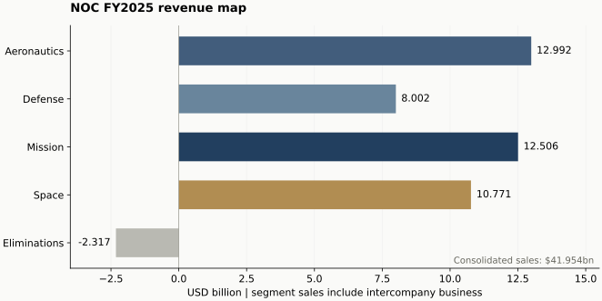
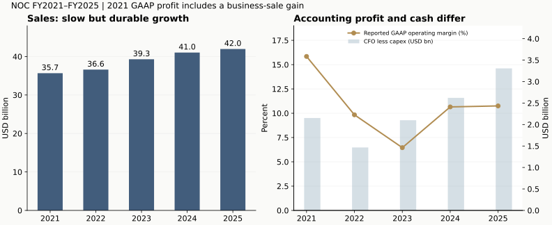

# 诺斯罗普·格鲁曼（NOC）研究报告

| 项目 | 口径 |
|---|---|
| 研究日期 / 数据截止 | **2026-11-25，Asia/Shanghai**；已运行系统日期核对。行情截至美国 11 月 24 日正常交易收盘，财务截至 2026Q3，重大事项检索至研究日 |
| 公司身份 | Northrop Grumman Corporation；诺斯罗普·格鲁曼，亦译诺思罗普·格鲁曼；NYSE：NOC，美国普通股，非 ADR |
| 价格 / 股本 / 市值 | **550.84 美元**；最新已披露 2026-10-15 普通股 142,064,489 股；复算市值 **782.5480 亿美元**，股本并非 11 月 24 日实时登记值 |
| 估值快照 | GAAP TTM PE **17.37 倍**；2026 公司 MTM 调整 EPS 指引中点对应 **18.64 倍**；本报告正常化 EPS 假设对应 **21.19 倍** |
| 信息丰富度评级 | **A 级**：年报、季报、政府采购与行业资料充裕；保密项目的单位经济仍不透明 |
| 研究起点 | 接续 [全球太空产业链研究](../全球太空领域产业链投资研究报告.md)。技术和任务资格支持长期收入，但股东回报取决于合同条件、成本估计与再投资，不能把国家预算或太空市场规模直接变成利润 |

**AI研究局限性声明：** 本报告没有保密项目资料、工程验收权限或供应链访谈。第三方标准化报表与公司 GAAP 的分类存在明显差异；分部毛利、部分持股和未来合同条款缺乏独立复核。事实、计算和研究假设分别注明，情景概率是主观判断。用于学习研究，不构成投资建议。

行情来源：[StockAnalysis](https://stockanalysis.com/stocks/noc/)、[FinanceCharts 价格历史](https://www.financecharts.com/stocks/NOC/summary/price)；股本来源：[2026Q3 10-Q 封面](https://investor.northropgrumman.com/node/44426/html)。两家行情源收盘一致，但 FinanceCharts 市值采用不同股数，本报告不沿用其市值。

---

## AI研究偏见自觉

NOC 的优势是公开财务可核验，研究陷阱是把“政府不会轻易放弃这个项目”理解为“股东一定赚到高回报”。B-21 的战略重要性与早期量产亏损可以同时成立；订单增长与现金占用也可以同时发生。

- [x] 将资料丰富与业务确定性分开：对总收入有信心，不等于看得清保密合同最终毛利。
- [x] 反查不买理由：单一主权客户、成本重估、养老金与税务支持、资本支出及分配政策约束。
- [x] 不依赖太空叙事：太空分部并非集团全部业务，最近增长也不突出。
- [x] 没有信息优势的地方不装作有：核心差异来自口径重建和价格纪律，而非预测军事政策。

> 研究者追问：如果公开资料减半，我仍能解释政府为什么持续采购，却还能同样确信每股现金回报吗？

---

## 第一步：核心数据总览

### 收入从哪里来

金额单位均为**百万美元**；分部销售含内部交易，必须保留抵销。下表利润率为分部经营利润率，公司未提供同口径分部毛利率。

| FY2025 分部 | 收入 | 同比 | 经营利润 | 经营利润率 | 主要经济来源 |
|---|---:|---:|---:|---:|---|
| 航空系统 Aeronautics | 12,992 | +5% | 813 | 6.3% | B-21、E-2、F-35 机体、无人航空；B-21 拨备压低本年利润 |
| 防务系统 Defense | 8,002 | +8% | 871 | 10.9% | Sentinel、导弹与防空系统、相关保障 |
| 任务系统 Mission | 12,506 | +10% | 1,827 | 14.6% | 雷达、传感、通信、电子战与受限任务系统 |
| 太空系统 Space | 10,771 | -8% | 1,183 | 11.0% | 国家安全卫星、导弹预警、推进与航天任务 |
| 内部销售抵销 | -2,317 | — | — | — | 不把同一枚部件的内部销售重复当外部收入 |
| **合并收入** | **41,954** | **+2%** | — | — | 2025 年美国政府最终客户占约 84%，含主承包与分包 |

来源：[2025 10-K](https://www.sec.gov/Archives/edgar/data/1133421/000113342126000003/noc-20251231.htm)、[2025 全年业绩稿](https://www.sec.gov/Archives/edgar/data/1133421/000113342126000002/noc-12312025xearningsrelea.htm)。分部销售可与 [StockAnalysis 分部表](https://stockanalysis.com/stocks/noc/financials/) 对照，年度经营利润另与 [Trefis 分部数据库](https://www.trefis.com/data/companies/NOC) 一致；季度分部利润缺乏完整独立第二来源，分部毛利未披露。同比按公司重述后的组织口径。



### 最近四季度：分部收入 / 同比 / 经营利润率

| 季度 | 航空系统 | 防务系统 | 任务系统 | 太空系统 | 抵销 / 合并收入 |
|---|---|---|---|---|---|
| 2025Q4 | 3,922 / +18% / 9.4% | 2,147 / +7% / 9.5% | 3,449 / +10% / 14.8% | 2,859 / +5% / 11.3% | -665 / 11,712 |
| 2026Q1 | 3,283 / +17% / 9.3% | 1,899 / +5% / 9.7% | 2,861 / +2% / 15.1% | 2,480 / -3% / 9.5% | -642 / 9,881 |
| 2026Q2 | 3,519 / +13% / 10.3% | 2,093 / +5% / 7.5% | 3,250 / +3% / 15.4% | 2,753 / +4% / 8.6% | -739 / 10,876 |
| **2026Q3** | **3,575 / +14% / 10.5%** | **2,307 / +12% / 10.8%** | **3,155 / +2% / 15.8%** | **2,749 / +2% / 11.3%** | **-664 / 11,122** |

来源：[Q4](https://www.sec.gov/Archives/edgar/data/1133421/000113342126000002/noc-12312025xearningsrelea.htm)、[Q1](https://www.sec.gov/Archives/edgar/data/1133421/000113342126000015/noc-03312026xearningsrelea.htm)、[Q2](https://www.sec.gov/Archives/edgar/data/1133421/000113342126000033/noc-06302026xearningsrelea.htm)、[Q3](https://www.sec.gov/Archives/edgar/data/1133421/000113342126000037/noc-09302026xearningsrelea.htm)。同比为财报取整值，不能据此反推精确上年收入。Q1 航空收入含公司原持有测试资产出售的影响，并非全为稳定量产增长。

### 五年财务：把会计利润与现金分开

| 年度 | 收入 | GAAP 净利润 | GAAP 经营利润 | 推算毛利率 | GAAP 经营利润率 | CFO | 现金 CapEx | 简单 FCF | 现金等价物 |
|---|---:|---:|---:|---:|---:|---:|---:|---:|---:|
| 2021 | 35,667 | 7,005 | 5,651 | 20.38% | 15.84% | 3,567 | 1,415 | 2,152 | 3,530 |
| 2022 | 36,602 | 4,896 | 3,601 | 20.42% | 9.84% | 2,901 | 1,435 | 1,466 | 2,577 |
| 2023 | 39,290 | 2,056 | 2,537 | 16.67% | 6.46% | 3,875 | 1,775 | 2,100 | 3,109 |
| 2024 | 41,033 | 4,174 | 4,370 | 20.38% | 10.65% | 4,388 | 1,767 | 2,621 | 4,353 |
| **2025** | **41,954** | **4,182** | **4,511** | **19.81%** | **10.75%** | **4,757** | **1,450** | **3,307** | **4,403** |

推算毛利为收入减披露的产品及服务成本，尚未扣单列 G&A；简单 FCF 统一为 CFO 减现金 CapEx，不加出售设备或业务回款。2021 年经营利润含出售业务收益，2021—2022 年净利润还受到养老金收益支持；2023 年含 B-21 大额损失拨备。不能把这条净利润曲线当成产品需求的同比曲线。

来源：[2023 年报](https://cdn.northropgrumman.com/-/media/Project/Northrop-Grumman/ngc/who-we-are/corporate-responsibility/2023-Annual-Report.pdf)、[2023 业绩稿](https://www.sec.gov/Archives/edgar/data/1133421/000113342124000004/noc-12312023xearningsreleaa.htm)、[2025 年报](https://www.sec.gov/Archives/edgar/data/1133421/000113342126000003/noc-20251231.htm)；独立对照：[StockAnalysis 现金流](https://stockanalysis.com/stocks/noc/financials/cash-flow-statement/)、[资产负债表](https://stockanalysis.com/stocks/noc/financials/balance-sheet/)、[Macrotrends 收入](https://www.macrotrends.net/stocks/charts/NOC/northrop-grumman/revenue)与[净利润](https://www.macrotrends.net/stocks/charts/NOC/northrop-grumman/net-income)。Macrotrends 正文受访问限制，仅取得滞后历史搜索索引，最新季度以公司与 StockAnalysis 为主。



2021—2025 收入复合增速为 +4.14%；2025 简单 FCF / 净利润为 79.08%。这更像缓慢增长、需持续投入的大型任务承包商，不能直接按高增长软件生意估值。

### 最新现金、债务与订单

| 数据点 | 采用值 / 解释 |
|---|---|
| 9M2026 收入 / 净利 | 31,879 / 3,093 百万美元；EPS 21.72 美元 |
| 9M2026 CFO / CapEx / 简单 FCF | 1,369 / 775 / **594** 百万美元 |
| 9M2026 公司调整 FCF | 965 百万美元，包含出售设备给客户的 371 百万美元回款；现金是真实的，但不能无条件年年重复 |
| TTM 简单 FCF | **3,829 百万美元**；由年度加当期减上年同期复算，不含设备出售回款 |
| 9/30 现金等价物 | 3,744 百万美元；不把另列 424 百万美元长期投资当短期现金 |
| 9/30 账面债务 / 狭义净债 | 15,197 / **11,453 百万美元**；债务含一年内到期部分，不含单列经营租赁；融资租赁未单列且年报称不重大 |
| 集团积压 / 其中已拨款 | 109,597 / 50,095 百万美元；已拨款占 **45.71%** |
| 太空积压 / 其中已拨款 | 26,348 / 9,848 百万美元；已拨款占 **37.38%** |

来源：[Q3 业绩稿及附表](https://www.sec.gov/Archives/edgar/data/1133421/000113342126000037/noc-09302026xearningsrelea.htm)、[10-Q](https://investor.northropgrumman.com/node/44426/html)、[独立现金流表](https://stockanalysis.com/stocks/noc/financials/cash-flow-statement/)。未拨款积压并非虚假订单，但不等于已经收到现金；已拨款合同也仍有履约和解约条款。

公司最新全年指引为收入 437.5—442.5 亿美元、分部经营利润 49.4—50.4 亿美元、MTM 调整 EPS 29.35—29.75 美元、调整 FCF 31—35 亿美元。利润指引上调，现金指引没有同步上调；公司明确未假设长期政府停摆或支出削减的影响。[Q3 指引](https://investor.northropgrumman.com/node/44406/html)

**口径差异已排查：** 第三方 FY2025 标准化“Operating Income”为 5,348，公司 GAAP 为 4,511 百万美元。后者减出售收益 231，加非经营养老金 541 和 MTM 收益 527，恰为前者。不能把这种重分类当成主业利润增长。平台总债务 17,399 与本报告 15,197 的差额涉及经营租赁；平台现金及投资 4,168 与现金 3,744 的差额是长期投资。本报告没有将它们混算为净现金。

> 巴菲特式追问（研究者拟题）：如果拿走养老金重估、税务支持和资产出售，主业能留下多少现金？

---

## 第二步：生意本质分析

**一句话：美国政府为难以替换的战略装备、传感与太空任务持续付费，NOC 用多年研发、制造和维护履约，把技术资格变成合同利润。**

| 商业环节 | 谁付钱 / 为什么重复 | 决定股东回报的变量 |
|---|---|---|
| 研发与工程 | 政府为验证技术、集成系统和满足军规付费 | 成本能否报销、奖励费能否取得、技术目标是否变化 |
| 初期量产 | 已选中平台逐批采购，替换供应商代价大 | 合同定价、通胀调整、学习曲线、供应商良率 |
| 成熟量产与保障 | 已装备平台需要补充、升级和维修 | 批量、交付节奏、可靠性、维修及升级的可竞争性 |
| 扩建与再投资 | 需求前置要求产能先投 | 谁出资本、验收与回款时间、扩产后单位利润 |

它具有长期复购，但复购依托装备和任务生命周期，收入仍按合同与履约进度确认。收入增长并不自动带来经营杠杆：产量爬坡可能先增加废品、加班、采购与测试成本；成本型项目增加收入也未必提高百分比利润率。

Mission Systems 的分部利润率较高，体现电子、传感和受限项目的价值；B-21 初期批次和发射发动机的成本偏差则能吞掉集团其他部门的改善。公司 FY2025 自筹研发约 11 亿美元，另有客户出资研发计入合同，不能仅凭自筹研发占收入约 2.6% 就断言技术投入低。[年报研发说明](https://www.sec.gov/Archives/edgar/data/1133421/000113342126000003/noc-20251231.htm)

> 段永平式追问（研究者拟题）：这门生意好在客户不能轻易换，还是好在每次交付后股东确实多了一笔现金？两者都要验证。

---

## 第三步：护城河评估

| 护城河来源 | 判断 | 证据与可证伪条件 |
|---|---|---|
| 品牌 / 定价权 | 品质信誉强，自由提价权中等偏弱 | 政府审价、合同谈判与竞争采购约束回报；能中标不意味着能随意提价 |
| 转换成本 | 强 | 平台设计、适航与安全认证、保密资质、维护体系交织；若客户可快速引入第二来源，该优势减弱 |
| 网络效应 | 弱 | 更多装备带来保障规模和数据积累，但不构成消费者平台式赢家通吃 |
| 规模与成本 | 中强 | 大型制造设施、测试与采购规模难复制；扩产低利用率、质量问题可使优势反向变成固定成本 |
| 技术 / 组织积累 | 强 | 隐身、系统集成、传感、推进和航天任务经验；有预算、有人才、有资格的竞标者仍能分走新项目 |

过去五年，战略装备的项目嵌入和产能稀缺性强化了业务持续性；同时，早期量产亏损证明定价护城河并未同步变宽。未来五年更可能是“高切换成本保持、交付能力决定份额、政府扶持替代供应商”，不宜预设瓶颈租金不断提高。

例如 SDA 的 Tranche 3 Tracking Layer 将订单分给 NOC、Lockheed Martin、L3Harris、Rocket Lab 四家，每家承担一组卫星。国家安全太空市场有资格门槛，也存在主动维护竞争的采购机制。[SDA 官方授标](https://www.sda.mil/space-development-agency-makes-awards-to-build-72-tracking-layer-satellites-for-tranche-3/)

> 巴菲特式追问（研究者拟题）：十年后资格和技术大概率还在；但政府若压低回报、分散采购，股东拥有的是多宽的经济护城河？

---

## 第四步：逆向思考与风险清单

最强的不买理由是：**政府可能很需要 NOC，但会要求它先扩产、让利和承担履约风险；股东付出的价格却已经假设相当顺利的利润兑现。**

以下为研究者对未来数年的定性发生可能性，彼此相关，不能相加成事故概率。

| 失败路径 | 可能性 / 影响 | 可观察信号 | 模型处理 |
|---|---|---|---|
| B-21 早期批次再次超支、扩建回报不及预期 | 中 / 高 | 累计估计损失上调、损失准备异常变化、公司资本投入增加而条款未改善 | 悲观利润情景与更小仓位 |
| Sentinel 重组延迟、奖励费下降或后续量产条款不利 | 中 / 高 | 新基线、设计成熟度、里程碑、实际拨款和量产定价 | 悲观利润情景；不把总项目超支等同公司损失 |
| 推进系统质量与交付扰动 | 中 / 中高 | 不利 EAC、事故调查、交付推迟、负营运资本改善逆转 | 增速与利润率压力 |
| 预算请求未落实、持续临时拨款或项目缩量 | 中 / 高 | 正式拨款、采购数量、已拨款积压转化 | 三情景销售及利润增速 |
| 回购和激励受到履约政策约束 | 中 / 中 | 新合同限制、补救要求、回购暂停、激励修改 | 不给未来回购增厚 EPS 的额外信用 |
| 极端取消核心项目、重大保密项目损失 | 无法可靠量化 / 很高 | 政府正式决定、重大特别损失、合同终止 | **未作数量化建模**，不能以普通悲观档冒充尾部保险 |

### 两个必须更正的合同判断

Sentinel 的现有 EMD 是成本型合同，生产与部署阶段尚未完成定价谈判。旧产业链报告“Sentinel 等固定价项目”的概称不准确，本报告明确更正；原历史文件保留。成本型降低部分成本风险，但仍有奖励费、不可报销成本、重组和未来批次条款风险。

B-21 的 EMD 主要为成本型，首五个 LRIP 批次主要为固定价，另有尚未最终谈妥的 NTE 批次。公司已累计确认约 20 亿美元 LRIP 损失，9 月末尚有约 10 亿美元相关损失准备；准备余额减少可能只是已预计亏损开始兑现，不能直接解释成新增利润。[10-Q 合同说明](https://investor.northropgrumman.com/node/44426/html)

### 历史类比与偏误

GAO 记录的 B-2 采购规模曾从计划的 132 架大幅压缩。技术难复制，并不保证最初规划的总产量。这是采购方的数量选择权，不是对 B-21 的数量预测。[GAO B-2 报告](https://www.gao.gov/assets/nsiad-97-181.pdf)

用博弈论看，政府希望供应商有能力持续交付，同时希望约束利润和避免单点依赖；用学习曲线看，量产降本必须由真实良率、工时和采购价格支持。最可能的分析错误，是把任务刚需、产能扩张和合同上限叠成一条平滑增长曲线。

> 芒格式追问（研究者拟题）：如果战略方向全对而投资仍失败，最可能是哪一个合同条款、资本投入或买入价格出了问题？

---

## 第五步：管理层评估

Kathy Warden 截至最新业绩披露仍兼任董事长、CEO 与总裁，2019 年起任 CEO。NOC 更依赖工程组织、人才和政府关系体系，CEO 退休不会立即消灭资格壁垒，但继任者的项目承诺和资本纪律会明显影响股东回报。[2026 Proxy](https://www.sec.gov/Archives/edgar/data/1133421/000113342126000007/noc-20260401.htm)

| 时间 / 决策 | 已知结果 | 研究评分 |
|---|---|---|
| 2023—2025 B-21 损失重估 | 先后确认较大 LRIP 损失；愿意确认亏损值得肯定，原始成本和报价纪律仍须问责 | 执行与定价偏弱 |
| 2025 现金配置 | 简单 FCF 3,307；普通股现金回购 1,624、股息 1,293 百万美元；两者合计 2,917，另有员工股权税代扣，仍需同时服务债务及项目投资 | 当年现金覆盖，不能只看 EPS 增厚 |
| 2026 B-21 提速协议 | 公司拟多年投入约 25 亿美元，换取改善相关批次回报的机会；回报尚未兑现 | 战略合理，财务回报待验证 |
| 2026 资本分配调整 | 前九个月现金回购仅 68 百万美元，Q3 未回购；不能外推以往回购速度 | 优先保交付值得观察 |
| 2026-08 额外长期股价奖励 | CEO 获附条件 MSU，归属至 2031 年；绝对股价激励仍需与交付和资本回报对照 | 治理折价，非否定任职能力 |

现金配置来源：[公司 10-K 现金流原表](https://www.sec.gov/Archives/edgar/data/1133421/000113342126000003/noc-20251231.htm)、[Q3 10-Q](https://investor.northropgrumman.com/node/44426/html)；平台回购含员工股权税代扣，本表按公司原始分类。B-21 投入另由 [Breaking Defense 报道](https://breakingdefense.com/2026/04/northrop-to-invest-2-5b-to-hasten-b-21-production/) 核对为公司多年投入计划，不能与政府资金相混；额外激励来源：[8 月 8-K](https://investor.northropgrumman.com/static-files/ef2e208d-cc80-4d11-b205-494f99a5bad8)。评分为研究者判断，不是绩效评级。

Proxy 披露 Warden 于 2026-03-20 持有普通股 196,681 股，同日总股数 142,033,159，复算约 **0.1385%**，一股一票。这个数不是 11 月实时持仓，也不含后来附条件奖励的假想归属；未取得同日独立第二来源，置信度中等。平台全体内部人持股不能拿来充当 CEO 持股验证。

FY2025 总薪酬为 2,535.7 万美元，包含授予日股权价值、养老金变动等，并非当年到手现金。2026 年激励兼顾收入、利润、CFO 与交付质量，但新增股价奖励要求继续审视“股东收益”与“客户履约”是否一致。[Proxy 薪酬与持股表](https://www.sec.gov/Archives/edgar/data/1133421/000113342126000007/noc-20260401.htm)

2026 年行政令针对履约不足、投资不足等情形提出分配和激励约束，不能据此宣称全行业已经停息。NOC 董事会 11 月 18 日仍宣布每股 2.47 美元季度股息，11 月 30 日登记、12 月 16 日支付。[行政令](https://www.whitehouse.gov/presidential-actions/2026/01/prioritizing-the-warfighter-in-defense-contracting/)、[最新股息公告](https://investor.northropgrumman.com/news-releases/news-release-details/northrop-grumman-board-declares-quarterly-dividend-57)

> 段永平式追问（研究者拟题）：如果 CEO 明年退休，新管理层接到的是可盈利的成熟产能，还是战略上必须交付、经济上仍要继续补贴的项目？

---

## 第六步：行业与文明趋势

长期需求来自核威慑更新、防空反导、分布式空间感知和信息对抗。NOC 位于关键系统、载荷与集成环节，而非仅赚火箭发射次数的钱。在轨服务是能力与潜在期权，本报告不给它独立的成熟利润估值。

| 趋势 | 公司可能得到什么 | 价值捕获的约束 |
|---|---|---|
| 战略装备换代 | 多年研发、量产与保障收入 | 数量、预算与合同回报由政府强力影响 |
| 反导与弹药补库 | 固体发动机、关键部件需求 | 产能扩建、供应链质量与第二来源竞争 |
| 分布式卫星架构 | 新的卫星、载荷和地面系统合同 | 更快采购也可能带来更快技术迭代和竞争 |
| AI / 自主化 | 更多传感、处理、通信与任务集成 | 不等于集团自动拥有软件平台利润率 |

11 月 16 日公司公布约 16 亿美元 PAC-3 MSE 多年订单，但它是 8 月超过 30 亿美元框架的一部分，不能相加成新增 46 亿美元。需求证据很具体，利润仍需等交付兑现。[公司订单公告](https://investor.northropgrumman.com/news-releases/news-release-details/northrop-grumman-lands-16-billion-award-scale-pac-3-mse)

太空分部 2026 前九个月收入仅增约 +1%。大项目结项、发射节奏与新项目爬坡会互相抵销；不能用整个全球太空经济的预测增速替代 NOC 可取得的市场。[季度结果](https://investor.northropgrumman.com/node/44406/html)

FY2027 的 1.5 万亿美元国防资源是总统预算请求，包含另需立法的资源，并非已拨款收入。研究日仍需关注临时拨款安排及 12 月 11 日节点。这里采用实际拨款与授标作为 TAM 落地代理，不编一个精确的“公司可寻址太空市场”。[预算请求](https://www.whitehouse.gov/wp-content/uploads/2026/04/budget_fy2027.pdf)、[现行临时拨款法](https://www.govinfo.gov/content/pkg/PLAW-119publ103/html/PLAW-119publ103.htm)

公司客户高度集中，供应端还受合格材料、推进剂、电子器件、技术工人及试验能力约束。没有取得可核验的单一供应商占比，不能量化成精确集中度。资本会进入瓶颈，政府也会培育替代供应商；今天的稀缺性不保证永远的高租金。

> 李录式追问（研究者拟题）：二十年后，这些能力大概率仍被需要；但技术进步和预算增长创造的价值，最终有多少留给今天价格买入的股东？

---

## 第七步：估值与安全边际

### 当前到底付了什么价格

| 指标 | 采用值 | 判断边界 |
|---|---:|---|
| 市值 | 782.5480 亿美元 | 最新已披露股数乘 11/24 收盘价 |
| GAAP TTM EPS / PE | 31.71 美元 / 17.37 倍 | 含会计养老金及税务影响，不等于持续现金盈利 |
| 2026 指引中点 EPS / PE | 29.55 美元 / 18.64 倍 | 剔除未来 MTM，不剔除全部常规养老金收益 |
| 研究正常化 EPS / PE | 26.00 美元 / 21.19 倍 | 下述盈利桥；研究假设，非公司预测 |
| P/S / 债务口径 EV/Sales | 1.80 / 2.06 倍 | TTM 收入 43,591 百万美元；EV 不含单列经营租赁 |
| PB | 4.19 倍 | 商誉、回购与累计会计项目使其解释力有限 |
| TTM 简单 FCF 收益率 | 4.89% | 3,829 百万美元，不含设备出售 |
| 2026 调整 FCF 中点去设备出售代理收益率 | 3.74% | 3,300 减 371 = 2,929 百万美元；不是公司另发的正式指引 |
| 年化已宣派股息 / 股息率 | 9.88 美元 / 1.79% | 假定季度额度不变，不保证未来四次均获宣派 |
| 平台 PEG | 2.96 倍 | 单源分析师口径，预测期和增速定义未独立核齐，不作为决策输入 |

债务口径 EV 为 897.0780 亿美元。平台租赁及长期投资口径 EV 约 914.9 亿美元，两者不应混用。NOC 对美国政府的经济依赖也不适合用一个低历史 beta 推导极低资本成本。[NOC 统计页](https://stockanalysis.com/stocks/noc/statistics/)

**正常化盈利桥：** 以公司 2026 MTM 调整 EPS 指引中点 29.55 为起点，减去约 7 亿美元全年净 FAS/CAS 调整按研究假设的 25% 示意税率税后、除以约 1.425 亿稀释股的 3.68 美元，得到 25.87，取整使用 **26 美元**。这是将养老金支持剥离的分析近似；示意税率参照披露的联邦与州税负取整，是分析假设，不是公司提供的 2026 实际税率。未进一步把所有税收优惠剔除，若低税率不可持续，26 仍可能偏高。[Q3 补充指引第 15 页](https://investor.northropgrumman.com/static-files/4406a933-6bc1-4912-9887-cb1d5899fb34)

### 三年三情景：回答贵不贵

三年盈利增速和退出 PE 均为研究假设。乐观情景需要产能、利润率与合同条款共同改善；中性按成熟承包商增长；悲观为正常盈利停滞，并非全部项目消失。

| 情景 / 主观概率 | EPS 年增速 | 三年 EPS | 三年 PE | 三年末价格 | 含现金股息三年累计回报 | 按 10% 折现的今日含息价值 |
|---|---:|---:|---:|---:|---:|---:|
| 悲观 / 25% | 0% | 26.00 | 14 倍 | 364.00 美元 | -28.54% | 298.05 美元 |
| **中性 / 55%** | **+6%** | **30.97** | **18 倍** | **557.40 美元** | **+7.01%** | **445.30 美元** |
| 乐观 / 20% | +10% | 34.61 | 22 倍 | 761.33 美元 | +44.50% | 600.58 美元 |

股息从每年 9.88 美元起，未来三年分别假设每年增长 0% / +4% / +8%，在每年末支付，不另加回购收益。累计回报未假定分红再投资。三年概率加权今日含息价值为 **439.54 美元**；不能把中性三年后的 557.40 当成今天的合理买价。

历史与同行只作校验。NOC 2024 / 2025 年末平台前瞻 PE 为 17.58 / 20.64 倍，当前平台为 18.69 倍；TTM PE 受拨备与 MTM 干扰更大。11/24 同平台前瞻 PE：LMT 18.31、LHX 19.63、RTX 25.16 倍。NOC 并没有相对 LMT 显著便宜；RTX 含更多民航业务，不能平移其倍数。[历史比率](https://stockanalysis.com/stocks/noc/financials/ratios/)、[LMT](https://stockanalysis.com/stocks/lmt/statistics/)、[LHX](https://stockanalysis.com/stocks/lhx/statistics/)、[RTX](https://stockanalysis.com/stocks/rtx/statistics/)。这些前瞻共识比较为单源，未完成第二供应商同日同口径核对，不作为独立价值证据；本报告 18.64 与平台 18.69 的 EPS 分母也不同。

### 十年折现：回答仓位能承受多大压力

| 输入 | 本报告判断及理由 |
|---|---|
| 币种 / r | USD；**r=10%**。11/24 美国十年国债约 4.91%，加研究采用 ERP 5.09%、规范 beta=1；ERP 是要求回报假设，不是观测报价。美元合理区间采用 9%—11.5% |
| 稳态增量 ROIC | **15%**；参考平台存量 ROIC 约 15.65%，避免假定新厂、新项目复制最优历史收益。以 26 美元正常 EPS、9.88 股息和 +6% 增长反推约 9.68% 的低端参照，15% 位于两者之间，但两端都含会计及分配假设 |
| 永续 g | 悲观 1%、中性 2.5%、乐观 3.5%；均是十年以后到永远的美元名义增长，基准不超过本币 4% 上限；g 不随 r 改动 |
| 十年正常利润增长 | 0% / +6% / +9%；概率 25% / 55% / 20%。不额外假定净回购，盈利增速不重复加股东回报率 |

利率来源：[美国财政部 11/24 日表](https://home.treasury.gov/resource-center/data-chart-center/interest-rates/TextView?type=daily_treasury_yield_curve&field_tdr_date_value=2026)。ROIC 与股息参照：[NOC 统计页](https://stockanalysis.com/stocks/noc/statistics/)。存量 ROIC 的第三方计算未完全穿透，仅作区间锚，15% 增量回报是核心不确定判断。

终值 PE 只由 `(1−g/ROIC)/(r−g)` 产生，不以同行今天的价格证明十年后的倍数。

| 情景 | 永续 g | r−g | 模型终值 PE | 第十年正常利润（百万美元） | 终值加当前股息率近似 IRR | 显式年度经济现金流 IRR |
|---|---:|---:|---:|---:|---:|---:|
| 悲观 | 1.0% | 9.0 个百分点 | 10.37 倍 | 3,693.68 | -5.10% | -0.50% |
| 中性 | 2.5% | 7.5 个百分点 | 11.11 倍 | 6,614.81 | +1.17% | +3.37% |
| 乐观 | 3.5% | 6.5 个百分点 | 11.79 倍 | 8,744.28 | +4.59% | +5.48% |

第一种是 `terminal_value.py` 的终值几何回报加当前股息率代理，不是真正逐年现金流 IRR，不能把其偏低结果冒充全部股东回报。第二种另作补全：每年正常利润乘以 `1−当年增长率/15%` 作为可分配经济现金，余款支持增长，第十年另加上述终值；用完整现金序列求 IRR，**不再重复加股息或回购**。这是再投资一致的股东现金模型，不是公司已承诺派息。

两种模型概率加权 IRR 分别为 **+0.29% / +2.83%**；中性显式现金模型今日价值 **327.43 美元**、概率加权 **321.78 美元**。后者低于三年估值，因为它要求增长由持续再投资支持，并把第十年估值收敛到永续经济回报；这一假设可能过保守，不能机械当目标股价。

**反向 DCF：** 沿用 26 美元起始正常 EPS、r=10%、g=2.5%，即使把全程增量 ROIC 提升到 30%，也需要未来十年约 **+11.93%** 的正常利润年增速才支持 550.84 美元。它远高于中性 +6%；30% ROIC 本身也比本报告稳态假设乐观。反向模型揭示价格所需组合，不是增长预测。

### r 敏感性与翻转检查

| r | 工具规定的终值加股息代理期望 IRR | 显式经济现金流期望 IRR | 相对 r 的压力测试 |
|---|---:|---:|---|
| 8% | +3.37% | +5.37% | 未通过；**区间外，仅供参考** |
| 9% | +1.70% | +3.98% | 未通过，美元区间内 |
| **10%** | **+0.29%** | **+2.83%** | **未通过，美元区间内** |
| 11% | -0.93% | +1.85% | 未通过，美元区间内 |
| 12% | -2.00% | +1.02% | 未通过；**区间外，仅供参考** |

已执行 ±2pp；两侧均在美元合理区间外，因此另执行 ±1pp。**在 9% / 10% / 11% 的合理区间抽查中，两套压力测试均未发生通过/未通过翻转。** 这说明当前仓位压力结论并非只依赖一个折现率点，不代表估值金额稳定，更不代表自动卖出。8% 与 12% 不参与有效翻转判定；8% 乐观 g 的分母也小于规范宽度，只作敏感性参考。

### 估值分歧对账

三年模型在一定利润增速与成熟承包商倍数下，中性今日价值 445.30 美元；十年经济现金模型更低。两者都不支持当前价有充足安全边际，但与“技术、客户嵌入和战略需求值得长期跟踪”的业务判断存在张力，也比旧产业链 430—470 美元观察带更谨慎。

三年模型负责定价；十年模型负责暴露资本回报、再投资和终值压缩对仓位的要求。最终观望新增，已有合理小仓可以持有复检，依据是六个维度共同作用：业务与壁垒可持续、治理和项目执行仍有缺口、增长受预算约束，且三年模型本身也缺少当前价格的安全边际。**十年未覆盖 r 只收紧仓位，不单独否决持有或未来条件式分批。**

本次以三年中性今日价值为价格基准，要求约 12%—19% 的折价，设置 **360—390 美元研究性分批评估带**。十年结果使其仅适合小规模首笔、参考总仓位不超过权益资产约 1.5%；它没有被拿来直接把评估带强压到 321.78 美元以下。旧 430—470 美元带由本报告替代，不再作为当前自动评估依据。

> 巴菲特式追问（研究者拟题）：r 错两个百分点会不会翻转？本次合理区间复核未翻转，但增量 ROIC 和盈利质量仍可能比 r 更重要。
>
> 段永平式追问（研究者拟题）：如果明天停市五年，我愿意持有这门生意；以 550.84 美元新增，则还缺足够的现金回报与价格余量。

---

## 第八步：最终决策与行动清单

| 维度 | 结论 | 信心度 |
|---|---|---|
| 生意质量 | 任务生命周期长、客户支付能力强；资本和合同经济约束明显 | 中高 |
| 护城河 | 技术、认证、切换成本强；定价权受采购方约束 | 高 |
| 管理层 | 组织能力成熟，损失确认较透明；原始报价、扩产回报和额外激励须跟踪 | 中 |
| 最大风险 | 成本与条款重估、拨款及缩量、供应链质量；极端保密风险无法量化 | 中低 |
| 文明趋势 | 战略威慑、反导与空间感知有长期需求，但不保证股东高增长 | 中高 |
| 估值 | 三年：当前价缺少安全边际，中性今日含息 445.30；十年：两套压力未通过，合理 r 抽查不翻转，只限制仓位 | 中 |

估值维度与其他五项并列；压力测试没有最终裁决权。本文没有用户账户、持仓成本、税负及其他军工敞口，以下仓位只是研究风险预算参照。

| 策略 / 价位 | 建议与经营条件 |
|---|---|
| **空仓者 / 当前 550.84 美元** | **观望新增。** 等价格与现金证据同时改善，不能因地缘新闻直接追入 |
| **360—390 美元** | 仅在无新重大项目损失、最新滚动简单 FCF 仍约不低于 30 亿美元、净债没有失控、拨款与交付可核后，研究首笔约 0.5%；这是分析条件，不是自动买单 |
| 加仓信号 | 进入评估带后，下一正式财务披露证实现金并非靠一次性设备出售、B-21 总损失估计未恶化、太空与防务利润率恢复可持续，且扩产条款/资本回报可核；再重估，参考合计不超过约 1.5% |
| 持仓者 | 合理小仓有条件持有，暂停加仓；超过自身风险预算先复核集中度。不要把低成本持有变成对当前价格的新背书 |
| 低于 360 美元 | 先查项目取消、现金和成本估计是否永久恶化；不因跌破带下沿自动加倍 |
| **≥650 美元** | 若正常盈利、合同经济与现金模型未增强，不追高并复核超配；这是明确研究警戒线，非机械卖出价 |
| 卖出 / 降仓信号 | 新增重大亏损或资金约束破坏正常盈利假设、核心任务持续缩量、会计或诚信红线；即使未到 650 美元也应重新研究 |

复检安排：**2026-12-11** 核正式拨款及临时安排后续；**2026-12-31** 人工检查 B-21 投入、推进订单与资本分配；**2027-02-15** 作为全年财报信息检查兜底，非公司确认披露日，正式财报若提前公布则提前人工复核。11/30、12/16 为本次已宣派股息登记及支付日，不是未来分红保证。

### 四位大师原话与研究者延伸

以下均为一般原则，未找到四位对 NOC 的直接投资意见；延伸部分是本报告作者分析，不是假想本人荐股。

| 人物 | 已读取的短引与出处 | 研究者延伸 |
|---|---|---|
| 巴菲特 | “It's far better to buy a wonderful company at a fair price than a fair company at a wonderful price.” [1989 股东信](https://www.berkshirehathaway.com/letters/1989.html) | 任务重要性支持研究价值，合理价格要由可持续现金证明 |
| 芒格 | “What will really fail in life? What do you want to avoid?” [2007 USC 演讲全文转载](https://jamesclear.com/great-speeches/2007-usc-law-school-commencement-address-by-charlie-munger) | 先找固定价学习曲线、质量与预算导致损失的路径 |
| 段永平 | “你能给用户带来什么价值。” [2025 浙大问答实录转载](https://finance.sina.com.cn/roll/2025-01-05/doc-inecxqhr2576638.shtml) | 客户需要可靠威慑与交付；投资者还必须问能否留下合理利润 |
| 李录 | “One common problem for investors is that they tend to swing too often.” [喜马拉雅资本官网所引署名原文](https://www.himcap.com/) | 国防与太空长期趋势不要求在每一个报价上出手 |

> 综合追问（研究者拟题）：哪些新事实会让我改变主意？能够核验的合同回报、持续现金与更好的价格，而不只是更响亮的战略叙事。

---

## AI分析置信度与投资确定性

AI 分析对身份、已披露收入、净利、现金、股本和简单 FCF 的置信度较高；对分部利润、CEO 持股和薪酬为中等，主要因独立第二来源不完整；对十年增量回报、情景概率和未定价项目条款为中低。

实际投资确定性低于资料置信度：NOC 被持续需要的确定性，高于它能以当前估值持续创造超额股东回报的确定性。重点一手验证问题是 B-21 扩建投入与合同回报的匹配、Sentinel 新基线及量产条款、推进系统 EAC 能否收敛、已拨款积压如何转成现金。极端核心项目取消和重大保密项目损失未作数量化建模，未来税务变化与激励稀释也未逐项精算。

---

## 数据来源与审计记录

### 关键数据交叉验证记录

| 项目 | 公司原始披露 | 独立来源 | 验证结论 |
|---|---:|---:|---|
| FY2025 收入（百万美元） | 41,954 | Macrotrends / StockAnalysis：41,954 | 一致 |
| FY2025 净利（百万美元） | 4,182 | Macrotrends / StockAnalysis：4,182 | 一致 |
| FY2025 简单 FCF（百万美元） | CFO 4,757 减 CapEx 1,450 | StockAnalysis：3,307 | 一致 |
| 2026Q3 现金（百万美元） | 3,744 | StockAnalysis：3,744 | 一致，未用含长期投资总额 |
| 10/15 普通股（股） | 142,064,489 | StockAnalysis：142,060,000，四舍五入 | 差异不足 0.01% |
| 11/24 收盘价（美元） | 不适用 | StockAnalysis / FinanceCharts：550.84 | 一致；两者市值股数口径不同 |
| Warden 3/20 持股 | Proxy：196,681 股 | 同日独立来源缺失 | 单源明确保留，不冒充双源通过 |

仓库工具实际输出摘录，完整原始输出见 [计算与验证底稿](Northrop-Grumman-validation-20261125.md)：

```text
市值验算 (Market Cap Verification)
  计算市值:           78.25B USD
  报告市值:           78.25B USD
  偏差:               0.01%
  ✅ 验证通过, 偏差仅 0.01%

交叉验证: FY2025收入 (Cross-Validation)
  ✅ 所有来源偏差 ≤ 1.0%, 数据一致
交叉验证: FY2025净利润 (Cross-Validation)
  ✅ 所有来源偏差 ≤ 1.0%, 数据一致
交叉验证: Q3现金等价物 (Cross-Validation)
  ✅ 所有来源偏差 ≤ 1.0%, 数据一致
```

计算采用仓库 `financial_rigor.py`、`terminal_value.py`，重要金额与现金折现另以 Decimal 复算。参数、逐年经济现金及结果见 [完整模型 JSON](Northrop-Grumman-model-20261125.json)；工具翻转参数见 [终值配置](Northrop-Grumman-terminal-config-20261125.json)。工具审计的静态通用利率文案不作为本案利率依据。

**核验结果：** 默认 15% 随机抽样选中 15 项，数值核对全部通过；其中八项外部事实取得公司与独立来源，PEG 仅通过单源转录核对，另六项为模型假设或计算，不冒充外部双源事实。抽检器未识别纯年份行，五年表另外全量对照年报与独立数据库。样本及来源见 [抽检记录](Northrop-Grumman-audit-sample-20261125.json)。最终终值约束审计通过，未建模警告已在正文列出；触发配置和每日监控检查通过，NOC 临时状态试运行通过、通知数为零。季度分部经营数据与持股的独立来源缺口不会因工具通过而消失。

跟踪沿用 `data/triggers.json` 的 **NOC**，主索引切换至本报告并保留旧产业链报告链接；价格带与上行警戒以本报告为准。事件仅登记供人工复检，现行每日监控自动扫描价格，不自动提醒事件。NOC 不在重点标的看板主表，本次在标的跟踪表新增建议事件。
