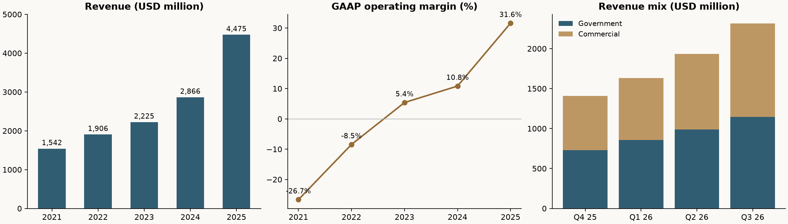

# Palantir（PLTR）研究报告

**数据截止日：2026-11-26（北京时间）**。最新经营数据截至2026-09-30，Q3业绩于纽约时间11月2日披露；价格采用11月25日正常交易收盘。研究对象为 Palantir Technologies Inc.（帕兰提尔），NASDAQ: PLTR，美国A类普通股，非ADR。

| 快照 | 数值与口径 |
|---|---|
| 股价 | US$163.59；Yahoo Finance与StockAnalysis同日收盘一致，未采用盘后价 |
| 已发行普通股 | 2,409,497,474股；10月26日A、B、F三类合计，属于最新披露股本，非11月25日逐日实测股本 |
| 复算市值 | US$394.1697B，约3,941.70亿美元 |
| 当前估值 | TTM市销率54.08倍；股价/稀释EPS为115.20倍；未扣SBC的标准FCF收益率1.03% |
| 研究主线 | 美国商业扩张和经营杠杆已经兑现；新增订单、竞争与正常税率下的每股现金，决定这份增长值多少钱 |

本文接续用户指定的[Q2财报精读](Palantir-earnings-2026Q2.md)与[旧研究](Palantir-research-20260801.md)，保留历史文件。用途为学习研究，不构成投资建议，亦未假定读者持仓、成本或风险预算。

---

## AI研究偏见自觉

**信息丰富度评级：A。** 一手财报、产品文档、股东信和交易数据充裕。主要陷阱是将资料数量、近期高增长和长期可预测性混为一谈。

**AI研究局限性声明：** 本文能够复算财务及估值，但无法独立观察客户真实部署成本、生产ROI、流失率、保密政府项目和竞品替换效果。TCV、RDV、NDR等经营指标来自同一发行人，新闻稿与演示稿重复披露不构成两个独立来源。没有公开可复核的统一市场份额，故不声称垄断率或技术领先年限。

- [x] 即使资料减少一半，核心问题仍是客户工作流、经济回报与支付价格。
- [x] 把公司披露的事实、本文的推理和模型假设分开。
- [x] 同时检验“增长继续超预期”与“增长正确、回报仍不足”两种可能。
- [x] 不将无法看清的客户ROI写成已被证明的护城河。

## 第一步：核心数据总览

### 五年经营轨迹

金额均为百万美元；净利为GAAP归属普通股股东净利。标准FCF为经营现金流减现金购置物业设备，包含SBC加回的影响，尚未扣股权激励经济成本。

| 财年 | 收入 | 归母净利 | 毛利率 | 经营利润率 | 标准FCF | 现金与流动有价证券 |
|---|---:|---:|---:|---:|---:|---:|
| 2021 | 1,541.889 | -520.379 | 77.99% | -26.66% | 321.224 | 2,524.827 |
| 2022 | 1,905.871 | -373.705 | 78.56% | -8.46% | 183.710 | 2,633.675 |
| 2023 | 2,225.012 | 209.825 | 80.62% | +5.39% | 697.069 | 3,674.179 |
| 2024 | 2,865.507 | 462.190 | 80.25% | +10.83% | 1,141.231 | 5,229.987 |
| **2025** | **4,475.446** | **1,625.033** | **82.37%** | **+31.59%** | **2,100.591** | **7,177.043** |

原始依据为[2022年10-K](https://www.sec.gov/Archives/edgar/data/1321655/000132165523000011/pltr-20221231.htm)、[2023年10-K](https://www.sec.gov/Archives/edgar/data/1321655/000132165524000022/pltr-20231231.htm)、[2025年10-K](https://www.sec.gov/Archives/edgar/data/1321655/000132165526000011/pltr-20251231.htm)，与[StockAnalysis损益表](https://stockanalysis.com/stocks/pltr/financials/)、[现金流表](https://stockanalysis.com/stocks/pltr/financials/cash-flow-statement/)、[资产负债表](https://stockanalysis.com/stocks/pltr/financials/balance-sheet/)交叉。历史证券并非全部国债，2021—2022年含股权投资，不应全部视为无风险现金。第三方毛利率、经营利润率可能因取整相差末位。



### 最近四季：商业成为收入主力

单位：百万美元。美国商业列采用公司公布的整数，其余为财报精确值；政府/商业为客户分部，美国/国际为地域维度，不能相加。

| 指标 | 2025Q4 | 2026Q1 | 2026Q2 | 2026Q3 |
|---|---:|---:|---:|---:|
| 总收入 | 1,406.802 | 1,632.583 | 1,935.464 | 2,313.411 |
| 政府 | 729.665 | 858.410 | 990.032 | 1,145.540 |
| 商业 | 677.137 | 774.173 | 945.432 | 1,167.871 |
| 美国 | 1,076.386 | 1,282.066 | 1,573.047 | 1,937.189 |
| 国际 | 330.416 | 350.517 | 362.417 | 376.222 |
| 美国商业，取整 | 507 | 595 | 764 | 984 |
| 毛利 | 1,190.836 | 1,416.785 | 1,638.594 | 1,930.125 |
| 毛利率 | 84.65% | 86.78% | 84.66% | 83.43% |
| 归母净利 | 608.676 | 870.527 | 1,061.890 | 1,128.012 |
| 经营现金流 | 777.295 | 899.165 | 1,216.167 | 1,204.570 |
| 现金资本开支 | 13.272 | 7.401 | 14.554 | 8.014 |

2025全年政府收入2,402.287百万美元、商业收入2,073.159百万美元；与近四季表同口径。

数据来自[Q3 10-Q](https://www.sec.gov/Archives/edgar/data/1321655/000132165526000048/pltr-20260930.htm)、[Q2 10-Q](https://www.sec.gov/Archives/edgar/data/1321655/000132165526000041/pltr-20260630.htm)、[2025年报](https://investors.palantir.com/files/2025%20FY%20PLTR%2010-K.pdf)与[季度损益表](https://stockanalysis.com/stocks/pltr/financials/?p=quarterly)、[季度现金流表](https://stockanalysis.com/stocks/pltr/financials/cash-flow-statement/?p=quarterly)。Q4由全年减前三季得到。季度地理拆分的第三方历史覆盖不全，部分仅能追溯发行人原表与差分；这项单源限制不作为独立验证通过。分部毛利率未披露；公司分部贡献利润扣除部分销售费用、排除SBC及未分摊费用，不能替代分部GAAP毛利率。

### Q3后最重要的变化

| 指标 | Q3最新披露 | 投资含义 |
|---|---|---|
| 收入 | 同比+96%；美国商业+148% | 增长兑现，美国商业首次超过美国政府收入 |
| 当季总TCV | 2,918百万美元，同比+6% | 新签流量明显没有跟随收入同比增速 |
| 美国商业TCV | 1,463百万美元，同比+11% | Q2的+153%不能直接延续为当前判断 |
| 美国商业RDV | 6,517百万美元，同比+79%、环比+4% | 存量仍厚，新增蓄水放缓 |
| RPO | 4.88B（Q2为4.90B） | 履约义务总额没有同步扩张；短期部分2.09B升至2.14B |
| NDR | 165%（Q2为157%） | 同一前期客户组滚动收入扩张，不能称客户数量留存165% |
| 美国商业客户数 | 686（Q2为653），TTM口径 | 新客继续增加，仍需区别新客与老客扩单 |
| 2026收入指引 | 8.530—8.534B美元 | 指引继续提高；属于管理层预测 |

来源：[Q3业绩新闻稿](https://www.sec.gov/Archives/edgar/data/1321655/000132165526000045/a2026q3ex991pressrelease.htm)、[官方Business Update](https://investors.palantir.com/files/Palantir%20-%20Q3%202026%20Business%20Update.pdf)。上述订单与客户指标为发行人单源披露；不把公司材料的相互吻合称为独立交叉验证。

TCV含合同期权，RDV也假设合同完整执行；RPO排除可取消部分，并对短期限合同有披露豁免。因此，“收入很强、订单增速较低、RPO近乎持平”需要联合解释，尚不足以断言需求崩塌，也不足以继续声称订单全面加速。

### 盈利与现金的三个口径

Q3 GAAP营业利润为1,084.845百万美元，经营利润率46.89%；毛利率83.43%。所得税仅13.560百万美元，对应税前利润1,148.001百万美元，有效税率约1.18%。经营杠杆真实存在，但这份税率不宜永续外推。[Q3损益表](https://investors.palantir.com/files/2026%20Q3%20PLTR%2010-Q.pdf)

| 现金口径，百万美元 | 2026年前九月 | TTM |
|---|---:|---:|
| 经营现金流 | 3,319.902 | 4,097.197 |
| 减现金资本开支后标准FCF | 3,289.933 | 4,053.956 |
| 再减SBC后的经济现金代理 | 2,504.243 | 3,071.861 |

减SBC的现金代理并非GAAP指标，也不是实际可分红现金；它将支付给员工的权益视为需要现金替代的报酬，帮助避免把SBC加回全部当作股东收益。尚需考虑营运资金时点、租赁和少数股东等差异。Q3 SBC为318.889百万美元，占收入13.78%，与Q2接近，未出现旧文期盼的明显下降。[现金流与SBC附注](https://www.sec.gov/Archives/edgar/data/1321655/000132165526000048/pltr-20260930.htm)、[独立现金流复核](https://stockanalysis.com/stocks/pltr/financials/cash-flow-statement/)

> 数据追问：如果恢复正常税率，并把员工股权视为成本，每股经济收益还能增长多快？

---

## 第二步：生意本质分析

**一句话：大型机构为把分散的数据、权限和AI模型接入能执行、能追责的业务流程付费，生产流程越深，续约和扩单越重要。**

例如制造企业希望调整采购：系统先把订单、库存、设备与供应商映射成统一业务对象；模型提出方案；权限决定谁能看、谁能批；Action执行修改；日志保留过程。模型换一家不等于这套流程可以立即迁移。Ontology是共同业务语义，Foundry承载数据与业务应用，AIP接入AI，Apollo支持多种环境下的软件部署。这是对[官方Ontology文档](https://www.palantir.com/docs/foundry/ontology/overview)、[AIP架构](https://www.palantir.com/docs/foundry/architecture-center/aip-architecture)、[AIP Logic](https://www.palantir.com/docs/foundry/logic/overview)的机制归纳，不能据此证明客户实际节约了多少成本。

| 生意变量 | 赚钱机制 | 需要验证的代价 |
|---|---|---|
| 试点转生产 | 初始部署进入更大业务范围，合同扩张 | Bootcamp不等于长期付费，集成成本可能由工程团队承担 |
| 老客扩单 | 增加数据、应用、部门与使用规模 | NDR强不代表全部客户满意，更不代表有同等提价权 |
| 软件复用 | 研发和平台跨项目复用，收入增速超过费用 | 云托管、FDE与定制交付可能抵消经营杠杆 |
| 政府业务 | 安全、部署与采购积累带来进入门槛 | 合同可取消、拨款及审批影响确认与回款 |

收入主要来自持续软件使用与服务合同，具有重复性，但不能把所有签约视为不可取消订阅。毛利较高来自软件复用与较低物理资本投入；客户现场实施、云计算和人员仍是实际成本。2026年前九月研发费用573.214百万美元，占收入9.75%；低资本开支不等于无需持续研发投入。[Q3经营分析](https://www.sec.gov/Archives/edgar/data/1321655/000132165526000048/pltr-20260930.htm)

> 段永平式追问：客户持续付款，是因为迁移麻烦，还是因为每一轮续约仍创造超过价格的价值？目前扩单支持后者，但独立ROI证据不够。

## 第三步：护城河评估

| 来源 | 判断 | 支持证据与反证条件 |
|---|---|---|
| 品牌与定价权 | 中等 | 高风险政府/企业项目有交付声誉；缺乏控制使用量后的纯提价证据 |
| 转换成本 | 较强，核心 | 对象模型、权限、行动和审计嵌入流程；若出现大规模低成本替换，应下调判断 |
| 网络效应 | 跨客户证据弱 | 客户内复用有价值；客户增加不自动使别家客户数据更好，不能等同社交网络 |
| 规模效应 | 中强 | 平台和部署经验可复用，营业利润率已上升；若增长需要同比例增加FDE则减弱 |
| 技术壁垒 | 集成能力有价值，概念不独占 | 不拥有独家基础模型，Ontology与Agent编排已有竞争路线 |

最新反证尤其重要：Databricks于11月11日宣布[Genie Ontology正式可用](https://www.databricks.com/blog/announcing-ga-genie-ontology)；[微软Fabric IQ Ontology](https://learn.microsoft.com/en-us/fabric/iq/ontology/overview)处于预览；Snowflake已提供围绕语义视图、检索和工具调用的[Cortex Agents路径](https://docs.snowflake.com/en/release-notes/2026/other/2026-08-28-cortex-analyst-transition-cortex-agents)。功能方向重叠不意味着生产能力相等，但已经足以否定“没有同方向对手”。

过去五年，既有客户的部署深度和规模复用大概率拓宽了迁移壁垒；未来五年，现有工作流可能更牢，新客获得和定价却会更难。这是本文推断，置信度中等。真正危险的是客户认为云平台原有语义与权限“已经够用”，从而不再为额外整合层支付高溢价。

> 巴菲特式追问：十年后仍然稀缺的是Ontology这个词，还是把复杂机构流程可靠运行起来的能力？护城河必须靠后者证明。

## 第四步：逆向思考与风险清单

**最强空方论点：公司可能继续成功，但当股价已要求多年高增长、持久高利润率和高估值时，股东仍可能得到低回报。** 再叠加云厂商捆绑、订单增长回落和低税率正常化，经营好消息也未必足以抬升每股价值。不建议据此做空：超预期增长与估值扩张的持续时间都不可预测。

| 失败或永久损失路径 | 主观可能性 | 影响 | 可观察指标 |
|---|---|---|---|
| 新签增长无法支持收入扩张 | 中 | 高 | 连续两次披露TCV/RDV、短期RPO与收入脱节，回款同步走弱 |
| 竞品利用既有数据入口压价 | 中 | 高 | 同口径续约折扣、客户迁移实例、毛利下降且使用量未补偿 |
| 投资者把低税率净利长期化 | 较高 | 中高 | 正常税负、SBC后盈利和每股现金低于表面EPS增长 |
| 政府便利取消或预算变化 | 中 | 中高 | 实际任务订单、拨款与交付，不能只看合同上限 |
| 数据泄露、模型行动或权限事故 | 难估 | 极高 | 正式事故披露、客户赔偿、暂停部署 |
| 创始人控制与报酬偏离股东 | 中 | 高 | 新授予、实际稀释、关联安排与投票结构变化 |
| 估值降至普通高质量软件水平 | 较高 | 高 | 即使盈利上升，倍数收缩仍可造成资本损失 |

概率为研究判断，并非统计估计，事件可以同时发生。Q3应收净额1,883.498百万美元，单一客户占27%，同期无客户占收入超过10%；这提示收款集中，不能直接断言坏账。[10-Q客户集中与风险条款](https://www.sec.gov/Archives/edgar/data/1321655/000132165526000048/pltr-20260930.htm)

陆军十年最高100亿美元协议的官方表述明确不承诺具体采购。不能把采购框架上限直接折现成订单收入。[陆军公告](https://www.army.mil/article/287506)

历史类比只作机制检验：早期企业平台可能凭安装基础变得持久，也可能在平台整合中被削弱；这两条路径都不足以靠一家历史赢家的名字赋予PLTR高倍数。跨学科上，技术采纳曲线解释需求扩散，采购与组织惯性解释扩单滞后，竞争博弈解释打包压价；三者共同决定价值获取，单看AI渗透率不够。

**最可能的分析错误：** 本文低估AI原生生产系统的价值与增长持续时间；相反方向则是把已经部署的少数大客户成功推广到全部企业，并把高增长永久化。现有数据不能排除任何一边。

> 芒格式追问：聪明人为什么不买？因为他可以承认产品有效，同时拒绝承担增长、利润率和退出倍数必须同时成功的价格。

## 第五步：管理层评估

Karp与Thiel等创始人建立了以机构级复杂部署为中心的公司；Karp并非传统软件工程师型CEO，技术组织及交付经验的作用不能全部归于个人。评价重点是战略兑现和每股资本配置。

| 决策 | 已观察结果 | 本文评价 |
|---|---|---|
| 长期投入政府与复杂机构市场 | 形成安全部署、采购和现场交付积累 | 正面，但预算与政治暴露持续存在 |
| Foundry、Apollo到AIP的产品延伸 | 商业扩单与经营杠杆提高 | 正面，尚需区分周期需求和平台优势 |
| Bootcamp、FDE推动生产应用 | 转化速度可能提高，客户与收入增长 | 有效迹象较强；获客成本及客户ROI披露不足 |
| 保持大量现金、无有息借款 | 财务弹性好 | 正面；不是高价回购或低回报投资的豁免 |
| 持续股权激励与创始人控制 | 留住人才，也产生经济成本和治理折价 | 必须逐期核每股结果，不能只看调整后指标 |

2026年4月6日实持A/B/F股合计口径下，Karp约2.43%、Cohen约0.58%、Thiel约4.10%；这不同于包含可于指定期限内行权期权的beneficial ownership。数字为当时快照，非11月最新实持。创始人协议配合F类股可控制最多49.999999%投票权，属于创始人合计安排，不能写成Karp个人拥有约50%。[2026 Proxy及持股脚注](https://www.sec.gov/Archives/edgar/data/1321655/000132165526000019/pltr-20260423.htm)

Q3披露Karp最多出售7,080,177股的计划，Thiel相关实体有最多买入4,000,000股的计划；交易计划不等于已成交，也不足以单独判断公司内在价值。[Q3交易计划披露](https://www.sec.gov/Archives/edgar/data/1321655/000132165526000048/pltr-20260930.htm)

对旧文也作两点纠正：稀释加权股数较基本股数高约若干百分点，代表潜在权益对每股指标的影响，**不等于每季新发行同等比例股份**；旧文引述Karp“18个月增长承诺”的精确含义，本轮未取得足以还原上下文的一手实录，故不把“公司必须增长149%”当成硬性失约判据。

若Karp退休，平台和已部署流程不会消失，但销售叙事、产品取舍与人才组织可能受损。目前不足以将其判断为完全摆脱关键人物的制度化公司。

> 段永平式追问：把创始人的表达风格拿掉，仅看客户、回款和每股价值，这个管理团队是否仍值得信任？经营兑现较强，治理保护则弱于普通同股同权公司。

## 第六步：行业与文明趋势

把AI从问答转为机构内的受控行动，确实可能改变企业软件采购；Palantir处在数据基础设施与最终业务行动之间，争取的是流程整合、治理和业务成果的利润池。价值不必全部流向模型，也不会必然全部流向应用层。

产业空间按“可付费生产流程数量×每个流程创造的增量利润×平台分成”理解更可靠。没有足够独立依据给出统一精确TAM或PLTR份额；通用AI市场总额、模型训练支出和软件收入不能直接相加。

长线模型分别假设2036年收入200亿、600亿、1,000亿美元，对应2026指引中点起十年收入复合增速约+8.89%、+21.54%、+27.91%；这组数是对可捕获市场的压力假设，不是公司指引或第三方预测。较高情景要求跨行业生产化和全球扩张，不可能仅靠现有政府项目自然实现。

供应依赖主要是云、模型和专业人才。多模型、跨环境有助于降低单一模型风险，但不能取消云计算议价、模型工具接口变化与数据准入风险。官方还说明，读取权限不会自动替代对模型输出及行动的访问控制，需要专门配置，不能声称平台天然消除了AI安全风险。[AIP架构与权限说明](https://www.palantir.com/docs/foundry/architecture-center/aip-architecture)

> 李录式追问：二十年后，公司是否成为企业生产系统的长期组成部分？这是值得研究的方向；目前还没有证据赋予它“时代标准石油”的确定性。

---

## 第七步：估值与安全边际

### 先统一市值、每股和现金口径

股价163.59美元乘以最新披露全类别2,409,497,474股，得394.1697B美元，与第三方394.17B一致。只取可交易A类的2,306,705,341股会漏算B/F经济权益。[10-Q封面](https://investors.palantir.com/files/2026%20Q3%20PLTR%2010-Q.pdf)、[StockAnalysis](https://stockanalysis.com/stocks/pltr/statistics/)、[Yahoo历史行情](https://finance.yahoo.com/quote/PLTR/history/)

| 指标 | 复算结果 | 边界 |
|---|---:|---|
| TTM收入 | 7.288260B美元 | FY2025减2025年前九月，加2026年前九月 |
| TTM归母净利 | 3.669105B美元 | 含低税率与非经营项 |
| 市值/归母净利 | 107.43倍 | 市值分母使用实股 |
| 股价/稀释TTM EPS | 115.20倍 | EPS采用1.42；与上述107.43不是同一股数口径 |
| PEG | 不作为估值锚 | 第三方显示约1.22，但增长窗口和正常化税负未统一，不冒称独立验证 |
| TTM PS | 54.08倍 | 非便宜的绝对水平 |
| 2026指引中点PS | 46.20倍 | 指引8.532B；不是第三方“未来十二个月PS” |
| 参考EV/TTM收入 | 52.66倍 | 减现金证券、加已单列非流动租赁；不是完整租赁调整EV |
| 标准FCF收益率 | 1.03% | 尚未扣SBC |
| FCF减SBC代理收益率 | 0.78% | 仍非完整可分配收益 |

现金3.619414B与流动证券6.942117B合计10.561531B；无有息借款。第三方标记的“债务”0.225267B对应非流动经营租赁，流动租赁藏于流动负债汇总，最新季度未单列，因此10.336264B只能称“扣已单列租赁后的余额”。长期模型将可归股东净现金保守取整为10B，留出负债和运营缓冲，不伪称已经逐笔结清全部义务。[原始余额](https://www.sec.gov/Archives/edgar/data/1321655/000132165526000048/pltr-20260930.htm)、[第三方余额](https://stockanalysis.com/stocks/pltr/financials/balance-sheet/)

历史参照：PLTR年末PS在2023、2024、2025年分别为16.79、60.12、94.66倍，目前54.08倍说明较狂热阶段收缩，不能证明便宜。[历史估值](https://stockanalysis.com/stocks/pltr/financials/ratios/)

同日软件参照为微软PS10.50倍、毛利率模型与云资本开支结构不同；Snowflake PS17.36倍、TTM毛利率67.03%、GAAP仍亏损。它们说明高增长溢价需要被解释，不能据此直接套PLTR退出倍数。本文不使用同业当前价格决定十年终值。[微软统计](https://stockanalysis.com/stocks/msft/statistics/)、[Snowflake统计](https://stockanalysis.com/stocks/snow/statistics/)

### 三年三情景：当前价格贵不贵

先把Q3营业利润年化，按20%正常税率、Q3稀释股数2,573.926百万股计算，每股约1.3487美元，取1.35。该起点已含SBC费用，剔除投资与利息，属于经营盈利代理，并非实际FY2026 EPS预测；20%是研究假设，公司调整后口径使用的长期税率更高，故并非刻意压低盈利。年化单季也可能高估可持续水平。

三年情景不重复扣SBC或机械再扣每年稀释，假设未来授予的成本可由利润内费用覆盖；已有潜在权益通过稀释股数体现。若新授予明显超出费用代理，必须下调每股结果。

| 情景 | EPS年增长假设 | 三年后PE假设 | 三年后EPS | 三年后价格 | 以10%折现的今日值 | 由现价起价格年化回报 |
|---|---:|---:|---:|---:|---:|---:|
| 悲观 | +15% | 25倍 | 2.0532 | 51.33美元 | 38.56美元 | -32.05% |
| **基准** | **+35%** | **35倍** | **3.3215** | **116.25美元** | **87.34美元** | **-10.76%** |
| 乐观 | +55% | 50倍 | 5.0272 | 251.36美元 | 188.85美元 | +15.39% |

三年PE只是到期市场定价情景：基准给予仍有增长的软件平台较高倍数，乐观保留更高溢价，悲观反映竞争与成熟化；均非永续倍数。按主观25%/50%/25%概率加权，今日值100.53美元。概率没有统计基础，单列用于检验，不能称准确目标价。表内未假设分红，不将未来股价误称今天价值。

再用现金交叉：前九月标准FCF减SBC后2,504.243百万美元，简单年化并除以稀释股数为1.2972美元，取1.30。假设每股现金三年年增+40%、期末P/现金30倍，三年后107.02美元，今日值80.40美元。此代理未完全解决税负与营运资金时点，精度有限，但支持“用当前现金支付163.59美元缺乏明显安全边际”的方向。两种三年方法都已用金融工具计算。

### 反向估值：市场要求什么

若三年后正常化PE回到35倍，要从现价取得年化10%价格回报，1.35美元起点EPS必须连续三年增长约+66.41%。这是条件推演，并非市场所有参与者采用的预测；更高退出倍数可以降低所需增长，却把回报交给下一位买家的定价。

十年方面，若完全忽略中途分配，以基准终值PE12.5714倍要求年化10%，2036年利润需约81.33B美元；这只是“零中间现金”的上限式门槛，不是真正的完整反向DCF。下文明确纳入中间可分配现金，避免把全部回报压到终点。

### 十年折现：仅作为仓位压力测试

美元资本成本r取10%，拆为[11月25日美国十年国债4.85%](https://home.treasury.gov/resource-center/data-chart-center/interest-rates/TextView?field_tdr_date_value=2026&type=daily_treasury_yield_curve)加研究假设ERP5.15%、经济β1。β为建模选择，并非交易回归β；预算取消、竞争、事故等离散风险不塞入r。合理r区间9%—11.5%，美元基准永续g不超过4%。

稳态增量ROIC取25%：承认轻资产和流程积累，但不沿用因极低账面资本而异常高的存量ROIC。未来十年之后的g分别取1.5%、3%、4%，对应从有限竞争优势到广泛渗透；它们与十年收入增速不同，改变r时保持g不变。

| 2036情景 | 主观概率 | 收入假设，B美元 | 税后经营利润率假设 | 利润，B美元 | 永续g | r−g | 永续模型退出PE |
|---|---:|---:|---:|---:|---:|---:|---:|
| 悲观 | 25% | 20 | 20% | 4 | 1.5% | 8.5个百分点 | 11.0588倍 |
| 基准 | 50% | 60 | 35% | 21 | 3.0% | 7.0个百分点 | 12.5714倍 |
| 乐观 | 25% | 100 | 45% | 45 | 4.0% | 6.0个百分点 | 14.0000倍 |

退出PE唯一来源为 `(1−g/ROIC)/(r−g)`。对应稳态可分配比例94%/88%/84%。乐观利润率与规模都很进取；永续模型仍要求2036年后增长回归稳态，这种结构会显著压低十年退出倍数，是压力假设本身的限制。

为补足终点工具没有逐年现金流的局限，另用Decimal逐期折现并求根。下列利润均为扣正常税和SBC后的B美元假设，按年末现金处理，2027—2036年恰作十期；没有声称实际派息承诺。

| 年度 | 悲观利润 | 基准利润 | 乐观利润 | 可分配比例假设 |
|---|---:|---:|---:|---:|
| 2027 | 3.8 | 4.6 | 5.5 | 0% |
| 2028 | 4.5 | 6.5 | 9.0 | 0% |
| 2029 | 5.3 | 8.6 | 13.0 | 0% |
| 2030 | 5.2 | 10.8 | 18.0 | 20% |
| 2031 | 5.0 | 13.0 | 23.0 | 30% |
| 2032 | 4.8 | 15.0 | 28.0 | 40% |
| 2033 | 4.6 | 16.8 | 33.0 | 50% |
| 2034 | 4.4 | 18.4 | 37.0 | 60% |
| 2035 | 4.2 | 19.8 | 41.0 | 70% |
| 2036 | 4.0 | 21.0 | 45.0 | 按各档94%/88%/84% |

留存部分支撑增长，中间可分配现金代表股东可得能力，可通过分红或净回购实现；不能把同一现金再作为额外稀释改善加一次。终值为2036利润乘上表PE，另加保留的10B现有净现金。除这10B外，未显式使用的留存资金没有第二次加回；可能低估后期现金积累，但避免把用于增长的留存也全当闲置现金。

| 情景 | 终点简化工具IRR，无中间分配 | 完整现金路径IRR，含10B净现金 | 完整路径r=10%今日每股值 |
|---|---:|---:|---:|
| 悲观 | -19.65% | -16.42% | 11.93美元 |
| 基准 | -3.93% | -1.58% | 56.19美元 |
| 乐观 | +4.80% | +7.12% | 126.74美元 |

主观概率加权的“各情景IRR算术均值”为简化-5.68%、完整-3.12%；它不是对所有情景现金流先平均后求IRR，也不是统计期望财富的等价年化。完整路径加权现值为62.76美元。**这些数字仅限制可承受仓位，不能单独否决买入或持有。**

| r敏感性 | 终点工具期望IRR | 完整现金路径期望IRR | 相对该r的仓位压力测试 |
|---|---:|---:|---|
| 8% | -2.40% | -0.36% | 未通过；区间外，仅供参考 |
| 10% | -5.68% | -3.12% | 未通过 |
| 12% | -8.03% | -5.01% | 未通过；区间外，仅供参考 |
| 9%，补充复核 | -4.19% | -1.89% | 未通过，合理区间内 |
| 11%，补充复核 | -6.94% | -4.14% | 未通过，合理区间内 |

已执行±2个百分点flip；因两侧均超出合理区间，再执行±1个百分点。**合理区间内的实际采样不翻转，均未覆盖资本成本；不等于证明所有可能参数都不翻转。** 对于8%/乐观g4%格，分母只有4个百分点，另标“仅作情景参考”，不得用作有效估值。

### 估值分歧对账

三年基准今日值87.34美元、现金交叉80.40美元，均低于现价，属于定价判断；十年完整基准56.19美元、加权62.76美元，来自更快成熟化与较低稳态倍数，属于仓位压力测试。两者方向一致、程度不同，不能把后者冒充精确价值下限。

经营质量偏正面而长期压力偏负面，是“平台优势是否能转换成股东回报”的分歧。最终新增观望同时依赖三年定价、订单前瞻信号、竞争和治理约束；保留合理小仓的条件式持有，则承认生产部署价值及持续超预期可能。十年结果只将研究性总仓参考上限收紧至权益组合约2%，不是独立清仓票。

旧70—85美元重估带改为**60—65美元条件研究带**，主要依据三年正常化利润与SBC后现金：对三年现金基准80.40美元约有19%—25%折让，而非因为十年模型未通过。它仍不是自动买入区间；经营条件失败时，低价也应重算。上行警戒线取**160美元**，接近当前定价，仅用于“模型未增强时不追价、复核超配”，不代表自动卖出。

> 巴菲特式追问：r错两个百分点会翻转吗？已测的合理区间档位不翻转，但终值成熟化假设会显著影响结果。
>
> 段永平式追问：若市场关闭五年，是否愿意以163.59美元增加持有？在当前每股经济收益、订单和竞争证据下，本文不愿增加；已有小仓可以在风险预算内继续观察。

---

## 第八步：最终决策与行动清单

| 六个并列维度 | 结论 | 信心度 |
|---|---|---|
| 生意质量 | 高毛利、重复合同、扩单与经营杠杆突出 | 中高 |
| 护城河 | 生产流程迁移成本较强，跨客户网络效应未证实 | 中 |
| 管理层 | 战略执行强，创始人控制和SBC要求折价 | 中 |
| 最大风险 | 高价叠加订单减速、竞争与正常税负，可能造成每股回报不足 | 中高 |
| 文明趋势 | AI生产化方向有价值，公司利润份额仍需验证 | 中 |
| 估值 | 三年基准87.34/现金80.40，现价缺安全边际；十年完整期望约-3.12%，有效r采样不翻转，仅限仓 | 算数高、假设中低 |

估值维度不是唯一裁决；十年未覆盖r只能下调仓位建议。综合结论为：**空仓者观望新增；合理小仓有条件持有、暂停加仓；超配者复核减仓。**

| 策略 | 具体行动 |
|---|---|
| 空仓者 | 163.59美元不新增。60—65美元仅启动条件研究，第一笔参考权益组合约0.5%，研究性总仓参考不超过2%；非个性化仓位要求 |
| 持仓者 | 业务仍强，合理小仓可持有复检，不按成本价决策。若远超研究预算，可分批降低集中度；不声称用户实际持仓 |
| 加仓信号 | 进入60—65美元，随后连续两次正式季度披露确认扩单与新签可解释、NDR保持至少130%、美商RDV不连续环比下降；滚动FCF减SBC为正、股数与回款可对清，重估后仍有约20%安全边际 |
| 卖出或退出复核 | 重大安全/诚信或会计问题；客户迁移及单位经济结构恶化；连续两次新签、RDV与回款联合走弱且公司不能合理解释。单个指标或单季波动不足以自动清仓 |
| 上行价格警戒 | 股价≥160美元且正常化盈利/现金模型未相应增强，停止追价并复核超配；不是做空或自动卖出信号 |
| 跌破研究带 | 低于60美元先查永久损失、合同取消及稀释，重新估值，不机械越跌越买 |

这里的130%、连续两次、仓位和折价均是本文研究纪律，不是公司指引或历史统计最优阈值。期末报告及后续可比披露共同核验，条件未齐时继续等待。

### 复检安排与登记

2026Q3复检现已完成，登记事件标记done并保留。2026-12-31为人工研究检查：核订单解释、竞争部署、股权计划实际执行和回款。2027-03-31为全年/Q4信息检查兜底，**不是已确认财报预约日**；若公司提前披露即提前研究，正式披露日以IR公告为准。

沿用触发目标`Palantir`及`usPLTR`，替换原价带并保留旧报告链接。PLTR不在重点标的主表，本次新增建议事件至[标的跟踪表](../标的跟踪表.md)，保留20260801-PLTR已关闭记录。每日自动监控只扫描价格；当前程序排除上行警戒线，因此60—65美元带进入活跃日报，160美元上行线仅登记作人工仓位复核。事件登记供人工复核，不声称已经创建新的定时提醒。

> 决策追问：若未来只允许看订单、每股现金和客户替换三组证据，我是否还会作同样决定？现阶段会；叙事本身不构成加仓信号。

### 四位大师的方法论映射

以下均为已读原话与本文方法论延伸，不声称四人曾评价PLTR，也不以其姓名为结论背书。

- **巴菲特**：“You can, of course, pay too much for even the best of businesses.”——[1996股东信](https://www.berkshirehathaway.com/letters/1996.html)。延伸：确认平台价值后，仍须单独核查支付价格。
- **芒格**：“I am personally skeptical of some of the hype that has gone into artificial intelligence.”——[2023股东会原始转录](https://buffett.cnbc.com/video/2023/05/08/morning-session---2023-meeting.html)。本轮读到搜索索引中的原转录段落，原页直连403；不据此替他判断PLTR，进一步模拟代言资料不足。
- **段永平**：“总而言之，不懂不做，不要跟消息走，跟着理解走。”——[2011-10-07原发言存档，第163条](../段永平/段永平雪球全量原发言.md)，[雪球原链](https://xueqiu.com/1247347556/20416338)。原链本轮不可直接访问，使用仓库原档。延伸：未理解真实ROI与续约机制，就不应因AI热度建立重仓。
- **李录**：“One common problem for investors is that they tend to swing too often.”——[喜马拉雅资本官网所载李录原文](https://www.himcap.com/)，注明《Poor Charlie’s Almanack》第61页。延伸：保留对产业机会的研究，并不要求每个价格都交易；原文也提醒真有好球时不能因恐惧而不行动。

## AI分析置信度与投资确定性

**AI分析置信度：基础财务和计算较高，商业优势中等，长期预测中低。投资确定性：当前价格下中低。** 这两者不能互相替代。

充分数据支持的是收入扩张、经营杠杆、低实际税率、SBC成本和已披露合同指标。有限信息推理的是迁移成本、AI利润份额和竞争结果；具体价格与回报来自明确假设，非未来事实。

未建模离散尾部包括重大数据/行动事故与极端创始人治理事件，可能造成超过悲观档的损失。还存在流动租赁拆分缺口、客户ROI与迁移成本缺口、NDR不能独立重算、订单期限/取消权使指标不可直接对应收入、年化单季及现金流季节性、稳态到达时点和留存资金用途等限制。因此，不应把模型小数位理解成预测精度。

## 数据来源与审计记录

年度收入和归母净利已按[Macrotrends收入](https://www.macrotrends.net/stocks/charts/PLTR/palantir-technologies/revenue)、[Macrotrends净利](https://www.macrotrends.net/stocks/charts/PLTR/palantir-technologies/net-income)、公司年报及StockAnalysis交叉。Macrotrends最新季度部分仍止于Q2，Q3以原始10-Q与StockAnalysis为主；不拿旧期间强行凑双源。Macrotrends历史现金可能纳入受限现金，与本文流动证券口径不同，未强行对齐。

### 关键数据交叉验证记录

金融严谨性工具的原始输出节录如下；来源名称精简，具体链接见上文。

```text
============================================================
市值验算 (Market Cap Verification)
============================================================
  股价 (Price):       163.59 USD
  总股本 (Shares):    2.41B
  计算市值:           394.17B USD
  报告市值:           394.17B USD
  偏差:               0.00%

  ✅ 验证通过, 偏差仅 0.00%
============================================================
估值指标验算 (Valuation Verification)
============================================================
  当前股价: 163.59

  PE (TTM):  163.59 / 1.42 = 115.20x
  盈利收益率: 0.87%
  PB:        163.59 / 4.659884943295026670777078391 = 35.11x
  ROE:       1.42 / 4.659884943295026670777078391 = 30.47%
  P/FCF:     163.59 / 1.682490246926899247705955470 = 97.23x
  FCF Yield: 1.03%
  股息率:    0 / 163.59 = 0.00%

  ✅ 以上指标均使用精确十进制计算, 无浮点误差

============================================================
交叉验证: FY2025收入 (Cross-Validation)
============================================================
  数据来源数: 2
  参考中位数: 4,475.45 百万美元

  ✅ 10-K                : 4,475.45 百万美元  (偏差 0.00%)
  ✅ StockAnalysis       : 4,475.45 百万美元  (偏差 0.00%)

  ✅ 所有来源偏差 ≤ 1%, 数据一致

  共识值 (加权中位数): 4,475.45 百万美元
============================================================
交叉验证: FY2025归母净利 (Cross-Validation)
============================================================
  数据来源数: 2
  参考中位数: 1,625.03 百万美元

  ✅ 10-K                : 1,625.03 百万美元  (偏差 0.00%)
  ✅ StockAnalysis       : 1,625.03 百万美元  (偏差 0.00%)

  ✅ 所有来源偏差 ≤ 1%, 数据一致

  共识值 (加权中位数): 1,625.03 百万美元
============================================================
交叉验证: Q3现金及证券 (Cross-Validation)
============================================================
  数据来源数: 2
  参考中位数: 10,561.77 百万美元

  ✅ 10-Q                : 10,561.53 百万美元  (偏差 0.00%)
  ✅ StockAnalysis       : 10,562.00 百万美元  (偏差 0.00%)

  ✅ 所有来源偏差 ≤ 1%, 数据一致

  共识值 (加权中位数): 10,561.77 百万美元
============================================================
交叉验证: 全类别已发行股本 (Cross-Validation)
============================================================
  数据来源数: 2
  参考中位数: 2.41B 股

  ✅ 10-Q封面              : 2.41B 股  (偏差 0.01%)
  ✅ StockAnalysis四舍五入   : 2.41B 股  (偏差 0.01%)

  ✅ 所有来源偏差 ≤ 1%, 数据一致

  共识值 (加权中位数): 2.41B 股
============================================================
交叉验证: FY2025收入Macrotrends (Cross-Validation)
============================================================
  数据来源数: 2
  参考中位数: 4,475.22 百万美元

  ✅ 10-K                : 4,475.45 百万美元  (偏差 0.00%)
  ✅ Macrotrends         : 4,475.00 百万美元  (偏差 0.00%)

  ✅ 所有来源偏差 ≤ 1%, 数据一致

  共识值 (加权中位数): 4,475.22 百万美元
============================================================
交叉验证: FY2025净利Macrotrends (Cross-Validation)
============================================================
  数据来源数: 2
  参考中位数: 1,625.02 百万美元

  ✅ 10-K                : 1,625.03 百万美元  (偏差 0.00%)
  ✅ Macrotrends         : 1,625.00 百万美元  (偏差 0.00%)

  ✅ 所有来源偏差 ≤ 1%, 数据一致

  共识值 (加权中位数): 1,625.02 百万美元
```

所有模型数值属于条件推演，审计通过只说明来源核对和算数通过，不证明假设成立。


### 最终准出与覆盖边界

已执行固定随机种子42、15%抽样：工具提取135项，抽检21项，21项数值通过、零警告、零失败；已取得的核验值偏差均不超过1%。其中有发行人单源经营指标、第三方单源PEG及模型复算项，**不将21项通过表述为21项均获独立双源验证**。单源与口径缺口已逐项标记，详见[抽检记录](Palantir-research-20261126-audit.json)。年度财务、收入/净利/现金及市值另有全文交叉记录。

最终定稿再次执行终值准出：USD、r=10%、ROIC=25%、g=1.5%/3%/4%、β=1，C1/C2/C3通过；重大事故与极端治理未建模的警告保留。工具audit的说明行带有内置参考利率/ERP文本，本文利率依据采用本报告读取的美国国债4.85%与明确假设ERP5.15%，不把工具内置说明当作当天行情。

[估值参数及完整现金路径](Palantir-research-20261126-model.json)保留了十年逐期利润、分配、终值与flip锚点，便于复核。正式发布前仍应人工补充客户ROI、取消权及竞争验证；本轮完成的是有明确数据边界的研究报告。

触发配置与每日监控只读校验通过；已用临时状态和临时报表目录完成Palantir定点验证，取价与研究快照一致。正式监控状态和历史日报未改动，本轮未发送通知。
