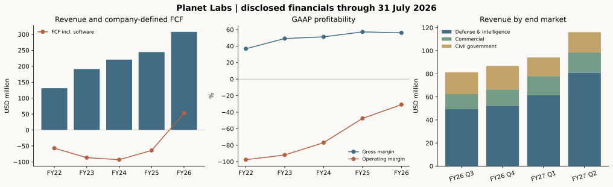

# Planet Labs PBC（PL）研究报告

> **研究日期／数据截止日：2026-11-25，北京时间。** 已用本机 date 核对日期。正式财务截至 FY2027 Q2（2026-07-31）；行情采用美东 2026-11-24 常规盘收盘。  
> **证券身份：** Planet Labs PBC，常见中文称“行星实验室”；NYSE:PL，A 类普通股，非 ADR。沿用既有 Planet Labs 目录及监控 ID：PL。  
> **价格与估值：** US$10.64；按 2026-08-27 最新可核披露总股数 363,847,989 股，估算市值 US$3.871B，保守本金及租赁口径 EV US$3.516B；TTM PS 10.23x、EV/S 9.30x、公司定义 FCF 收益率 0.51%。股数并非 11 月实时登记数。  
> **研究主线：** 日频地球档案和主权卫星能力已有客户验证；决定股东回报的下一步，是把项目、预付款与技术进展转成可持续的每股现金收益。

本报告用于学习研究，不构成投资建议。相对于 [9月8日报告](<Planet Labs-research-20260908.md>)，本篇保留历史文件，重新核对现金流、收入确认、股本及估值。新价带源于模型重建，不把方法修正描述成公司财务再次恶化。

---

## AI研究偏见自觉

**信息丰富度评级：A 级。** SEC、公司 IR、产品文档及客户公告充分；产品毛利、项目资本回报、AI 单独付费能力仍不充分。资料丰富带来的主要陷阱，是把“98% recurring ACV”、Google 合作和国防增长拼成已经验证的高利润软件平台。

- [x] 不将资料量当成投资确定性；财务事实与远期判断分列。
- [x] 不将 ACV 指标覆盖的业务当成集团全部收入。
- [x] 不将随时间确认收入等同订阅，也不将点时收入等同卫星服务。
- [x] 同时检验客户预付的融资优势与未来履约责任。
- [x] 不以股价较旧锚点下跌、或技术成功，直接推导便宜。

**AI研究局限性声明：** 本研究能核对集团财务、合同定义和已披露股数，不能独立检验在轨服务可用率、每颗卫星全寿命成本、项目毛利、客户 cohort、AI ARPU 或国防合同保密条款。情景概率、远期利润率、股数和价格区间均为研究假设。Macrotrends 部分页面访问受限且数据更新落后，本次未假称其验证了最新季度；关键数字以 SEC 与独立整理平台 StockAnalysis 交叉，冲突回到原始报表。

---

## 第一步：核心数据总览

### 最新财报仍是 Q2，Q3 尚未公布

FY2027 于 2027 年 1 月 31 日结束，不能与自然年混用。公司已 [正式公告](https://investors.planet.com/news/news-details/2026/Planet-to-Announce-Fiscal-Third-Quarter-2027-Results-on-Thursday-December-10-2026/default.aspx)：截至 10 月的 Q3 将于美东 **12 月 10 日盘后**发布，电话会为美东 17:00，即北京时间 **12 月 11 日 06:00**。截至本次截止日，不能使用尚未披露的 Q3 财务作为事实。

| 最新正式指标 | 数值 | 解读 |
|---|---:|---|
| Q2 收入（US$m） | 116.052 | 同比约 +58%，国防情报拉动明显 |
| Q2 毛利／毛利率 | US$65.632m／56.55% | 高增长尚未带来更高集团毛利率 |
| Q2 GAAP 营业利润／净利润（US$m） | -13.509／-9.353 | 经营层面仍亏损 |
| Q2 调整后 EBITDA（US$m，约） | 13.9 | 不等于扣完 SBC、卫星更新后的盈利 |
| 半年经营现金流／公司 FCF（US$m） | 68.388／21.297 | 现金质量需结合预付款观察 |
| recurring ACV／NDR | 98%／109% | 指标排除 Satellite Services 等业务，非集团收入续费率 |
| RPO／Backlog（US$m） | 753.117／814.863 | 分别低于年初 852.435／900.427 |
| FY2027 收入指引（US$m） | 430–441 | 仍为 9 月 3 日发布口径 |
| Q3 收入／Capex 指引（US$m） | 101–105／30–37 | 收入指引低于 Q2；不能外推单季 +58% |
| FY2027 Capex 指引（US$m） | 100–115 | 含资本化软件，投资需求真实存在 |

来源：[Q2 10-Q](https://www.sec.gov/Archives/edgar/data/1836833/000119312526382016/pl-20260731.htm)、[Q2 业绩公告](https://investors.planet.com/news/news-details/2026/Planet-Reports-Financial-Results-for-Second-Quarter-of-Fiscal-Year-2027/default.aspx)。公司只有一个经营／报告分部，未披露各产品或下列终端市场的单独毛利率。

### 收入结构与最近四季

单位：US$m。前三个客户类别是终端市场分类，不能视作三个会计分部。Q4 由全年减前九个月取得；季度现金流由累计值相减。

| 季度及结束日 | 总收入 | 国防情报 | 商业 | 民用政府 | GAAP 毛利率 | 公司 FCF |
|---|---:|---:|---:|---:|---:|---:|
| FY2026 Q3，2025-10-31 | 81.254 | 49.365 | 13.061 | 18.828 | 57.33% | 0.911 |
| FY2026 Q4，2026-01-31 | 86.822 | 52.311 | 14.135 | 20.376 | 54.17% | -2.336 |
| FY2027 Q1，2026-04-30 | 94.150 | 61.386 | 16.595 | 16.169 | 53.53% | -2.517 |
| **FY2027 Q2，2026-07-31** | **116.052** | **80.995** | **17.559** | **17.498** | **56.55%** | **23.814** |

本季 D&I 占收入约 69.8%，而商业收入仍只有 US$17.559m。前三大客户分别占 Q2 收入的 17%、11%、10%。这既体现大客户认可，也意味着少数验收和续签就能影响增长；不能从未披露的客户身份反推某个国家的精确占比。

来源：[FY2026 Q3 10-Q](https://www.sec.gov/Archives/edgar/data/1836833/000119312525314295/pl-20251031.htm)、[FY2026 10-K](https://www.sec.gov/Archives/edgar/data/1836833/000119312526119957/pl-20260131.htm)、[FY2027 Q1 10-Q](https://www.sec.gov/Archives/edgar/data/1836833/000119312526258304/pl-20260430.htm)、[FY2027 Q2 10-Q](https://www.sec.gov/Archives/edgar/data/1836833/000119312526382016/pl-20260731.htm)，与 [StockAnalysis 季度财务](https://stockanalysis.com/stocks/pl/financials/?p=quarterly)交叉。

### 五年盈利与再投资

单位：US$m。FCF 统一为 CFO 减购置 PP&E、再减资本化内部软件现金支出；不是调整后 FCF。

| 财年，1月31日止 | 收入 | 毛利率 | 营业利润率 | GAAP 净利润 | 公司 FCF | 现金及短投 |
|---|---:|---:|---:|---:|---:|---:|
| FY2022 | 131.209 | 36.75% | -97.59% | -137.124 | -57.142 | 490.762 |
| FY2023 | 191.256 | 49.15% | -91.85% | -161.966 | -86.693 | 408.760 |
| FY2024 | 220.696 | 51.18% | -76.91% | -140.509 | -93.121 | 298.907 |
| FY2025 | 244.352 | 57.18% | -47.52% | -123.196 | -63.993 | 222.075 |
| **FY2026** | **307.727** | **56.05%** | **-30.90%** | **-246.860** | **52.865** | **640.090** |

毛利率和经营费用吸收能力明显进步；净亏损受权证等公允价值变动影响，不能只用其扩大否定经营改善。研发费用从 FY2022 的 US$66.684m 增至 FY2026 的 US$106.749m，仍未证明新增研发能带来高资本回报。



来源：[FY2024 10-K，含 FY2022–2024](https://www.sec.gov/Archives/edgar/data/1836833/000183683324000037/pl-20240131.htm)、[FY2023 10-K，历史现金](https://www.sec.gov/Archives/edgar/data/1836833/000183683323000014/pl-20230131.htm)、[FY2026 10-K](https://www.sec.gov/Archives/edgar/data/1836833/000119312526119957/pl-20260131.htm)、[StockAnalysis](https://stockanalysis.com/stocks/pl/financials/)。图与表使用同一组原值。

### 自由现金流：本次最重要的口径修正

| TTM 至 2026-07-31，US$m | 数值 |
|---|---:|
| 经营现金流 CFO | 117.630 |
| 减：购置 PP&E | 92.960 |
| 第三方简化 FCF | 24.670 |
| 再减：资本化内部软件 | 4.798 |
| **公司定义 FCF** | **19.872** |
| 同期递延收入现金流变动 | +122.324 |
| 同期计入损益的 SBC | 62.518 |

旧报告明确使用简化 FCF，并非原始取数错误；本篇改用完整公司口径。FY2026 同样从简化 US$57.648m 桥接为 US$52.865m。不能直接拿公司 FCF 和第三方简化 FCF 比较后说其中一方数据错误。

半年 CFO US$68.388m 中，递延收入增加贡献 US$47.083m、应收减少贡献 US$23.946m。半年 FCF US$21.297m 机械扣去递延变化后为 **-US$25.786m**。这只是预付款依赖的敏感性，不是“真实 FCF”：持续预付可成为商业模式优势，但需要交付，不能把整笔现金当可永久分派利润。TTM FCF 减计入损益 SBC 的经济敏感性为 -US$42.646m，也不等于 GAAP 现金流；估值中不再叠加这一扣减与全额稀释折价。

来源：[SEC 现金流量表](https://www.sec.gov/Archives/edgar/data/1836833/000119312526382016/pl-20260731.htm)、[FY2026 10-K](https://www.sec.gov/Archives/edgar/data/1836833/000119312526119957/pl-20260131.htm)、[StockAnalysis 现金流](https://stockanalysis.com/stocks/pl/financials/cash-flow-statement/)。

> **段永平式追问：** 钱从哪里来，又要付给谁？——增长已可核验；现金有多少来自股东经济利润、多少来自预付款与融资，需要继续拆开。

---

## 第二步：生意本质分析

**一句话定义：政府和企业为持续发现地球变化付费，Planet 将同一套轨道采集和历史档案多次出售，并为主权客户提供专用卫星能力。**

| 收费层 | 付费原因与重复性 | 资产／成本 | 决定利润的变量 |
|---|---|---|---|
| PlanetScope 广域监测 | 近每日、多光谱时序，适合农业、土地、基础设施变化 | SuperDove 星座更新、地面处理、云 | 影像复用、订阅留存及价格 |
| SkySat／Pelican 高分任务 | 对特定地点更清晰、更及时的观测与专用容量 | 高分卫星、发射、排程与交付 | 可用容量、利用率、保证时延的溢价 |
| PIP／分析与 AI | 把影像变成检测、提示和业务工作流 | 研发、模型、云、集成支持 | 客户是否为新增决策价值额外付费 |
| Satellite Services | 客户取得卫星、地站、工程、运维或专用访问能力 | 制造、库存、验收、营运资本 | 全合同毛利、收款与履约、保留数据权价值 |

核心数据订阅能“一次采集、多次出售”；卫星服务既可能带来低回报工程，也可能借助客户预付和客户拥有资产降低 Planet 自有资本投入，并保留部分影像许可权供复用。需要核对每个合同的全寿命回报，不能预设所有硬件业务都差。

收入确认尤其容易误读。Q2 随时间确认 US$101.977m、点时确认 US$14.075m，但某些卫星项目按 cost-to-cost 随时间确认，存档影像也可能点时确认。因此两类金额都不能直接代替订阅或卫星服务收入。某些影像许可权还是非现金对价，已确认收入也未必等量变成当期现金。[10-Q 收入确认政策与合同附注](https://www.sec.gov/Archives/edgar/data/1836833/000119312526382016/pl-20260731.htm)

研发并不全转化成收入。Google Suncatcher 协议按 ASC 730-20 将研发资助冲减研发费用，半年认列资助和对应成本各约 US$4.8m；截至 7 月累计收款 US$9.5m。这项合作验证技术能力，尚不证明轨道 AI 算力已形成订阅收入。[Google 官方原型进展](https://blog.google/innovation-and-ai/models-and-research/google-research/project-suncatcher-prototype/)、[10-Q 研发安排](https://www.sec.gov/Archives/edgar/data/1836833/000119312526382016/pl-20260731.htm)

商业模式最关键的三个变量是：数据和任务容量能否提高复用；卫星服务合同能否覆盖全部制造及履约成本；收入和现金能否跑赢每股稀释。Capex／收入下降本身不够，因为客户拥有卫星的成本可能进入存货和 COGS，而非 Planet 的 PP&E。

> **段永平式追问：** 这门生意好在哪？——难以重建的连续档案可以重复收费；但能否把它做成持续高资本回报的生意，还要看合同和每股现金。

---

## 第三步：护城河评估

| 类型 | 强度判断 | 已有证据 | 可以推翻判断的信号 |
|---|---|---|---|
| 品牌／定价权 | 中弱 | 政府客户选择、任务可靠性有信誉价值 | 降价续约、ARPU 不升；未披露可核提价实绩 |
| 转换成本 | 中 | API、模型、时序基线及政府工作流嵌入 | 客户易于多源替换，NDR 回落 |
| 网络效应 | 弱 | 更大客户基础可分摊采集与研发成本 | 不是用户增加就自动提高产品质量的双边网络 |
| 规模／历史资产 | 中强 | 持续广域采集、历史不能补拍、运营学习曲线 | 免费数据加 AI 满足大多数需求，采集成本优势被复制 |
| 技术／制造 | 中 | 多星座在轨执行、Pelican 与欧洲制造 | 分辨率、可用性、交付和成本持续落后 |
| 合规／主权本地化 | 中 | 德国客户与柏林制造有采购意义 | 竞争者同样本地化或采购规则变化 |

过去五年，规模和工程能力在增强，毛利率较早期显著改善；未来五年的增量护城河要从“更多数据”发展为“可靠、可解释、嵌入决策的服务”。单靠高分辨率不足以锁定利润，云、夜间、天气与交付时效也会决定采购。

最近可核的技术进展是 [Pelican-12 首光](https://investors.planet.com/news/news-details/2026/Planet-Releases-First-Light-from-Pelican-12/default.aspx)。它仍在校准，初期提供 50cm 级影像，设计为降轨后实现 30cm 级。将其写成全部星座已经成熟供应 30cm，会提前兑现尚待验证的能力。[德国 BKG 的客户公告](https://bkg.bund.de/aktuelles/acht-satelliten-fuer-aktuelle-lagebilder-aus-deutschland)则独立证明专用容量对真实业务有用。

> **巴菲特式追问：** 十年后什么还在，什么会被复制？——历史时序和运行经验较难复制；新卫星参数、AI 界面和主权采购渠道都可能被竞争者追上。

---

## 第四步：逆向思考与风险清单

最强空方论点是：国防需求确实增长，但收入确认、预收款和调整后利润先改善，每股可持续现金未必同步；当前价格仍为这种转化支付较高倍数。10 月的 [公开空方研究](https://research.shawarmacapital.net/p/pl-the-quarter-that-borrowed-from)也质疑订单消耗与现金前置。这里采用的事实回到 SEC 核对，不把空方判断当成已证实的会计问题。

| 失败路径 | 主观可能性 | 影响 | 可观察预警 |
|---|---|---|---|
| 项目增长无法转成稳定复购 | 中高 | 高 | RPO 补充弱、商业收入停滞、续约变差 |
| 制造／验收成本吞掉毛利 | 中 | 高 | 累计成本上调、库存和合同资产堆积、现金流落后 |
| 客户预付款消退 | 中高 | 高 | 递延收入反转，FCF 连续为负而交付投入上升 |
| 稀释超过每股价值增长 | 高 | 高 | ATM、股权激励或转股后每股增长明显落后集团增长 |
| 高分、SAR 或免费数据压价 | 中 | 中高 | 同客户多源采购、定价降、工作流可替换 |
| 发射／在轨或网络安全事故 | 低至中 | 高 | 服务中断、补星支出、客户索赔 |
| 政府撤单、出口禁令 | 中；极端禁令低概率 | 高至极高 | 取消、未拨款预算、许可证限制 |
| 生存性融资失败 | 低但非零，未量化 | 极高 | 现金与履约责任错配、低价增发或债务重组 |

这些概率描述是研究判断，不是统计频率，也不相加。三情景的 30%／50%／20% 为主观权重；悲观情景仍假设存续，**没有覆盖全面星座损毁、破产归零或全面出口禁令**，不能称完整尾部风险模型。

历史类比宜看机制：技术和资本开支驱动的网络，可以创造长期基础设施，也可以因建设先于付费需求而损害原股东。数据平台的重复售卖与防务承包的固定价交付同时存在；把它类比成纯 SaaS 或天然垄断，都会遗漏一半经济性。

最可能的分析错误有两个方向：高估“AI＋太空”能带来的收费权；或因为产品毛利未披露，就低估客户出资、数据权保留与运维的协同。下一次财报要用收款、成本与续约辨别两者。

> **芒格式追问：** 聪明人为什么不买？——不是因为需求不真实，而是暂时无法判断原股东能以多大成本分享增长，且当前估值还要求成功兑现。

---

## 第五步：管理层评估

Will Marshall 与 Robbie Schingler 的优势是长期航天工程和客户执行经验。判断“对的人”还要看他们把技术成功转成每股回报的能力。[2026 Proxy](https://www.sec.gov/Archives/edgar/data/1836833/000119312526241945/pl-20260527.htm)

| 时间／决策 | 可核结果 | 评价 |
|---|---|---|
| FY2024–2026 费用与组织调整 | 营业亏损率收窄，仍未 GAAP 经营盈利 | 成本纪律改善，不能只用调整后指标结案 |
| 2023 Sinergise、2025 Bedrock 整合分析能力 | 下游平台与 AI 能力补充，未单列并购回报 | 战略合理，ROIC 未证 |
| 2025 可转债融资 | 本金 US$460m，0.50%票息，2030-10-15 到期 | 低息换时间，代价是到期义务或稀释 |
| 2026 ATM | Q2 出售 3,782,460 股；半年现金流列净流入 US$120.386m | 高价融资有利公司安全，但原股东份额下降 |
| 2026 柏林制造 | 本地化制造与主权客户结合 | 执行方向可取，产能规划不等于已实现产出和订单 |

### 经济权益与控制权必须分开

按 2026-05-15 同一记录日的已发行股份及 Proxy 注释重算，两位创始人已发行 A/B 股的经济权益合计约 **6.92%**，投票权约 **58.68%**。Class A 每股 1 票、B 每股 20 票。计算只计已发行权益，未将期权、未归属 RSU 或 B 类可转换受益权益重复加入。它不是 11 月实时持仓；10-Q 风险段约称 62%与该日重构口径不同，不能静默混用。

FY2026 Marshall 总薪酬约 US$4.626m，其中股权奖励约 US$4.176m；年度奖金使用收入及调整后 EBITDA。关注点是这些目标能否同步转成每股现金，而非对股权激励一概否定。[Proxy 薪酬与受益所有权表](https://www.sec.gov/Archives/edgar/data/1836833/000119312526241945/pl-20260527.htm)

最近 Form 4 也不能只看“减少股数”：Marshall 9 月的 F 类税扣、G 类赠与，以及 Schingler 11 月赠与，都不是市场出售。Schingler 9 月 17 日出售 52,240 股、Johnson 同日出售 55,663 股，披露依据既有 10b5-1 计划；单独不能证明其预判坏消息。[Marshall 税扣](https://www.sec.gov/Archives/edgar/data/1836833/000119312526394792/ownership.xml)、[Schingler 出售](https://www.sec.gov/Archives/edgar/data/1836833/000119312526394651/ownership.xml)、[Johnson 出售](https://www.sec.gov/Archives/edgar/data/1836833/000119312526394658/ownership.xml)、[Schingler 赠与](https://www.sec.gov/Archives/edgar/data/1836833/000119312526451910/ownership.xml)

组织能力正在从创始人技术驱动扩展到制造、成本控制和政府交付系统；目前没有充分证据证明 CEO 退出后，公司仍可保持同等客户及资本配置能力。

> **段永平式追问：** 如果 CEO 退休，竞争力能否延续？——数据和工程体系能保留，但客户关系、战略与控制权仍集中，继任风险需要折进仓位。

---

## 第六步：行业与文明趋势

地球观测从“事后买图”发展到“持续监测—识别变化—发出任务—辅助决策”，属于长期数字基础设施演进。AI 可以降低使用门槛，主权与国防可以扩大预算；价值最终仍要由付费、利用率和交付成本决定。

| 9月8日后新增证据 | 已证明什么 | 尚未证明什么 |
|---|---|---|
| [9/15 德国民用合同](https://investors.planet.com/news/news-details/2026/Planet-Awarded-Landmark-German-Federal-Contract-for-Exclusive-Access-to-Dedicated-Satellite-Constellation/default.aspx) | 专用容量及平台获政府采用 | 最高 €25m／5年含期权，非确定收入；公司称不改变全年指引 |
| [10/1 Google、Tanager-2、SuperDove 发射](https://investors.planet.com/news/news-details/2026/Planet-Launches-Suncatcher-Tanager-2-and-18-SuperDove-Satellites/default.aspx) | 技术与发射执行能力 | 轨道计算的规模商业回报 |
| [10/13 ESA 斯洛文尼亚节点](https://investors.planet.com/news/news-details/2026/Planet-Selected-by-European-Space-Agency-to-Build-Slovenias-Space-Resilience-Node/default.aspx) | 自动监测与任务工作流获选择 | 12个月原型不等于长期量产订单，金额未披露 |
| [10/21 NASA Tanager 评估](https://investors.planet.com/news/news-details/2026/Planet-Awarded-NASA-Commercial-Satellite-Data-Acquisition-CSDA-Evaluation-Task-Order-for-Tanager-Hyperspectral-Data/default.aspx) | 科学质量评估开始 | 不是已完成大规模永久采购 |
| [11/9 Stoke 发射协议](https://investors.planet.com/news/news-details/2026/Planet-and-Stoke-Space-Sign-Multi-Launch-Agreement-for-Nova-Launch-Capabilities/default.aspx) | 潜在排程及供应商选择增加 | Nova 轨道演示计划始于2027，当前成本优势未证 |
| [11/24 欧洲 D&I 扩约，公司原发转载](https://markets.chroniclejournal.com/thepilotnews/article/bizwire-2026-11-24-planet-awarded-contract-expansion-with-european-defense-and-intelligence-customer) | 既有客户扩大监测与高分任务使用 | 新增金额与期限未披露，原合同七位数不能冒充扩约金额 |

最后一项公司官网正文及 Business Wire 原链抓取不稳定，使用署名公司、经 Business Wire 分发的全文转载；其金额判断置信度低于 SEC 已披露合同，未加入收入预测。

### 趋势属于行业，利润需要竞争

| 对手／替代 | 竞争机制 | 对 Planet 的约束 |
|---|---|---|
| BlackSky | 高分任务、AI 情报和主权能力 | 官方 Q3 已有实际服务收入与 Gen-3 运行，不能把高分市场视作 PL 独占 |
| Airbus 等光学供应商 | 高分、专业客户和分销渠道 | 保证交付、价格及客户关系也决定份额 |
| ICEYE 等 SAR | 夜间和穿云 | 光学不具全气候替代性 |
| 免费 Copernicus／Landsat | 降低基础观测成本 | PL 要靠频率、清晰度、时延及工作流证明溢价 |

[BlackSky 2026 Q3 官方结果](https://blacksky.com/press-releases/blacksky-reports-third-quarter-2026-results/)报告总收入约 US$42.8m，其中空间情报及 AI 服务约 US$32.7m。其联合体十亿美元投资标题不能视作 BlackSky 自身已签订单。免费数据的能力边界参见 [ESA Sentinel-2](https://www.esa.int/Applications/Observing_the_Earth/Copernicus/Sentinel-2/Facts_and_figures)；雷达能力参见 [ICEYE](https://www.iceye.com/company)。

没有足够一致、可与本公司收入定义对接的一手全球 TAM 和市场份额数据，本报告不填精确份额或行业 CAGR。可核验的增长路径是既有客户扩容、主权系统、下游分析；不能把国防总预算、轨道计算总投资或合同上限相加当 TAM。发射供应商、芯片和地面云仍构成外部依赖，未披露其完整采购集中占比。

> **李录式追问：** 二十年后谁获得超额利润？——需求长期存在的判断较强，利润是否留给数据所有者、制造商或下游决策平台，仍待商业结果回答。

---

## 第七步：估值与安全边际

### 当前价格买到了什么

[官方 IR 行情](https://investors.planet.com/stock-info/default.aspx)与 [StockAnalysis 历史表](https://stockanalysis.com/stocks/pl/history/)同为 11 月 24 日收盘 US$10.64。以下估值将该价格与 8 月 27 日最新披露总股数、7 月 31 日财务组合，是可核快照估算，不能叫实时法定市值。

| 估值字段 | 复算值 | 口径 |
|---|---:|---|
| 总股数 | 363,847,989 | A 340,354,193＋B 23,493,796，非加权平均 EPS 股数 |
| 市值（US$m） | 3,871.343 | 价格乘上述总股数；第三方约3.87B |
| 现金／短投（US$m） | 415.130／450.288 | 不含受限现金 |
| 可转债本金／账面值（US$m） | 460.000／448.255 | 本篇偿债桥采用本金 |
| 租赁负债（US$m） | 50.368 | 与非租赁债务分开列示 |
| 本金及租赁口径净现金（US$m） | 355.050 | 非全部可分派的多余现金 |
| 同口径 EV（US$m） | 3,516.293 | 市值减上行净现金 |
| 账面债务口径净现金／EV（US$m） | 366.795／3,504.548 | 解释与第三方EV约3.50B的差异 |
| TTM 收入（US$m） | 378.278 | 最新四季合计 |
| PS／本金口径 EV/S | 10.23x／9.30x | 仍依赖未来利润跃迁 |
| FY2027 指引中值口径 EV/S | 8.07x | 中值435.5m，不是已实现收入 |
| 公司口径 P/FCF／FCF收益率 | 194.81x／0.51% | 采用FCF19.872m |
| PB | 6.86x | 对数据与工程能力的解释有限 |
| PE／PEG | 不适用 | TTM仍亏损 |

股本、现金、债务来源：[10-Q](https://www.sec.gov/Archives/edgar/data/1836833/000119312526382016/pl-20260731.htm)、[StockAnalysis statistics](https://stockanalysis.com/stocks/pl/statistics/)。最新登记之后的 ATM／激励交割总数存在缺口；可转债、期权、RSU 和 earn-out 不能因 GAAP 亏损下反稀释排除，就当作不存在。

历史对比上，9 月旧报告锚点 US$18.12 至本次收盘下跌 **41.28%**；旧报告 PS17.43x 降为10.23x，价格回落已降低估值，但并未自动把高增长兑现风险消除。这是两次明示快照对比，不是完整历史估值分位，也不作为买入依据。

同业对照采用同一美东11/24行情快照：

| 同业估值，US$m | Planet Labs | BlackSky |
|---|---:|---:|
| 估算市值 | 3871.343 | 679.353 |
| EV，账面债务及租赁口径 | 3504.548 | 696.800 |
| TTM收入 | 378.278 | 132.148 |
| EV/S | 9.26x | 5.27x |

[BlackSky statistics](https://stockanalysis.com/stocks/bksy/statistics/)与[其Q3官方披露](https://blacksky.com/press-releases/blacksky-reports-third-quarter-2026-results/)交叉；BKSY股数为11/2披露41,398,708股，财务截至9/30，比PL财务更新。其11/24宣布[EpochGeo收购](https://blacksky.com/press-releases/blacksky-acquires-epochgeo-to-expand-real-time-intelligence-capabilities-with-ai-enabled-rf-signals-and-multi-source-analytics/)，对价未披露，静态EV未含交易全貌。BKSY收入成本排除单列折旧摊销，不能拿其约79%的表面毛利直接比较PL含折旧口径。PL的倍数溢价需要以更大档案、更强复用和更好每股回报兑现，不能仅靠公司规模证明合理。

### 反向 DCF：市场仍要求怎样的兑现

为便于理解，先做不含前十年中期现金流的终值敏感性：USD r=10%、永续 g=3%、第十年 FCFF margin=20%，今日 EV US$3,516.293m 要求第十年 FCFF 约 **US$619.830m**、收入约 **US$3,099.151m**。相对 FY2027 指引中值，十年收入 CAGR 约 **21.68%**。

公式为 EV×(1+r)^10×(r−g)／(1+g)，再除终值现金利润率。加入前期现金可降低所需终值；稀释、额外融资和履约资本会影响每股结果。这不是断言市场恰好预测21.68%，而是说明现价仍需要长期增长和很高的现金转化。

### 三年三情景：从经营成果到每股价值

公司亏损，不能把负 GAAP EPS 复合后乘 PE。这里使用项目与数据混合业务的收入—税后经营利润（NOPAT）—企业价值—净现金—未来股数桥，全部用 financial_rigor 的十进制引擎计算。FY2027 指引中值 US$435.5m 为起点；FY2030 近似按三年估值，忽略与本日之间少量日历差异。

| 三年模型，均为研究假设 | 悲观 | 基准 | 乐观 |
|---|---:|---:|---:|
| 收入 CAGR | +12% | +23% | +35% |
| FY2030 收入（US$m） | 611.846 | 810.408 | 1,071.493 |
| 税后经营利润率 | 0% | 12% | 18% |
| 税后经营利润（US$m） | 0 | 97.249 | 192.869 |
| 企业价值计价 | EV/S 1x | EV/NOPAT 25x | EV/NOPAT 35x |
| 期末净现金（US$m） | 100 | 250 | 815 |
| 未来股数（百万股） | 410 | 400 | 438.4886 |
| **三年后每股价值（US$）** | **1.74** | **6.70** | **17.25** |
| **以10%折现的今日值（US$）** | **1.30** | **5.04** | **12.96** |
| 从10.64至终点的年化价格回报 | -45.35% | -14.27% | +17.48% |

25x／35x是三年相对估值的研究判断，**不是当前 PE，也不是十年永续终值 PE**。考虑后续成长才给较高倍数；它们没有客观唯一值。悲观1x收入也是存续下的残值判断，非清算保底。三情景不存在保本承诺。

利润率假设已计员工经济成本、正常税负与常态折旧；基准要从当前营业亏损进展到12%税后率，要求毛利率改善并让销售研发等费用增长慢于收入，已相当积极。NOPAT不是可全部分派的FCF，三年倍数仍隐含再投资能够创造价值，需以完整现金模型交叉。

股数与净现金联动：悲观、基准假设转债保留并已预留本金；乐观含约38.4886m潜在转股，净现金815m约为当前355.05m加释放460m债务，取整并保留少量净消耗，**没有新增460m现金流入**。capped call 不另给价值，未来ATM也不预加筹资收益。股数是情景值，不是管理层承诺。

主观权重30%／50%／20%对应今日值均值 **US$5.50**，不是可观测的“市场期望价值”。基准经营成果若只给15x、25x、35x经营利润倍数，加同一净现金和股数、再折现，今日值分别为3.21／5.04／6.86美元；价格对倍数同样敏感，不能只选乐观格定价。

### 十年折现：仓位压力测试

本段单独回答仓位能否加重，不能独自裁决买入、持有或回避。

- **r=10%，USD。** 11/24美国10年国债收益率4.91%，加研究设定ERP5.09%、β=1。依据 [美国财政部](https://home.treasury.gov/resource-center/data-chart-center/interest-rates/TextView?field_tdr_date_value_month=202611&type=daily_treasury_yield_curve)。ERP是要求回报的判断，不是观察数据；没有把撤单、事故或出口风险加进β或r。
- **稳态增量ROIC=18%。** 公司当前亏损，不能用存量ROIC外推；18%意味着数据复用取得较好资本效率、又受卫星更新约束，是待验证判断，置信度低。
- **g=1%／3%／4%。** 均为终值年之后的美元永续增长，基准不超过4%上限；不随r改变。基准r−g分别9／7／6个百分点。
- 工具称为“终值PE”的倍数严格来自 `(1−g/ROIC)/(r−g)`，即10.4938x／11.9048x／12.9630x，不借同行今天的价格作为来源。本模型的利润明确为剔除现金投资收益与融资利息、已计员工经济成本的税后经营利润NOPAT；因此该倍数经济上是经营EV／NOPAT，所得不含金融现金，可另加净现金，不能与含利息的集团GAAP净利润乘PE混用。

| 十年情景，主观权重30%／50%／20% | 悲观 | 基准 | 乐观 |
|---|---:|---:|---:|
| 十年收入 CAGR | +8% | +20% | +30% |
| 第十年收入（US$m） | 940.212 | 2,696.501 | 6,003.737 |
| 终值税后经营利润率（NOPAT） | 5% | 15% | 22% |
| 第十年NOPAT（US$m） | 47.011 | 404.475 | 1,320.822 |
| 终值股数（百万股） | 500 | 461.5114 | 520 |
| 终值倍数（工具PE字段，EV/NOPAT） | 10.4938x | 11.9048x | 12.9630x |
| 工具端点IRR，未计中期现金或余款 | -21.16% | -0.20% | +11.96% |
| 现金留存补充模型终值净现金（US$m） | 355.952 | 1,517.888 | 3,832.468 |
| 含现金留存后的十年IRR | -16.76% | +2.58% | +14.24% |

terminal_value 的利润输入使用“公司终值NOPAT×今日股数／终值股数”，再与今日市值比较，k=0，避免重复扣稀释。端点IRR是简化压力指标，不是完整现金流回报；它的情景加权均值为 **-4.06%**，也不是概率加权终值财富的CAGR。

为处理工具未计中期现金的问题，补充模型将每年FCF全部留存至终点、不计现金利息，并加入期初本金及租赁口径净现金355.05m；悲观与基准均假设2030到期以现金偿还可转债、预留本金不再释放；基准未来股数相应从含转股的500m降为461.5114m。乐观明确假设2030到期前转股条件实现，包含转股股份并释放预留本金460m，不能用2036终值股价证明2030能转股。乐观若改为现金偿还，终值股数481.5114m、净现金3372.468m，含现金IRR约14.87%，方向不变。十年FCF margin路径分别为：悲观 -10／-8／-5／-2／0／1／2／3／4／5%；基准 -5／0／2／4／6／8／10／11／12／12.5%；乐观 -3／0／3／6／8／10／12／14／16／17.1111%。这些是扣现金再投资后的假设，不是公司指引；不再把同一笔FCF作为年度分红重复计算。终值经营价值不含其现金，故再加净现金。

补充模型的情景加权IRR均值约 **-0.89%**。未来份额与资本需求仍需重新核实；两套模型均不能证明投资收益确定为负，更不能单独否决持有。它们共同说明，按这些假设尚不支持把它配成核心仓位。

### r敏感性与翻转检查

| r | 工具端点情景IRR均值 | 含现金留存均值 | 相对IRR≥r的压力判定 |
|---|---:|---:|---|
| 8% | -0.82% | +1.67% | 未通过；USD区间外，仅供参考；乐观档r−g=4pp仅作情景 |
| 9% | -2.59% | +0.25% | 未通过；合理区间内 |
| **10%** | **-4.06%** | **-0.89%** | **未通过；合理区间内** |
| 11% | -5.31% | -1.83% | 未通过；合理区间内 |
| 12% | -6.40% | -2.63% | 未通过；USD区间外，仅供参考 |

已运行±2pp，因两侧均超出USD合理区间9%–11.5%，又运行±1pp。**在合理区间的9%／10%／11%复核中，仓位压力测试不随r翻转。**区间外结果不能拿来论证买入；8%档还存在终值分母不足5个百分点。所有r档位保留同一到期处置假设，不按2036终值股价事后选择2030是否转股。它们只限制仓位，不是六维决策中的唯一否决票。

### 估值分歧对账与旧价带接续

三年和十年本次方向一致：三年基准今日值低于现价；十年压力限制加重仓位。需要对账的是旧报告6–9美元研究带与本篇4–5美元研究带：旧篇主要列三年未来价、使用较弱的股数／现金流桥，本篇明确折现到今日并联动未来股数、债务和现金，不能机械沿用旧带。9月后的合同与技术进展总体偏正面，价格下调**主要是估值方法及安全边际的修正**。

4–5美元是进入重新核验的区间，经营证据未改善时不会自动触发买入。上沿接近三年基准今日值，只有两次正式披露连续改善、足以支持或上修假设时才讨论首笔；越接近上沿，对证据要求越高。十年未覆盖r仅把潜在总仓限制在研究性小仓，并未独自将本来可买的生意改判回避。

与机会成本相比，继续等待下一次现金和项目毛利证据有价值；目前没有证据支持为“可能成为基础设施”放弃价格纪律。

> **巴菲特式追问：** r错2个百分点会改变判断吗？——合理区间内压力判定未翻转；最大变量仍是利润率、股数和交付经济性。  
> **段永平式追问：** 股市关闭五年，愿以10.64持有吗？——对没有一手项目经济信息的新投资者，尚无足够理解支持；现有小仓者可按红线复检。

---

## 第八步：最终决策与行动清单

| 六个并列维度 | 综合判断 | 信心度 |
|---|---|---|
| 生意质量（段永平） | 数据复用有价值，项目与订阅混合，稳态股东现金未证 | 中 |
| 护城河（巴菲特） | 历史时序和运营强于网络效应与提价证据 | 中 |
| 管理层（段永平＋巴菲特） | 航天执行与融资能力强，少数经济权益控制、激励及稀释需约束 | 中高 |
| 最大风险（芒格） | 把预付／工程增长误作高质量每股利润，价格承担兑现风险 | 中高 |
| 文明趋势（李录） | 持续监测与主权需求获验证，利润池归属仍竞争 | 中高 |
| 估值（巴菲特＋段永平） | 三年基准今日值5.04美元、均值5.50低于现价；十年压力只限仓，合理r内不翻转 | 模型算术高，假设低至中 |

**最终结论：空仓者观望新增；已有合理小仓者有条件持有、暂停加仓。**依据是经营／现金质量、竞争与控制权、三年价格缺乏安全边际共同作用。估值维度不是唯一裁决，十年压力测试没有单独否决其他五个维度。

| 策略 | 可执行的研究动作 |
|---|---|
| 空仓者 | 10.64美元不新增。4–5美元且下述经营、股数门槛通过才研究首笔总权益约0.25%–0.5%，参考总上限1%；非自动交易指令 |
| 持仓者 | 能承受重大损失的合理小仓可持有至复检；暂停摊低。若明显超出1%参考风险预算，复核并考虑降至可承受规模；没有用户成本和组合信息，不替其下交易指令 |
| 加仓／首次买入门槛 | 连续两次正式季度披露商业及D&I收入仍增长、NDR≥100%、无重大撤单；滚动完整FCF为正且剔递延收入变化的敏感性改善；项目回款／毛利可解释、库存及履约资金可核；最新AB总股数、潜在转股及ATM完整可核、每股价值不被稀释吞掉 |
| 跌破4美元 | 先核撤单、现金、融资及永久损失；不因更便宜自动增加仓位 |
| 估值警戒 | ≥18美元且项目现金、利润与每股模型未增强，不追高并复核超配；不是自动卖出线，也不把本模型乐观价直接当卖点 |
| 退出／卖出信号 | 重要客户取消且无法补充、成本估计持续恶化、非暂时性数据／出口限制、融资导致每股价值受永久损害；是否退出以新增一手证据判断 |
| 下一正式复检 | 北京时间2026-12-11财报与电话会后；核Q3收入101–105m指引兑现、项目／非现金收入、RPO、完整FCF、客户预付、股数及转债 |
| 后续研究检查 | 2027-01-31核柏林生产、Pelican校准／交付与资金（自定研究日期，非预约财报日）；2027-03-31核全年披露安排（非确认业绩日，若提前披露则提前核） |

### 四位大师原话与本文的应用

以下均为可核验原话后的研究者延伸，不是四人对Planet Labs的公开评价，也不模拟其实际买卖决定。

- **巴菲特原话：** “You can, of course, pay too much for even the best of businesses.” [1996股东信](https://www.berkshirehathaway.com/letters/1996.html)。本文应用：卫星与数据有价值，仍要分开核算企业优势和买入价格。
- **芒格原话：** “Getting the incentives right is a very, very important lesson.” [USC演讲转载，Ivey存档PDF第61页](https://www.ivey.uwo.ca/media/2975916/the-best-of-charlie-munger-1994-2011.pdf)。本文应用：把收入／调整后EBITDA的薪酬目标，与每股现金和股数一起检查。
- **段永平原话：** “不懂不做，不要跟消息走，跟着理解走。” [2011-10-07雪球原帖](https://xueqiu.com/1247347556/20416338)，本仓库 [全量原发言第163条](../段永平/段永平雪球全量原发言.md)已读取，原语境为Yahoo。本文应用：先理解项目收款、成本与份额，再解释新合同和技术标题。
- **李录原话：** “The most important concept of a circle of competence is knowing the edge of it” [哥大2026-10-05官方实录，第3页](https://business.columbia.edu/sites/default/files-efs/imce-uploads/36th%20Annual%20Graham%20%26%20Dodd%20Luncheon%20Transcript%20%2820261005%29%20CBS.pdf)。本文应用：行业长期发展较可见，不等于自己已能预测该公司的增量资本回报。

---

## AI分析置信度 vs 投资确定性

**AI分析置信度：财务事实高、现金质量解释中高、竞争与管理层判断中、估值输入低至中。投资确定性：偏低。**前者来自SEC、客户与公司原始材料及工具核验；后者取决于尚未充分披露的产品毛利、履约回报、续约和原股东份额。

充分证据支持的是：收入和执行能力进步；集团仍有经营亏损；现金转正受到预付支持；稀释不能忽略。有限信息推理的是：未来12%–22%利润率、项目现金路径、未来股数及任何具体研究价带。

优先需要一手验证的问题是：主权项目全寿命毛利与现金回报；影像权非现金对价的可变现性；客户预付能否持续且覆盖剩余履约；AI附加收费和留存提升；最新完全稀释股数。全面出口禁令、系统性星座毁损和破产归零未做可量化概率定价，三档结果不是损失下限。

## 数据来源与审计记录

### 关键数据交叉验证记录

| 字段，US$m除注明 | SEC／公司 | 独立整理来源 | 结论 |
|---|---:|---:|---|
| 收盘价，US$ | IR10.64 | StockAnalysis10.64 | 一致 |
| 总股数，股，8/27披露 | 363847989 | StockAnalysis363850000（取整） | 一致；非11月实时登记 |
| FY2026收入 | 307.727 | StockAnalysis307.730；Macrotrends约308 | 偏差≤0.1% |
| FY2026净利润 | -246.860 | StockAnalysis-246.860 | 一致 |
| 7/31现金及短投 | 865.418 | StockAnalysis865.418 | 一致 |
| TTM CFO | 117.630 | StockAnalysis117.630 | 一致 |
| TTM完整FCF | 19.872 | 第三方简化24.670减SEC软件4.798 | 口径桥接一致；软件项依赖SEC，非完全独立验证 |
| FY2026营业亏损 | -95.073 | StockAnalysis-83.400 | 差异超过1%，采用SEC；Macrotrends约-95支持原报表 |

StockAnalysis标准化毛利及营业利润与GAAP存在重分类差异，未完成逐科目重分类桥，故不采用其营业利润。Macrotrends本次索引能读取部分历史取整数，最新季度和净利页面访问有缺口；不把不可读数据当交叉验证。研发、细分类收入、持股和合同条款主要依赖一手披露，独立颗粒度验证有限。

程序记录见 [财务验证输出](assets-20261125/financial-validation.txt)、[十年工具输出](assets-20261125/terminal-validation.txt)、[模型输入与全精度结果](assets-20261125/model.json)。亏损公司的主三情景用financial_rigor十进制引擎建立经营桥；附加three-scenario仅以预测年每股NOPAT、零外推年数验算倍数敏感性，工具字段名EPS／PE不代表当期GAAP指标。

### 工具原始输出节选

以下为财务验证输出原文节选；报告采用1%交叉容差。

```text
市值验算 (Market Cap Verification)

交叉验证: FY2026_revenue (Cross-Validation)

交叉验证: FY2026_net_income (Cross-Validation)

交叉验证: cash_plus_STI_20260731 (Cross-Validation)
```

### 最终准出与跟踪

以固定随机种子20261125抽取15%，提取器返回29项；其中2项误把Q2／Q3编号当作数值，留存排除记录，并以另一个固定种子从财务字段补抽2项。最终29项核对通过，零警告／零失败。其中10项为跨来源事实核对，3项细项主要依赖原始披露，4项为公司指引，1项为口径桥，1项为日历；7项为模型算术，2项为模型假设转录，1项为策略门槛核对。**算术／转录准出不等于预测获证实，也不代表所有颗粒度数据都有两个独立来源。**抽检来源缺口已逐项标记，不把同一公司两份文件称为独立验证。

[抽检结果与来源](assets-20261125/audit-results.json)、[判决原始输出](assets-20261125/audit-verdict.txt)、[误识别及补抽记录](assets-20261125/audit-exclusions.json)。最终终值参数已重跑 [C1/C2/C3 audit](assets-20261125/terminal-audit.txt)，通过；三项未建模尾部风险已披露。模型、全文与图表使用同一组定稿参数。

自动跟踪：沿用PL标的ID及原目录，新增20261125-PL建议事件，旧20260908-PL以新研究接续关闭，未评判历史投资命中；更新4–5美元条件研究带及18美元警戒线。事件仅留供人工复检，每日监控只扫描价格，不会自动提醒财报。旧研究保留，未执行交易或提交推送。

