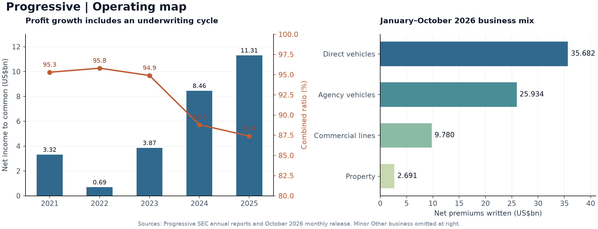

# Progressive（PGR）研究报告

**研究与数据截止日**：2026-11-25（北京时间）；股价采用 2026-11-24 美股正常交易时段收盘，最新经营月报截至 2026-10-31，完整财务报表截至 2026-09-30。  
**证券身份**：The Progressive Corporation，中文常译前进保险，NYSE:PGR，普通股，非 ADR；复用既有 Progressive 目录和触发标的 ID。  
**价格 / 市值 / 估值**：US$235.68 / 按最新已披露实股复算 US$136.1523 billion / 市值除滚动净利润 11.73 倍，最新 PB 3.81 倍。[10][11]  
**一句话判断**：Progressive 仍是承保纪律和风险定价能力较强的保险公司，但降价、赔付严重度与获客投入正在共同侵蚀超额利润；决定投资回报的是正常化盈利和买入价格。

本报告接续 [9 月研究](Progressive-research-20260927.md) 与 [Q2 精读](Progressive-earnings-2026Q2.md)，保留历史报告。金额未特别说明均为美元；表中 US$bn 为十亿美元，US$m 为百万美元。框架中的“大师式追问”为研究者拟定的问题，非本人引语或对 PGR 的推荐。

## AI 研究偏见自觉

**信息丰富度评级：A。**月报、季报和监管市场份额资料充足，最容易产生的偏差是把数据密度当作盈利确定性，把周期高利润的低 PE 当作便宜。

**AI 研究局限性声明**：准备金由管理层估计、未来可能修订；公开资料不足以独立计算新增保单的生命周期价值、真实获客成本及模型相对同业的增益。月报未经审计。经营数据的新闻转载仍源于公司，不构成独立原始测量。估值增长、分配比例、情景概率和仓位均为研究假设，不能当成公司指引。

- [x] 将“资料充足”与“未来赔付可预测”分开。
- [x] 检验去年佛州返还、准备金发展和月结错位，避免机械同比。
- [x] 用正常化利润和完整现金分配检验低 PE，不把保险浮存金当作股东闲钱。
- [x] 反面立场是：公司可以持续扩大保单，但每股利润和股东回报仍可能停滞。

---

## 第一步：核心数据总览

### 收入和保费结构

2025 年 GAAP 收入为 US$87.671bn，其中净已赚保费（NPE）US$81.661bn、投资收入 US$3.583bn、证券已实现及计入损益的公允价值净收益 US$0.727bn，另有手续费及服务收入。NPW 是签发和续保净保费，NPE 是随保障期确认的收入；二者不能混用作综合成本率（CR）的分母。[1][5]

| 业务 / 渠道 | 2025 NPE（US$bn） | 2026 年前十月 NPE（US$bn） | 前十月 NPW 占比 | 前十月 CR | 10 月 CR |
|---|---:|---:|---:|---:|---:|
| 车辆险 Agency | 29.382 | 25.342 | 35.00% | 85.6 | 90.0 |
| 车辆险 Direct | 38.280 | 34.611 | 48.16% | 90.2 | 96.1 |
| Property | 3.116 | 2.622 | 3.63% | 74.7 | 60.8 |
| Commercial Lines | 10.881 | 8.995 | 13.20% | 88.6 | 84.8 |
| **公司合计** | **81.661** | **71.576** | **100%** | **87.9** | **91.2** |

来源：2025 全年月报和 2026 年 10 月完整月报。[4][5]公司合计含少量 Other，渠道占比因四舍五入不严格加总。Property 属于 Personal Lines，表中仍单列以便比较。



图左为普通股净利润及 CR；图右为 2026 年前十月 NPW 结构。纯数字及来源见相邻表，图中的 CR 纵轴保留 80–100 区间，便于观察周期变化。

### 五年财务：高盈利包含承保周期

| 财年 | 收入 US$bn | 普通股净利 US$bn | 稀释 EPS | CR | CFO US$bn | CFO−CapEx US$bn | 现金+短投 US$bn |
|---|---:|---:|---:|---:|---:|---:|---:|
| 2021 | 47.702 | 3.324 | 5.66 | 95.3 | 7.762 | 7.518 | 1.130 |
| 2022 | 49.611 | 0.695 | 1.18 | 95.8 | 6.849 | 6.557 | 3.066 |
| 2023 | 62.109 | 3.865 | 6.58 | 94.9 | 10.643 | 10.391 | 1.875 |
| 2024 | 75.372 | 8.463 | 14.40 | 88.8 | 15.119 | 14.834 | 0.758 |
| **2025** | **87.671** | **11.308** | **19.23** | **87.4** | **17.548** | **17.200** | **10.130** |

来源：公司年报及 StockAnalysis；2021–2022 现金流原始精度由 2023 年报补充。[1][6][7][8]净利润为普通股可得口径，不能与较早年度包含优先股分配前的合并净利直接混比。2025 收入双源差异是第三方扣除投资费用 US$34m，校准后完全一致。

**CFO−CapEx 仅为会计展示，不是保险公司可分配股东现金流。**预收保费、准备金及赔付时点可以推高 CFO；分红还受法定资本和子公司上划约束。毛利率、通用营业利润率和工业企业 ROIC 不适合直接跨行业比较，本报告以损失率、费用率、CR、普通股回报和可分配能力分析经营效率。

### 最近四季：规模继续增长，承保利润空间收窄

| 期间 | Personal NPE US$bn | Commercial NPE US$bn | 公司 NPE US$bn | 合并净利 US$bn | 稀释 EPS | 公司 CR | 期末保单百万张 |
|---|---:|---:|---:|---:|---:|---:|---:|
| 2025Q4 | 18.435 | 2.657 | 21.093 | 2.951 | 5.02 | 88.0 | 38.619 |
| 2026Q1 | 18.384 | 2.583 | 20.968 | 2.818 | 4.80 | 86.4 | 39.565 |
| 2026Q2 | 18.880 | 2.691 | 21.573 | 3.311 | 5.67 | 87.3 | 40.086 |
| **2026Q3** | **19.060** | **2.807** | **21.869** | **2.542** | **4.37** | **88.7** | **40.489** |

来源：四次季度完整月报及各季 10-Q。[2][3][5][9]2025Q4 分部 NPE 由全年减前三季计算，合计含 Other。季度顺序只说明趋势，不能忽略季节性。

### 本次复核的三个关键变化

**第一，表面 CR 改善掩盖可比口径恶化。**Q3 CR 从 89.5 降至 88.7，但去年包含佛州保费返还，使费用率增加 4.6 点。剔除此项，去年比较基数约为 84.9，今年实际走弱约 3.8 点。Q3 事故年损失及理赔费用率从 66.6 升至 70.5，前三季从 67.5 升至 69.6，更能说明当期成本压力。这不等于准备金造假，而是日历年承保利润和当事故年风险需要分别看。[3]

**第二，广告增加而新单疲弱。**Q3 广告约 US$1.6bn、前九月约 US$4.5bn，均同比 +18%；Q3 个人车辆新业务申请 −1%、续保申请 +9%，个人车平均每单签单保费 −2%。严重度 +4%、频率 −3%，后者提供缓冲。广告也服务品牌和续保，现有数据不能直接算出 CAC 或 ROI，但已不足以支持“多投广告必然增厚利润”的判断。[3][12]

**第三，10 月增长有月结干扰，Direct 则需单独盯紧。**NPW US$7.079bn，实际同比 +1.10%，公司说明月结错位拖低约 2–3 点，并预期 11 月反向增加、Q4 不受影响；不能把这部分算成份额流失。10 月 CR 91.2、事故年损失率 72.0；Direct 渠道当月 CR 96.1，但前十月仍为 90.2，单月越过公司全年目标不等于已触及长期经营红线。总在保保单 40.532 百万张、同比 +6%，仍未同步转负。[4]

前十月有利前期准备金发展 US$1.674bn，约相当于同期 NPE 的 2.34 点。它降低日历年成本；不能同时把这笔释放当长期利润，又假设事故年赔付压力已经消失。[4]

> 段永平式追问：每张新增保单在赔付、获客和资本占用之后，是否还值得公司继续扩张？

---

## 第二步：生意本质分析

**这门生意是先收取车主与商户的保费，承担未来赔付承诺，以更准确的风险价格和更有效率的理赔赚承保利润，再让支持保险负债的投资组合贡献收益。**

| 经营环节 | 怎样赚钱 | 需要付出的代价 |
|---|---|---|
| 直接销售 | 品牌、线上报价、电话和 App 触达客户 | 广告持续投入，消费者容易比价 |
| 独立代理 | 覆盖偏好代理服务的客户和风险组合 | 佣金、激励及代理关系维护 |
| 风险定价 | 识别同一平均风险中更好的客户，以更合适的费率承保 | 数据、模型、州级审批与迭代成本 |
| 理赔 | 准确估损、控制欺诈与处理成本 | 人员、维修、人伤及诉讼通胀 |
| 投资 | 保费先收、赔付后付形成投资资产 | 资产首先支持保单负债，须保持流动性和资本 |

复购来源于持续保障需求和续保便利，客户并未被牢牢锁住。房车捆绑改善留存，也带入天气和房屋维修风险。保险的经营杠杆主要来自固定系统和理赔能力的分摊，以及每一点损失率在庞大 NPE 上的放大；扩大保单同时会扩大所需保险资本。

以当前滚动 NPE 和假设税率作静态测算，CR 每恶化 1 个百分点，对每股利润的影响约 US$1.17；这解释了为什么几乎相同的收入规模可以对应很不相同的盈利。该数是敏感性，不是明年 EPS 预测，亦未把保费、投资收益和资本同时动态建模。

> 段永平式追问：如果不能依赖继续提价，公司还能否用更好的风险识别和服务成本赚取合理利润？

---

## 第三步：护城河评估

| 来源 | 强度判断 | 支持证据与可证伪条件 |
|---|---|---|
| 品牌 / 定价权 | 中等 | 品牌减少客户搜索成本，但车险费率可比；Q3 每单保费下降，说明不能随意提价 |
| 转换成本 | 低至中等 | 续保和捆绑便利有价值；若报价优势消失，客户仍可更换 |
| 传统网络效应 | 弱 | 新增保户不会直接提高老保户的产品价值，不能把数据积累冒充平台网络效应 |
| 规模 / 成本 | 中强 | 代理、广告、理赔网络和 IT 可以复用；优势要以相近风险组合下的费用与损失验证 |
| 数据 / 技术 / 组织 | 中强 | Snapshot、风险细分及理赔反馈持续迭代；模型领先年数和单独可比研发支出未披露，不能填估计数 |

管理层股东信披露 9.0 模型在 Q3 已覆盖 21 州、占个人车保单约 55%。这是迭代范围证据，并不证明每张保单都比竞争者更赚钱。[12]

过去五年规模、份额和承保盈利扩大，支持护城河积累；未来五年更可能表现为“仍能比同业更好地承保”，而非永远维持 87 左右的 CR。数据优势能降低定价错误，却不能消灭共同的赔付通胀、州监管和价格竞争。若为增长放宽风险边界、广告支出侵蚀成本优势或数据使用被限制，护城河会收窄。

> 巴菲特式追问：十年后，公司的优势还能体现为穿越周期的承保回报，还是只剩下规模？

---

## 第四步：逆向思考与风险清单

最强反方论点是：**市场给的十余倍 PE 对应周期高利润；降价和广告竞争先发生，赔付成本随后体现，公司仍增长却无法维持过去的每股利润。**这比“自动驾驶马上让车险消失”更贴近当前证据。

| 失败路径 | 主观可能性 / 影响 | 复核信号 |
|---|---|---|
| 降价快于赔付成本下降 | 中高 / 高 | 事故年率连续走高、同风险组合保费下降 |
| 广告与代理激励回报下滑 | 中高 / 中高 | 获客投入上升、新单持续疲弱、续保不足以补偿 |
| 准备金低估与人伤诉讼 | 中 / 高 | 前期发展转不利，严重度和结案周期超预期 |
| 房险重新扩张增加灾害暴露 | 中 / 中高 | 非捆绑及高风险地区增量、巨灾后资本压力 |
| 法规、隐私及算法限制 | 中 / 中高 | 关键定价变量受限，诉讼及客户信任成本增加 |
| 自动驾驶改变责任与数据归属 | 时间不确定 / 长期高 | 车队商业里程扩大，制造商或软件方取得责任险利润 |
| 投资资产利率冲击 | 中 / 中 | 账面损失、资本缓冲与上划能力恶化 |

可能性是定性判断，彼此相关，不是可以相加的独立概率。

一个近在眼前的类比是 GEICO：2026Q3 CR 91.4，对比去年 84.3，签单保费同比 −0.3%，广告和佣金增加。规模和品牌并不能免除软市场。PGR 相对有韧性，但双方争夺客户时，部分利润可能转移给保户和获客平台；不同险种与风险组合也使两家 CR 不能被当作纯技术排名。[13]

本报告最可能犯的错，是把 CR 93 的“正常化”当成必然：它可能偏悲观，低估模型和份额优势；也可能偏乐观，低估竞争、诉讼和灾害。避免锚定的方法是用未来披露更新盈利，而不是要求股价回到某个旧高点。

> 芒格式追问：如果三年后保单更多、正常化 EPS 却只有十四美元，今天的买入理由还成立吗？

---

## 第五步：管理层与资本配置

Tricia Griffith 仍任 CEO；公司内部培养和持续承保纪律有长期记录。2026 年 CFO Andrew Quigg 已于 7 月接任，Jim Curtis 已于 10 月接任个人线总裁，Pat Callahan 计划于 2027 年 1 月退休。交接已进入实际执行，不能继续写成尚未发生的事项。[14]

| 时间 / 决策 | 已见结果 | 研究评价 |
|---|---|---|
| 2021–2023 成本上升时调整价格及承保 | 低利润期之后恢复承保回报 | 较好，但部分来自全行业价格周期 |
| 2024–2025 扩大获客投入 | 保费、普通股利润及规模扩大 | 较好，不能将高峰利润永久化 |
| 2026 在软市场降价、继续投放 | Q3 保单仍增长，新单和可比 CR 承压 | 待验证，不预先判定广告低效或成功 |
| 2026 增加回购 | 前九月约 770 万股、成本约 US$1.6bn；10 月另回购约 173 万股、均价 US$218.24 | 有利每股权益，但回购行为不等于低估证明 |
| 房险风险选择与理赔能力内建 | 当前盈利改善后重新寻找增长 | 必须检验跨天气周期的回报 |

回购和资本配置事实来自季报、月报及股东信。[3][4][12]2025 年每股宣派股息合计 US$13.90，包含变动分红；年度常规股息 US$0.40 与历史特别分配是两回事，均不保证未来重复。[1][10]

2026 委托书列示截至 1 月末 Griffith 实益持有 599,411 股，约为百分之零点一量级，其中 24,603 为股份等值单位；不能将全部视作即时投票股，更不能当作 11 月现持股。该证券没有控制性 AB 股结构。2025 年 CEO 总薪酬约 US$17.706m，其中股票授予日公允价值约 US$11.000m，不能视作当年现金所得；Gainshare 激励联系增长和盈利，支持纪律，也有追求短期指标的风险。公开持股较低，组织制度、激励和资本纪律比创始人控制更关键；未逐笔还原其后全部 Form 4，最新持股与减持节奏保留缺口。[15]

资产负债也须分口径：2025 年末现金加短投 US$10.130bn、官方债务 US$6.897bn；9 月末分别 US$2.266bn、US$8.389bn，狭义净现金为负 US$6.123bn。最新 10 月总投资 US$100.166bn、普通股权益 US$35.757bn、债务 US$8.389bn，固收信用质量 AA−、久期 3.6 年。投资组合需要支持保单负债，不能全额加回股权估值。[1][4][7]

> 段永平与巴菲特式追问：如果 CEO 退休，新任业务和财务负责人是否仍会为了承保回报而放弃不划算的增长？

---

## 第六步：行业与文明趋势

NAIC 的 2025 年申报快照显示，美国个人车险直接签单保费约 US$371.042bn；State Farm 份额 18.64%，Progressive 18.60%，Berkshire 集团 11.56%，Allstate 10.15%。PGR 接近第一，但这份可核验快照仍列第二。商业车险市场约 US$77.105bn，PGR 份额 13.20%、居第一。NAIC 的直接签单保费与公司净签单保费口径不同，不能拼成同一个增长序列。[16]

这是成熟的大市场。增长来自车辆及保单量、费率、组合和份额；保费因维修与医疗通胀上涨，并不自动增加股东价值。竞争者可以获得类似算力和软件，难以迅速复制的是历史风险、理赔反馈和执行体系；反过来，旧数据也可能在驾驶行为或责任制度改变后贬值。

自动驾驶可能同时降低事故频率、提高单次维修成本，并将承保对象从司机转向车队、制造商和软件方。财政部 FIO 报告讨论了责任转移与数据获取问题；Allianz 与 Waymo 已公布车队和责任险合作，说明新利润池不天然归 PGR。[17]本报告不假定十年内完全无影响，也不将尚无法量化的风险随意塞进 β。

核心个人车业务的客户总体分散；商业线包含 TNC 等业务，本次没有完整量化其客户集中度，不外推全公司不存在大客户风险。更值得关注的是州级费率审批、理赔服务、维修医疗成本、再保险对手方和获客渠道。商业本质仍是赔付承诺，AI 的价值要落在更准的风险选择和更低的全成本上。

> 李录式追问：二十年后的风险仍需保险，但控制驾驶数据、责任和分销入口的会是谁？

---

## 第七步：估值与安全边际

### 当前估值与来源差异

| 指标 | 本报告口径 | 含义与限制 |
|---|---|---|
| 收盘价 | US$235.68 | 11 月 24 日；StockAnalysis 与 CompaniesMarketCap 同价 |
| 最新已披露期末实股 | 577.7 百万股 | 10 月末舍入值，不是 11 月 24 日实时股本 |
| 复算普通股市值 | US$136.152336bn | 价格×实股；独立站点约 US$136.15bn |
| 滚动净利润 / 总额 PE | US$11.604bn / 11.73 倍 | FY2025 加今年前十月、减去年前十月 |
| 拼接稀释 EPS / 对应 PE | 约 US$19.84 / 11.88 倍 | 不同期间平均股本不同，因此是近似值 |
| 10 月 BVPS / PB | US$61.90 / 3.81 倍 | 比第三方仍用 9 月净资产的 PB 更及时 |
| P/S | 约 1.48 倍 | 用截至 Q3 滚动 GAAP 收入 US$91.735bn；解释力弱于承保回报 |
| PEG / EV/Revenue | 不作核心依据 | 利润周期使 PEG 易误导；第三方 EV/Sales 约 1.58，现金和投资口径不适合直接判断保险价值 |

来源及工具核验见附录。[1][3][4][10][11]StockAnalysis 的 579.36 百万股对应 10 月 1 日披露，市值 US$136.54bn 与本报告差异主要是股数时点；其滚动 EPS 19.85 截至 Q3，不能冒充 10 月已更新值。

### 用正常化盈利重估低 PE

采用滚动 NPE US$85.591bn、滚动净利 US$11.604bn、假设税率 21%、最新股数 577.7 百万股，以前十月 CR 87.9 作为当前利润率代理，将 CR 静态调至 93：

\[
NI_{代理}=11.604-85.591\times(0.930-0.879)\times(1-0.21)
=8.15554\ \text{billion}
\]

对应每股约 US$14.12、现价约 16.69 倍；后续模型保守取正常化起点 **US$14.00**。这不是精确重编滚动损益：它把前十月 CR 应用于滚动规模，保留原有投资收益、证券损益及其他项目，也没有预测未来保单与费率；本质是利润率敏感性。调整 CR 已经覆盖承保利润的回归，不再重复扣一次有利准备金发展。

历史年末 PE 约为 2023 年 24.11、2024 年 16.59、2025 年 11.81 倍；倍数下降同时发生于利润快速上升，不能据此认定现在比以往更便宜。同一行情快照下 Chubb 约 13.14 倍、Allstate 约 6.12 倍，但业务组合、准备金及处置收益不同，不能照搬为 PGR 的内在价值。[18]

### 三年情景：先问价格有没有保护

以正常化 EPS 14.00 为起点，三年后退出 PE 为判断假设；悲观 / 基准 / 乐观主观权重为 25% / 50% / 25%。每年按当年盈利的 60% 作经济分配假设，固定股数，不再加一遍回购收益。该分配不是已宣布现金股息；60% 分配后保留资本，实际能否上划还须验证。

| 情景 | 三年 EPS 年增速 | 第三年 EPS | 退出 PE | 第三年股价 | 仅股价涨跌 | 含假设分配年化回报 | 按 10% 折现的今日价值 |
|---|---:|---:|---:|---:|---:|---:|---:|
| 悲观：竞争及赔付挤压 | −3% | 12.78 | 10 倍 | US$127.77 | −45.78% | −14.33% | US$115.70 |
| **基准：回归后温和增长** | **+5%** | **16.21** | **14 倍** | **US$226.89** | **−3.73%** | **+2.72%** | **US$193.45** |
| 乐观：份额与单位经济改善 | +12% | 19.67 | 16 倍 | US$314.70 | +33.53% | +14.18% | US$262.57 |

三年概率加权今日价值约 **US$191.29**。退出 PE 是三年市场定价假设，不是十年永续倍数。若实际分配更低，现金到达股东更晚，回报也会改变；不能直接把三年后价格当今天合理价。

### 十年压力测试：明确资本成本和资本约束

所有现金流用美元，基准 r 取 **10%**，由 FRED 可见的 11 月 23 日十年美债 4.92% 加规范性 β=1、研究假设 ERP 5.08% 组成。β=1 是方法约束，不是引用第三方低股价 β；ERP 是要求回报的判断。[19]

保险公司按股权现金流估值，模型中 `roic` 参数以**稳态新增股权回报率代理 18%**解释，不能当作工业企业投入资本回报。它低于公司近期三十余的普通股回报率，反映增量保费与资本不能永久复制高峰回报。2025 特别分红使反推留存率不稳定，18% 仍是判断，不是统计证明。前十年分配 60%、保留 40%，约可支持不高于 7.2% 的持续增长；三年乐观 12% 包含阶段性盈利恢复，不被直接延长十年。

永久增长 g 分别为 2% / 3% / 4%，独立于 r，不随敏感性调整；美元基准上限 4%。终值倍数严格采用：

\[
PE_{终值}=\frac{1-g/0.18}{r-g}
\]

| 十年情景 | 前十年 EPS 增速 | 第十年 EPS / 利润 US$bn | 永久 g | r−g | 退出 PE | 仅终值工具年化代理 | 含逐年分配的完整现金 IRR |
|---|---:|---:|---:|---:|---:|---:|---:|
| 悲观 | −2% | 11.44 / 6.608 | 2% | 8 点 | 11.11 倍 | −5.99% | −1.81% |
| 基准 | +5% | 22.80 / 13.174 | 3% | 7 点 | 11.90 倍 | +1.42% | +5.77% |
| 乐观 | +7% | 27.54 / 15.910 | 4% | 6 点 | 12.96 倍 | +4.24% | +8.50% |

`terminal_value.py irr/flip` 本身用终值几何年化加固定收益率，不能容纳逐年变化的分配。故先按 k=0 跑完规定工具，再以同样终值倍数、固定股数和逐年 60% 盈利分配计算真正现金流 IRR；没有把终值代理称为完整总回报。概率加权 IRR 是情景 IRR 的算术加权，亦不等于对概率加权现金流再求 IRR。

完整现金 IRR 按以下现金流求解：第 1–9 年为当年 EPS×60%，第 10 年为 EPS×60% 加 EPS×终值 PE，初始投入为 US$235.68。终值之后留存率改由 g/18% 决定，体现成熟阶段分配提高；没有额外加回总投资、浮存金或账面权益。

### r 敏感性与翻转检查

| r | 工具期望终值代理 | 代理是否覆盖 r | 期望完整现金 IRR | 完整现金是否覆盖 r | 使用边界 |
|---|---:|---|---:|---|---|
| 8% | +3.77% | 否 | +7.47% | 否 | 区间外，仅供参考；乐观档 r−g 仅 4 点，不作估值依据 |
| 10% | +0.28% | 否 | +4.56% | 否 | 美元合理区间内 |
| 12% | −2.24% | 否 | +2.55% | 否 | 区间外，仅供参考 |
| 9%（补充） | +1.86% | 否 | +5.86% | 否 | 合理区间内，三档分母 7 / 6 / 5 点 |
| 11%（补充） | −1.07% | 否 | +3.47% | 否 | 合理区间内，三档分母 9 / 8 / 7 点 |

已执行 r±2 点；因两侧均超出美元 9%–11.5% 合理区间，再执行 r±1 点。**在合理区间内，仓位压力测试结论不翻转：当前价下均未覆盖资本成本。**这是限制大仓位的依据，不能单独当作清仓或不买的否决票。

反向检验：固定终值 g=3%、新增股权回报 18%、60% 分配及 r=10%，要支持现价，前十年 EPS 需约 **+9.20%** 年增长，明显高于基准 +5%，也超过本假设留存与回报可支持的约 7.2%。这不证明市场错误，而是说明买方还必须相信更高增量回报、阶段性高峰盈利持续或更强资本释放，不能只引用低 PE。

### 估值分歧对账

历史 Q2 报告曾支持小仓分批，9 月报告已转为现价观望。业务质量、内部培养和风险定价优势仍在；新增反证是新单疲弱、可比 CR 走弱及当前更高价格。三年模型是定价判断：基准今日价值约 193 美元，现价缺少折价；十年模型是仓位压力测试：计入分配后仍限制加大仓位。两者本次方向一致，不能把结论全部归因于十年 r。

六维综合支持“已有合理小仓可持有复检、当前价不新增”，而非因为模型未通过就推断生意坏了。保留旧稿 US$170 上沿，并明确 **US$150–170 条件研究带**：相对三年基准今日价值折价约 12.12%–22.46%，对应十年基准完整现金 IRR 约 +10.02%–+11.75%。这仍不等于加权或最差情景都过关，因此只支持小额首笔，不能恢复旧稿大仓建议。

> 巴菲特与段永平式追问：r 改变一到两个百分点时，证据没有替我翻转压力结论；如果市场关闭五年，我是否愿意为尚未验证的盈利持续性付出今天的价格？

---

## 第八步：最终决策与行动清单

| 维度 | 综合判断 | 信心度 |
|---|---|---|
| 生意质量 | 风险承保和续保需求持久，当前仍有承保利润；利润率有周期 | 较高 |
| 护城河 | 风险定价、双渠道、理赔规模与组织反馈较强，转换成本有限 | 中高 |
| 管理层 | 承保纪律和内部培养有证据；新任团队须证明执行 | 中高 |
| 最大风险 | 软市场降价、严重度和获客支出共同压缩正常化利润 | 中高 |
| 文明趋势 | 保险需求持久，自动驾驶可能转移数据与责任利润池 | 中 |
| 估值 | 三年基准今日 US$193.45、加权 US$191.29；十年完整现金期望约 +4.56%，合理 r 区间内不翻转，只收紧仓位 | 中低 |

**结论：现价观望新增；已有合理小仓可有条件持有，暂停加仓。**理由由六个维度共同得出：好组织尚未失效，但正常化盈利、竞争变化和价格之间没有足够保护。十年压力测试只用于限制仓位，估值一项不是最终决策唯一裁决。

| 对象 / 触发 | 行动与前提 |
|---|---|
| 空仓，US$235.68 | 不新增，等待价格或正常化盈利证据改善，不为低表面 PE 追价 |
| **US$150–170** | **有条件研究性分批**：至少后续两次月度披露事故年损失率趋稳，消除 10–11 月错位后 NPW 和保单未同步转负，下一完整财报能解释广告、新单与资本；用最新数据重估仍有折价，再考虑约 0.5% 首笔 |
| 低于 US$150 | 先查永久损失及盈利假设，不因跌破区间自动加仓 |
| US$170–220 | 观察 / 合理仓位持有，以基本面复检为主 |
| **高于 US$220** | **无正常化盈利增强则回避追价，超配者复核仓位**；延续 9 月警戒线，不是自动卖出线 |
| 已持仓 | 仅在无实质红线时持有；研究总仓主观参考不高于 2%，显著超配者评估集中度。未知用户持仓，不假定已交易 |
| 卖出 / 减仓重审 | 连续两个季度公司 CR>97，或准备金发展明显转不利并伴随资本恶化；NPW 与保单同步转负且承保纪律失守；确证重大数据、诚信或偿付风险。单月 Direct CR 96.1 不等于该红线已触发 |
| 加仓重审 | 下一完整财报与后续月度经营共同支持正常化 EPS 至少约 14、可分配及资本充足；先检验首笔假设，再讨论扩大，不按旧 5%–8% 建议机械执行 |

**复检安排**：公司已公告 2026-12-16 美股开盘前发布 11 月结果，需把 10–11 月合看，防止错位制造假加速；2026-12-31 为自定资本、分配与管理交接研究检查；2027-03-31 为全年正式报告披露窗口兜底，非公司确认财报预约日，若提前披露即提前核查。[4]

触发登记只监控价位；事件保留供人工复核，当前每日流程不自动扫描或提醒事件。当前价已高于 US$220 警戒线，但不代表已经完成仓位决策。

### 大师原文与方法延伸

巴菲特 1977 年股东信谈保险产品：**“Their only products are promises.”**[20]这是对保险承诺的描述，不是对 PGR 的推荐。本报告的方法延伸是：检验承诺的风险价格、兑现成本和经营者纪律，而非只看保费增长。

芒格、段永平、李录：本次未读到足够可核验且相关的一手原文，**资料不足，不模拟代言**。各节的框架提问由研究者提出，不冒充本人发言。

## AI 分析置信度与投资确定性

**AI 分析置信度：经营事实较高，估值中等。**财报、月报、价格、股数时点、现金与短投口径有原文和交叉核验；正常化 EPS、长期增速、可分配比例及风险概率属于有据推理。

**实际投资确定性：中等。**准备金最终充足性、新保单生命周期价值、未来价格竞争和技术责任转移，不能由公开资料量保证。广告单位回报、最新管理层完整持股、分部研发投入仍有缺口。灾难性巨灾及准备金崩塌、自动驾驶责任重构、重大数据隐私诉讼未单独定量，十年情景不覆盖所有永久损失路径；未建模风险不通过提高 r 隐藏处理。

---

## 数据来源与审计记录

1. [SEC：2025 年报财务及十年回顾](https://www.sec.gov/Archives/edgar/data/80661/000008066126000086/pgr-20251231_d2.htm)，配套 [10-K](https://www.sec.gov/Archives/edgar/data/80661/000008066126000086/pgr-20251231.htm)。
2. [SEC：2026Q1 10-Q](https://www.sec.gov/Archives/edgar/data/80661/000008066126000177/pgr-20260331.htm)与[Q2 10-Q](https://www.sec.gov/Archives/edgar/data/80661/000008066126000308/pgr-20260630.htm)。
3. [SEC：2026Q3 10-Q，11 月 2 日提交](https://www.sec.gov/Archives/edgar/data/80661/000008066126000379/pgr-20260930.htm)。
4. [SEC：2026 年 10 月完整月报，11 月 18 日发布](https://www.sec.gov/Archives/edgar/data/80661/000008066126000384/pgr202610ex99earningsrelea.htm)。
5. [SEC：2025 年 12 月及全年完整月报](https://www.sec.gov/Archives/edgar/data/80661/000008066126000071/pgr202512ex991earningsrele.htm)。
6. [StockAnalysis：损益表](https://stockanalysis.com/stocks/pgr/financials/income-statement/)，收入使用 Revenue as Reported，普通股净利用 Net Income to Common。
7. [StockAnalysis：资产负债表](https://stockanalysis.com/stocks/pgr/financials/balance-sheet/)与[现金流](https://stockanalysis.com/stocks/pgr/financials/cash-flow-statement/)。
8. [SEC：2023 年报，补充早年现金流精度](https://www.sec.gov/Archives/edgar/data/80661/000119312524076191/d322174dars.pdf)。Macrotrends [收入](https://www.macrotrends.net/stocks/charts/PGR/progressive/revenue)与[净利润](https://www.macrotrends.net/stocks/charts/PGR/progressive/net-income)只读到历史检索索引，正文访问受限；未将其计为最新完整核验源。
9. [SEC：2026 年 9 月完整月报](https://www.sec.gov/Archives/edgar/data/80661/000008066126000367/pgr202609ex99earningsrelea.htm)；[Q1 完整月报](https://ml.globenewswire.com/Resource/Download/fefd8f5c-55b4-4317-b656-aa6a1c3e3e8b)；[Q2 完整月报](https://ml.globenewswire.com/Resource/Download/80356bff-8751-4f27-b604-5c4f266c944e)。
10. [StockAnalysis：PGR 行情](https://stockanalysis.com/stocks/pgr/)与[统计](https://stockanalysis.com/stocks/pgr/statistics/)。
11. [CompaniesMarketCap：PGR 市值与价格](https://companiesmarketcap.com/progressive/marketcap/)。不同子页面缓存时点不一致，本报告未把旧缓存股份页当作最新股数。
12. [SEC：2026Q3 CEO 股东信](https://www.sec.gov/Archives/edgar/data/80661/000008066126000379/pgr-2026930ex99shareholder.htm)。
13. [Berkshire：2026Q3 报告，GEICO 经营](https://www.berkshirehathaway.com/qtrly/3rdqtr26.pdf)。
14. [公司领导页](https://www.progressive.com/about/leadership/)；[CFO 交接公告](https://investors.progressive.com/financials/financial-news-releases/news-details/2026/Progressive-Announces-Plans-For-CFO-Transition/default.aspx)；[个人线交接公告](https://investor.progressive.com/financials/financial-news-releases/news-details/2026/Progressive-Announces-Management-Changes/default.aspx)。
15. [SEC：2026 股东委托书](https://www.sec.gov/Archives/edgar/data/80661/000008066126000099/pgr-20260318.htm)。持股是历史快照，未声称已完成当前持股独立双源验证。
16. [NAIC：2025 市占率表](https://content.naic.org/sites/default/files/research-actuarial-property-casualty-market-share.pdf)，截至 2026-03-18 申报快照，个人车险及商业车险表。
17. [美国财政部：FIO 2026 年度报告](https://home.treasury.gov/system/files/311/2026-FIO-AR.pdf)；[Allianz–Waymo 官方合作公告](https://www.allianz-partners.com/en_global/in-the-news/press-releases/Allianz_Partners_and_Waymo_Announce_Strategic_Collaboration_for_Autonomous_Vehicle_Insurance_and_Safety_Research_in_Europe.html)。
18. [StockAnalysis：PGR 历史估值](https://stockanalysis.com/stocks/pgr/financials/ratios/)、[Chubb](https://stockanalysis.com/stocks/cb/statistics/)、[Allstate](https://stockanalysis.com/stocks/all/statistics/)。历史使用站点年末估值序列，未混算未复权历史股价回报。
19. [FRED：DGS10](https://fred.stlouisfed.org/series/DGS10)，抓取时可见最新观测 2026-11-23 为 4.92%，非声称已取得 11 月 25 日收盘利率。
20. [Berkshire：巴菲特 1977 年股东信](https://www.berkshirehathaway.com/letters/1977.html)，Insurance Underwriting 段落。

### 关键数据交叉验证记录

`financial_rigor.py` 输出节录如下；[完整验证记录](Progressive-validation-20261125.md)保留工具原始输出与随机抽检，[模型参数及完整现金流](Progressive-model-20261125.json)保留精确数值。

```text
市值验算：235.68 USD × 577.70M = 136.152336B USD
对 CompaniesMarketCap 136.15B 偏差 <0.01%，通过。
FY2025 GAAP收入：SEC 87671 / StockAnalysis同口径87671（USD million），偏差0.00%。
FY2025普通股净利：SEC 11308 / StockAnalysis 11308，偏差0.00%。
FY2025现金+短投：SEC 10130 / StockAnalysis同口径10130，偏差0.00%。
2026Q3现金+短投：SEC 2266 / StockAnalysis同口径2266，偏差0.00%。
股数时点差：10月末577.7M / 10月1日579.362175M，差异约0.29%，并非同日矛盾。
估值：235.68 / 19.84 = 11.88x；235.68 / 61.90 = 3.81x。
terminal_value audit：USD / r=10% / 股权回报代理18% / g=2%,3%,4%，C1/C2/C3准出。
```

工具把 EPS/BVPS 的约 32.05% 标作 ROE，该值只是期末净资产比；正文采用公司披露的滚动平均普通股权益回报 34.4%，不混同。第三方 FY2025 总债约 US$7.102bn 含租赁，官方 US$6.897bn 不含租赁；本报告狭义净现金统一采用后者。10 月现金未单列，未编造最新现金与净现金。

公司专属事故年率、广告和管理层持股缺少真正独立测量，已明确标注；第三方同源转载不算第二独立证据。**数据抽检及定稿后的估值参数复检均已准出**，明细见验证记录；这不等同未来回报保证。

*本报告用于学习研究，不构成个人化投资建议。*
