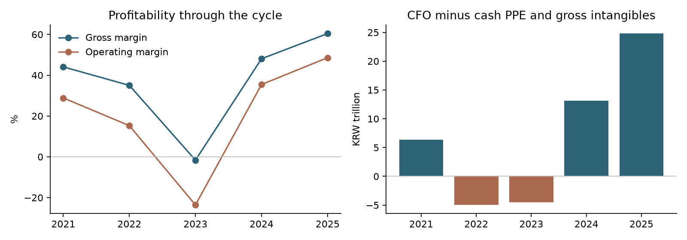
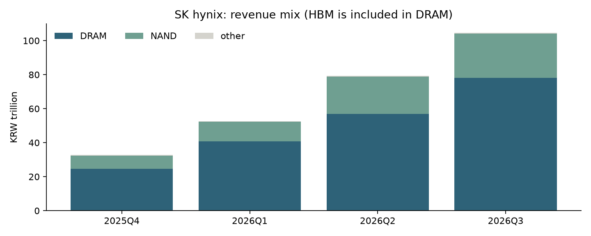

# SK海力士（SK hynix，KRX:000660）研究报告

> **研究与资料截止：2026-11-19，Asia/Shanghai；已执行 date 核对。** 价格锚为当日 Google Finance 16:30:07 KST 快照及 Investing 页头的 **1,183,000韩元**；最新完整财务为11月16日披露、截至9月末的经审阅季度报表。以11月5日注销后的发行普通股706,799,093股保守估算，市值836.143万亿韩元，约627.519十亿美元；TTM归母口径PE4.43倍，含重大金融投资损益。**主线：AI存储需求与现金兑现很强，HBM竞争也已回归；便宜的报表倍数，需要跨周期现金而非峰值利润证明。** 用户成本、持仓与账户币种未知，以下为研究用行动框架，不是用户实际持仓判断。本项目用于学习研究，不构成投资建议。

## AI研究偏见自觉

信息丰富度评级：**A级**。公司披露、卖方覆盖和AI报道充足，但HBM良率、代际客户分配、LTA合同底价与取消赔偿仍不透明。AI分析最容易把“资料很多”误当“未来确定”，或把低PE与存储周期见顶机械等同。

AI研究局限性声明：本文没有供应链私有信息。公司业绩、独立数据库、市场研究与研究假设分别标明；送样、商业出货、客户认证和长期份额不能互换。模型没有预测战争、永久架构替代或未来汇率的能力。

- [x] 先问利润来自销量、售价、组合，还是投资估值；不把金融收益当HBM利润。
- [x] 同时检查HBM份额下降、三星与美光量产，以及长约和股东现金回报增强。
- [x] 正式审阅财报优先于初步演示材料；历史现金统一用纯现金等价物。
- [x] 三年估值回答贵不贵；十年测试限制仓位，不把折现率当唯一买卖裁决。

身份与目录：SK hynix Inc.／SK하이닉스，中文SK海力士，韩国普通股000660。Nasdaq的SKHY是同一公司的ADS，每10份对应1普通股；旧HXSCL为另一存托凭证，每份对应1普通股。本文韩元价带只适用于000660，不能直接套用ADS成交价。已沿用原“SK海力士”目录和原监控ID，并归拢此前分散在“存储”“存储半导体”的两篇本公司历史报告、修复入口链接。[证券发行说明书](https://www.sec.gov/Archives/edgar/data/2120882/000119312526299963/d32785d424b4.htm)、[Citi GDR说明](https://depositaryreceipts.citi.com/adr/guides/viewDocument.aspx?annid=2&divid=025&secid=SKHRP&type=P)。

---

## 第一步：核心数据总览

### 五年穿越周期的底稿

自然年，金额单位为万亿韩元；利润为归母。完整FCF定义为CFO减现金购置PPE、减现金购置无形资产总额，尚未扣融资现金流中的租赁本金。历史表保留三位小数，计算使用原始百万韩元数。

| 年度 | 收入 | 归母净利 | 毛利率 | 营业利润率 | CFO | 现金PPE | 现金无形总额 | 完整FCF | 纯现金等价物 |
|---|---:|---:|---:|---:|---:|---:|---:|---:|---:|
| 2021 | 42.998 | 9.602 | 44.08% | 28.86% | 19.798 | 12.487 | 0.974 | 6.337 | 5.058 |
| 2022 | 44.622 | 2.230 | 35.02% | 15.26% | 14.781 | 19.010 | 0.739 | -4.968 | 4.977 |
| 2023 | 32.766 | -9.112 | -1.63% | -23.59% | 4.278 | 8.325 | 0.455 | -4.502 | 7.587 |
| 2024 | 66.193 | 19.789 | 48.08% | 35.45% | 29.796 | 15.946 | 0.717 | 13.133 | 11.205 |
| 2025 | 97.147 | 42.919 | 60.41% | 48.59% | 53.373 | 27.519 | 1.060 | 24.794 | 14.924 |

一手：[FY2022审计财报存档](https://files.quartr.com/reports/ab896-2026-05-12-05-16-41.pdf)、[FY2025审计财报存档](https://files.quartr.com/reports/eb5ee-2026-04-01-09-00-51.pdf)；独立交叉：[SA损益](https://stockanalysis.com/quote/krx/000660/financials/)、[SA现金流](https://stockanalysis.com/quote/krx/000660/financials/cash-flow-statement/)、[SA资产负债表](https://stockanalysis.com/quote/krx/000660/financials/balance-sheet/)。Quartr只是公司原报表的托管镜像，不算另一独立审计来源。无形资产采用原表gross购置额，SA的净购置额不能直接替代。



这家公司经历过收入下降、毛利为负、连续负FCF，再进入极强景气。HBM确实可以抬高盈利中枢，但尚不能据此删除资本开支与供给周期。

### 最新四季与收入结构

金额单位为万亿韩元。下表为集团口径；2025Q4、2026Q1/Q2必要项目由年报或累计报表相减，不能误用母公司单体产品表。

| 季度 | 收入 | DRAM收入 | NAND收入 | 其他收入 | 毛利率 | 营业利润 | 归母净利 |
|---|---:|---:|---:|---:|---:|---:|---:|---:|
| 2025Q4 | 32.827 | 24.659 | 7.744 | 0.423 | 68.77% | 19.170 | 15.220 |
| 2026Q1 | 52.576 | 40.659 | 11.574 | 0.343 | 79.27% | 37.610 | 40.330 |
| 2026Q2 | 79.319 | 56.983 | 21.960 | 0.376 | 83.20% | 60.543 | 93.820 |
| 2026Q3 | 104.615 | 78.229 | 25.997 | 0.389 | 85.70% | 83.334 | 39.534 |

2025全年集团DRAM收入74.904、NAND20.690、其他1.552万亿韩元。HBM属于DRAM子集，不能与DRAM相加；公司没有公开足以双源核验的四季HBM独立收入、各产品毛利率，本报告留空。[FY2025原表](https://files.quartr.com/reports/eb5ee-2026-04-01-09-00-51.pdf)、[H1完整财报](https://www.sec.gov/Archives/edgar/data/2120882/000119312526354777/d147827d6k.htm)、[Q3完整财报收入附注](https://www.sec.gov/Archives/edgar/data/2120882/000119312526461909/d166755d6k.htm)、[SA季度损益](https://stockanalysis.com/quote/krx/000660/financials/?p=quarterly)。



### 高净利、好现金与金融收益要拆开

Q2归母93.820降到Q3的39.534万亿，不意味着主业突然衰退：同期营业利润仍增长。净金融收益由+62.218转为-32.599万亿，其中金融工具估值损益由+53.237转为-22.918万亿。逐项税效和少数股东归属不足，不能简单加回税前损失后宣布得到了“精确正常化归母”。[H1财报金融收益附注](https://www.sec.gov/Archives/edgar/data/2120882/000119312526354777/d147827d6k.htm)、[Q3财报金融收益附注](https://www.sec.gov/Archives/edgar/data/2120882/000119312526461909/d166755d6k.htm)。

| 现金诊断项目 | 万亿韩元 | 边界 |
|---|---:|---|
| 9M2026 CFO | 145.634314 | 含投资现金股息流入 |
| 9M2026完整FCF | 113.674748 | 减现金PPE30.998642及gross无形0.960924 |
| 9M2026再扣租赁本金 | 113.251145 | 扣0.423603，不假称全部可分配 |
| 9M2026再剔投资现金股息 | 99.233796 | 剔14.017349，仍非精确长期所有者收益 |
| Q3正式单季CFO | 53.891813 | 9M减H1，与初步deck有差异 |
| Q3完整FCF | 40.926263 | 再扣租赁本金前 |
| TTM完整FCF | 122.290728 | 年度减同期累计加本期累计 |
| TTM扣租赁及投资现金股息后 | 106.769986 | 跨期现金诊断，不外推永续 |

正式累计现金流与[SA年度/TTM现金流](https://stockanalysis.com/quote/krx/000660/financials/cash-flow-statement/)交叉，单季采用[正式Q3](https://www.sec.gov/Archives/edgar/data/2120882/000119312526461909/d166755d6k.htm)减[H1](https://www.sec.gov/Archives/edgar/data/2120882/000119312526354777/d147827d6k.htm)。SA季度页的部分单季项目未完整接续累计修订：Q3 CFO53.494314与正式53.891813不一致，无形项目还有累计/单季混排，均未直接采用。差异低于阈值也要解释概念，不能只看“通过”图标。

现金质量是正面证据；只是新增设备、税款、员工报酬和新战略投资仍会消耗现金，CFO不等于普通股股东随时可提走的钱。

> 数据追问：剔除投资损益与融资后，扩产、税和员工报酬之后，每股能留下多少现金？

---

## 第二步：生意本质分析

**这门生意，是用持续更新的工艺、良率和封装，把有限晶圆变成客户愿意反复购买的可靠容量与带宽。** 收入是器件销售及客户持续换代采购，不是订阅费；复购靠算力扩张、数据增长和下一代性能要求。

| 产品与资产 | 谁付款、为何付款 | 股东真正赚什么 |
|---|---|---|
| HBM、M15X及先进封装 | GPU/ASIC客户需要带宽、功耗与稳定交付 | 多层堆叠良率、系统认证与每片晶圆的经济产出 |
| 服务器DDR5、LPDDR等DRAM | 服务器与终端需要工作内存 | bit成本与实现售价的差，紧缺期经营杠杆很大 |
| NAND、Solidigm企业SSD | 数据中心需要容量、耐久和吞吐 | 控制器/固件、QLC成本、客户认证与产品组合 |
| 龙仁、新厂及海外封装 | 未来交付能力 | 利用率、折旧及每笔新增资本回报 |

经营利润率Q3已达79.66%，主要解释是稀缺期售价与组合改善覆盖较固定的制造成本；下行时同一杠杆反向工作。公司称Q3 DRAM bit出货环比约+10%，ASP为高20%区间增长，量价均有贡献，不能把全部增量都归为HBM技术溢价。[Q3官方业绩](https://news.skhynix.com/en/q3-2026-business-results/)。

技术投入仍然必要：Q3集团研发总投入4.052万亿、其中费用化3.879；不是用专利数量或单次峰值毛利证明研发回报。HBM4E已送样不等于大规模认证，HBM5联合验证也不等于形成当期收入。[Q3研发附注](https://www.sec.gov/Archives/edgar/data/2120882/000119312526461909/d166755d6k.htm)、[HBM4E样品](https://news.skhynix.com/en/sk-hynix-ships-samples-of-12-layer-next-gen-hbm4e-2/)、[TSMC OIP说明](https://news.skhynix.com/en/tsmc-oip-conference-2026/)。

> 段永平式追问：客户反复买的理由很强，但股东是否必须把绝大多数回报不断投回下一代设备？

---

## 第三步：护城河评估

| 护城河来源 | 强度与证据 | 如何证伪 |
|---|---|---|
| 品牌及定价权 | 中；交付信誉有价值，价格仍随供需 | 紧缺缓解后溢价消失、同规格报价趋同 |
| 转换成本 | 中强；认证、共同设计、系统调优 | 新平台把主份额交给第二、第三供应商 |
| 网络效应 | 弱；装机越多并不自动让每颗存储更好 | 不用软件平台的网络效应给制造商估值 |
| 规模及成本 | 强；工艺、采购、良率学习与资本门槛 | 多家扩产同时投产，成本下降赶不上价格下跌 |
| 技术与专利 | 强但需续费式再投资 | 对手量产、良率与客户认可追平 |
| 长期协议 | 需求可见度增强 | 重谈、延迟提货、回款弱化或价格区间不利 |

关键反证已经出现：[Counterpoint同口径HBM收入份额](https://counterpointresearch.com/cn/insights/global-dram-and-hbm-market-share)显示，2025Q2海力士/三星/美光为64%/15%/21%，2026Q2为50%/33%/18%；最新三项因舍入合计101%。海力士仍居首，但“竞争对手还未进入”已不成立。三星与美光各自的[HBM4商业发货公告](https://news.samsung.com/global/samsung-ships-industry-first-commercial-hbm4-with-ultimate-performance-for-ai-computing)、[HBM4量产公告](https://investors.micron.com/news/press-release/2026/Micron-in-High-Volume-Production-of-HBM4-Designed-for-NVIDIA-Vera-Rubin-PCIe-Gen6-SSD-and-SOCAMM2-03-16-2026/default.aspx)提供了独立于海力士叙事的证据；各厂性能测试条件不同，不能只比较宣传参数。

五年看，HBM和企业SSD使护城河比传统标准品时代更宽；未来五年仍需每代重赢。14客户LTA覆盖2027—28超过半数产能、价格在约定范围随市况调整，确实改善可见度；但这不等于公开披露了全部take-or-pay、担保或不可取消条款。[官方合同说明](https://news.skhynix.com/en/q3-2026-business-results/)。

> 巴菲特式追问：十年后存储仍重要很容易判断；海力士是否还能以超越新增资本成本的回报供应它，才是护城河问题。

---

## 第四步：逆向思考与风险清单

最强空方观点：长约、AI需求和现金回报都可能真实，同时2026年的高价格也可能正在鼓励全行业建设下一轮过剩。股票便宜不便宜，取决于利润中枢；“只有四倍PE”并没有回答这个问题。

| 失败路径 | 主观概率等级 | 影响及可观察证据 |
|---|---|---|
| 供给集中释放、价格回落 | 中高 | 毛利与现金率同步回落，库存/应收上升；DRAM与NAND分开看 |
| HBM4及后续代际份额下降 | 中高 | 第二供应商稳定放量、价格溢价收窄；不是仅凭送样新闻 |
| AI终端回报不足、CSP放缓采购 | 中 | LTA提货/回款恶化，客户下调资本预算 |
| 新厂和设备回报不足 | 中 | CapEx上修、现金回收落后、闲置折旧和减值 |
| 集团治理或员工报酬侵蚀回报 | 中 | 回购后净股数未降、关联投资扩大、分红承诺未兑现 |
| 中国厂设备年度许可受限 | 中，条件不透明 | 维护/升级受阻、迁移费用、产能或资产减值 |
| 永久架构替代或主要产能毁损 | 无可靠概率 | 永久损失；未纳入十年加权回报，不能装作已定量 |

上述等级不是可相加的统计概率。十年估值另用互斥财务情景权重，避免把相互重叠的风险百分比伪装成精确损失率。

历史类比最有用的是公司自己的2022—23年：需求长期存在，没有阻止利润与FCF跨越零线。2026与当年存在HBM差异化、长约和净现金的区别，不能照抄上轮结局；也不能把“这次不同”当作永续高利润率证明。博弈上，客户支持多家供应商会削弱单一厂商稀缺溢价；供给存在建设时滞，使高利润与未来过剩能够同时成立。

对华设备规则已变化：[美国BIS最终规则](https://www.federalregister.gov/documents/2025/09/02/2025-16735/revocation-of-validated-end-user-authorizations-in-the-peoples-republic-of-china)撤销特定中国实体的VEU便利资格，2025年末生效。2026年度许可获批的[政府机构转载报道](https://www.investkorea.org/ik-en/bbs/i-465/detail.do?ntt_sn=493159)仍依赖行业消息，不能当永久豁免，也不能推定2027自动续批。

最可能的分析错误：一是用旧周期均值拒绝承认盈利中枢提高；二是把金融收益、缺货定价和高估值投资资产全部当成稳定主营现金。这两种偏误都要避免。

> 芒格式追问：如果三年后投资亏损，最可能是买贵了峰值利润，还是竞争和资本配置改变了生意？现在有什么证据能提前识别？

---

## 第五步：管理层评估

郭鲁正（Nohjung Kwak）为工程师背景职业经理人，组织能力比个人持股更关键。SK Square控制链与CEO经济利益必须区分。按最新发行股数复算，SK Square持146,100,000股、约20.67%；CEO持14,312股、约0.002025%。普通股没有将其变成另一套超级投票权；库存股与ADS投票代理会影响实际投票分母。个体持股来自发行人披露，在IR/SEC重复出现仍是同源，严格独立调查缺口保留。[最新股东与激励披露](https://www.sec.gov/Archives/edgar/data/2120882/000119312526461909/d166755d6k.htm)、[公司IR](https://www.skhynix.com/ir/UI-FR-IR04/)。

| 决策阶段 | 决策及结果 | 研究评价 |
|---|---|---|
| 前期HBM投入与先进封装 | 形成客户、良率和量产优势 | 正面；不等于未来每代领先 |
| Solidigm整合 | 企业SSD能力构成NAND补充 | 战略逻辑可见，整体并购回报仍须跨周期验证 |
| 2026年7月ADS融资 | 增资同时增加现金和股数 | 募资与后续回购分别按每股回报评判 |
| 8—11月大额回购注销 | 23,693,272股已于11月5日注销 | 从计划推进到已执行的正面治理事实 |
| Q3提高分红及终止审议Solidigm IPO | 股东回报意愿增强、减少新上市结构复杂度 | 正面，仍不等于全年计划全部付款 |
| 未来新厂与员工购股 | 扩产增大资本责任，部分回购用于薪酬 | 必须计全成本，不能全部称股东回报 |

约100万亿韩元的2026回报是计划，含先前40万亿回购。新20万亿购股中约10万亿用于注销、约10万亿用于员工薪酬；不可把员工部分也加进股东回报。已宣告Q3每股20,000韩元中含Kioxia相关特别分配，不能永久年化。[Q3回报计划](https://news.skhynix.com/en/q3-2026-business-results/)、[已完成购股结果](https://www.sec.gov/Archives/edgar/data/2120882/000119312526430986/d370650d6k.htm)、[注销后正式股本](https://www.sec.gov/Archives/edgar/data/2120882/000119312526461909/d166755d6k.htm)。

如果CEO退休，工艺团队、制造执行和客户共同开发体系仍在；但没有团队稳定性与代际良率细节，不能声称关键人风险为零。管理层目前技术执行较强，资本配置评价保留到扩产现金回报进一步兑现。

> 段永平/巴菲特式追问：先募资、再回购、再扩产，最终每股现金是否增加，比任何一个金额标题都重要。

---

## 第六步：行业与文明趋势

AI扩大计算、工作内存与数据持久化需求，海力士处于重要瓶颈。文明趋势支持需求，并不决定稀缺利润永久属于同一批股东。

[Counterpoint 11月5日原始研究](https://counterpointresearch.com/en/insights/dram-super-cycle-nears-dollar-200b)估算Q3全球DRAM季度收入已接近2,000亿美元，但bit出货仅环比约+4%；这是当季价格与组合驱动的市场规模，不能当长期TAM，再直接年化外推。其预测下一年价格仍强，也预测三星可能在2027年HBM居首；两者都是判断，不能选择只引用利好。

海力士的增量不只有HBM。服务器普通DRAM、企业SSD也能受益；同时KV cache分层、CXL、HBF和更省内存的系统可能改变各类存储的价值分配。海力士自己的[OCP技术展示](https://news.skhynix.com/en/ocp-global-summit-2026/)包含内部模拟结果，不能当客户付费规模；[与TSMC共同开发](https://news.skhynix.com/en/tsmc-technology-symposium-2026/)加强定制黏性，也增加台湾逻辑裸片与封装依赖。

资本约束同样重要：[龙仁首厂官方建设说明](https://news.skhynix.com/en/new-facility-investment-for-yongin-semiconductor-cluster/)所称约31万亿韩元建设投入不含设备安装成本。厂房更快建成是交付优势，也是未来折旧与现金投入；不能用当前设备现金支出代表未来总资本承诺。

最新正式披露9M匿名客户A、B分别占收入约14.79%、10.08%；没有依据把A直接命名为NVIDIA，也不能推断最终客户集中度已经同幅下降。[Q3客户附注](https://www.sec.gov/Archives/edgar/data/2120882/000119312526461909/d166755d6k.htm)。客户信用、设备与材料供应、TSMC封装和中国产能许可，仍需一起跟踪。

> 李录式追问：二十年后的社会大概率使用更多存储；今天买入这家公司的股东，能否在每轮技术替换后仍分享价值，而不是只为扩产融资？

---

## 第七步：估值与安全边际

### 价格、股本和币种

[Google Finance](https://www.google.com/finance/quote/000660:KRX)与[Investing页头](https://www.investing.com/equities/sk-hynix-inc-historical-data)均为1,183,000韩元；[SA 16:10 KST](https://stockanalysis.com/quote/krx/000660/history/)仍为1,184,000，是较早快照。Investing当天历史表行缓存不同数值，不用缓存行冒充最终报价。发行股数706,799,093以SEC为准，与Google706.80百万、[JONBUR](https://jonbur.com/stock/000660-sk-hynix)交叉。SA股数仍为9月末711.12百万，弃用其当前市值。

当前精确经济流通股数尚有新回购执行缺口；本文**所有估值统一用较保守发行股数**，不减未核实库存，不先奖励未来回购。11月注销的同一批股票不能从已经扣过库存的经济股数再减一次。

工具没有KRW终值准出带，因此本文将市值、利润及现金全部先按USD/KRW=1,332.46转换为美元后估值；此为[11月18日完整报价](https://www.investing.com/currencies/usd-krw-historical-data)，与[独立汇率历史](https://www.forexinvestors.com/exchange-rates/usd-to-krw/)1,332.37接近。韩元目标价只是固定汇率展示换回，不是将韩元现金流贴上USD标签。长期固定汇率是重要模型假设。

| 估值项目 | 当前/最近可核值 | 解释 |
|---|---:|---|
| 发行股数口径市值 | 836.143万亿韩元 | 外部836.14万亿，乘法闭合 |
| TTM归母净利 | 188.904587万亿韩元 | 含投资估值与股息，不是正常化利润 |
| PE（TTM归母） | 4.43x | 不能以低PE直接判便宜 |
| PS（TTM） | 3.10x | TTM收入269.337169万亿 |
| PB（9月底权益快照） | 2.71x | 使用归母权益308.494939；非11月实时净资产 |
| P/完整FCF | 6.84x | 完整FCF122.290728，含投资现金股息 |
| 完整FCF收益率 | 14.63% | 非永续可分配收益率 |
| EV/Revenue（9月底现金债务快照） | 2.75x | 含租赁总债，期后资本安排尚未全桥接 |
| 本次已宣告股息/现价 | 1.69% | 仅一次20,000韩元，非持续年化股息率 |

现金池114.459602＝纯现金38.324414＋短期金融工具37.925282＋短期投资38.209906；含租赁债务18.127761，净现金96.331841万亿。SA现金池多0.005349来自其他流动金融资产，定义差异已排查。长期投资与铠侠估值没有再塞进现金池。[正式余额](https://www.sec.gov/Archives/edgar/data/2120882/000119312526461909/d166755d6k.htm)、[独立余额](https://stockanalysis.com/quote/krx/000660/financials/balance-sheet/)。

### 三年三情景：当前有没有足够安全垫

不以失真的TTM利润做机械增长。假设2029正常化归母分别为60/120/180万亿韩元，含全额员工经济报酬及普通资金收益；三年PE为8/10/12，是周期性盈利的研究定价，不是合法终值PE。基准承认AI抬高中枢，也允许售价与利润率回落。

| 情景 | 2029正常化归母（万亿KRW） | 三年PE | 第三年每股价（KRW） | 折现至今日（KRW） | 加已宣告股息现值（KRW） |
|---|---:|---:|---:|---:|---:|
| 悲观 | 60 | 8 | 679,118 | 510,231 | 528,413 |
| 基准 | 120 | 10 | 1,697,795 | 1,275,579 | 1,293,760 |
| 乐观 | 180 | 12 | 3,056,031 | 2,296,041 | 2,314,223 |

三年表由financial_rigor三情景模型复现，再用Decimal折现至今日；120万亿仅作为算术基点，三档增长输入不是从高峰TTM出发的公司预测。一次20,000韩元股息保守放一年后，r10%；未把未来未宣告股息全部补上。净现金不再额外加到这套含普通资金收益的净利估值中。

当前118.3万低于基准含息现值129.4万，但这种幅度不足以为制造周期、份额与假设误差提供很厚的保护。反算相同10倍PE与三年折现，现价要求2029正常化归母约109.58万亿；是否能长期保住该水平，比预测下一季纪录更重要。

历史方面，SA年末PE2021/2022/2024/2025约9.38/23.13/6.06/10.47倍，2023亏损不适用。这不是复权一致的历史分位，跨周期利润的分母不同，不能机械认为当前四倍会回到十倍。[历史估值](https://stockanalysis.com/quote/krx/000660/financials/ratios/)。

| 同行快照，供应商口径 | TTM PE | PB | 限制 |
|---|---:|---:|---|
| SK海力士，本文复算 | 4.43x | 2.71x | 金融收益大，股数用发行口径 |
| Micron，11/18美国收盘 | 9.49x | 5.76x | 财年、税和产品组合不同 |
| 三星电子，11/19较早快照 | 6.03x | 2.03x | 还含手机等业务及优先股，非纯存储可比 |

[Micron数据](https://stockanalysis.com/stocks/mu/statistics/)、[三星数据](https://stockanalysis.com/quote/krx/005930/statistics/)。同行为单一供应商筛查信息、非独立双源完整估值，不用来决定本文价格带或十年终值；PE按页面股价/EPS复核。海力士折价可能包含韩国治理、汇率和利润构成差异，折价不等于必然错价。PEG在当前非经营波动与周期下缺乏解释力，不作为定价依据。

### 经营现金DCF与反向DCF

另建排除投资股息、处置和估值损益的经营FCFF模型。下表现金已扣全额员工报酬、现金有形/无形资本开支、税、营运资本及全部租赁现金使用成本。租赁按经营处理，现金桥只扣借款、不再扣租赁负债；低杠杆下以同一美元10%作为经营资产折现门槛代理，不声称精确测得WACC。

| 情景 | 前五年经营FCFF（万亿KRW） | 后五年增长 | 第十年FCFF（万亿KRW） | 永续g | 每股DCF（KRW） |
|---|---|---:|---:|---:|---:|
| 悲观 | 35 / 40 / 45 / 50 / 55 | +3% | 63.760 | 0% | 833,514 |
| 基准 | 70 / 80 / 90 / 100 / 110 | +4% | 133.832 | 2% | 1,863,186 |
| 乐观 | 110 / 130 / 150 / 170 / 190 | +5% | 242.493 | 3% | 3,508,157 |

全部为研究假设，先转美元计算。基准首年70可拆为税后经营利润110＋非租赁折旧20－全部现金资本开支55－营运资本增加5；利润口径已含员工与租赁成本。公司扩产若令55不足，应下修现金路径。新厂并没有自动变成高回报资产。

保守现金调整为35.526万亿韩元：9月底现金池减借款，再减10月旧计划已知购股现金9.031、新计划全额预留20、已宣告股息14.103、运营储备20。这里预留额是研究假设，不是11月19日审计净现金；未计未知期后经营流，未加长期金融投资，未为未来购股提前减少股数。9月末前已支付购股不重复扣减；结算跨期和新计划实际执行仍有缺口。

反向DCF固定基准形状、r/g与现金桥，只反解经营现金规模。现价要求约为基准路径的62.48%，即首年43.737、第五年68.729、第十年83.620万亿韩元。当前现金诊断使这一门槛可讨论，不能说一切利好已被定价；但若未来主业现金只有悲观路径，现价仍存在永久损失风险。该反算不是唯一隐含增长率，改变路径、利润率、CapEx或汇率都会改变答案。

### 十年模型：只用于仓位压力测试

美元资本成本r10%＝[11/18美国10年国债5.07%](https://home.treasury.gov/resource-center/data-chart-center/interest-rates/TextView?field_tdr_date_value=2026&type=daily_treasury_yield_curve)＋β1.0×主观长期ERP4.93%。β1.0是框架假设，不是测得的SK海力士市场β；价格周期、竞争和许可风险进入情景，不塞进β。USD合理r区间9%—11.5%，基准永续g上限4%。稳态增量ROIC18%是跨周期判断，低于紧缺期回报；并无精确可观测的2036新增资本回报数据。

终值PE唯一采用 (1−g/ROIC)/(r−g)。2036净利100/180/300万亿韩元分别转换为75.049/135.088/225.147十亿美元，非公司承诺。大致对应收入300/500/750万亿、净利率约33.3%/36%/40%的经营规模，用来暴露假设强度。

| 2036情景 | 主观概率 | 永续g | r−g分母 | 公式退出PE | 十年年化回报代理 |
|---|---:|---:|---:|---:|---:|
| 悲观 | 30% | 0% | 10个百分点 | 10.00x | +2.81% |
| 基准 | 50% | 2% | 8个百分点 | 11.11x | +10.11% |
| 乐观 | 20% | 3% | 7个百分点 | 11.90x | +16.63% |

工具定义为终值资本利得年化加k，k=股息率减稀释率=1%的研究假设，**不是逐年现金流求解的严格IRR**。没有把特别股息永久化，也没有把未来回购再计为额外收益。三档权重为主观财务情景，未包含所有灾难尾部。

| r敏感性 | 加权期望回报代理 | 是否覆盖对应r | 使用范围 |
|---|---:|---|---|
| 8% | +12.30% | 通过 | 区间外，仅供参考 |
| 10% | +9.22% | 未通过 | 基准，收紧仓位 |
| 12% | +6.89% | 未通过 | 区间外，仅供参考 |
| 9% | +10.64% | 通过 | ±1pp区间内复核 |
| 11% | +7.99% | 未通过 | ±1pp区间内复核 |

±2pp两侧都在合理区间外，因此另跑±1pp。**结论在币种合理区间内随r翻转，对折现率敏感，仓位建议须降级。** 不能用r9%通过支持重仓，也不能用r10%未通过单独否决买入。固定韩元利润、仅令终值USD/KRW提高20%或下降20%，加权回报代理分别约+7.27%与+11.67%；未含经营对冲反馈，不是完整汇率情景。

未建模的重大离散风险：永久架构替代、半岛战争或主要产能毁损。周期/竞争、扩产回报及中国厂许可用情景承接。全部r−g分母至少5个百分点，末次准出仍须检查。

### 估值分歧对账

三年基准含息现值129.4万与经营DCF186.3万，都高于118.3万；十年加权代理9.22%略低于r10%，看起来方向不同。前三年正常化盈利提供的是**定价参考**，现金DCF依赖多年现金兑现，十年终值模型衡量的是**特定r、净利和分配假设下能否支持较大仓位**，三者现金路径也不完全相同，不能互相冒充验证。

旧7月thesis的70万基准锚已不足以代表本轮经营证据；10/31报告已上修盈利和现金模型。本次较10/31价格锚下降16.57%，基本面现金细项更完整，同时HBM竞争反证更强；不能只沿用旧价位结论，也没有理由把所有新高利润永续化。

最终仍是合理小仓持有、空仓现价观望：需求和现金支持持有，竞争/扩产、有限三年安全垫和现金路径分歧限制新买。十年测试只把研究总仓参考上限压至约3%、首笔预算0.5%—1%；若未来事实足以证明更高跨周期现金，应先重建模型，再调整仓位，不靠调低r。

> 巴菲特/段永平式追问：股市关门五年，能否接受价格周期和设备再投资？r差一个百分点就影响压力测试，现价显然还不是可忽视假设误差的机会。

---

## 第八步：最终决策与行动清单

| 六个并列维度 | 结论 | 信心度 |
|---|---|---|
| 生意质量 | 关键存储制造能力优秀，资本密集、价格敏感仍在 | 中高 |
| 护城河 | 良率/封装/认证较强，HBM份额反证要求代际重评 | 中 |
| 管理层 | 技术执行与已完成注销正向，扩产/员工激励需全成本检验 | 中 |
| 最大风险 | 峰值定价、份额收窄与扩产现金叠加，另有许可及未量化尾部 | 中 |
| 文明趋势 | AI扩展内存需求，价值分配与赢家有变化 | 中高 |
| 估值 | 三年基准略便宜但安全垫薄；现金DCF更乐观；十年压力在合理r内翻转，仅限仓 | 中低 |

估值是六维之一。不能把十年压力未过当作单独回避票，合理持有的依据也不能只有“PE低”。

| 策略 | 建议 |
|---|---|
| 空仓者 | **118.3万韩元观望，现价不追；90万—110万韩元有条件评估小额首笔。** |
| 持仓者 | 合理小仓可持有，不因金融损益波动机械卖出；先检查AI存储总敞口与承受力，现价暂停加仓。 |
| 加仓条件 | 价入90万—110万，同时最新正式材料确认HBM4交付/客户资格无结构损坏、滚动完整现金扣租赁和投资股息后仍正、新厂预算与资金可解释、许可/治理无重大红线。首笔研究预算0.5%—1%，后续增加须新证据，参考总仓≤3%。 |
| 低于90万 | 先重查正常化利润、客户、库存与许可；不得自动摊低成本。 |
| 110万—150万 | 观察或合理仓位持有，等待现金/竞争证据；不把单季纪录当追价依据。 |
| ≥200万且模型未提高 | 复核机会成本、超配与减仓，非自动清仓线。 |
| 卖出/显著减仓信号 | 财务诚信被监管或审计确认破坏、关键客户资格持续丧失、低利润时仍无纪律扩产、连续负完整FCF并明显净负债化，或许可导致重要产能无法维持。 |

这些比例是研究预算示例，不是依据用户资产配置计算的个人方案。价带沿用10/31的90万—110万，理由是最新现金支持与竞争压力相抵，尚无足够依据上移；触价只是重估开始。仓库旧thesis的份额红线仍需同口径复检，不能拿最新50%单季份额宣称未来安全。

复检安排：11月30日核20,000韩元股息登记、期后购股及年度设备许可；12月31日核登记后一个月内的实际付款与经营现金，日期为研究检查而非官宣固定支付日；2027年1月28日核新购股执行期结束、注销与员工分配。Q4正式披露日期待官方确认。11月5日注销及11月16日完整季报已核，旧“待检查”应标完成。

### 四位大师原则的有据延伸

下列是已读原文后的框架应用，**不是四位对SK海力士的真实点评、当前持仓或价格背书**。

- 巴菲特原话：“You only have to be able to evaluate companies within your circle of competence.” 延伸：看懂AI需求还不够，需能评估每代技术和跨周期资本回报；无法判断时，小仓或不参与都合理。[1996年股东信](https://www.berkshirehathaway.com/letters/1996.html)。
- 芒格短引：“a seamless web of deserved trust”。延伸：审查大额资本配置、员工与股东回报是否如实披露并兑现；不能用技术领先替代治理信任。[Himalaya Capital官网所载原话](https://www.himcap.com/)。
- 段永平原话：“最后赚一堆过时的设备”。这是2012年谈三星设备竞赛的旧发言，其历史预测不能套为海力士结局；本文只借此追问更新资本是否吞噬股东现金。[原帖](https://xueqiu.com/1247347556/22185134)、[已读本地存档](../段永平/段永平雪球全量原发言.md#1070-2012-08-31-0100)。
- 李录原话：“One common problem for investors is that they tend to swing too often.” 延伸：无需跟随每季纪录频繁交易；若认定是能力圈内机会，也不能永远以周期为由拒绝更新事实。当前分歧要求价格与现金纪律。[官网所载原文](https://www.himcap.com/)。

## AI分析置信度与投资确定性

已披露收入、归母、CFO、注销股数的AI分析置信度较高；新回购后的精确经济股数、LTA条款、各代HBM良率与毛利、2027许可缺口仍在。个体高管持股属于发行人来源，未完成真正独立调查；同行快照与行业预测也没有升级为财务事实。

投资确定性为中等偏低，主要取决于份额、价格、扩产资本回报和买价，远低于历史数据可读性。正常化利润、FCFF路径、ROIC、r/g和概率均属研究判断；完整DCF和十年代理的精细小数不增加它们的可信度。若未来事实破坏假设，应改结论，不把亏损解释成“市场暂时不懂”。

## 关键数据交叉验证与审计记录

本次使用financial_rigor完成股价×股数、市值、收入/净利/现金/债务双源及估值验算，所有衍生数另以Decimal复算；终值使用terminal_value。原始工具输出、精确底数和公式结果见[验证记录](SK海力士-验证记录-20261119.json)，[十年参数](SK海力士-估值参数-20261119.json)。工具的EPS/期末BVPS并非常规定义的平均权益ROE，未将该输出冒充真实ROE；一次股息收益率亦未年化。

以下摘录实际工具输出，完整上下文保留在验证记录：

```text
  计算市值:           836.14T KRW
  报告市值:           836.14T KRW
  偏差:               0.00%
  ✅ 验证通过, 偏差仅 0.00%
```

关键二源为公司审计/审阅原表与SA；原表与媒体转载不当成两个独立取数源。公开HBM份额是独立研究估计，非审计收入；SA季流与现金池定义差异已排查，未强行归成完全一致。预测参数的“验算”只证明算术，不证明预测。

审计抽样、判决及末次终值准出见[抽检记录](SK海力士-审计记录-20261119.json)和[判决](SK海力士-审计判决-20261119.txt)。跟踪更新沿用重点看板及原target，不在非重点台账重复建行；韩国DART披露仍需人工复核，价位监控的快照时点需检查。

本次随机抽取十二项，并追加三十项核心底稿核对，数值对账均通过。模型假设、单一供应商同行指标、仅原报表可核的投资现金股息/无形gross/租赁细项分别标识；这些明细尚未全部完成独立双源核实，故保留证据缺口，不将工具准出等同于无条件可投资。

临时状态的定点监控已成功读取韩元快照1,179,500、状态FAR；与报告报价的时点不同，不当作同一收盘值。只在临时目录生成候选事项，未发送通知，正式机器状态与历史trigger-scan档案均未更新。原监控目标和重点看板已更新，非重点台账未新增本公司事件。

关键财年收入、归母和纯现金的工具原始输出摘录：

```text
  ✅ official            : 97.15M million_KRW  (偏差 0.00%)
  ✅ StockAnalysis       : 97.15M million_KRW  (偏差 0.00%)
  ✅ 所有来源偏差 ≤ 2.0%, 数据一致

  ✅ official            : 42.92M million_KRW  (偏差 0.00%)
  ✅ StockAnalysis       : 42.92M million_KRW  (偏差 0.00%)
  ✅ 所有来源偏差 ≤ 2.0%, 数据一致

  ✅ official            : 14.92M million_KRW  (偏差 0.00%)
  ✅ StockAnalysis       : 14.92M million_KRW  (偏差 0.00%)
  ✅ 所有来源偏差 ≤ 2.0%, 数据一致
```

[定稿终值准出记录](SK海力士-终值准出-20261119.txt)已通过币种、分母及风险归属检查；审计页内置的国债利率说明为静态模板，本报告实际使用的观测Rf与敏感性输入均为5.07%。准出仅证明约束一致，不消除上述证据和模型限制。
