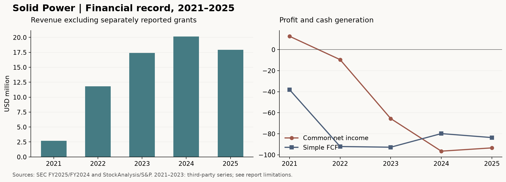

# Solid Power（NASDAQ:SLDP）研究报告

**研究日与信息截止：2026-11-12（北京时间）；金额默认美元，m 为百万美元。**  
**行情：2026-11-11 美东常规盘收盘 $1.98；已披露股数 229,188,332 股（11 月 2 日），复算市值 $453.793m。**  
**最新财务：2026Q3／9M，期末 2026-09-30；业绩 11 月 3 日发布，10-Q 11 月 4 日提交。**

Solid Power 正从研发合作走向电解质供应商：产线工程有进展，客户量产采购及单位经济仍待证明。低于净资产的价格和接近市值的流动性，给公司提供时间，但不能替股东保证回报。

## AI 研究偏见自觉

**信息丰富度评级：B；其中商业化质量为 C。** SEC 账表可查，公开资料不能证实量产良率、实际售价、材料成本及客户认证成功率。信息充足不等于投资确定性高。

**AI研究局限性声明：** 本文未接触客户或工厂，无法验证电解质性能能否在批量生产及实际电芯中同时满足寿命、压力、安全和成本要求。对现金、股本的信心高于对未来利润的信心；情景参数是分析者假设，不是公司指引。仅用于学习研究，非投资建议。

| 偏见检查 | 本次处理 |
|---|---|
| 把合作伙伴名单当收入保障 | 逐一核实协议范围、到期日及采购承诺 |
| 把产能当销量 | 分开看建成、调试、认证、订单及收款 |
| 把现金当股价底部 | 扣除未来消耗，并单列股本稀释 |
| 因“看不清”就断言技术差 | 对技术胜出不下结论；只判断现有投资证据是否够用 |

## 已有研究与本次更新

沿用既有 `SLDP` 目录与触发 target `SLDP`；确认标的是美国 Solid Power, Inc. 普通股，Nasdaq 代码 SLDP，SEC CIK 1844862。SLDPW 是同一发行人的上市权证，**不适用普通股价格带**；并非其他名称相似公司或 ADR。

历史基线为 [2026-08-05 公司研究](SLDP-research-20260805.md)（含 8 月 29 日 Q2 披露复核）和 [2026-07-16 固态电池行业研究](../固态电池/固态电池-research-20260716.md)。前者财务覆盖 Q2、结论为观望，原 $1.50–$2.00 为附商业条件的研究带；行业报告提供路线背景，不是本次独立财务来源。[跟踪台账](../标的跟踪表.md)和[11 月 10 日监控](../daily-monitor/daily-monitor-20261110.md)提示价格进入旧带，但不证明经营条件已满足。

| 旧判断或未解决问题 | 本次状态 | 新证据与对行动的影响 |
|---|---|---|
| 材料、开发及授权是价值核心 | 强化、修正边界 | 公司不以商业电芯制造商为目标；不能用整车电池总市场直接推其收入 [S1][S2] |
| 流动性充裕，无金融借款 | 维持但缓冲下降 | 第三季度流动性 $397.561m，第二季度为 $419.326m；存在租赁和经营负债 [S1][S5] |
| BMW／Ford／SK On 合作都可作为当前开发抓手 | 削弱并局部推翻 | Ford 开发收尾；Samsung SDI／BMW 联合评估协议 9 月 30 日完成并到期；继续接洽不等于续约 [S1][S3] |
| 尚缺可量化长期承诺 | 修正旧表述 | SK On 已有小额最低材料采购承诺；但现有研发许可不授权商业电芯生产，新协议未签 [S3][S4] |
| 收入弱，但尚未拆出原因 | 补齐 | 第二季度有 $1.2m 非现金收入冲回；前九个月补助占合计收入约 66.96%，不是材料复购增长 [S1][S5] |
| 管理层持股、潜在融资待核 | 部分解决 | 已核直接配售、预付权证及普通权证；当前管理层完整持股仍缺可靠独立第二来源 [S1][S8] |
| $1.50–$2.00 可作为条件式期权评估带 | 本次替代 | 旧报告主要用静态现金；本次补入烧钱、负债及稀释。旧带降为历史观察，不再承接建仓含义 |

检索覆盖 2025 年报、Q2／Q3 10-Q、9 月演示、10 月 26 日产线公告、11 月 3 日电话会及截至研究日可检索公司新闻／SEC 列表。未发现此后足以证明新增产能锁单的正式文件；这不等于保证没有未索引文件。未来财报发布日期尚未确认，计划复检日不冒充官方日历。Macrotrends 页面返回访问限制，未沿用旧报告取整数；本次以 SEC 原始报表与 StockAnalysis／S&P 取数复核。原始财务底层仍来自公司，第三方复核不是独立审计。

---

## 第一步：核心数据总览

### 财务快照：先区分收入与补助

| 指标 | 披露或复算值 | 口径 |
|---|---:|---|
| FY2025 收入，不含补助 | 17.913m | 公司原始报表 Revenue；第三方 17.91m |
| FY2025 补助 | 3.834m | Grant income，不能称作材料销售 |
| FY2025 收入及补助合计 | 21.747m | 旧报告主要使用此数 |
| FY2025 归普通股净利润 | -93.410m | 含非经营项目 |
| FY2025 研发费用 | 72.513m | 原始报表；标准化第三方 71.77m 有超过 1% 的差异，估值不用其标准化研发数 |
| Q3 收入，不含补助 | 0.243m | 同比 -93.49%；政府收入本季为零 |
| Q3 补助 | 0.981m | 合计 1.224m |
| 9M 收入，不含补助 | 1.331m | 其中非政府收入 1.203m，政府收入 0.128m |
| 9M 补助／合计 | 2.698m／4.029m | 合计同比 -77.76% |
| Q3／9M 经营亏损 | -29.840m／-86.474m | 比净利润更能看主营负担 |
| Q3／9M 归普通股净利润 | -24.353m／-61.203m | 前九个月含权证负债公允价值收益 13.463m，不是经营现金流 |
| 9M 经营现金流／购建设备支出 | -43.967m／12.609m | 简单 FCF 为 -56.576m |
| Q3 现金及等价物 | 23.278m | 不含受限现金 0.280m |
| Q3 可供出售债券 | 374.283m | 包括流动证券与非流动债券投资 |
| Q3 流动性 | 397.561m | 现金加可供出售债券，非全部银行存款 |
| Q3 股东权益 | 478.772m | 其中设备、知识产权等不能按账面全额变现 |
| 2026 现金投资指引 | 75m–85m | 由 85m–100m 下调；是管理层指引，不是未来不变烧钱率 |

来源：[2025 10-K][S3]、[Q3 10-Q][S1]、[Q3 公告][S2]、[Q2 10-Q][S5]与[StockAnalysis 财务][S6]。未披露单独材料销量、单价、许可费分部利润，不能自行补出“材料业务毛利率”。公司只有一个报告分部。

### 五年趋势图表

| 年度 | 收入，不含单列补助（m） | 归普通股净利润（m） | 简单 FCF（m） | 现金及短期投资（m，未含长债） |
|---|---:|---:|---:|---:|
| 2021 | 2.71 | +12.66 | -38.06 | 589.33 |
| 2022 | 11.79 | -9.56 | -92.12 | 323.08 |
| 2023 | 17.41 | -65.55 | -92.77 | 176.04 |
| 2024 | 20.139 | -96.52 | -79.84 | 118.20 |
| 2025 | 17.913 | -93.410 | -83.605 | 250.78 |



历史 2021–2023 为第三方标准化序列，未逐年取得第二来源，低于最近两年账表的验证等级，不进入估值输入；2021 普通股利润受非经营及优先股调整影响，不能视为主营赚钱。现金列只是短期资产分类，随债券期限迁移大幅变化，不能据此直接计算总流动性下降。2025 设备 CapEx 取 10.212m，FCF 不含无形资产购置；第三方四舍五入显示 -83.60m。

五年第三方标准化经营利润率依次约 -978.83%、-501.48%、-520.50%、-523.03%、-558.72%；2025 标准化经营利润 -100.08m 与原始 -100.832m 的分类有差异，近期判断使用原始报表，不能将整列当作同口径量产毛利趋势。[S6]

2025 可比“收入减直接成本”的粗略毛利率为 -15.27%；公司未提供可比量产材料毛利。五年表和图说明研发现金消耗先于规模收入，不能据此外推永久负利润，也不能因为 2021 账面盈利就判定商业模式已经跑通。[S3][S6][S7]

### 最近四季：波动不是正常销量曲线

| 期间 | Revenue（m） | Grant income（m） | 合计（m） |
|---|---:|---:|---:|
| 2025Q4，全年减 9M 推算 | 2.571 | 1.060 | 3.631 |
| 2026Q1，H1 减 Q2 推算 | 2.105 | 0.968 | 3.073 |
| 2026Q2 | -1.017 | 0.749 | -0.268 |
| 2026Q3 | 0.243 | 0.981 | 1.224 |
| 滚动四季，工具加总 | 3.902 | 3.758 | 7.660 |

Q2 负收入来自 SK On 里程碑可变对价估计变化导致的冲回，不能解读成“卖出负数量”，也不能无条件当作无关紧要的一次性：它暴露履约估计与商业里程碑兑现风险。9M OCF 改善包含合同资产回收及递延收入变化，不等于终端材料复购改善。[S1][S5]

> 巴菲特式追问：报表里哪些钱可以重复赚到？目前补助、开发里程碑和现金利息比经验证的材料复购更清楚。

---

## 第二步：生意本质分析

**这门生意是向电芯厂出售硫化物电解质及相关技术，让客户用自己的产线验证并制造固态电芯；真正稀缺的是可认证、可批量复制的材料性能与成本组合。**

| 现金来源 | 谁付钱、为何付钱 | 重复性与障碍 |
|---|---|---|
| 研发许可与服务 | SK On 等购买工艺知识和试验能力 | 里程碑型，收入可冲回；不是稳定版税 |
| 产线安装 | 客户购买试验线建设和技术转移 | 项目型，Q2 完成旧安装工作后收入自然减弱 |
| 电解质 | 客户为样品和研发采购材料 | 可发展成复购，但目前销量、ASP 和贡献利润未披露 |
| DOE 补助 | 政府支持中试线建设 | 非商业客户需求；拨款条件和政策有风险 |
| 股权融资 | 投资者支付技术期权价值 | 不属于营业收入，增加存续能力同时摊薄每股权益 |

SK On 既有框架包括约 20m 研发许可、约 22m 产线安装，以及截至 2030 年至少采购 8 吨电解质、公司预期至少 8.3m 材料收入。最低采购有价值，但不足以承接整个汽车电池市场叙事；研发许可不允许商业电芯生产，新商业授权仍需另谈。[S3]

客户今天也能选液态／半固态锂电、其他硫化物材料，或自研。若 SLDP 的材料能嵌入量产化学体系，重复采购与转换成本会增强；在此之前，OEM 及电芯厂掌握验证日程、预算和路线切换权。

名义产能增加并不会自动产生经营杠杆。固定研发、干房与安全支出先发生，产量合格率、认证周期、材料售价及原料成本共同决定盈亏。MOBIUS 从批次法走向连续工艺是必要工程步骤，但还缺实际成本／良率曲线。

> 段永平式追问：好在哪里？潜力在于材料和许可比自建全球电芯厂更省资本；今天仍缺客户持续付钱且覆盖全部成本的证明。

---

## 第三步：护城河评估

| 类型 | 当前证据 | 判断与证伪条件 |
|---|---|---|
| 品牌／定价权 | 尚无量产客户持续接受溢价的记录 | 弱；若仅能以亏损价格获试样订单，不构成定价权 |
| 转换成本 | 化学体系导入需要认证及工艺适配 | 潜在中等；认证未完成，客户仍可多路线并行 |
| 网络效应 | 材料客户增加不自动提高彼此价值 | 无；共同开发经验是学习效应，不是网络效应 |
| 规模／成本 | 连续生产理论上改善一致性和成本 | 尚未验证；需要合格吨成本，而非额定吨产能 |
| 技术／专利 | 配方、工艺、客户协同具有知识积累 | 潜在中等；未证明领先年限或不可复制程度 |

过去五年，知识积累和伙伴试验能力有进步；经济护城河没有随伙伴数量线性变宽。Samsung／BMW 评估完成却未见续签，恰好说明技术试验与长期商业绑定是两回事。未来五年的“变宽”应由多客户认证、可盈利采购及工艺成本优势来证明。

竞争对象不仅是 QuantumScape 等固态电芯开发者。SLDP 的直接问题是与其他硫化物材料商、电芯厂自研争夺材料预算，同时面对液态锂电持续改良。无法得到可信的电解质市场份额，故不填“行业第一”或技术领先若干年的数字。[S1][S3]

> 巴菲特式追问：十年后还在吗？若客户更换材料容易、专利难执行或液态路线持续降本，今天的研发领先不会成为十年的经济租金。

---

## 第四步：逆向思考与风险清单

最强反方不是“固态是骗局”，而是：**即使固态成功，SLDP 也可能只是有用但缺乏定价权的上游供应商，且成功前的现金消耗和稀释足以让今天股东回报很差。**

| 失败路径 | 概率判断，非统计频率 | 影响 | 可观察信号 |
|---|---|---|---|
| 技术或经济性无法达标 | 高不确定性 | 可能永久损失 | 客户认证反复、无法披露成本／合格率改善 |
| 新产线达产但无订单 | 中高 | 固定成本吞噬现金 | 只有产能公告、没有采购量及期限 |
| 客户合同缩减或不续签 | 中高 | 收入骤降及论文削弱 | 评估到期、新协议长期停留于讨论 |
| 韩国 JV 出资及进度超预期 | 中 | 母公司承担更多资本 | 资本承诺增长快于订单或合作方实缴 |
| 融资／激励持续稀释 | 高 | 企业成功不等于每股成功 | 股数扩张、附带权证、ATM 再开 |
| 补助削减、供应链及关税变化 | 中 | 现金需求增加 | DOE 拨款延迟、投入成本上升 |
| 退出／诉讼责任超出已知负债 | 未能量化 | 尾部损失扩大 | 新赔偿要求、清算折价或终止支出 |

这些风险相关，不能把表中主观概率相加。第七步另设失败归零的尾部情景，概率仅用于暴露假设敏感性。

历史类比可借鉴早期电池材料及新型制造技术“实验室验证—客户认证—工厂复制”的落差，但没有选取一个故事就套成功率。A123 等历史案例若没有逐案重读一手材料，不在本报告中作为已验证统计证据。采用技术采纳曲线时，试验样车属于早期验证，不是大众市场渗透率。

我最可能犯的错误，是低估客户认证和隐性工程价值，或反向高估账面现金的可回收性。多头的最强依据则是现金提供了多轮试错时间，材料模式资本需求可能低于电芯模式；若签下可信商业合同，小市值可能有较大弹性。这些优点需要合同和成本来兑现。

> 芒格式追问：聪明人为什么不买？因为他们无法验证最终单位利润，也不能用账面现金消除连续研发消耗和融资风险。

---

## 第五步：管理层评估

CEO John Van Scoter 有半导体及技术产业管理经验；CFO 为 Linda Heller。履历能说明执行背景，不能替代商业化成绩。[S2][S8]

| 时间／决策 | 已知结果 | 本次评价 |
|---|---|---|
| 2024–2025 回购 | 在研发亏损期使用现金回购普通股 | 有价格纪律的可能；仍须与随后融资和权证成本一并评估 |
| 2025 ATM 融资 | 补充现金，普通股股数增加 | 有效延长存续；不能把融资增加的现金当盈利积累 |
| 2026 年 1 月直接配售 | 净得 121.345m；附普通股、预付及普通权证 | 融资窗口把握值得肯定；附带长期权证损害须计入每股分析 |
| 2026 推进 MOBIUS | 工程进入投料调试，年底仍是目标 | 有进展，尚不能评为成功量产 |
| 2026Q3 下调现金投资指引 | 75m–85m | 正面，但须继续核实是否牺牲验证速度或把支出移至以后 |

9 月末实际普通股 228,276,970 股，11 月 2 日已增至 229,188,332 股；相比 2025 年末增长约 13.92%。亏损期基本／稀释加权股数相同，是反稀释会计规则，**不意味着没有未来稀释**。旧报告将期末实股称作“稀释后股数”，本次纠正。

截至 Q3，预付权证已全部行权，已进入实股，不能再次相加。另有 45,614,036 份本次配售普通权证，行权价 $7.25、到期 2033-01-31，约为已披露股数的 19.90%。当前价下不当作已行权；上涨情景应同时计入新增股数与行权现金，不能只减股东份额、不加现金。另有旧 SPAC 权证及期权／RSU，完整未来稀释比单项权证更多。十年模型的年 3% 股数增长只是综合情景，未逐份模拟所有行权路径。[S1]

管理层一致性核验：委托书的 beneficial ownership 包含可在短期取得的期权／RSU，不能等同已投入真金白银的普通股。已查 2026 委托书与 10 月 1 日 Form 4；后者代码 F 为归属扣税，不应指称为主动看空减持。当前经济持股比例缺少可靠独立第二来源，本次不把第三方不一致的持股数纳入评分或估值。CEO 2025 总薪酬约 4.69m，主要为股权奖励，非全现金；仍须看里程碑是否最终变成每股现金创造。[S8]

公司仍依赖核心技术团队和客户关系；公开资料不足以给出研发回报率、人才稳定性或 CEO 退休后的业务韧性评分。当前管理层评价是“融资与工程执行有证据，资本长期回报待验证”。

> 段永平式追问：CEO 退休还行吗？尚缺稳定盈利和可复制客户体系，不能假设只靠制度就能延续。

---

## 第六步：行业与文明趋势

更安全、能量密度更高的储能材料有长期价值，但电动车、电池、固态电池和硫化物电解质是四层不同市场，不能把最外层 TAM 当 SLDP 的可获取收入。机器人、无人机及国防也只是潜在新应用，暂无足以支持独立收入预测的合同数据。[S2][S4]

自下而上的收入关系应是“合格销售吨数 × 每吨售价 + 可兑现许可费”；再扣原料、合格率、客户服务和研发开支。当前没有可靠售价、客户配方中材料用量及量产渗透数据，因此不引用一个看似精确的全球市场 CAGR 来填补收入缺口。大趋势成立，并不自动让利润留在材料商。

| 价值链位置 | 谁掌握关键变量 | SLDP 的机会与约束 |
|---|---|---|
| 原料与电解质 | 材料纯度、成本、配方 | 稳定供应可产生复购；原料及安全管理压缩利润 |
| 电芯设计与制造 | 电芯厂的良率、工艺及认证 | SLDP 可授权，但量产收益由合同决定 |
| 整车／应用 | OEM 的平台、质保和预算 | 客户握有路线与供应商选择权 |

工程事实是名义产能计划从 30 吨增至 75 吨；新增 45 吨，完整调试目标为年底。电话会说明新增产能尚未被供货协议锁定，未来客户还需认证。韩国 JV 与更大商业工厂是规划，不是已出资、已投产的资产。[S1][S4][S9]

> 李录式追问：二十年后是关键材料平台还是众多供应商之一？现在足以判断需求方向，尚不足以判断 SLDP 的最终利润份额。

---

## 第七步：估值与安全边际

### 当前定价：接近现金，却不是现金替代品

| 指标 | 复算值 | 解释 |
|---|---:|---|
| 普通股市值 | 453.793m | $1.98 × 229.188332m 股；非实时完全摊薄市值 |
| 每股总流动性 | $1.7346 | 使用最新已披露股数与 Q3 现金快照 |
| 借款口径净现金 | 397.561m | 公司无金融借款；不把租赁遗漏成零负担 |
| 扣租赁债务代理后的金融净资产 | 约 390.131m | 第三方租赁债务约 7.43m；为扩展口径 |
| 现金外企业价值，借款口径 | 56.232m | 未加租赁、未作证券风险折价，不能与别家的含租赁 EV 混比 |
| PB | 0.948x | 用最新股数与 Q3 权益；账面设备不是现金 |
| PS／EV 收入倍数 | 116.30x／14.41x | 分母为不含补助的滚动收入 3.902m |
| PE／PEG | 不适用 | 亏损；负 PE 不具有“便宜”的经济含义 |
| 简单滚动 FCF 收益率 | -17.53% | 滚动 OCF 减设备 CapEx 为 -79.565m；未额外扣无形资产购置 |
| 静态现金跑道 | 4.68–5.30 年 | 397.561 ÷ 年 85–75；无扩产、无融资的静态比值，不是保底存续期限 |

总流动性必须包括非流动的可供出售债券，但剔除权益法投资：23.278 + 211.996 + 163.600 − 1.313 = 397.561m。只用第三方“现金及短期投资”235.274m 会低估金融资产；直接把全部 Investments 都算成现金也不对。[S1][S7]

2025 年末到 Q3 的流动性增长主要有股权融资支持，不能写成经营创造现金。按当前静态数，市场仅为现金外业务支付约 56m；但如果未来几年继续每年消耗现金，期权成本会通过每股金融资产下降被持续支付。

### 三年三情景：回答贵不贵

对亏损 EPS 机械套三年增长及正 PE，会输出负股价。已运行技能要求的 EPS 工具诊断，结果不具经济意义，排除出定价。改用工具计算“金融资产消耗 + 商业期权”的三年框架，拒绝用负 EPS 的数学输出充当目标价。

统一假设：起点金融流动性 397.561m，先保守扣全部已知负债 26.225m 及夹层权益 0.427m，剩 370.909m；不计工厂清算价值。其后每年净消耗分别为 100m／80m／60m，不再另加利息收入；年股数增长 3%，三年后约 250.440m 股，无股息；美元折现率 10%。扣全部负债可能与未来现金消耗部分重叠，是保守框架，不是精确清算会计。

| 情景 | 三年累计净消耗（m） | 2029 现金外业务价值假设（m） | 折回今日每股值 |
|---|---:|---:|---:|
| 悲观：认证延后，商业期权耗损 | 300 | 0 | $0.213 |
| 基准：付费验证延续，尚非规模赢家 | 240 | 150 | $0.843 |
| 乐观：认证及商业合同明显兑现 | 180 | 500 | $2.073 |

**150m 与 500m 是显式期权报价假设，缺少可观察稳定现金流，不能称为客观内在价值。** 它们表示投资者在三年后愿为已获更强证据的业务支付的金额；不是公司预测，也没有用同行今天的股价证明它们正确。35%／45%／20% 的示意权重给出约 $0.868，但不是统计期望或目标价。若期权报价假设不接受，应舍弃这个加权数，回到合同和现金验证。

反向检验更直观：按基准烧钱与稀释，要让今天 $1.98 在三年尺度满足 10% 要求回报，2029 年现金外业务需值约 529.096m，明显高于本报告 150m 的基准假设。市场也可能正确：若锁单和单位经济远超基准，应上调模型，不能为等待低价而拒绝新证据。

旧报告只有静态现金参照，没有覆盖未来研发消耗；本次价格带变动既来自新事实，也来自方法补全，**不是声称商业价值已被精确下调某个百分比**。历史 PS/PB 因融资、补助和微小收入分母变化不适合做估值分位。同行 QS 的电芯／许可模式与 SLDP 材料模式也不能直接套相同 PS；未取得同一时点可比估值，本次不编同行折价表。

### 十年折现：只约束仓位

这是高度假设化的仓位压力测试，不是唯一买入否决票。2036 利润没有公司指引支撑。

| 输入 | 判断及理由 |
|---|---|
| 币种、r | USD，资本成本 10%；使用长期无风险利率假设 5% + 标准化 β 1.0 × ERP 假设 5%。不是声称当天国债报价恰为 5%；也未把股票短期高 β 生搬进去 |
| ROIC | 条件成功后的稳态增量 ROIC 20%；假设材料／许可带来一定壁垒，仍远未被现实证实；不是负利润阶段的实测 ROIC |
| 永续 g | 悲观／基准／乐观为 0%／3%／4%，USD 上限 4%；与十年内增长不同，敏感性时不随 r 改 |
| 失败档 | 主观概率 40%，2036 普通股回收为零；技术、客户及融资失败合并尾部，非统计破产率 |
| 基准／乐观 | 概率 40%／20%，2036 公司净利润分别 60m／180m；无中途股息，不单独再加现有现金 |
| 稀释 | 各成功档年股数增长 3%；2036 约 308.010m 股，先折成今日股东对应利润，再计算终值 |

终值 PE 唯一使用 `(1 − g/ROIC)/(r − g)`。不是同行倍数：悲观 10.000x，基准 12.143x，乐观 13.333x；分母分别 10、7、6 个百分点。失败档价值为零，其 PE 只是形式占位，不意味着还有盈利。

| 情景 | 2036 公司利润（m） | 扣累计稀释后、今日股东对应利润（m） | 十年终值持有回报率 |
|---|---:|---:|---:|
| 失败归零 | 0 | 0 | -100.00% |
| 基准 | 60 | 44.646 | +1.79% |
| 乐观 | 180 | 133.937 | +14.68% |

归零档按十年末零终值计算的几何率为 -100%，不表示每年亏掉全部本金；真实失败时点未建模。工具的概率加权 IRR 为 **-36.35%**，是各情景年化回报的算术均值，**不等于组合财富的年增长率**，也不等于预测股价每年下跌幅度。按同一权重先加权终值财富再年化，得到约 **+2.38%**；此数也不是投资者单一路径实际回报。两者都提醒“成功概率与失败回收假设决定仓位”，不能用一个极端均值冒充精确回报预测。

| 敏感性档位 | 期望 IRR，工具定义 | 是否覆盖该档 r | 有效性 |
|---|---:|---|---|
| r=8% | -34.00% | 否 | 区间外，仅供参考 |
| r=10% | -36.35% | 否 | USD 合理区间内 |
| r=12% | -38.01% | 否 | 区间外，仅供参考 |
| r=9%，补做区间内复核 | -35.29% | 否 | 合理区间内 |
| r=11%，补做区间内复核 | -37.24% | 否 | 合理区间内 |

**在币种合理区间内随 Δr 不翻转。** 8% 与 12% 不参与正式翻转判断；再跑 ±1pp 后仍未通过。这里稳定的是在同一高度不确定的利润／失败假设下的压力测试，不代表估值本身可靠。合理区间内成功档分母均至少 5 个百分点；8% 乐观档仅 4 个百分点，只能作参考。

反向十年检验：假设不失败、年稀释 3%、基准终值 PE 12.143x、无中途股息，要让 $1.98 获得 10% 年回报，2036 净利润需约 130.267m。若净利率为情景假设 15%，对应收入约 868.450m。不能把这解释成公司预测；它展示当前投资要跨越多大的商业化距离。加入失败风险后，成功档要求更高。

### 估值分歧对账与边界

本次三年基准也未提供安全边际，与十年压力方向一致；但“现金外 EV 仅约 56m”和旧报告“接近现金可评估”的直觉偏正面。分歧来自静态资产与持续烧钱的时间维度：前者是今天支付的期权价格，三年模型是价格判断，十年模型是仓位压力测试。最终观望来自生意未验证、护城河未形成、合同到期及价格缺缓冲共同作用，**不是十年 IRR 低于 r 的单票裁决**。

三年现金外估值与十年利润是独立压力情景，没有伪装成同一经营预测的连续路径；二者不加总。ROIC、利润、期权价值与失败概率均低置信度。离散风险未塞进 r：技术归尾部、客户／补助／融资归情景；**诉讼赔偿与极端退出摩擦未量化**，可能使实际回收更差。多年扩产出资、融资价格、全部权证行权及终值年前留存现金未逐年展开；因此不能把压力测试当完整现金流 DCF。

> 巴菲特式追问：r 错 2 个百分点会翻转吗？币种区间内补做 9%–11% 仍不翻转；真正可能翻转判断的是客户合同、盈利与失败概率，而非把 r 调低。  
> 段永平式追问：关闭股市五年愿持有吗？没有客户／工厂一手验证能力，本报告尚找不到足够依据以现价持有价值仓。

---

## 第八步：最终决策与行动清单

| 六个并列维度 | 结论 | 信心度 |
|---|---|---|
| 生意质量 | 有价值的材料研发选择权，复购利润未验证 | 中低 |
| 护城河 | 工程经验存在，经济壁垒尚待认证与定价证明 | 中低 |
| 管理层 | 融资与产线推进有成绩，每股资本回报待证明 | 中 |
| 最大风险 | 认证、合同与持续稀释；资金充裕不消除永久损失 | 高，风险识别层面 |
| 文明趋势 | 更好电池有需求，硫化物路线与公司利润份额不确定 | 中 |
| 估值 | 三年基准示意现值约 $0.84；十年未通过仓位压力、区间内不翻转；均高度依赖假设 | 低 |

**综合结论：观望，现价不新增价值仓。** 估值不是唯一裁决；即使未来十年模型覆盖资本成本，也须同时证明生意和合同质量。十年模型当前只支持收紧风险预算。

| 价格／条件 | 含义与动作 |
|---|---|
| $0.60–$0.80，且下述经营条件同时通过 | 仅重新研究极小期权仓；相对三年基准保留部分缓冲，不是承诺买点或清算底价 |
| $0.80–$2.10 | 观察带；目前 $1.98 落入此带，保持观望；暂停旧 $1.50–$2.00 的建仓评估含义 |
| ≥$2.10，经营证据和模型没有上调 | 不追高，复核已有超配仓；不是自动卖出指令 |
| <$0.60 | 先查融资、客户或技术永久损失，不能因更便宜自动买入 |

进入 $0.60–$0.80 后，还须同时满足：MOBIUS 完整调试并进入有进度可核的客户认证；至少一个能核验采购量、期限及商业用途的新增／续签付费合同；至少两个可比季度材料或许可现金证据改善，剔补助及冲回；届时总流动性仍至少 300m、滚动净消耗未恶化且 JV 资本承诺／新增股数可解释。300m 是本报告风险门槛，不是公司财务预测。若财务期数或股本显著改变，先重估价格带。

| 投资者／信号 | 建议 |
|---|---|
| 空仓者 | 继续观望；有能力验证客户与工厂且全部条件通过，才研究首笔约组合 0.25%、总参考上限 0.5% 的可归零期权资金 |
| 持仓者 | 若本来是极小风险仓且能够承受全损，可带条件继续复检、不加仓；若当作现金替代或核心价值仓，纠正定位并降低超配风险 |
| 卖出／退出研究信号 | 关键认证／合同实质失败、资金耗损明显超预期而无融资保障、严重不利稀释、技术路线失去客户或治理可信度破坏；不限价格 |
| 加仓信号 | 价格与全部经营条件同时成立，且重新核算每股权益；样车、ISO、产能公告或机器人新闻单独不触发 |
| 下次复检 | 2026-12-31 查 MOBIUS、ISO、韩国 JV 和 SK On 新协议；2027-03-01 查全年披露日历与融资，均为研究检查日，不是确认财报日 |

与直接等待有自由现金流的公司相比，SLDP 要承担无法靠公开数据消除的工程风险；闲置资金的机会成本低于误把技术期权当低风险资产。小仓上限是研究示例，未结合用户现有组合，不构成个性化配置方案。

### 四位大师的方法校准，不冒名背书

- **巴菲特：** 已读 [1996 年股东信](https://www.berkshirehathaway.com/letters/1996.html)，短引 “knowing its boundaries, however, is vital.” 本报告延伸：能力圈边界在客户成本和认证，不能靠账面现金替代认识；这是方法推演，并非他对 SLDP 的观点。
- **段永平：** 已读[仓库存档第 72 条](../拼多多/段永平雪球发言-PDD相关.md)及其中[2022-03-24 出处](https://xueqiu.com/1247347556/215025016)，短引“我没办法看懂10年后这个公司会是什么样子”。原文谈拼多多，不谈 SLDP；本报告借其“理解未来赚钱方式”的标准，不能把他“看不懂不等于不看好”的立场改写成必然看空固态电池。
- **芒格：** 未取得足以支撑对 SLDP 或该路线具体立场的一手原文，资料不足，不模拟代言。逆向风险分析为本报告判断。
- **李录：** 未取得足以支撑对 SLDP 或该路线具体立场的一手原文，资料不足，不模拟代言。文明趋势分析为本报告判断。

---

## 需要一手验证的问题清单

1. MOBIUS 合格吨成本、良率、纯度一致性、能耗及安全费用，比批次线到底改善多少？额定产能多久转成实际合格产量？
2. Samsung／BMW 评估结果为何未立即形成新商业协议？后续资格认证是否有明确时间、规格和预算？
3. SK On 新协议是否允许商业生产，是否含最低采购、价格、排他性或退出条款？既有最低材料合同已交付／收款多少？
4. 韩国 JV 各方出资、技术归属、担保、扩产预算及锚定客户分别是什么？谁承担需求不达预期的损失？
5. 客户的堆叠压力、循环寿命、快充和质保需求能否同时满足？独立测试与客户实际配方是否一致？
6. 完整管理层经济持股、未归属奖励及全部融资工具在不同股价下，对现有股东究竟摊薄多少？

## AI 分析置信度与投资确定性

**AI 分析置信度：财务与合同现状中高，技术经济性及估值低。** 已充分支持的是现金仍多、收入弱、补助占比较高及新增产能尚未锁定供货；有限信息推理的是未来利润、失败概率和价格条件。

**实际投资确定性：低。** 财务资料再增加一倍，也不能替代合格率、单位利润和客户长期采购的现实证明。报告保留技术成功及估值上修的可能，但现有证据不足以建立核心价值仓。

## 数据来源与审计记录

[S1]: https://www.sec.gov/Archives/edgar/data/1844862/000110465926122310/sldp-20260930x10q.htm "2026Q3 10-Q，2026-11-04 提交"
[S2]: https://ir.solidpowerbattery.com/investor-relations/investor-news/news-details/2026/Solid-Power-Reports-Third-Quarter-2026-Results/default.aspx "2026-11-03 Q3 业绩"
[S3]: https://www.sec.gov/Archives/edgar/data/1844862/000110465926019435/sldp-20251231x10k.htm "2025 10-K，2026-02-25"
[S4]: https://www.fool.com/earnings/call-transcripts/2026/11/04/solid-power-sldp-q3-2026-earnings-call-transcript/ "11月3日电话会的11月4日转录，非独立公司公告"
[S5]: https://www.sec.gov/Archives/edgar/data/1844862/000110465926090634/sldp-20260630x10q.htm "Q2 10-Q"
[S6]: https://stockanalysis.com/stocks/sldp/financials/income-statement/ "StockAnalysis/S&P 损益表"
[S7]: https://stockanalysis.com/stocks/sldp/financials/balance-sheet/ "StockAnalysis/S&P 资产负债表"
[S8]: https://www.sec.gov/Archives/edgar/data/1844862/000110465926041131/tm261518-1_def14a.htm "2026 委托书"
[S9]: https://www.solidpowerbattery.com/investor-relations/investor-news/news-details/2026/Solid-Power-Announces-Significant-Advancement-in-Commercial-Pathway-Commissioning-MOBIUS-Continuous-Electrolyte-Manufacturing-Line/default.aspx "2026-10-26 MOBIUS 公告"

行情以[公司 IR 收盘快照](https://ir.solidpowerbattery.com/investor-relations/stock-info/default.aspx)与[Yahoo 历史行情](https://finance.yahoo.com/quote/SLDP/history/)及[StockAnalysis](https://stockanalysis.com/stocks/sldp/)核对；财务第三方为 S&P 数据服务，不把公司公告转载计作新的独立事实来源。现金流参见[第三方现金流表](https://stockanalysis.com/stocks/sldp/financials/cash-flow-statement/)。管理层最新归属税款性质参见[2026-10-01 Form 4](https://www.sec.gov/Archives/edgar/data/1844862/000184486226000026/xslF345X06/primary_doc.xml)。

### 关键数据交叉验证记录

以下为 `financial_rigor.py` 实际输出摘要；该工具默认容差宽于技能要求，本报告另外按 1% 复核。百分比按未取整数比较。

```text
verify-market-cap：Price 1.98 USD × Shares 229,188,332 = 453.79M USD；
reported 453.79M USD，偏差 0.00%，通过。
cross-validate FY2025 Revenue：SEC 17.913m / StockAnalysis 17.91m，工具各偏差 0.01%。
cross-validate FY2025 Common Net Loss：SEC -93.410m / StockAnalysis -93.41m，偏差 0.00%。
cross-validate Q3 cash：SEC 23.278m / StockAnalysis 23.28m，工具各偏差 0.00%。
cross-validate Q3 aligned liquidity：SEC 397.561m / 第三方分项对齐 397.567m，偏差约 0.00%。
第三方对齐：23.28 + 212.00 + 163.60 − SEC单独识别的权益法投资1.313。
最后一项口径拆分仍依赖SEC，不能称为完全独立的总流动性确认。
cross-validate filing-date shares：SEC 229.188332m / StockAnalysis 229.19m，偏差约 0.00%。
Q3合计收入1.224m与StockTitan一致，但后者是SEC摘要，只属转载复核。
verify-valuation：PB 0.95x；FCF Yield -17.53%；负PE不用于定价。
terminal_value audit：C1/C2/C3准出；未建模诉讼及退出摩擦须保留限制。
flip ±2pp及±1pp已执行；合理币种区间内未翻转，均未覆盖资本成本。
```

核心算术与多源记录见[验证附件](SLDP-verification-20261112.txt)，十年参数见[模型参数](SLDP-model-20261112.json)。附件不包含下载的公告全文、PDF 或完整模型提示。

抽检状态：`report_audit.py` 以随机种子 20261112 从 89 个可提取数字中抽检 14 项，14 项数值核对通过、无警告。其中公司披露或据披露复算 9 项，情景模型算术／参数核对 5 项；后者不构成对假设真实性的外部验证。抽检中的公告转载只作同源复核，不能替代独立证据。明细见[抽检记录](SLDP-audit-20261112.json)。终稿另跑十年口径 audit，C1／C2／C3 准出；未建模风险保留。

*本报告仅供学习研究，不构成证券买卖建议。*
