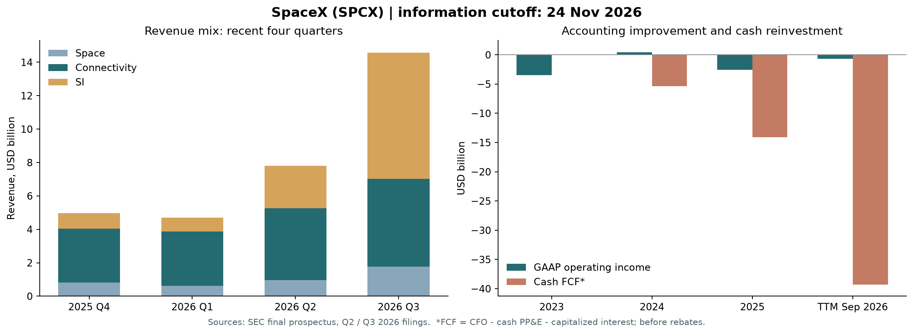

# SpaceX（SPCX）研究报告

**数据截止日：2026-11-24（北京时间）**。证券为 Space Exploration Technologies Corp. 的纳斯达克 A 类普通股，代码 SPCX，无 ADR 换算。估值统一采用最近完整交易日 **2026-11-23 美东 16:00 收盘价 133.35 美元**，不混入 11/24 盘中价格。

最新披露总股本为 13,581,063,709 股（截至 10/15），复算权益市值 **1.8110 万亿美元**。滚动收入市销率 56.52 倍；集团滚动净利润和自由现金流仍为负，历史 PE、P/FCF 不适用。行情由 [StockAnalysis](https://stockanalysis.com/stocks/spcx/market-cap/) 与 [Yahoo Finance](https://finance.yahoo.com/quote/SPCX/?fr=sycsrp_catchall) 交叉核对；股数以 [Q3 10-Q 封面](https://www.sec.gov/Archives/edgar/data/1181412/000162828026066880/spcx-20260930.htm) 为主，并与 [第三方股本统计](https://stockanalysis.com/stocks/spcx/statistics/) 核对。

本次研究的核心问题是：**星链与发射体系已有很强竞争优势，但买入 SPCX 同时承担 AI 算力、软件并购及控制股东后续资本配置；这些资产最终能留下多少属于每股股东的现金？**

本报告接续 [6 月研究](SpaceX-research-20260623.md)，沿用现有公司目录。旧报告作为历史材料保留，本次重新建立财务与估值口径。本文用于学习研究，不构成投资建议。

---

## AI 研究偏见自觉

**信息丰富度评级：A 级；长期现金流可预测性明显低于资料丰富度。** IPO 文件与两季上市后财报已较充分，市场叙事也很密集。最容易犯的错误，是把技术成功、创始人声望、星链盈利和整个集团的每股投资回报当成同一件事。

**AI 研究局限性声明：**可比经审计合并历史只有 2023—2025 年，不能补造五年序列。算力与 Grok 的独立单位经济、星链维护性资本开支、未来并购换股比例均不完整。本次未找到可用的 Macrotrends SPCX 财务页，使用 SEC 原件与 StockAnalysis/S&P Global，个别字段辅以其他独立行情发布者；公司 IR 与 SEC 镜像属于同一原始披露，不冒充两个独立数据源。

- [x] 星链的优势来自发射、制造、频谱和运营的组合，资料多寡不会改变这个机制判断。
- [x] 即使删除一半媒体报道，主要结论仍可从财报、客户集中度和现金投入重建。
- [x] 最强反方不是“马斯克做不到”，而是“做到了，股东是否仍因价格、追加投资和稀释而回报不足”。
- [x] 对 AI 与轨道算力保留上行可能；证据不足处不按零价值处理，也不先按成功兑现。

> 研究追问：我是在评估一项可重复的股东现金回报，还是因为能讲清工程故事而误以为能预测利润？

---

## 第一步：核心数据总览

### 先把合并口径说清

xAI 于 2026 年并入 SpaceX，X 此前并入 xAI，属于共同控制交易，历史合并报表已追溯。下面的历史数字包含这些业务，不能称为当年的纯 SpaceX 火箭与星链单体报表。五月拆股后的历史股数也已追溯调整。以 [最终招股书](https://www.sec.gov/Archives/edgar/data/1181412/000162828026042639/spaceexplorationtechnologi.htm) 为准。

财务表单位均为**百万美元**；负号代表亏损或现金流出。FCF* 统一定义为经营现金流减现金购建 PP&E，再减单列的资本化利息，不加回产品返点，不扣减增长性投资。

| 指标 | 2023 | 2024 | 2025 | TTM 至 2026/9 |
|---|---:|---:|---:|---:|
| 收入 | 10,387 | 14,015 | 18,674 | 32,043 |
| 毛利率 | 41.18% | 42.95% | 49.39% | 56.74% |
| GAAP 营业利润 | -3,505 | 466 | -2,589 | -668 |
| 合并净利润 | -4,628 | 791 | -4,937 | -2,760 |
| 经营现金流 | 4,520 | 5,776 | 6,785 | 15,762 |
| 现金 PP&E | 4,415 | 11,163 | 20,737 | 54,960 |
| 资本化利息 | 0 | 0 | 169 | 93 |
| FCF* | 105 | -5,387 | -14,121 | -39,291 |

2021—2022：缺少上述同一合并口径的可比经审计序列，不填推测值。年度原值来自最终招股书，TTM 用年度加本年前九月减上年前九月重建；现金流由 [StockAnalysis 现金流表](https://stockanalysis.com/stocks/spcx/financials/cash-flow-statement/) 交叉核对。2024 合并净利润 791 可与 [Morningstar 年度表](https://00215-prod-alb.eci0254d.eas.morningstar.com/1c6qh1t6k9/stockreport/default.aspx?SecurityToken=0P0002DZNH%5D3%5D0%5DE0EXG%24XNAS) 对照，不能误拿普通股可分配利润 18 替代。

| 最近四季 | 2025Q4（差额重建） | 2026Q1 | 2026Q2 | 2026Q3 |
|---|---:|---:|---:|---:|
| 收入 | 4,960 | 4,694 | 7,814 | 14,575 |
| 毛利率 | 49.56% | 49.13% | 55.27% | 62.42% |
| GAAP 营业利润 | -1,373 | -1,943 | -143 | 2,791 |
| 合并净利润 | -2,347 | -4,276 | -541 | 4,404 |
| 经营现金流 | 2,665 | 1,047 | 2,419 | 9,631 |
| FCF* | -4,299 | -9,067 | -15,963 | -9,962 |

季度原值见 [Q2 发布稿](https://www.sec.gov/Archives/edgar/data/1181412/000162828026052515/earningsreleaseq22608042.htm)、[Q3 发布稿](https://www.sec.gov/Archives/edgar/data/1181412/000162828026066482/spaceexplorationtechnologi.htm) 及对应现金流量表。Q4 差额表不是独立发布的四季度财报。**会计盈利转正与现金投入高峰并存。**

Q3 合并净利润还包含 TBC 投资未实现收益 561、所得税利益 390（百万美元），不能全按正常经营利润年化。SI 的 431 营业利润保留了收购股酬费用，并非加回费用后的宣传口径；前九月经营现金也受到预收款增加支持。利润、回款时点与长期资本回报必须分别观察。[Q3 财务附注](https://www.sec.gov/Archives/edgar/data/1181412/000162828026066880/spcx-20260930.htm)



### 三个分部的经济性差别很大

| 业务 | 2025 收入 | 2025 营业利润 | Q3 收入 | Q3 营业利润 | Q3 现金 CapEx |
|---|---:|---:|---:|---:|---:|
| Space：发射、研发与任务 | 4,086 | -657 | 1,767 | -7 | 1,606 |
| Connectivity：星链连接 | 11,387 | 4,423 | 5,248 | 2,367 | 1,543 |
| SI：算力、Grok、X、Cursor 等 | 3,201 | -6,355 | 7,560 | 431 | 16,444 |

历史分部来自最终招股书；最新分部见 [Q3 官方发布稿](https://www.sec.gov/Archives/edgar/data/1181412/000162828026066482/spaceexplorationtechnologi.htm)。计算得到 Q3 收入结构为 Space 12.12%、连接 36.01%、SI 51.87%；相应营业利润率约 -0.40%、45.10%、5.70%。

这意味着：SI 已是收入最大的板块，连接业务仍贡献主要营业利润。SI 收入是按云服务交付等确认，不应说成资产出售产生的收入，也不能全部称为 Grok 订阅收入。

### 三处必须保留的差异

| 项目 | 主口径 | 对照及处理 |
|---|---|---|
| 2025 营业利润 | SEC GAAP -2,589 | 第三方标准化 -2,064，差额 525 等于重组 487 加减值 38；不混用 |
| TTM 净利润 | 合并 -2,760 | 普通股口径 -3,431；差额涉及前九月 671 的优先股视同股息，不能称为经营亏损差异 |
| 9 月末净现金 | 现金 51,294＋证券 38,561－借款及融资租赁 38,844＝51,011 | 第三方债务 39,218 另含当期经营租赁 374，净现金 50,637；两口径并列保留 |

现金及短期证券 89,855、年度收入及净亏损绝对额均完成独立发布来源核对。净现金定义差异约 0.73%，不因低于阈值就省略解释。第三方资产负债表曾显示净现金每股 8.17，和当期股数不一致；其统计页约 3.73 才对应其广义债务口径。本报告主口径自行计算每股净现金 3.756。详见 [第三方财务概览](https://stockanalysis.com/stocks/spcx/financials/)、[资产负债表](https://stockanalysis.com/stocks/spcx/financials/balance-sheet/) 与后附校验记录。

这些钱支持扩产与融资承诺，不能直接认定为可分红的闲置现金。

> 段永平式追问：哪一块收入已经证明会反复产生现金，哪一块还需要不断追加现金来证明自己？

---

## 第二步：生意本质分析

**最有证据的一句话：SpaceX 用自有发射与星座体系，向地面网络难以高效覆盖的客户持续出售连接能力，再把资金投入更大运力与 AI 基础设施。**

### 客户为什么付钱

偏远住宅、船舶、航空与政府用户，购买的是在其他网络不便、不可用或不够可靠时仍可工作的带宽。普通消费者可以按月退出，设备投入构成有限转换成本；企业、航空和政府客户还需终端安装、认证、网络整合及服务保障，转换摩擦更高。城市优质光纤覆盖区很难靠卫星全面取代地面网络，增长应看场景与容量，而非把全球人口直接当可收费用户。

Q3 星链消费者服务线路为 1,360 万，Q2 为 1,200 万；月 ARPU 从 Q2 的 66 美元回到 69 美元，但仍低于上年同期的 83 美元。线路数不是人数，也不涵盖所有直接议价的企业政府用户，不能拿期末线路乘 ARPU 反推整个连接业务收入。航空安装已超过 3,800 架。上述均为 [公司 Q3 运营披露](https://www.sec.gov/Archives/edgar/data/1181412/000162828026066482/spaceexplorationtechnologi.htm)，尚无同等粒度的独立用户审计。

### 真正驱动盈利的变量

1. **单位容量的完全成本。** 卫星制造、发射、地面站、频谱与替换费用，决定带宽能以什么价格获利。
2. **容量利用与客户组合。** 海空、政府与企业场景可提高收入质量；消费端需要同时观察流失、拥堵与地区价格。
3. **增量资本回报。** 星链利润能否覆盖星座更新，算力毛利能否覆盖 GPU、机房、供电、融资和快速折旧，决定股东剩下什么。

招股书披露卫星寿命通常约 3—5 年，内部发射和制造部分成本资本化。因此，EBITDA 加回折旧并不意味着这些成本不用再付。维护性与扩张性 CapEx 尚未充分拆分，既不能全当维护，也不能全当一次性的增长投入。[卫星资产寿命与会计政策](https://d18rn0p25nwr6d.cloudfront.net/CIK-0001181412/590df001-1c6e-4932-b4c1-07685e3d0351.html)

用“营业利润＋折旧摊销－全部现金 CapEx”作一个**非正式、税前、未扣营运资本的经营现金近似**，Q3 连接业务为 1,810，SI 为 -13,540（百万美元）。它不是分部 FCF，但足以说明相近的收入规模不代表相近的资金需求。分部经营现金流并未完整披露。

### SI 的经营杠杆何时可信

GPU 与机房先投入、产能交付后开始收费，可以出现收入与利润率快速改善。问题在于，合同在初始爬坡期后通常允许任一方提前 90 天通知终止；名义期限通常三年，并不等于三年不可撤销收款。这个条款直接决定“先投资本、后收月费”的风险如何分配。[Q2 10-Q 收入政策及云客户风险](https://www.sec.gov/Archives/edgar/data/1181412/000162828026052535/spcx-20260630.htm)

> 段永平式追问：如果停止外部融资，只让客户付款支持下一轮投资，哪些业务还能保持现在的扩张速度？

---

## 第三步：护城河评估

下表是研究判断，不是第三方评级。

| 护城河 | 当前判断 | 如何验证与证伪 |
|---|---|---|
| 品牌与定价权 | 连接领域较强，地区差异大 | 看同地区留存与价格；ARPU 季度反弹不能单独证明永久提价权 |
| 转换成本 | 航空政府较高，住宅中等偏低 | 看长期合同、认证、部署成本；用户可取消意味着护城河并不相同 |
| 网络效应 | 直接需求侧网络效应有限 | 更多用户也占容量；真正改善服务需新增供给与调度效率 |
| 规模与成本 | 最强，来源是整套执行系统 | 制造、复用、发射周转与星座运营彼此强化；观察完全单位容量成本 |
| 技术与工程 | 发射优势显著，持续领先需投入 | 同一飞行器重复使用、周转与可靠性，比单次演示更有解释力 |
| 频谱与许可 | 稀缺且附条件 | 准入、部署义务、干扰与碎片合规；许可数不等于在轨数 |
| AI 模型与云服务 | 尚未获得与星链等量的证明 | 独立付费、客户分散、GPU 更新后回报及软件留存 |

监管层面，FCC 在 2026 年初将获准 Gen2 总量扩至 15,000 颗，这是进入壁垒，也有后续履约和安全义务；不能把获批量当已经投运的资产。[FCC 官方公告](https://docs.fcc.gov/public/attachments/DOC-417881A1.pdf)

**过去五年的机制判断：**商业航天和星链的组合优势扩大。**未来五年的判断：**取决于 Starship 是否把运力优势变成可重复的成本优势，以及星链能否消化容量；SI 必须单独证明护城河，不能继承火箭的评分。

“竞争对手拿 100 亿美元能否复制？”复制整套成熟发射、制造、许可与运营体系很难；购买 GPU 并向大客户出租相对更容易获得资本。因此，同一股票内部业务的超额回报持续性差别很大。

> 巴菲特式追问：十年后仍稀缺的是频谱、低成本运力和可靠服务，还是今天某一代 GPU？支付的估值主要押在哪一项？

---

## 第四步：逆向思考与风险清单

**最强空方观点：可以买到一家技术领先、收入高速增长的公司，同时买到不足的股东回报。只要算力新增利润仍需更大的资本投入，且控制股东可以持续注入新项目，营业利润增长就不等于每股可分配现金增长。**

Q3 匿名客户 B 占集团收入 34.5%，仅涉及 SI。按已披露收入结构推算，约占 SI 的 66.5%，有披露四舍五入误差；不猜测该客户身份。即使收入确认合规，续约、议价和回款风险仍集中。[Q3 10-Q 客户集中度及分部说明](https://www.sec.gov/Archives/edgar/data/1181412/000162828026066880/spcx-20260930.htm)

| 失败路径 | 研究判断的发生可能性 | 股东影响 | 可观察信号 |
|---|---|---|---|
| 云大客户降价、退出或自行建设 | 中等 | 重资产利用率与回报恶化 | 集中度、应收回收、合同续签与产能利用 |
| 投资额长期追着收入增长 | 较高 | 稀释与债务吞掉每股增长 | 全部现金 CapEx、设备应付、租赁融资与 FCF |
| 星链单位价格或可靠性承压 | 中等 | 扩张不再产生相称利润 | 同地区 ARPU、流失、拥堵、替换卫星成本 |
| Starship 不能经济且稳定复用 | 中等 | 新一代容量与相关项目延期 | 重复复用次数、完全成本、保险和失败损失 |
| 关联交易及大型并购重新分配价值 | 中高 | 少数股东难以约束资金去向 | 独立委员会、换股比例、留任奖和治理条款 |
| 准入、政府采购或频谱收紧 | 中等 | 部分市场与合同回报下降 | 新招标、许可与本地替代系统 |
| 重大事故、全网灾难与严重法律损失 | 低频、难定量 | 可能造成永久损失 | 安全、轨道风险、保险与监管处置 |

以上“高中低”是主观风险排序，既非历史频率也不可相加。灾难全损与未来 Tesla 交易尚未完整量化，不能以基准情景概率代替。

历史类比应看机制：大型通信网络和新技术基础设施常见“先建资产、后等需求”，账面利润可先于更新资本后的自由现金；平台赢家也可能最终兑现。这里的用途是提出利用率、更新成本与融资期限的问题，不用历史故事直接预测 SpaceX 的结局。

最可能的分析错误，是低估星链以外业务的成功规模；其次是看到负 FCF 就把高回报扩张全部当浪费。相反的错误，是把当前成功收入全部按高 ROIC 永久外推。必须同时检验两端。

> 芒格式追问：如果五年后公司更强而股价回报仍差，是买价、稀释、资本密度还是治理出了问题？哪项现在就能跟踪？

---

## 第五步：管理层评估

工程执行与资本配置需要分开评价。Musk 的高目标与组织推动能力已产生真实产品；但上市股东还需要判断新增资产的价格、资金来源、治理与激励。Shotwell 等长期经营团队增加组织连续性，无法消除控制股东的资本配置影响。

| 时点与决策 | 可核结果 | 本报告评价 |
|---|---|---|
| Falcon 复用与自建星链 | 发射体系与重复连接收入相互支持 | 已验证的优秀长期投入 |
| 2026 年合并 xAI | 共同控制追溯并表，扩大上市主体风险范围 | AI 的资源协同存在，少数股东回报需重新验证 |
| 2026 年完成 IPO | 建立大规模融资与并购货币 | 资金能力增强，不等同于新增资本回报已达标 |
| 8 月并入 Cursor | 取得软件产品与企业入口，也新增商誉和留任股酬 | 产品逻辑可理解，代价与稀释需严格追踪 |
| 10 月探索 Tesla 组合 | 双方成立特别委员会 | 尚无确定换股与交割条件，基准模型不计协同 |

Cursor 的会计购买对价为 42,474 百万美元，另有与收购后服务相关的留任股权奖励 23,376 百万美元。交易标题的 600 亿美元、会计对价和后续薪酬范围不同，不能据会计对价较低就说便宜；未来费用与股份归属会继续影响股东。[Q3 10-Q 收购注释](https://www.sec.gov/Archives/edgar/data/1181412/000162828026066880/spcx-20260930.htm)

治理上，A 股每股一票、B 股十票；IPO 文件的 Musk 约 82.4% 投票权属于发行时口径。[Musk 的 13G](https://www.sec.gov/Archives/edgar/data/1181412/000110465926095936/xslSCHEDULE_13G_X02/primary_doc.xml) 披露的 48.4% 受益所有权包含可行权期权与有条件限制股，不能写成全部已归属经济权益，更不能当作 11 月的最新投票权。这些口径说明公众股东制约能力有限，不支持一个未经核实的“当前经济持股率”。

截至本次截止日，Tesla 交易的一手确认是探索而非已签成的合并。不能把媒体估计的进度或马斯克的协同愿景预先加进现值。[Tesla Q3 10-Q 特别委员会披露](https://www.sec.gov/Archives/edgar/data/1318605/000162828026066775/tsla-20260930.htm)

资本配置评分因此分成两项：历史工程投入优秀；上市后 AI 扩张与软件并购的每股回报证据尚短。当前不给整体“优质管理层”一个足以覆盖交易条件的统一高分。

> 段永平式追问：如果 Musk 不再亲自推动项目，发射和星链仍可能运转；谁能约束下一笔大型资本配置，规则是否同样可靠？

---

## 第六步：行业与文明趋势

廉价入轨与全球连接有长期价值，AI 计算需求也可能继续扩张。但文明级需求与股东可获得的利润池之间，隔着竞争、资本、价格和治理。

### 价值链位置与真实竞争

SpaceX 同时控制制造、运输与连接服务，减少对外部发射供应的依赖。竞争来自不同层面：Blue Origin 等影响运力与政府项目；Amazon Leo、其他卫星系统影响连接；光纤和固定无线接入影响特定地区需求；大型云商和模型软件公司影响 SI 利润。不能用发射优势直接证明所有下游市场也会一家独大。

Amazon 官方仍把 Leo 初始服务放在 2026 年底计划，并与 AT&T 等合作拓展企业场景；其部署与多家发射商合作，说明竞争者有资本和分销资源，同时仍受发射执行约束。不能沿用“亚马逊只有两颗试验星”的旧判断。[Amazon Q3 官方业绩材料](https://ir.aboutamazon.com/files/doc_earnings/2026/q3/earnings-result/AMZN-Q3-2026-Earnings-Release.pdf)、[Leo 官方介绍](https://www.aboutamazon.com/what-we-do/devices-services/amazon-leo)

NASA 10/23 的最新安排按供应商就绪程度选择 2028 年首次载人登月任务，SpaceX 与 Blue Origin 均未锁定具体任务。政府客户能支持早期研发，也可调整采购与竞争格局。[NASA 最新登月开发安排](https://www.nasa.gov/missions/artemis/nasa-partners-accelerate-lander-development-for-2028-moon-missions/)

### TAM 用客户与经济性约束

不把总人口、全部通信支出或整个 AI 经济直接算作可得收入。连接业务的上限取决于可用容量与可付费场景；云算力取决于独立客户的预算、内部自建替代与设备更新后的收益；轨道计算还需验证供电、散热、维修与有效交付成本。

Starship 已完成公司披露的首次商业载荷任务，本报告因此撤销旧研究中“尚无商业兑现”的静态表述。但单次载荷交付尚不能证明快速全复用的稳态经济性。下一步要看同一资产重复使用和全成本，而非只追踪试飞新闻。

技术路线风险也不同：火箭技术进步可能扩大连接优势；AI 模型代际与 GPU 更新则可能加速已有资产贬值。客户和供应商两端都需看集中度，尤其不能把某一硬件供应链和少数云客户的联合繁荣当成稳定终局。

> 李录式追问：二十年后社会是否更需要这些基础设施，很可能是；今天股东能否以足够好的价格获得那部分价值，仍要单独证明。

---

## 第七步：估值与安全边际

### 当前价格买入了什么

| 指标 | 复算结果 | 限制 |
|---|---:|---|
| 股价（11/23 收盘，美元） | 133.35 | 当日盘中行情不作本次估值锚 |
| 总股本（股） | 13,581,063,709 | 使用最近正式披露，非今日股东名册 |
| 权益市值（十亿美元） | 1,811.03 | 当前价乘披露股数 |
| 企业价值（十亿美元） | 1,760.02 | 减主口径净现金；不声称全部净现金可分派 |
| TTM PS | 56.52 倍 | 收入含 SI 新业务与并购变化 |
| TTM EV/收入 | 54.93 倍 | 采用借款及融资租赁口径 |
| P/B | 10.25 倍 | 含商誉，资产账面值不代表可变现价值 |
| TTM FCF 收益率 | -2.17% | 现金 CapEx 全扣，未将负值包装成正收益 |
| 历史 PE / PEG / P/FCF | 不适用 | 盈利及现金基数不支持有意义正倍数 |

即使仅将 Q3 收入乘四，所得也只是 58.30 十亿美元的机械年化收入，对应 PS 31.06 倍；它不是公司指引，更没有消除客户集中与资本投入问题。

### 三年三情景：回答当前贵不贵

**以下全部是研究假设，不是公司指引或市场一致预期。** 用 2029 年可持续、扣除正常股酬后的股东净利润重新建模，不让负 TTM EPS 按增长率外推。三档假设总股本均为 150 亿股，较披露股数增加约 10.45%，涵盖研究假设内的并购留任与员工稀释；如有 Tesla 交易须整体重算。

金额单位为十亿美元，每股价格为美元。

| 假设与结果 | 悲观 | 基准 | 乐观 |
|---|---:|---:|---:|
| 主观权重 | 35% | 50% | 15% |
| 连接收入 | 25 | 45 | 60 |
| Space 收入 | 7.5 | 10 | 15 |
| SI 收入 | 35 | 95 | 165 |
| 集团收入 | 67.5 | 150 | 240 |
| 可持续净利润 | 7.5 | 30 | 60 |
| 净利率 | 11.11% | 20.00% | 25.00% |
| EPS | 0.50 | 2.00 | 4.00 |
| 2029 估值 PE | 20 倍 | 30 倍 | 40 倍 |
| 2029 每股价值 | 10.00 | 60.00 | 160.00 |
| 以 10% 折回今日 | 7.51 | **45.08** | 120.21 |
| 现价至 2029 的价格年化回报 | -57.83% | -23.37% | +6.26% |

这是很宽的分布。悲观档也假设 SI 收入显著高于历史水平，并非倒闭情景；基准要求集团形成高利润且具有现金支持的综合平台；乐观要求连接继续放量、SI 大规模成功且净利率保持很高。权重只是暴露判断，不是统计概率。三年退出 PE 用于阶段性定价，**不用于十年终值**。

概率加权今日值约 43.20 美元。35—40 美元相对基准现值约有 22.36%—11.27% 折价，考虑模型跨度，这也只能是有附加条件的研究带。没有独立证明股东现金回报前，不能将这个窄幅折价称为充分安全。

### 反向定价：需要多大的兑现

以 2029 年 30 倍 PE、150 亿股、投资人年回报 10% 倒推，当前价需要 2029 年可持续利润约 **887.44 亿美元**；若净利率 20%，需要收入约 4,437.22 亿美元。这个结果来自声明的退出定价假设，说明门槛之高，并不证明别的增长路径不可能。

自身历史只覆盖上市后很短窗口，且新增并购和股数变化使价格变化不能等同于估值变化。同行也没有可直接照搬的完整组合：发射企业、卫星电信、云商和软件企业的资本结构及盈利成熟度不同。本次不列未经同日、同口径核验的“同业平均 PE”，也不把二级市场或 IPO 成交价当内在价值。

### 十年折现：只回答仓位能加到多重

终值模型按 USD 设置：r＝10%，由长期建模用无风险锚 4.7%＋β 1.0×ERP 5.3% 构成。**4.7% 是本次模型锚与工具口径，不是宣称 11/23 国债实际报价。** USD 合理 r 区间沿用 9%—11.5%，永续 g 基准上限 4%。

稳态增量 ROIC 假设 20%：假设成熟连接及软件提高集团回报，同时 GPU、卫星更新和竞争使新增资本无法复制早期稀缺资产的回报。它是待证伪的研究假设；集团当前亏损和并购使历史合并 ROIC 不能直接提供可信稳态估计。数据不足本身会降低加大仓位的依据。

三档 g 为 1%/3%/4%，表示 2036 年以后的永续增长，随 r 敏感性保持不变。终值 PE 严格由 `(1−g/ROIC)/(r−g)` 产生，不引用同业今天的 PE。股息率设零，年度稀释设 1%，比三年股数假设更温和，不包含未知新交易。

| 2036 假设与压力结果 | 悲观 | 基准 | 乐观 |
|---|---:|---:|---:|
| 主观权重 | 35% | 50% | 15% |
| 2036 利润（十亿美元） | 30 | 150 | 400 |
| 永续 g | 1% | 3% | 4% |
| r−g 宽度 | 9 个百分点 | 7 个百分点 | 6 个百分点 |
| 永续模型退出 PE | 10.56 倍 | 12.14 倍 | 13.33 倍 |
| 工具口径十年年化回报 | -17.00% | -0.94% | +10.41% |
| 精确按年稀释后的终值年化对照 | -16.83% | -0.93% | +10.30% |

2036 基准利润 1,500 亿美元意味着已成为全球大型利润平台；乐观 4,000 亿美元要求多个平台同时取得巨大成功。现价按基准终值倍数与工具稀释口径要覆盖 10% 回报，需要终值年利润约 4,234.83 亿美元。不能仅用“空间很大”替代对这些利润规模的论证。

**工具限制：** `terminal_value.py` 把终值 CAGR 与“股息率−稀释率”直接相加，称为 IRR。本表明确作为终值回报近似，并非含逐年追加融资、分红与回购的完整现金流 IRR。另列的对照用每年股数增长 1% 精确复合；二者不得混作同一个公式。未将期中留存现金再加一遍，也没有把当前净现金另加到终值利润倍数上。

### 折现率翻转检查

| r 档位 | 期望年化回报（工具口径） | 是否覆盖该档 r | 适用范围 |
|---|---:|---|---|
| 8%（-2pp） | -1.71% | 未通过 | 区间外，仅供参考 |
| 10%（基准） | -4.86% | 未通过 | 合理区间内 |
| 12%（+2pp） | -7.16% | 未通过 | 区间外，仅供参考 |
| 9%（追加 -1pp） | -3.43% | 未通过 | 合理区间内 |
| 11%（追加 +1pp） | -6.09% | 未通过 | 合理区间内 |

期望值为各情景年化回报的主观加权，不是承诺收益，也不是期望终值的 IRR。因 ±2pp 两端都超出 USD 区间，已追加 ±1pp 检查。**在合理区间 9%—11% 内，仓位压力测试不随折现率扰动翻转，始终未覆盖资本成本。** 这降低重仓依据；最终新增/持有结论仍需六个维度共同决定。

### 估值分歧对账

本报告三年定价与十年压力方向一致，但存在两个需要公开对账的分歧。

第一，星链与发射的业务评价较强，整体估值结论谨慎。前者回答资产是否有竞争力，三年定价回答当前是否有余量，十年只限制可承受仓位。回避现价新增来自三年安全边际不足、资本回报未证实、客户集中与治理约束的共同作用，不能归因于十年一票否决。既有、能够承受高波动的小额研究仓可保留观察，不因一张模型表自动清仓。

第二，旧报告用旧数据得出约 30—50 美元研究区间，且含未核原话式模拟。本次 **35—40 美元条件带重新来自新财报、股数与方法**，不是声称旧区间已由市场验证；也不继承旧模拟作为事实。对于段永平曾认可 SpaceX 未来可能性的一手表态，见下一节，不将其改写成本报告的回避背书。

> 巴菲特式追问：r 改动后，合理区间内压力结果没有翻转；但利润情景若大错，结论仍会变。真正的主要不确定性在未来股东现金与资本配置。
>
> 段永平式追问：股市关闭五年，以 133.35 美元买入后，没有可核现金回报和控制股东约束，我目前无法给出足够有把握的“愿意”。

---

## 第八步：综合决策与行动清单

### 六个维度并列

| 维度 | 结论 | 信心度 |
|---|---|---|
| 生意质量 | 连接业务优质且已盈利；集团是资本密集的多业务组合 | 连接高、整体中 |
| 护城河 | 制造、复用、部署与许可组合强；不可直接外推至 AI | 中高 |
| 管理层 | 工程执行突出；新增资本回报与少数股东约束较弱 | 中 |
| 最大风险 | 集中客户、快速资本投入、稀释与关联交易同时存在 | 识别较高，损失幅度中低 |
| 文明趋势 | 廉价入轨、全球连接、AI 有长期需求；价值捕获仍受约束 | 方向中高、利润中低 |
| 估值 | 三年基准今日值 45.08，现价缺安全边际；十年合理 r 内未覆盖且不翻转，仅收紧仓位 | 算术高，输入中低 |

估值是六个维度之一。**十年未覆盖 r 只收紧仓位，不单独决定回避或卖出。**

| 策略 | 建议 |
|---|---|
| 空仓者 | **回避现价新增长期价值仓，持续研究。** 35—40 美元且下列经营条件通过后，再考虑研究性分批 |
| 持仓者 | 合理小额研究仓可有条件持有、暂停加仓；若已成为核心或集中仓，优先复核降低集中度，而非以成本价决定是否继续承担风险 |
| 条件首笔与上限 | 未知个人资产与风险承受力，仅供研究组合参考：条件满足后首笔总权益约 0.25%—0.5%，直接 SPCX 参考上限 1%；已有太空基金或 Tesla/AI 暴露须合并评估 |
| 加仓信号 | 连续两次正式披露显示集团滚动 CFO 覆盖全部现金 PP&E 与资本化利息；SI 客户分散、可退出合同与回款可核；星链利润未以服务质量与过度更新成本为代价；并购、激励与完全股数重新核价 |
| 卖出或降风险信号 | 重大治理/资金用途变化、云客户退出令资产回报损坏、星链需求或可靠性持续恶化、融资与稀释超模型；不必等价格警戒线才复检 |
| 上行价格警戒 | ≥150 美元且经营与模型未增强时，复核超配与机会成本；这是研究警戒，不是自动卖出或做空信号 |
| 低于研究带 | <35 美元先查永久损失、融资和交易变化，不能机械“越跌越买” |

机会成本很具体：为了获得同样的预期回报，当前 SPCX 需要更大规模的成功、更长兑现时间与更多资本配置信任。在无法验证这些条件时，保留预算本身有价值。本文没有足够依据建议做空，价格高与可执行的做空交易是两个问题。

### 四位大师：原话与方法延伸

以下仅是基于已读原文的方法延伸，**不是本人对本报告、目标价或当前 SPCX 的背书**。

- **巴菲特。** 原话：“The size of that circle is not very important; knowing its boundaries, however, is vital.” [1996 年股东信](https://www.berkshirehathaway.com/letters/1996.html)。延伸：可以看懂星链收入机制，同时承认尚不能可靠评估轨道 AI 与大额关联并购的股东现金。
- **芒格。** 原话：“Warren and I are looking for the easy job that we can identify.” [2023 年股东会下午场第 12 问，CNBC 原始转写](https://buffett.cnbc.com/video/2023/05/08/afternoon-session---2023-meeting.html)。该上下文同样肯定 Musk 解决极难问题的能力；延伸仅是投资者可选择更易评估的机会，不能写成芒格认定 SpaceX 会失败。
- **段永平。** 6/17 原帖短引：“所以这很可能不是个bubble。” [雪球原帖](https://xueqiu.com/1247347556/395135124)。其语境是未来年利润 1,500 亿美元与 3 万亿美元市值的可能性。6/20 又说：“需要先看懂未来现金流再说。” [补充原帖](https://xueqiu.com/1247347556/395691722)。**立场对账：**他认可可能性，本报告保留这一原意；本报告使用不同期限、终值倍数与稀释假设，对现价更谨慎，不能用他的名字替本报告的具体价格带背书。
- **李录。** 原话：“I let my own personal interests define my circle of competence.” [哥伦比亚商学院 2013 春季原始访谈，第 25 页](https://business.columbia.edu/sites/default/files-efs/imce-uploads/Graham%20%26%20Doddsville%20-%20Issue%2018%20-%20Spring%202013_0.pdf)。延伸：沿产业链研究实际价值捕获并逐步扩大能力圈。未找到其对 SpaceX 当前价格的直接意见，不模拟公司立场。

### 后续检查

| 日期或节点 | 内容 | 性质 |
|---|---|---|
| 2026-12-31 | 资金、资本承诺、客户回款、Cursor 激励与 Tesla 特别委员会后续 | 本报告自定研究检查日 |
| 2027-03-31 | 全年财务与后续指引是否已发布，重建现金、股数和情景 | 信息兜底检查日，不是官宣财报日 |
| 下次正式财报或重大交易公告 | 提前重估，不等上面的日期 | 实际披露即触发人工复检 |

价格带与检查日期须登记在 `data/triggers.json`；日常自动监控只看价格，事件保留供人工复检。

> 四位方法共同追问：能否在不预测每个技术突破的前提下，买到有足够余量的每股现金回报？以当前价与现有证据，本报告尚未找到这样的余量。

---

## AI 分析置信度与投资确定性

**AI 分析置信度：财报原值、股数验算和条款识别较高；可持续利润与估值中低。投资确定性：连接业务的需求与成本优势相对较高，当前整个集团每股长期回报的确定性偏低。** 公开资料丰富不能把后者自动提高。

充分数据支持的结论包括：星链已形成显著营业利润、SI 收入快速上升、现金投入很大、客户集中与治理约束真实存在。有限信息推理包括：SI 长期 ROIC、维护性 CapEx 占比、2036 利润、情景概率及未来稀释率。

限制必须持续保留：只有三年可比合并历史；用户、维护 CapEx 与云客户单位经济缺乏独立充分验证；未来 Tesla 或其他关联并购、换股、交易税费与新融资未量化；灾难全损、重大法律损失的概率与回收率也未完整建模。三档正利润情景不等于没有归零尾部。

需要一手补充的问题：同地区星链流失与 ARPU、卫星实际寿命和维护预算、云客户利用率及合同回款、GPU 更新后的真实增量回报、Cursor 留存和股酬后的利润、控制股东交易中的少数股东保护。产品体验与客户访谈能补服务质量；合同、会计和治理问题仍需正式披露。

---

## 数据来源与审计记录

主要一手资料为最终 424B4、Q2/Q3 10-Q、两季财报发布稿、Musk 13G、NASA、FCC 及 Amazon 官方材料；独立发布交叉来源为 StockAnalysis/S&P Global、Yahoo、Morningstar。以上链接在对应段落给出。正式披露与第三方标准化字段的差异已逐项说明，未以镜像文档冒充独立来源。

### 关键数据交叉验证记录

下列为 `financial_rigor.py` 输出的关键数值摘录，完整原始输出保存在 [计算与交叉验证记录](SpaceX-validation-20261124.md)。

```text
市值 = 133.35 × 13,581,063,709 = USD 1,811,034,845,595.15
对公开舍入市值 USD 1,811,000,000,000：通过
2025 收入：SEC 18,674 / StockAnalysis 18,674（百万美元）
2025 净亏损绝对额：SEC 4,937 / StockAnalysis 4,937（百万美元）
现金及短期证券：SEC 89,855 / StockAnalysis 89,855（百万美元）
股数：SEC 13,581,063,709 / 第三方舍入 13,580,000,000
净现金：借款及融资租赁定义 51,011 / 第三方广义定义 50,637
PS 56.52；P/B 10.25；FCF yield -2.17%；亏损 PE 不适用
十年 audit：C1 币种、C2 分母宽度、C3 风险归属通过
未量化风险：未来关联并购/Tesla 交易、灾难全损；已在限制中披露
```

三年模型由金融严谨性工具分档验算。由于实际 EPS 为负，工具的 EPS 参数仅代入该档 2029 假设 EPS、增长设零，取对应 PE 做乘法；未将其误称为当前盈利或实际增长率。现值与反向定价另用 Decimal 精算。十年终值、年化回报、两组 flip 和最终 audit 均调用仓库原有工具，参数存于 [模型数据](SpaceX-model-20261124.json) 与 [十年配置](SpaceX-terminal-config-20261124.json)。

随机抽检按日期固定种子复现：提取 146 项，抽样 22 项；其中 14 项已披露或由披露计算的数据，8 项假设及模型复现。全部偏差在 1% 内，无空项、警告或失败，工具判为准出。抽检用于数值与计算复核，不给研究假设提供外部事实认证。详细范围见 [抽检记录](SpaceX-audit-20261124.json)。

收尾已新增 SPCX 建议事件至 [标的跟踪表](../标的跟踪表.md)，并登记价格带与人工复检节点；日常自动流程只监控价格。相关配置与隔离状态定点检查见计算记录附录。
