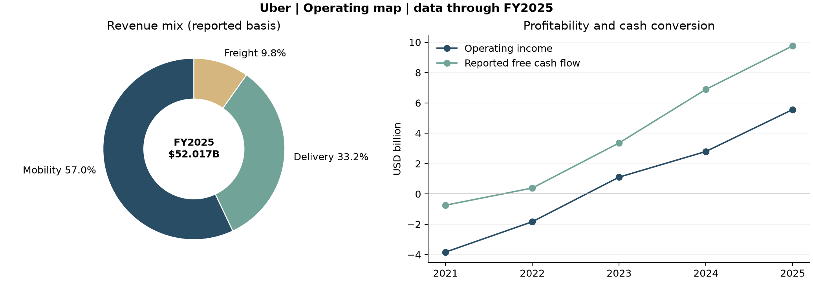

# Uber（NYSE:UBER）研究报告

> **研究及信息截止日：2026-11-24（北京时间）**。标的为 Uber Technologies, Inc.（优步），纽交所普通股 UBER，非ADR。估值统一采用美国2026-11-23常规盘收盘价 **64.07美元**，不混入11月24日盘中行情；最新正式财务为2026Q3。
>
> 最新可核普通股为10月30日2,041,898,070股，据此复算市值 **1,308.2441亿美元**；点时股数并非11月23日实时股数。报告FCF对应P/FCF **12.55倍**，本报告正常化经济盈利对应 **24.64倍**。核心命题：Uber已经证明它能把城市里的供需密度变成利润，但尚未证明在为自动驾驶和并购承担更多资本风险后，仍能保持原有的每股现金回报。
>
> 本报告复用 `reports/Uber`，接续[2026年5月旧报告](最终报告.md)，保留旧稿作为历史。所有金额除另注外均为美元。本研究用于学习与跟踪，不构成投资建议。

---

## AI研究偏见自觉

**信息丰富度：A级。** 财报、监管文件和管理层交流充足；优势在于能核对当前经营，陷阱在于把“全球需求入口+自动驾驶聚合”的熟悉叙事误认为确定的长期利润分配。

**AI研究局限性声明：** 未实地测量司机等待时间、商户增量回报、会员自然留存或机器人车队全成本；未取得AV分成、最低采购退出条款及Delivery Hero全部交割资金桥。以下分别标记已披露事实、研究假设和资料缺口，不能用资料数量替代投资确定性。

- [x] 不沿用旧报告“盈利拐点不可逆”的判断。
- [x] 不把会员数量等同于高转换成本，不把合作伙伴数量等同于利润议价权。
- [x] 反查现金、股酬、保险浮存和税项，不用GAAP或Non-GAAP单一PE裁决。
- [x] 若资料减少一半，仍可确认当前网络有价值；无法因此确认自动驾驶终局归属。

> 芒格式追问：如果所有自动驾驶合作新闻都删掉，仅凭今天能留给股东的钱，这家公司值多少？

---

## 第一步：核心数据总览

### 五年趋势：经营转正是真实的，净利润不宜直接外推

下表单位为百万美元。毛利率按公司收入减明示营业成本计算，**不含单列折旧摊销**；不是StockAnalysis标准化毛利率。

| 指标 | 2021 | 2022 | 2023 | 2024 | 2025 |
|---|---:|---:|---:|---:|---:|
| 收入 | 17,455 | 31,877 | 37,281 | 43,978 | 52,017 |
| 归母净利润 | -496 | -9,141 | 1,887 | 9,856 | 10,053 |
| 毛利率（上述口径） | 46.43% | 38.33% | 39.76% | 39.40% | 39.75% |
| GAAP营业利润 | -3,834 | -1,832 | 1,110 | 2,799 | 5,565 |
| GAAP营业利润率 | -21.97% | -5.75% | +2.98% | +6.36% | +10.70% |
| 报告自由现金流 | -743 | 390 | 3,362 | 6,895 | 9,763 |
| 无受限现金及短期投资 | 4,295 | 4,311 | 5,407 | 6,977 | 7,633 |

来源：[2023年10-K](https://www.sec.gov/Archives/edgar/data/1543151/000154315124000012/uber-20231231.htm)、[2025年10-K](https://www.sec.gov/Archives/edgar/data/1543151/000154315126000015/uber-20251231.htm)，并与[StockAnalysis损益表](https://stockanalysis.com/stocks/uber/financials/income-statement/)、[现金流表](https://stockanalysis.com/stocks/uber/financials/cash-flow-statement/)、[资产负债表](https://stockanalysis.com/stocks/uber/financials/balance-sheet/)交叉核对。收入、净利润、营业利润和FCF口径一致。原始成本口径毛利另与[Stock Analysis on Net原始表](https://www.stock-analysis-on.net/NYSE/Company/Uber-Technologies-Inc/Financial-Statement/Income-Statement)核对，未采用该站自动生成的毛利率文字解读。

2024、2025净利润都有大额递延税估值准备释放影响；相比之下，营业利润从亏损转正、继续扩张，更能说明核心业务改善。净利润的波动不能直接代表经营趋势。[官方全年业绩](https://investor.uber.com/news-events/news/press-release-details/2026/Uber-Announces-Results-for-Fourth-Quarter-and-Full-Year-2025/)

图左为FY2025收入：Mobility 29,670、Delivery 17,248、Freight 5,099百万美元。 三项年度收入同比依次为+18.27%、+25.44%、-0.82%。图右FCF尚未扣除股酬的经济成本、保险准备金增长及并购投资，不能把曲线高度视为股东可分配收益。

### 最近四季：统一分部营业利润口径

单位为百万美元；采用最新补充材料的可比口径。分部营业利润含正常经营股酬，与旧报告的分部调整后EBITDA不同；也未分摊全部总部与平台研发成本。

| 季度 | 出行收入 | 配送收入 | 货运收入 | 出行分部营业利润 | 配送分部营业利润 | 货运分部营业利润 |
|---|---:|---:|---:|---:|---:|---:|
| 2025Q4 | 8,204 | 4,892 | 1,270 | 2,027 | 905 | -18 |
| 2026Q1 | 6,798 | 5,068 | 1,337 | 2,029 | 961 | -30 |
| 2026Q2 | 7,363 | 5,245 | 1,583 | 2,215 | 1,055 | -24 |
| 2026Q3 | 7,520 | 5,488 | 1,758 | 2,362 | 1,057 | -33 |

来源：[2026Q3补充数据第11—13页](https://s23.q4cdn.com/407969754/files/doc_earnings/2026/q3/supplemental-info/Uber-Q3-26-Earnings-Supplemental-Data.pdf)；收入与第三方分部表交叉核对。公司未公布完整可比分部毛利率，**不以分部营业利润率冒充毛利率**。 同份材料的恒汇率分部收入同比，按2025Q4至2026Q3顺序：出行为+18%/+1%/0%/-2%，配送为+29%/+28%/+26%/+23%，货运为-1%/+6%/+25%/+34%；这些不是总额/净额调整后的有机增速。

Q3出行收入同比-2%、配送+23%、货运+34%，但出行预订额仍增长。英国出行由总额向净额列报的业务模式变化，令合并收入同比增速减少约8个百分点，因此“收入/预订额”不能直接当成佣金率。[Q3官方业绩](https://investor.uber.com/news-events/news/press-release-details/2026/Uber-Announces-Results-for-Third-Quarter-2026/default.aspx)

| Q3经营指标 | 披露值 | 解释 |
|---|---:|---|
| 总预订额 | 59,819百万美元 | 同比+20% |
| 月活平台消费者 | 215百万 | 同比+14% |
| 行程/订单数 | 4,061百万 | 同比+16% |
| 出行分部利润/预订额 | 8.00% | 自算，衡量利润捕获，非抽佣率 |
| 配送分部利润/预订额 | 3.70% | 自算，仍低于出行 |
| GAAP归母净利润 | 512百万美元 | 投资重估使其与经营利润显著不同 |
| 报告FCF | 2,535百万美元 | 同比+13.68% |

依据同份Q3业绩及补充数据精确重算。非GAAP营业利润与分部利润、GAAP营业利润的调节应保留，不能横向混用。

### 现金与债务：把受限资金排除

截至9月30日，单位百万美元：

| 项目 | 数值 | 口径 |
|---|---:|---|
| 现金及现金等价物 | 9,558 | 自由现金起点 |
| 短期投资 | 510 | 与现金合计10,068 |
| 受限现金及受限投资 | 11,372 | 616+1,988+8,768，不可当作自由现金 |
| 金融债务账面值 | 15,664 | 本金扣发行费用等 |
| 租赁负债 | 2,073 | 单列，不与金融债务混淆 |
| 净金融债务 | 5,596 | 金融债务减自由现金短投 |
| 含租赁净债务 | 7,669 | 只作更宽负担口径 |

[Q3 10-Q](https://www.sec.gov/Archives/edgar/data/1543151/000154315126000041/uber-20260930.htm)与[StockAnalysis资产负债表](https://stockanalysis.com/stocks/uber/financials/balance-sheet/)的自由现金短投一致。第三方统计页显示现金13,685百万美元，口径或时点无法解释，本报告弃用该统计值及其净债务/EV，**没有将差异伪报为交叉验证通过**。

> 芒格式追问：现金流很好，是否也意味着这些钱可以无条件拿去分红？

---

## 第二步：生意本质分析

**Uber把乘客、商户和运力在特定时间地点匹配起来，通过提高成交概率与利用率，反复收取服务费用。** 稀缺的是可即时履约的密度与可靠性，而非下载一个App的能力。

| 环节 | 谁为什么付费 | 利润变量 | 资本及成本约束 |
|---|---|---|---|
| Mobility | 用户为可用车辆、到达时间、安全与支付便利付费 | 每城供需密度、频次、每单净收入 | 司机激励、保险、合规；未来可能增加车队兜底 |
| Delivery | 消费者购买便利，商户购买成交与配送 | 客单、订单密度、配送距离、商户费与广告 | 配送员成本、消费者补贴、商户利润承受力 |
| Uber One | 用户预付会员费以获得优惠 | 促销后的续费、跨业务使用、增量贡献 | 权益补贴可能吃掉会费，不能只看会员人数 |
| 广告 | 商户为高购买意图流量付费 | 可验证增量成交和广告负载 | 过度商业化会损害自然排序与用户体验 |
| Freight | 货主购买运力组织与履约 | 价差、规模、企业客户渗透 | 周期性和竞争限制利润，不能套软件倍数 |

复购主要来自持续有用，不是合同锁定。用户和司机可同时使用竞品，会员让比价的心理门槛提高，却不能消灭比价。

规模带来经营杠杆：新增交易不必同比增加总部和平台研发，局部密度还能减少空驶。但平台必须持续把一部分效率让给司机、商户和消费者，否则流动性反而下降。过去五年的利润改善值得肯定，不能推导未来利润率只升不降。

公司披露Uber One约5,500万会员，贡献出行和配送合计过半预订额；这证明覆盖广，不证明用户都是会员带来的新增需求。高频用户更愿意购买会员，本就存在自选择效应。公司也把商户广告与优惠合并呈现；不能将两者合计直接认作广告收入。[Q3管理层说明](https://s23.q4cdn.com/407969754/files/doc_earnings/2026/q3/transcript/Uber-Q3-26-Prepared-Remarks.pdf)

技术优势在匹配、地图、动态定价、风控、支付及实验系统。9M研发费用3,267百万美元，但费用规模无法证明技术领先几年；AV核心驾驶技术掌握在合作方手中。研发回报应由降低等待、激励和履约损失来验证，而非由AI工具调用量判断。[Q3 10-Q研发披露](https://www.sec.gov/Archives/edgar/data/1543151/000154315126000041/uber-20260930.htm)

总额/净额列报、司机与配送员支出归类不同，使Uber、Lyft、DoorDash表面毛利率缺乏直接可比性。本报告用营业利润、全部资本开支后的现金流和订单经济作比较。

> 段永平式追问：这门生意好在哪？在同一座城市，更多有效供给让下一位用户更容易成交；关键是这种改善能留下多少利润。

---

## 第三步：护城河评估

| 来源 | 判断 | 支持证据与机制 | 可证伪条件 |
|---|---|---|---|
| 品牌与定价权 | 中等 | 安全感、可用性和全球出行习惯节省搜索成本 | 提价后频次或留存显著下滑，需补贴挽回 |
| 转换成本 | 偏弱至中等 | 支付、会员、历史偏好及企业账户便利 | 多平台比价成本始终很低，会员自然续费弱 |
| 网络效应 | 较强但局部 | 密度降低等待和空驶、提高匹配概率 | AV集中供给可绕过平台，长尾城市密度不足 |
| 规模效应 | 较强 | 研发、支付、客服和风险模型可摊薄 | 保险、劳动成本和车队资金吞噬节省 |
| 技术壁垒 | 中等 | 长期运营数据与交易闭环支持优化 | 数据可迁移，驾驶技术方控制稀缺供给 |

**过去五年：护城河主要因盈利网络密度、配送及会员的交叉使用而变宽。未来五年：方向未定。** 自动驾驶可能让Uber聚合更多低成本运力，也可能把最有价值的乘客关系和利润交给少数车队技术方。

最新两类证据要同时看：Zoox已于11月16日在拉斯维加斯接入Uber，是多供应商分发的实际进展；Waymo管理层在原始采访中表示，计划2028年1月在Austin和Atlanta开放自有App服务，意味着独家关系将变化，不能推演为届时完全停止Uber分发。[Uber–Zoox公告](https://investor.uber.com/news-events/news/press-release-details/2026/Zoox-Is-Now-Available-on-Uber-in-Las-Vegas/)、[Waymo负责人采访](https://bloomberg.com/news/videos/2026-11-04/waymo-s-bet-on-a-driverless-future-video)

旧报告“跨平台协同别人无法复制”过于绝对。DoorDash拟收购Instacart，说明对手也能通过并购拼接会员、商户和品类；其尚未交割，不能把未来协同提前计入当前收入。[DoorDash原始公告](https://ir.doordash.com/news/news-details/2026/DoorDash-to-Acquire-Instacart-to-Help-Local-Stores-Win/default.aspx)

> 巴菲特式追问：十年后还在的优势可能是城市履约网络；能摧毁其利润的，不一定是App竞争者，也可能是控制低成本运力的供应商。

---

## 第四步：逆向思考与风险清单

**最强空方论点：市场给的折价未必源于“不理解Uber”，也可能是在为商业模式从轻撮合转向承担运力资本风险定价。** 当前的需求网络有价值，但如果Uber必须投入大额资金换取AV供给，而技术方还能直达消费者，交易增长未必带来同等每股收益。

以下概率为研究者对未来十年“出现实质性影响”的主观区间，互相重叠，不能相加；不是统计预测，也不等于估值情景概率。

| 失败或受损路径 | 主观概率 | 影响 | 应观察什么 |
|---|---|---|---|
| AV技术方拿走高价值需求，平台分成下降 | 中高：30%—50% | 高 | 同城AV净贡献、非独家化、自有App复购 |
| AV最低采购、担保或基础设施回报不及预期 | 中：25%—40% | 高 | 全成本单车回报、无追索第三方融资、退出责任 |
| Delivery Hero整合或审批不顺，债务回报低 | 中：25%—40% | 高 | 最终资金桥、出售业务条件、每股现金收益 |
| 劳动分类、保险或安全责任挤压利润 | 中高：30%—50% | 中高 | 每单保险/激励成本、司法辖区实际执行 |
| 会员及商户增长依赖补贴，广告增量不足 | 中：20%—35% | 中高 | 自然续费、促销后频次、商户真实增量回报 |
| 衰退、油价和司机短缺同时发生 | 中：20%—35% | 中 | 量价拆解、司机在线时长、等车时间 |

### 监管方向并非单边恶化

美国劳工部11月19日宣布、11月23日刊登新最终规则，撤销2024规则，联邦分类分析方向有所放松；规则尚有生效等待期，并不覆盖州和地方法律。不能把联邦变化推成全球风险解除。[美国劳工部原文](https://www.dol.gov/agencies/whd/flsa/misclassification/2026rulemaking/faqs)

新泽西ABC解释规则已进入实施阶段，但不能写成所有Uber司机都已被裁定为雇员。欧盟平台工作指令转置截止日为2026年12月2日，各国实施仍须跟踪。[新泽西劳工部](https://www.nj.gov/labor/lwdhome/press/2026/20260505_ABC.shtml)、[欧盟指令第29条](https://eur-lex.europa.eu/legal-content/EN/TXT/PDF/?uri=CELEX%3A32024L2831)

FTC对Uber One的案件仍在进行，涉及订阅、扣费和取消流程的指控，不能写成已裁定事实；也不能仅凭会员增长证明客户满意。[FTC案卷](https://www.ftc.gov/legal-library/browse/cases-proceedings/2423092-uber-ftc-v)

### 历史类比与最可能犯的错

传统旅行分销商的经验说明：聚合需求可以长期有价值，但供应商仍会发展直销，分销费率需要反复谈判。这只是产业组织类比，不用来借同业倍数证明Uber估值。双边网络在达到局部密度后有递减回报；多归属会限制赢家通吃，不能套纯社交网络模型。

最可能的分析错误依次是：把报告FCF当成可分配利润；把自动驾驶乘坐量当成平台利润；把会员高消费的相关性当成会员带来的因果效果。风险模型还未给重大事故、全面禁令及突发汇税风险建立可信尾部损失分布。

> 芒格式追问：聪明人为什么不买？因为未来产业链的分成还在谈，而资本承诺可能先变成确定支出。

---

## 第五步：管理层评估

Dara Khosrowshahi在2017年接任前曾领导Expedia。其任内经营纪律和盈利转型有实际结果，新增资本配置则仍待考验。退出中国发生在2016年，不能算作其功绩；Q3披露仍有滴滴投资，也不能写成滴滴权益已经全部出售。[公司领导层](https://investor.uber.com/governance/leadership/default.aspx)、[Q3 10-Q](https://www.sec.gov/Archives/edgar/data/1543151/000154315126000041/uber-20260930.htm)

| 决策 | 目前结果 | 评价 |
|---|---|---|
| 收缩自研AV等高消耗项目，聚焦核心平台 | 五年经营利润改善提供验证 | 较好，不能把后续所有成功都归于单人 |
| 扩大配送、会员与广告协同 | 配送分部利润持续增长 | 较好，须看促销后收益 |
| 股份回购 | 9M支出约42.79亿美元，但仍有股酬和归属发行 | 中等；授权不等于执行，净股数才是结果 |
| 多方AV投资及采购安排 | 获得供给选择，也增加兜底风险 | 暂不评分，缺少全链条回报 |
| 拟收购Delivery Hero | 尚未完成，资金与整合责任上升 | 暂不评分，不能拿预测EPS增厚当经济成功 |

### 新资本配置是本次重审重点

公司7月提出以每股41.50欧元现金收购Delivery Hero，100%股权隐含价值约148亿美元，预计2027年下半年交割，仍需条件满足。9月末持股24.5%，采用权益法；拟出售重叠业务也有先决条件，不能提前当成可用现金。桥贷被部分定期贷款置换，不能把置换前后承诺重复相加。[Uber收购公告](https://investor.uber.com/news-events/news/press-release-details/2026/Uber-Announces-Acquisition-Offer-for-Delivery-Hero/default.aspx)、[Delivery Hero确认](https://www.deliveryhero.com/newsroom/delivery-hero-and-uber-to-join-forces-to-deliver-more-for-customers-vendors-and-riders/)

AV未来多年合计超过100亿美元的承诺，包含股权、基础设施与采购安排，**不是已付100亿美元，也不能与每项合作重复相加**。例如Rivian最高12.5亿美元股权投资附带里程碑，另有购车及选择权；Lucid已投入与最低采购是另一组义务。[Q2管理层说明](https://s23.q4cdn.com/407969754/files/doc_earnings/2026/q2/transcript/Uber-Q2-26-Prepared-Remarks.pdf)、[Rivian合作原文](https://investor.uber.com/news-events/news/press-release-details/2026/Uber-and-Rivian-Partner-to-Deploy-up-to-50000-Fully-Autonomous-Robotaxis-2026-TViR4R05gi/)

### 持股与激励：没有创始人超级投票权的保护

2026 Proxy显示单一普通股一股一票。Dara的3月beneficial ownership含可归属RSU和期权，不能全当已发行普通股。最新已读Form 4显示，其9月10日主动买入后直接普通股1,367,100股；以10月30日总股数作近似分母，为0.06695%。CFO Balaji Krishnamurthy最新直接股47,850股，近似0.00234%。二者均不含全部未归属激励，日期也不完全匹配。

来源：[2026 Proxy](https://www.sec.gov/Archives/edgar/data/1543151/000130817926000125/uber014597-def14a.htm)、[Dara Form 4](https://www.sec.gov/Archives/edgar/data/1543151/000118423726000008/primarydocument.xml)、[Balaji Form 4](https://www.sec.gov/Archives/edgar/data/1543151/000211186726000015/primarydocument.xml)。最新实际股数属**单一原始申报，未取得独立第二来源确证**；不标为双源验证通过。主动买入支持利益一致性，但小比例实际持股不能替代对薪酬目标和并购回报的审查。

组织能力更多体现在城市运营与平台系统，不应完全依赖CEO。Balaji于2026年接任CFO，以及并购整合负担，都使团队延续性值得复检。没有独立员工留存和文化调查，本报告不对企业文化作高置信度赞誉。

> 段永平式追问：若CEO退休，匹配网络仍在；但谁来约束新资本承诺，是否已有可验证的组织纪律？

---

## 第六步：行业与文明趋势

城市交通、餐饮零售数字化和自动驾驶都可能扩大可服务需求，但公司只能分得其中一部分利润。用整个交通或食品消费总额作Uber收入TAM，会同时忽略私人车替代、履约范围、商户利润与平台分成。

本报告不采用缺少统一口径的最新全球TAM及旧市场份额快照。旧稿美国出行76%、美国配送67%/23%的数字，没有取得截至本次截止日同方法的一手更新，不能作为精确现状。可以确认的是Uber出行网络规模大、配送面临DoorDash等强劲竞争；无法由此确认份额永久不变。

| 趋势 | 潜在受益 | 价值可能流向哪里 |
|---|---|---|
| 更低成本的自动驾驶 | 出行频次与覆盖扩大 | 驾驶系统、车队、融资/保险或需求平台，分配未定 |
| 配送扩展杂货零售 | 更多时段和订单密度 | 商户、会员补贴、配送网络与广告平台 |
| AI代理参与订购 | 降低搜寻与下单摩擦 | 入口可能转移，但本地履约仍须实际执行 |
| 企业出行与团餐 | 更高客单和稳定需求 | 客户议价、平台、专业运营方共同分享 |

已实现与规划必须分开：Zoox已经上线；11月24日Nuro/Lucid开始无安全员道路测试，面向公众商业服务仍属后续计划。管理层提出2026年底约700辆、2027年底超过2,000辆全无人车目标，并非今日已达规模。[Zoox公告](https://investor.uber.com/news-events/news/press-release-details/2026/Zoox-Is-Now-Available-on-Uber-in-Las-Vegas/)、[Nuro/Lucid联合新闻稿](https://www.businesswire.com/news/home/20261124557985/en/)、[Q3管理层说明](https://s23.q4cdn.com/407969754/files/doc_earnings/2026/q3/transcript/Uber-Q3-26-Prepared-Remarks.pdf)

消费者与商户整体分散，但AV供给可能集中于少数技术平台，形成新的供应商议价权。当前资料不足以给出“AV增长一倍将使Uber利润增长多少”的可信弹性。本报告对2030年后的产业地位给中低确定性，不把技术进步自动映射为股东超额收益。

> 李录式追问：二十年后，人和货的流动会更高效；Uber究竟拥有这份效率，还是需要不断付费租用它？

---

## 第七步：估值与安全边际

### 先分开四种盈利口径

TTM截至2026年9月，单位百万美元。

| 口径 | 数值 | 能回答什么 |
|---|---:|---|
| GAAP归母净利润 | 3,465 | 报表盈利，仍受投资重估及税项影响 |
| GAAP营业利润 | 7,034 | 核心业务成本后的经营表现 |
| 报告FCF | 10,421 | OCF 10,735减现金CapEx 314 |
| FCF减现金流表股酬 | 8,356 | 把股酬视作经济成本的近似 |
| 再扣保险准备金增加 | 6,522 | 剔除该项浮存增长带来的现金时间差 |
| 本报告正常化经济盈利 | 5,308.935 | 每股2.60美元，属研究假设 |

前三项和股酬与[StockAnalysis现金流表](https://stockanalysis.com/stocks/uber/financials/cash-flow-statement/)核对；保险增量由官方全年与9M现金流重建。[全年业绩](https://investor.uber.com/news-events/news/press-release-details/2026/Uber-Announces-Results-for-Fourth-Quarter-and-Full-Year-2025/)、[Q3 10-Q](https://www.sec.gov/Archives/edgar/data/1543151/000154315126000041/uber-20260930.htm)

从6,522到5,308.935的桥接：9M现金税446，而损益税费1,278，差异主要含递延税因素。本报告将差额按年化折成1,109.333的**递延税优惠正常化压力**，再留103.732的余量，得到每股2.60。这不是预测公司下年一定多交这些税，也不是已发现的现金漏损。

股酬按税前金额扣除、保险浮存增量全部剔除，都偏审慎；现金税压力也可能高估。反过来，报告FCF未扣并购、非上市股权、票据贷款与部分其他投资支出。**2.60美元是正常化经济盈利的情景标尺，不是GAAP EPS、公司Non-GAAP EPS或经审计FCFE；后续模型不再重复扣同一股酬、保险或税缓冲。**

### 当前定价

| 指标 | 本报告重算 | 解读 |
|---|---:|---|
| 市值 | 130.8244十亿美元 | 64.07×最新披露普通股 |
| 股价/TTM稀释EPS | 38.14倍 | EPS1.68；与网站实时38.24倍差异不足1% |
| 市值/TTM归母净利润 | 37.76倍 | 点时股数与加权稀释股数口径不同 |
| P/S | 2.31倍 | 总额/净额变化限制历史可比性 |
| P/报告FCF | 12.55倍 | FCF收益率7.97%，不等于可派息收益率 |
| P/剔股酬及保险浮存现金 | 20.06倍 | 尚未计完整未来资本承诺 |
| P/正常化经济盈利 | 24.64倍 | 正常化收益率4.06% |
| 自定义EV/收入 | 2.44倍 | EV计金融债、减无受限现金，加两类NCI；不计经营租赁、不减非经营股权投资 |
| 网站Forward PE / PEG | 15.50倍 / 0.51 | 分析师预期口径，未取得统一盈利桥，不作主估值依据 |

重算参数和原始输出见[关键数据与估值工具记录](Uber-validation-20261124.md)。[StockAnalysis统计快照](https://stockanalysis.com/stocks/uber/statistics/)仅作差异对照。没有把12.55倍FCF和约15倍Forward PE混称为“13倍经营利润”。

作为机会成本参照，研究时可读的FRED十年美债收益率为11月20日4.92%，更新于11月23日；不是11月24日实时利率。Uber的4.06%正常化收益率需要增长补足回报与风险溢价。[FRED DGS10](https://fred.stlouisfed.org/series/DGS10)

### 自身历史与同业：便宜的倍数也会骗人

StockAnalysis年末P/FCF为2023年37.69倍、2024年18.42倍、2025年17.39倍，现在12.55倍，方向上明显压缩。不过盈利成熟、保险浮存和资本承诺变化会改变合理倍数，不能只按历史均值回归。[历史财务与倍数](https://stockanalysis.com/stocks/uber/financials/)

同业统一使用11月23日收盘、9月末TTM财务，市值以第三方披露股数重算，精度受股数舍入限制：

| 公司 | 收盘价（美元） | TTM收入（十亿美元） | 官方TTM FCF（十亿美元） | P/FCF |
|---|---:|---:|---:|---:|
| Uber | 64.07 | 56.526 | 10.421 | 12.55倍 |
| Lyft | 16.22 | 6.909 | 1.1292 | 5.43倍 |
| DoorDash | 161.35 | 17.061 | 2.203 | 31.93倍 |

[Lyft官方Q3](https://investor.lyft.com/news-events-presentations/press-releases/detail/210/lyft-reports-strong-q3-2026-results)、[DoorDash官方Q3](https://ir.doordash.com/news/news-details/2026/DoorDash-Releases-Third-Quarter-2026-Financial-Results/default.aspx)，对照[LYFT价格](https://stockanalysis.com/stocks/lyft/history/)、[LYFT财务](https://stockanalysis.com/stocks/lyft/financials/)、[DASH统计](https://stockanalysis.com/stocks/dash/statistics/)。

Lyft低GAAP PE受一次性税收益扭曲；DoorDash第三方FCF约2.691十亿美元未扣资本化软件0.488，官方FCF为2.203。上表按官方全现金资本开支口径修正，但仍未统一扣除各自股酬及浮存，**只作粗比较，不是估值锚**。[Lyft税项原文](https://investor.lyft.com/news-events-presentations/press-releases/detail/191/lyft-reports-record-q4-and-full-year-2025-results)、[DoorDash官方现金流调节](https://ir.doordash.com/news/news-details/2026/DoorDash-Releases-Third-Quarter-2026-Financial-Results/default.aspx)

### 反向DCF：市场并未要求奇迹，也没有免费赠送未来

以每股2.60的正常化现金盈利作起点，未来十年现金流都可分配、美元折现率10%、此后现金流永续增长2.5%的简化FCFE模型，当前市值隐含十年现金流年增约 **10.55%**。

这里的现金流必须是**扣完所需再投资后**仍可分配的钱。若把预订额增长率直接代入，同时漏掉AV采购、并购融资与现金税，模型会系统性高估价值。该反向DCF采用乐观的全分配能力假设，不是公司实际分红预测，也不与下一节的利润终值PE模型拼接。

### 三年三情景：回答贵不贵

起点为每股正常化经济盈利2.60。工具的EPS字段在这里承载该代理值，倍数是经济盈利倍数，**不是预测GAAP PE**。三年保持股数不变，无分红，不另加回购收益率；实际回购若抵不过资本消耗，不能视为额外回报。

| 情景 | 主观概率 | 经济盈利年增 | 三年末倍数 | 三年末价格（美元） | 以10%折回今日（美元） | 现价至末值年化 |
|---|---:|---:|---:|---:|---:|---:|
| 悲观 | 30% | -5% | 12倍 | 26.75 | 20.10 | -25.26% |
| 基准 | 50% | +12% | 18倍 | 65.75 | 49.40 | +0.87% |
| 乐观 | 20% | +20% | 22倍 | 98.84 | 74.26 | +15.55% |

概率加权今日值约45.58美元。这是主观分布下的估值，不是目标价承诺；工具精算不意味着参数具有同等确定性。

基准要求现金盈利增长仍接近低双位数，会员与配送支持利润、融资成本可控；18倍反映增长后趋于成熟且存在供应商分成风险。乐观需要AV聚合、广告和运营杠杆一起兑现；悲观体现抽佣承压及资本投入吞噬回报。**三年基准价值低于64.07美元，当前安全边际不足。**

### 十年折现：只作仓位压力测试

三年模型判断价格；十年模型检验仓位承受能力。十年未覆盖资本成本，不能单独把买入、持有改判成回避。

参数全部为判断：美元r=10%，由Rf4.92%+beta1.0×ERP5.08%组成。ERP是本报告假设，并非直接观测值；不把AV、劳动或并购风险加进beta。终值稳态增量ROIC取15%，围绕第三方当前账面ROIC14.93%的量级作保守判断；由于不派息，缺少派息反推的可靠下界，**无法声称已经精确夹住长期增量ROIC**。永续g为0%/2.5%/4%，基准低于美元4%的上限，且不随r变化。

终值倍数仅用 `PE=(1−g/ROIC)/(r−g)`，不引用同行现价。2036利润指再投资前正常化税后经济利润的独立情景假设，**不是把当前调整后FCF机械改名成净利润**。当前2.60仅提供起始量级；未来GAAP利润、折旧/维护投资和现金税需要重新桥接。

| 情景 | 2036经济利润（十亿美元） | 永续g | r−g | 终值PE | 工具终值年化回报 |
|---|---:|---:|---:|---:|---:|
| 悲观 | 4.5 | 0% | 10.0个百分点 | 10.00倍 | -10.12% |
| 基准 | 16 | 2.5% | 7.5个百分点 | 11.11倍 | +3.11% |
| 乐观 | 30 | 4.0% | 6.0个百分点 | 12.22倍 | +10.86% |

三档概率同上。基准2036利润160亿美元，需出行/配送密度和利润率继续提高，并在净融资、劳动和AV成本后留下真实收益；乐观300亿美元要求更强变现，悲观45亿美元体现议价权与资本回报受损。这些不是管理层指引。

`terminal_value.py irr`计算终值几何回报，k=0，不包含十年中间分配，不应冒称完整股东现金流IRR。为避免这一限制隐藏在数字里，补充了从正常化起点向终值利润平滑过渡、假设每年分别可分配利润50%/30%/10%的现金流能力情景：三档IRR约-7.10%/+5.09%/+11.53%，基准按10%折现约42.05美元/股。**这些是假想可分配能力，不是承诺分红；未分配部分承担增长、AV与并购资金需要。** 过渡期利润增长还依赖利润率改善或高于终值水平的回报，不能说全十年均以15%ROIC自洽生成；资金桥无法满足时必须下修，不能额外借债又不扣融资成本。

#### 折现率敏感性与翻转检验

下表照工具输出，均为概率加权的**终值年化回报算术均值**，不是概率加权财富路径的复合收益率：

| r | 期望年化回报 | 是否覆盖对应r | 参与有效翻转判定 |
|---|---:|---|---|
| 8% | +3.84% | 未通过 | 区间外，仅供参考；乐观r−g仅4个百分点，也仅作情景 |
| 10% | +0.69% | 未通过 | 是 |
| 12% | -1.63% | 未通过 | 区间外，仅供参考 |
| 9%（补做±1pp） | +2.13% | 未通过 | 是，最窄分母5个百分点 |
| 11%（补做±1pp） | -0.54% | 未通过 | 是 |

±2pp两侧均不在美元9%—11.5%合理区间，因此又做±1pp。**在合理区间9%/10%/11%内，压力测试结论未翻转，均未覆盖资本成本。** 完整现金流能力补充情景比终值工具回报高，但基准仍不足以支持高集中度；不因此自动清仓。

#### 估值分歧对账：与旧报告相比，改变了什么

| 判断来源 | 回答的问题 | 本次结果 |
|---|---|---|
| 旧报告“约13倍PE、15倍FCF” | 对当时利润与现金流的定价 | 未充分扣股酬、浮存和税正常化，也早于最新重大并购 |
| 三年正常化估值 | 当前有没有价格安全边际 | 基准今日49.40，现价64.07不足 |
| 十年r压力测试 | 组合能否承担更重仓位 | 未覆盖r，收紧上限，不能单独否决持有 |
| 前六步经营证据 | 公司是否仍值得研究与持有 | 核心网络继续盈利，终局与资本配置确定性下降 |

旧稿约75美元至本次收盘下跌约14.57%，并不自动产生安全边际：分母口径、资本责任与现金可支配性都必须更新。本次空仓观望同时依据三年定价、护城河变化与融资执行风险；持仓保留小仓条件持有，说明十年压力没有充当清仓否决票。原3%—5%研究仓位参考收紧至总参考不超过2%。

#### 估值限制

重大事故/全面禁令与汇率及税务突变未建立可信独立尾部分布；三情景没有覆盖所有极端损失。Delivery Hero最终净对价、目标债务、剥离净回款、AV采购责任、增量融资及各业务现金税未形成完整逐年资金桥。正常化盈利、过渡分配比例和稳态ROIC均为判断，不能把模型小数点当成精度。若资金缺口出现，需降低分配或利润、增加稀释，不能同时保留全部增长与回购收益。

> 巴菲特式追问：r错2个百分点，结论会翻转吗？工具有效区间内没有翻转；真正更敏感的是正常化盈利和资本责任。
>
> 段永平式追问：股市关闭五年愿意持有吗？仅对能够承受AV及并购执行风险的小仓回答“有条件愿意”，目前价格不足以支持新增大仓。

---

## 第八步：最终决策与行动清单

| 维度 | 结论 | 信心度 |
|---|---|---|
| 生意质量 | 高复购、本地密度与运营杠杆有价值，但并非纯订阅 | 中高 |
| 护城河 | 当前网络较强；多归属与AV供应商直销限制长期定价权 | 中 |
| 管理层 | 运营成绩可核；AV和Delivery Hero资本配置尚待兑现 | 中 |
| 最大风险 | 从轻撮合向承担资本兜底转变，现金收益难完整兑现 | 中高（风险存在）；低（损失概率） |
| 文明趋势 | 交通与配送效率改善明确，Uber分得多少利润未定 | 中 |
| 估值 | 三年基准今日49.40；十年压力未过、有效r内不翻转，只限仓 | 中低（假设敏感） |

**估值维度不是唯一裁决。综合建议：空仓观望；合理小仓有条件持有，暂停加仓。** 不因十年未过而单独建议清仓；也不因FCF倍数下降而忽略资本责任。

| 策略 | 建议 |
|---|---|
| 空仓者 | 64.07美元不新增长期价值仓；等待35—40美元进入有条件研究建仓带 |
| 持仓者 | 核心经营与融资条件未破坏时，小仓持有复检；仓位参考≤2%，超配者评估降低集中度，不以成本价作判断依据 |
| 35—40美元 | 相对三年基准今日值约有19.03%—29.15%折价；仍须满足下述经营和资金条件，才研究首笔约0.5%，分步验证，总参考≤2% |
| 低于35美元 | 先排查永久损失、融资或法律变化，不自动越跌越买 |
| 高于40且低于75美元 | 现有假设下主要持有/观察区；靠近40也不免除条件核验 |
| 75美元及以上 | 若盈利和资金模型未增强，不追高，复核集中度和减仓；属于估值警戒，非自动卖出指令 |
| 卖出或明显减仓信号 | 持续丧失平台分成、资本缺口依赖不利融资、劳动/安全事件永久改变利润，或管理层隐瞒重大责任 |
| 加仓信号 | 价格进入研究带，现金收益与每股价值获正式披露支持，AV资金/责任及并购桥接可核，且红线未触 |

价带是研究判断，不是市场预测。首笔及上限是缺少用户成本、组合与承受能力资料下的通用研究参考。

### 建仓前的可证伪条件

未来连续两次正式季度披露需同时检验：恒汇率总预订额仍有约15%或以上增长；滚动FCF减完整股酬与保险准备金增长仍为正，税正常化后每股经济盈利能够支持至少2.60美元；不能靠扩大浮存或缩减必要投资维持。15%及2.60是本报告门槛，不是公司指引。

此外，Delivery Hero剩余对价、净债、出售业务和融资成本应能对上；AV每车贡献必须计折旧、融资、保险、远程协助、清洗及平台分成，新增兜底不能推翻现金模型。若披露不足，只保留观察，不把“未证伪”视为“已验证”。

### 复检日与登记

| 日期 | 性质 | 下次动作 |
|---|---|---|
| 2026-12-02 | 欧盟指令转置截止日 | 人工核各重点国家落地与成本影响，非公司财报日 |
| 2026-12-31 | 自定研究检查 | 核年底AV目标、融资及收购进展；若尚无正式数据就记录待证 |
| 2027-02-15 | 全年业绩日历检查窗口 | 非已确认财报预约日；正式披露更早则提前研究 |
| 2027-12-31 | 中期执行检查 | 核AV规模、利润分成及Delivery Hero进度；不是保证交割日 |

沿用触发标的id `Uber`，登记35—40美元下行研究带及75美元上行警戒，保留旧财报事件并标记已复检。旧11月3日市场预计事件实际于11月4日发布，已在说明纠正。**每日监控只扫描价格；事件仅供人工复核，不承诺自动事件提醒。** 本标的不在重点标的看板，新增本次建议事件至标的跟踪表，旧建议接续关闭且不虚构历史命中。

> 四种方法共同追问：什么事实会让我改主意？是每股经济收益和资本责任的变化，而非股价涨跌本身。

### 四位大师原话与方法应用

以下均已阅读原始出处或仓库原文存档。**没有找到四位对Uber的直接可核立场；下文是研究者的方法应用，不是本人对Uber的意见或引语。**

| 人物 | 可核验短引及出处 | 本报告的应用推演 |
|---|---|---|
| 巴菲特 | “You only have to be able to evaluate companies within your circle of competence.” [1996股东信](https://www.berkshirehathaway.com/letters/1996.html) | 将能理解的当前平台收益与无法确证的AV终局分开，不用后者给前者无限倍数 |
| 芒格 | “You have to figure out where you’ve got an edge.” [授权原书Talk Two](https://stripe.press/poor-charlies-almanack/book) | 密度是已有优势，未来驾驶技术供给的议价权仍需反面检验 |
| 段永平 | “不懂不碰的就是好的投资者” [2011-09-07原发言存档第77条](../段永平/段永平雪球全量原发言.md)；[雪球出处](https://xueqiu.com/1247347556/20385652) | 无法解释现金口径、车队责任或并购资金时，较低倍数不足以成为行动理由 |
| 李录 | “A stock is not just a tradable piece of paper; it represents part ownership of a company.” [2024-12-07官方演讲第23页](https://cdn.prod.website-files.com/5ef3c7300432b40ed865991a/67a4f75703627bd3a927077e_Global%20Value%20Investing%20in%20Our%20Era%20(2024-12-07).pdf) | 持有的是未来能留给每股的收益，产业效率改善只是必要背景 |

---

## AI分析置信度与投资确定性

当前收入、营业利润、现金流及股本口径的**AI分析置信度较高**，因为有原始披露和独立数据库互核；最新管理层实际持股只有原始申报，证据等级低一档。监管已公开事实也能核实，具体执行成本仍需后续观察。

**实际投资确定性为中等偏低**：当前网络盈利可以理解，但长期分成、资本兜底、整合回报和税正常化仍有重要假设。三年倍数、2036利润、概率、ROIC及分配能力来自有限信息推理。较完整的报告只能提高可追溯性，不能消除这些商业不确定性。

下一次一手验证优先问：AV合作方愿否在无Uber担保下融资；同城人工/AV全成本贡献是多少；会员续费有多少来自自然留存；Delivery Hero交割后每股现金收益是否高于放弃回购的机会成本。

---

## 数据来源与审计记录

关键数据以SEC和公司原文为准，独立数据库用于复核；Macrotrends部分页面直接访问受限，历史数可由索引结果核对，不能冒称已取得最新完整表。

| 项目 | 交叉核对与处置 |
|---|---|
| 收入、归母净利、FCF | FY2025及TTM与StockAnalysis一致；Macrotrends历史收入/净利同值，精确工具核验通过 |
| 总股数与市值 | SEC 2,041,898,070股对第三方约2.04B；64.07美元两源一致；复算市值对130.82B偏差约0.0034% |
| 自由现金短投 | SEC及StockAnalysis资产负债表10,068M一致；弃用统计页13,685M |
| 毛利 | Macrotrends/原始成本口径FY2025为20,679M；StockAnalysis标准化20,025M，源于费用重分类，保留差异，不混用 |
| 历史现金 | Macrotrends FY2025的8,264M含流动受限现金631M；扣除后与无受限7,633M对齐 |
| 管理层持股 | Proxy与Form 4核日期和权益定义；最新直接股数只有一手源，未声称双源准出 |
| 同业现金流 | DoorDash扣资本化软件后用官方FCF2,203M，来源差异已解释 |
| 财务与模型计算 | `financial_rigor.py`执行市值、交叉核对、估值及三情景；附加Decimal复算，避免心算和浮点舍入误导 |
| 十年估值 | 最终参数r10%、ROIC15%、g0/2.5/4%，终值审计C1/C2/C3通过；未建模风险已在正文列明 |

[关键数据交叉验证记录及工具原始输出](Uber-validation-20261124.md) · [估值输入与精算结果](Uber-model-20261124.json) · [终值敏感性配置](Uber-terminal-config-20261124.json)

随机抽样审计已准出：从144个可识别数据点抽取22项，7项披露事实、5项依据信源计算、5项模型输入一致性、5项模型算式复算，全部偏差在1%以内，没有未解释警告。模型输入检查不代表预测得到外部验证。可复核[抽检JSON](Uber-audit-20261124.json)和[原始判决](Uber-validation-20261124.md)；审计不为主观概率和投资建议背书。
