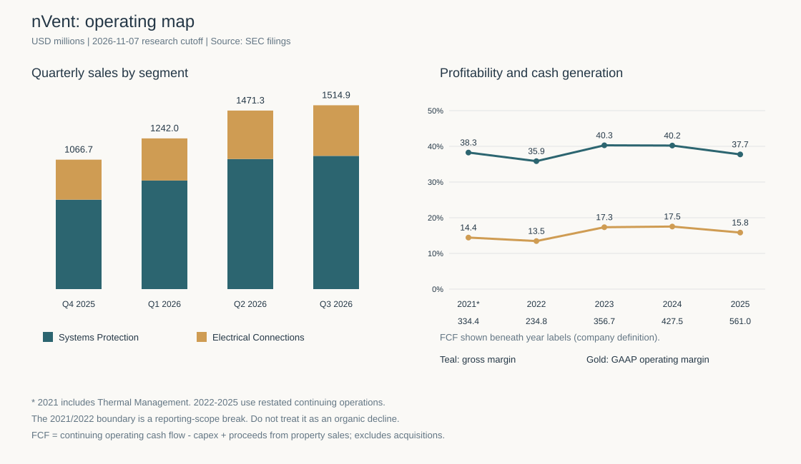

# nVent Electric（NVT）研究报告

> **研究日与资料截止日：2026-11-07，北京时间。** 行情统一采用最近一个已完成交易日——2026-11-05 常规盘收盘 US$98.38；11 月 6 日美股在研究开始时仍在交易，不将盘中数据写成收盘。以最近披露的 161,598,060 股普通股复算，股权市值 US$15.898bn。2026 年 GAAP／调整后 EPS 指引中点对应 21.60／18.30 倍 P/E。币种均为美元，表内财务金额默认 US$m（百万美元）。本报告用于学习研究。

**研究主线：** nVent 正把电气连接、保护、配电和散热组合成系统供应能力，Q3 的有机增长证明转型并非只有并购故事。但项目型采购、扩产和杠杆决定了，它的价值取决于交付后留下的每股现金，而不能直接由 AI 建设规模推导。

标的确认：法定名称 nVent Electric plc，NYSE:NVT，普通股；中文官网使用 nVent 品牌，市场中文译名不统一，本文保留英文。沿用既有 `nVent` 目录及监控 ID，不另建中文标的。行情交叉来源：[StockAnalysis 历史行情](https://stockanalysis.com/stocks/nvt/history/)、[Yahoo 历史行情](https://sg.finance.yahoo.com/quote/NVT/history/)；股数来源见 [Q3 10-Q](https://www.sec.gov/Archives/edgar/data/1720635/000162828026068596/nvt-20260930.htm)。股数为披露日余额，不能保证等于研究时刻的实时股数。

---

## AI研究偏见自觉

**信息丰富度评级：A。** 定期报告和投资者材料充裕；客户逐项目回报、订单取消率、各液冷产品收入及 Maverick 完整交割资产负债表仍不充分。

**AI研究局限性声明：** 本研究没有客户访谈、工厂调查或专有订单数据。行业预测、管理层目标、研究假设与已实现财务分开标注。资料丰富提高历史事实可核验程度，不代表未来现金流确定。

- [x] 不把基础设施收入全部算作 AI 收入。
- [x] 不把股价大跌当作业绩恶化的证据，也不把跌幅当作安全边际。
- [x] 不把第三方“总净利”和持续经营收入直接拼成净利率。
- [x] 同时检查竞争扩产、技术路线变化与并购后负债。

本次最重要的反面检验是：**当产品种类更多、客户看似更多时，公司是否反而更集中依赖同一轮数据中心资本开支？**

---

## 第一步：核心数据总览

### 五年财务：先修正可比口径

| 财年 | 收入 | 毛利率 | GAAP经营利润率 | 持续经营净利润 | 公司定义FCF | 年末现金 |
|---|---:|---:|---:|---:|---:|---:|
| 2021* | 2,462.0 | 38.26% | 14.44% | 272.9* | 334.4* | 49.5 |
| 2022 | 2,295.1 | 35.85% | 13.46% | 293.1 | 234.8 | 297.5 |
| 2023 | 2,668.9 | 40.29% | 17.34% | 459.7 | 356.7 | 179.6 |
| 2024 | 3,006.1 | 40.22% | 17.53% | 240.8 | 427.5 | 131.2 |
| **2025** | **3,893.1** | **37.74%** | **15.84%** | **428.5** | **561.0** | **237.5** |

*2021 为当年含 Thermal Management 的原集团口径，净利润亦为原集团净利润；2022—2025 为剔除该业务后的重述持续经营口径。两者有断点，不能把 2021—2022 表观收入下降解释成有机衰退。FCF 定义为经营现金流减资本支出、加固定资产处置所得，不扣收购款。2023 利润含税务利好，2024 税负异常，净利波动不能直接当作常态盈利趋势。

财务原表：[2025 10-K](https://www.sec.gov/Archives/edgar/data/1720635/000162828026008608/nvt-20251231.htm)、[2024 10-K](https://www.sec.gov/Archives/edgar/data/1720635/000172063525000018/nvt-20241231.htm)、[2023 10-K](https://www.sec.gov/Archives/edgar/data/1720635/000172063524000012/nvt-20231231.htm)；独立展示核对：[StockAnalysis 损益明细](https://stockanalysis.com/stocks/nvt/financials/income-statement/)、[资产负债表](https://stockanalysis.com/stocks/nvt/financials/balance-sheet/)。利润率以一手报表金额用 Decimal 重算。

2025 分部收入为 Systems Protection 2,592.9、Electrical Connections 1,300.2；前者涵盖机柜、液冷、控制建筑及配电，后者主要是连接、接地、固定及相关电气产品。分部毛利并未按集团 GAAP 分摊完整披露，下面采用公司报告的分部利润率，不能称为分部毛利率。[2025 全年业绩](https://s22.q4cdn.com/268397047/files/doc_financials/2025/q4/Q4-2025-NVT-Press-Release.pdf)

### 最近四季：增长扩张与利润结构

| 季度 | Systems Protection收入 | 分部ROS | Electrical Connections收入 | 分部ROS | 集团收入 | 集团GAAP经营利润率 |
|---|---:|---:|---:|---:|---:|---:|
| 2025Q4 | 737.1 | 20.3% | 329.6 | 27.6% | 1,066.7 | 15.4% |
| 2026Q1 | 894.8 | 22.7% | 347.2 | 24.4% | 1,242.0 | 15.8% |
| 2026Q2 | 1,072.1 | 23.2% | 399.2 | 27.3% | 1,471.3 | 20.4% |
| **2026Q3** | **1,098.0** | **23.0%** | **416.9** | **28.2%** | **1,514.9** | **18.6%** |

来源：[2025Q4](https://s22.q4cdn.com/268397047/files/doc_financials/2025/q4/Q4-2025-NVT-Press-Release.pdf)、[2026Q1](https://www.sec.gov/Archives/edgar/data/1720635/000162828026029098/q12026nvtpressrelease.htm)、[2026Q2](https://www.sec.gov/Archives/edgar/data/1720635/000162828026051203/q22026nvtpressrelease.htm)、[2026Q3](https://www.sec.gov/Archives/edgar/data/1720635/000162828026068391/q32026nvtpressrelease.htm)。分部 ROS 属调整后／分部报告口径，未扣全部总部、收购摊销等成本，不能与集团 GAAP 利润率直接横比。



Q3 有机收入约 +44%，Systems Protection 有机约 +54%，Electrical Connections 约 +23%；全年有机收入指引提高至 +38%—+39%。GAAP EPS 指引 4.54—4.57，调整后 5.36—5.39；Q4 有机增速指引 +26%—+29%，仍强劲但低于 Q3，不能把全年高增速外推十年。Q3 毛利率约 35.8%，经营利润率上升更多体现费用摊薄，不能称毛利全面扩张。[Q3 业绩及指引](https://www.sec.gov/Archives/edgar/data/1720635/000162828026068391/q32026nvtpressrelease.htm)

### 旧报告需要接续修正的三处

1. 2025 总净利 710.2 包含终止经营净利 281.7，持续净利应为 428.5。总净利不能作为未来经常利润的起点。
2. StockAnalysis 展示的 2025 FCF 371.9，混有终止业务现金流；公司持续经营 FCF 为 561.0。2024 对应公司口径为 427.5，也不是第三方总现金口径 569.1。因此旧报告“2025 主业 FCF 下滑”的推断不成立。
3. 第三方标准化经营利润与 GAAP 原表不同；本表回到原表，不能沿用旧报告的经营利润率序列。

这属于会计口径修复，并非本期主业突然变好。旧报告保留作历史记录，当前判断以本稿为准。[公司现金流原表](https://www.sec.gov/Archives/edgar/data/1720635/000162828026008608/nvt-20251231.htm)、[第三方现金流展示](https://stockanalysis.com/stocks/nvt/financials/cash-flow-statement/)

> 段永平式追问：如果拿掉处置收益和 AI 标签，客户仍为什么持续向它付款？

---

## 第二步：生意本质分析

**一句话：nVent 为设备业主、OEM 和承包商提供能通过认证、按时交付、降低停机风险的供电与保护系统，靠客户在下一台设备、下一个项目继续选用来复购。**

| 环节 | 谁付款、买什么 | 如何影响盈利 |
|---|---|---|
| 电气连接 | OEM、盘柜厂、承包商买连接器、接地、固定及布线产品 | 单件占项目预算不大，失效成本却高；渠道和认证有价值 |
| 机柜与系统保护 | 工业、公用事业、数据中心买机柜、控制建筑和定制系统 | 设计进入、交付速度和现场工程能力决定中标及溢价 |
| 冷却 | 高密度机架客户买 CDU、歧管、后门换热等 | 高功率提升单柜价值，产品路线和扩产效率决定能留多少利润 |
| 配电 | 数据中心等买开关设备、模块化配电和服务 | Maverick 补齐产品，但增加项目执行、营运资本和融资负担 |

这是硬件与工程交付生意。复购依赖持续创造可靠性与施工效率价值，销售随建设项目波动；没有已证实的软件式 ARR。现有设施内更换成本较高，新项目仍会重新招标。系统方案可以增加交叉销售，也可能提高定制复杂度和应收款风险。

经营杠杆来自销量摊薄工程、研发及管理费用。2026 前九个月收入 4,228.2，持续经营 CFO 581.9、资本支出 94.6、固定资产处置所得 1.7，得到公司 FCF 489.0；滚动持续 FCF 为 678.3。同期应收、库存和合同资产负债消耗现金，供应商账期又提供部分融资，增长不能只看利润表。Q2 GAAP 利润还受关税退款收益影响，单季高利润率不能直接年化。[Q3 10-Q 现金流与经营分析](https://www.sec.gov/Archives/edgar/data/1720635/000162828026068596/nvt-20260930.htm)

> 段永平式追问：好处在于替客户减少失效和安装麻烦；如果供货不再紧张，客户还愿意为这些好处多付钱吗？

---

## 第三步：护城河评估

| 来源 | 判断 | 可核机制 | 证伪信号 |
|---|---|---|---|
| 品牌与定价权 | 中等偏强 | HOFFMAN、ERICO、CADDY 等安装历史及可靠性降低采购风险 | 有机销量需靠大幅降价，质量或交付口碑转差 |
| 转换成本 | 存量项目中强，新项目中等 | 重设计、认证、停机和施工培训有成本 | 客户普遍采用可直接替换标准，并推动多供应商压价 |
| 网络效应 | 弱 | 用户增加不直接提升另一客户产品价值 | 不给予网络平台溢价 |
| 规模与交付 | 中等偏强 | 渠道、工程支持、制造网络与应用经验 | 竞品交付恢复后订单和利润率同步回落 |
| 技术与专利 | 中等 | 流体控制、冗余、热插拔及电气安全工程有积累 | 产品架构变更绕过现有方案；不能假定技术领先固定年数 |

2025 研发 78.5，约收入的 2%；2026 前九个月研发 71.5。投入支持产品迭代，但投入额不等于技术领先。公司年报也不支持依赖单一专利的垄断叙事。[2025 10-K](https://www.sec.gov/Archives/edgar/data/1720635/000162828026008608/nvt-20251231.htm)、[Q3 10-Q](https://www.sec.gov/Archives/edgar/data/1720635/000162828026068596/nvt-20260930.htm)

过去五年，产品和系统交付能力变宽；其中一部分来自付钱收购，必须连同投入资本评价。未来五年能否守住利润，取决于客户设计进入、执行质量及扩产后的现金回报，不能靠市场空间保证。

竞争者并未停下：Eaton 已收购 Boyd Thermal，Ecolab 已收购 CoolIT，Legrand 也在配电及液冷扩张。它们说明客户需求真实，也说明资金雄厚的竞争者能够进入。nVent 的独立、同口径细分市占率未取得，不编造“第一”或份额数字。[Eaton 公告](https://ssl-uk.eaton.com/gb/en-gb/company/news-insights/news-releases/2026/eaton-completes-acquisition-of-leading-liquid-cooling-solutions-provider-boyd-thermal.html)、[Ecolab 公告](https://investor.ecolab.com/news/news-details/2026/Ecolab-Closes-CoolIT-Acquisition-and-Expands-AI-Cooling-Platform-as-Global-High-Tech-Business-Targets-4-Billion-by-2030/default.aspx)

> 巴菲特式追问：十年后客户仍会为可靠性付费，但它们是否仍需要 nVent 的这一代产品？护城河可能被架构变化与交付失误破坏。

---

## 第四步：逆向思考与风险清单

**最强空方论点：** nVent 在高景气时用负债增加数据中心敞口；如果审批、融资或客户投资回报限制建设，新增产能、库存和并购对价都会占用现金。产品目录越长不一定越分散风险，因为最终预算可能来自同一批客户。

下表为未来三年研究者主观风险区间，并非统计频率；事件相关、不可相加，也不同于估值情景概率。

| 失败路径 | 主观可能性 | 影响 | 可观察指标 |
|---|---|---|---|
| 数据中心投资或审批放缓 | 中高，约25%—40% | 交付递延、订单与估值同时承压 | 有机订单、取消与推迟、客户资本开支、电网接入 |
| Maverick整合及去杠杆不达预期 | 中，约20%—30% | 利息和再投资挤占分配；收购回报不足 | 收购后净债务、利息、分部现金和减值 |
| 液冷架构减少现有产品价值 | 中，约20%—35% | 部分后门换热方案价值下降，其他产品可能补偿 | CDU／歧管／RDHx订单与设计认证，不能只看集团销售 |
| 扩产、材料及竞争压价 | 中，约20%—35% | 利润和现金转换恶化 | 毛利、交付、库存、应收及资本支出 |
| 严重质量事故或赔偿 | 低但无法可靠量化 | 客户信任和现金永久损失 | 召回、保修准备、重大诉讼 |

### 暴跌归因与技术反例

11 月 3 日至 5 日价格由 129.26 降至 98.38，累计 -23.89%。同期其他电气／数据中心供应商也下跌。外部报道将一部分抛售归因于得州数据中心审批政策担忧；竞选官网可核验暂停建设的政策主张，但不能据此断言全国禁建已实施，亦不能直接推算 nVent 收入损失。**“政策及资本开支再定价”是当前较有支持的解释，仍是归因推断；未找到足以确认本次下跌源自 nVent 丢单的一手证据。** [行情](https://stockanalysis.com/stocks/nvt/history/)、[Texas Tribune 报道](https://www.texastribune.org/2026/11/04/data-center-texas-pause-gina-hinojosa-governor-policies/)、[政策主张原文](https://ginafortexas.com/2026/09/recap-gina-hinojosa-talks-data-centers-the-economy-and-schools-campaigning-in-el-paso/)

技术上，NVIDIA Rubin 的全液冷、温水入口设计可能减少某些剩余风冷热量处理需求，但其系统仍含 CDU。“无需冷水机”不能推成“无需液冷”。nVent 与 AMD Helios 合作的后门换热产品验证了另一条商业路线；全液冷是否压缩 RDHx 单柜价值、能否由 CDU 和电气连接补偿，当前没有足够产品收入数据量化。[NVIDIA 官方说明](https://blogs.nvidia.com/blog/liquid-cooling-ai-factories/)、[nVent／AMD 合作公告](https://investors.nvent.com/press-releases/press-release-details/2026/nVent-and-AMD-Collaborate-on-Cooling-for-AMD-Helios-Rackscale-Solution/default.aspx)

历史类比采用机制，不套股价：Cisco 在 2001 年需求骤降后计提约 22.49 亿美元过量库存费用，证明长期网络需求增长可以与短期设备投资过剩并存。nVent 产品寿命与客户结构不同，此例仅提醒库存和资本开支的放大作用。[Cisco 当年公告](https://newsroom.cisco.com/c/r/newsroom/en/us/a/y2001/m05/cisco-systems-reports-third-quarter-earnings.html)

本研究最可能犯的错，是把当前订单与短交期优势当作永久稀缺；其次是把股价跌穿旧评估带当成自动买入。偏误检查覆盖 AI 叙事、旧价格锚定和只研究成功供应商的幸存者偏差。

> 芒格式追问：如果订单、营运资本与并购估值同时反向变化，公司还剩多少财务弹性？

---

## 第五步：管理层评估

Beth Wozniak 自 2018 年分拆起任 CEO，2023 年起兼董事长，此前在 Pentair、Honeywell 任职。公司有独立首席董事及定期接班审议机制，但尚未公开指定 CEO 继任者。判断为工业运营与组合转型能力较强、资本配置仍待新一轮检验。[董事会资料](https://investors.nvent.com/corporate-governance/board-of-directors/default.aspx)、[2026 Proxy](https://www.sec.gov/Archives/edgar/data/1720635/000110465926037751/tm261516-1_def14a.htm)

| 时间 | 关键决策 | 结果及评价 |
|---|---|---|
| 2023 | 收购ECM Industries | 连接产品与渠道扩张；方向合理，不能仅以并表收入判成功 |
| 2024 | 收购Trachte | 增加控制建筑与项目交付，扩展基础设施能力 |
| 2025 | 出售Thermal、买入Avail EPG | 资源向电气基础设施集中；持续经营现金改善支持转型，但处置收益须剔除 |
| 2026 | 完成Maverick收购 | 配电与冷却组合更完整；在高景气时加债，现金回报与整合暂不评分为成功 |

事实来源：[ECM](https://investors.nvent.com/press-releases/press-release-details/2023/nVent-Completes-Acquisition-of-ECM-Industries/default.aspx)、[Trachte](https://investors.nvent.com/press-releases/press-release-details/2024/nVent-Completes-Acquisition-of-Trachte/default.aspx)、[Thermal 出售](https://investors.nvent.com/press-releases/press-release-details/2025/nVent-Completes-Sale-of-Thermal-Management-Business/default.aspx)、[Avail EPG](https://investors.nvent.com/press-releases/press-release-details/2025/nVent-Completes-Acquisition-of-the-Electrical-Products-Group-Business-of-Avail-Infrastructure-Solutions/default.aspx)、[Maverick 交割](https://investors.nvent.com/press-releases/press-release-details/2026/nVent-Completes-Acquisition-of-Maverick-Power/default.aspx)。

Proxy 披露 CEO 2025 总薪酬约 1,378 万美元，含授予日股权与养老金等会计价值，并非全是现金。年度奖金重视收入、调整后 EPS 与 FCF；收入考核剔除了收购影响，不能指责并购收入自动抬奖金。长期激励以相对股东回报、期权和限制股为主；没有单列 ROIC 硬门槛，是大并购后的观察点。研发和并购回报未能单独归因，不能给出貌似精确的成功率。[Proxy 薪酬表及考核说明](https://www.sec.gov/Archives/edgar/data/1720635/000110465926037751/tm261516-1_def14a.htm)

持股尤其容易误读：Proxy 的 Beth“1.0%”含普通股、递延单位及可获取权利，递延单位没有投票权。最新查到的 8 月 Form 4 显示直接普通股约 55,612 股，另有递延单位等；期间存在行权后出售，不能写“从未减持”，亦不能据此推断看空。**完整管理层经济权益比例的同日、同口径独立双源核验未完成**，此项结论降置信度。聚合平台的内部人占比不能代替 Proxy 权利分类。[Form 4 镜像原表](https://www.secform4.com/filings/1720635/0000897069-26-001592.htm)、[独立持股展示](https://mentionfox.com/who-owns/nvent-electric)

回购要看实际现金支出和净股数，授权额度不是已经返还股东的钱。2026 前九个月回购与股息各约一亿美元，未来应优先证明并购后现金足以服务债务、维持研发和扩产。不存在足够证据指控管理层诚信问题；监督重点是并购价格与每股现金回报。

> 段永平式追问：CEO 退休后，品牌、渠道和工程系统仍在；但并购整合与资本纪律能否由组织接续，目前只能给中等信心。

---

## 第六步：行业与文明趋势

电气化与高密度计算是长期方向，nVent 位于设备安全、配电和热管理层。它可以受益于更多用电设备和更高机架功率，但不拥有电力、芯片或客户预算的独占收费权。

IEA 预计全球数据中心用电由 2025 年约 485 TWh 上升至 2030 年约 950 TWh，同时提醒融资、投资回报和供应链约束。这是用电情景，不是 nVent 的美元 TAM。公司的 2026 Investor Day 提出中期有机收入 +10%—+13%、调整后 EPS +17%—+20% 等目标，均属于管理层目标，不能当独立预测或已实现收益。[IEA](https://www.iea.org/reports/key-questions-on-energy-and-ai/executive-summary)、[公司 Investor Day](https://investors.nvent.com/press-releases/press-release-details/2026/nVent-Highlights-Portfolio-Transformation-and-Growth-Priorities-at-2026-Investor-Day/default.aspx)

边界清楚的 TAM 应按“可供货机架数量×每架可获得价值＋公用事业／工业项目”建立；目前缺少各产品份额、价格与装机数据，无法可靠完成这个美元市场模型。不能把全部 AI 资本开支直接计入公司的机会。

2025 一名 Systems Protection 客户约占集团收入 11%，客户集中已需关注；更重要的是不同客户的资金来源可能同受 AI 资本开支周期驱动。没有足够披露量化供应商集中度与得州最终项目敞口，这两项保留缺口。[2025 10-K 风险与客户披露](https://www.sec.gov/Archives/edgar/data/1720635/000162828026008608/nvt-20251231.htm)

类比电力、互联网革命，更可靠的结论是“基础设施需求长期存在”；设备供应商能否获得超额回报，仍取决于标准、竞争及资本纪律。现有证据支持有竞争力的工业平台，尚不支持“这个时代的标准石油”。

> 李录式追问：二十年后，留下的是客户信任和持续资本回报，还是一轮扩产留下的资产？

---

## 第七步：估值与安全边际

### 并购后现金与债务桥接

Maverick 于 10 月 1 日完成，基础现金价 1,750，另有最高 550 的 2027／2028 年业绩对价。9 月发行的 800 债券已包含在 9 月底现金和债务内；10 月交割再借 600 定期贷款、250 循环贷款。不能将“并购融资合计 1,650”整笔再加到季末债务。[交割公告](https://investors.nvent.com/press-releases/press-release-details/2026/nVent-Completes-Acquisition-of-Maverick-Power/default.aspx)、[10-Q 债务附注](https://www.sec.gov/Archives/edgar/data/1720635/000162828026068596/nvt-20260930.htm)

| 项目 | 金额 | 口径 |
|---|---:|---|
| 9月底现金 | 1,121.8 | 已含预融资，不是可以全部分配的多余现金 |
| 9月底债务本金 | 2,196.6 | 账面债务为2,181.4；融资费用差异，不含经营租赁 |
| 交割后债务本金示意 | 3,046.6 | 2,196.6＋600＋250 |
| 交割后现金示意 | 221.8 | 1,121.8＋600＋250−1,750 |
| **交割后净债务示意** | **2,824.8** | 不含标的现金、交割调整、费用、10月后经营及租赁 |
| 若最高业绩对价全付、其他不变 | 3,374.8 | 纯压力情景，非当前负债余额 |

这是研究桥接，**不是公司发布的 11 月资产负债表**。完整收购会计、标的营运资金和或有对价公允价值仍待后续披露。StockAnalysis 的债务包含租赁，因此也不能与本表本金直接判为数据错误。

### 当前定价

| 指标 | 复算结果 | 解释 |
|---|---:|---|
| 股权市值 | US$15.898bn | 98.38×161,598,060股 |
| 2026 GAAP指引P/E | 21.60x | EPS中点4.555，前瞻而非TTM |
| 2026调整后指引P/E | 18.30x | EPS中点5.375，非GAAP |
| TTM报表P/E | 23.76x | 第三方EPS4.14含少量终止业务，辅助参考 |
| P/S | 3.00x | 持续经营TTM收入5,294.9 |
| P/B | 3.87x | 商誉及无形资产占比较高，不能当清算底 |
| 持续经营FCF收益率 | 4.27% | 678.3÷股权市值，尚非Maverick完整年度现金 |
| 年化股息率 | 0.85% | 季息0.21年化，不保证未来不变 |
| 并购后EV／原有TTM收入示意 | 3.54x | 加示意净债务，但收入未并入Maverick，不能当完整可比倍数 |
| PEG辅助参考 | 1.22x | 18.30÷研究假设15%，并非市场共识PEG，可信度低 |

精确计算基于本报告原始输入；市值与 [StockAnalysis 同日市值](https://stockanalysis.com/stocks/nvt/market-cap/) 15.90bn 的差异约 0.01%。Macrotrends 的市值检索版本停留在 8 月，未用于“当前市值”。

同行统一用 11 月 5 日收盘和各公司 FY2026 调整 EPS 指引中点，调整项目不同，不能视为完全同口径，也不用于十年终值。

| 公司 | FY2026调整后指引P/E | 比较含义 |
|---|---:|---|
| nVent | 18.30x | 相对同行已有折价，杠杆和项目执行亦须计价 |
| Vertiv | 24.72x | 数据中心集中度更高，服务能力与产品不同 |
| Eaton | 23.78x | 业务更分散、规模更大；价格仅取得一处明确同日来源，辅助比较 |
| Hubbell | 20.43x | 公用事业和电气连接敞口较重要 |

价格：[VRT](https://stockanalysis.com/stocks/vrt/history/)、[ETN](https://stockanalysis.com/stocks/etn/history/)、[HUBB](https://stockanalysis.com/stocks/hubb/history/)；指引：[Vertiv Q3](https://investors.vertiv.com/news/news-details/2026/Vertiv-Reports-Strong-Third-Quarter-2026-with-Net-Sales-Growth-of-61-Organic-Orders-Growth-over-100-and-Diluted-EPS-Growth-of-91-Adjusted-Diluted-EPS-Growth-of-78-Raises-Full-Year-2026-Guidance-Across-All-Key-Metrics/default.aspx)、[Eaton Q3](https://www.eaton.com/us/en-us/company/news-insights/news-releases/2026/eaton-reports-record-third-quarter-2026-results.html)、[Hubbell Q3](https://hubbell.gcs-web.com/node/32291)。

自身历史只作有限比较：8 月旧稿约30倍调整后指引PE，当前约18倍，定价要求显著降低；但公司组合、债务与指引均已改变。没有取得统一重述盈利及前复权价格的完整历史序列，不能声称当前处于历史某百分位。[旧稿](nVent-research-20260829.md)

### 三年三情景：回答贵不贵

以 FY2026 GAAP EPS 中点 4.555 为起点，不直接采用更高的调整 EPS；三年增长率和倍数是研究假设，不是公司指引。未来股数变化另作风险。倍数用于三年定价情景，不延用到十年终值。

| 情景 | EPS年增速假设 | 第三年EPS | 第三年P/E | 第三年价格 | 较98.38价格变化 | 按10%折现含股息现值 |
|---|---:|---:|---:|---:|---:|---:|
| 悲观 | 0% | 4.56 | 16x | 72.88 | −25.92% | 56.65 |
| 中性 | +15% | 6.93 | 22x | 152.41 | +54.92% | 116.40 |
| 乐观 | +25% | 8.90 | 26x | 231.31 | +135.12% | 175.68 |

`financial_rigor.py three-scenario` 已验算。最后一列为保守简化：未来每年0.84股息合计2.52全部放至第三年折现；既不保证分红，也不把现值当第三年目标价。相应含股息近似年化回报为 −8.49%／+16.34%／+33.45%。中性假设接近公司中期增长目标但保留折扣；悲观假设体现景气回落，仍不覆盖极端永久毁损。

### 现金流折现与反向检验

为避免“调整 EPS×较高倍数”独占结论，另设股权现金流模型。美元资本成本10%，显性十年，永续现金增长3%；估的是利息、日常资本支出与营运资金投入之后、净新增借款之前的可分配现金，不再另加股息，也不在价值末尾重复扣现有债务。

**起始每股现金4.00是研究假设，并非已披露的并购后FCFE。** 对应约646.4现金：原有持续TTM FCF678.3，扣TTM持续SBC37.6后约640.7；模型假定Maverick现金贡献扣新增融资利息、额外投入及其他调整的净额约+5.7。这个净额尚未被完整年度报表验证；收购对价及或有付款不能被当作没有经济成本。对价已进入净债务桥接，后续支付或借款会影响现金／每股模型，不能同时假设它免费且永不稀释。

| 现金情景 | 前五年每股现金增速 | 后五年增速 | 估值现值 |
|---|---:|---:|---:|
| 悲观 | 0% | 0% | 47.27 |
| 中性 | +12% | +7% | 97.37 |
| 乐观 | +18% | +10% | 136.83 |

情景增长均已包含维持对应增长所需的再投资；若营运资金、扩产或业绩对价令现金增长无法兑现，必须下调现金序列。中性现值约58%来自终值，预测误差仍大。只将起始现金改为3.50／4.50，中性价值即变为85.20／109.54；这比报一个精确到美分的“内在价值”更有意义。

反向DCF在同一模型下求解：当前98.38隐含前五年每股现金约+12.25%，随后五年+7%、永续+3%。要求并非荒谬，也尚未给足犯错空间；如起始现金低于4.00，市场隐含增长要求会提高。**当前已摆脱8月高预期，但大体处于现金模型的合理区，安全边际不足。** 模型参数与逐年现金见 [计算底稿](nVent-model-20261107.json)。

### 十年终值与仓位压力测试

本模型单独约束仓位，不是买入／持有／回避的唯一裁决。

- **r=10%，USD**。采用可核的11月4日美国十年国债4.90%＋研究ERP5.10%，β取1；不将政策、整合或技术风险塞进β。币种合理区间9%—11.5%，美元基准永续g上限4%。[FRED DGS10](https://fred.stlouisfed.org/series/DGS10/query/tables)
- **稳态增量ROIC=15%**，是对工程平台有回报、但并购与竞争使新投入低于理想轻资产业务的判断，并非把第三方存量ROIC直接照搬。该参数缺少完整收购后实证，应降置信度。
- **g=1.5%／3%／4%**，只指十年之后的永续增长，不随r变化。
- 十年利润代理以4.555×当前普通股构造恒股数起点，年增长分别2%／12%／20%；这是便于压力测试的尺度，不是报表归母利润预测。增长未计未来股数变化；k=年股息率减未来稀释率约+0.5%，保守低于当前股息率，不加入回购授权。

终值倍数仅由 `(1−g/ROIC)/(r−g)` 推导，不由同业价格类比。

| 情景 | 概率假设 | 第十年利润代理 | r−g | 终值P/E | 十年近似IRR |
|---|---:|---:|---:|---:|---:|
| 悲观 | 30% | 897.3 | 8.5个百分点 | 10.59x | −4.52% |
| 基准 | 50% | 2,286.2 | 7.0个百分点 | 11.43x | +5.59% |
| 乐观 | 20% | 4,557.6 | 6.0个百分点 | 12.22x | +13.86% |

三档均通过C1/C2/C3准出检查。概率加权的情景IRR均值约+4.21%；它是情景IRR的加权平均，不是概率加权现金流的精确XIRR。工具采用终值几何回报加k的近似，未逐年复利再投资，不能代替完整现金DCF。

| r敏感性 | 期望IRR | 相对资本成本 | 判定用途 |
|---|---:|---|---|
| 8%（r−2pp） | +7.72% | 未覆盖 | 区间外，仅供参考 |
| 10% | +4.21% | 未覆盖 | 合理区间基准 |
| 12%（r＋2pp） | +1.67% | 未覆盖 | 区间外，仅供参考 |
| 9%（补充区间内） | +5.81% | 未覆盖 | ±1pp复核 |
| 11%（补充区间内） | +2.85% | 未覆盖 | ±1pp复核 |

**在所检验的币种合理区间内，压力测试不随r翻转，均不支持重仓。** 8%和12%的结果不能用于论证买入。未建模的离散尾部包括大规模质量赔偿、全面审批冻结；它们列在限制中，未通过抬高折现率掩盖。

### 估值分歧对账

三年中性含息现值116.40高于现价，说明若增长与较高三年倍数成立，定价有吸引力；十年模型将成熟期倍数压至约11倍，期望回报未覆盖10%，不支持加大仓位。现金DCF中性97.37则接近现价，说明结论依赖增长最终能转成现金。

前者是**三年定价判断**，十年IRR是**仓位压力测试**，现金DCF用于核对可分配现金。最终空仓者观望，依据是现金安全边际不足、收购后现金尚待验证、政策及技术路径不确定，与生意和管理层的正面证据并列；并非十年IRR一票否决。小仓持有人可以持有复检，十年压力结果把研究参考总仓位约束在2%以内，不提高到核心仓。

旧稿115—130评估带由本稿接续为75—85：原因包含收购已交割、完整融资与股权现金模型补入，以及旧现金口径修正，不能解释成已经证实公司长期价值全面恶化。若后续证实更高每股现金，评估带可以上调；价格下跌本身不触发上调或买入。

> 巴菲特式追问：r错两个百分点，区间内的重仓压力结论仍不翻转；真正可能改变判断的是并购后的每股现金。
>
> 段永平式追问：若市场关闭五年，以98.38持有必须接受项目波动和整合风险；现有现金证据还不足以让稳健空仓者放心重仓。

---

## 第八步：最终决策与行动清单

| 维度 | 结论 | 信心度 |
|---|---|---|
| 生意质量 | 客户失效成本高、连接保护需求重复；项目采购限制收入可预测性 | 中高 |
| 护城河 | 品牌、认证、交付与设计进入有效；没有网络垄断 | 中高 |
| 管理层 | 转型执行有事实支持；Maverick资本回报仍待验证 | 中 |
| 最大风险 | 多产品共同依赖数据中心投资，叠加扩产和并购杠杆 | 中高 |
| 文明趋势 | 电气化与算力密度顺风强；公司价值捕获并非必然 | 高／个股中 |
| 估值 | 三年中性偏有吸引力，现金中性接近现价；十年压力不支持重仓，区间内r扰动不翻转 | 中低 |

**综合结论：空仓者观望，持仓者小仓持有复检；现价不新增、不加杠杆。** 估值维度不是唯一裁决，十年未覆盖r仅收紧仓位。

| 策略 | 建议 |
|---|---|
| 空仓者 | 98.38附近等待；75—85美元且经营条件通过后，才研究性分批，首笔约0.5%—1%，总仓研究上限约2% |
| 持仓者 | 小仓可等完整并购报表；若已显著超配，则按组合承受力降低集中，不把旧买价当价值锚 |
| 加仓信号 | 进入75—85；原有Systems Protection有机增长仍双位数、利润率大致守住22%；滚动持续CFO覆盖资本支出且应收库存未连续吞噬增量现金；收购后净债务开始下降、无重大取消或质量红线 |
| 卖出／减仓信号 | 项目取消与利润恶化持续、滚动现金显著落后经常利润、净债务继续上升或大额减值／质量事件；或价格≥140而现金模型未增强时复核超配，不自动卖出 |
| 低于75 | 先核论文是否破坏，再谈更便宜；不设置无条件抄底 |
| 85—110 | 观察与持仓复检区，等待完整现金证据 |
| 110以上 | 没有盈利和现金模型升级时不追价；140为单独估值警戒线 |

75—85相对现金中性97.37约有13%—23%折价，是有经营前提的研究带，不是保证收益。参考仓位假设一般分散组合、无杠杆；未掌握用户成本、现有持仓及风险约束，不构成个人组合配置结论。

复检安排：2026-12-15检查政策、订单取消及交付；2027-02-15检查全年业绩日历及完整并购现金／资本结构。两者均为**研究检查日，不是公司已确认财报日**；下一正式财报日期目前未确认，确认后更新。触发配置沿用原ID，并保留已完成Q3事件；价格到带仍需人工核经营条件。

### 四位大师的方法论延伸

以下仅为根据已读原文进行的方法论推演，**不是四位大师对nVent的公开点评，也不是虚构本人讲话**。

- 巴菲特短引：“buy a wonderful company at a fair price”。[1989股东信](https://www.berkshirehathaway.com/letters/1989.html)。据此延伸：可靠性与资本回报值得研究，但不能用AI大趋势替代合理价格，也不应仅因某个模型未过线就断言必须卖出。
- 芒格短引：“Invert, always invert.”（演讲中引述Jacobi）。[1986 Harvard School演讲](https://worldlypartners.com/wp-content/uploads/2024/01/1986-commencement-speech-by-charlie-munger-at-harvard-school-now-harvard-westlake.pdf)。据此延伸：先研究项目延期、扩产和债务同时恶化的现金路径。
- 段永平短引：“你能给用户带来什么价值。”[2025浙大问答实录](https://finance.sina.com.cn/roll/2025-01-05/doc-inecxqhr2576638.shtml)。据此延伸：价值来自少停机、易安装、快交付，不能只以AI标签判断生意。
- 李录短引：“It is essential to have substantial margin of safety”。[喜马拉雅资本2024演讲原稿，第21页](https://cdn.prod.website-files.com/5ef3c7300432b40ed865991a/67a4f75703627bd3a927077e_Global%20Value%20Investing%20in%20Our%20Era%20(2024-12-07).pdf)，亦参见[本库中文存档](../李录/李录-北大演讲-20241207.md)。据此延伸：文明趋势正确仍需能力圈和安全边际，未披露的现金结构不能用信心补齐。

> 四种方法共同追问：什么证据会让我们改变判断？答案是每股现金、客户持续选择和资本回报，不能仅是股价反弹。

---

## AI分析置信度与投资确定性

历史财务、Q3指引、交易时间、融资本金和产品合作事实，分析置信度较高。护城河持续性、收购协同及政策对订单的影响是中等置信推断；现金4.00、稳态ROIC、概率与增长率是估值假设，置信度较低。

实际投资确定性为中等：客户价值可以理解，需求顺风有证据，但项目周期、技术架构和杠杆使每股现金不够稳定。**AI对资料的分析置信度高，不等于此刻投资回报确定性高。**

需要补的一手验证包括：Maverick完整交割与经营现金、或有对价条件和资本需求；主要客户取消与延期条款；CDU／RDHx／配电的独立收入和利润；得州项目敞口与审批执行；新产能良率、交期及质量；完整管理层经济权益的独立同日核验。质量事故和全面审批冻结未进入三档概率模型，极端损失可能超过悲观档。

---

## 数据来源与审计记录

### 关键数据交叉验证记录

| 字段 | 公司／主源 | 独立展示源 | 处理 |
|---|---:|---:|---|
| 2025收入 | SEC 3,893.1 | StockAnalysis 3,893（取整） | 差异小于1% |
| 2025持续净利 | SEC 428.5 | StockAnalysis持续经营行428.5 | 一致；不误用总净利 |
| 2025总净利 | SEC 710.2 | StockAnalysis 710.2 | 一致；非估值主锚 |
| 9月底现金 | SEC 1,121.8 | StockAnalysis 1,122（取整） | 差异小于1%；不是交割后现金 |
| 普通股数 | SEC 161,598,060股 | StockAnalysis 161.60百万股 | 四舍五入差异，小于1% |
| 11月5日收盘 | StockAnalysis 98.38 | Yahoo 98.38 | 一致 |
| 持续经营FCF | 公司2025为561.0 | 第三方混合现金371.9 | 口径差异已逐项解释，不冒称直接一致 |
| 管理层完整经济权益 | Proxy权利分类 | 聚合展示不含相同范围 | 双源核验未完成，已降低结论信心 |

Macrotrends 已尝试访问，部分页面403、部分检索版本滞后；没有把旧缓存冒充当前数据。采用原始SEC＋StockAnalysis明细行补充，利润率和FCF以原始报表口径优先。SEC与公司IR是同一发行人，不能当两个独立来源。

以下为 `financial_rigor.py` 输出摘录，全部输入与模型详见[计算底稿](nVent-model-20261107.json)：

```text
交叉验证: 2025收入
✅ SEC 10-K: 3,893.10 USDm (偏差0.00%)
✅ StockAnalysis: 3,893.00 USDm (偏差0.00%)
交叉验证: 2025持续经营净利润
✅ SEC 10-K: 428.50 USDm (偏差0.00%)
✅ StockAnalysis Earnings From Continuing Operations: 428.50 USDm (偏差0.00%)
交叉验证: 2026Q3现金
✅ SEC 10-Q: 1,121.80 USDm (偏差0.01%)
✅ StockAnalysis: 1,122.00 USDm (偏差0.01%)
市值验算: 98.38 USD × 161.60M股；报告市值15.90B USD；偏差0.01%
PE (TTM): 98.38 / 4.14 = 23.76x
P/FCF: 98.38 / 4.197451380295035720107035938 = 23.44x
FCF Yield: 4.27%
股息率: 0.84 / 98.38 = 0.85%
```

工具 `cross-validate` 默认提示门槛为2%，本报告执行更严格的1%；上述关键直接比较均小于1%。`verify-valuation` 将任意EPS输入固定标成TTM，指引EPS的结果已在正文正确改标“2026指引P/E”。工具输出的EPS／期末BVPS是简化ROE，不当作公司平均权益ROE披露。

数据抽检：以研究日为固定随机种子抽取15项；其中一项误抽到月份，保留记录、排除并补检实际净债务。另主动补检五年净利及关键现金，共25项有效核验全部通过、偏差均≤1%。其中研究假设仅检查参数一致性，模型输出核算数学，不伪称第三方未来事实。详见[抽检记录](nVent-audit-20261107.json)。十年参数在定稿后复跑C1/C2/C3准出检查通过，未建模风险仍如正文披露。
