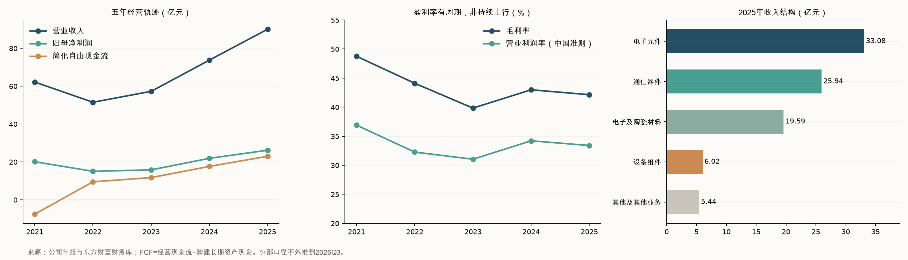

# 三环集团（300408.SZ / 06951.HK）研究报告

**研究日与数据截止：2026-11-14，北京时间。**已运行系统日期核验；财务截至2026-09-30，最新完整经审计年度为2025年。A股采用11月13日收盘71.26元；H股采用同日16:08:24收盘后行情快照64.55港元，经腾讯、东方财富及华盛通交叉核对，不把它表述为另行核实的交易所最终结算价。金额默认人民币，表格另注单位。

**估值快照：**A价隐含集团股权价值1,422.86亿元，滚动归母PE为31.44倍；H价按中间价折成人民币后，滚动归母PE为24.38倍。按两地实际价格分别乘各自股数，加总集团股权价值为1,410.02亿元。

**研究主线：**三环通过材料配方、量产工艺和客户认证，持续出售电子工业中价值不高但失效代价很高的陶瓷元件。2026Q3量价与利润率同时改善，经营证据明显增强；投资判断取决于其中有多少能穿越供给周期，以及新增资本能否保持回报。

---

## AI研究偏见自觉

**信息丰富度评级：A。**公司年报、季报、H股招股书和同业资料充足，AI/MLCC/SOFC叙事也十分拥挤。报表透明度较高，产品经济性透明度仍有限。

**AI研究局限性声明：**公开资料不能还原各规格售价、客户终端库存、良率、产能利用率和高端产品利润；2026H1改变了产品披露粒度，Q3没有分部收入表。本文不推造MLCC、AI或SOFC的最新独立收入，也不把匿名客户确认成特定公司。市场份额来自发行人委托研究，仅视为有偏差可能的证据。未来增长、情景概率、估值倍数与仓位均为研究假设，不是公司指引。

- [x] 资料数量支持核账，不能证明未来增长具有同样确定性。
- [x] 把资料减半，材料与认证机制仍成立；SOFC利润空间等判断则应明显降置信度。
- [x] 对“AI需求增长”增加供给反扑、渠道库存、回购用途三项反面检验。
- [x] 新价格带由盈利口径和三年定价模型重建，不能沿用旧报告结论充当锚。

> 段永平式追问：我知道的是客户愿意为什么付钱，还是只知道公司的热门标签？前者可以解释现有生意，后者不足以预测每股回报。

---

## 第一步：核心数据总览

### 身份、目录与口径

标的是**潮州三环（集团）股份有限公司**，英文CHAOZHOU THREE-CIRCLE (GROUP) CO., LTD.，简称CCTC；A股300408、H股06951是同一公司的普通股，并非ADR。复用原有“三环集团”目录和监控ID，不新增同公司条目。H股于2026年7月9日上市；最新总已发行股本为1,996,718,571股，其中A股1,916,497,371股、H股80,221,200股。[半年报](https://disc.static.szse.cn/disc/disk03/finalpage/2026-08-28/328c12d7-c3e9-4280-a2c2-9a37c15cff4f.PDF)、[11月回购报告书](https://static.cninfo.com.cn/finalpage/2026-11-05/1225658392.PDF)

估值统一使用**含库存股的总已发行股数**，作为库存股未来重售、激励交付后的保守分母。10月底月报列示A股库存股27,556,861股，此后仍有回购与员工持股过户；本文不把这一历史库存数当作11月13日的最新流通分母。法定股本、扣除库存股的经济流通股数、加权平均EPS股数各有用途，不能混用。[10月月报独立分发](https://stock.stockstar.com/notice/SN2026110300001236.shtml)

### 五年财务轨迹

以下均为中国企业会计准则合并口径，金额亿元。营业利润率按报表“营业利润/营业收入”计算，含其他收益和投资类损益，并非剔除这些项目后的纯主营经营利润率。

| 年度 | 收入 | 归母净利 | 毛利率 | 营业利润率 | 经营现金流 | 现金资本开支 | 简化FCF | 货币资金 |
|---|---:|---:|---:|---:|---:|---:|---:|---:|
| 2021 | 62.18 | 20.11 | 48.75% | 36.90% | 11.54 | 19.10 | -7.56 | 55.52 |
| 2022 | 51.49 | 15.05 | 44.10% | 32.26% | 20.74 | 11.25 | 9.49 | 45.09 |
| 2023 | 57.27 | 15.81 | 39.83% | 31.04% | 17.19 | 5.46 | 11.73 | 28.42 |
| 2024 | 73.75 | 21.90 | 42.98% | 34.21% | 24.03 | 6.39 | 17.64 | 30.63 |
| 2025 | 90.07 | 26.18 | 42.14% | 33.40% | 28.78 | 5.80 | 22.98 | 30.58 |

FCF定义为经营现金流减“购建固定资产、无形资产和其他长期资产支付的现金”，不扣并购，不把购买理财误当生产性资本开支，也不是可立即全部派出的股东现金。货币资金不含全部定期存款或理财。历史数由原始年报及东方财富财务库逐项核对；部分年报使用原公告的新浪全文镜像读取。[2022年报（含2021比较数）](https://static.cninfo.com.cn/finalpage/2023-04-24/1216527030.PDF)、[2023年报全文](https://money.finance.sina.com.cn/corp/view/vCB_AllBulletinDetail.php?id=10132913&stockid=300408)、[2025年报（含2024比较数）](https://static.cninfo.com.cn/finalpage/2026-03-28/1225041594.PDF)、[东方财富财务分析](https://emweb.eastmoney.com/PC_HSF10/NewFinanceAnalysis/Index?type=web&code=SZ300408)



这段历史说明：公司能赚钱，但利润和资本开支都有周期。2021利润率很高，随后收入和毛利率仍然回落；不能把本轮利润率新高直接当成新的永久底线。

### 最近四季度与滚动现金

金额亿元；2025Q4、2026Q2/Q3的成本和现金流采用累计差分，Q1采用一季报。季度均未经审计。

| 期间 | 收入 | 归母净利 | 扣非归母 | 毛利率 | 经营现金流 | 现金资本开支 | 简化FCF |
|---|---:|---:|---:|---:|---:|---:|---:|
| 2025Q4 | 24.99 | 6.60 | 5.43 | 41.22% | 8.87 | 2.06 | 6.81 |
| 2026Q1 | 26.81 | 7.91 | 7.22 | 43.49% | 1.57 | 1.88 | -0.32 |
| 2026Q2 | 37.42 | 11.41 | 10.88 | 44.91% | 11.41 | 2.88 | 8.53 |
| 2026Q3 | 50.79 | 19.33 | 18.72 | 53.72% | 21.30 | 5.03 | 16.27 |
| TTM至2026Q3 | 140.02 | 45.25 | 42.24 | 47.18% | 43.14 | 11.86 | 31.29 |

2026年前三季度收入115.03亿元、归母38.65亿元，同比分别+76.74%、+97.35%；Q3单季分别+115.27%、+167.97%。扣非与现金同步增加，增长不能简单归因于补助或财务投资。[2026Q1](https://static.cninfo.com.cn/finalpage/2026-04-24/1225163564.PDF)、[2026H1摘要](https://static.cninfo.com.cn/finalpage/2026-08-28/1225516991.PDF)、[2026Q3原报告](https://static.cninfo.com.cn/finalpage/2026-10-29/1225633826.PDF)、[东方财富独立分发核验](https://finance.eastmoney.com/a/202610293913588216.html)

### 收入结构与披露缺口

| 2025产品 | 收入（亿元） | 收入占比 | 同比 | 毛利率 | 客户购买的实际用途 |
|---|---:|---:|---:|---:|---|
| 电子元件 | 33.08 | 36.73% | +43.95% | 42.30% | MLCC等用于储能、滤波、去耦；电子元件不全等于MLCC |
| 通信器件 | 25.94 | 28.80% | +12.50% | 44.36% | 插芯、套筒等提供光纤精密对准和连接 |
| 电子及陶瓷材料 | 19.59 | 21.75% | +16.82% | 38.09% | 基板、封装等材料与结构件 |
| 设备组件 | 6.02 | 6.68% | +12.09% | 未在此表列示 | 制造相关设备及组件 |
| 其他 | 4.05 | 4.50% | — | — | 其他产品 |
| 其他业务 | 1.39 | 1.54% | — | — | 区别于主营收入 |

2026H1仅披露聚合的“电子、通信元件及材料”收入60.81亿元、同比+54.97%、毛利率44.23%；Q3没有同口径产品拆分。因此最近四季度的**产品分部收入、分部增速及分部毛利率不可完整取得**，不能按2025占比摊分。年报90.07亿元总收入与招股书88.69亿元主营收入可以由其他业务收入调和，并非两个来源对同一收入字段发生重大矛盾。[2025年报第12—13页](https://static.cninfo.com.cn/finalpage/2026-03-28/1225041594.PDF)、[2026H1全文第10—11页](https://disc.static.szse.cn/disc/disk03/finalpage/2026-08-28/328c12d7-c3e9-4280-a2c2-9a37c15cff4f.PDF)

### 现金充裕，但不能重复计价

| 2026-09-30项目 | 亿元 | 口径 |
|---|---:|---|
| 货币资金 | 115.72 | 包含与现金等价物口径不同的资金 |
| 交易性金融资产 | 30.62 | 主要理财类资产，不等于活期现金 |
| 有息及类有息债务 | 16.70 | 短借、长借、租赁负债及全部一年内非流动负债之和 |
| 窄口径净现金/理财 | 129.64 | 上述两项资产减上述债务；不是可分配超额现金 |
| 现金及现金等价物 | 109.63 | 现金流量表口径，不能与货币资金混称 |
| 其他非流动资产 | 55.43 | Q3无完整附注明细，不全部计作长期存款 |

2025年报披露一年以上定存/大额存单58.51亿元；不能把这个历史数直接加在最新货币资金上。现金增加还包含H股融资，并不全是经营创造。后续扩产、回购和员工持股会继续影响资金与股数。[Q3第6—11页](https://static.cninfo.com.cn/finalpage/2026-10-29/1225633826.PDF)、[2025年报第127页](https://static.cninfo.com.cn/finalpage/2026-03-28/1225041594.PDF)

> 巴菲特式追问：利润究竟有多少变成可以长期交给股东的现金？滚动简化FCF为31.29亿元，约为滚动扣非利润的74.06%；维护与增长资本开支尚不能完全拆分。

---

## 第二步：生意本质分析

**一句话本质：向电子、通信和工业客户出售经认证、可规模交付的陶瓷材料与元件，客户持续为一致性、可靠性和少出故障付费。**

客户每生产一批设备就需要采购器件，复购来自下游产量、设计导入和产品升级。它没有订阅合同的可预测性，也没有消费品牌随时提价的自由。单颗元件便宜，系统失效、返工或重新认证很贵，这种不对称构成优质供应商的位置。

| 环节 | 三环做什么 | 经济价值 | 需要付出的资本 |
|---|---|---|---|
| 配方与粉体 | 材料开发、纯度及性能控制 | 改善电性能、烧结与一致性 | 长期研发、试验和人才 |
| 成型与烧结 | 多层结构、精密尺寸、量产控制 | 良率决定合格品单位成本 | 设备、厂房、能源和爬坡损失 |
| 客户认证 | 样品、可靠性与批量导入 | 降低客户换供应商的意愿 | 验证时间与应用支持 |
| 批量交付 | 多规格持续供货 | 规模分摊固定成本 | 库存、应收、产能和供应链 |

利润主要由三个变量决定：**高端合格品销量、每个合格品的售价与成本差、新产能实际利用率。**满产和涨价可以共同推高毛利率，反向变化时也会共同压低它。Q3毛利率从Q2的44.91%升至53.72%，经营杠杆已经释放；这同时扩大了未来利润率正常化的风险。

2025研发费用6.53亿元，占收入7.25%，全部费用化；研发人员1,975人。2026年前三季度研发费用6.10亿元。研发费用率下降时应分清收入快速增长的分母效应与真实投入削弱，不能只看比率。[2025年报第15—16页](https://static.cninfo.com.cn/finalpage/2026-03-28/1225041594.PDF)、[Q3利润表](https://static.cninfo.com.cn/finalpage/2026-10-29/1225633826.PDF)

> 段永平式追问：这门生意好在哪？工艺和认证可以积累，客户付费有真实失效成本支撑；它的弱点是继续成长仍需设备、营运资本和持续研发。

---

## 第三步：护城河评估

| 护城河 | 判断 | 支持证据与可证伪条件 |
|---|---|---|
| 技术/工艺 | 中强 | 配方、烧结、精密加工及量产良率的隐性经验难复制；若同业在同规格、同可靠性下迅速追平成本，判断削弱 |
| 转换成本 | 中等，依应用变化 | 汽车、工业、高速通信重新认证与失效成本高；标准消费类料号多供采购更容易 |
| 规模效应 | 中强 | 材料与制造一体化、多规格和客户覆盖降低合格品成本；低利用率会反噬优势 |
| 品牌/定价权 | 中等偏弱 | B2B质量信誉支持导入；本轮涨价并不证明跨周期持续提价能力 |
| 网络效应 | 无 | 客户增多不会直接让另一个客户使用的电容更好 |

招股书所引Frost & Sullivan研究称，按2025收入，公司在陶瓷插芯及套筒、氧化铝陶瓷基板、晶振用陶瓷封装基座的全球份额分别约70%、超过50%、约40%。这些是**发行人委托、特定细分市场的估计**，没有独立第二来源，不能当作MLCC全球份额或全部半导体陶瓷份额。[招股书第136页](https://www1.hkexnews.hk/listedco/listconews/sehk/2026/0630/2026063000324_c.pdf)

过去五年，产品覆盖与高端认证支持护城河有所拓宽；净利率和FCF的历史波动又表明护城河没有消除周期。这是有壁垒的制造平台，壁垒强度随产品而异。未来五年最关键的验证是：竞争者新增产能后，高端份额、合格品成本和资本回报能否保持。

村田仍在升级同尺寸大容量MLCC。其2026年4—9月毛利率约45.73%、营业利润率22.5%；三环同期最近可得的H1毛利率44.32%，但产品组合和会计口径不同，不能以单个季度53.72%证明全面超越村田。村田最新材料也披露未来扩产计划，说明竞争不会静止。[村田MLCC技术发布](https://www.murata.com/en-eu/news/capacitor/ceramiccapacitor/2025/0710)、[村田最新官方业绩](https://corporate.murata.com/-/media/corporate/about/newsroom/news/irnews/irnews/2026/1030/26q2-e-fls.ashx)

> 巴菲特式追问：十年后护城河还在吗？可靠性和工艺积累有延续基础；若客户多供采购、对手技术升级和供给扩张共同压价，股东仍可能只得到普通制造业回报。

---

## 第四步：逆向思考与风险清单

**最强反方观点：三环的技术优势是真的，但买方可能把“量价修复、满产和国产替代叠加的好年份”，按长期平台利润定价；竞争者扩产、终端去库和新增折旧会让销售增长与每股现金回报脱节。**

| 失败路径 | 概率判断 | 影响 | 可观察预警 |
|---|---|---|---|
| MLCC扩产后供需逆转 | 中高 | 高 | 产品价格、利用率与毛利率共同下行 |
| 渠道采购快于终端消耗 | 中 | 高 | 经销增长、应收和终端库存不匹配 |
| 高端认证变成低回报扩产 | 中 | 高 | 在建工程/固定资产增长，资本回报持续下降 |
| SOFC增长兑现慢或客户集中 | 中 | 中高 | 项目里程碑、回款与分部利润迟迟不能核实 |
| 回购、激励或重售低效 | 中 | 中 | 回购现金支出扩大但经济股数、每股现金未改善 |
| 重大质量事故或断供 | 低频、无法可靠定量 | 极高 | 客户召回、停产、法律或出口限制 |

概率为定性判断，不是统计频率，不能相加。估值中三档主观权重另列，也没有覆盖所有尾部事故。

2026年9月底应收账款37.99亿元，较年初+75.91%；存货32.83亿元，较年初+37.26%。不能拿资产存量的年初增幅与收入同比机械判定造假，但需要跟踪回款。同期应付账款及票据较年初增加18.08亿元，经营现金流也得到供应商信用支持；不能把全部现金流改善当成纯终端收现效率提升。[Q3报表](https://static.cninfo.com.cn/finalpage/2026-10-29/1225633826.PDF)

招股书披露内控顾问曾在2025年9月识别防渠道塞货管理流程的若干不足，公司随后整改，后续审查未发现重大不足，公司称往绩期未发生塞货事件。**这不是造假认定**，但在经销扩张和量价齐升期，终端库存与退货规则应成为持续核验项目。[招股书第164—166页](https://www1.hkexnews.hk/listedco/listconews/sehk/2026/0630/2026063000324_c.pdf)

历史机制可参考TDK在2019年官方说明中的陶瓷电容经销商去库：长期电子含量提升，仍可与短期客户削减库存并存。用技术采纳曲线看需求，用资本周期看供给，两者合起来才完整。把AI服务器用量增加直接映射到供应商永续利润增长，是本报告最可能犯的分析错误。[TDK官方业绩说明](https://www.tdk.com/system/files/wwwtdkcom_ir_ir_events_conference_2020_pdf_2020_1q03_5s0q5z57.pdf)

> 芒格式追问：聪明人为什么不买？因为价格可能已经要求较高的盈利留存，而公开数据仍无法区分涨价红利、结构升级和渠道补库存各自贡献。

---

## 第五步：管理层与资本配置

李钢自2021年任董事长，马艳红自2023年任总经理；2026年8月是董事会换届续任，不能写成首次接班。两人有公司内部业务积累，支持组织传承的判断；制造能力可以依靠系统延续，资本配置能力仍须逐次评估。[招股书董事章节](https://www1.hkexnews.hk/listedco/listconews/sehk/2026/0630/2026063000324_c.pdf)

| 时间 | 决策/行为 | 已观察结果 | 评价 |
|---|---|---|---|
| 2021—2025 | 持续研发与产能建设 | 研发费用化，产品覆盖扩大；期间亦经历收入下滑 | 执行较好，但不能据此假设新投资均高回报 |
| 2026年7月 | H股融资、拓展海外及研发投入 | 现金和股本明显增加 | 战略有逻辑，新增资本回报尚待检验 |
| 2026年前三期回购 | 合计约23.95亿元 | 含激励、维护价值后出售等用途 | 不能等同全部注销或永久股东回报 |
| 2026年11月第四期 | 计划回购5—10亿元；11月5日首次使用约4.00亿元 | 拟用于维护价值后出售；回购上限100元不等于内在价值 | 应核实际买价、重售条件、资金成本 |
| 2026员工持股 | 首次实际受让252.23万股、57.58元/股，涉及2,241人 | 解锁含2028审计收入至少260亿元及个人考核 | 有助绑定员工；缺独立利润/ROIC门槛，激励仍偏规模 |

第四期回购拟全部用于出售，在规定期限未使用/售完才涉及注销，因此估值不预设永久缩股。公司取得的股票回购贷款承诺也不是已经全额提款，更不是新增经营现金流。[回购用途](https://static.cninfo.com.cn/finalpage/2026-11-05/1225658392.PDF)、[回购进展](https://static.cninfo.com.cn/finalpage/2026-11-06/1225660602.PDF)、[员工持股管理办法](https://static.cninfo.com.cn/finalpage/2026-08-28/1225530758.PDF)、[实际过户公告](https://static.cninfo.com.cn/finalpage/2026-11-05/1225658394.PDF)

2026Q3控股股东三江投资直接持股32.32%，实控人张万镇直接持股2.68%。三江受其控制，不代表三江所持全部股票都属于他的经济权益；未完成最新穿透前，不给出伪精确的最终财富持股比例。未见AB股超级投票权结构。HKSCC代理持股也不能当作独立终益大股东。[Q3股东表](https://static.cninfo.com.cn/finalpage/2026-10-29/1225633826.PDF)

管理层技术与制造执行评价中高，资本配置评价中等。最新完整高管薪酬、个人减持交易和全部关联交易未在本次逐笔重建，不能据此宣布“无人减持、治理无风险”。激励的260亿元目标是薪酬契约条件，绝非业绩承诺。

> 段永平式追问：CEO退休后还能保持竞争力吗？工艺、客户体系与内部培养提供基础；真正的检验是下一轮扩产是否仍能产生合理资本回报，而非是否延续收入目标。

---

## 第六步：行业与文明趋势

电子化、电气化、数据中心和汽车电子扩大了可靠元件的需求，AI又提高电源完整性、高速连接和供电环节要求。三环位于材料与关键元件环节，收入机会来自器件用量、规格升级、客户份额和新增应用，不直接拥有算力需求的定价权。

| 机会 | 三环的价值捕获方式 | 仍需验证 |
|---|---|---|
| 高端MLCC | 更高容量、可靠性与客户导入提升单位价值 | 高端占比、良率与跨周期价格 |
| 光通信 | 插芯/套筒与新型连接产品供货 | 高速架构变化、客户多供和替代路线 |
| 半导体陶瓷 | 高纯度、耐热与低污染组件进入设备/封装 | 从小批交付走向稳定批量与现金收入 |
| SOFC | 隔膜片等陶瓷部件参与分布式能源链 | 分部客户集中、系统路线、订单转化和回款 |

2025年前五客户占收入14.94%，最大客户3.67%，前五供应商占采购26.86%；这支持集团层面客户较分散，但**无法证明SOFC子业务客户分散**。招股书的匿名美国新能源客户不在本文中直接确认为Bloom；外部系统厂商的项目或订单也不直接进入三环收入预测。[2025年报第14页](https://static.cninfo.com.cn/finalpage/2026-03-28/1225041594.PDF)、[招股书第167页](https://www1.hkexnews.hk/listedco/listconews/sehk/2026/0630/2026063000324_c.pdf)

本次没有获得能独立双源核实、口径统一且覆盖全部业务的TAM及增长预测，故不拼接一个“公司总市场空间”。市场足够大不等于利润池属于三环。村田计划扩大产能，说明需求增长会诱发供给响应；SOFC等新方向也有技术替代和经济性验证风险。[村田最新官方说明材料](https://corporate.murata.com/-/media/corporate/about/newsroom/news/irnews/irnews/2026/1030%EF%BD%82/26q2-e.ashx?cvid=20261104002830000000&la=en-us)

> 李录式追问：二十年后它会是什么？有机会继续成为电子工业的关键材料供应商；要把时代顺风变成购买力增长，仍须保持客户地位、资本回报与合理买价。

---

## 第七步：估值与安全边际

### 当前定价与历史纠错

行情通过腾讯和东方财富直接接口核对。港元换算采用11月13日官方中间价100港元=85.604元人民币，即1港元=0.85604元；这不是投资者实际成交汇率。H股64.55港元折合55.257382元，较A股折价22.46%，不假设折价一定收敛。[腾讯行情](https://qt.gtimg.cn/q=sz300408,hk06951)、[东方财富A股行情](https://quote.eastmoney.com/sz300408.html)、[H股独立行情](https://daily.hstong.com/quotes/10000-06951-HK)、[国家外汇管理局汇率表](https://www.safe.gov.cn/AppStructured/hlw/RMBQuery.do?COLLCC=546877760)

| 指标 | A股71.26元 | H股64.55港元，按人民币等值 |
|---|---:|---:|
| 各自价格隐含集团股权价值（亿元人民币） | 1,422.86 | 1,103.33 |
| PE，滚动归母利润 | 31.44倍 | 24.38倍 |
| PE，滚动扣非利润 | 33.68倍 | 26.12倍 |
| PS，滚动收入 | 10.16倍 | 7.88倍 |
| PB，9月底净资产 | 4.82倍 | 3.74倍 |
| P/FCF，滚动简化FCF | 45.48倍 | 35.26倍 |
| 简化FCF收益率 | 2.20% | 2.84% |
| 以0.45元历史每股股息计算的税前股息率 | 0.63% | 0.81% |

0.45元来自公司已实施的2025年度A股每股现金股息；H股在其后才上市，本文只把相同人民币每股金额作为未来分配情景锚，不声称H股已收到该笔股息，亦不保证以后每股金额相同。[权益分派实施公告](https://static.cninfo.com.cn/finalpage/2026-04-30/1225255550.PDF)

滚动归母EPS=2.266251元，扣非EPS=2.115645元，均按最新全部已发行股数重算。行情平台显示的27.61倍等口径可能基于累计利润年化，与本文TTM不同；不能混放比较。两地隐含集团市值不能相加，实际按两类股数分别计价的集团总市值才是1,410.02亿元。扣除窄口径净现金/理财的简化EV为1,280.38亿元，EV/TTM收入9.14倍；该EV仍有受限资金、理财及资本用途等限制。

**旧报告纠正：**[8月3日报告](三环集团-research-20260803.md)的2021收入61.82亿元混用了主营收入，合并总收入应为62.18亿元；其PS列2.30倍存在数量级错误，用该报告列示的2,266.16亿元市值/98.55亿元收入应约23.00倍。该报告当时股本口径不能沿用到绿鞋增发后的现在；旧市值验算文字也不够精确。本文保留历史文件作追溯，新估值、价格带和结论取代旧报告相应建议。

若机械使用本报告12%的三年扣非EPS增速，研究假设PEG为A股2.81、H股2.18；这是人为增长假设的派生数，并非可核实的市场一致预期PEG，不作为独立买点。

与历史比较，本次只能可靠说明：旧时点接近79倍TTM归母PE已显著回落到31.44倍，经营利润又明显增强。未取得连续、同口径的历史PE分位，因此不声称目前处于“历史最低分位”。

| 可比标的 | 11月13日价格 | 同口径重算TTM归母PE | 2026年前三季毛利率 | 比较限制 |
|---|---:|---:|---:|---|
| 三环集团A | 71.26元 | 31.44倍 | 48.47% | 含电子元件、通信、材料等 |
| 风华高科000636 | 30.36元 | 50.01倍 | 22.80% | 业务与盈利周期不同 |
| 国瓷材料300285 | 38.60元 | 57.76倍 | 37.34% | 上游材料及其他业务组合不同 |

同业均用2025全年+2026前三季−2025前三季归母利润、最新股本和当日价格计算。三环相对这两个A股标的更便宜、利润率更高，但同业自身也可能贵；该比较不作为十年退出倍数来源。日韩同业未取得本次可审计的同日估值，不拼接预测PE。[风华财务库](https://emweb.eastmoney.com/PC_HSF10/NewFinanceAnalysis/Index?type=web&code=SZ000636)、[国瓷财务库](https://emweb.eastmoney.com/PC_HSF10/NewFinanceAnalysis/Index?type=web&code=SZ300285)

### 三年三情景：回答“贵不贵”

起点用TTM扣非EPS 2.115645元，股数不因可重售回购而假设永久减少。未来三年EPS增速与退出PE是显式研究判断：基准增长12%，承认需求和份额提升但不延续本季翻倍；25倍PE反映制造平台质量及周期风险。乐观需要高端产品和新业务持续兑现，悲观包含周期回落。以下是三年后的价格，另列按8%要求回报折回今天的价格，均不含中途股息。

| 情景 | EPS年增速 | 三年PE | 三年目标价（元人民币） | 折回今日（元人民币） | A股价格年化回报 | H股人民币价格年化回报 |
|---|---:|---:|---:|---:|---:|---:|
| 悲观 | -5% | 18倍 | 32.65 | 25.92 | -22.91% | -16.09% |
| 基准 | +12% | 25倍 | 74.31 | 58.99 | +1.41% | +10.38% |
| 乐观 | +25% | 35倍 | 144.62 | 114.81 | +26.61% | +37.81% |

**三年判断：A股基准回报偏低；H股有价格优势，但对基准现值的折让有限，尚未形成足够厚的安全边际。**这不是由十年压力测试单独导出的结论。

反向定价检验：若三年后回到25倍扣非PE，要实现8%价格年化回报，A股要求扣非EPS未来三年约+19.28%/年，H股人民币等值要求约+9.59%/年。这是反向终值定价检验，**不是完整DCF**；下文用完整现金流补充。A股要求公司比本报告基准更快增长，H股对近期兑现的要求较低。

### 十年压力测试：资本成本、再投资与退出估值

全部经营利润和现金流使用**人民币**。H股也先换成人民币初始成本，结果是人民币购买力口径，不是对港元投资回报的保证；没有将人民币现金流直接配港元折现率，未来汇率变化须另行评估。

- **r=8%。**参考11月13日中债10年国债收益率1.6123%，取β=1、权益风险溢价6.3877个百分点，合为8%。风险溢价是长期要求回报判断；人民币合理范围6%—9%。不随短期低利率把要求回报压低，也不把质量事故等离散风险塞进r。[中债收益率来源](https://yield.chinabond.com.cn/cbweb-cbrc-web/cbrc/showCbrc)
- **稳态增量ROIC=18%。**这是终值年之后新资本的回报假设，不是已经核实的存量ROIC。工艺与认证可能支持超额回报，但全球扩产和成熟后价格竞争会压低新投资回报。本次未得到可稳健穿透理财、存款和无形研发的历史经济ROIC，因此不给出虚假的“精确夹点”；18%是中等置信度判断。
- **永续g=0%/1.5%/2%。**是十年之后的增长，基准不超过人民币2%上限；g独立于r。十年内利润增长另由终值利润决定。

终值PE唯一来自 `(1−g/ROIC)/(r−g)`，不借用同业今天的PE。2036年三档利润50/120/220亿元，以当前TTM扣非42.24亿元为起点，分别隐含约+1.70%/+11.00%/+17.94%的十年复合增长。权重30%/50%/20%为主观压力分配，无统计校准，不是收益承诺。

| 十年情景 | 主观权重 | 2036利润（亿元） | g | r−g | 公式退出PE | A股工具近似年回报 | H股人民币等值工具近似年回报 |
|---|---:|---:|---:|---:|---:|---:|---:|
| 悲观 | 30% | 50 | 0% | 8.0个百分点 | 12.50倍 | -7.27% | -4.71% |
| 基准 | 50% | 120 | 1.5% | 6.5个百分点 | 14.10倍 | +2.38% | +5.18% |
| 乐观 | 20% | 220 | 2% | 6.0个百分点 | 14.81倍 | +9.27% | +12.25% |

这里必须说明工具边界：`terminal_value.py irr`计算的是几何价格回报加固定“股息率−稀释率”，并非逐年现金流求根的完整IRR。上表固定股息锚分别为当前历史股息收益率，永久净缩股假设为零；未来分红变化与股权支付不在这条简式中。因此其加权输出只用于工具规定的仓位压力测试。

| r敏感性 | A股工具期望近似年回报 | 覆盖r？ | H股人民币等值工具期望近似年回报 | 覆盖r？ |
|---|---:|---|---:|---|
| 6%（r−2个百分点） | +4.48% | 未通过 | +7.33% | 通过，但含窄分母情景，见下文 |
| 8%（基准） | +0.87% | 未通过 | +3.63% | 未通过 |
| 10%（r+2个百分点） | -1.71% | 未通过；币种区间外，仅供参考 | +0.99% | 未通过；币种区间外，仅供参考 |
| 7%（额外复核） | +2.49% | 未通过 | +5.30% | 未通过 |
| 9%（额外复核） | -0.51% | 未通过 | +2.22% | 未通过 |

**翻转回答：A股在工具检查的人民币合理区间内未翻转；H股在6%与8%之间出现翻转，表明对折现率敏感，仓位建议必须降级。**同时，6%时基准/乐观的r−g仅4.5/4.0个百分点，低于5个百分点，故该两格只能作情景参考，不能把6%下“通过”当作正式估值或买入论据。额外7%—9%复核的各格分母均不低于5个百分点，A/H均未通过。基准8%三档C1/C2/C3准出通过，不能靠调低r追求买入结论。

### 完整现金流与反向DCF补充

为避免固定股息简式系统性漏算增长中的派息，另建逐年现金流模型：从当前扣非利润起，按各档隐含增速平滑增长至2036年；每年分配当年利润35%，第十年同时按上述公式PE出售剩余权益；用逐年现金流求IRR，按8%折现。35%是可分配能力情景，不是公司承诺；留存资金能支撑增长仍取决于再投资回报。终值年后的留存率改为公式要求的g/ROIC，避免重复分配。没有再把净现金加一次，也没有把回购金额当股息。

| 情景 | 完整现金流现值/股（元人民币） | A股完整现金流IRR | H股人民币等值完整现金流IRR |
|---|---:|---:|---:|
| 悲观 | 19.90 | -6.20% | -3.61% |
| 基准 | 47.90 | +3.49% | +6.35% |
| 乐观 | 88.01 | +10.44% | +13.49% |

按相同主观概率加权，各档IRR均值A股约+1.97%、H股约+4.79%；该均值不等于组合真实IRR，也未计税费、汇兑与极端尾部损失。完整模型的年现金流、终值和求根结果保存在[模型文件](三环集团-model-20261114.json)。与简式相比，增长派息改善回报，但没有消除对增长和终值假设的依赖。

反向DCF沿用35%分配、g=1.5%、ROIC=18%、r=8%，反解当前价格需要的十年平滑利润增长：A股约+15.84%/年、2036年利润约183.86亿元；H股人民币等值约+12.73%/年、2036年利润约140.03亿元。它揭示的是“持有价格需要什么经营兑现”，不证明公司能做到；完整求根与现值回代见模型文件。

### 估值分歧对账

| 证据 | 回答的问题 | 本次结果与使用方式 |
|---|---|---|
| 生意与最新经营证据 | 值不值得持续研究/持有 | 材料、认证、客户和现金证据增强，支持保留研究与适度持有 |
| 三年三情景 | 当前价格贵不贵 | A股缺安全边际；H股相对便宜但对基准现值折让仍薄 |
| 十年工具及完整现金流 | 仓位能否加重 | 回报偏低且H对r敏感，限制总仓位；不能单独否决买入或要求全部卖出 |
| 旧70—85元建议 | 是否沿用历史行动 | 旧口径存在错误，且高景气利润需要正常化；由本次增长、PE及现金模型重新定价，不以十年未通过单独撤销 |

三年模型假定三年后仍能获得25倍基准估值，十年永续公式给的是14.10倍，解释了两者差异。短中期高端化兑现，和长期行业成熟后的估值收敛可以同时成立。最终观望来自**当前三年安全边际不足、周期盈利可持续性与资本配置待验证**；十年压力测试进一步收紧潜在仓位。对现有小仓不作机械清仓建议。

**本次价格纪律：A股47—52元、H股55—61港元为有条件的小仓分批评估带。**以当前汇率两者大致对应同一人民币购买成本。区间来自三年基准现值的折让，并参考完整现金流基准值；不是保证盈利的底部。低于下沿仍要提醒，但须先核论文破坏，经营条件成立才继续评估。A股≥90元/H股≥100港元且模型未获新证据增强时，复核过高仓位，不自动卖出。

> 巴菲特式追问：r错两个百分点会翻转吗？H股的工具结果会，且低r部分模型分母过窄；不能为买入挑折现率。段永平式追问：关市五年愿意按现价买入吗？现有公开证据支持继续研究和适度持有，尚不足以支持重仓新买。

---

## 第八步：最终决策与行动清单

| 维度 | 结论 | 信心度 |
|---|---|---|
| 生意质量（段永平） | 工艺、可靠性与持续需求支撑的优质制造平台，资本需求仍高 | 中高 |
| 护城河（巴菲特） | 材料、良率、规模与认证中强；不能消除周期或多供采购 | 中 |
| 管理层（段永平+巴菲特） | 制造执行较好，融资后再投资、回购与规模激励仍需回报核验 | 中 |
| 最大风险（芒格） | 把本轮涨价和满产毛利率当成永久利润，并低估供给响应 | 中高 |
| 文明趋势（李录） | 电子化、算力和电气化顺风，利润归属仍取决于技术与竞争 | 中高 |
| 估值（巴菲特+段永平） | 三年：A缺安全边际、H折让有限；十年：仅支持谨慎仓位，H随合理r低端翻转 | 中 |

**综合结论：A/H空仓者均观望；已有适度小仓可持有、不在现价加仓。H股相对A股更值得优先跟踪。**估值只是六维中的一维，十年未覆盖r不能单独构成买入否决。用户未提供成本、税务、流动性需求和当前仓位，下面的比例只是研究用的组合上限参考。

| 策略 | 具体行动 |
|---|---|
| 空仓者 | 当前不新增长期价值仓；进入A47—52元或H55—61港元并满足下述经营条件后，研究首笔约0.5%—1% |
| 持仓者 | 小仓可持有；若单一标的已明显超出约2%—3%的研究参考上限，可分步降集中度；不能仅因模型未通过而清仓 |
| 加仓条件 | 再有连续两次正式披露验证扣非利润与回款，滚动简化FCF保持正且扣非转化率约≥70%，后续可核产品/综合毛利率未显著恶化，应收存货及回购/股数可解释；股价入带只是启动复核 |
| 仓位限制 | 即使价格与经营条件同时满足，总仓参考≤2%；高端产品利润、再投资回报及渠道终端库存证据增强后才讨论提高 |
| 卖出/重审信号 | 连续两次披露综合毛利率同比下降且应收/库存明显失配；滚动简化FCF转负或转化率持续低于约50%；重大质量、合规或治理事件；高价低效扩产/激励实质损害每股价值 |
| 估值警戒 | A≥90元/H≥100港元且经营仅基准：不追价并复核超配；价格单独触线不自动卖出 |
| 下一步 | 2026-12-31核渠道、资本配置和回购重售；2027-03-31检查全年披露日历，正式财报发布即提前复核；均非公司确认财报日 |

70%、50%和仓位比例是本报告研究纪律，不是公司承诺或统计最优值。现有季度的利润率高低不单独触发买卖；需要结合规模、产品组合与收现核验。

### 四位大师原话与方法应用

以下引用已读取可核原文，**方法延伸由本报告作者作出，不是四位本人对三环集团的评价或交易建议**。未发现他们对三环的可靠直接表态，不模拟公司层面的买卖代言。

- **巴菲特：**“It’s far better to buy a wonderful company at a fair price”。出处为[1989年官方股东信](https://www.berkshirehathaway.com/letters/1989.html)。本文延伸：材料能力值得认可，买价仍需容纳正常竞争后的回报。
- **芒格：**“inversion frequently will solve problems which nothing else will solve”。出处为[2007年USC演讲转录](https://jamesclear.com/great-speeches/2007-usc-law-school-commencement-address-by-charlie-munger)，非校方逐字稿。本文延伸：先研究扩产、价格反转与渠道库存如何使论文失败。
- **段永平：**“不懂不投，哪天搞懂了，看见便宜的还是可以投的。”出处为[2011年7月14日雪球原帖](https://xueqiu.com/1247347556/20317351)，本地已核[原发言存档](../段永平/段永平雪球全量原发言.md)。本文延伸：公开资料不能穿透的产品盈利，不用“AI概念”填补。
- **李录：**“投资的根本目的是保存和增加你的购买力。”出处为[2024年12月7日北大演讲存档及原始来源索引](../李录/李录-北大演讲-20241207.md)。本文延伸：时代方向与股票投资回报分别检验。

> 四位方法共同留下的追问：公司变强以后，新增的一元资本与投资者今天付出的一元，能分别得到多少可持续回报？

---

## AI分析置信度与投资确定性

**AI分析置信度：财务核账高，商业机制中高，未来盈利与估值中等偏低。**收入、利润、现金流和股本有原公告及独立财务数据分发核对；SOFC和高端MLCC独立利润、客户终端库存、维护资本开支、未来增量ROIC及全部减持记录仍有缺口。

**实际投资确定性：中等，当前价格的安全边际确定性较低。**公司有真实的材料与制造积累，2026Q3经营强化；材料优势能延续，不等于本季利润率能延续，也不等于当前价格能带来足够回报。

重大质量事故、出口/制裁断供、治理侵占的损失概率与强度**未建模**，审计提示已明确留在这里。35%分配假设不等于完整的自由现金流拆分，净现金未完成“超额可分配”穿透；H股现金税费与未来汇率未建模。进一步一手验证应优先问：高端产品良率和价格如何变化、经销商终端库存是多少、SOFC各客户收入与回款是否集中、新产能可得的增量资本回报是多少。

---

## 数据来源与审计记录

主要财务依据为[2025年报](https://static.cninfo.com.cn/finalpage/2026-03-28/1225041594.PDF)、[2026半年报](https://disc.static.szse.cn/disc/disk03/finalpage/2026-08-28/328c12d7-c3e9-4280-a2c2-9a37c15cff4f.PDF)、[2026三季报](https://static.cninfo.com.cn/finalpage/2026-10-29/1225633826.PDF)，与东方财富MAINFINADATA、GBALANCE、GINCOME、GCASHFLOW财务字段对照。所谓双源指独立分发和字段提取校验，不是两个独立审计意见；不能消除公司原始报表自身的风险。

关键数据交叉验证工具原始输出摘录如下，金额按工具自动显示B（十亿元）/M（百万元）：

```text
交叉验证: 2025收入 (Cross-Validation)
  数据来源数: 2
  ✅ 所有来源偏差 ≤ 1.0%, 数据一致
交叉验证: 2026Q3货币资金 (Cross-Validation)
  数据来源数: 2
  ✅ 所有来源偏差 ≤ 1.0%, 数据一致
市值验算 (Market Cap Verification)
  股价 (Price):       71.26 CNY
  计算市值:           142.29B CNY
  报告市值:           142.29B CNY
  偏差:               0.00%
估值指标验算 (Valuation Verification)
  PE (TTM):  71.26 / 2.2662506931078172 = 31.44x
  P/FCF:     71.26 / 1.5669203249975683 = 45.48x
  FCF Yield: 2.20%
```

完整收入/净利/现金/债务/股本及持股核验、估值工具原始输出、随机数据抽检清单与判决、定稿终值口径复检见[核验记录](三环集团-audit-20261114.md)。所有模型参数和逐年现金流保存在[模型JSON](三环集团-model-20261114.json)，抽检字段保存在[抽检JSON](三环集团-audit-samples-20261114.json)。情景判断是内部一致性核验，不能伪装成已经被外部来源证实的预测。

本研究更新同一监控ID，登记A/H价格带及复检节点，并在非重点标的跟踪表新增本次事件、接续关闭旧事件。监控触线只表示需要按本报告核验条件，不表示自动交易。

*本报告用于学习与研究，不构成投资建议。*
