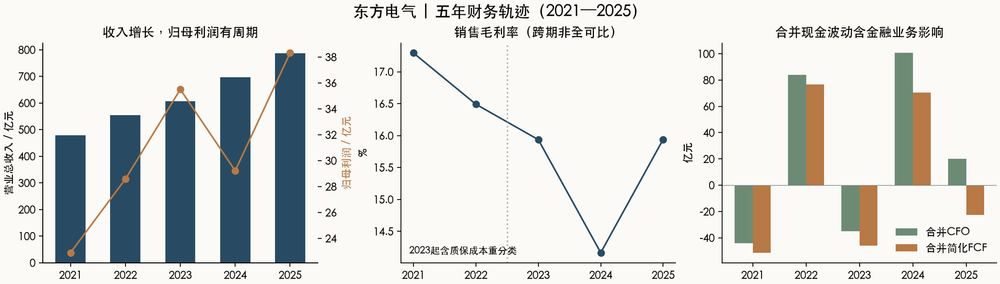
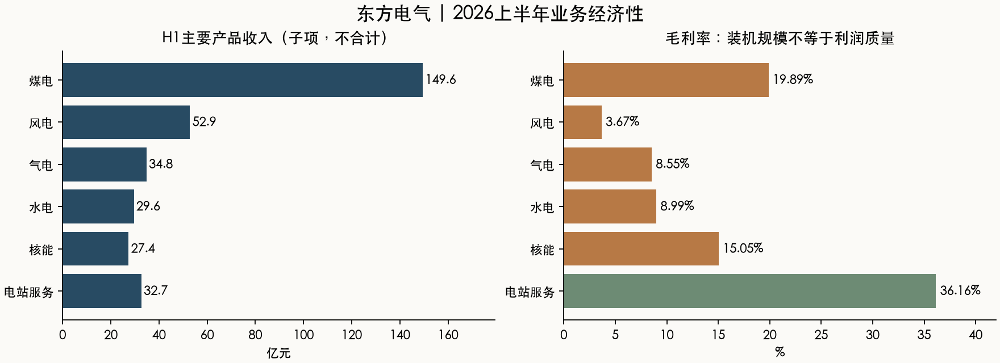

# 东方电气（600875.SH / 01072.HK）研究报告

**研究与数据检索截止：2026-11-24，Asia/Shanghai。** 年度审计数据截至2025-12-31，最新财务截至2026-09-30；行情采用11月24日收盘。公司全称为东方电气股份有限公司，英文 Dongfang Electric Corporation Limited。A、H股是同一上市公司的两类股份，区别于控股股东中国东方电气集团有限公司。

| 当前快照 | A股 | H股 |
|---|---:|---:|
| 收盘价 | 20.50元 | 14.42港元 |
| 按当日中间价折合人民币 | 20.50元 | 12.3416元 |
| 当前价乘全部股本的等价市值 | 708.96亿元人民币 | 498.70亿港元 |
| 归母PE，TTM | 15.07倍 | 9.07倍 |
| 正常化PE，按每股1.15元假设 | 17.83倍 | 10.73倍 |
| PB，按9月底归母净资产 | 1.51倍 | 0.91倍 |

**研究主线：** 东方电气拥有难复制的能源装备资质和工程体系，自主燃机与电站服务正在增加商业机会；能否成为好投资，取决于这些机会转化为每股现金回报的速度，以及买入哪类股份、付出什么价格。

本次接续[8月3日旧报告](东方电气-research-20260803.md)，保留历史原稿。A/H分拆合计市值为675.68亿元人民币；上表两个“等价市值”均不能再相加。汇率采用中国外汇交易中心11月24日中间价1港元=0.85587元人民币，非可成交汇率。H股折价约39.80%，不假设折价必然收敛。[行情与计算记录](证据-20261124/market.json)、[官方汇率](https://www.chinamoney.com.cn/chinese/bkccpr/index.html?tab=2)。

> 本报告用于学习研究，不构成投资建议。未获知读者实际持仓、税务身份或风险承受力；下文仓位仅为研究参考。

---

## AI研究偏见自觉

**信息丰富度评级：A级。** A+H定期报告、能源统计和技术新闻丰富，但客户合同的利润率、预付款、最终验收、质保成本和制造主业现金流，仍有重要盲区。资料量高，不等于长期股东回报确定。

**AI研究局限性声明：** 本文双源核验主要是公司原始披露与东方财富的数据整理核对，并非两次独立审计。加拿大客户声明未获得完整合同、付款凭证和园区融资文件。最新报告未逐季度披露细分收入；2025—2026年扣除财务公司后的完整工业现金流，本轮未取得可比明细。估值中的增长、派息率、增量ROIC及情景概率都是研究假设。

- [x] 不把国家能源安全和AI用电需求直接等同于设备商利润。
- [x] 不把新增订单或集团新闻全部计入上市公司盈利。
- [x] 不把制造服务整体等同于售后，也不把合并负现金流全部归咎于制造主业。
- [x] 不从北美燃机同业的估值反推G50必然具有同样利润率。
- [x] 不用十年压力测试单独决定买入、持有或回避。

---

## 第一步：核心数据总览

### 五年轨迹：利润增长与现金波动并存

单位：亿元人民币；利润率为%。优先使用最新可取得的追溯比较数。

| 指标 | 2021 | 2022 | 2023 | 2024 | 2025 |
|---|---:|---:|---:|---:|---:|
| 营业总收入 | 478.19 | 553.64 | 606.77 | 696.95 | 786.15 |
| 营业收入 | 467.56 | 541.90 | 595.67 | 685.93 | 775.83 |
| 归母净利润 | 22.89 | 28.58 | 35.50 | 29.22 | 38.31 |
| 扣非归母净利润 | 17.63 | 23.85 | 25.76 | 19.80 | 31.92 |
| 销售毛利率 | 17.29% | 16.49% | 15.94% | 14.17% | 15.94% |
| 营业利润/营业总收入 | 5.56% | 6.00% | 6.55% | 5.58% | 6.08% |
| 合并经营现金流 | -44.21 | 84.09 | -34.96 | 100.59 | 20.14 |
| 现金资本开支 | 7.18 | 7.48 | 11.10 | 29.99 | 42.84 |
| 合并简化FCF | -51.39 | 76.60 | -46.06 | 70.60 | -22.70 |
| 货币资金 | 187.22 | 150.47 | 171.29 | 268.56 | 226.80 |



有三处口径必须先解释。

第一，营业总收入含金融业务的利息及手续费收入，销售毛利率则按营业收入减营业成本计算。不能将2025年分部表含金融业务的17.01%与销售毛利率15.94%混用。

第二，2024年执行准则解释第18号，将保证类质保支出从销售费用调入营业成本，并追溯2023年。2023年原报毛利率17.31%，追溯后为15.94%，利润与现金流并未因此下降；2021、2022尚未作同样重列，五年毛利率不是严格同口径序列。另有2022年同一控制合并等追溯，详见底稿。

第三，简化FCF定义为合并CFO减购建固定资产、无形资产及其他长期资产的现金支出，包含财务公司存贷波动。2021、2023年剔除财务公司后CFO分别为正7.05、24.95亿元；因此不能从合并FCF多次为负，推论工业主业长期不产现金。2025—2026年的同口径工业现金桥仍是研究缺口。[历年原表、页码与双源记录](证据-20261124/financials.md)。

### 最新四季度：主营改善比一季度更扎实，现金仍需穿透

| 指标，亿元 | 2025Q4 | 2026Q1 | 2026Q2 | 2026Q3 |
|---|---:|---:|---:|---:|
| 营业总收入 | 230.94 | 174.70 | 211.54 | 175.74 |
| 归母净利润 | 8.65 | 15.85 | 11.28 | 11.25 |
| 扣非归母净利润 | 4.65 | 11.79 | 11.86 | 11.29 |
| 销售毛利率 | 17.28% | 17.18% | 14.69% | 16.75% |
| 合并CFO | 57.19 | -26.98 | 9.76 | -5.57 |
| 现金资本开支 | 29.92 | 5.45 | 3.28 | 4.23 |
| 合并简化FCF | 27.26 | -32.43 | 6.48 | -9.80 |

季度数由年度/累计报表差分，未经年度审计的季度数据保持相应限制。公司不披露每季产品分部，本文不推造最近四季的煤、核、气、风收入。[2025年报](https://static.cninfo.com.cn/finalpage/2026-04-01/1225068291.PDF)、[2026半年报](https://static.cninfo.com.cn/finalpage/2026-08-26/1225505169.PDF)、[2026三季报](https://static.cninfo.com.cn/finalpage/2026-10-30/1225638727.PDF)。

前三季度营业总收入561.98亿元，同比+1.22%；归母38.39亿元，同比+29.40%；扣非34.94亿元，同比+28.17%。第三季度单季扣非+22.68%，说明改善已不能只归于一季度金融资产公允价值收益。与此同时，前三季度合并CFO为-22.79亿元，不能把利润改善直接当成股东现金改善。

| TTM截至2026Q3 | 金额/每股值 |
|---|---:|
| 营业总收入 | 792.9168亿元 |
| 归母净利润 | 47.0355亿元 |
| 扣非归母净利润 | 39.5991亿元 |
| 按最新实际股本归一的归母EPS | 1.360052元 |
| 按最新实际股本归一的扣非EPS | 1.145026元 |
| 合并CFO | 34.3921亿元 |
| 现金资本开支 | 42.8797亿元 |
| 合并简化FCF | -8.4876亿元 |

归一EPS是TTM利润除当前实际股本，不把各季加权平均EPS直接相加。估值取1.15元正常化起点，接近TTM扣非EPS的两位小数舍入；并非2026全年盈利指引，扣非也并未剔除所有金融业务收益。

### 现金：先扣客户负债，再讨论流动性

| 2026年9月底，亿元 | 金额 | 解释 |
|---|---:|---|
| 货币资金 | 265.84 | 不等于全部可派发 |
| 现金及现金等价物 | 234.54 | 现金流量表口径 |
| 含一年内到期和租赁的有息负债 | 79.88 | 短借、长借、一年内、租赁合计 |
| 吸收存款及同业存放 | 65.43 | 财务公司对客户等的负债 |
| 扣债与存款后的流动性桥 | 89.23 | 不另加贷款、债权投资和回购资产 |
| 交易性金融资产 | 16.08 | 若加上，上述桥为105.31亿元 |
| 应收账款 | 165.66 | 回款风险需逐笔判断 |
| 存货 | 312.61 | 项目在制品与交付节奏 |
| 合同资产 | 180.55 | 验收、结算、质保等现金约束 |
| 合同负债 | 466.74 | 预收款支持生产，同时附交付义务 |

89.23亿元只是排除明显重复和客户负债后的流动性参考，仍非严格工业净现金，更非闲置可分配现金。9月底货币资金与现金等价物相差31.30亿元，不能一概称受限资金；最新明确披露的受限数为2026年中30.42亿元。估值已经包含金融业务盈利，**不再把金融资产总额加到股权价值上**。

旧稿“保守净现金148.82亿元”没有充分处理财务公司客户负债，停止沿用该标签；这属于口径修正，不能把两期不同算法之差解释为现金消失。[现金桥精确输入](证据-20261124/financials.json)。

> 段永平式追问：这些数字能解释这门生意如何把利润变成钱吗？
>
> 已能确认扣非利润改善，尚不能完整确认最新工业现金转化；这会约束加仓幅度。

---

## 第二步：生意本质分析

**一句话：电站业主为高可靠、经认证、能按期交付的大型主机付钱，东方电气通过设备、工程以及投运后的备件维修和改造获得收入。**

从获单到回款，通常要经过招标、设计采购、制造、发运、安装、验收和质保。设备寿命长带来服务机会，但设备收入本身是低频项目交易；客户对可靠性的要求高，也具有集中采购和压价能力。项目预付款可以改善资金周转，延迟验收、成本超支和质保则会反向占用现金。

### 收入结构与经济性

| 主分部 | 2025收入，亿元 | 2025毛利率 | 2026H1收入，亿元 | H1毛利率 |
|---|---:|---:|---:|---:|
| 能源装备制造 | 580.05 | 13.98% | 294.46 | 14.08% |
| 制造服务 | 129.01 | 31.88% | 62.71 | 32.63% |
| 新兴产业 | 77.09 | 14.95% | 29.07 | 11.02% |

| 产品子项 | 2025收入，亿元 | 2025毛利率 | 2026H1收入，亿元 | H1收入同比 | H1毛利率 |
|---|---:|---:|---:|---:|---:|
| 煤电 | 244.92 | 20.69% | 149.56 | +15.95% | 19.89% |
| 风电 | 182.24 | 2.83% | 52.87 | -33.72% | 3.67% |
| 气电 | 56.28 | 12.01% | 34.81 | +25.04% | 8.55% |
| 核能 | 56.60 | 24.11% | 27.40 | +2.04% | 15.05% |
| 水电 | 39.03 | 12.13% | 29.58 | +54.15% | 8.99% |
| 电站服务，属制造服务 | 57.81 | 37.37% | 32.72 | +17.97% | 36.16% |

产品是上表主分部的子项，禁止重复相加。来源为两期附注和东方财富整理核对；精确成本/同期收入及定位见[财务证据](证据-20261124/financials.json)、[商业证据](证据-20261124/business.md)。



真正影响利润的变量有三个：煤电等高质量存量订单的交付组合；电站服务能否把既有装机转为持续业务；风电与新兴产业是否停止消耗过多资本。燃机是额外的改善路径，目前没有足够数据取代这三个基本变量。

制造服务含现代金融和综合能源，不能整块当作售后。H1现代金融收入5.01亿元，其收入减直接成本的“毛利”约占制造服务同口径毛利的23.62%，尚未计完整信用、费用和资本成本。电站服务自身增长17.97%值得肯定，整体制造服务收入却下降11.86%，二者可以同时发生。

风电2025年还受益于陆上整机质保计提从销售收入6%降至4%、海上维持6%的估计调整，减少成本及预计负债约1.6688亿元。2.83%毛利不能全部归于产品竞争力改善；核能当期15.05%也提醒我们，不能把上一年24.11%外推为永久利润率。

固定设施、研发和工程团队提供经营杠杆，但采购、项目定制和质保风险限制规模效应。2025研发总投入38.81亿元，费用化投入34.11亿元、资本化4.71亿元；利润表研发费用为32.61亿元，统计口径不同，不应相加。技术投入有必要，回报还要看量产、终验与现金。

> 段永平式追问：这门生意好在哪里？
>
> 好在多数制造商进不了大型能源装备的合格供应体系；经济性最可能改善的地方，是装机后的原厂服务和拥有自主知识产权的核心部件。能交付还不等于有强定价权。

---

## 第三步：护城河评估

| 来源 | 判断 | 可验证证据 | 如何被削弱 |
|---|---|---|---|
| 品牌/定价权 | 中等入围能力，提价能力有限 | 大型项目资质、央企信用；风电薄毛利是反证 | 招标竞争、客户要求让利 |
| 转换成本 | 运行后高于新建竞标阶段 | 备件适配、控制、寿命与检修责任 | 非原厂服务成熟、技术许可受限 |
| 网络效应 | 弱 | 运行数据属于学习效应，非用户网络效应 | 不给平台估值 |
| 规模与工程经验 | 中强 | 全谱系工厂、试验设施、工程师与交付履历 | 定制化、低效扩产、跨赛道分散 |
| 技术/许可证 | 强但因产品而异 | 核级资质、大型水电、热端制造与自主燃机 | 质量事故、寿命成本不达标、路线替代 |

过去五年，资质与自主工程能力总体增强；未来五年的关键，是运维经验和可靠性证明是否跟得上装机规模。没有可比测试支持“领先同业若干年”的说法。

### G50：三层证据不能跳步

| 证据层 | 新进展 | 目前边界 |
|---|---|---|
| 技术与可靠性 | 11月21日公司披露清远G50首次核心开缸检修结果良好，单机累计运行超1万小时 | 公司自述，尚非全机队寿命成本审计 |
| 商业客户 | 10月26日Adag/Eco DC宣布G50合作由10台扩至30台，面向加拿大数据中心 | 客户公告没有完整付款、交期、许可和融资条款 |
| 股东利润 | 有设备、培训、备件和长期服务潜力 | 未披露G50单独收入、毛利、现金及赔偿上限 |

客户所说超过2.1GW是联合循环规划容量，超过80亿美元符号的金额是规划发电投资，**均不能当成东方电气的设备订单金额**。本文不按“30台×猜测单价”计入基准利润，也不假设加拿大项目全部兑现才能支持基准价值。[客户原始公告](https://adaggroup.com/blog/eco-dc-solutions-secures-30-dongfang-gas-turbines/)、[G50首检公告](https://www.dongfang.com/info/1035/21136.htm)。

G50制造主体东方汽轮机属于上市公司全资范围，这一商业机会具有上市公司归属基础；集团的其他光能、油气或数字业务则要逐一核对，不能因同属“东方”全部装入估值。

> 巴菲特式追问：十年后护城河还在吗？
>
> 核级资质和工程体系大概率仍在，利润能否留在股东手中要看服务权、质保、客户议价和资本纪律。重大可靠性事故比竞争者多做一台样机更可能损害护城河。

---

## 第四步：逆向思考与风险清单

最强空方论点是：**公司可能在技术、收入、订单上持续进步，同时把煤电和服务赚到的钱投入风电、氢能及新产能，使每股可分配现金改善慢于利润。** 当前低PE并不能自动排除这条路径。

下列概率为定性判断，非经验统计；风险相互相关，不相加。

| 失败路径 | 概率判断 | 影响 | 观察信号 |
|---|---|---|---|
| 煤电交付高峰后订单和价格回落 | 中 | 高 | 新增订单、交付毛利同时走弱 |
| 风电继续低毛利却追加资本 | 中高 | 高 | 增资后回报、质保及现金仍不改善 |
| G50批量可靠性、服务成本低于预期 | 中 | 高 | 首批终验延误、返修、备件及预计负债增加 |
| 加拿大项目许可、融资或采购不能落实 | 中，合同信息不足 | 中高 | 预付款/生效条件、交期迟迟不明确 |
| 回款放缓、合同资产和减值上升 | 中 | 高 | 同期营运资本快于收入、质保结算拖延 |
| 关联金融信用及资金占用风险 | 中低，穿透不足 | 高 | 集团客户贷款/存款、逾期、流动性约束 |
| 重大安全质量事故或跨境制裁断供 | 低频、不可可靠量化 | 极高 | 索赔、停运、进口认证/出口限制 |
| 融资、少数股权与新兴业务稀释每股收益 | 中 | 中高 | 股数增加而每股现金回报停滞 |

历史类比以巴菲特关闭纺织业务的反思最有启发：行业内各家都能获得的提效投资，最终利益可能流向客户。东方的许可证和工程壁垒比纺织强，不能直接类比结局，但“技术进步是否提高资本回报”的问题相同。[1985年股东信](https://www.berkshirehathaway.com/letters/1985.html)。

竞争博弈同样重要。三大主机集团都能进入一些招标时，行业有壁垒仍可能维持激烈竞争；燃机从示范到批量则遵循可靠性学习曲线，早期订单越多，备件、质保和服务体系投入也可能越多。

本轮最容易犯的两种相反错误：一是把AI电力紧缺直接乘上北美燃机龙头估值；二是把财务公司造成的合并现金波动，误判为工业主业完全没有现金创造能力。两者都应由项目与现金明细证伪。

> 芒格式追问：聪明人为什么不买？
>
> 因为他们可能愿意放弃自主燃机的上行，等待资本回报与现金更透明的生意；这是一项真实的机会成本选择，并非没看见能源趋势。

---

## 第五步：管理层评估

最新已核实的公司信息仍显示罗乾宜任董事长、张彦军任总裁；前者有大型央企财务管理经历，后者有锅炉、研发与工程履历。2025年末二人持股均为零；个人经济权益绑定较弱，不能用专业背景替代资本配置检验。[11月21日公司信息](https://www.dec-ltd.cn/info/1523/13255.htm)、[年报治理章节](https://static.cninfo.com.cn/finalpage/2026-04-01/1225068291.PDF)。

| 决策 | 已知事实 | 股东评价与待验证项 |
|---|---|---|
| 2025融资及收购少数股权 | 股本扩大；购买东机、东汽等少数权益，部分子公司实现全资 | 增加归母权益，不能只说摊薄；需比较支付对价与新增归母现金 |
| 2025利润分配 | 每股0.53元，现金总额18.33亿元 | 按实际派息/归母利润为47.84%，修正旧稿46.09% |
| 2026燃机产能一期 | 董事会批准总投资7.39亿元 | 有商业基础，仍需核扩产节奏、客户付款与资本回报 |
| 2026风电增资 | 董事会同意上市公司增资33亿元（八月决议） | 对低毛利业务的大额支持，是当前资本配置重点风险 |
| 氢能B轮融资 | 总融资不超过11.70亿元；公司及东锅合计持股拟保持52.95% | 不等于上市公司独自支付全额，仍须核估值、实际出资和亏损 |

董事会决议金额不是已经发生的现金流；对并表子公司的内部注资也不是新增合并资本开支，不能再整体扣一次。真正应追踪的是后续对外投入、经营亏损、少数股东分摊和可回收价值。[4月董事会决议](https://static.cninfo.com.cn/finalpage/2026-04-30/1225257627.PDF)、[8月董事会决议](https://static.cninfo.com.cn/finalpage/2026-08-12/1225468069.PDF)。

管理质量判断为“专业能力可信、股东回报导向需持续验证”，不作人格推断。公司依靠工厂、技术人员、资质和制度运转，关键人依赖低于创始人型企业；相应地，任期考核与长期资本回报是否一致更重要。

> 段永平式追问：总裁退休后还剩什么？
>
> 工程体系和合格供应商地位仍在；要继续留下的是项目定价、质量和资本纪律。

---

## 第六步：行业与文明趋势

电气化、核电建设、调节电源与数据中心用电构成长期需求，但装机增长只是设备需求的上游条件。国家能源局披露2026年9月底全国发电装机约41.3亿千瓦、同比+11.2%，同期设备平均利用小时同比减少194小时；装机扩张和使用效率压力可以同时存在。[能源局前三季度统计](https://www.nea.gov.cn/20261026/7e48f52542c94c0f99c166262453627d/c.html)。

核电和抽蓄为长周期设备提供需求基础。能源局8月披露核准在建核电机组57台；年中抽蓄装机约6900万千瓦。这些是行业规模锚，不能直接换成东方订单，更不能把全电站投资额当成主机TAM。[核电进度](https://www.nea.gov.cn/20260817/3973781b3ea44626849f496128b73857/c.html)、[年中发布会](https://www.nea.gov.cn/20260730/bb571bc20d7445e5ae7d9dc51c3f700d/c.html)。

| 需求来源 | 东方的获利位置 | 主要约束 |
|---|---|---|
| 高效煤电与灵活改造 | 大型主机和改造服务 | 新建周期、业主价格纪律 |
| 核电/抽蓄 | 核级制造、大型水轮机及发电机 | 审批到交付跨年，工程结算慢 |
| 自主燃机 | 主机、热端部件、控制与长期运维 | 认证、可靠性、质保、产能与海外资金 |
| 风电大型化 | 机组与部分服务 | 技术迭代快，单机功率不等于寿命成本优势 |
| 存量电站服务 | 维修、备件、升级、寿命管理 | 原厂份额、合同类型与金融收入须拆开 |

竞争没有消失：哈尔滨电气有大型水火核装备及抽蓄履历；上海电气也取得核岛、常规岛和燃机订单；金风等专业厂商具有风电规模。不同“第一”的产品范围、年度和分母不一致，本文不拼接未经统一口径的市场份额。[哈电2025年报](https://www.hkexnews.hk/listedco/listconews/sehk/2026/0421/2026042101359_c.pdf)、[上海电气2026中报](https://www1.hkexnews.hk/listedco/listconews/sehk/2026/0928/2026092800957.pdf)。

公司2025年末在手订单1403.1亿元；2026年前九月新生效934.75亿元，H1为698.80亿元。最新未取得新的在手总额，不能用“原余额+新增−收入”滚算，因为生效、履约义务、取消、税费和确认口径可能不同。

TAM不提供未经核验的单一金额预测。客户主要是强势电力及能源业主，关键供应链涉及铸锻件、材料、热端和控制部件；本轮未完成最新前五大客户/供应商占比双源更新，因此不以旧比例论证集中度下降。二十年后公司仍重要的概率，高于其自动成为高ROIC复利公司的概率。

> 李录式追问：文明趋势的收益最终归谁？
>
> 如果效率和供给增加主要降低业主建设成本，设备商只分享产量；只有自主核心部件、运维和资本纪律改善，股东才能更多分享价值。

---

## 第七步：估值与安全边际

### 先统一每股与市值口径

当前实际总股本3,458,360,326股，其中A股3,050,360,326股、H股408,000,000股。股本已由公司披露及东方财富交叉核验，不能以流通股代总股本。

| 指标 | A股 | H股 | 解释 |
|---|---:|---:|---|
| TTM归母PE | 15.07倍 | 9.07倍 | 同一人民币利润，H价格先折人民币 |
| 正常化PE | 17.83倍 | 10.73倍 | EPS假设1.15元 |
| PB | 1.51倍 | 0.91倍 | 归母净资产470.54亿元 |
| PS，按营业总收入 | 0.89倍 | 0.54倍 | 各类股价的等价全股本口径 |
| 历史每股0.53元对应税前股息率 | 2.59% | 4.29% | 不保证未来派息相同 |
| H股股息扣20%假设后的收益率 | — | 3.44% | 示例按内地个人港股通，其他身份另核 |
| 合并简化FCF收益率 | -1.20% | -1.99% | 受金融业务影响，不是工业FCF收益率 |

H股部分行情终端的PE与人民币/港币EPS、静态/滚动字段并不一致，本文用原利润重算。EV/Revenue不报假精度：财务公司存贷与经营现金未充分拆开，无法可靠定义统一工业净债务；PEG也不适合用非经常收益与订单周期混合的单年增速计算。

税率只用于情景示例，不推定读者身份；股息及A股处理见[公司分红实施文件](https://static.cninfo.com.cn/finalpage/2026-07-17/1225427945.PDF)，内地个人港股通股息20%规则见[税务总局政策原文](https://fgk.chinatax.gov.cn/zcfgk/c102416/c5204006/content.html)。实际税、交易费和可成交汇率需按账户核对，模型不假设无成本跨市场套利。

### 三年三情景：回答贵不贵

起点EPS为1.15元；三年EPS增速悲观-5%、基准+8%、乐观+15%；退出PE分别10、15、20倍，属于相对定价判断。基准要求现有主业与服务改善，不把加拿大30台合同额或利润单独加入。情景股息按当年EPS的50%支付，属于假设，H股现金股息另扣20%。人民币必要回报率8%，汇率固定，仅作可比展示。

| 情景 | EPS增速 | 三年末PE | 三年末EPS，元 | 三年末价格，元 | 含息折现今日A股，元 | 含税负假设今日H股，港元 |
|---|---:|---:|---:|---:|---:|---:|
| 悲观 | -5% | 10倍 | 0.9860 | 9.86 | 9.17 | 10.40 |
| 基准 | +8% | 15倍 | 1.4487 | 21.73 | 18.98 | 21.77 |
| 乐观 | +15% | 20倍 | 1.7490 | 34.98 | 29.73 | 34.28 |

A股当前价高于三年基准现值，尚无明显安全边际；H股有折价空间，但悲观结果仍可低于买入价。三年末价格不是今天的价值；三年模型也不能单独批准重仓。

与8月旧稿相比，当前A股归母PE低于旧稿约21.83倍，但时点和利润口径不同，这不是历史分位统计。没有完整同口径前复权估值序列，本文不声称处于历史底部。同行中，哈电同样有项目和现金周期，上海电气业务更广、利润分母不同，专业风机厂则缺少同样核电与燃机组合；不以同行现价作为十年退出倍数。最严格的当前价格对照是同公司A/H两类股份。

### 十年折现：完整现金模型与仓位压力

所有盈利、终值和现金统一用人民币；H股买价先换成人民币。因此使用CNY折现率与CNY永续增速，并未把港币9%—11.5%的口径套到人民币现金流。固定汇率并不消除未来汇兑风险。

| 参数 | 本文取值 | 理由与限制 |
|---|---|---|
| 资本成本r | 8% | 当日人民币10年国债1.5853%+β1×ERP6.4147%；ERP为所需溢价判断，不是观测事实 |
| 合理区间 | CNY 6%—9% | 以仓库估值规则进行敏感性，不为买入下调r |
| 稳态增量ROIC | 10% | 假设服务与自主部件改善被设备竞争抵消；工业业务独立ROIC未可靠分离，此值置信度中低 |
| 十年EPS年增速 | -2% / +5% / +10% | 比三年景气恢复更重视中周期；乐观需要服务与自主燃机商业化 |
| 永续g | 0% / 1% / 2% | 是2036年后的永续增长，基准不超过人民币2%上限，不随r变化 |
| 情景权重 | 30% / 50% / 20% | 主观判断，非统计概率，不含完整尾部定价 |
| 逐年现金派息 | 各年EPS的50% | 需要现金化验证；基准5%增长对应约50%留存、约10%增量回报的经济约束 |

现有合并FCF仍负，因此下表现金是**正常化可分配现金的条件模型**，不是已经验证的工业现金流预测。乐观10%增长且派息50%，还要求成长期回报约20%，明显高于终值稳态10%；若做不到，乐观档必须下调。不能只调增长而不承担再投资代价。

终值PE只按永续公式 `(1−g/ROIC)/(r−g)` 生成；不由同业类比决定。不另加账面净现金，不重复计入金融资产。

| 十年情景 | 2036归母利润，亿元 | r−g | 公式终值PE | A股逐期现金IRR | H股逐期现金IRR | A股现金现值，元 | H股现金现值，港元 |
|---|---:|---:|---:|---:|---:|---:|---:|
| 悲观 | 32.50 | 8个百分点 | 12.50倍 | -2.21% | +2.93% | 8.94 | 9.63 |
| 基准 | 64.78 | 7个百分点 | 12.86倍 | +5.02% | +10.55% | 16.10 | 17.65 |
| 乐观 | 103.16 | 6个百分点 | 13.33倍 | +10.35% | +16.16% | 24.79 | 27.48 |

逐期现金IRR使用每年股息及第十年出售所得求根，H股每年股息按20%税负假设扣减；均未计手续费、滑点和额外换汇损失。各情景IRR按主观权重平均约A股3.92%、H股9.39%，并非投资组合现金流的唯一IRR。这组数以公式经济价值作为终值，不保证H股届时按该价值成交。

**反向DCF：** 固定8%折现率、终值g1%/ROIC10%及50%派息，仅反求未来十年EPS增长，当前A股价格要求约+7.98%年增速，H股约+2.58%。该对照说明价格要求不同，不证明未来现金必然实现。

### 折现率翻转检查

按要求先使用仓库`terminal_value.py`完成PE、终值IRR与`flip`。工具的IRR为“终值资本利得年化+固定股息净率”近似，并非上表逐期现金IRR。固定净率k取A股1.5%、H股2.5%，低于当前历史股息率，作为削减派息或摊薄的压力假设；它不另加在完整现金模型上。

| 人民币r | 工具近似期望IRR A | 覆盖r | 工具近似期望IRR H | 覆盖r |
|---|---:|---|---:|---|
| 6%，r−2pp | +5.51% | 未通过 | +11.92% | 通过，分母限制见下 |
| 7%，补充r−1pp | +3.62% | 未通过 | +9.94% | 通过 |
| 8%，基准 | +2.06% | 未通过 | +8.29% | 通过 |
| 9%，补充r+1pp | +0.72% | 未通过 | +6.89% | 未通过 |
| 10%，r+2pp | -0.44% | 区间外，仅供参考 | +5.67% | 区间外，仅供参考 |

6%时乐观g2%的分母仅4个百分点，该乐观档仅作情景参考，不能用于论证安全价值。故另查7%、8%、9%三档，所有分母均不低于5个百分点。10%超出本模型CNY区间，不参与翻转判定。工具中的默认国债文字是预置说明，本次实际传入rf为1.5853%。[当日中债曲线](https://yield.chinabond.com.cn/cbweb-pbc-web/pbc/more?locale=cn_zh)。

完整逐期现金模型在r6%/8%/10%时的期望IRR，A股分别6.91%/3.92%/1.83%，H股12.56%/9.39%/7.16%；6%仍有上述分母警告，10%仍仅参考。进一步在r7%/8%/9%复核，A股为5.26%/3.92%/2.79%，均未通过；H股为10.81%/9.39%/8.19%，由通过转为未通过。

**结论是否翻转：A股在有效7%—9%检查内未翻转，H股翻转。H股结论对折现率敏感，仓位建议须降级。** 这是限制仓位的理由，不能把任何一个r下的结果当成买入否决或重仓许可证。

还要单独检验H股退出折价。若十年后实际成交价格相对上述公式经济终值再折价20%或40%，保持年度股息假设不变，H股基准现金现值降至15.05或12.44港元；基准逐期IRR降至8.54%或6.10%，三档加权分别为7.40%或4.98%。这里40%仅是接近当前39.80%相对A股价差的压力尺度，二者分母不同，并非精确预测A/H价差。

因此，14.42港元在保守退出条件下的安全边际远低于“公式现值17.65港元”给人的第一印象。H股首笔的依据是三年定价折价、现有资质及已发生的业务进步共同提供有限上行机会；不以折价收敛作为确定收益来源。若要求即使退出折价保留仍有充分安全边际，应继续等待更低价格或更强经营证据。

### 估值分歧对账

三年基准含息现值为A18.98元/H21.77港元；十年完整现金基准为A16.10元/H17.65港元。差距来自短期增长8%和相对退出15倍，相比十年增长5%及公式终值12.86倍的不同假设，不能只挑高者。

A股的价格缺少折价，同时现金与资本配置仍有不确定，综合维持观望；这个判断来自价格、商业质量与风险共同作用。H股两种公式模型均高于14.42港元，但保留退出折价后的价值可能低于现价，十年在合理r内也会翻转，又有风电增资与现金透明度限制，因此只支持能够承担这些风险的极小首笔和分阶段验证，不支持重仓。

若读者要求更高回报、无法承受项目波动或只愿持有现金流透明的公司，选择继续观察H股同样合理；本文不以降低折现率解决这些偏好差异。

### 价格纪律

| 类别 | 研究价格带 | 动作及前提 |
|---|---|---|
| A股 | 13—15元 | 主业、订单与质量未出现实质恶化时，研究小额分批；现价20.50元观望 |
| H股 | 13.5—15港元 | 可研究首笔约组合0.5%；14.42已入价格带，现金与资本风险尚在 |
| 更低价格 | A低于13元/H低于13.5港元 | 先查盈利与资产是否永久受损，不自动加速买入 |
| 上行复核 | A≥25元/H≥22港元 | 若盈利模型未增强，复核超配和预期；不等于自动卖出 |

新价带同时参考三年与完整现金基准、现金化缺口及必要折价，属于研究纪律，非模型精确解。A股带较旧15—18元收窄并下调，主要来自补充十年现金与资本约束，而非声称主业已突然恶化。H股为首次独立明确登记，不把A股价格直接按汇率机械复制。

> 巴菲特式追问：r错两个百分点，还是同一个投资吗？
>
> H股在有效区间内会翻转，说明目前只够支持有限风险预算；A股则没有获得新增仓位的充分价格补偿。

> 段永平式追问：若市场关闭五年，愿意承担什么？
>
> 愿意用很小仓位承担H股的工程与现金验证风险，不愿以当前A股价建立集中持仓。

---

## 第八步：最终决策与行动清单

| 维度 | 判断 | 信心度 |
|---|---|---|
| 生意质量 | 合格的高门槛项目制造；纯电站服务改善，尚非稳定高现金复利模式 | 中高 |
| 护城河 | 许可证、可靠性履历、工程设施和存量机组真实；定价权因赛道而异 | 高 |
| 管理层 | 专业组织可信；低个人持股、风电/氢能资本配置需验证 | 中 |
| 最大风险 | 技术与订单进展未转为现金、低回报扩张及质保/信用风险 | 中高 |
| 文明趋势 | 电气化与稳定电源长期顺风；收益并不全归主机厂 | 高 |
| 估值 | 三年A股缺安全边际、H股有折价；十年A未过、H对r翻转，仅限仓 | 中 |

**估值解除语：** 上表六维共同形成决策。十年折现只是仓位压力测试，未覆盖r不能单独把买入/持有改成回避；H股某些r下通过也不意味着可以忽视资本与现金风险。

| 投资者/信号 | 建议 |
|---|---|
| 空仓者，A股 | **观望。** 13—15元且无主业/质量红线，再研究首笔 |
| 空仓者，H股 | **小仓分批。** 13.5—15港元可研究约0.5%首笔；当前已入价格带，不把加拿大30台盈利作为买入前提 |
| 稳健且不接受现金穿透缺口者 | 等2026年报或下一正式披露后，再决定是否执行H股首笔 |
| 已有合理小仓 | 有条件持有；年报现金与增资回报核验前暂停加大，不能只因跌价补仓 |
| 加仓信号 | 下一正式披露能桥接工业/金融现金；剔金融后滚动CFO覆盖工业现金CapEx且股息有可持续资金来源；电站服务维持增长；风电预计负债、增资用途与回报可解释；无重大质量/信用红线 |
| 仓位纪律 | 未验证前仅首笔约0.5%；现金条件通过、且保留20%退出终值折价后相对买价仍有约20%价值折价时，才研究将总仓提升至≤2%；A/H合并计算 |
| 减仓/退出信号 | 明确质量事故或信用损失破坏长期盈利；风电等持续追加资本而每股现金回报下降；订单/毛利/回款同步恶化；上行复核线以上且预期未增强时评估超配 |

价格入带不等于经营确认。当前没有新增硬证据足以否决H股极小首笔，但也没有证据批准重仓。持有A股者不能把换到H股视作无风险套利，应分别核交易权限、税费、结算和持有目标。

### 复检节点

2026-12-31作研究检查，核加拿大项目正式条款、G50交付/首检反馈与风电实际增资用途；2027-04-30作全年披露兜底检查，**不是已确认的财报预约日**。公司若提前披露，立即提前复核现金桥、分部质量、质保和资本回报。两事件登记供人工复核，每日价格监控不自动扫描事件；上行复核线虽已登记，当前每日价格页也不评估上涨警戒，需人工检查。

### 四位大师的观点边界

本报告中的“大师式追问”是研究者使用的方法论问题，不是本人对东方电气的评论。旧稿未提供原文的模拟引语不再沿用。

巴菲特在[1985年股东信](https://www.berkshirehathaway.com/letters/1985.html)问：**“how much additional capital was required to produce the additional earnings?”** 这是资本效率的一般问题，不是他对东方电气的意见。延伸到本研究，应追踪新增利润需要多少增资、库存、合同资产和质保资本。

芒格、段永平、李录：本轮没有取得足够相关一手原文，**资料不足，不模拟代言**；使用其分析框架不代表其认可本结论。

---

## AI分析置信度与投资确定性

**AI分析置信度：中高。** 公司身份、股本、主要财务、分部收入成本和董事会资本决议有充分可核验材料。模型算术可以复现，独立数据整理与原文主要数值相符。

**投资确定性：中等。** G50的批量可靠性、加拿大项目付款与融资、未来工业现金转化、风电增资回报、稳定增量ROIC仍依赖有限信息推理。A级信息丰富度不能消除这些问题。

重大安全事故、跨境制裁断供为**未量化建模的离散尾部风险**，没有塞入r或β，也没有伪造小概率；情景权重并非完整风险调整。最新工业现金桥和项目经济性不足，使任何正常化现金估值都具有条件性。

需要一手验证的重点：G50合同生效/预付/终验/赔偿与服务权；加拿大园区许可与融资；风电增资后的对外用款及项目回报；剔除财务公司后的制造CFO、CapEx、受限与可汇出现金；未来质保估计是否充足。

---

## 数据来源与审计记录

主要原数、来源URL和页码保存在[财务数据](证据-20261124/financials.json)与[商业证据](证据-20261124/business.md)。财务第三方核对使用[东方财富F10](https://emweb.securities.eastmoney.com/PC_HSF10/NewFinanceAnalysis/Index?type=web&code=SH600875)完整三表，非将巨潮同一PDF的不同转载当成两个独立整理来源。

关键交叉验证的专用工具输出摘录如下，原始全文见[财务验算](证据-20261124/financial-rigor-record.txt)与[估值验算](证据-20261124/valuation-tools.log)。

```text
股价20.50 × 实际股本3,458,360,326
  计算市值70,896,386,683元；行情约70,896,000,000元，偏差0.00%，通过。
股价14.42 × 实际股本3,458,360,326
  H价等价市值49,869,555,900.92港元；行情约49,869,560,000港元，偏差0.00%，通过。
2025营业总收入：公司原报/东方财富均为78,615,277,439.83元。
2025归母利润：公司原报/东方财富均为3,831,301,222.13元。
2025货币资金：公司原报/东方财富均为22,679,594,590.64元。
2026Q3总股本：公司原报/东方财富均为3,458,360,326股。
2026Q3累计扣非：公司原报/东方财富均为3,494,470,775.63元。
以上关键双源偏差均为0；历史追溯差异另列，不掩盖原报与重列口径。
终值audit：CNY、r8%、ROIC10%、g0/1/2%，C1/C2/C3准出；两项未建模警告保留。
```

三情景、市值和估值指标已调用`financial_rigor.py`，十年终值与翻转已调用`terminal_value.py`；完整逐期现金模型另用Decimal现值和现金流求根交叉核对，未把工具近似当成精确IRR。[模型参数及结果](证据-20261124/model.json)、[终值配置](证据-20261124/terminal-config.json)。

数据抽检与最终准出记录见[抽检记录](证据-20261124/report-audit.json)和[判决](证据-20261124/report-audit-verdict.log)。价格与事件已接续原有“东方电气”target；本标的不在重点看板，建议事件更新于[标的跟踪表](../标的跟踪表.md)。

本次抽取241个可解析数值，随机核查37项（15.35%），另强制复核3项核心财务值；40项均通过所声明的核对。其中财务事实及派生量21项、单一原始资本决议3项，其余为模型、假设、行动规则和年份元数据。后者只证明记录或算术一致，不能证明盈利预测会实现；分部成本缺少独立完整来源的限制在逐项记录中保留。
