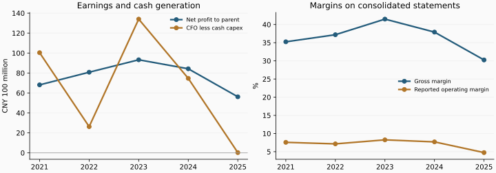
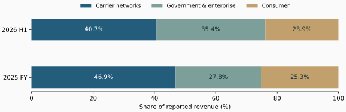

# 中兴通讯（000063.SZ / 00763.HK）研究报告

**研究日期 / 数据截止日：2026-11-18（Asia/Shanghai）**；行情采用 2026-11-17 最近完整收盘，财务截至 2026-09-30（未经审计），最新审计年度为 2025 年。公司全称中兴通讯股份有限公司，英文 ZTE Corporation；A/H 是同一发行人的普通股。沿用本目录及监控 ID“中兴通讯”。

**价格与估值：** A 股 27.68 元，A 股价格乘注册总股本的等值市值 1,324.08 亿元，归母利润代理 TTM PE 30.40 倍；H 股 18.98 港元，以固定汇率 1 港元=0.8493 元人民币折算，等值 PE 17.70 倍。这里的等值市值用于比较同一公司的两类报价；两地实际股份分别计价、剔除库存股后的合计市值为 1,228.81 亿元，不与前者混用。[腾讯行情](https://qt.gtimg.cn/q=sz000063,hk00763)、[A股第二行情源](https://summary.jrj.com.cn/stock/sz/000063)、[H股历史行情](https://cn.investing.com/equities/zte-corp.-historical-data)。

**研究主线：** 算力正在接替网络业务成为收入增长引擎；但中兴仍需证明，新增硬件收入在支付研发、备货和资本成本之后，能够增加普通股每股现金。

本报告接续用户所给的[2026H1复核](中兴通讯-earnings-2026H1-20261008.md)及[8月研究](中兴通讯-research-20260803.md)。下文先建立经营证据，再给出价格与行动。仅用于学习与研究，不构成投资建议。

---

## AI研究偏见自觉

**信息丰富度评级：A（信息充裕）。** 双重上市和多年披露提供了充足的报表，却没有提供每个算力项目的经济回报。最大的共识陷阱，是把“AI基础设施必然扩张”直接换成“中兴股东必然获利”。

**AI研究局限性声明：** 未取得服务器专属完整利润表、订单库龄、主要客户项目回款与 GPU 许可合同；Q3 没有完整分部毛利披露。第三方数据库主要转录公司公告，双渠道核验能防抄录和口径错误，不能独立证明订单真实性。合规调查结局、全面断供等极端损失也无法可靠定量。

- [x] 用利润、现金与营运资本检验收入叙事。
- [x] 区分公司业务宣传口径与法定报告分部。
- [x] 更正旧研究数据，不把旧结论作为事实来源。
- [x] 对信息丰富的“确定感”保持警惕；主要信息优势是口径复核，尚不是专有经营信息。

> 芒格式追问：如果删掉所有“AI”字样，仅凭报表，我还愿意为什么付钱？

---

## 第一步：核心数据总览

除每股、比例及特别注明外，金额均为人民币亿元。现金型自由现金流（FCF）=合并经营现金流（CFO）−购建固定资产、无形资产和其他长期资产支付的现金；不扣并购，不把理财申购算资本开支，也没有臆分维护性与扩张性支出。它仍非普通股可直接分配现金。

### 五年盈利与现金

| 年度 | 营业收入 | 归母净利润 | 综合毛利率 | 营业利润率 | CFO | 现金资本开支 | 简化FCF | 期末现金等价物 |
|---|---:|---:|---:|---:|---:|---:|---:|---:|
| 2021 | 1,145.22 | 68.13 | 35.24% | 7.58% | 157.24 | 56.86 | 100.37 | 390.71 |
| 2022 | 1,229.54 | 80.80 | 37.19% | 7.15% | 75.78 | 49.52 | 26.26 | 470.72 |
| 2023 | 1,242.51 | 93.26 | 41.49% | 8.26% | 174.06 | 40.05 | 134.01 | 510.13 |
| 2024 | 1,212.99 | 84.25 | 37.91% | 7.70% | 114.80 | 40.15 | 74.65 | 280.26 |
| **2025** | **1,338.95** | **56.18** | **30.25%** | **4.75%** | **39.19** | **38.93** | **0.26** | **254.82** |

来源为各年官方合并报表及[东方财富财务数据](https://emweb.securities.eastmoney.com/PC_HSF10/NewFinanceAnalysis/index?code=SZ000063&color=b&type=soft)，逐期出处见附录。营业利润是中国会计准则口径，含其他收益、投资、公允价值变动及减值，不能直接当作剔除非经营项的 EBIT。2023 成本使用后续审计报告的可比重分类值。



**旧研究数据更正：** 8月报告的五年毛利率序列不能继续沿用。尤其 2024 年 37.42%、2025 年 30.11%，应分别改为 37.91%、30.25%。审计报表的收入与成本、东方财富结构化数据一致；没有证据把这两处旧值解释为公司新近重述。2023 年另有《解释18号》将保证类质量保证费用从销售费用移入营业成本的可比重分类，不改变营业利润。历史报告保留，新研究以本表为准。

### Q3究竟改善了什么

| 项目 | 2026Q3单季 | 2026年前三季度 | 解释 |
|---|---:|---:|---|
| 收入 | 388.13 | 1,168.38 | 单季同比 +33.99%，累计 +16.23% |
| 归母净利润 | 13.07 | 40.60 | 单季同比 +394.46%，累计 -23.71% |
| 扣非归母净利润 | 5.93 | 28.14 | 单季同比扭亏；累计 -27.46% |
| 综合毛利率 | 24.56% | 25.18% | 单季高于Q2，但累计毛利额同比仍下降 |
| CFO | 8.42 | 7.15 | 单季为正，累计同比 -59.78% |
| 现金资本开支 | 6.36 | 26.50 | 采用现金流量表购建长期资产项 |
| 简化FCF | 2.06 | -19.35 | 单季改善，全年修复尚待验证 |
| 非经常损益 | 7.15 | 12.47 | 单季超过归母利润的一半 |

[Q3正式报告](https://static.cninfo.com.cn/finalpage/2026-10-27/1225623166.PDF)与东方财富三表交叉核验。金融资产/负债公允价值与处置相关非经常收益，Q3 为 6.91 亿元；这是非经常性损益分类汇总，不能再次与利润表投资收益相加。

| 最近五个单季（累计相减） | 收入 | 归母 | 扣非归母 | 毛利率 | 简化FCF |
|---|---:|---:|---:|---:|---:|
| 2025Q3 | 289.67 | 2.64 | -2.25 | 25.85% | -3.39 |
| 2025Q4 | 333.76 | 2.96 | -5.09 | 29.35% | 11.66 |
| 2026Q1 | 349.88 | 13.10 | 9.36 | 28.28% | -30.86 |
| 2026Q2 | 430.37 | 14.42 | 12.85 | 23.22% | 9.45 |
| **2026Q3** | **388.13** | **13.07** | **5.93** | **24.56%** | **2.06** |

Q3 毛利率环比改善是真实信号；同时扣非利润环比 -53.85%，收入环比 -9.82%。去年 Q3 扣非为负，因此公告的 +363.65%不能当作从正数基期出发的普通增速，更不能反推出去年扣非为正。单季季节性和项目验收影响很大，本表不直接外推全年。

### 业务结构：增长与利润池分开看

| 业务 | 2025收入 | 2026H1收入 | H1收入同比 | H1毛利率 | H1毛利率同比变化 |
|---|---:|---:|---:|---:|---:|
| 运营商网络 | 628.57 | 317.65 | -9.41% | 38.06% | -14.88个百分点 |
| 政企业务 | 372.22 | 276.31 | +43.51% | 15.84% | +7.57个百分点 |
| 消费者业务 | 338.16 | 186.29 | +8.09% | 18.35% | +0.57个百分点 |

中报原文与[东方财富经营分析](https://emweb.securities.eastmoney.com/PC_HSF10/BusinessAnalysis/index?code=SZ000063)收入/成本交叉；同比数据按中报，并与东方财富上年同期分部收入/毛利率复算核对。Q3 没有补出同样完整的分部表，不能把集团毛利率环比回升写成“运营商毛利已止跌”。



公司称前三季度算力收入增长超 70%、占收入 38%。**算力是产品口径，会跨越运营商和政企客户，不能与上述三分部再相加。** [公司Q3经营发布](https://www.zte.com.cn/china/about/news/20261026C1.html)。

> 段永平式追问：收入增长是否增加了股东能拿走的现金？2025年几乎没有，2026Q3有改善，但累计仍未完成修复。

---

## 第二步：生意本质分析

**一句话：中兴替运营商和行业客户建设可靠、兼容、可交付的网络与算力系统，靠持续换代和扩容重复卖设备；利润取决于客户是否愿意为系统能力付溢价，以及备货能否按时变成现金。**

| 环节 | 谁付钱 / 买什么 | 复购与价格机制 | 对股东的关键变量 |
|---|---|---|---|
| 网络连接 | 电信运营商买无线、核心网、光传输及路由设备 | 现网兼容、扩容、标准升级；通常仍需集采招标 | 高毛利产品占比、客户资本开支、维护研发支出 |
| 算力 | 运营商、互联网、金融等买服务器、存储、交换、机房方案 | 项目验收、芯片/存储成本传导、系统TCO竞争 | 毛利额、验收、库存、付款与回款周期 |
| 终端 | 运营商渠道及消费者买家庭终端、手机等 | 产品换代、渠道与品牌；促销和采购成本竞争 | 产品组合、渠道库存、售后与营销成本 |

客户锁定保护的是供应商资格、兼容和迁移便利；集采制度及大客户集中限制提价。设备并非一次安装永久收租：研发、售后、标准演进和备件是维持地位必须付出的成本。

2025 年研发费用 227.55 亿元；2026 前三季度 169.42 亿元。研发应看成长期竞争资格的成本，资本化开发支出还需在现金资本开支中考虑。收入向低毛利产品移动时，研发和交付体系无法同步大幅缩小，形成负向经营杠杆。累计收入增加而毛利额同比 -4.20%，说明新增规模尚未补回全部旧利润池。

同业只提供机制对照：Ericsson Q3 报告毛利率 47.1%，Nokia 为 42.2%；两者与中兴的终端/服务器组合、会计政策不同，不能直接给中兴套同样毛利率。此处为官方单源可比参考，未取得独立二验，不参与估值计算。[Ericsson](https://www.ericsson.com/en/press-releases/2026/10/ericsson-reports-third-quarter-results-2026)、[Nokia](https://www.nokia.com/newsroom/nokia-corporation-interim-report-for-q3-2026/)。

> 段永平式追问：这门生意好在哪里？通信系统的工程与客户积累很好；算力业务仍要用毛利和回款证明它也能成为好生意。

---

## 第三步：护城河评估

| 来源 | 强度 / 证据 | 可证伪指标 |
|---|---|---|
| 品牌与定价权 | 中；可靠性与交付有价值，集采采购方议价强 | 保份额是否需要持续降价、网络毛利额是否下滑 |
| 转换成本 | 网络中高、标准服务器中低；互通测试、运维与现网迁移有成本 | 客户份额、维保、故障率；本次未取得完整量化序列 |
| 网络效应 | 弱；装机越多有经验收益，但没有明显平台式边际利润飞轮 | 软件、工具链或生态是否产生独立收费与锁定 |
| 规模效应 | 中；研发摊销、采购和全球服务体系 | 规模增大后毛利额/FCF能否同步增长 |
| 技术和专利 | 网络中高、算力待验证；芯片、光网、互联、系统优化有积累 | 新产品真实订单、性能/TCO验证和可留存利润 |

过去五年，中兴进入算力市场的能力增强，但集团经济护城河的结果指标变弱：收入高于早期，毛利和现金回报低于高点。未来的可取路径，是网络、散热、互联和调度协同提升集群效率；若利润主要被芯片、软件生态和大客户取得，中兴仍可能是有技术但资本回报普通的供应商。

> 巴菲特式追问：十年后护城河还在吗？工程能力可能在；政策封闭、标准开放化与持续低毛利，可能让能力无法转成股东超额回报。

---

## 第四步：逆向思考与风险清单

最强空方论点是：公司可能把原本高毛利的通信利润池，换成规模大、垫资多、可比价的算力硬件。营收增长、报表利润与股东现金可以长期分叉。最强多方反驳是：政企毛利率已经改善，Q3 集团毛利率和现金转正表明规模并非完全无效；若备货对应确定交付，未来回款可能比本期报表好。

| 失败路径 | 主观可能性 | 影响 | 观察信号 |
|---|---|---|---|
| 网络利润继续收缩，算力只增收 | 中高 | 高 | 网络毛利额、政企增量毛利、扣非每股利润 |
| 库存/合同资产积压或订单更改 | 中高 | 高 | 库龄、减值、验收、售后和最终销售回款 |
| 高端芯片/存储供应及成本波动 | 中 | 高 | 正式许可、交期、可替代方案与项目毛利 |
| 海外准入进一步收缩 | 中 | 高 | 国家/区域正式限制、订单及当地应收 |
| 合规事项导致重大处罚或经营中断 | 无法可靠量化 | 极高 | 公司及监管正式文件；不以传闻金额建模 |
| 永续融资、转股与激励稀释回报 | 中 | 中高 | 普通股利润、利息、全面摊薄股数和资金用途 |

以上是研究者的定性判断，不是统计概率；与估值情景的主观权重分开。

### 现金和存货需要怎样解读

| 项目 | 2025年底 | 2026H1末 | 2026Q3末 |
|---|---:|---:|---:|
| 应收账款 | 216.70 | 306.20 | 241.77 |
| 存货 | 470.17 | 546.46 | 736.35 |
| 货币资金 | 337.51 | 246.47 | 168.95 |
| 期末现金等价物 | 254.82 | 226.64 | 149.16 |

应收环比 -21.04%是好信号；存货环比 +34.75%、年初以来 +56.61%则要求交付证据。公司将备货增加解释为材料采购增加，这不等于库存已经卖出。Q3末应付票据和应付账款合计也明显扩张，现金改善部分依赖供应商信用，不能把全部回款视为可分配收益。

另一方面，货币资金减少不等于发生同额经营亏损：交易性金融资产、存单分类也变了。下文仅给出可追溯的边界，不把所有金融资产当现金。

### 合规风险的证据边界

2017 年 DOJ 公告记载公司就违反制裁、妨碍司法及重大虚假陈述同意认罪；2018 年 BIS 新和解另有长期义务。这是管理与治理评价的真实负面历史。[DOJ原始公告](https://www.justice.gov/archives/opa/pr/zte-corporation-agrees-plead-guilty-and-pay-over-4304-million-violating-us-sanctions-sending)、[2018和解文件](https://www.govinfo.gov/content/pkg/FR-2018-07-23/html/2018-15633.htm)。

2026H1 中报第4.7节仍披露：针对2025年底涉美国《反海外腐败法》的媒体报道，公司与 DOJ 保持沟通，披露时无重大进展。11月募集文件及本次查询未提供足以确认结案、处罚金额或指控成立的证据；不能自行认定罚款负债。FCC Covered List 的市场准入限制也不等同于全面上游断供。[FCC清单](https://docs.fcc.gov/public/attachments/DA-26-495A1.pdf)、[11月募集说明书](https://www.zte.com.cn/content/dam/zte-site/investorrelations/cn_announcement/2026110503.pdf)。

欧洲亦须区分现有成员国措施与立法提案。欧委会认可限制高风险供应商的方向；2026年《Cybersecurity Act 2》所引文件是提案，本文不将其写成全欧已实施全面禁售。[议会答复](https://www.europarl.europa.eu/doceo/document/E-10-2025-003145-ASW_EN.pdf)、[提案原文](https://eur-lex.europa.eu/legal-content/EN/TXT/?uri=celex%3A52026PC0011)。

历史类比应看机制：芒格谈过纺织企业技术降本最终让利客户；这提醒设备商不能仅靠技术进步保证利润。Nokia 的业务转型也说明同一公司不同阶段的竞争优势不能相互代替。两者均非对中兴结局的预测。

> 芒格式追问：最可能错在哪里？用旧网络高毛利加上新算力高收入，拼成一个从未存在的“正常利润”。

---

## 第五步：管理层评估

现任董事长方榕、总裁徐子阳、财务总监李莹。徐子阳有长期产品及经营经历，组织并非依赖单一创始人的早期公司；但资本配置仍应按普通股回报评价。[公司董事长简历](https://www.zte.com.cn/china/about/corporate_information/leader_fangrong.html)、中报及11月募集文件。

| 决策 / 事项 | 结果与判断 | 研究评价 |
|---|---|---|
| 维持大规模研发，推进“连接+算力” | 算力收入增长，网络积累提供交付基础；尚未恢复现金回报 | 方向有进展，回报待验 |
| 2025年度每股现金分红0.411元 | 有分配纪律；以最新价格衡量收益率有限 | 中等，不能用历史派息保证未来 |
| 2026年A股回购约10亿元 | 库存股用于员工持股/激励，未注销 | 看后续每股回报，不按永久缩股计收益 |
| 持有较多理财/存单，同时借款及永续融资 | 支持备货和资金安排，但提高分类与普通股资金成本复杂度 | 待资金用途及资本回报验证 |
| 历史合规失效及当前披露事项 | 经营连续性与诚信要求更高核验标准 | 明确扣分，不能用技术能力抵消 |

2026H1 直接持股：徐子阳 168,000 股，占注册总股本约 0.0035%；董事及高管合计 548,162 股、约 0.0115%；方榕直接持股为零。原文与[新浪中报转录](https://money.finance.sina.com.cn/corp/view/vCB_AllBulletinDetail.php?id=12517314&stockid=000063)核对。这是职业经理人结构；不能把控股股东中兴新的权益当成管理层个人重仓，也没有 AB 股超额投票权结构。

10月证券变动月报另列潜在 H 股转股 132,039,936 股。全面转股相对注册股本约增加 2.76%；存量库存股也可能重新流入员工激励。模型保守保留全部注册股份，再加已知转股潜力，不提前计入库存注销收益。[10月月报转录](https://cfi.net.cn/p20261103001712.html)、[官方募集文件](https://www.zte.com.cn/content/dam/zte-site/investorrelations/cn_announcement/2026110503.pdf)。

11月又有科技创新可续期债发行事项，属于期后融资；本报告的现金及债务表仍是9月底截面，没有将发行额机械加入9月现金，也未承诺当前可用净现金。[发行事项](https://money.finance.sina.com.cn/corp/view/vCB_AllBulletinDetail.php?id=12692558&stockid=000063)。

> 段永平式追问：总裁退休后公司能继续吗？体系大概率可以；真正需要延续的是能把技术投入变成每股现金的纪律。

---

## 第六步：行业与文明趋势

AI 推理、智能体与高速网络确实会增加计算、互联、电力和散热需求。中兴覆盖连接、算力和终端，具备进入这轮建设的条件。技术采纳曲线却只解释需求如何扩散；竞争博弈、供给稀缺和客户议价决定利润落在哪里。

IDC公布的2026Q2全球服务器销售额增长快于台数，反映配置与成本变化也会放大收入。其官网全年预测正文与表格存在不一致，本报告不选择其中一个数字做TAM锚，也不虚构中兴独立服务器份额。[IDC服务器页面](https://www.idc.com/promo/servers/)。

Nokia 披露 AI与云客户增长，同时提示现金转化受备货等影响；Ericsson 仍面对平坦 RAN 市场。它们共同说明，AI建设与传统无线资本开支并非同步周期。[Nokia Q3](https://www.nokia.com/newsroom/nokia-corporation-interim-report-for-q3-2026/)、[Ericsson Q3](https://www.ericsson.com/en/press-releases/2026/10/ericsson-reports-third-quarter-results-2026)。

客户侧，运营商、互联网和行业大客户集中采购，需求大不等于议价弱；供应侧，高端芯片、存储器件与生态适配决定交付。Q3未提供足够细的算力客户/供应商集中度，不能以“全球销售”代替客户分散证明。下一阶段最值得验证的技术，不是发布的参数数量，而是互联与软件能否降低每单位有效算力的交付和运维成本。

> 李录式追问：二十年后回看，这是不是时代的关键基础设施？很可能参与其中；能否成为长期高回报资产，仍取决于价值捕获和再投资回报。

---

## 第七步：估值与安全边际

### 先统一分母与资金口径

注册普通股为 4,783,534,887 股，其中 A 股 4,028,032,353 股、H 股 755,502,534 股；A股库存 28,659,411 股。价格与股本有独立行情/转录渠道验证。

TTM以“2025全年+2026年前三季度−2025年前三季度”构建：收入 1,502.14 亿元、归母净利润 43.56 亿元、扣非归母 23.05 亿元、简化FCF -7.69 亿元。对应归母利润/注册股本代理 EPS 0.9106 元、扣非代理 EPS 0.4819 元。代理值没有逐季扣除其他权益工具利息，也未模拟转股，故不冒充会计基本EPS；2026年前三季度已披露基本/稀释 EPS 为0.85/0.83元。

| 指标 | A股27.68元 | H股18.98港元（人民币折算） |
|---|---:|---:|
| 归母利润代理TTM PE | 30.40倍 | 17.70倍 |
| 扣非利润代理TTM PE | 57.44倍 | 33.45倍 |
| PB（扣其他权益工具） | 1.73倍 | 1.01倍 |
| TTM PS | 0.88倍 | 0.51倍 |
| TTM简化FCF收益率 | -0.58% | -1.00% |
| 2025每股分红对应税前股息率 | 1.48% | 2.55% |
| 本报告正常化EPS假设对应PE | 30.76倍 | 17.91倍 |

PE便宜与否必须看盈利质量。H股折价明显，但没有使扣非盈利变厚。股息率是历史分红的报价比率，未计税及后续汇率变化。PB使用归母权益扣除其他权益工具，普通股每股净资产约15.9691元；没有把永续工具的权益当作普通股权益。

**净现金不作加项。** 9月底“借款、债券、全部一年内到期非流动负债、非流动租赁及保理银行拨款”合计代理为718.15亿元，含少量可能非纯融资项目。货币资金+交易性金融资产+一年内到期非流动资产+债权投资的合计上界796.56亿元，减前述代理只余78.41亿元；其中存单、受限/托管、产品期限与营运现金需求未完全穿透。这不是可分配净现金。仅现金等价物减融资负债的窄口径则是净债务568.99亿元。两个边界都不能冒充精确经济净现金。

EV/Revenue因上述现金、租赁及融资归类缺口不报伪精确点值；PEG因扣非盈利基数和恢复增速均不稳定而不适用。未取得统一日期、相同盈利口径的同业PE及完整前复权历史PE分位，不填写虚构的行业折价。五年ROE/利润率走弱本身已说明不能机械回到历史高峰估值。

### 三年三情景：当前贵不贵

以**正常化全面摊薄 EPS 0.90 元**作为研究假设，并非公司指引或一致预期。它高于当前扣非TTM代理值，已经给了利润修复空间；不把金融收益全部永久化。该EPS视为扣其他权益工具成本、含已知可转股后的普通股盈利，未来增发/额外激励仍是下修风险。

| 情景 | EPS年增速 | 三年末PE假设 | 三年末价格（元） | A股价格回报 | 当前现值（元） | 现值折港元 |
|---|---:|---:|---:|---:|---:|---:|
| 乐观 | +25% | 26倍 | 45.70 | +65.11% | 36.28 | 42.72 |
| **基准** | **+10%** | **20倍** | **23.96** | **-13.45%** | **19.02** | **22.39** |
| 悲观 | -10% | 12倍 | 7.87 | -71.56% | 6.25 | 7.36 |

工具按三年复利出数；现值以人民币8%折现，未计未来股息和税。三年PE是过渡期的情景定价假设，26倍需要系统能力和利润兑现，20倍仍给予修复溢价，12倍对应衰退/低资本回报；不是由同业当日股价证明的内在倍数，更不用于十年终值。H股基准三年价格回报约+48.63%，但三年后的价格不能与今天报价直接当作即期安全边际；折现现值才是比较起点。

### 现金流对照与反向DCF

用相同正常化EPS，从下一年开始前五年每股利润+10%、后五年+5%，每年70%利润可转成普通股所有者现金，人民币资本成本8%，第十年后g=1%、增量ROIC=12%决定终值倍数，不另加净现金，得到每股 **17.73元 / 20.87港元**。这是恢复后的现金能力假设；最新FCF尚未支持70%的稳定转化率，不能把模型值当已兑现现金。

反向求解同一现金转化和终值框架，A股现价要求未来十年每股利润约+13.48%的持续增长，H股人民币等价价格约要求+6.53%。二者均隐含现金转化显著好于当前。它们是条件反解，不是未来增速预测；若营运资本持续吃掉利润，要求会更高。

三年基准现值19.02元与现金流对照17.73元相近。**A股14—16元、H股16.5—18.8港元**作为条件研究带，来自对这两个恢复假设现值再留折扣；价位到达仍须经营条件同时成立。原22—28元继续保留作历史研究记录，取消其当前分批含义。

### 十年折现：只做仓位压力测试

现金流用人民币，所以两类证券均在人民币口径下分析。H股先按固定汇率换成人民币，不拿8%的人民币r去搭配港元g；H股结果不是包含未来汇率变化的港元总回报预测。

| 输入 | 本报告假设与依据 |
|---|---|
| 资本成本r | 8%；11/17中债十年国债1.6055%+β1×判断性ERP6.3945%；ERP不是市场实测回归值 |
| 稳态增量ROIC | 12%；假设转型成熟后超过资本成本，但不照搬历史高毛利时期；缺少新增项目ROIC，判断置信度低 |
| 永续g（悲/基/乐） | 0% / 1% / 2%；均为人民币名义长期增速，基准不超过2%上限 |
| 2036普通股归属利润（悲/基/乐） | 20 / 90 / 160亿元；视为扣其他权益工具成本后的假设值，非公司预测 |
| 主观权重 | 悲30% / 基50% / 乐20%；不是发生频率估计 |
| 股数与股息 | 全注册股本加已知潜在转股，49.15574823亿股；不提前注销库存股。净股息项k=0，未计未来派息；额外未来稀释未定量 |

[中债11/17收益率](https://yield.chinabond.com.cn/cbweb-pbc-web/pbc/more?locale=cn_zh)。存量ROIC、派息反解的增量ROIC未形成可直接比较的可靠区间，因此12%明确是一项待验证的稳态假设，不能声称已从历史报表机械估出。

终值唯一采用 `(1−g/ROIC)/(r−g)`。基准r下三档分母分别8、7、6个百分点，准出检查通过；退出PE依次12.50、13.10、13.89倍。

| 2036情景 | 终值PE | A股十年收益代理 | H股人民币十年收益代理 |
|---|---:|---:|---:|
| 悲观 | 12.50倍 | -15.58% | -10.90% |
| 基准 | 13.10倍 | -1.43% | +4.05% |
| 乐观 | 13.89倍 | +5.03% | +10.86% |
| 主观加权 | — | -4.38% | +0.93% |

工具称IRR；这里k=0，实际是终值资本利得的几何年化代理，**未计中途股息**，并非完整股息现金流求根的总IRR。加权值是情景年化收益的算术加权，也不等同组合现金流IRR。它有意检验终值和资本配置压力，不能据此断言实际长期总回报必然如此。

| r敏感性 | A股期望收益代理 | H股人民币期望收益代理 | 相对当档r的测试 |
|---|---:|---:|---|
| 6%（r−2pp） | -1.09% | +4.41% | 均未通过；乐观档r−g仅4pp，只作情景参考 |
| 7%（补充复核） | -2.89% | +2.50% | 均未通过；三档分母均至少5pp |
| **8%（基准）** | **-4.38%** | **+0.93%** | **均未通过** |
| 9%（补充复核） | -5.65% | -0.41% | 均未通过 |
| 10%（r+2pp） | -6.76% | -1.58% | 均未通过；区间外，仅供参考，不参与判定 |

`flip`显示：**在人民币合理区间内，压力测试结论未随Δr翻转。** 6%档有窄分母，额外以7%/8%/9%复核仍未翻转；没有靠降r论证买入。情景中处理供应许可收紧、低利润与存货损失；全面禁供/账户冻结、FCPA极端处罚未建模，写入限制。主观概率没有穷尽尾部损失。

### 估值分歧对账

H股三年定价比A股有吸引力，恢复假设下现价低于两项基准现值；十年压力测试却未覆盖8%。分歧来自三年给了恢复期20倍PE，而十年成熟终值约13倍，并且十年压力代理未计中途分红。三年是在问报价是否给了折扣，十年是在检验终值与仓位能承受多大误差，不能由后一项单独决定买卖。

本次两地均暂停新增，依据是经营质量仍未充分恢复、合规尾部无法定量，以及A股缺乏定价折扣、H股折扣尚不宽；并非只因十年未过。已有合理小仓可以持有复检，未来满足价格与经营条件才讨论新仓。十年结果把条件配置约束在A/H合计参考上限2%，不支持因AI叙事升至重仓；未来若股息、ROIC和现金能力证实，须重建模型再讨论上限。

> 巴菲特式追问：r错两个百分点会改变结论吗？本次压力结论未翻转。段永平式追问：股市关闭五年愿不愿持有？现价下尚缺足够现金回报证据，不新增长期仓。

---

## 第八步：最终决策与行动清单

| 维度 | 综合判断 | 信心度 |
|---|---|---|
| 生意质量 | 网络工程是有价值的生意；算力仍需证明扣再投资后的每股现金 | 中 |
| 护城河 | 网络转换/认证壁垒真实；未证明已变成算力定价权 | 中 |
| 管理层 | 产品与交付能力可见；普通股持股低，资本配置及合规记录须严格复核 | 中 |
| 最大风险 | 存货与营运资本、利润池替换、出口/合规离散风险 | 风险识别高，概率低 |
| 文明趋势 | AI基础设施扩张有方向性，利润分配和技术路线未定 | 中 |
| 估值 | 三年：A偏贵、H有折扣但安全边际有限；十年：两类报价压力未过，合理区间flip未翻转，仅限仓 | 中低 |

估值不是唯一裁决。尤其十年未覆盖r只能约束仓位，不能独自推翻生意、护城河和经营事实。

| 策略 | 建议 |
|---|---|
| **空仓者** | **观望，两地现价均不新增。** 条件研究带A14—16元 / H16.5—18.8港元，价格与下述经营验证同时满足才讨论首笔约0.5% |
| 持仓者 | 原有可承受的小仓持有复检、暂停加仓；若A/H合计显著超过2%的研究参考上限，优先复核集中度与合规损失承受能力，不按成本价摊薄 |
| 加仓信号 | 连续两个单季扣非EPS改善、累计CFO覆盖全部现金资本开支、存货/收入占比回落且有验收回款证据；下一完整分部披露确认网络毛利额止跌、政企增量毛利可持续；合规/供应链无新增重大不利 |
| 卖出/减仓信号 | 正式披露导致核心市场或供给连续性受损；重大诚信/会计问题；备货无法变现且减值、现金缺口继续扩大。A≥30元或H≥28港元且模型未增强，复核超配及估值，非自动卖出 |
| 低于研究带 | A<14元 / H<16.5港元先查永久损坏，禁止单因更低价格自动加仓 |
| 下次动作 | 2026-12-31检查交付、库存、融资和合规；2027-03-01核查全年业绩正式日历及最新披露。均为研究检查日，未确认FY2026正式披露日期 |

上述0.5%首笔、合计2%仅是无用户资产负债与持仓资料条件下的研究风险预算，不是针对个人账户的执行单。若现金条件改善但价格高于研究带，仍先重估，不把一季转正当成追价许可。

### 与旧报告逐项对账

| 旧条件 | 本次证据 | 结果 |
|---|---|---|
| CFO转正 | Q3、前三季度均为正，但累计FCF仍为负 | 部分满足 |
| 网络毛利止跌 | Q3无完整分部毛利，H1网络毛利明显下降 | 尚未证实 |
| 算力增长变成每股利润 | 政企H1改善，Q3扣非环比下降 | 尚未证实 |
| 22—28元可分批 | 本次正常化/现金模型重建，未给该带足够折扣 | 由新带接替；不把触价记为命中 |

### 四位大师的方法延伸

以下短引已读取可核原文，点评为本报告作者的方法应用，**不是四位对中兴的公开推荐或实盘立场**。

- 巴菲特原话：“A moat that must be continuously rebuilt will eventually be no moat at all.” [2007股东信第5页](https://www.berkshirehathaway.com/letters/2007ltr.pdf)。延伸：中兴需证明研发维护以后还留下超额回报，研发额本身不能证明护城河。
- 芒格原话：“It's just that the savings didn't go to you.” [1994 USC演讲实录第19页](https://worldlypartners.com/wp-content/uploads/2024/01/1994-lecture-by-charlie-munger-at-usc-a-lesson-on-elementary-worldly-wisdom-as-it-relates-to-investment.pdf)。其上下文是纺织技术降本被竞争让给客户；延伸：算力效率改善能否留在股东手中，是本次核心问题。
- 段永平原话：“我认为‘慢慢的变富’其实是最快的办法。” [2019-03-21原帖](https://xueqiu.com/1247347556/123498463)，亦见[仓库原文](../段永平/段永平雪球全量原发言.md)第15179行。提问者曾以中兴为例，段的回答没有认定中兴被错定价；本文不能代替他作出买卖判断。
- 李录原话：“Cost, revenue, and profit are also very important.” [哥大2026-10-05官方对谈实录第8页](https://business.columbia.edu/sites/default/files-efs/imce-uploads/36th%20Annual%20Graham%20&%20Dodd%20Luncheon%20Transcript%20(20261005)%20CBS.pdf)。上下文讨论AI的资本需求与财务纪律；延伸：文明趋势须落回成本、收入、利润与资本需求。

> 四种方法的共同追问：不靠更高估值和更乐观的故事，未来普通股每股现金能否稳定增加？目前证据仍不够支持重仓。

---

## AI分析置信度与投资确定性

**AI分析置信度：历史财务、股本及计算较高；分部回报与正常化利润中等；十年利润、情景权重和极端事件低。投资确定性：中低。** 充足资料提高的是核对能力，不能消除硬件价格竞争、营运资本和政策风险。

充分数据支持的结论包括：传统利润池承压、Q3现金与集团毛利环比改善、扣非利润环比下滑、库存明显扩大。有限信息推理包括：70%长期所有者现金转化、正常化EPS0.90元、稳态ROIC12%、2036利润与研究带。这些是等待经营验证的假设。

仍需一手验证：算力订单取消/验收条款；服务器库存库龄与最终客户；高端芯片和存储许可/价格锁定；网络毛利回落中量价与产品结构的贡献；理财、存单、托管资金的可用性；FCPA事项和后续融资对普通股的影响。全面禁供、账户冻结、极端处罚和未来额外稀释未完整建模，估值不是损失上限。

---

## 数据来源与审计记录

### 一手资料与第二读取渠道

| 资料 | 主要用途 | 核对位置 / 第二渠道 |
|---|---|---|
| [2021年报](https://static.cninfo.com.cn/finalpage/2022-03-09/1212529495.PDF) | 早期财务 | 印刷页142资产、145利润、149现金流；东方财富年度三表 |
| [2023年报](https://static.cninfo.com.cn/finalpage/2024-03-09/1219266488.PDF) | 2022—2023现金与利润 | 印刷页106/109/113；2023成本另用后续重分类值 |
| [2024审计报告](https://static.cninfo.com.cn/finalpage/2025-02-28/1222676061.PDF) | 可比成本重分类 | 印刷页54—55解释18号；东方财富更新后三表 |
| [2025审计报表](https://static.cninfo.com.cn/finalpage/2026-03-07/1225000303.PDF) | FY2025及比较期 | 合并报表，不取母公司列；[完整年报](https://www.zte.com.cn/content/dam/zte-site/investorrelations/cn_annual_report/2025%E5%B9%B4%E5%B9%B4%E5%BA%A6%E6%8A%A5%E5%91%8A.pdf)五年摘要/分部；东方财富 |
| [2026H1中报](https://static.cninfo.com.cn/finalpage/2026-08-22/1225490139.PDF) | 分部、股权、资金附注 | 印刷页20—21、41、133—136、151—152；东方财富经营分析及新浪转录 |
| [2026Q3季报](https://static.cninfo.com.cn/finalpage/2026-10-27/1225623166.PDF) | 最新财务、非经常损益 | 印刷页2、7—11；累计利润页另渲染目视核对；东方财富三表 |
| [11月募集说明书](https://www.zte.com.cn/content/dam/zte-site/investorrelations/cn_announcement/2026110503.pdf) | 股本、资本结构与风险 | 股本再与10月月报、腾讯核对；余额财务截止仍为9月 |

官网、巨潮、交易所托管的同一公告不算独立经营证据。东方财富与新浪提供不同转录渠道，不是额外审计。金额与会计口径优先原始合并报表；分部缺口及同业单源数据已逐处标出。

### 关键数据交叉验证记录

以下摘录本次工具输出；完整原始输入、算式、估值及敏感性记录见[输入与来源](证据-20261118/inputs.json)、[精算结果](证据-20261118/calculations.json)、[工具输出](证据-20261118/validation.txt)及[十年配置](证据-20261118/terminal-config.json)。

```text
市值验算：股价27.68 × 总股本4,783,534,887
计算市值1,324.08亿元；行情报告市值1,324.08亿元；偏差0.00%
2025收入：巨潮133,895,460 / 东方财富133,895,460（千元）
2025归母：巨潮5,617,745 / 东方财富5,617,745（千元）
2025现金等价物：巨潮25,482,400 / 东方财富25,482,400（千元）
2026Q3货币资金：巨潮16,894,991 / 东方财富16,894,991（千元）
PE (TTM): 27.68 / 0.9106240683721389 = 30.40x
PB: 27.68 / 15.969104606636895 = 1.73x
FCF Yield: -0.58%
股息率: 0.411 / 27.68 = 1.48%
PS: 27.68 / 31.40236886496444 = 0.88x
```

其中数值直接来自工具，中文市值单位排版作压缩；未把母公司收入、集团净利润与归母利润混用。估值、营运资本和情景均已使用`financial_rigor.py`验算；十年使用`terminal_value.py`。

数据抽检与最终估值准出结果见本节末记录。抽检只验证选中的事实及模型算术，不为预测假设提供事实背书。触发器和台账登记只表示纳入研究跟踪，价格到达不是自动交易。

> **数据抽检准出：** 固定种子20261118，工具从124个可提取数值点抽取19项，19项通过、0警告、0不通过，最大偏差约0.65%。样本包括披露事实、衍生指标、模型算术及1个被解析器抽中的比较年份；模型项只验证公式，不能验证未来假设。见[抽检明细](证据-20261118/audit-results.json)和[工具判决](证据-20261118/audit-verdict.txt)。五年主表另已逐期核对，不能把本抽样说成覆盖全部文字。

> **估值口径准出：** 最终r=8%、ROIC=12%、g=0%/1%/2%、人民币口径复检通过；全面禁供/账户冻结、FCPA极端处罚两项未建模警告保留。6%敏感性窄分母、10%区间外标注均已保留。

> **跟踪已接续：** 沿用同一监控ID，新增H股报价与两地新价位带；Q3旧事件标完成，登记后续研究检查。中兴不在重点标的看板，本次在[标的跟踪表](../标的跟踪表.md)新增建议事件，旧10/8事件关闭为“无法判定”，未将触价计为命中。
