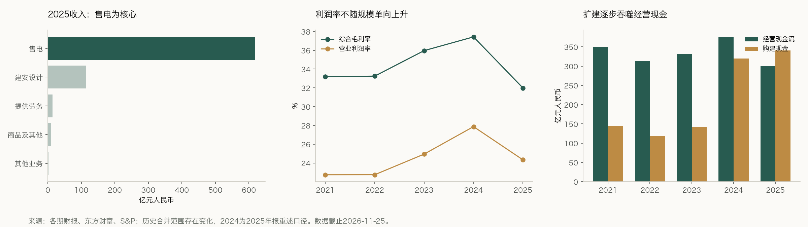

# 中国广核（003816.SZ / 01816.HK）研究报告

> **研究与信息截止：2026-11-25（Asia/Shanghai）**；财务更新至2026年9月30日，年报基期为2025年；价格为11月25日收盘，最新可核股本截至11月23日。  
> **价格：A股4.63元 / H股3.28港元**；A/H分价合计股权市值约2,156.34亿元人民币；正常化归母110亿元假设下，A/H同价等价PE分别21.45倍 / 13.00倍。  
> **研究主线：新机组开始贡献利润、电价阶段企稳，但增长需要持续投入；每股回报取决于新资本的收益、电力交易规则与买入价格。**  
> 本文用于学习与研究，不构成投资建议；未获知读者持仓、税务身份或资金期限。

## AI研究偏见自觉

**信息丰富度评级：A级。** 公司A/H两地上市，运营、财务、核安全及投资者交流披露较充分。正式名称为中国广核电力股份有限公司（CGN Power Co., Ltd.）；H股简称“中广核电力”。它与中广核集团、中国核电（601985.SH）、中广核新能源均不是同一上市主体。[公司年报](https://static.cninfo.com.cn/finalpage/2026-03-26/1225030278.PDF)

AI研究局限性声明：公开报表能核对电量、利润和现金，无法独立验证堆内状态、各机组全寿期维护资本开支、新项目股权IRR、集团采购公允性或未来电价谈判。资料丰富不能消除核安全尾部风险，也不能把行业核准目标变成股东收益承诺。

- [x] 以最新Q3检验旧H1判断，避免锚定“利润只具韧性”。
- [x] 区分管理装机、并表口径和归母经济权益。
- [x] 区分现金创造与资本支出，避免用合并CFO/归母净利证明股东可得现金充足。
- [x] 对A/H价差长期不修复另做压力测试，不把“便宜于A股”当作绝对便宜。
- [x] 将预测、主观概率、研究价带与已披露事实分开。

本文接续[原最终报告](最终报告.md)及用户给出的[2026H1财报精读](中国广核-earnings-2026H1.md)。旧文件保留；新的数据口径、价格条件与复检安排以本文为准。

---

## 第一步：核心数据总览

### 先处理四个容易改变结论的口径

1. **业务改善已经出现。** 前三季归母增长12.75%，Q3单季增长36.08%；前三季含税市场化电价约0.36元/度、同比基本持平。H1“电价下降、利润韧性”的描述已不足以概括最新状态。[Q3财报](https://static.cninfo.com.cn/finalpage/2026-10-29/1225634227.PDF)、[10月29日官方交流](https://static.cninfo.com.cn/finalpage/2026-10-29/1225645223.PDF)
2. **最新股本不能停留在9月底。** 2025年底原股本50,498,611,100股，加截至11月23日累计转股473,304,157股，得50,971,915,257股。恒健可交换债换股只是老股转移，不能再加一次股本。[10月证券变动月报](https://static.cninfo.com.cn/finalpage/2026-11-03/1225652580.PDF)、[11月股东公告原件](https://static.cninfo.com.cn/finalpage/2026-11-25/1225686290.PDF)、[可读全文](https://www.cfi.net.cn/p20261124001970.html)
3. **旧2024年自由现金流高估。** 2025年报所列2024年重述CFO375.0573亿元，应配重述购建现金319.3277亿元，差额为55.7295亿元。旧报告用196.66亿元资本开支算出的178.40亿元混用了范围，不能沿用。[2025年报合并现金流量表](https://static.cninfo.com.cn/finalpage/2026-03-26/1225030278.PDF)、[S&P独立整理现金流](https://stockanalysis.com/quote/hkg/1816/financials/cash-flow-statement/)
4. **归母权益不能用总权益替代。** 九月底归母权益1,273.5188亿元，另有少数股东权益659.1189亿元。用合计权益算上市普通股PB，会把少数股东资产也算给普通股股东。[原始季报](https://disc.static.szse.cn/download/disc/disk03/finalpage/2026-10-29/16e6de45-6f27-44f5-9ae1-dc8909e8843f.PDF)、[独立资产负债表](https://stockanalysis.com/quote/hkg/1816/financials/balance-sheet/)

### 五年财务底图

单位：亿元人民币；利润率另列。“简单FCF”仅为合并CFO减购建固定资产、无形资产和其他长期资产现金，不是归母FCFE，亦未囊括收购、少数股东分配及全部融资付息。

| 年度 | 收入 | 归母 | 毛利率 | 营业利润率 | CFO | 购建现金 | 简单FCF | 货币资金 |
|---|---:|---:|---:|---:|---:|---:|---:|---:|
| 2021 | 806.79 | 97.64 | 33.20% | 22.75% | 349.11 | 144.41 | 204.70 | 158.28 |
| 2022 | 828.22 | 99.64 | 33.25% | 22.75% | 313.68 | 118.40 | 195.29 | 148.41 |
| 2023 | 825.49 | 107.25 | 35.97% | 24.95% | 331.20 | 142.46 | 188.74 | 157.40 |
| 2024 | 789.45 | 108.38 | 37.43% | 27.87% | 375.06 | 319.33 | 55.73 | 170.26 |
| 2025 | 756.97 | 97.65 | 31.99% | 24.34% | 299.71 | 340.57 | -40.86 | 208.27 |


历史口径：2021采用2022年报重述，2022采用2023年报重述，2023采用当年披露，2024采用2025年报重述，2025采用当年年报。其间发生资产注入，**表格只展示各年可核记录，不把跨行差额全部解释为有机增长**；也不据此计算同范围五年CAGR。营业利润率为中国会计准则“营业利润/收入”，含投资收益与其他收益，不是标准化EBIT率。

来源：公司[2022年报](https://static.cninfo.com.cn/finalpage/2023-03-16/1216127809.PDF)、[2023年报](https://pdf.dfcfw.com/pdf/H2_AN202403271628310884_1.pdf)、[2025年报](https://static.cninfo.com.cn/finalpage/2026-03-26/1225030278.PDF)，与[东方财富财务库](https://emweb.securities.eastmoney.com/PC_HSF10/NewFinanceAnalysis/Index?type=web&code=SZ003816)及[S&P财务总览](https://stockanalysis.com/quote/hkg/1816/financials/)交叉核对；独立库采用百万元四舍五入，不以其舍入值替代原年报精确金额。



图中历史合并范围随披露变化；2024资本开支已使用重述值。利润率和自由现金流的变化比“装机不断增加”更能提醒投资者关注投入回报。

### 最近财年收入结构

2025年按产品分解；单位：亿元人民币。它与管理层分部“工程业务/核电运营”口径不同，工程分部内部收入不能与外部售电收入直接相加。

| 产品 | 收入 | 占收入 | 毛利率 |
|---|---:|---:|---:|
| 售电 | 617.57 | 81.59% | 37.49% |
| 建安设计 | 113.41 | 14.98% | 2.20% |
| 提供劳务 | 14.29 | 1.89% | 36.59% |
| 商品及其他 | 9.52 | 1.26% | 23.33% |
| 其他业务 | 2.18 | 0.29% | 31.34% |


电力收入占比81.59%，但电力毛利贡献更集中。建安收入虽然较大，毛利薄，集团内部工程还会抵消。不能把建安业务少确认收入直接等同于核电售电恶化。[审计财务报表附注收入分解](https://static.cninfo.com.cn/finalpage/2026-03-26/1225030280.PDF)

最新H1的分产品结构如下；单位仍为亿元，2025H1同比基期按中报重述。分产品取原始附注，并用东方财富主营数据库核对；细分附注的外部独立经营验证仍弱于集团财务数据核对。

| 产品 | 2026H1收入 | 同口径收入同比 | 毛利率 | 收入占比 |
|---|---:|---:|---:|---:|
| 销售电力 | 301.9464 | -1.51% | 46.26% | 95.91% |
| 建安设计 | 2.0089 | -76.53% | 25.28% | 0.64% |
| 提供劳务 | 6.6243 | +23.67% | 32.59% | 2.10% |
| 商品及其他 | 3.5642 | +23.77% | 22.90% | 1.13% |
| 其他业务 | 0.6891 | +77.01% | 32.35% | 0.22% |

来源：[H1全文第22页及附注45](https://disc.static.szse.cn/download/disc/disk03/finalpage/2026-08-26/f5bd7adc-d03c-49ab-b370-cd6ddc6c8f04.PDF)、[东方财富主营构成](https://emweb.securities.eastmoney.com/PC_HSF10/BusinessAnalysis/Index?type=web&code=SZ003816)。2025细分数据另用[中诚信跟踪评级表5](https://static.cninfo.com.cn/finalpage/2026-06-27/1225390314.PDF)核对。总收入结构变化包含并表后内部工程抵消，不能用2025全年建安占比直接推算2026剩余季度。

### 最新经营与现金

单位：亿元人民币，EPS为元。同比均按Q3报告所列重述同期比较。

| 指标 | 2026H1 | 2026前三季 | 证据与解读 |
|---|---:|---:|---|
| 营业收入 | 314.83 | 510.98 | 前三季+3.98% |
| 归母净利润 | 61.05 | 96.03 | 前三季+12.75%，新机组投产贡献 |
| 扣非归母 | 55.77 | 90.23 | 前三季+11.10%，增长并非只靠一次性收益 |
| CFO | 133.32 | 265.67 | 前三季+19.00% |
| 购建长期资产现金 | 268.14 | 377.23 | 建设投入仍超过经营现金流 |
| 简单FCF | -134.82 | -111.56 | Q3现金改善，累计仍净流出 |
| 基本EPS | 0.1210 | 0.1902 | 前三季稀释EPS为0.1863 |
| 综合毛利率 | 45.54% | 43.54% | 不能只对比上半年/前三季而忽略季节与范围 |
| 营业利润率 | 36.18% | 34.63% | 不是EBIT率 |

来源：[H1原报](https://disc.static.szse.cn/download/disc/disk03/finalpage/2026-08-26/f5bd7adc-d03c-49ab-b370-cd6ddc6c8f04.PDF)、[Q3原报](https://static.cninfo.com.cn/finalpage/2026-10-29/1225634227.PDF)、[东方财富财务数据](https://emweb.securities.eastmoney.com/PC_HSF10/NewFinanceAnalysis/Index?type=web&code=SZ003816)。归母增长还受新机组免税期影响，不能把Q3增速直接外推三年。

最近四季度的证据完整度：2026Q3单季收入196.1480亿元、归母34.9817亿元可直接核对；2025Q4、2026Q1和Q2在苍南同控重述、宁德第二核电并表后缺少完整的同范围季度分产品表。本报告不拼造“四季度分部收入/毛利率”或严格可比TTM。公开数据库的TTM归母约108.51亿元只是辅助参照；估值取110亿元正常化归母，属于判断，**不是声称已披露2026全年业绩**。

九月底货币资金242.8767亿元，现金及现金等价物只有163.5196亿元；差额不能一概当作随时可派息现金。债务基础口径为短借、长借、一年内非流动负债、应付债券和租赁负债合计3,561.4116亿元；再把其他流动负债42.1926亿元全部保守视作债务，上界为3,603.6042亿元。扣货币资金后，研究净债务区间为**3,318.53—3,360.73亿元**。其他流动负债含短融也可能含非债务项目，因此上界不是精确有息债务值。[季报三表](https://static.cninfo.com.cn/finalpage/2026-10-29/1225634227.PDF)、[S&P债务基础口径](https://stockanalysis.com/quote/hkg/1816/financials/balance-sheet/)

资产负债率68.08%。截至9月底的资产负债表尚未反映11月大量转股带来的债转权益；本报告没有拿旧负债表加新股数制造“实时净资产/企业价值”。H1含短融债务与Q3第三方不含短融债务也不能直接比较。

> 巴菲特式追问：这些会计利润中，有多少最终能在维护资产、偿债与少数股东分配后交到普通股股东手里？

---

## 第二步：生意本质分析

**一句话：公司以稀缺厂址、核安全许可和长期运营能力，向电网及电力用户持续出售低碳稳定电量，再把大量现金投回寿命很长的电站。**

### 资产地图先于增长叙事

下表为2026年9月底公告口径；装机为MW，电量为前三季上网亿千瓦时。

| 主要基地 | 管理装机 | 上网电量 | 经济含义 |
|---|---:|---:|---|
| 大亚湾、岭澳、岭东 | 6,204 | 358.38 | 成熟资产；换料节奏仍影响年度电量 |
| 阳江 | 6,516 | 372.83 | 大型成熟基地，不能将全部净利当归母 |
| 台山 | 3,500 | 97.80 | 电量-39.23%，长大修说明技术与可利用率风险真实存在 |
| 防城港 | 4,548 | 242.69 | 投产、检修与区域电价共同决定回报 |
| 宁德 | 4,356 | 244.48 | 子公司宁核投资持股46%，借控制安排并表；不等于上市公司直接或穿透经济权益46% |
| 惠州 | 2,404 | 57.66 | 惠州1/2号年内商运，项目公司82%权益 |
| 苍南 | 1,208 | 41.06 | 苍南1号年内商运，46%权益借助控制安排并表 |
| 子公司合计 | 28,736 | 1,414.91 | 并表收入仍需扣少数股东利润 |
| 红沿河联营 | 6,714 | 352.58 | 公司间接权益38.88%，权益法核算 |
| 管理合计 | 35,450 | 1,767.49 | 不能把管理总电量乘电价当作合并收入 |

来源：[Q3运营公告及机组表](https://static.cninfo.com.cn/finalpage/2026-10-14/1225602719.PDF)、[同花顺独立整理运营数据库](https://basic.10jqka.com.cn/003816/operate.html)、[H1控制依据附注](https://disc.static.szse.cn/download/disc/disk03/finalpage/2026-08-26/f5bd7adc-d03c-49ab-b370-cd6ddc6c8f04.PDF)。宁核投资持股层级另由[中诚信评级附录](https://static.cninfo.com.cn/finalpage/2026-06-27/1225390314.PDF)核对。部分汇总由工具相加，整数调整可能产生微小尾差。

九月底“在建19台”包括7台已核准、尚未FCD的机组，不是19台都在土建。陆丰5号、苍南2号当时计划2027年运行，陆丰6号2028年，宁德5号2029年；计划不是收益保证。苍南4号已于11月10日FCD。[运营进度](https://static.cninfo.com.cn/finalpage/2026-10-14/1225602719.PDF)、[苍南4号开工公告](https://disc.static.szse.cn/download/disc/disk03/finalpage/2026-11-11/9dacb48b-52e7-4449-83a9-2574bbc5132d.PDF)

### 谁付钱、成本如何发生

| 环节 | 收入与成本机制 | 投资者应看什么 |
|---|---|---|
| 客户 | 电网、香港购电方及市场化用户；交易与结算规则影响实现电价 | 合同电价、交易比例、回款，而非品牌溢价 |
| 复购 | 电力每天消耗、需求重复；并非消费者对品牌的忠诚 | 利用小时、限电、年度/月度合同结构 |
| 固定投入 | 开工前后多年支出，投产后长期折旧、运维与融资 | 总投资、延期、资本化利息、每股利润及现金 |
| 变动投入 | 核燃料、后处理基金、运维等；燃料成本不等于现货铀价 | 长协、库存、首炉与后续换料的差异 |
| 增长 | 新机组投产、老机组可利用率、结算电价 | 回报超过资本成本的增长才有价值 |

2025年售电成本中，核燃料96.57亿元、折旧117.29亿元、乏燃料处置金43.78亿元、运维及其他128.39亿元。固定成本和资金成本较重：电价或利用率变化，利润会更敏感；建设期现金流则早于收益发生。[年报营业成本分解](https://static.cninfo.com.cn/finalpage/2026-03-26/1225030278.PDF)

H1前四大客户收入占比分别约49.27%、17.23%、16.48%、10.38%。客户信用较强不代表公司议价能力强；电网与制度本身就是重要买方约束。公司披露的新机组首炉燃料成本较低、首修约商运后12个月、之后约18个月换料，首年利润率不能作为永久盈利能力。[H1信用风险附注](https://disc.static.szse.cn/download/disc/disk03/finalpage/2026-08-26/f5bd7adc-d03c-49ab-b370-cd6ddc6c8f04.PDF)、[11月10日路演](https://static.cninfo.com.cn/finalpage/2026-11-10/1225665748.PDF)

> 段永平式追问：如果扩建暂停，存量电站能给股东多少净现金；如果扩建继续，每一块新投入又能挣多少？两者都要能回答。

---

## 第三步：护城河评估

| 来源 | 判断 | 可核验证据 | 会削弱它的事实 |
|---|---|---|---|
| 品牌与定价权 | 安全信誉强，商品提价权弱 | 长期运营记录有价值；电价仍受区域规则与交易制约 | 市场电价持续下降、可靠性不能获得补偿 |
| 转换成本 | 对系统有价值，对客户锁定有限 | 电网需要稳定供电；用户购买的是可替代电量 | 供给过剩时低价电量挤占交易空间 |
| 网络效应 | 弱 | 电站更多能共享经验，但不构成用户互相吸引 | 不应给互联网平台式估值 |
| 规模与成本 | 强 | 成熟核电运营、统一采购、培训、检修和融资能力 | 跨基地复杂度、超支及采购利益分配 |
| 技术与专利 | 中强，侧重工程体系 | 多堆型运营与华龙一号建设经验；不是所有集团技术权益都归上市公司 | EPR长大修、关键设备失效、工程复制不顺 |
| 牌照、厂址与安全体系 | 最强 | 许可、沿海厂址、建设组织、运行经验无法单靠资金迅速复制 | 重大事故、许可暂停、政策改变 |

过去数年，资产规模与工程经验加深了进入壁垒；与此同时，市场化交易扩大削弱了收入的“债券感”。**进入壁垒变高，并不必然意味着少数股东回报变高。** 技术与安全资料依据[公司年报](https://static.cninfo.com.cn/finalpage/2026-03-26/1225030278.PDF)及[国家核安全局对台山事件的说明](https://nnsa.mee.gov.cn/ywdh/fyd/202608/t20260828_1164659.html)；以上强弱评级为本报告判断。

未来五年更可能出现的是“机组更多、护城河仍在，但电价和资本投入决定利润分配”，而非竞争者突然复制完整核电平台。拿100亿元未必能复制牌照和运营体系，却可以建设其他电源并影响市场电价，这就是护城河与商品竞争同时存在的原因。

> 巴菲特式追问：十年后牌照与安全运营能力大概率仍重要，但监管会允许股东保留多少稀缺性收益？

---

## 第四步：逆向思考与风险清单

最强空方论点不是“核电没有未来”，而是：**电站扩张、归母利润增长和每股可分配现金增长，可能是三件不同的事。** 新项目有免税和低首炉成本，成熟后收益可能回落；资本支出、少数股东与转股稀释却持续存在。若投资者仍按高确定性、高分红资产追价，经营没有失败，投资也可能长期低回报。

概率列为未来数年的主观等级，不是精算频率；重大核事故没有足够公开资料支持精确概率。模型另列的5%尾部权重只是压力预算，不能解释为公司核事故概率。

| 失败路径 | 概率判断 | 影响 | 可观察信号 |
|---|---|---|---|
| 市场交易收益低于预期 | 中高 | 盈利及新项目IRR下修 | 同口径实现电价、合同覆盖和省级规则 |
| 新机组首年表现被永久化 | 中 | 税惠退出、换料后每股利润增速回落 | 首修天数、免税结束、燃料及折旧负担 |
| 建设延期与超支 | 中 | 资本沉淀、利息和追加融资 | FCD到商运进度、预算调整、在建工程 |
| 集团注入/采购损害少数股东 | 无法可靠量化 | 规模增长但ROE和分红承压 | 独立估值、关联采购、公允性、每股回报 |
| 长大修与技术可靠性 | 中 | 季度乃至年度电量损失 | 台山等基地可利用率、检修延期 |
| 债务及股本快于盈利扩张 | 中 | 每股回报下降、融资依赖 | 转股、融资、利息、现金及债务到期结构 |
| 重大核安全事故/全面审批冻结 | 低频、不可校准 | 极高，可能永久损失 | 监管调查、INES等级、强制停运 |
| H股折价和汇兑成本长期存在 | 中高 | 退出价值与税后回报低于统一估值 | 流动性、市场折价、个人适用股息税费 |

台山前三季电量-39.23%是可利用率风险的现实证据。2026年8月披露的台山传输池边界门渗漏为0级事件、无对外放射性释放，不能把它升级叙述成严重核事故。[Q3运营公告](https://static.cninfo.com.cn/finalpage/2026-10-14/1225602719.PDF)、[核安全局说明](https://nnsa.mee.gov.cn/ywdh/fyd/202608/t20260828_1164659.html)

历史类比宜比较机制：福岛之后的日本核电表明，低频事件可能同时改变运营许可、社会接受与全行业资本成本；法国大型压水堆的可利用率问题提醒人们，成熟技术也会出现集中检修。它们是风险路径，不是中国广核事故概率或估值倍数的样本。此处不以未经同口径核实的海外亏损金额作量化类比。[IAEA福岛事故报告入口](https://www.iaea.org/publications/10962/the-fukushima-daiichi-accident)、[EDF关于检修延长的原始披露](https://www.edf.fr/en/the-edf-group/dedicated-sections/journalists/all-press-releases/edf-updates-its-2022-french-nuclear-output-estimate-0)

最可能的研究错误有两项：把便宜的H股当作价差必然收敛的套利；把CFO很高误读为扩建和付息之后股东仍有同样多的现金。第二项尤其容易被报表中的少数股东权益和利息分类掩盖。

> 芒格式追问：即使核电行业不断增长，我能否仍因买贵、融资稀释、政策分配或一次低频事件而永久亏损？

---

## 第五步：管理层评估

杨长利为董事长，庞松涛自2025年12月任执行董事兼总裁，尹恩刚为财务总监兼董事会秘书。核电专业经验、安全管理及项目组织是优势；但职业央企管理层还服务能源安全和集团发展，不能默认其目标只有少数股东回报。[年报履历与治理披露](https://static.cninfo.com.cn/finalpage/2026-03-26/1225030278.PDF)

| 时点/决策 | 结果或现状 | 评价 |
|---|---|---|
| 2021—2025持续现金分红 | 每股人民币0.084、0.087、0.094、0.095、0.086元；2025分红下降 | 有兑现记录，不能宣传为刚性递增分红 |
| 惠州项目注入与2026投产 | 惠州1/2号已贡献电量；利润仍需扣少数股东、检验完整周期成本 | 运营兑现较好，资本回报待核 |
| 2026年6月收购苍南 | 收购46%及51%权益、合计对价84.90亿元；涉及同控重述 | 平台定位兑现；价格公允性与资金回报应持续核查 |
| 2025可转债融资，2026转股 | 降低债务压力同时增加普通股股数 | 不能只看总利润和降杠杆，必须看每股回报 |
| Q3公开解释税率和建安变化 | 对免税、新投与内部抵消有具体说明 | 披露透明度正面，仍需年报验收 |

分红序列由[S&P](https://stockanalysis.com/quote/hkg/1816/financials/)与年报核对；苍南交易见[H1全文](https://disc.static.szse.cn/download/disc/disk03/finalpage/2026-08-26/f5bd7adc-d03c-49ab-b370-cd6ddc6c8f04.PDF)；最新转股见[11月公告](https://www.cfi.net.cn/p20261124001970.html)。

2025年报董事及高管表列示持股为零，H1披露无变动，说明直接经济利益绑定有限；这是发行人披露链，未取得独立受益持股穿透验证，不能当作两套独立登记记录。年报显示杨长利在股东单位领取薪酬，庞松涛2025年12月才转由上市公司发薪，不能用当年上市公司支付的少量薪酬判断全年总激励。年内换届也需要跟踪。

研发不应被忽略：2025费用化研发19.17亿元；前三季2026研发费用10.63亿元，9月底开发支出账面93.17亿元。费用与资本化余额不能相加当“当年研发投入”，也不能由此推出研发回报率。关键技术依赖持续的工程、安全、设备和燃料供应体系。[年报研发费用](https://static.cninfo.com.cn/finalpage/2026-03-26/1225030278.PDF)、[Q3资产负债表及损益表](https://static.cninfo.com.cn/finalpage/2026-10-29/1225634227.PDF)

管理层结论：专业执行能力中高信心，资本配置带来持续每股超额收益只有中等信心。换任总裁不会让许可和电站消失，公司更依赖体系；但“体系强”不能替代资产注入及项目回报的逐项审核。

> 段永平式追问：如果总裁退休，安全运营体系大概率还能运作；如果少数股东回报与装机规模发生冲突，制度会奖励哪一个？

---

## 第六步：行业与文明趋势

稳定、低碳、可调度程度较高的电源，是电气化和高比例风光系统的长期需要。但核电的系统价值，必须通过电量、价格、容量或辅助服务结算机制，才能成为股东现金流。核准数量和AI用电需求不是运营商的利润表。

国家规划支持2030年运行核电规模约1.1亿千瓦。这说明行业空间，不代表全部归中国广核，更不代表每股利润按装机同比增长。本报告未凭全球TAM预测向公司分配固定份额。[国务院相关行动方案](https://www.mee.gov.cn/zcwj/gwywj/202607/t20260714_1161655.shtml)

| 对照 | 中国广核 | 中国核电 | 投资含义 |
|---|---|---|---|
| 主体 | 003816.SZ / 01816.HK | 601985.SH | 不同集团与上市主体 |
| 9月底核电装机口径 | 子公司2,873.6万千瓦，另有联营红沿河 | 控股在运2,621.2万千瓦 | 只能比较相近的控股口径，不能用管理总量压倒控股量 |
| 业务结构 | 核电运营为主，兼工程服务 | 核电及较大风光新能源组合 | 归母利润差异不等于核电技术效率差异 |
| 前三季归母变化 | +12.75% | -24.20% | 受检修、税率、融资和新能源结构共同影响 |

中国核电数据来自[Q3财报](https://static.cninfo.com.cn/finalpage/2026-10-28/1225630598.PDF)、[运营公告](https://static.cninfo.com.cn/finalpage/2026-10-10/1225598378.PDF)。没有取得同一收盘日、同样重述和少数股东口径的同行PE/PB及历史分位序列，故不以模糊“同行便宜几倍”替代估值；下文相对估值以公司自身A/H价格为可核主比较。

政策上必须分清三件事：新能源电价改革文件不等于核电全部按同一规则入市；现行容量机制覆盖哪些类型，不能提前给核电计入尚未确定的收入；广东2027年正式交易规则与报价签约结果才影响下一年度经营。11月18日监管动态仍在讨论方案和关键参数，本次未取得截至11月25日可确认的最终广东方案。[新能源改革解释](https://www.ndrc.gov.cn/xxgk/jd/jd/202502/t20250209_1396070.html)、[容量机制通知](https://www.ndrc.gov.cn/xwdt/tzgg/202601/t20260130_1403525.html)、[南方能源监管局](https://nfj.nea.gov.cn/xwzx/jgdt/202611/t20261118_312704.html)

产业链中，设备、工程、燃料与运营商赚取不同的钱。铀价上涨可能利好资源方，却增加运营商的远期投入；技术国产化可能降低建造成本，也可能伴随早期可靠性验证。不能把集团拥有的上游、海外或新能源资产全部加进中国广核的估值。

> 李录式追问：二十年后核电仍重要的概率，与今天普通股持有人能否取得满意回报，是两个需要分别证明的命题。

---

## 第七步：估值与安全边际

### 当前价格到底买到了什么

估值均先以人民币现金流计算，再按研究日中间价1港元=0.85539元人民币转换H股入场成本。该汇率由[外汇局](https://www.safe.gov.cn/AppStructured/hlw/RMBQuery.do)与[中国货币网](https://www.chinamoney.com.cn/chinese/bkccpr/index.html?tab=2)核对；中间价不等于可成交汇率，不承诺未来汇率不变。

| 指标 | A股 | H股 | 口径 |
|---|---:|---:|---|
| 收盘价 | 4.63元 | 3.28港元 | 11月25日 |
| 按同一价格乘全股本的等价市值 | 2,360.00亿元人民币 | 1,671.88亿港元 | 二者不是可相加的两家公司市值 |
| 2025归母静态PE | 24.17倍 | 14.64倍 | 原年报归母/11月股数，非TTM |
| 正常化PE | 21.45倍 | 13.00倍 | 假设正常化归母110亿元 |
| 归母PB代理 | 1.85倍 | 1.12倍 | 9月底归母权益/11月股数；未桥接转股增资，非实时PB |
| 2025收入静态PS | 3.12倍 | 1.89倍 | 不同于市场数据库可能采用的混合市值PS |
| 2025每股分红对应税前收益率 | 1.86% | 3.07% | 人民币每股0.086元按研究日汇率换算；非未来承诺 |

A股行情由[腾讯快照接口](https://qt.gtimg.cn/q=sz003816,hk01816)与[中财收盘记录](https://quotewh.cfi.cn/quote78252_003816.html)交叉核对；H股由[东方财富当日记录](https://hk.eastmoney.com/sellshort.html?code=01816)与[Investing历史收盘](https://cn.investing.com/equities/cgn-power-co-ltd-historical-data)、[S&P页面行情](https://stockanalysis.com/quote/hkg/1816/financials/)核对。部分平台股本仍停在10月，不能照抄其市值。

实际两类股份分价相加为2,156.3393亿元人民币。H股相对A股的人民币折价为39.40%；这不是39.40%的无风险收益。本文不提供PEG：短期恢复增速受税惠及并表影响，不适合拿单年增长作稳定分母。也不报看似精确的EV/Revenue：净债务范围、少数权益和最新转股尚需同日桥接；用混合范围的EV与收入配比会误导。

历史比较的可靠边界是，旧报告6月曾引用A股约20.6倍、H股约13—14倍，但价格日期、股本、盈利口径与本表不完全一致，不能据此宣称估值位于某个精确历史分位。未经前复权重建，也不使用旧历史价格图推导长期总回报。

### 三年三情景：回答贵不贵

正常化归母取110亿元，分摊最新股本得EPS0.215805元。理由是2025归母97.65亿元、前三季2026已96.03亿元且新投持续贡献；同时不给Q3的36%增速永久化。它是中等信心的盈利锚，不是公司指引。三年EPS增长悲观-3%、中性+4%、乐观+8%；退出PE分别11、15、18倍；三档主观概率30%、50%、20%。这些是当前价格判断的倍数，不拿它们充当十年终值倍数。

每年派发当年利润45%为研究假设，不是已公告政策；逐年折现现金股息和第三年退出价值，人民币折现率8%。现金股息可能依赖建设融资安排，实际可支付能力须另核。精确十进制结果如下。

| 情景 | EPS年增长 | 三年退出PE | 第三年股价（元） | 三年股息合计（元） | 今日值A（元） | 统一价值H（港元） |
|---|---:|---:|---:|---:|---:|---:|
| 悲观 | -3.00% | 11倍 | 2.1666 | 0.2742 | 1.9558 | 2.2864 |
| 中性 | +4.00% | 15倍 | 3.6413 | 0.3153 | 3.1608 | 3.6952 |
| 乐观 | +8.00% | 18倍 | 4.8933 | 0.3405 | 4.1758 | 4.8818 |


H股“统一价值”是把人民币同股权利价值机械换汇；另作第三年退出价值继续折让20%的压力测试，只折退出价格，不折现金股息，中性今日值降至**3.0194港元**。20%是主观流动性/投资者结构折让，不是预测折价必定收敛到20%。三年未折H股退出价的中性含息IRR为12.52%，若据此直接断言值得重仓，会忽略退出折价和长周期风险。

A股三年概率加权今日值为3.0023元。中性今日值3.1608元，低于当前4.63元；H股统一价值3.6952港元高于当前3.28港元，但保留退出折价后的3.0194港元低于现价。A股缺安全边际，H股的吸引力取决于投资者是否愿意承受折价和资金占用。

### 反向DCF：市场需要怎样的增长

以十年归母分红代理模型反推：每年派息45%，终值按后文永续模型中性12.6667倍，人民币r=8%，不含股本后续变化与灾难尾部，A股当前价格需未来十年每股盈利年增约**10.74%**，H股约**4.61%**。这不是公司真正的项目DCF；缺少维护资本开支、项目债务和少数股东逐站拆分，只能解释价格隐含要求。

三年模型的另一种反推是固定15倍退出PE：A股需盈利年增18.52%，H股不保留折价时约-0.17%，若H股退出继续折让20%则需约7.02%。两组反推差异来自期限与终值假设，表明“当前H股便宜”包含怎样的退出条件，不能只选对买入最有利的一组。

### 十年折现：只约束仓位

所有十年数据均为**人民币现金流口径**，H股只是把买入成本转换成人民币；没有把人民币现金流搭配港元9%—11.5%的r。未对未来汇率贬值、个人股息税和交易成本作保证。

| 输入 | 本报告判断 | 理由与局限 |
|---|---|---|
| r | 8%人民币 | 工具历史基准无风险利率1.70% + β1 × ERP6.30%；1.70%是框架固定历史锚，非声称11月25日最新国债收益率；合理区间6%—9% |
| g | 悲观0%、中性0.5%、乐观1.0% | 2036年以后永久增长，与未来十年增速不同；基准低于人民币2%上限，不随r变化 |
| 稳态再投资回报参数 | 10% | 在归母PE模型内解释为股东留存资本的增量回报代理，靠近近年9%—10%的ROE；不是已披露项目ROIC |
| 十年归母增长 | -1%、+4%、+7% | 分别代表电价/成本压力、温和项目兑现、较强兑现，非全按装机增速 |
| 未来十年派息率 | 每年45% | 保留大量利润支持扩建；融资和成本偏差会改变可支付性 |
| 普通三情景概率 | 30%、50%、20% | 主观压力权重，不是统计预测 |
| 离散尾部 | 额外5%权重，期末回收20%、期间无股息 | 是安全/许可中断的复合压力预算，不是核事故概率估计；极端关联交易损失未单独建模 |

**ROIC与PE口径限制必须正视。** 工具字段名为`roic`，但用归母净利构建PE时，留存率g/回报率必须对应股东资本；资产端ROIC应与NOPAT和企业价值配对。本报告明确使用股东回报代理，不把10%宣传为核电项目税后ROIC。它不能替代逐站FCFF/WACC估值。若要求资产端严格估值，需要维护资本开支、资本化利息及项目融资分拆，本次资料不足。下列数字用于限仓，不作为高精度内在价值证明。

终值倍数仅按永续模型计算：PE=(1−g/回报参数)/(r−g)。以中性为例，留存率0.5%/10%=5%，分子95%，分母8%−0.5%=7.5个百分点，终值PE=12.6667倍。没有引用同行当前PE。

| 情景 | 2036归母假设（亿元） | 永续g | r−g | 终值PE | A股十年含息IRR | H股十年含息IRR |
|---|---:|---:|---:|---:|---:|---:|
| 悲观 | 99.48 | 0% | 8.0个百分点 | 12.5000倍 | -3.56% | +2.10% |
| 中性 | 162.83 | 0.5% | 7.5个百分点 | 12.6667倍 | +1.43% | +7.37% |
| 乐观 | 216.39 | 1.0% | 7.0个百分点 | 12.8571倍 | +4.48% | +10.60% |

这张表按逐年股息现金和末期股权价值解IRR，未用“资本利得CAGR+固定股息率”近似。条件式加权IRR为A股0.54%、H股6.43%；再将普通三档合计权重降为95%，加5%尾部后，主观加权IRR为A股**-0.23%**、H股**5.37%**。加权IRR是情景IRR的期望，不能误称为一笔确定现金流的IRR。十年表尚未扣H股另设的退出折价、个人税费和汇兑损失；加入这些负担会进一步降低回报。

模型对未来每股盈利增长直接作假设，未再扣一次固定稀释率；已发生转股纳入入场股数，未来转股/增资若使每股增长不达标，应下调情景，而非遗漏。若融资恶化，45%派息与盈利路径可能同时受损。

### r±2个百分点与翻转检查

按技能先运行终值工具的`pe`、`irr`和`flip`。为避免工具将分红收益率近似加到CAGR，本次`flip`输入的k=0，先列**不含中间股息的终值本体**；随后补齐逐年股息和尾部，给出投资判断实际采用的压力表。

| 人民币r | A股终值本体期望IRR | H股终值本体期望IRR | A股覆盖r？ | H股覆盖r？ |
|---|---:|---:|---|---|
| 6% | +0.87% | +6.05% | 未通过 | 通过 |
| 8% | -2.20% | +2.82% | 未通过 | 未通过 |
| 10% | -4.48% | +0.43% | 区间外，仅供参考 | 区间外，仅供参考 |

| 人民币r | A股完整现金期望IRR（含尾部） | H股完整现金期望IRR（含尾部） | A股覆盖r？ | H股覆盖r？ |
|---|---:|---:|---|---|
| 6% | +2.35% | +8.02% | 未通过 | 通过 |
| 8% | -0.23% | +5.37% | 未通过 | 未通过 |
| 10% | -2.09% | +3.46% | 区间外，仅供参考 | 区间外，仅供参考 |


完整现金表也补查7%、9%：A股期望IRR分别0.94%、-1.22%，均未覆盖r；H股分别6.57%、4.34%，均未覆盖r。**A股在已测试合理r内不翻转；H股在6%与7%之间翻转。H股结论对折现率敏感，仓位建议须降级；不得用8%单点未通过否决买入。** 本次±2个百分点已有6%、8%两档在合理区间，不存在“区间内只有基准一档”的情形。

在6%、8%、10%三档，悲观/中性/乐观的r−g分别为6/5.5/5、8/7.5/7、10/9.5/9个百分点，均未小于5个百分点；10%的分母虽然合格，r仍在人民币合理区间外，不能用其数字为交易背书。

### 估值分歧对账

H股三年不扣退出折价时有一定折让，而十年8%压力未覆盖资本成本；旧论文也偏向H股观察或小仓持有。这些观点不应被静默覆盖。

| 分歧 | 各自依据 | 本报告怎样使用 |
|---|---|---|
| 三年中性统一价值高于H股现价 | 新机组增长、15倍退出PE及股息 | 说明不能把H股一概判为劣质或必须清仓 |
| H股退出继续折让20%后现值低于现价 | 同股不同市场折价可能长期存在 | 定价层面要求额外安全边际，支持新增资金等待 |
| 十年8%下期望IRR不足 | 长期低增长、永续倍数及尾部压力 | 只收紧仓位，不给持仓者一票否决 |
| Q3优于H1经营状态 | 电价企稳、投产贡献及税惠 | 维持业务正面评价，同时验证完整周期回报 |

最终“A股观望新增、H股观望新增而合理小仓可持有”的判断，由生意、护城河、管理层、风险、行业趋势和价格六方面共同得出。H股新增等待的直接估值依据是退出折价后安全边际不足及经营/融资条件仍待核，**不是十年未达8%的一票否决**。若持有，十年敏感性将研究性总仓位参考上限压到2%，而非把优质核电资产直接判成回避。

> 巴菲特式追问：r错2个百分点，H股压力结论会翻转；这要求缩小下注，而非把r调低后宣布便宜。  
> 段永平式追问：市场关闭五年，只有在价格留有余地、融资可持续且核安全前提未变时，才愿以小仓持有。

---

## 第八步：最终决策与行动清单

| 维度 | 结论 | 信心度 |
|---|---|---|
| 生意质量 | 电量需求重复、长期资产稀缺；定价和资本投入限制复利 | 中高 |
| 护城河 | 许可、厂址、安全体系强；客户锁定和定价权弱 | 高/中，分项不同 |
| 管理层 | 专业执行可信，少数股东资本回报仍待完整周期验证 | 中 |
| 最大风险 | 电价、项目投入与每股稀释；另有不可精算核安全尾部 | 中，尾部低置信 |
| 文明趋势 | 稳定低碳电源有长期需求，利润归属需结算机制兑现 | 中高 |
| 估值 | 三年A股贵，H股统一价值略有折让、保留折价后不足；十年仅限仓，H股在合理r内翻转 | 中低 |

估值维度不是唯一裁决；十年压力未通过只降低仓位。核安全或治理实质破坏则来自独立的风险与管理层维度，可以改变整个投资结论。

### 不同投资者的行动

| 策略 | 建议 |
|---|---|
| 空仓者 | **当前两地均观望新增，H股优先跟踪。** A股研究分批带2.60—2.90元，H股2.40—2.60港元；进入价格带后仍需通过下述经营、资金与安全复核 |
| 已持有者 | 合理小仓可有条件持有，当前暂停加仓；不因Q3单季高增追价。A股估值更紧，若已超配，优先复核集中度；不推定用户已有持仓 |
| 仓位纪律 | 条件通过后研究首笔约0.5%，下一正式披露再次验证才扩大；A/H合计研究总仓参考≤2%，属于主观风险预算，不是适配所有投资者的个性化比例 |
| 加仓信号 | 进入研究带；最新省级规则与合同支持电价；新机组完整运行/首修成本可解释；资本支出及融资有清晰预算，债务无失控，资产注入不损害每股回报 |
| 卖出/降级信号 | 重大核安全或诚信事件、项目长期回报低于资本成本、持续融资稀释却无每股改善；价格A≥5.00元/H≥4.20港元且盈利/现金模型未增强时复核超配，不是机械卖出线 |
| 跌破研究带 | A<2.60元/H<2.40港元，先检查永久损失和财务前提，不能按更便宜自动加码 |

价带的定价依据：A股2.60—2.90元低于三年中性3.1608元及加权3.0023元，越靠上沿安全边际越薄；H股2.40—2.60港元低于保留20%退出折价后的中性3.0194港元。价带是复核范围，不是精确价值下限。币种与税务条件不同，A/H区间不要求机械等价。

与旧方案对账：旧A股3.20—3.50元等待带由本文2.60—2.90元接续，主因补入三年折现、最新股数、归母权益和安全边际纪律，**不代表Q3经营恶化**。旧H股2.30—2.60港元被本文2.40—2.60港元接续；它仍保留对港股折价和融资的要求。所有旧价带均停止作为本次监控依据，历史建议结果不追溯改写。

### 验收条件与时间

| 检查点 | 要核对的事实 | 状态与动作 |
|---|---|---|
| 2026Q3 | 电价、电量、盈利及资本开支 | 本次已完成，关闭旧10月31日节点 |
| 2026-11-26投资者交流 | 2027交易、换届、转股及建设资金 | 官方14:30—17:00集体接待日后查记录；没有新记录不编造答复 |
| 2026-12-31研究检查 | 2027正式规则/签约、苍南2号及陆丰5号进度、最新股本/转股 | 人工研究日期，非承诺财报日 |
| 2027-04-30年度信息兜底 | 2026全年资本开支、净债务、分红、台山及新机组完整运行情况 | 非已确认预约日；正式披露即提前复检 |

研究阈值而非公司承诺：观察市场电价是否大致保持0.36元/度附近、实现电价变化与结构能否对账；若同比再次显著下行，重算盈利锚。资产负债率若持续超过70%且没有可解释的建设资金闭环，暂停扩大仓位；并非“到70%立即违约”。不要求建设期简单FCF机械转正，重点是新增项目收益与融资、分红是否匹配。

接待日时间及尹恩刚参加安排来自[官方2026-099公告](https://static.cninfo.com.cn/finalpage/2026-11-25/1225686291.PDF)，时区为Asia/Shanghai。

### 四位大师的原话与框架延伸

以下均已阅读出处，是本报告借其方法作的延伸，**不是四位对中国广核的实际评价、持仓或交易建议**。

- 巴菲特：“have reasonable expectations of earning decent returns on the incremental sums they invest.” [2009年股东信第9页](https://www.berkshirehathaway.com/letters/2009ltr.pdf)明确讨论重资本公用事业可以投资，前提是增量资金获得合理回报。延伸：不能因中国广核建设期FCF为负就否决，应检验新机组回报、融资和买价。
- 芒格：“Get the incentives right.” [《穷查理宝典》授权在线原文Talk 11](https://stripe.press/poor-charlies-almanack/book)。延伸：安全、按期投产与股东回报的激励要同时检查，不能只奖励装机规模。
- 段永平：“好的生意模式就是能长期产生很多净现金流的模式。” [2012年4月8日原帖](https://xueqiu.com/1247347556/21664908)，已读[本地原发言归档](../段永平/段永平雪球全量原发言.md)对应日期，网页直连本次不可达。延伸：把存量现金与扩建现金拆开，再判断长期股东所得，不能把折旧带来的CFO全视作股东现金。
- 李录：“One common problem for investors is that they tend to swing too often.” [喜马拉雅资本官网署名原话](https://www.himcap.com/)。延伸：观察有能力理解的资产并等待回报条件，不需要因为核电热度或单季高增就出手。

> 综合追问：如果不期待A/H折价修复，且下一次检修和融资比预期更差，这个买价还能留下足够回报吗？

---

## AI分析置信度与投资确定性

**AI分析置信度：财务、股本和运营事实较高；正常化盈利与三年价值中等；十年每股现金、再投资回报及尾部权重中低。实际投资确定性：中等。** 强牌照和长期需求不能消除电价制度、融资、检修和安全事故的不确定性。

充分数据支持的结论包括：新机组已投产、Q3盈利加速、市场电价阶段稳定、累计建设支出大于CFO、最新股本扩大、A/H同股权利存在显著定价差异。有限信息推理包括：110亿元正常化归母、三年增长和倍数、2036后股东再投资回报、20%退出折价、5%尾部权重和2%仓位参考。

未完成的一手验证仍包括：各项目真实全寿期IRR、维持性与扩张性资本开支分拆、全部资本化利息、集团采购的独立公允性、2027各省最终签约结果、最新转股后同日净债务与权益、后续换届的完整激励结构。关联交易极端损失未单独量化，已在终值审计列为“未建模”；不能用普通情景已覆盖它来淡化该缺口。

截至日附记：台山3号FCD公告正文落款11月25日，文件目录标作11月26日。本次列作盘后披露时间待对照事项，不把它计为新增商运装机，也不据此上调盈利。[公告原件](https://static.cninfo.com.cn/finalpage/2026-11-26/1225687515.PDF)

---

## 数据来源与审计记录

原始财报、运营和股本来源已就近链接。东方财富是A股标准核对入口；S&P/StockAnalysis提供独立整理副源。没有使用同一份年报的摘要、A/H镜像或转载，冒充独立第三方财务核算；法律公告的转载仅用于可读性核实。

关键数据交叉验证记录如下，数值以原始披露为准，不取工具中位数来替代：

| 数据点 | 发行人/交易所 | 独立整理或行情源 | 结论 |
|---|---:|---:|---|
| 2025收入（百万元） | 75,696.558974 | S&P 75,697 | 偏差小于0.01% |
| 2025归母（百万元） | 9,765.358960 | S&P 9,765 | 偏差小于0.01% |
| 2025货币资金（百万元） | 20,826.720819 | S&P 20,827 | 偏差小于0.01% |
| 前三季2026收入（百万元） | 51,098.085870 | 东方财富51,098.085870 | 一致 |
| 前三季2026归母（百万元） | 9,603.255336 | 东方财富9,603.255336 | 一致 |
| 九月底货币资金（百万元） | 24,287.666246 | S&P 24,288 | 偏差小于0.01% |
| 最新总股本（股） | 原股本加转股50,971,915,257 | 腾讯50,971,915,257 | 一致 |

工具原始输出摘录（完整记录见[计算与验证输出](中国广核-validation-20261125.txt)）：

```text
  计算市值:           236.00B CNY
  偏差:               0.00%
  计算市值:           167.19B HKD（同价总股本等价值）
  偏差:               0.00%
交叉验证: 总股本 (Cross-Validation)
  ✅ 所有来源偏差 ≤ 1.0%, 数据一致
交叉验证: 2025营业收入 (Cross-Validation)
  ✅ 所有来源偏差 ≤ 1.0%, 数据一致
交叉验证: 2025归母净利 (Cross-Validation)
  ✅ 所有来源偏差 ≤ 1.0%, 数据一致
交叉验证: 2025货币资金 (Cross-Validation)
  ✅ 所有来源偏差 ≤ 1.0%, 数据一致
交叉验证: 2026前三季收入 (Cross-Validation)
  ✅ 所有来源偏差 ≤ 1.0%, 数据一致
交叉验证: 2026前三季归母 (Cross-Validation)
  ✅ 所有来源偏差 ≤ 1.0%, 数据一致
交叉验证: 2026九月货币资金 (Cross-Validation)
  ✅ 所有来源偏差 ≤ 1.0%, 数据一致
  PE (TTM):  4.63 / 0.191583127897846 = 24.17x
  PB:        4.63 / 2.4984715462197724 = 1.85x
  股息率:    0.086 / 4.63 = 1.86%
  PE (TTM):  2.8056791999999997 / 0.191583127897846 = 14.64x
  PB:        2.8056791999999997 / 2.4984715462197724 = 1.12x
  股息率:    0.086 / 2.8056791999999997 = 3.07%
【准出】三条硬约束全部通过，可以把估值写进报告。
```

工具自动把传入EPS标为“PE (TTM)”，本次传入的是2025归母重分最新股数，报告已改标“静态PE”；工具附带EPS/BVPS比值是跨期代理，不当作正式ROE。H股等价市值的验算是算术自检，独立股本、价格核对另有上表，不冒充第三方已报告该市值。

估值参数与十年逐档计算保存于[模型记录](中国广核-model-20261125.json)，均为本报告研究假设，不是外部数据库事实。金额与比例使用共享金融严谨性工具的十进制运算；十年另以逐年现金流求根验证股息影响。

已执行固定随机种子的15%抽检。工具识别182个点、抽取28项，其中年份、机组序号和精度阈值等6项为误识别，逐项保留排除理由；其余22项包括16项已披露事实和6项模型数值/假设一致性检查。`report_audit.py verdict`判决22项通过、无警告、无失败，全部偏差不超过1%。模型算术通过不代表预测已经被外部证实。[完整抽检记录](中国广核-audit-20261125.json)

最终终值口径复检C1/C2/C3通过；“关联交易未单独建模”的警告仍保留在限制中。触发配置与每日监控只读检查均通过，台账按主表重新统计，报告及相关本地链接已核对。

触发监控已按本文价带接续原target“中国广核”，A/H各一条下行复核带与一条上行警戒；旧Q3事件关闭。日常监控只扫描价格，事件登记仅供人工复检。本标的不在重点标的看板，本次新增建议事件至[标的跟踪表](../标的跟踪表.md)，保留已关闭历史记录。
