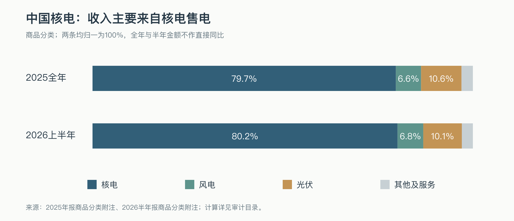
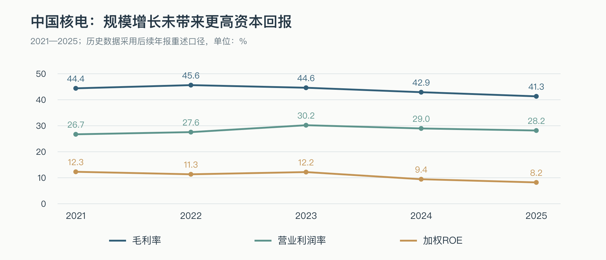

# 中国核电（601985.SH）研究报告

**研究与资料截止日：2026年10月16日。** 股价采用当日不复权收盘价 **9.43元**；总股本205.6800亿股，复算总市值 **1,939.56亿元**。截至目前取得的最近完整财务报告为未经审计的2026半年报，最近经营数据为2026年前三季度发电量公告；不把已公布电量当作尚未公布的三季报利润。

近十二个月归母利润口径PE为26.65倍，2025全年归母利润口径PE为20.85倍，普通股权益口径PB为1.64倍，2025年度每股股息0.18元对应税前股息率1.91%。本报告采用长期普通股股东视角，估值基准要求回报率为税前人民币名义8%，这是研究假设，并非无风险收益承诺。[行情交叉来源：腾讯](https://qt.gtimg.cn/q=sh601985)、[华盛通](https://www.hstong.com/quotes/30000-601985-SH)；[最新股本：10月16日分红实施公告](https://pdf.dfcfw.com/pdf/H2_AN202610151830516354_1.pdf)。

研究主线：**核电厂址、牌照与运维体系稀缺，但股东最终获得的回报取决于电价、建设成本及每股剩余现金。** 2026年上半年的利润下降，已经说明“稀缺资产持续扩容”不能直接等同于“每股利润稳定增长”。

---

## AI研究偏见自觉

**信息丰富度评级：A级。** 公司上市多年，定期披露、经营公告与券商覆盖充分。最大的AI陷阱是重复“核准加速、投产高峰、能源安全、类债资产”的共识，却遗漏电价下行、归母比例、资金缺口和股本摊薄。

**AI研究局限性声明：** 本报告核对公开披露及数据商资料，未进行电站现场调查，无法独立核验设备状态、核安全工程质量及项目实际施工进度。管理层计划不是投产保证，未来电价和分红不是已知事实。财务与行情可验证，不代表尾部核安全风险或未来投资回报能够精确量化。本项目用于学习与研究，不构成个性化投资建议。

- [x] 确定性判断以运营机制与每股经济利益为依据，不以报道数量为依据。
- [x] 同时研究“不买”的理由：较低股息、建设期现金缺口、电价压力和新能源资本配置。
- [x] 把核电集团的完整技术能力与上市公司实际能够取得的利润区分开。
- [x] 对没有取得双源核验的细分披露、无法确认的维护资本开支及预测参数，保留明确边界。

> 研究起点的追问：如果关于“投产高峰”的报道少一半，我还愿意支付当前价格吗？

---

## 第一步：核心数据总览

### 收入结构：核电是核心，新能源不是无风险增量

下表按财报“商品类型”分类，金额为人民币亿元。核电列只含核电商品收入，不与包括服务等的“核电板块收入”混用。2025及2026H1核电、风电、光伏分类收入和成本均与东方财富主营构成数据库独立交叉，原始金额一致；2025收入增速另参考东方财富所载财报解读。[2025年报第226页](https://static.cninfo.com.cn/finalpage/2026-04-30/1225257680.PDF)、[2026半年报第166页](https://static.cninfo.com.cn/finalpage/2026-08-29/1225531682.PDF)、[东方财富所载2025财报解读](https://data.eastmoney.com/report/info/AP202605021821935300.html)。

| 商品分类 | 2025收入 | 2025占比 | 2025毛利率 | 2026H1收入 | 2026H1占比 | 2026H1毛利率 |
|---|---:|---:|---:|---:|---:|---:|
| 核电 | 654.53 | 79.75% | 41.66% | 307.90 | 80.19% | 38.88% |
| 风电 | 54.44 | 6.63% | 41.87% | 25.98 | 6.77% | 30.66% |
| 光伏 | 87.25 | 10.63% | 37.92% | 38.93 | 10.14% | 21.38% |
| 其他及服务 | 24.54 | 2.99% | — | 11.16 | 2.91% | — |
| 合计 | 820.75 | 100% | 41.32% | 383.98 | 100% | 36.47% |



2025核电商品收入同比增长4.03%、光伏增长23.58%、风电增长7.04%。但收入增长的质量已经分化：新能源仍有毛利，扣除折旧以外的费用、融资成本及少数股东分配后，未必给上市股东留下正利润。公司在2026半年业绩会披露，核电板块归母利润39.79亿元，新能源板块归母亏损3.37亿元；这比“清洁能源装机继续增长”更接近股东的实际处境。[2025解读](https://data.eastmoney.com/report/info/AP202605021821935300.html)、[8月31日业绩会记录，9月2日披露](https://pdf.dfcfw.com/pdf/H22_AN202609021828919429_1.pdf)。

近四个已完整披露季度如下。单季数据由累计数相减，毛利率按单季收入与成本重算。公司没有完整披露这四季逐季业务分类收入及毛利率，故不补造季度分部表；2026Q3仅有电量，暂不纳入财务表。[东方财富财务分析](https://emweb.securities.eastmoney.com/PC_HSF10/FinanceAnalysis/Index?type=web&code=SH601985)、[2025年报分季度表及财务报表](https://static.cninfo.com.cn/finalpage/2026-04-30/1225257680.PDF)、[2026半年报](https://static.cninfo.com.cn/finalpage/2026-08-29/1225531682.PDF)。

| 季度 | 收入（亿元） | 归母利润（亿元） | 合并毛利率 |
|---|---:|---:|---:|
| 2025Q3 | 206.62 | 23.36 | 41.38% |
| 2025Q4 | 204.41 | 13.02 | 33.30% |
| 2026Q1 | 189.25 | 20.64 | 39.50% |
| 2026Q2 | 194.73 | 15.77 | 33.53% |

### 五年趋势：盈利增长慢于资本投入

金额为人民币亿元。简单FCF定义为“合并经营现金流－购建固定资产、无形资产和其他长期资产支付的现金”，含增长资本开支，不含收购、租赁本金及普通股融资现金流，**不是普通股可分配现金流**。2021采用解释15号追溯重述数，2022采用后续年报调整数；不能与旧网页的原披露数字混用。

| 年度 | 收入 | 归母利润 | 毛利率 | 营业利润率 | 加权ROE | 经营现金流 | 购建资产现金支出 | 简单FCF | 期末货币资金 |
|---|---:|---:|---:|---:|---:|---:|---:|---:|---:|
| 2021 | 626.95 | 82.17 | 44.41% | 26.72% | 12.30% | 356.08 | 251.23 | +104.85 | 130.64 |
| 2022 | 712.86 | 90.10 | 45.63% | 27.56% | 11.34% | 466.98 | 505.10 | -38.12 | 161.62 |
| 2023 | 749.57 | 106.24 | 44.62% | 30.21% | 12.19% | 431.26 | 671.00 | -239.74 | 97.74 |
| 2024 | 772.72 | 87.77 | 42.91% | 28.97% | 9.44% | 407.21 | 907.08 | -499.88 | 197.38 |
| 2025 | **820.75** | **93.04** | **41.32%** | **28.17%** | **8.21%** | **374.08** | **936.84** | **-562.75** | **155.82** |

来源：东方财富主要财务指标及三张报表，与[2022年报](https://file.finance.sina.com.cn/211.154.219.97:9494/MRGG/CNSESH_STOCK/2023/2023-4/2023-04-27/9110990.PDF)、[2023年报](https://static.sse.com.cn/disclosure/listedinfo/announcement/c/new/2024-04-27/601985_20240427_99QZ.pdf)、[2025年报](https://static.cninfo.com.cn/finalpage/2026-04-30/1225257680.PDF)交叉；逐项取数页码及数据接口见文末资料索引。营业利润率按中国会计准则营业利润计算，包含其他收益等，不能视为纯发电EBIT率。



负FCF并不直接证明项目毁灭价值：新电站建设先付钱，投产后才多年收回。真正的问题是新增项目的全周期回报是否高于资金成本，以及普通股东是否需要不断补充股本。当前尚未取得可靠的维护与增长资本开支分拆，不能把全部资本开支扣掉后断言公司没有价值，也不能将其全部加回当作“可自由分红现金”。

### 最新资产与电量：装机不等于权益装机

截至2026年9月末，控股在运核电27台、2,621.20万千瓦；在建及核准待建22台、2,563.50万千瓦。后者包含尚未开工项目，不能全部计入近期盈利。新能源在运3,591.56万千瓦，另有独立储能206.10万千瓦。[10月10日经营公告](https://pdf.dfcfw.com/pdf/H2_AN202610091830259637_1.pdf)。

| 主要核电资产 | 控股在运容量（万千瓦） | 前三季度发电量同比 | 股东需要理解的差异 |
|---|---:|---:|---|
| 秦山一核／二核／三核 | 252.80／271.80／145.60 | +9.93%／+2.54%／-0.25% | 成熟资产，延寿、安全改造与不同权益比例影响现金价值 |
| 三门核电 | 250.00 | +3.59% | 上市公司持股56%；年报机组表旧51%与附注冲突，以附注为准 |
| 江苏核电（田湾在运） | 660.80 | -1.44% | 在运资产与田湾7、8号项目主体、权益比例须分别核算 |
| 福清核电 | 667.80 | -11.34% | 本期检修增加，不能用新增机组假设覆盖既有机组减发 |
| 海南核电 | 130.00 | -7.39% | 小堆仍属建设项目，不能提前确认投产利润 |
| 漳州核电 | 242.40 | +74.38% | 2号机组于2026年1月1日商运，提供增量电量 |

经营数据来源同上；股权交叉参照[2026半年报释义及子公司附注](https://static.cninfo.com.cn/finalpage/2026-08-29/1225531682.PDF)。这里列的是受控项目全部装机；三门、田湾、福清等项目存在较多少数股东，不能把控股装机全部折算为上市股东收益。昌江3、4号属于持股49%的联营项目，也不应加入控股装机。

前三季度核电发电量1,532.78亿千瓦时，同比增长1.50%；核电上网量增长1.40%。新能源发电量333.82亿千瓦时，仅增长0.08%，上网量下降0.07%。这比装机扩张更能说明2026年的消纳与检修压力，但仍不能据此推断三季度利润。[经营公告](https://pdf.dfcfw.com/pdf/H2_AN202610091830259637_1.pdf)。

> 段永平式追问：股东最终买到的是发电量，还是扣除建设、融资和合作股东份额后属于自己的现金？

---

## 第二步：生意本质分析

**一句话定义：先投入巨额长期资本取得稀缺核电厂址和运营许可，再靠安全运行、利用小时及电价，在数十年内回收投资并取得剩余现金。**

电网、售电市场及相关用能客户为持续交付的电力、蒸汽等付钱。用电需求重复发生，收入有持续性，但这不是客户主动忠诚于某个品牌的订阅生意。电力具有同质性，电网调度、市场交易规则和地方供需会决定能够卖多少、卖什么价；其他电源构成替代。

| 商业环节 | 钱如何流动 | 影响普通股回报的关键变量 |
|---|---|---|
| 建设期 | 股东资本、合作方资本及贷款先投入项目 | 实际单位造价、工期、资本化利息、后续股权稀释 |
| 发电期 | 按上网电量与结算电价收款 | 运行小时、大修时点、电价及保障机制覆盖比例 |
| 成本端 | 燃料、折旧、运维、乏燃料及退役等支出 | 固定成本占比高，价格下降未必能同步降成本 |
| 股东分配 | 项目偿债、必要再投资后向各权益持有人分配 | 少数股东、永续债、母公司资本需求与现金分红政策 |

最值得跟踪的三个变量是**实现电价、有效利用小时和新增项目的每股资本回报**。2025核电含税综合电价0.3937元／千瓦时，同比下降5.16%；2026H1进一步降至0.3798元，同比下降4.09%。2025核电市场化电量占比71.36%，上一年为50.78%。牌照并未阻止电价下降。[2025年报](https://static.cninfo.com.cn/finalpage/2026-04-30/1225257680.PDF)、[半年业绩会](https://pdf.dfcfw.com/pdf/H22_AN202609021828919429_1.pdf)。

经营杠杆的尺度可以算清：以2025核电上网量1,878.47亿千瓦时为固定基数，假设全部电量含税结算价变化0.01元／千瓦时，按13%增值税简化换算，对合并不含税收入的影响约16.62亿元。这个敏感性未计销量变化、税收返还、项目权益比例及分档电价，不能直接当作归母利润变化。它说明少量电价变化足以显著影响剩余利润。

2026H1核电大修10次，同比增加4次，大修费用增加约6.60亿元，增值税返还减少3.90亿元；新能源综合电价0.3442元／千瓦时，平均限电率23.52%。部分税收优惠退出、机组进入乏燃料计提期，不能将全部盈利下降视为下一年自然恢复的检修扰动。[半年业绩会](https://pdf.dfcfw.com/pdf/H22_AN202609021828919429_1.pdf)。

2026H1经营现金流191.77亿元，购建资产现金支出346.03亿元，简单FCF为-154.26亿元。经营回款仍在，但扩张后的资金需要仍超过内部现金产出。[半年报现金流量表第73页](https://static.cninfo.com.cn/finalpage/2026-08-29/1225531682.PDF)、[东方财富现金流量表](https://emweb.securities.eastmoney.com/PC_HSF10/FinanceAnalysis/Index?type=web&code=SH601985)。

> 段永平式追问：这门生意好在稀缺资产能够长期发电；如果电价持续下降，还能留下足够的每股现金吗？

---

## 第三步：护城河评估

| 护城河来源 | 判断 | 支撑与反证 | 可证伪指标 |
|---|---|---|---|
| 品牌／定价权 | 弱 | 电力可靠性重要，但2025及2026H1实现电价连续下降 | 相同项目实际电价与合同保障，而非品牌宣传价值 |
| 客户转换成本 | 弱至中 | 电站接网和调度关系稳定；电网仍能调度其他电源 | 保障电量、市场中标及实际利用小时 |
| 网络效应 | 弱 | 更多电站不使每一度电因用户增加而自动升值 | 不把集约采购和共享运维误称为网络效应 |
| 规模与运维 | 强 | 多机组运行、大修、人员培训与采购能够复用 | 单位非燃料成本、检修天数、安全运行表现 |
| 技术与人才 | 强，但需区分集团归属 | 多堆型运行和工程体系难复制；核心设计和燃料链收益并非全部归上市公司 | 设备国产化、工程兑现、实际授权与服务收入 |
| 牌照、厂址及融资准入 | 强 | 核安全许可、沿海厂址和长周期资本形成进入壁垒 | 新进入者扩张、审批变化及项目全周期回报 |

有100亿元也难以快速复制既有电站群的许可、人才和运营记录。2025年公司披露22台机组WANO综合指数满分、平均98.84分，说明运营组织有积累；这类指标是公司披露，未经本研究独立工程审计。[2025年报运营及核心竞争力部分](https://static.cninfo.com.cn/finalpage/2026-04-30/1225257680.PDF)。

过去五年，项目储备和组织运维能力总体变宽，但价格保障及普通股资本回报承受压力。未来五年最可能出现的是“运营门槛依旧高、投资回报继续分化”。摧毁经济护城河的路径未必是新竞争者复制核电，而可能是低电价、高造价、停机及低回报再投资。

> 巴菲特式追问：十年后厂址和牌照大概率还稀缺；届时留下的资本回报，是否足以补偿今天的价格？

---

## 第四步：逆向思考与风险清单

最强的不买理由是：**普通股以约26.6倍近十二个月盈利购买一个价格受约束、正在大规模投入资本、部分利润属于合作股东的发电平台；若增长只体现在装机和资产上，股息与每股盈利可能无法覆盖机会成本。**

以下“高／中／低”是未来五年影响投资论文的主观可能性分类，不是统计发生率；核安全重大事故的概率尤其无法由公开资料可靠估计。

| 失败路径 | 主观可能性 | 影响 | 应观察的证据 |
|---|---|---|---|
| 市场电价持续走低，增量电量不足补价差 | 高，已部分发生 | 盈利与估值同时受压 | 核电实现电价、保障及市场电量比例、扣非EPS |
| 新能源消纳不改善，核电现金持续投入低回报项目 | 中至高 | 降低普通股回报、增加融资 | 限电率、新能源归母利润、新项目现金回收 |
| 建设延期、设备瓶颈及单位造价上升 | 中 | 推迟收入，增加资本化利息与未来折旧 | 田湾、三门、徐大堡实际商运及预算兑现 |
| 融资或合作股权增加，但每股利润未同步提高 | 中至高 | 装机增长被少数权益与股本摊薄抵消 | 总股本、权益比例、普通股ROE、分红能力 |
| 旧机组检修、延寿与税收优惠退出 | 中 | 现金成本及停机时间增加 | 两年滚动检修周期、度电成本、税费返还 |
| 重大安全事件或监管停运 | 无法可靠量化 | 极高，可能跨项目传导 | 官方核安全监管、运行许可证及停运通报 |
| 退役和乏燃料义务高于既有准备 | 中，金额不确定 | 长期现金及会计成本增加 | 新规实施测算、准备金、专用资金安排 |
| 对集团采购与融资依赖影响中小股东回报 | 中 | 成本、资金可用性及资本配置受约束 | 关联定价、集团财务公司资金及独立董事意见 |

历史类比可以看EDF：2025年其法国核电产出改善，但较低市场电价仍压低整体盈利。类比只用于说明“电量恢复不等于盈利恢复”，不把法国市场制度、融资安排或估值直接移植到中国。[EDF 2025年度业绩](https://www.edf.fr/en/2025-annual-results)。

从博弈角度看，这是少数发电运营者面对强电网客户、调度与政策规则的市场，卖方集中并不自动形成自由定价。从会计角度看，建设期利息资本化会延后在利润表体现成本；投产后折旧和费用化利息开始显现，新增资产的利润爬坡需要逐项目核查。

本研究最可能犯的错，是把当前盈利低谷全部归因于大修，并据此给恢复后的利润过高倍数。另一种相反错误，是把增长资本开支全部当作维持现状所必需，从而忽视长期资产价值。三情景同时保留这两种可能，避免只挑其中一种叙事。

> 芒格式追问：聪明人不买，可能不是不懂核电，而是不愿替长期建设资金和被约束的电价支付过高价格。

---

## 第五步：管理层评估

董事长卢铁忠与总经理邹正宇均有电站运行、值长和成员公司管理经历。核电更依赖安全文化、流程及人才梯队，核心优势不取决于单一明星CEO。截至2025年末，卢铁忠持205,246股，邹正宇持股为零，董高合计453,192股；按最新总股本折算分别约0.0010%和0.0022%。这属于职业经理人与国资治理体系，不是创始人大额持股模式。[2025年报第51—54页](https://static.cninfo.com.cn/finalpage/2026-04-30/1225257680.PDF)、[新浪高管持股数据库](https://vip.stock.finance.sina.com.cn/corp/view/vCI_CorpManagerInfo.php?Name=%C2%AC%EF%BF%BD%EF%BF%BD%EF%BF%BD%EF%BF%BD&Pcode=30712316&stockid=sh601985)。

中核集团2025年末持股55.67%，经济权益和普通股投票权原则上按持股比例，不存在AB股特殊投票权结构；截至报告基准日的逐日持股变动没有重新构建，不能把年末比例冒充实时股东名册。[2025年报股东资料](https://static.cninfo.com.cn/finalpage/2026-04-30/1225257680.PDF)、[公司股东资料入口](https://emweb.securities.eastmoney.com/PC_HSF10/ShareholderResearch/Index?type=web&code=SH601985)。

| 时段 | 决策与结果 | 资本配置评价 |
|---|---|---|
| 2020年以来 | 布局中核汇能、持续扩张风光 | 增加清洁能源资产；到2026H1新能源归母亏损，回报需重审，不能仅以装机评价成功 |
| 2025年初 | 完成增发，支持核电项目资本金 | 增强融资能力；是否增厚老股东价值须看投产后的每股回报 |
| 2025—2026年4月 | 上一轮累计回购约0.54亿股、投入4.84亿元 | 有资本回报动作，但未据此认定股份已注销或每股权益永久增厚 |
| 2025年度 | 每股股息合计0.18元，其中中期0.02、年度0.16 | 分红有连续性；以现价计股息率仍低，不宜仅据国企属性称为高息资产 |
| 2025末—2026H1 | 类REITs、公募REITs等盘活新能源资产 | 缓解资金需求，同时少数股东占比提高，归母收益可能被稀释 |
| 2026年9月 | 新回购金额1—2亿元，用于股权激励；取得最高1.8亿元贷款承诺 | 激励型回购不是注销回购，承诺函不是提款，也不是完成回购的证据 |

来源：[半年报资本运作说明](https://static.cninfo.com.cn/finalpage/2026-08-29/1225531682.PDF)、[2025年报及分红方案](https://static.cninfo.com.cn/finalpage/2026-04-30/1225257680.PDF)、[9月4日回购报告书](https://epaper.cs.com.cn/zgzqb/html/2026-09/04/nw.D110000zgzqb_20260904_8-B007.htm)、[9月8日贷款承诺公告](https://epaper.cs.com.cn/zgzqb/html/2026-09/08/nw.D110000zgzqb_20260908_4-B001.htm)。最新10月16日公告的库存股仍为54,012,257股，不能将回购授权当作已经减少总股本。

研发投入也应看回报而非只看金额：2025研发总投入23.28亿元，其中资本化8.89亿元，资本化比例38.17%。技术储备和运维能力有价值，但集团技术成果、研发资本化和上市公司未来现金盈利需要分别核验。[2025年报研发投入表](https://static.cninfo.com.cn/finalpage/2026-04-30/1225257680.PDF)。

治理观察点很具体：2025国家电网贡献销售额88.46%，同一控制口径合并后的中核集团供应商采购占88.85%。这既反映产业链协同，也使上市公司缺少自由分散采购和客户的空间。关联交易本身不是违规证据，但应检验定价、公平性和普通股资金回报。[2025年报第22—23页客户与供应商表](https://static.cninfo.com.cn/finalpage/2026-04-30/1225257680.PDF)。

> 段永平式追问：CEO退休后，运营体系仍可延续；但这个体系会优先扩大资产规模，还是持续提高普通股东的资本回报？

---

## 第六步：行业与文明趋势

电气化、能源安全与低碳转型支持核电的长期需求。核电在电力系统中能够提供连续低碳电量，价值不只体现在装机大小。国家能源局2026年8月资料指出，国内核电装机占比不足2%，发电量贡献接近5%；在运与核准在建总规模达1.35亿千瓦。这个总规模包含尚未运行的项目，不能当作当期可售电市场。[国家能源局行业信息](https://xbj.nea.gov.cn/dtyw/hyxx/202608/t20260825_307318.html)。

核电行业的可寻址市场，应理解为能够在适当厂址、许可、电网消纳和可接受造价下新增的稳定电力供给。需求空间不等于可无限复制的利润池。风光和储能成本、跨省输电、市场交易及未来核能技术，都会改变核电的边际经济价值。AI数据中心可能增加需求，但未核到公司已签署足以改变盈利模型的专属高溢价合同，因此本报告不给“AI核电”额外估值。

| 产业链环节 | 收益来源 | 对中国核电普通股东的含义 |
|---|---|---|
| 铀、燃料、设备与工程设计 | 燃料、制造与工程订单 | 很多利润属于集团其他主体或外部供应商，不能全部归给601985 |
| 核电运营 | 长期电量、热量及运维收入 | 上市公司的核心利润池，同时承担建设和运行资本风险 |
| 电网、售电及终端客户 | 调度、结算和使用电力 | 影响核电收益能否按稀缺性定价 |
| 风光、储能和核能综合利用 | 增量发电、调节与供热 | 需分别验证回报，不能以“新能源”标签统一给高倍数 |

技术路线的主要问题是工程与经济兑现。华龙一号、VVER、AP1000/CAP1000及小堆等多路线提供经验，也增加设备、备件和人才协同难度。聚变和新应用尚不能按成熟商业利润计入本次估值。[公司半年报核心竞争力及项目进展](https://static.cninfo.com.cn/finalpage/2026-08-29/1225531682.PDF)。

两个政策边界值得跟踪。风光入市同时设有可持续发展差价结算机制，不能简单理解为所有保底均取消。2026年7月起执行的退役准备办法要求在运行期计提退役费用；现有准备与新增规则的衔接、资金使用细则及公司测算仍需跟进，不能武断推断公司成本立即翻倍。[新能源电价改革官方解读](https://www.ndrc.gov.cn/xxgk/jd/jd/202502/t20250209_1396070.html)、[核电厂退役准备管理暂行办法](https://www.ndrc.gov.cn/xxgk/zcfb/ghxwj/202605/P020260519577470429013.pdf)。

> 李录式追问：二十年后核电仍可能是重要基础设施；投资者需要回答的是谁获得回报，以及需要再投入多少资本才能获得它。

---

## 第七步：估值与安全边际

### 先处理少数股东、永续债与负债

近十二个月归母利润以2025全年＋2026H1－2025H1计算，为72.7903亿元；除最新总股本得到统一股本口径EPS代理值0.353900元。它适合按当前股本比较情景，但不等于会计报表加权股数的基本EPS，也未扣除各期母公司永续债分配；后者会使普通股盈利略低。2025归母利润93.04亿元不能与合并净利润179.71亿元混用，少数股东利润不属于上市普通股东。[年报合并利润表及每股收益附注](https://static.cninfo.com.cn/finalpage/2026-04-30/1225257680.PDF)、[半年报](https://static.cninfo.com.cn/finalpage/2026-08-29/1225531682.PDF)、[东方财富财务分析](https://emweb.securities.eastmoney.com/PC_HSF10/FinanceAnalysis/Index?type=web&code=SH601985)。

下表为2026年6月末合并口径，金额为人民币亿元。现金与总资产、负债可由东方财富二源核对；债务细项按官方附注重组，未取得独立第三方相同口径债务合计，明确列为本研究单源重构。

| 项目 | 金额 | 口径 |
|---|---:|---|
| 货币资金 | 184.32 | 含集团财务公司存款103.67；不是全部可直接分给上市股东的现金 |
| 受限货币资金 | 2.73 | 履约、复垦等；可用现金另为181.59 |
| 银行短期及长期借款 | 4,137.98 | 主要融资负债，未将非融资应付款全部当债务 |
| 债券、租赁、到期融资及其他融资项 | 778.12 | 包括短债、当期到期融资、售后租回及集团代融资 |
| 广义有息债务〔单源重构〕 | **4,916.10** | 剔除职工薪酬到期项、乏燃料处置、海域费及专项应付款 |
| 净有息债务〔货币资金抵减〕 | **4,731.78** | 如仅抵扣可用现金，净债务还会略高 |
| 归母权益 | 1,194.23 | 包含母公司永续债10.00 |
| 普通股权益 | 1,184.23 | 归母权益减母公司永续债 |
| 少数股东权益 | 1,133.13 | 不属于上市普通股东 |

来源：[半年报第64—66、106、155—162、175页](https://static.cninfo.com.cn/finalpage/2026-08-29/1225531682.PDF)。现金与债务分别是财务报表时点和研究重构值，不是10月16日实时余额。现金储备按货币资金计算，未把长期股权投资当作现金；两期交易性金融资产不适用。详细债务构成和小数精度见[计算记录](审计-20261016/财务与估值验算.json)。

作为尺度，全部广义债务成本假设上升50个基点、且全部立即重定价，年度合并税前利息影响约24.58亿元。实际借款存在固定／浮动利率、期限差异及资本化，不能直接扣到当期归母利润。

### 当前定价

| 指标 | 工具复算结果 | 读法 |
|---|---:|---|
| 市值 | 1,939.56亿元 | 9.43元乘205.6800亿股；库存股尚未注销，不直接从总股本剔除 |
| PE，近十二个月归母利润 | **26.65倍** | 用统一当前股本EPS代理；母永续调整后略高 |
| PE，2025归母利润 | 20.85倍 | 这是静态口径，不替代已下降后的TTM盈利 |
| PS，近十二个月 | 2.44倍 | 仅辅助，不反映债务及少数股东要求权 |
| PB，普通股权益 | 1.64倍 | 扣除母公司永续债后每股净资产5.7577元 |
| EV／Revenue〔账面少数权益代理〕 | 9.83倍 | 市值＋净债务＋母永续＋少数股东账面权益，除合并TTM收入；非精确市场价值EV |
| 2025年度税前股息率 | 1.91% | 每股0.18元；不是已知2026全年分红 |
| PEG | 不赋单点 | 利润正在下行，恢复期增长高度依赖假设，机械PEG会误导 |
| 普通股FCF收益率 | 暂不可靠 | 未分拆维护资本开支、项目偿债及少数股东现金分配，不能将合并FCF直接除上市股数 |

平台“静PE约12倍”的显示不能据以认定便宜，其精确分母和更新口径未能确认；本报告使用可以复算的归母利润。EV使用少数股东账面权益只是近似，不能拿来与平台未调整的EV倍数直接比较。PE已经使用杠杆后的盈利，后面的情景价格不再重复减去净债务。

### 自身历史与同业

理杏仁10月15日页面显示PE为26.59倍，与本报告更新一日后的26.65倍一致。其页面展示窗口的中位数20.42倍、低位参考17.30倍，但本次未确认该窗口起止，故只作为页面参照，**不宣称是十年估值分位或长期合理价值**。更可靠的历史约束是公司2025加权ROE已经低于2021—2023年，而当前估值仍要求较强的盈利恢复。[理杏仁估值页面](https://www.lixinger.com/equity/company/detail/sh/601985/601985/fundamental/valuation/pe-ttm)。

| 可比项 | 中国核电 | 中国广核A股 | 结论 |
|---|---:|---:|---|
| 10月16日收盘价 | 9.43元 | 4.59元 | 同日人民币实际价格 |
| 当前股本口径TTM EPS | 0.353900元 | 0.196513元 | 均由最新可得归母利润及总股本复算 |
| PE TTM | 26.65倍 | 23.36倍 | 中国核电仍有估值溢价 |
| 2026H1归母同比 | -35.74% | +2.66% | 区域、电价、检修、资产权益及非经常因素不同 |
| 2026H1主要发电毛利率 | 核电商品38.88% | 销售电力46.26% | 分类并非完全相同，仅作经济性参照 |

来源：[中国广核2025年报](https://static.cninfo.com.cn/finalpage/2026-03-26/1225030278.PDF)、[中国广核半年报](https://static.cninfo.com.cn/finalpage/2026-08-26/1225503731.PDF)、[东方财富中国广核财务分析](https://emweb.securities.eastmoney.com/PC_HSF10/FinanceAnalysis/Index?type=web&code=SZ003816)、[同日腾讯行情](https://qt.gtimg.cn/q=sz003816)。中国广核TTM利润采用2025年97.6536亿元加2026H1的61.0508亿元减同期59.4676亿元，再除总股本504.9882亿股；关键中间数存入计算记录。中国广核“管理装机”包含联营机组，不与中国核电“控股装机”直接计算份额。这里的比较并不构成买入另一家公司的结论。

### 反向DCF：今天需要什么样的恢复

由于普通股自由现金流分拆不足，本报告采用“可分配利润的股息＋期末盈利价值”股权模型，作为反向DCF代理，**没有伪装成项目FCFF估值**。假设未来五年EPS按恒定速度增长、每年派发当年EPS的40%、第五年按18倍PE退出、折现率8%。从TTM EPS代理0.353900元起算，要支持9.43元现价，需要未来五年每股盈利年复合增长约 **14.63%**。

公式为：现价＝未来五年股息的折现值＋第五年EPS乘18倍PE的折现值。这个增长要求还需要较高再投资回报来支撑留存利润，不能只靠增加资产。若到期倍数低于18倍、分红率更低或继续稀释，所需增长更高；若电价和新项目盈利超预期，要求会更容易满足。14.63%是模型反推值，不是市场一致预期，更不是公司指引。

### 三情景：股价目标、股息与今天的价值

从本次基准日向后约三年，即2029年同期；使用上述TTM统一股本EPS，不以单季利润年化。增长、终值PE和40%派息率均是研究假设。股息按年末到账，不再投资，未计税和交易费用；IRR按逐年现金流求解。

| 情景 | 每股盈利年增速 | 三年后EPS | 终值PE | 三年后价格 | 三年累计股息 | 含息总回报 | 含息年化IRR | 按8%折现的今日价值 |
|---|---:|---:|---:|---:|---:|---:|---:|---:|
| 乐观 | +20% | 0.6115元 | 22倍 | **13.45元** | 0.6183元 | +49.23% | +14.50% | 11.21元 |
| 中性 | +12% | 0.4972元 | 18倍 | **8.95元** | 0.5350元 | +0.58% | +0.20% | 7.56元 |
| 悲观 | 0% | 0.3539元 | 14倍 | **4.95元** | 0.4247元 | -42.96% | -17.42% | 4.30元 |

乐观情景要求新机组按期释放权益利润、电价企稳和新能源修复同时出现；中性情景已经假设每股盈利两位数恢复，并非保守到“不增长”；悲观情景甚至没有假设EPS进一步下滑，若安全或融资发生重大冲击，损失还可能超过表中情景。

中性情景的终值按6%至10%折现率变化，对应今日价值约7.99至7.16元，故本报告的**中性合理价值参照为7.2—8.0元**。它是模型区间，绝非价格底部。只有以更低价格或更强的盈利证据买入，才能提高预期回报；现价9.43元更接近提前支付较顺利的恢复。

具体行动价格：**6.0—6.8元为附带经营条件的研究性分批评估带；6.8—8.0元继续核证据；8.0元以上按本次中性模型缺少安全边际，现价观望。** 低于6.0元仍先查是否出现论文破坏，不能机械补仓。若达到或超过11元而经营只达到中性情景，应重审持仓和机会成本。未来除息或股本变化后，应按同一权益口径重算价格带，不能永久套用。

> 巴菲特与段永平式追问：股市关闭五年，我愿意持有稀缺的运营资产；但在9.43元，现有证据尚不足以支持我为普通股回报支付这个价格。

---

## 第八步：最终决策与行动清单

**研究结论：观望，当前价格不新增。** 公司具备长期运营资产与组织壁垒，2026年的盈利压力和资金需求也真实存在。以现有公开证据，尚不能把它视为高息、防守且每股收益自动增长的资产。

| 维度 | 结论 | 信心度 |
|---|---|---|
| 生意质量（段永平） | 需求重复、资产寿命长；资本投入重、售价受约束 | 高 |
| 护城河（巴菲特） | 厂址、牌照、运维强；自由定价权弱 | 高 |
| 管理层（段永平＋巴菲特） | 专业体系较强；新能源与扩建的普通股回报仍待验证 | 中 |
| 最大风险（芒格） | 电价下降及低回报扩张，将装机增长变成每股收益停滞 | 中高 |
| 文明趋势（李录） | 连续低碳电力具长期需求，利润如何分配并不确定 | 中高 |
| 估值（巴菲特＋段永平） | 中性价值7.2—8.0元，9.43元缺少安全边际 | 中偏低，依赖假设 |

| 投资者情形／信号 | 本次研究动作 |
|---|---|
| 空仓者 | 现价观望；6.0—6.8元且经营条件通过，才研究性小额分批；无法承受核安全尾部风险者不宜参与 |
| 已持仓者 | 不因装机叙事加仓；核仓位与替代资产的预期回报，长期小额持仓可随披露继续观察，大额集中仓应主动复核 |
| 加仓条件 | 价格进入评估带，且核电实现电价同比降幅收窄、两年滚动检修成本可解释、新能源归母向盈亏平衡改善、融资与股本变化可接受；缺一项则保持研究观察 |
| 经营减仓／退出信号 | 重大安全或治理问题；连续两个正式报告期电价与扣非每股盈利共同恶化；项目明显超预算并持续依赖摊薄融资；新能源持续亏损且投资纪律未改善 |
| 估值复核信号 | ≥11元而经营仅达中性情景，重新评估仓位和机会成本；不是机械止盈单 |
| 下一财报检查 | 2026Q3预约披露日为10月28日；预约可能调整，以公司／交易所实际公告为准 |
| 项目与政策复检 | 2026年末检查田湾7号商运、净债务与退役准备政策测算；2027年初检查海南小堆实际投产 |

三季度复核应取得实际结算电价、扣非EPS、经营现金流、购建资产支出、项目权益比例和回购用途执行。电量恢复或单次大修推迟不单独解除观望结论。[披露预约日历](https://data.eastmoney.com/stockcalendar/601985.html)、[最新业绩会项目指引](https://pdf.dfcfw.com/pdf/H22_AN202609021828919429_1.pdf)。

下列为方法论模拟，非四位本人对该股的评价或原话：

> 段永平式：生意可以看懂，价格还要算明白。盯每股能拿到的钱，不能只看电站越来越多。

> 巴菲特式：牌照与厂址形成壁垒，但高资本需求和受约束电价要求更严格的买入价格。

> 芒格式：最容易犯的错，是把所有下滑都叫暂时性，把所有资本开支都叫未来利润。

> 李录式：长期能源需求值得研究；文明受益并不保证每个时点的普通股股东都有高回报。

---

## AI分析置信度与投资确定性

对已披露收入、归母利润、现金流、现金及股本的分析置信度较高：关键总量已在原始报告和独立数据渠道交叉，差异小于1%。核电、风电和光伏分类财务额也完成双渠道核对；债务细项重构及部分运营解释仍依赖官方单源；工程质量和所有在建项目的实际回报无法由公开资料完整证明。

对未来电价、投产节奏、维持资本开支、普通股长期现金分配及终值倍数的置信度中等或偏低。6.0—6.8元评估带和7.2—8.0元中性价值均为假设推演，必须随新证据修订。**资料丰富提高的是分析可核验程度，不等于投资确定性；本次最确定的判断是存在稀缺运营资产，最不确定的是新增资本究竟给普通股东带来多少净回报。**

---

## 数据来源与审计记录

### 资料索引与口径

- [2022年度报告](https://file.finance.sina.com.cn/211.154.219.97:9494/MRGG/CNSESH_STOCK/2023/2023-4/2023-04-27/9110990.PDF)：第68页解释15号重述；第93、97—101页用于2021重述后的财务及现金流。
- [2023年度报告](https://static.sse.com.cn/disclosure/listedinfo/announcement/c/new/2024-04-27/601985_20240427_99QZ.pdf)：第6页历史重述、第103、107页利润及现金流。交易所链接如受访问限制，可用[同文PDF镜像](https://file.finance.sina.com.cn/211.154.219.97:9494/MRGG/CNSESH_STOCK/2024/2024-4/2024-04-27/10123495.PDF)读取；镜像不算额外独立来源。
- [2025年度报告](https://static.cninfo.com.cn/finalpage/2026-04-30/1225257680.PDF)：第8页近三年指标、第23页客户供应商、第51—54页董高、第128、131页利润及现金流、第164页现金、第214、219页融资、第226页商品分类、第237页现金等价物。
- [2026半年度报告](https://static.cninfo.com.cn/finalpage/2026-08-29/1225531682.PDF)：第8页关键指标、第64—66页资产负债、第69—73页利润及现金流、第106页现金、第155—162页融资及母永续、第166页商品分类、第175页现金等价物。
- [东方财富财务分析入口](https://emweb.securities.eastmoney.com/PC_HSF10/FinanceAnalysis/Index?type=web&code=SH601985)：独立渠道核对主要指标、利润、现金流与资产负债。数据接口报告名为RPT_F10_FINANCE_MAINFINADATA、RPT_DMSK_FN_INCOME、RPT_DMSK_FN_CASHFLOW、RPT_DMSK_FN_BALANCE及主营构成RPT_F10_FN_MAINOP；筛选601985.SH。历史记录中的TOTAL_SHARE可能回填当前股本，不能当作历史股本序列。
- [半年业绩会原始记录](https://pdf.dfcfw.com/pdf/H22_AN202609021828919429_1.pdf)、[前三季经营公告](https://pdf.dfcfw.com/pdf/H2_AN202610091830259637_1.pdf)、[10月16日权益分派实施公告](https://pdf.dfcfw.com/pdf/H2_AN202610151830516354_1.pdf)：用于电价、限电、投产计划、最新运营及股本。
- [年度基础数据逐项核对](审计-20261016/年度基础数据核对.json)、[核电与风光分类双源核对](审计-20261016/分部双源核对.json)：历史年度基础额及两期主要商品分类收入、成本均一致。
- [完整财务与估值计算](审计-20261016/财务与估值验算.json)、[完整financial_rigor工具输出](审计-20261016/financial-rigor.txt)：所有金额计算使用Decimal；市场价值、交叉来源和三情景另经共享工具验算。股价及股本一致，2025收入、归母和2026H1现金等关键总量交叉偏差为零。

### 关键数据交叉验证记录

以下直接摘录本次共享金融工具输出。工具中ROE为“TTM EPS／期末普通股净资产”的简化比值，不等于财报加权平均ROE；情景表价格在工具终端只显示一位小数，正文采用完整Decimal计算保留两位。完整日志见上方链接。

```text
============================================================
市值验算 (Market Cap Verification)
============================================================
  股价 (Price):       9.43 CNY
  总股本 (Shares):    20.57B
  计算市值:           193.96B CNY
  报告市值:           193.96B CNY
  偏差:               0.00%

  ✅ 验证通过, 偏差仅 0.00%

交叉验证: 2025收入 (Cross-Validation)
============================================================
  数据来源数: 2
  参考中位数: 82.08B 元

  ✅ 公司年报                : 82.08B 元  (偏差 0.00%)
  ✅ 东方财富                : 82.08B 元  (偏差 0.00%)

  ✅ 所有来源偏差 ≤ 1.0%, 数据一致

  共识值 (加权中位数): 82.08B 元

交叉验证: 2025归母净利润 (Cross-Validation)
============================================================
  数据来源数: 2
  参考中位数: 9.30B 元

  ✅ 公司年报                : 9.30B 元  (偏差 0.00%)
  ✅ 东方财富                : 9.30B 元  (偏差 0.00%)

  ✅ 所有来源偏差 ≤ 1.0%, 数据一致

  共识值 (加权中位数): 9.30B 元

交叉验证: 2026H1货币资金 (Cross-Validation)
============================================================
  数据来源数: 2
  参考中位数: 18.43B 元

  ✅ 公司半年报               : 18.43B 元  (偏差 0.00%)
  ✅ 东方财富资产负债表           : 18.43B 元  (偏差 0.00%)

  ✅ 所有来源偏差 ≤ 1.0%, 数据一致

  共识值 (加权中位数): 18.43B 元

估值指标验算 (Valuation Verification)
============================================================
  当前股价: 9.43

  PE (TTM):  9.43 / 0.3539004603447319 = 26.65x
  盈利收益率: 3.75%
  PB:        9.43 / 5.757656670187187 = 1.64x
  ROE:       0.3539004603447319 / 5.757656670187187 = 6.15%
  股息率:    0.18 / 9.43 = 1.91%
  PS:        9.43 / 3.865246138807347 = 2.44x

  ✅ 以上指标均使用精确十进制计算, 无浮点误差

============================================================
三情景估值模型 (Three-Scenario Valuation)
============================================================
  当前股价: 9.43 CNY
  当前EPS:  0.3539004603447319
  预测期:   3年

  情景                年增速     目标PE      目标EPS       目标股价      涨跌幅
  ------------ -------- -------- ---------- ---------- --------
  乐观 (Bull)         20%      22x       0.61      13.5   +42.7%
  中性 (Base)         12%      18x       0.50       8.9    -5.1%
  悲观 (Bear)          0%      14x       0.35       5.0   -47.5%

  ✅ 所有计算使用精确十进制, 结果可审计复现

============================================================
估值指标验算 (Valuation Verification)
============================================================
  当前股价: 4.59

  PE (TTM):  4.59 / 0.19651299686254986 = 23.36x
  盈利收益率: 4.28%

  ✅ 以上指标均使用精确十进制计算, 无浮点误差
```

### 抽检与监控交接

**抽检结果：准出（PASS）。** 共享工具按固定随机种子20261016、默认15%比例，从可识别字段抽取16项。原始样本有两项将机组编号和年份误识为财务数据，明确剔除并留底；其余14项全部通过，零警告、零失败，最大显示偏差低于1%。有效样本包括披露事实及其派生量九项、模型算术五项；模型算术通过不代表预测获外部证实，其中装机一项只有发行人来源。年度基础财务额与主要商品分类额另作完整双渠道核对，避免解析器不抽取纯年份表行造成遗漏。

可查[原始抽样清单](审计-20261016/抽检原始清单.json)、[逐项取数与噪声说明](审计-20261016/抽检核验结果.json)、[正式判决](审计-20261016/report-audit-verdict.txt)。

本次新增中国核电至[标的跟踪表](../标的跟踪表.md)，主表总数重计为98条，其中待触发63条；重点标的看板只同步台账摘要。监控配置登记一个“≤8元研究复核入口”，在附加条件中区分6.8—8.0元观察与6.0—6.8元条件分批，并登记11元估值复检线，以及除息、Q3、田湾7号和小堆复检事件。每市场仅一条下行条件和一条上行警戒线，以适配统一监控的数据约束。

触发配置及统一每日监控配置均校验通过；[中国核电定点行情快照](审计-20261016/监控定点快照.json)为9.43元，两条价格条件均未触发。下一财报预约日期及研究日历不冒充已确定的公司事件日期。

价格与经营条件共同构成研究触发，已登记的价格到达不等于自动买入。每日监控由现有统一流程消费配置；本次本地验证不发送通知，也不更新历史trigger-scan日报。研究报告与建议事件应可由标的跟踪表回溯。
