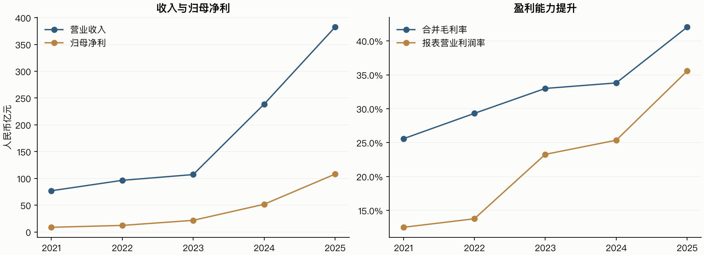
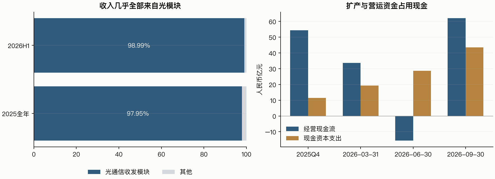

# 中际旭创（300308.SZ／03308.HK）研究报告

> **研究及数据截止日：2026-11-25（上海时间，晚间核验）。** 最新财务为2026年三季报，未经审计；最近完整审计年度为2025年。A股收盘409.00元，H股收盘485.40港元。以1港元兑0.8508元人民币计，A/H分价、含库存股的已发行股本市值合计约4,820.14亿元；A价等值市值4,817.65亿元。A股TTM归母PE 18.60倍，扣非PE 18.72倍。除明确标注外，金额为人民币。
>
> **研究主线：** 公司已经把高速光互连的技术、良率和交付优势兑现成利润；下一阶段的股东回报，取决于这些利润转化为现金的速度，以及可插拔模块优势能否迁移到新架构。
>
> 本报告用于学习和研究，不构成投资建议；仓位为缺少个人资产、成本和风险信息时的研究参考。

## AI研究偏见自觉

**信息丰富度评级：A。** 财报、港股招股书和机构交流很多，但真正影响未来价值的客户取消条款、分速率利润、良率和新架构价值量没有充分公开。市场讨论密集，不代表这些变量可预测。

**AI研究局限性声明：** 下文把正式财报、管理层表述、第三方预测和本报告假设分开。不能从匿名客户排名推断确定客户名称；不能把2027年的PO当成不可撤销收入；不能用CPO带来更多光连接，直接证明现有模块厂能保留全部利润。情景概率是研究判断，未经统计校准。

- [x] 确定性主要来自已实现的收入与交付，而不是资料数量。
- [x] 已查找订单、政策、技术替代及资本配置的反证。
- [x] 即使资料减少一半，客户议价、代际迁移和再投资仍是核心矛盾。
- [x] 不把“AI需求增长”和“股票必然有高回报”合并为一个命题。

本次复用原有「中际旭创」目录，并保留[7月旧报告](中际旭创-research-20260727.md)。当时之后发生H股上市、绿鞋发行及大额回购，旧股本、现金与价带不再直接使用。另经原始2022年报核对，2022收入应为96.4179亿元，旧报告96.70亿元缺少正式支持，并非追溯重述。

---

## 第一步：核心数据总览

### 证券身份与股本

公司为中际旭创股份有限公司，英文Zhongji InnoLight Co., Ltd.。A股300308在深交所创业板，H股03308于2026-07-30在港交所上市，属于同一家公司的两类普通股；苏州旭创是其经营子公司，不能用子公司报表替代整个上市集团。

| 项目 | 本次使用口径 | 依据与限制 |
|---|---:|---|
| 已发行总股本 | 1,177,909,641股 | 三季报、10月月报及11月回购文件一致 |
| A股 | 1,115,234,641股 | 含库存股 |
| H股 | 62,675,000股 | 包含超额配售 |
| 已核A股库存股 | 5,653,063股 | 10月底月报；注销获批不等于完成登记 |
| A/H分价市值，扣上述库存 | 4,797.02亿元 | 经济权益口径敏感性 |
| H股换算人民币价格 | 412.98元 | 较A股约溢价0.97%，尚无明显H股折价 |

股本以[HKEX 10月月报](https://www.hkexnews.hk/listedco/listconews/sehk/2026/1102/2026110203424_c.pdf)及[11月回购报告书](https://static.cninfo.com.cn/finalpage/2026-11-25/1225686830.PDF)为一手依据，并与[腾讯A行情](https://qt.gtimg.cn/q=sz300308)、[新浪股本结构](https://money.finance.sina.com.cn/corp/go.php/vCI_StockStructure/stockid/300308.phtml)交叉。价格分别由腾讯及[Google Finance A股](https://www.google.com/finance/beta/quote/300308:SHE?hl=zh-CN)、[经济通H股](https://seg.etnet.com.hk/www/eng/stocks/ci_ipo_detail.php?code=03308&type=listing)印证。腾讯时间分别为当日16:14:30、16:08:07；独立H源18:00更新。[公司官网动态页头](https://www.zj-innolight.com/en/newsinfo/232.html)亦显示同价。Google页面市值与已核股本不符，未采用其市值或盈利字段。

汇率取[腾讯即期](https://qt.gtimg.cn/q=whHKDCNY)21:28的0.8508；[CurrencyAPI当日较早时点](https://currencyapi.com/currency-conversion/hkd-cny-1)为0.85076。[CFETS中间价](https://www.chinamoney.com.cn/english/bmkcpr/)为0.85539，是不同时间及口径。H股估值只是人民币价值按本次汇率换算，后文所有现金流、折现率和回报率均为**人民币口径**；不承诺港元投资者取得同样回报。

### 五年财务：利润率上台阶，现金流存在波动

金额均为亿元。营业利润率为中国会计准则报表营业利润／收入，含投资等项目，不能等同于纯主营EBIT率。

| 年度 | 收入 | 归母净利 | 合并毛利率 | 报表营业利润率 | 研发费用 |
|---|---:|---:|---:|---:|---:|
| 2021 | 76.9540 | 8.7698 | 25.57% | 12.51% | 5.4110 |
| 2022 | 96.4179 | 12.2399 | 29.31% | 13.77% | 7.6702 |
| 2023 | 107.1798 | 21.7353 | 32.99% | 23.27% | 7.3937 |
| 2024 | 238.6216 | 51.7149 | 33.80% | 25.35% | 12.4403 |
| 2025 | 382.3994 | 107.9725 | 42.04% | 35.56% | 16.1528 |

| 年度 | 经营现金流CFO | 现金资本支出 | 简化FCF | 货币资金 |
|---|---:|---:|---:|---:|
| 2021 | 8.1276 | 8.3958 | -0.2682 | 35.1461 |
| 2022 | 24.4894 | 7.9183 | 16.5711 | 28.3102 |
| 2023 | 18.9713 | 17.0446 | 1.9267 | 33.1728 |
| 2024 | 31.6458 | 28.6616 | 2.9843 | 50.5381 |
| 2025 | 108.9613 | 27.5999 | 81.3613 | 109.8689 |

简化FCF＝CFO−购建固定资产、无形资产及其他长期资产支付现金，**未扣并购、金融投资、租赁本金和少数股东分配**，也不是直接归属普通股东的现金。2025研发投入16.7593亿元，区别于费用16.1528亿元；资本化等使两者不同。

五年原数已逐项对照[东方财富财务数据](https://emweb.securities.eastmoney.com/PC_HSF10/NewFinanceAnalysis/Index?code=SZ300308&type=web)与正式[2021年报](https://static.cninfo.com.cn/finalpage/2022-04-25/1213057723.PDF)、[2022年报](https://disc.static.szse.cn/disc/disk03/finalpage/2023-04-24/4331740a-643a-42df-bc20-f30692ba1b71.PDF)、[2023年报](https://disc.static.szse.cn/disc/disk03/finalpage/2024-04-22/f8324e07-ab83-43af-9a59-9ca461d0b794.PDF)、[2024年报](https://static.cninfo.com.cn/finalpage/2025-04-21/1223155483.PDF)、[2025年报](https://disc.static.szse.cn/disc/disk03/finalpage/2026-03-31/7bb16111-3899-41e7-8a07-abf2c8798dd7.PDF)。页码、精确原数及工具输出在文末附件。

### 最近四季：增长强，但不能只看同比

以下单季数据由正式累计报表差分，金额为亿元。

| 单季 | 收入 | 归母净利 | 扣非归母 | 合并毛利率 | CFO | 现金资本支出 | 简化FCF |
|---|---:|---:|---:|---:|---:|---:|---:|
| 2025Q4 | 132.3513 | 36.6532 | 36.2635 | 44.48% | 54.4130 | 11.4546 | 42.9585 |
| 2026Q1 | 194.9640 | 57.3450 | 57.1775 | 46.06% | 33.6757 | 19.2920 | 14.3837 |
| 2026Q2 | 222.8146 | 79.1665 | 73.7385 | 46.42% | -15.6790 | 28.7296 | -44.4086 |
| 2026Q3 | 277.6920 | 85.8679 | 90.1807 | 46.61% | 62.0877 | 43.5871 | 18.5005 |

前三季收入695.4706亿元、归母222.3794亿元，分别同比+178.13%、+211.81%；同期CFO 80.0844亿元、资本支出91.6088亿元，简化FCF为-11.5243亿元。Q3现金已恢复，不能把Q2净流出等同于持续失血；但9M CFO／归母仅36.01%，也不能用单个好季度消除资金占用问题。来源：[Q1](https://disc.static.szse.cn/disc/disk03/finalpage/2026-04-17/9d49a477-951e-4995-bba4-4acaf6c10aba.PDF)、[H1](https://static.cninfo.com.cn/finalpage/2026-08-22/1225491753.PDF)、[Q3](https://static.cninfo.com.cn/finalpage/2026-10-30/1225643953.PDF)，以及[东财主表](https://datacenter.eastmoney.com/securities/api/data/get?type=RPT_F10_FINANCE_MAINFINADATA&sty=ALL&filter=%28SECUCODE%3D%22300308.SZ%22%29&p=1&ps=100&sr=-1&st=REPORT_DATE&source=HSF10&client=PC)。

TTM至2026-09-30：收入827.8219亿元、归母259.0326亿元、扣非257.3602亿元、CFO 134.4975亿元、资本支出103.0633亿元、简化FCF 31.4342亿元。TTM CFO／归母为51.92%，简化FCF／归母为12.14%。这些比率尚不能支持把全部净利润直接视为股东现金。

### 收入结构与现金边界

| 项目 | 2025全年 | 2026H1 |
|---|---:|---:|
| 光通信收发模块收入，亿元 | 374.5652 | 413.5521 |
| 其他收入，亿元 | 7.8342 | 4.2265 |
| 模块收入占比 | 97.95% | 98.99% |
| 模块毛利率 | 42.61% | 46.59% |

产品结构取[2025年报第24—26页](https://disc.static.szse.cn/disc/disk03/finalpage/2026-03-31/7bb16111-3899-41e7-8a07-abf2c8798dd7.PDF)及[H1经营分析](https://static.cninfo.com.cn/finalpage/2026-08-22/1225491753.PDF)；“其他”为总收入减该产品收入的余项。东财分部接口H1“模块及器件”收入为413.3105亿元、占98.9305%，来自财报附注分部表并含抵销口径，与本表产品分析相差不足1%，不混用其“其他”金额。**近四季800G、1.6T的分别收入及毛利未披露**，不能填造季度分部表；管理层亦在[10月29日交流](https://static.cninfo.com.cn/finalpage/2026-10-29/1225645972.PDF)明确未量化具体比例。

9月底应收账款173.0899亿元、库存238.7770亿元，较年底分别+175.76%、+88.30%。这是备料及销售扩张的资金需求，也会在订单变更时成为风险敞口，不能仅凭增长就判断坏账或积压。

| 9月底资产／义务，亿元 | 数额 | 估值处理 |
|---|---:|---|
| 货币资金 | 535.3249 | 包含受限等口径，不等于可分配现金 |
| 交易性金融资产 | 22.7964 | 增量主要为股权投资；不计入现金储备 |
| 短期、长期借款合计 | 8.2211 | 计入类债务桥 |
| 一年内到期非流动负债 | 8.7049 | Q3未完整拆分，保守全部纳入 |
| 非流动租赁负债 | 1.6356 | 纳入 |
| 长期应付款 | 50.6300 | 子公司增资的回购义务，纳入 |
| 上述义务合计 | 69.1917 | 非“精确银行债务” |
| 货币资金减上述义务的代理值 | 466.1333 | 未再减受限、资本承诺、设备款，不可称冗余现金 |

现金跳升主要来自H股融资，不能归因于经营积累。另有其他应付款56.5126亿元，增量主要是设备工程款，预示未来现金支出。赎回义务来源于TeraHop投资者附带权利；[H股中报附注19，印刷第71页](https://disc.static.szse.cn/download/disc/disk03/finalpage/2026-09-11/bd77234d-1e87-4e66-9cde-8f1568e584b8.PDF)披露特定事件可触发回购，公司无法避免相关事件。其余数字见[三季报第3—4、7—10页](https://static.cninfo.com.cn/finalpage/2026-10-30/1225643953.PDF)。

> 段永平式追问：利润和现金的差距是有回报的备货扩产，还是未来减值的前奏？现有证据支持交付需求强，但尚未证明每一笔新增资本的回报。

---

## 第二步：生意本质分析

**一句话：公司替云厂商把高速光电器件、封装与测试，变成下一代AI网络能及时、大批量、稳定使用的连接产品，靠不断赢得下一代设计导入重复收款。**

| 商业环节 | 钱如何流动 | 决定利润的变量 |
|---|---|---|
| 客户设计导入 | 与客户共同定义性能、可靠性、功耗及规格 | 研发响应、认证及导入时点 |
| 采购和制造 | 采购光源、电芯片等，完成封装耦合及测试 | 供料、良率、产线利用率、采购成本 |
| 模块交付 | 按采购订单交货收款，一次性硬件收入 | 出货量、组合、同款年降、回款 |
| 下一代升级 | 重新开发并争取份额 | 新架构技术及客户关系的可迁移性 |

这不是订阅模式，但有持续升级驱动的复购。认证完成后替换供应商需要测试、工程资源与时间；客户仍会发展多供应商，认证粘性不能写成永久锁定。

真正驱动利润的是三个变量：高速产品组合能否抵销同款降价；硅光与量产良率能否降本；收入扩张所需的库存、应收、设备与研发是否吞噬现金。2025模块毛利和近四季整体毛利上升是积极证据，尚不能据此判断同一款模块拥有提价权。[招股书第111—112页](https://www1.hkexnews.hk/listedco/listconews/sehk/2026/0722/2026072200014_c.pdf)同时讨论客户认证和同类产品随时间降价。

经营杠杆已经显现：收入扩大、产品组合和工艺改善，推动毛利与利润率上升；资本杠杆也在扩大：扩产、预付款和库存先付钱，订单交付后才回收。需求变慢时，两种杠杆会同时反向。

> 段永平式追问：这门生意好在哪里？好在复杂产品的量产交付能力持续被客户验证；长期是否好，取决于每次升级都能重复这一能力，而非某一代产品的短缺。

---

## 第三步：护城河评估

| 护城河 | 证据与反证 | 判断 |
|---|---|---|
| 品牌／定价权 | 大客户认可有助导入；同款通常年降，整体毛利改善包含组合因素 | 中等偏弱 |
| 转换成本 | 认证、可靠性、系统调试形成工程粘性；但客户可双供、多供 | 中等 |
| 网络效应 | 增加一个客户并不直接提高其他客户产品效用 | 弱 |
| 规模效应 | 采购、自动化、测试数据、良率及研发摊薄形成优势；扩产也增加周期风险 | 中强 |
| 技术／专利 | 光电设计、耦合、封装和测试协同；新架构会改变能力组合 | 当前中强，长期需重证 |

2025年底公司披露专利411项，其中发明215项；研发人员2,169人。专利数量只是投入线索，真正的验证仍是客户导入、交付与利润。招股书引用灼识咨询称，2025整体光互连收入份额21.2%、高速数通28.1%；这是发行人引用的咨询估算，不能当独立审计事实，也不能与不同市场范围的份额混用。来源：[年报第22—28页](https://disc.static.szse.cn/disc/disk03/finalpage/2026-03-31/7bb16111-3899-41e7-8a07-abf2c8798dd7.PDF)、[招股书第1页](https://www1.hkexnews.hk/listedco/listconews/sehk/2026/0722/2026072200014_c.pdf)。

过去五年，从盈利能力、规模和高速产品导入看，护城河变宽。未来五年不能简单延长直线：NPO、CPO等会把价值量转向光引擎、封装、光源及系统协同。公司明确称当前CPO参与最快的主要是FAU和ELS外置光源，尚无证据证明其能保留原模块的完整价值量。[11月3日交流Q14—15](https://static.cninfo.com.cn/finalpage/2026-11-03/1225656565.PDF)。

可证伪指标：下一代导入晚于主要对手、客户新增份额下降、毛利下降而库存及应收继续上升，或CPO相关收入增长却无法补回模块利润，都会削弱“可迁移护城河”的判断。

> 巴菲特式追问：十年后还在的不是800G产品，而是组织能否持续解决客户下一代连接难题。技术升级期间失去系统入口，足以摧毁今天看起来很宽的优势。

---

## 第四步：逆向思考与风险清单

**最强反方论点：当前低PE可能对应很高的周期利润。客户、技术和政策同时改变时，新增库存与产能不一定产生预期现金，公司也未必能把今天的模块利润搬到下一代架构。** 这比“AI需求不存在”更值得检验。

| 失败路径 | 主观概率等级 | 影响 | 可观察警报 |
|---|---|---|---|
| 美国市场准入逐步收紧，客户提前换供应商 | 中，政策方向不可精确量化 | 极高 | 正式规则、适用主体／产品、客户采购和认证变动 |
| AI资本开支、产品结构或拉货时间改变 | 中 | 高 | 订单取消延期、收入环比及回款，不能只看同比 |
| CPO/NPO价值量转移，公司只保留低价值零件 | 中 | 高 | 实际新架构收入、毛利、设计导入与量产时间 |
| 竞争扩产、价格下降快于降本 | 中高 | 高 | 同速率报价、毛利、利用率和库存周转 |
| 关键光源／电芯片短缺或限制供给 | 中 | 高 | 预付款、替代认证、交期和实际交付 |
| 资本配置偏离主业，或子公司回购权触发 | 中 | 中高 | 金融投资、关联安排、赎回负债、资本承诺及现金 |
| 应收与备货不能回收 | 中 | 高 | 账龄、减值、客户验收、现金与利润持续背离 |

等级针对不同风险，不相加；估值悲观档30%的概率是多风险组合假设，不是任一政策发生率。

### 政策事实需要拆开

公司在[6月10日正式公告](https://disc.static.szse.cn/download/disc/disk03/finalpage/2026-06-10/a7f39724-7179-4c40-a439-848d2a7a2bfd.pdf)确认，6月8日美国时间已列入1260H清单，并对认定提出异议，称当时订单及运营正常。这是已发生事实，不能只写成泛泛的“未来制裁风险”。

[美国官方6月30日说明](https://www.war.gov/News/Releases/Release/Article/4529413/department-of-war-launches-new-website-to-help-industry-partners-navigate-secti/)讨论国防采购直接及间接限制，后者涉及2027年节点。另有[参议院S.5548提案文本](https://www.govinfo.gov/content/pkg/BILLS-119s5548is/html/BILLS-119s5548is.htm)点名相关供应商，针对特定联邦系统采购，并写有拟议生效过渡安排。**提案不是已经生效的全面商业禁令；1260H也不能自动等同BIS实体清单。** 本次未找到足以认定公司全部商业模块已被美国禁止销售的一手文件，也未完成逐个客户合同的法律穿透。

有关FCC进一步限制的媒体报道构成跟进线索，本文不将尚未取得正式文本的范围和生效日当作事实。泰国产能可改善物流及部分贸易敞口，不能保证母公司身份、美国技术或最终用途问题获豁免。

历史类比应看光通信硬件行业的共同机制：带宽需求长期上升，仍可能伴随产能周期、技术迁移和制造环节利润下降。不能用一家幸存者替代整个行业的结果，也不能套用互联网泡沫的旧涨跌幅预测本轮股价。

最可能的分析错误有两个：把最新高利润当成永久正常值；或因短期现金低于利润，忽略备料可能在随后季度成功变现。报告同时保留两条证伪路径。

> 芒格式追问：聪明人为什么不买？因为他需要看清下一代价值量和现金回收，才愿意把高周期利润当成长期所有者收益。

---

## 第五步：管理层评估

刘圣为董事长兼总裁，曾任朗讯、Pine Photonics及Opnext研发管理岗位，2008年创立苏州旭创，2023年起任上市公司董事长。实际控制人为王伟修；常务副总裁王晓东为其子。技术经营者与控制人是不同角色。来源：[2025年报董事履历及控制关系](https://disc.static.szse.cn/disc/disk03/finalpage/2026-03-31/7bb16111-3899-41e7-8a07-abf2c8798dd7.PDF)、[H股中报第25页](https://static.cninfo.com.cn/finalpage/2026-08-22/1225492575.PDF)。

| 时间／决策 | 已观察结果 | 研究评价 |
|---|---|---|
| 2017收购苏州旭创 | 成为今天高速光互连业务核心 | 正面；不能把后来行业红利全部算作管理能力 |
| 持续研发及硅光、高速新品投入 | 盈利能力及交付扩大 | 经营执行证据强，新架构回报仍待验证 |
| 2026 H股融资 | 强化资金、研发和扩产能力 | 有利于资源获取；使用纪律比融资额更重要 |
| 2026年9月回购约49.97亿元 | 买入价806.93—944.68元，拟改注销已获股东会批准 | 回报意愿正面；大额高价回购的机会成本值得追问，不能只因短期跌价认定不诚信 |
| 2026年参股中石科技 | 对价约17.47亿元，取得10.47%，非控制权收购 | 需看协同与资本回报；不能沿用早年成功评价 |
| 11月新回购20—40亿元、上限600元 | 已有方案，执行和最终用途仍待确认 | 不把上限当价值底价，不预计全部注销收益 |

上述交易分别见[招股书第147页](https://www1.hkexnews.hk/listedco/listconews/sehk/2026/0722/2026072200014_c.pdf)、[9月回购结果](https://static.cninfo.com.cn/finalpage/2026-09-25/1225583167.PDF)、[中石科技投资公告](https://static.cninfo.com.cn/finalpage/2026-08-14/1225472840.PDF)、[11月回购报告书](https://static.cninfo.com.cn/finalpage/2026-11-25/1225686830.PDF)。11月25日股东会决议已于当日晚间公开，文件[落款11月26日](https://static.cninfo.com.cn/finalpage/2026-11-26/1225688137.PDF)；本文只确认通过改注销议案，未确认注销登记完成。

截至11月23日，中际控股121,440,135股、王伟修69,731,451股，两者为一致行动人，合计占注册股本16.23%。公司[股东表](https://static.cninfo.com.cn/finalpage/2026-11-25/1225686831.PDF)与[东方财富股东API](https://datacenter.eastmoney.com/securities/api/data/get?type=RPT_F10_EH_HOLDERS&sty=ALL&filter=%28SECUCODE%3D%22300308.SZ%22%29&p=1&ps=100&sr=-1&st=END_DATE&source=HSF10&client=PC)一致。HKSCC代名人持仓不等于单一实际经济股东。

刘圣H1直接持股3,651,954股，按本次注册总股本约0.31%；港股权益披露另含未归属奖励和GP控制平台的视同权益，不能都当成个人全额经济权益。其直接股数有A/H发行人文件支持，**本次未取得独立第三方逐人持股数据，保留单源缺口**。此外，管理平台持有TeraHop权益并有认股权安排，上市公司与管理层在核心子公司的利益需持续穿透，而非只比较母公司个人持股。[A股H1第48页](https://static.cninfo.com.cn/finalpage/2026-08-22/1225491753.PDF)、[H股中报第25—26页](https://static.cninfo.com.cn/finalpage/2026-08-22/1225492575.PDF)。

回购文件披露，刘圣一致行动人在提议前半年合计减持360,500股；不能写“从无减持”。这与已披露的回购安排并存，需看完整时间和利益关系，不能凭一项行为单独裁决诚信。

**资本配置结论：经营执行中高信心，资本配置中等信心。** H股募资用途包括研发、全球扩产、供应链、投资及营运，并非全部可随时返还股东；回购也同时消耗真实现金。公开信息不足以精确计算新增研发ROIC或证明继任梯队深度。

> 段永平式追问：刘圣退休后还行吗？客户认证、研发和制造已呈组织能力，但新架构与海外子公司治理仍需核心团队；本次不能给出完全去个人化的结论。

---

## 第六步：行业与文明趋势

AI计算从单机走向大集群，电连接在距离、功耗和带宽上的约束，使光连接需求增加。趋势有持续性，利润分配却由上游光源／芯片、模块集成与下游系统／云客户共同决定。公司在制造与交付端强，仍面对上下游集中议价。

[2025年报第26页](https://disc.static.szse.cn/disc/disk03/finalpage/2026-03-31/7bb16111-3899-41e7-8a07-abf2c8798dd7.PDF)披露前五客户75.98%。[招股书第4、178页](https://www1.hkexnews.hk/listedco/listconews/sehk/2026/0722/2026072200014_c.pdf)披露2026Q1前五客户81.9%、第一客户25.1%；前五供应商52.4%、第一供应商38.3%。最大供应商可能是采购渠道，不应直接写成某芯片原厂；匿名客户不能自行对号入座。

### TAM与竞争：规模向上，统计口径不混用

[LightCounting 2026年5月公开预测](https://www.lightcounting.com/newsletter/en/may-2026-silicon-photonics-lpolro-and-npocpo-377)当时估计2026光收发器总市场约400亿美元，2031收发器、AOC及NPO/CPO合计接近800亿美元。这里同时存在预测日期和范围变化，**不能直接算成同口径增长率，也不是11月已实现数据**。[TrendForce 4月预测](https://www.trendforce.com/presscenter/news/20260420-13017.html)的AI专用光模块2026年260亿美元属于子集，不能与400亿美元互称误差。后续付费或受限更新未取得完整一手文本，本文不拿单点TAM作为盈利模型输入。

| 公司 | 毛利率与期间 | 可比性限制 |
|---|---|---|
| 中际旭创 | 46.39%（中国准则，前三季） | 当前新品、硅光及规模优势已反映在利润 |
| 新易盛 | 47.69%（中国准则，前三季） | 同期更接近，但产品及客户组合仍不同 |
| Coherent | 39.14%（FY27Q1，GAAP） | 含工业及器件业务，不能全当模块 |
| Lumentum | 51.0%（FY27Q1，GAAP） | 器件及系统组合不同，不能直接比non-GAAP |

同业来源为[新易盛正式三季报](https://static.cninfo.com.cn/finalpage/2026-10-30/1225642947.PDF)、[Coherent财报](https://ir.coherent.com/node/18411/pdf)、[Lumentum财报](https://investor.lumentum.com/financial-news-releases/news-details/2026/Lumentum-Announces-First-Quarter-of-Fiscal-Year-2027-Financial-Results/default.aspx)。新易盛与[东财财务页](https://emweb.eastmoney.com/PC_HSF10/OperationsRequired/Index?code=sz300502&type=web)、Coherent与[StockAnalysis](https://stockanalysis.com/stocks/cohr/financials/?p=quarterly)一致。Lumentum原文51.0%，[StockAnalysis标准化页](https://stockanalysis.com/stocks/lite/financials/income-statement/?p=quarterly)则为52.52%，原始差异超过1%。对照发现后者毛利663.1百万美元，等于原文GAAP毛利644.0加收购无形资产摊销19.1；将摊销扣回后为51.01%，与发行人一致。这一列报差异已有算术对账，仍不能无调整混比；[原文成本表](https://www.sec.gov/Archives/edgar/data/1633978/000162828026068655/lite_ex991xq1fy27.htm)单列该摊销。上述比较不作为退出倍数依据。

### CPO已经出现真实部署

[NVIDIA技术说明](https://developer.nvidia.com/blog/scaling-power-efficient-ai-factories-with-nvidia-spectrum-x-ethernet-photonics)解释CPO把光引擎移近交换ASIC以降低电通道损耗。[Lambda 11月16日客户公告](https://lambda.com/blog/worlds-first-large-scale-deployment-of-nvidia-photonics-switches-with-cpo)披露已用相关交换机连接超过10,000块Blackwell Ultra GPU。这证明产品化已发生，但不能推论可插拔已被全市场淘汰。

公司NPO预计2027H2起量、2028更多部署，是有方向的应对；认证、材料、良率和份额仍待验证。近端观察800G／1.6T交付，远端观察新架构收入与归母现金贡献。[10月29日交流Q8及Q13](https://static.cninfo.com.cn/finalpage/2026-10-29/1225645972.PDF)所称2027年PO覆盖，仍须结合[招股书第38页](https://www1.hkexnews.hk/listedco/listconews/sehk/2026/0722/2026072200014_c.pdf)关于采购安排可延期、取消及缺少最低采购保证的风险阅读。

> 李录式追问：二十年后是基础设施赢家还是3Com式的代际过客？光连接方向更容易判断；谁在届时掌握系统接口和利润池，目前远不如方向确定。

---

## 第七步：估值与安全边际

### 当前定价与比较边界

以注册总股本为分母，保守地不预扣待注销库存、不假定未来净回购；未归属激励也未提前视为发行，未来应重算稀释。

| 指标 | A股／人民币口径 | 解释 |
|---|---:|---|
| TTM归母EPS重算值 | 21.9909元 | 当前注册股数摊薄，区别于历史加权EPS |
| TTM扣非EPS重算值 | 21.8489元 | 三年及长期盈利模型起点 |
| 归母PE | 18.60倍 | H股按现汇折算为18.78倍 |
| 扣非PE | 18.72倍 | 并不等于FCF倍数 |
| PB | 5.11倍 | 9月底归母权益口径 |
| PS | 5.82倍 | TTM收入 |
| P／简化FCF | 153.26倍 | 简化FCF仍未扣全部股东现金项目 |
| 简化FCF收益率 | 0.65% | 当前现金回报与利润收益率差距明显 |
| EV／收入代理 | 5.32倍 | 两地分价市值＋账面少数权益−466.13亿现金净额代理，非精确交易EV |

所有倍数由[精确运算及验证附件](中际旭创-validation-20261125.md)生成。最近两次A股实际现金派息合计2.2元／股，仅作历史记录：[2025末期1.0元于4月30日支付](https://disc.static.szse.cn/download/disc/disk03/finalpage/2026-04-22/614d8f79-9034-42df-bfa9-8b156e09834d.PDF)、[2026中期1.2元于10月12日支付](https://static.cninfo.com.cn/finalpage/2026-09-28/1225584867.PDF)。未来分配没有机械沿用该金额。

7月旧报告按旧价及2025 EPS计算静态PE超过100倍，与今天18.60倍的TTM PE**期间及股本不同**，不能直接声称历史分位低于某个百分位。本次未取得统一前复权价格、股本及一致盈利期的完整历史序列，也未取得同业同步、严格二源估值，故不填伪精确分位、同业便宜排名或PEG。三年退出倍数是研究假设，不来自同业现价；十年倍数只来自永续模型。

### 反向估值：门槛已低，问题转为利润耐久性

假定三年后20倍扣非PE、忽略股息，现价要求扣非EPS三年年复合约-2.18%，即可收回409元的名义价格；若要求年化8%，则需要约+5.64%。这只是“盈利×退出倍数”的反推，既不是DCF，也不证明高周期利润能保持。

现金反推更严格：完整十年现金模型下，基准假设得到409.57元现值，几乎等于现价。现价实质要求基准中的增长、资本效率与现金恢复大体兑现；若长期只能维持当前简化FCF转换比例，基准不能成立。

### 三年三情景：回答贵不贵

起点为TTM扣非EPS 21.8489元；估值期为未来三年，近似至2029年同期。以下均为**假设**，不属于公司盈利指引。现值按人民币8%折现，未另加预测股息。

| 情景 | 前三年盈利年增速 | 三年退出PE | 三年EPS | 三年终点价格，元 | 今日折现值，元 | 相对409元的终点涨跌 |
|---|---:|---:|---:|---:|---:|---:|
| 悲观 | -10% | 12倍 | 15.9278 | 191.13 | 151.73 | -53.27% |
| 基准 | +12% | 20倍 | 30.6961 | 613.92 | 487.35 | +50.10% |
| 乐观 | +25% | 25倍 | 42.6736 | 1,066.84 | 846.89 | +160.84% |

三年基准支持“盈利估值存在吸引力”：现价低于基准折现值。但高盈利延续和退出倍数都是条件，不是今天可收到的现金；“50.10%”是三年终点资本利得，不是今日安全边际，更不是年化收益。

### 十年折现：检验仓位承受力

所有金额与资本成本用人民币。r取8%＝[当日中国10年国债1.5914%](https://yield.chinabond.com.cn/cbweb-cbrc-web/cbrc/more)＋β 1.0×主观长期ERP 6.4086%。ERP是要求回报判断，未把制裁、技术替代或客户违约加进r；这些风险进入悲观盈利路径。稳态增量ROIC取18%，是对量产工艺优势与重投资约束的折中，**不是已审计的未来增量ROIC**。因新增产能回报尚未完整可见，不直接复制高增长期报表ROE；该输入置信度中低。

永续增速悲观0、基准1.5%、乐观2.0%；人民币基准上限为2%，与未来十年增长率不同。退出PE全部由 `(1−g／ROIC)／(r−g)` 得出，不用同业当前PE替代。

| 长期假设／结果 | 悲观 | 基准 | 乐观 |
|---|---:|---:|---:|
| 主观概率 | 30% | 50% | 20% |
| 前三年扣非利润增速 | -10% | +12% | +25% |
| 第四至十年利润增速 | -7% | +5% | +8% |
| 前三年归母可分配现金／利润 | 40% | 40% | 40% |
| 后七年归母可分配现金／利润 | 40% | 65% | 80% |
| 第十年盈利，亿元 | 112.8885 | 508.7690 | 861.4653 |
| 永续g | 0.0% | 1.5% | 2.0% |
| 基准r−g分母 | 8.0个百分点 | 6.5个百分点 | 6.0个百分点 |
| 基准r下退出PE | 12.5000倍 | 14.1026倍 | 14.8148倍 |
| 仅终值年化代理，k＝0 | -11.56% | +4.06% | +10.23% |
| 完整年度现金流IRR | -9.28% | +8.02% | +15.43% |
| 完整现金流今日每股现值，元 | 94.25 | 409.57 | 726.94 |

“归母可分配现金／利润”已考虑归母边界、全部再投资和现金占用，是未来**假设比例**，不是历史合并FCF比率，也不是派息承诺。当前TTM简化FCF仅为归母利润12.14%，即便前三年40%也需要恢复。基准在第四年后采用65%，预留剩余利润用于再投；终值则按g／ROIC留存，避免同一再投资既扣现金又重复扣终值。

完整模型逐年预测盈利及可分配现金，第十年加入永续模型退出价值，求净现值为零的年回报。未额外加回466.13亿元净现金代理：融资有指定用途和义务，资本承诺不能既作为当前扣减又在未来现金中重复扣。该处理可能低估可真正释放的现金，也避免把募资当成利润。完整年度输入与求解定义见[模型JSON](中际旭创-model-20261125.json)。现金若后续证实能合法、无损地释放，应连同利息收入、资本需要一并重算。

`terminal_value.py irr`只含退出价值加固定股息率代理；本次k＝0，不能假装它包含期间现金。工具基准r下概率加权代理为+0.61%，完整现金法为+4.31%；完整法基准单档+8.02%，不代表概率加权已经覆盖8%。这些“期望IRR”是情景IRR的算术加权，不是可交易组合的精确IRR。

### 折现率敏感性与翻转

g保持不变，只改变r及由它决定的退出PE。H股按当前汇率折人民币的成本略高，结论相同；下表为A股。

| r | 工具仅终值期望年化 | 是否覆盖r | 完整现金期望IRR | 是否覆盖r | 使用边界 |
|---|---:|---|---:|---|---|
| 6% | +4.25% | 未通过 | +7.38% | 算术上通过 | CNY区间内，但基准／乐观分母4.5／4.0个百分点，仅作敏感情景 |
| 8% | +0.61% | 未通过 | +4.31% | 未通过 | 基准准出参数 |
| 10% | -1.98% | 未通过 | +2.21% | 未通过 | CNY区间外，仅供参考，不参与翻转判定 |
| 7% | +2.25% | 未通过 | +5.68% | 未通过 | 补充区间内复核，最窄分母5个百分点 |
| 9% | -0.78% | 未通过 | +3.18% | 未通过 | 补充区间内复核 |

**明确结论：工具代理在人民币合理区间内不翻转；完整现金法在6%与8%之间翻转，因此仓位结论对r敏感。** 6%同时触及分母硬约束，不能拿它的“通过”作为买入依据。在分母合规的7%—9%复核中均未通过。该敏感性降低大仓位信心，不得把8%下未通过单独当成回避或观望的否决票。基准参数的C1／C2／C3已准出，敏感档不能替代基准准出。

### 估值分歧对账

| 依据 | 回答的问题 | 本次含义 |
|---|---|---|
| 三年基准现值487.35元 | 盈利估值贵不贵 | 现价有一定折价，不能再沿用旧报告“静态百倍”定性 |
| 完整现金基准409.57元、加权378.45元 | 再投后现金能支持什么价值 | 现价接近基准，缺乏充足缓冲；增长并不免费 |
| 十年完整现金期望IRR 4.31%、r敏感 | 能否承受加大仓位 | 收紧仓位；不单独决定买卖 |
| 生意、管理、技术与准入证据 | 盈利与护城河能持续多久 | 执行强，迁移和政策尾部风险仍需折价 |

最终观望新增，依据是**现金估值接近现价、资本配置待验证、客户与准入集中，以及技术价值迁移**共同作用；并非因为十年模型未覆盖r便否决三年折价。对于没有重大红线的小仓持有人，三年估值与经营增长支持继续有条件持有，十年压力只限制仓位。

### 可执行价格区间

| 区间 | A股，人民币元 | H股，港元 | 研究动作 |
|---|---:|---:|---|
| 条件性分批研究带 | 300—330 | 350—385 | 经营、现金及准入条件同时满足才考虑首笔 |
| 等待证据区 | 330—500 | 385—585 | 当前两地价格在此；空仓不追，合理小仓复核持有 |
| 估值复核警戒 | ≥600 | ≥700 | 盈利现金模型未增强时复核超配和机会成本，不是自动卖出 |

A股330元约对应基准完整现金现值的八成；H带按汇率换算后审慎取整，未假定未来A/H价差消失。两地高低沿是研究价带，不是精确价值断点。低于下沿先查永久损失及旧假设是否失效，不能越跌越自动买。若股数、汇率、利润路径或政策发生重大变化，以上价带先失效、后重算。

> 巴菲特式追问：r错两个百分点会怎样？完整现金的仓位压力结论会翻转，说明不能仅靠折现率取值支持重仓。
>
> 段永平式追问：若明日休市五年，愿意以409元持有吗？只对能接受技术和政策不确定性的有限小仓有条件愿意；不足以承诺重仓五年不复检。

---

## 第八步：最终决策与行动清单

| 六个并列维度 | 结论 | 信心 |
|---|---|---|
| 生意质量 | 高速互连量产交付有真实价值，复购来自升级；资本需求随扩张上升 | 中高 |
| 护城河 | 工艺、规模与认证优势已验证；新架构能否保留利润池未验证 | 中 |
| 管理层 | 经营执行强；大额融资、投资、回购与子公司融资需完整问责 | 中 |
| 最大风险 | 准入、客户集中、技术迁移与资金占用存在共振 | 中高，概率不精确 |
| 文明趋势 | 光连接需求受益于AI集群，趋势不保证既有模块利润 | 中高 |
| 估值 | 三年基准有折价；完整现金接近现价；十年只收紧仓位，完整法对r敏感 | 中低 |

**估值解除语：估值维度不是唯一裁决，十年未覆盖r不能单独否决买入或持有；本报告已经将其与另外五维及三年定价对账。**

**最终建议：空仓者观望新增；合理小仓持有者可有条件持有、暂停加仓；超配者复核降低集中度。** 公司经营的正面证据足以反对仅凭跌价或传言否定业务，但当前现金估值与风险组合不足以支持无条件新增。

| 策略 | 行动与条件 |
|---|---|
| 空仓者 | A300—330元／H350—385港元且条件全部满足后，才研究首笔约权益0.5%；不因单独触价交易 |
| 持仓者 | 未触实质红线的小仓可持有；研究总仓主观参考不高于权益2%，穿透其他AI、光通信及同客户风险。未知个人成本，不能据此下达统一卖单 |
| 加仓信号 | 后续连续两次正式财务披露可比单季CFO为正、滚动CFO覆盖全部现金资本支出，简化FCF／扣非利润向至少40%恢复；库存／应收和订单交付可解释，1.6T及新架构认证未掉队，无实质准入恶化，并用新股数重估仍有至少约20%价值折价 |
| 卖出／减仓复核信号 | 正式准入限制实质损害核心商业订单；新架构持续失去客户入口；现金、库存或治理证据证明永久损失；或价格过警戒而盈利现金未增强且已超配。重大红线无需等价格触线 |
| 下一次检查 | 2026-12-31人工核回购注销、募资使用、赎回义务及准入；2027-04-30为全年及Q1披露兜底复检，不是公司确认预约日；提前正式披露即提前核 |

未得个人资产信息，2%只是综合尾部风险及敏感性后的研究上限，不是模型算出的最优仓位。价格监控登记A/H研究带及上行警戒；事件只留作人工复核，当前每日监控不会自动扫描或提醒事件。

### 四位大师的原文约束

巴菲特在已读取的[1992年股东信](https://www.berkshirehathaway.com/letters/1992.html)写道：

> “Growth is always a component in the calculation of value.”

这是关于增长与价值的一般论述，不是他对中际旭创的评价。依该原则，本报告同时计入增长的盈利和为增长付出的资本，不能仅凭高速增长或低PE决定价值；这是研究者的延伸，不代称巴菲特会买卖本股。

芒格、段永平、李录：本次未取得足够可核验、适用于本公司或具体争议的原始发言，**资料不足，不模拟代言**。各节“大师式追问”为框架问题，不是他们说过的引语，也不暗示其持仓或推荐。

---

## AI分析置信度与投资确定性

财务原数、注册股本、当日报价及已公告资本行为，AI分析置信度较高；800G／1.6T分别利润、PO取消后的真实保障、新架构价值量、增量ROIC及政策最终范围，置信度明显更低。**实际投资确定性为中等，低于财务分析置信度。**

仍需一手验证：客户验收和回款、备料结构、下一代良率及单位价值量、TeraHop回购权触发条款、募资使用进度和资本回报。本报告没有对所有客户合同做法律穿透，也未量化欺诈及战争等极端风险；这些未建模风险可能使实际损失超过悲观档。概率、现金转换和ROIC假设均可能错误。

## 数据来源与审计记录

核心财务采用中国会计准则；不把H股IFRS的收入、毛利或经营利润与A股数字无声混排。东方财富与交易所／巨潮是不同发布渠道，但底层仍为发行人报表，不能排除共同原始错报。单源持股和同业比较缺口已在正文标明。

- [逐项原数、官方PDF页码与独立渠道索引](中际旭创-source-check-20261125.json)：五年及最新报表71项原数交叉核对，偏差均为零；不代表全部风险可量化。
- [关键数据交叉验证记录及工具原始输出](中际旭创-validation-20261125.md)：市场值验算、多源对照、倍数、三年场景、终值PE及翻转；包含股本口径说明。
- [估值模型与完整年度现金流](中际旭创-model-20261125.json)：保存起点、概率、现金转换、退出倍数公式及各档结果；不是公司预测。
- 报告按15%随机抽取17项，并补充随机抽查11项原数，合计28项，全部通过；其中假设一致性检查不等于预测获得外部验证。最终终值C1／C2／C3口径复检通过，未建模风险见正文。机械准出不消除单源缺口、参数判断及政策风险。

本报告取代旧研究的活跃估值与价格条件，保留旧文件以便复盘；没有重建旧建议的完整历史执行与投资回报，不宣称旧建议命中。
