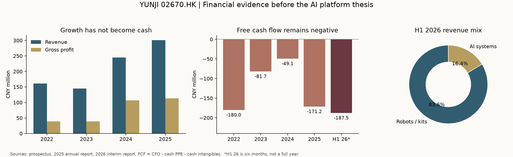

# 云迹科技（02670.HK）研究报告

> **研究日期／数据截止：2026-11-25，港股收市后。** 最新完整财务期为2026H1；经营更新截至9月30日、10月16日公布；股本月报截至10月31日。  
> **股价／权益市值：2.010港元／13.9385亿港元**，采用扣库存股693,459,820股；折人民币11.8645亿元。  
> **关键估值：TTM PS 3.12倍；用六月净现金计算的EV/S 1.62倍。** 后者没有反映七月以来的现金消耗。  
> 一句话观点：酒店与生态伙伴为机器人和调度服务付钱，HDOS的付费扩张值得跟踪；但硬件增收尚未转化为现金，股价进入旧复核带并不足以证明安全边际。

公司全称北京云迹科技股份有限公司（Beijing Yunji Technology Co., Ltd.），香港联交所主板02670，2025年10月上市。本报告沿用既有“云迹科技”目录及监控ID，研究基线为用户指定的[10月8日报告](云迹科技-earnings-refresh-20261008.md)，补充[8月17日研究](云迹科技-research-20260817.md)。与美国电商Yunji Inc.并非同一公司，不使用后者的ADR数据。

除股价、港元市值及特别说明外，金额均为人民币。汇率采用11月25日20:42腾讯即期1港元＝0.8512元，Wise同日页面0.849758，时点差约0.17%，不影响价带取整。本文用于学习研究，不构成投资建议。

## AI研究偏见自觉

**信息丰富度B级。** 招股书、审计年报、经审阅中报及运营公告足以确认财务压力；续费率、净收入留存、队列客单价、单机维护成本和客户实际节省的人力仍不充分。财报可研究性高于单位经济可研究性。

AI研究局限性声明：没有实地体验或客户访谈，无法从“部署酒店”“任务次数”直接推导复购和利润；公司自报运营数据及受委托行业研究缺少独立重测。第三方有缓存、股本复权和亏损归属口径问题，不能把页面上所有字段当作同一时点、同一定义。

- [x] 价格下跌与经营改善分别核验，不用历史高点证明便宜。
- [x] 不把HDOS总客户数当付费客户数，不把付费户增幅当收入增幅。
- [x] 不把定期存款到期当经营现金回流，不把六月净现金当十一月现金。
- [x] 明确模型假设、原始披露和独立第二来源的边界。

---

## 第一步：核心数据总览

### 四个完整年度与最新半年

| 指标（百万元；比率除外） | 2022 | 2023 | 2024 | 2025 | 2026H1 |
|---|---:|---:|---:|---:|---:|
| 收入 | 161.280 | 145.153 | 244.775 | 301.242 | **187.978** |
| 毛利率 | 24.35% | 26.98% | 43.48% | 37.63% | **34.98%** |
| 经营利润率 | -144.36% | -91.25% | -21.62% | -63.54% | **-60.48%** |
| 集团净损益 | -365.420 | -264.523 | -184.963 | -295.232 | **-113.812** |
| 经营现金流CFO | -170.392 | -76.370 | -41.482 | -169.818 | **-179.980** |
| 现金资本开支 | 9.591 | 5.376 | 7.606 | 1.396 | **7.526** |
| 传统FCF | -179.983 | -81.746 | -49.088 | -171.214 | **-187.506** |
| 现金等价物 | 111.656 | 174.133 | 105.481 | 233.414 | **255.412** |

FCF＝CFO－现金购买物业设备－现金购买无形资产，不含存款申赎、收购或证券投资。2025资本开支1.396由设备1.178与无形资产0.218组成。仅有四个完整年度，2026H1为第五个观察期，不与全年机械比较或简单年化。损益和现金等价物由[年报][annual]、[招股书][prospectus]与[ETNet年度表][etnet-final]核对；年度CFO由[ETNet现金流表][etnet-cf]复核，年度资本开支与[Stockopedia现金流表][stockopedia-cf]取整数核对均在1%内。H1完整CFO与资本开支来自[中报第44页][interim]，ETNet该期缺值；[StockAnalysis的TTM CFO -292.60][sa-cf]可经FY2025和2025H1桥接间接复核H1 CFO，不能称为取得了另一份独立展示的完整半年现金流表。



历史轨迹不是一条稳定改善的曲线。2024毛利修复后，2025及2026H1再次承压。H1研发费用71.051百万元已超过毛利65.760百万元，随后还要支付销售、行政和坏账成本。短期多卖机器人并不能自动带来盈亏平衡。[中报第18、39页][interim]

H1集团归母亏损111.001百万元，较上期142.617收窄，并不等于主业改善：上期存在65.714百万元赎回负债账面值变动，上市后已终止；经调整净亏损反而由31.395扩大至108.842百万元。后者是公司非IFRS定义，具体调整见[中报第20页][interim]，不与集团归母口径混排。

### 增长来自哪里

| 业务收入（百万元） | 2025全年 | 2025H1 | 2026H1 | H1同比 |
|---|---:|---:|---:|---|
| 机器人及功能套件 | 213.311 | 81.135 | 157.216 | +93.8% |
| AI数字化系统 | 87.931 | 28.408 | 30.762 | +8.3% |
| 合计 | 301.242 | 109.543 | 187.978 | +71.6% |

H1硬件套件占83.6%，AI系统占16.4%；租赁收入仅0.891百万元，其余硬件主要是销售。客户结构中，生态伙伴收入90.496百万元，酒店收入82.766百万元，而2025H1酒店为99.693百万元。酒店收入下降与生态大单增长同时发生：它可以是新商业模式扩张，也可能是收入质量变得更依赖伙伴交付，暂不能选择性只讲其中一面。[年报第16页][annual]、[中报第15—17页][interim]

公司没有披露足够独立单季财务，无法制作可信的近四季度分部收入和毛利率序列。H2可由全年减H1计算，Q1/Q2/Q3不能据网页AI摘要随意拆分；分产品毛利率亦未取得可靠完整序列。

### 十月新证据：软件扩张是真信号，收入兑现仍待验证

| 项目 | 2026年6月底／H1 | 2026年9月底／前九个月 | 如何解读 |
|---|---|---|---|
| HDOS客户总数 | 3,835家，含试用 | 超过5,000家，同比约+230% | 覆盖扩张；不是全部付费 |
| HDOS付费客户 | 3,173家，同比+621% | 仅披露同比约+220% | 没有最新绝对数，不能反推付费率 |
| 机器人日均活跃数量同比 | 约+30% | 约+20%至+25% | 累计增速放缓；不能直接换算Q3收入 |
| 任务量同比 | 约+46% | 约+25%至+30% | 利用率和收入仍需分别观察 |
| 公寓末端履约覆盖 | 约100处 | 约400处 | 公告明确该生态业务尚未变现 |

9月底累计酒店覆盖超过45,000家。1,000台野鸟合作订单正在交付，润翼100台项目部署中，另有2,000台战略合作拟2027年交付，仍受最终合作及交付条款约束。不得将战略协议全部当作已确认收入。最忙公寓约650单／日是单点峰值，不能乘全部公寓估算订单总量。[10月16日业务更新第1—3页][business]

多头最值得保留的论点是：酒店集团扩大HDOS采用，新客户分批开始服务可能导致收入确认滞后。反面证据是H1 AI系统收入仅增长8.3%。两者需要下一份正式收入与续订数据对账，现阶段既不能断言平台成功，也不能断言客户增长毫无价值。

### 现金与应收

| 2026年6月末项目（百万元） | 数值 | 口径 |
|---|---:|---|
| 现金及现金等价物 | 255.412 | 不含受限现金 |
| 银行定期存款 | 384.558 | 流动与非流动合计 |
| 银行借款 | 57.022 | 有息借款 |
| 租赁负债 | 11.924 | 流动与非流动合计 |
| 广义净现金 | **571.024** | 现金＋存款－借款－租赁 |
| 另列受限制现金 | 41.990 | 不加入可动用净现金 |
| 贸易应收账款净额 | 122.857 | 账面净值 |
| 应收账款损失准备余额 | 52.708 | 存量准备，非当期费用 |
| H1当期应收减值费用 | 27.624 | 已计入经营损益 |

现金等价物与借款租赁可由[ETNet资产负债表][etnet-bs]复核；定期存款、受限现金及损失准备采用[中报第40—41、52、54页][interim]，独立同口径第二来源不足。应收毛额175.565百万元，对应准备占比约30.02%，不能忽略信用损失。准备已经扣入净应收，不再从估值机械扣一次。

按H1月均FCF消耗约31.251百万元，六月净现金相当于约18.27个月消耗。这是**静态压力比率，不是公司可生存时间预测**；收入回款、受限资金、最低运营现金、借款及新投入都会改变结果。

> 段永平式追问：客户为什么持续付钱？目前能确认客户在使用并扩大接入，还不能确认每增加一位客户便增加多少可分配现金。

---

## 第二步：生意本质分析

**这门生意是把酒店和楼宇里重复、跨楼层的服务流程交给机器人，再尝试让客户持续为软件协调能力付费。**

| 环节 | 钱由谁付、为何付 | 决定长期利润的变量 |
|---|---|---|
| 机器人及底座交付 | 酒店、生态伙伴购买设备和模块，减少重复劳动或缩短开发周期 | 售价、返修、部署工时、渠道折让、回款 |
| HDOS及AI系统 | 客户为需求理解、派单、异常追踪和多设备协同付费 | 续费率、付费客单价、服务毛利、实施维护成本 |
| 外卖上楼等生态 | 未来可能按履约服务分成 | 收费权、单位补贴、平台议价、单均成本；目前未变现 |

替代选择包括人工、原有物业流程、竞品机器人以及酒店自身系统。机器人不需要替代整个人，能减少夜间来回配送也可能有经济价值；但客户省钱并不必然意味着云迹有定价权。若竞品也能完成任务，节省的人力可能主要归客户，云迹承担降价与售后成本。

技术栈包括移动导航与乘梯、UP模块化底座、智能操作，以及通过HDOS实现的任务理解和调度。中报将世界价值模型作为技术方向，但未披露独立评测领先幅度、同任务推理成本或研发投入回报。不能由技术命名推导领先年限。[中报第11—14页][interim]

当前首要经营变量是**增量毛利能否覆盖研发、销售与信用损失**。H1研发71.051、销售48.394、行政39.339、应收减值27.624百万元；研发同比+141.0%，投入可能创造未来产品，也可能拉长现金消耗周期。下一阶段应优先看软件收入、毛利和回款同时改善，而不是只追机器人台数。

> 段永平式追问：这门生意好在哪？若系统真正嵌入服务流程，复购有机会；若客户只在采购设备时付一次钱，价值更接近需要持续研发和售后的设备商。

---

## 第三步：护城河评估

| 来源 | 现有证据 | 反证／可证伪条件 | 判断 |
|---|---|---|---|
| 品牌与定价权 | 酒店积累和累计部署 | H1公司主动推广较低ASP及利润率组合 | 弱；尚无提价验证 |
| 转换成本 | 地图、梯控、培训、工作流与系统接口 | 更换成本、净留存和续订率未披露 | 有潜力，未闭合 |
| 网络效应 | 现场数据可能改善调度与异常处理 | 一个酒店增加设备，未必直接提高另一酒店价值 | 学习效应多于已证网络效应 |
| 规模优势 | 渠道、标准模块与采购复用 | 毛利率仍下滑，坏账和交付可能抵消规模收益 | 尚未体现为现金优势 |
| 技术壁垒 | 软件、导航、模块和场景经验 | 同业也提供自主跨楼层配送 | 不应按排他平台定价 |

[擎朗W3官方产品页][keenon]已提供自主乘梯配送能力；[普渡10月23日官方公告][pudu]称其梯控取得CSA B44.1／ASME A17.5认证。这说明跨楼层能力可以被其他供应商提供，不能单独构成云迹的独占护城河。认证和部署效果均未做第三方现场复测，也不能反向认定竞争者服务质量完全相同。

招股书受委托行业研究列示，2024中国hospitality机器人智能体收入份额云迹6.3%、前五25.4%；其中酒店场景云迹13.9%。这些是旧年度、特定口径的公司引用数据，不是2026实时份额，且不能由排名第一推导寡头定价权。[招股书第140、149页][prospectus]

过去数年部署与接口积累增加，但财务上的定价权并未同步增强。未来护城河能否变宽，取决于HDOS是否独立产生高留存、高毛利收入，并在不依靠硬件补贴的情况下形成客户锁定。

> 巴菲特式追问：十年后还有什么难复制？可保护的应是长期客户流程、可靠服务与经济回报，而不是“会乘电梯”这一项功能。

---

## 第四步：逆向思考与风险清单

| 失败路径 | 主观可能性 | 影响 | 可观察预警 |
|---|---|---|---|
| 软件客户增多、收入与毛利没有兑现 | 中高 | 高 | AI收入持续慢于客户扩张，续费和客单价仍不披露 |
| 生态硬件大单低毛利、回款慢 | 中高 | 高 | 伙伴收入增加但应收账龄、减值和CFO恶化 |
| 研发跨太多场景，费用无法收回 | 中高 | 高 | 演示和POC增加，标准化交付利润未跟上 |
| 现金消耗导致融资与摊薄 | 中 | 极高 | 现金下降、借款增加、折价发行或高成本融资 |
| 平台方或同行压缩分成／设备售价 | 中高 | 高 | 外卖履约收费迟迟不能落地，渠道折扣扩大 |
| 安全、数据、合规及海外服务事故 | 低至中，无法精确量化 | 高 | 事故、召回、处罚、认证或售后失控 |
| 小盘股流动性恶化 | 中高 | 高 | 买卖价差、成交深度不足；融资或大股东退出放大冲击 |

以上为研究者判断，并非统计违约概率。历史机制可参照[巴菲特2007年股东信][buffett]讨论的纺织与航空业：技术或服务需求进步，未必由股东取得回报，资本投入和竞争可能把收益让渡给客户。这只是资本回报机制类比，不代表云迹必然重演相同结局。

**最强空方论点：** 云迹在用研发与信用支持扩张设备和客户，部署的增长先带来费用和营运资金需求，软件收费还不足以抵消；市场即便不再给予极高PS，也可能高估剩余现金最终留给股东的比例。

**最强多方反驳：** 安装网络和HDOS正形成真实使用基础，集团客户扩张具备复制性；若付费确认滞后，H1财报可能低估下一阶段的软件变现。低估它的风险，是把所有研发支出都视为浪费，把所有收入滞后都视为商业失败。

本报告最可能犯错之处，是不知道真实续费、价格与维保成本，因而既可能低估软件化拐点，也可能高估毛利和现金修复速度。两种错误都不能靠更精细的DCF小数解决。

> 芒格式追问：怎样会永久亏钱？不是股价短期下跌本身，而是客户不持续付费、现金被消耗后仍需不断向股东融资。

---

## 第五步：管理层评估

| 时间／事项 | 可核事实 | 资本配置与治理判断 |
|---|---|---|
| 长期聚焦酒店，再扩展生态 | 创始团队建立现有交付网络 | 场景经验有价值，跨场景复制仍须回报验证 |
| 2025上市 | 年末IPO资金和存款增加 | 现金增加主要来自融资，不是经营已自养 |
| 2026H1研发扩张 | 研发71.051百万元、CFO -179.980百万元 | 不能简单否定投入，但资本回报尚未通过检验 |
| 2026H1回购 | 支付59.757百万元购库存股 | 与亏损、新增借款并存，需解释机会成本 |
| 10月16日直接持股延长禁售 | 支涛、李全印各自直接股份锁至2027年10月15日 | 利益对齐正面；不等于全体老股东或员工平台都不能出售 |
| 10月16日终止投资者投票协议 | 撤销31,348,160股投票委托 | 控制安排改变，不能把表决权视作经济持股 |

支涛为董事长兼总裁，李全印为CEO，胡泉为总经理。10月16日公告中，支涛直接持股60,161,930股、李全印13,787,960股，占含库存总股本8.62%和1.98%。支涛与云迹天使合计受控投票权为扣库存后的28.04%，已不再属于上市规则定义的控股股东，但仍为最大股东组；27.87%是含库存分母上的视同权益口径，不能混用。这也不是AB股的超额投票权结构。[禁售公告][lockup]、[投票协议终止公告第2—3页][governance]

上述持股和投票权来自一手法定披露，未取得独立同定义股权数据库复核，不能把28.04%写成创始人经济持股。员工平台后续按激励计划处置股份，也不应直接等同于支涛出售其直接持有股份。

腾讯相关主体11月5日减持后最后披露降至4.92%，对应34,343,260股，申报日期为11月10日。跌破申报门槛后，该数字不能作为11月25日精确现持股，也不等于已经清仓。仅凭减持不能判断公司经营恶化，更不足以解释每日股价全部变化。[港交所权益披露][tencent-di]

管理层可信度结论为“方向可理解，资金纪律与每股价值待证明”。没有掌握完整客户流失、组织稳定性和核心团队留任数据；不能给出高确定性的接班能力评分。

> 段永平式追问：CEO换人后还能运转吗？需要验证销售、交付、维护和软件续费是否由组织流程驱动，现有公开材料不足以下定论。

---

## 第六步：行业与文明趋势

劳动力配置、智能感知和服务自动化是长期趋势，酒店末端服务也确实存在重复劳动。云迹位于机器人硬件、现场部署与工作流软件的结合处。价值可能被酒店客户、渠道、外卖平台、基础模型或机器人厂商分走，行业变大不保证云迹的资本回报提高。

**修正旧口径：** 招股书第127页的2024年93亿元、2029年292亿元对应全球hospitality AI agent口径，8月旧报告将其写为中国市场不准确。本次采用招股书明示的中国hospitality机器人智能体2024年37亿元、2029年135亿元、预测复合增速29.3%，不将其全部解释为酒店单一场景。以上仍是IPO时受委托行业预测，不是独立确认的未来收入。[招股书第2、127—128页][prospectus]

| 产业问题 | 公司能否捕获价值的检验 |
|---|---|
| 酒店是否需要机器人 | 实际节省的工时、服务成功率、总拥有成本 |
| 是否需要独立调度层 | 跨品牌设备接入、客户续费意愿、系统迁移成本 |
| 生态是否扩大可触达需求 | 伙伴订单重复性、毛利、交付验收与现金回款 |
| 海外是否复制成功 | 本地认证、售后成本和回款；不只看经销商签约 |

2025最大客户占收入5.1%、前五15.7%；最大供应商及分包商占采购27.6%、前五48.8%。客户表面分散，但采购集中及核心模块替代性仍需关注。2026H1海外收入仅5.351百万元，高增速来自较低基数，不足以证明国际化利润飞轮。[年报第55页][annual]、[中报第17页][interim]

竞争估值对照的限制：普渡、擎朗缺少可核的上市股权报价；优必选等公司业务及资本结构差异很大。未取得同日、同口径可比企业价值与经常性软件收入，故不发布伪精确的同业PS排名，也不以同行股价决定云迹终值倍数。

> 李录式追问：二十年后谁拥有利润池？需要找到不可替代的客户关系和收费权；“自动化必然发展”还没有回答这一点。

---

## 第七步：估值与安全边际

### 当前定价与旧报告变化

| 指标 | 11月25日结果 | 解释 |
|---|---:|---|
| 股价（港元） | **2.010** | 腾讯16:08:07与ETNet16:15收市报价一致 |
| 权益市值（亿港元） | **13.9385** | 现价乘扣库存股数，非页面滞后市值 |
| TTM收入（百万元） | 379.677 | FY2025－2025H1＋2026H1 |
| TTM集团归母损益（百万元） | -263.285 | 全体权益股东归属口径 |
| TTM传统FCF（百万元） | -300.523 | 含H2 2025及H1 2026，与StockAnalysis -300.52取整一致 |
| TTM PS | 3.12倍 | 人民币市值／人民币收入 |
| EV/S，扣六月净现金 | 1.62倍 | 六月现金配十一月价格，偏乐观的静态快照 |
| PB，六月归母净资产 | 1.71倍 | 两边均人民币；净资产不是清算保底 |

股本由[十月月报][monthly]与腾讯、ETNet复核。[当日ETNet报价][quote]与[腾讯行情][tencent-quote]支持2.010港元。各财务页面顶栏可能停留旧报价，财务数据表与市场快照分别取数。

当前较10月8日拆股后5.85港元下降65.64%。原报告的2.00—3.50港元带已经触及，但当时只是旧20—35港元机械除十后的研究触发带。本次根据现金消耗及新模型重新定义动作，不把旧带继续当安全边际。拆股不增加资本，也不创造价值。

亏损阶段PE、PEG及P/FCF不宜作便宜程度依据。强制运行EPS三情景工具后仍得到负目标价，证明负EPS外推不适用，不能把负数当价格目标。本次以现金流三情景替代该定价方法，并另外执行十年终值压力测试。

### 三年三情景：判断贵不贵

**下表全部是研究假设，不是公司指引。** 模型先用六月净现金571.024减去148天按H1日均FCF外推的153.320，得到11月25日净现金代理417.704百万元。该桥没有已知下半年实际现金支持，不含新的回购、融资或重大投入；不能称为最新现金事实。随后计入从研究日起未来三个模型年度的自由现金流，最后加持续经营价值；年度末时点近似，不强装为自然年度精确预测。

现金流均扣维护和成长再投资，包含营运资金变化，排除融资及证券交易；已在期初净现金扣租赁，未来现金流按债务等价租赁处理、避免重复扣本金。稳态利润使用下一年度、即约2030年的税后经营利润代理，不含额外现金利息。稳态业务倍数统一来自 `(1−g/ROIC)/(r−g)`，没有采用同行价格。该倍数作为利润资本化因子，不代表当前公司已有这些利润。权益现值＝净现金代理＋前三年现金流现值＋第三年末持续经营价值现值，再除股数及人民币／港元汇率；残值不低于零。没有把同一份净现金在终值再次加回。

| 模型输入／输出 | 悲观 | 基准 | 乐观 |
|---|---:|---:|---:|
| 第一年现金流（百万元） | -120 | -100 | 0 |
| 第二年现金流（百万元） | -90 | -30 | 70 |
| 第三年现金流（百万元） | -60 | 30 | 150 |
| 稳态起始税后经营利润（百万元） | 0 | 68 | 180 |
| 永续增速g | 0% | 2% | 3% |
| 利润资本化因子 | 12.50倍 | 14.44倍 | 16.00倍 |
| 今日权益现值（百万元） | 181.803 | 1,102.926 | 2,883.030 |
| **今日每股现值（港元）** | **0.31** | **1.87** | **4.88** |
| 相对当前价格 | -84.68% | -7.04% | +143.00% |

折现率r为人民币8%，稳态增量ROIC为15%。基准68百万元相当于假设未来收入850百万元、税后经营利润率8%；不是从历史亏损机械长出来的预测。乐观180百万元要求例如收入1,500百万元、税后经营利润率12%，还须足够现金转化；悲观不授予持续经营价值，只保留模型期内消耗后的现金残余。这些利润率均明显优于当前，基准本身已经包含经营改善。

反向检验：沿用基准前三年现金路径及净现金代理，现价需要稳态起始税后经营利润约75.28百万元；若收入850百万元，利润率需约8.86%。市场并非只为现金付钱，而是在为可实现的盈利改善付钱。每少100百万元可动用净现金，估值约少0.169港元；运营最低现金、受限资金或新的回购都可能吃掉这部分余量。

三年基准今天值1.87与现价接近，不支持“极高PS仍然昂贵”的旧说法，也尚未提供足够安全边际。以基准现值打约20%—30%折扣，**1.30—1.50港元为新的有条件研究带**；该价带不能替代经营条件。悲观现值也不是清算保底，未覆盖的新负债、事故或回款损失可以令权益进一步归零。模型现金与正常利润的置信度低，精确计算不使假设变成事实。

### 十年折现：只约束仓位

参数理由：现金流与终值利润均以人民币计价，r取8%，拆为仓库长期研究参考Rf 1.7%＋β 1×ERP 6.3%；Rf是方法参数，不宣称为11月25日实时国债收益率。基准g取2%，乐观3%仅作上行情景，悲观0%。ROIC 15%是假设成熟后的增量回报，当前亏损无法提供可信存量ROIC或派息反解，因此其来源是条件判断，不能称为历史验证。

`PE终值=(1−g/ROIC)/(r−g)`。基准r下三档分母分别8、6、5个百分点，均满足最小5个百分点要求。软件失败归情景，融资归情景及稀释，流动性和退市损失单列尾部，重大安全合规事故保留未建模警告；没有通过提高β或r掩盖这些风险。

| 2036条件情景 | 悲观 | 基准 | 乐观 |
|---|---:|---:|---:|
| 归属利润假设（百万元） | 15 | 128 | 420 |
| 对应收入例示（百万元） | 600 | 1,600 | 3,500 |
| 利润率假设 | 2.5% | 8% | 12% |
| 主观条件概率 | 35% | 50% | 15% |
| r＝8%终值PE | 12.50倍 | 14.44倍 | 16.00倍 |
| 十年年化代理 | -17.85% | +3.54% | +17.94% |

按工具口径，中期无股息，年化稀释代理1%，直接从资本利得年化中扣减，属于仓位近似测试，非逐笔现金流精确IRR。没有将六月净现金另外加到2036市值，假定其被用于转型及运营；若届时存在剩余超额现金，模型将低估价值。未来盈利假设与三年现金模型是不同尺度的边界测试，不是一条已验证的统一经营预测。

三档年化的主观概率加权为-1.79%，低于8%资本成本；先加权终值再年化则约+4.35%，两种统计量不同，不能互换。即使后者也未覆盖资本成本。再额外假设10%概率永久全损，年化代理算术均值约-11.61%；该尾部概率纯为压力输入，缺乏频率估计，不能当成预测。

| r敏感性 | 工具期望年化代理 | 是否覆盖该r | 模型有效性 |
|---|---:|---|---|
| 6%（r－2pp） | +2.16% | 未通过 | 币种区间内，但基准／乐观分母4／3个百分点，仅作情景参考 |
| **8%（基准）** | **-1.79%** | **未通过** | 分母8／6／5个百分点，有效 |
| 10%（r＋2pp） | -4.50% | 未通过 | **币种区间外，仅供参考** |
| 7%（补充r－1pp） | -0.03% | 未通过 | 乐观分母4个百分点，仅作情景参考 |
| 9%（补充r＋1pp） | -3.25% | 未通过 | 分母9／7／6个百分点，有效 |

已运行flip的±2pp及±1pp。**在人民币合理区间且分母合格的8%与9%采样中，压力测试均未通过，没有翻转**；不声称穷尽所有参数组合。6%和7%虽然位于币种区间，但不满足所有情景分母约束，不能用其数值扩大有效结论。十年结果只限制研究仓位，不能单独否决买入或持有。

### 估值与论文对账

原报告的高价格风险已明显缓解；HDOS扩张对原先“软件飞轮未验证”的判断构成正面待验证信号。三年基准现值接近现价、乐观上行显著，十年压力均值却偏低，差异主要来自失败概率、稀释和远期利润分布。前者是当前定价判断，后者是承担多大组合风险的测试。

最终维持观望新增，依据是软件变现、护城河及现金自养尚未证实，加上三年基准缺少安全边际。**即使删除十年模型，这个判断仍成立。** 若下一财报验证经营条件、价格落入研究带，可以重新研究小额首笔，十年压力仅把总仓参考上限收紧至0.5%，而非一票否决。

> 巴菲特式追问：r错两个百分点会翻转吗？在本次有效采样内不会；但模型对正常利润、现金余额和失败概率远比对小数精度敏感。

> 段永平式追问：停市五年愿意持有吗？稳健资金目前缺少足够单位经济证据，不宜把它作为核心资产。

---

## 第八步：最终决策与行动清单

| 维度 | 综合判断 | 信心度 |
|---|---|---|
| 生意质量 | 客户需求真实，复购和现金创造未充分验证 | 中低 |
| 护城河 | 场景与工作流有积累，定价权及网络效应未闭合 | 中低 |
| 管理层 | 延长直接持股禁售正面，研发与回购资金纪律待验证 | 中 |
| 最大风险 | 营运资金和研发消耗先发生，融资稀释可能侵蚀每股收益 | 中高 |
| 文明趋势 | 自动化顺风，利润归属仍需竞争检验 | 中 |
| 估值 | 三年基准1.87港元，现价缺安全边际；十年只限仓，有效r采样不翻转 | 计算高、假设低 |

估值维度不是最终决策的唯一裁决。没有依据从价格崩跌直接升级为买入，也没有依据仅凭十年未覆盖资本成本要求所有持仓清零。

| 投资者／触发 | 明确动作 |
|---|---|
| **空仓者** | **观望，不在2.010港元新增。** 旧2.00—3.50带只完成了研究触发，买入条件未验证。 |
| 持仓者 | 不补跌；仅把可承受全损的极小研究仓作为观察。若已超出主观0.5%总仓参考，优先复核减仓；不推定用户实际持仓。 |
| **1.30—1.50港元** | 仅当下列经营条件通过、用最新现金重估后，才研究首笔0.1%—0.25%；研究总仓参考≤0.5%。比例是风险预算判断，不是用户账户指令。 |
| 低于1.30港元 | 先查回款、融资、现金和产品失效；不因更便宜自动加仓。 |
| **≥3.00港元** | 若新财报未提高正常利润与现金估值，复核超配／减仓；这是价格警戒，不代表自动卖出。 |
| 卖出／降风险信号 | 正式披露显示现金与回款继续恶化、融资显著损害每股价值，或软件留存／收费证伪；持仓理由若只剩回本，应重新裁决。 |
| 加仓信号 | 不能只有价格：至少连续两次正式披露显示软件收入与占比改善、毛利修复、现金消耗收敛和应收质量改善，且估值重算后仍有安全边际。 |

具体经营复核门槛属于研究纪律，不是公司指引：AI数字化系统同比增速应明显高于H1的8.3%、收入占比高于H1的16.4%；集团毛利率至少恢复到约35%并继续改善；可比完整期间CFO消耗收敛，不能依赖存款到期或融资；应收账龄、准备率和期后回款不能进一步恶化。缺少正式数据时视为尚未验证，不能以新闻替代。

下次人工检查为**2026年12月31日**，复核正式公告、融资、股本及现金相关证据；**2027年3月31日**仅作为全年业绩披露的研究兜底检查日，非公司确认预约日。正式全年业绩提前披露即提前检查。所有事件只登记供人工复核，当前每日监控仅扫描价格。

### 四位大师原文与方法延伸

以下原话均非对云迹的投资评价，方法延伸由本报告负责，不能写成大师本人推荐或反对该股。

- **巴菲特原话：** “A truly great business must have an enduring ‘moat’ that protects excellent returns on invested capital.” [2007股东信，PDF第5页][buffett]。方法延伸：应检查长期资本回报，设备与客户规模本身不足以证明护城河。
- **芒格原话：** “inversion frequently will solve problems which nothing else will solve.” [2007 USC演讲实录转载][munger]；[USC官方预告][usc]确认演讲活动。方法延伸：先问现金如何耗尽、客户为何不续费，再问平台能有多大。
- **段永平：资料不足，不模拟代言。** 已检索到[本人雪球原帖][duan]，但直读受限，未以搜索摘要充当完整原文。旧报告中的模拟句也不作为其原话引用。
- **李录原话：** “What can this technology do for my customers, both my consumers and enterprise customers?” [2026年10月5日哥大官方实录，PDF第18页][lilu]。方法延伸：机器人对客户创造多少可量化价值，应先于宏大技术标签。

---

## AI分析置信度与投资确定性

**AI分析置信度中等，实际投资确定性低。** 前者来自报表、股本、现金流和公告的可核性，后者受软件单位经济、客户留存、竞争与资本回报尚未证实所限。关键报表数字有充分依据；下一阶段利润、现金代理、尾部概率及研究价带主要是有限信息下的条件推理。

需要一手验证的问题：HDOS按客户队列的续费、折扣和实施维护成本；酒店实际节省的工时与回本期；生态伙伴付款与验收条款；软件与硬件毛利拆分；下半年净现金及融资承诺；外卖上楼实际付费方、单均收入和成本。即使公司整体为B级，这些单位经济问题仍接近C级证据状态。

限制：H1 CFO只有TTM桥接的间接第二来源；广义净现金组合、股权与部分费用及运营指标缺少完整独立第二来源；没有完整Q&A、同业可比估值及最新净现金；公告检索未发现11月4日以后新的交易所经营披露，但未完整遍历所有动态公告条目；重大安全合规事故未定量建模。未采用AI行情新闻中无法核实的港股通剔除说法及虚构单季数字。StockAnalysis标准化净利润及经营利润字段与本报告报表口径不同，未拿这些字段替代原文；仅使用已逐项闭合的收入、现金流总额及资产负债表分项。

## 数据来源与审计记录

### 原报告修正与新事实分开

| 类型 | 本次处理 |
|---|---|
| 资料补全 | 2022／2023 CFO并非未披露，已从招股书补齐并与ETNet核对。 |
| 小额修正 | H1应收准备余额采用原文52.708，旧稿52.712不沿用；当期减值另列27.624。 |
| 定义修正 | FY2025集团亏损295.232、集团归母亏损294.901、普通股股东EPS分子亏损138.823，三个口径分别识别。年报附注7列示赎回权股份分配156.078，不能用历史EPS乘当前股本反推集团亏损。 |
| 市场口径 | 统一拆股后价格、扣库存股本和人民币财务；PB不再跨币种相除。 |
| 行业口径 | 旧稿93亿／292亿为全球hospitality AI agent数据，本次不作为中国TAM。 |
| 新证据 | 纳入10月运营更新、表决权变化、延长直接持股禁售及腾讯最后一次已核权益披露。 |

### 关键数据交叉验证记录

下列为financial_rigor工具输出摘录，全文工具输出、模型输入和抽检证据另存[验证记录](云迹科技-research-20261125-validation.json)。

```text
市值验算：2.010 HKD × 693,459,820股
计算市值：1,393,854,238.200 HKD
腾讯显示市值：1,393,850,000 HKD；偏差0.00%（显示精度）
验证通过。

FY2025收入：年报301.242 / ETNet301.242，人民币百万元，偏差0.00%。
FY2025集团净亏损：年报-295.232 / ETNet-295.232，偏差0.00%。
2026H1收入：中报187.978 / ETNet187.978，偏差0.00%。
2026H1集团净亏损：中报-113.812 / ETNet-113.812，偏差0.00%。
2026H1现金等价物：中报255.412 / ETNet255.412，偏差0.00%。
2026H1借款及租赁：中报68.946 / ETNet68.946，偏差0.00%。
PS 3.12倍；PB 1.71倍；亏损PE -4.51倍，仅作亏损提示。
```

两来源均转述同一财报，不代表两次独立审计。单源项目及H1 CFO间接复核的局限明确保留，不用同一份财报镜像冒充独立第二来源。StockAnalysis的年度FCF只扣PPE，与本报告还扣无形资产的定义不同；例如2022缺少扣除无形资产2.830，故采用原文分项重建，不直接混用。估值口径audit的C1／C2／C3通过，保留重大安全合规事故未建模警告；敏感性分母失效档位已单独标注。

固定随机种子42抽取22项，实际核验17个事实项，另排除3项已声明模型假设及2项时间／网址误识别，并保留排除原因。另加查年度和H1收入、集团亏损及H1 CFO共5项核心事实。全部22个事实数值在1%容差内；其中6项仍只有发行人来源，不将数字通过包装成独立双源通过。最终口径复检及工具输出见验证记录。抽检不证明全部假设正确，也不消除单源限制。新报告接续旧建议，监控价带与台账按本次动作同步。

[annual]: https://www1.hkexnews.hk/listedco/listconews/sehk/2026/0429/2026042906272.pdf
[prospectus]: https://www1.hkexnews.hk/listedco/listconews/sehk/2025/1008/2025100800003.pdf
[interim]: https://ir.yunjichina.com.cn/media/fslldwfj/2026092400034_c.pdf
[monthly]: https://www.hkexnews.hk/listedco/listconews/sehk/2026/1104/2026110400861_c.pdf
[business]: https://www.hkexnews.hk/listedco/listconews/sehk/2026/1016/2026101600046_c.pdf
[lockup]: https://www.hkexnews.hk/listedco/listconews/sehk/2026/1016/2026101600044_c.pdf
[governance]: https://www.hkexnews.hk/listedco/listconews/sehk/2026/1016/2026101600040_c.pdf
[tencent-di]: https://di.hkex.com.hk/di/NSForm2.aspx?ed=11%2F11%2F2026&fn=CS20261110E00395&lang=EN&sa1=cl&sa2=ns&sc=02670&sced=11%2F11%2F2026&scsd=11%2F11%2F2025&sd=11%2F11%2F2025&sid=519177&src=Main&tk=ds
[quote]: https://content.etnet.com.hk/content/cpyrevamp/sc/stock_quote.php?code=02670
[tencent-quote]: https://qt.gtimg.cn/q=r_hk02670
[etnet-final]: https://www.etnet.com.hk/www/tc/stocks/realtime/quote_ci_pl.php?code=2670&quarter=final
[etnet-bs]: https://www.etnet.com.hk/www/tc/stocks/realtime/quote_ci_bs.php?code=2670
[etnet-cf]: https://www.etnet.com.hk/www/tc/stocks/realtime/quote_ci_cashflow.php?code=2670
[stockopedia-cf]: https://www.stockopedia.com/share-prices/beijing-yunji-technology-HKG:2670/cashflow/
[sa-cf]: https://stockanalysis.com/quote/hkg/2670/financials/cash-flow-statement/
[keenon]: https://www.keenon.com/en/product/W3
[pudu]: https://www.pudurobotics.com/en/news/pudu-elevator-control-csa-certification
[buffett]: https://www.berkshirehathaway.com/letters/2007ltr.pdf
[munger]: https://jamesclear.com/great-speeches/2007-usc-law-school-commencement-address-by-charlie-munger
[usc]: https://gould.usc.edu/news/munger-to-keynote-commencement/
[duan]: https://xueqiu.com/1247347556/270653905
[lilu]: https://business.columbia.edu/sites/default/files-efs/imce-uploads/36th%20Annual%20Graham%20%26%20Dodd%20Luncheon%20Transcript%20%2820261005%29%20CBS.pdf
