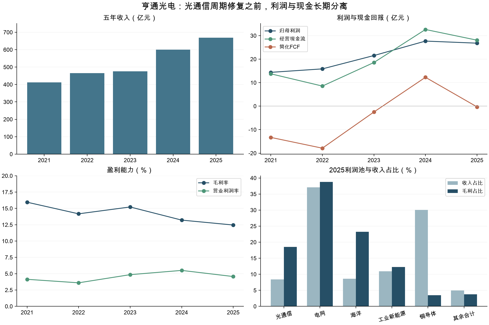

# 亨通光电（600487.SH）研究报告

**研究日期 / 数据截止日：2026-11-24（Asia/Shanghai）**。研究对象为江苏亨通光电股份有限公司，英文名 Hengtong Optic-Electric Co., Ltd.，上海证券交易所A股；不把亨通集团未上市资产或其他同名企业并入估值。最新正式定期报告为10月29日披露的2026年三季报，未经审计。金额未特别注明均为人民币亿元。

**价格与估值：36.50元；总市值900.23亿元；TTM归母PE 13.92倍、PB 2.43倍。** 价格为11月24日收盘后快照，腾讯时间16:15:00、东方财富时间16:11:39，双源同价。总股本采用[11月10日股本变动公告](https://static.cninfo.com.cn/finalpage/2026-11-10/1225664371.PDF)及行情共同确认的2,466,392,257股，包含库存股，不用尚未发行的定增股份计算当前市值。

本次研究的核心变化是：光通信涨价已显著改善利润，Q3单季也开始创造现金；当前价格的主要疑问，转为这轮利润能持续多久、外部融资之后每股能留下多少钱。完整行动建议放在第八步。

本报告接续[2026H1财报复核](亨通光电-earnings-2026H1-20261008.md)与[8月研究](亨通光电-research-20260826.md)，保留历史文件。三处需要更新：最新财务期已是Q3；中报其实披露了光通信收入增速和毛利率；旧45—55元价位带须由新估值及融资条件接续，不能因为跌破旧带就直接执行。

---

## AI研究偏见自觉

**信息丰富度评级：A。** 公司长期上市，正式财报及公告充足；AI最容易把“光纤涨价、AI互联、海洋经济”合成为一个不分业务、不分现金的高增长故事，也可能固守旧报告的负现金流判断，漏看Q3改善。

**AI研究局限性声明：** 分产品利润、订单质量和回款条款主要来自公司披露，无法独立接触客户；Q3没有完整产品分部报表，不能精确归因价格、数量和成本各贡献多少。多渠道取数可检查转录和口径，不能独立证明全部合同及会计估计。未来利润、概率、折现率和价格区间均为研究假设。

- [x] 将已披露的利润、现金和行业事实，与模型假设分开。
- [x] 同时检验“周期高点低PE”和“旧风险已被现金改善修复”。
- [x] 不把技术性能、订单或激励目标视为已实现销售及利润承诺。
- [x] 不以资料丰富推导生意确定；删去AI标签，现金回报仍须成立。

---

## 第一步：核心数据总览

### 五年盈利与现金

简化自由现金流（FCF）＝合并经营现金流（CFO）－购建固定资产、无形资产和其他长期资产支付的现金。它包含扩张投入，不等同维护性FCF、股东可分配现金或严格FCFE；没有将收购、租赁本金与少数股东分配混进同一口径。

| 期间 | 营业收入 | 归母净利润 | 毛利率 | 营业利润率 | CFO | 现金CapEx | 简化FCF | 期末现金等价物 |
|---|---:|---:|---:|---:|---:|---:|---:|---:|
| 2021 | 412.71 | 14.39 | 15.95% | 4.14% | 13.76 | 27.06 | -13.30 | 67.46 |
| 2022 | 464.64 | 15.86 | 14.17% | 3.60% | 8.55 | 26.43 | -17.88 | 66.89 |
| 2023 | 476.22 | 21.54 | 15.22% | 4.85% | 18.57 | 21.06 | -2.48 | 88.12 |
| 2024 | 599.84 | 27.69 | 13.21% | 5.50% | 32.62 | 20.34 | +12.28 | 93.26 |
| 2025 | 668.55 | 26.80 | 12.46% | 4.57% | 28.08 | 28.38 | -0.3035 | 87.58 |
| 2026前三季 | 643.67 | 61.63 | 19.53% | 10.81% | 8.41 | 26.31 | -17.89 | 91.08 |
| TTM至2026Q3 | 816.01 | 64.68 | — | — | 31.56 | 34.89 | -3.34 | — |

来源为各年正式年报、2026Q3及东方财富三表，逐项核对；原始元数、URL及计算记录见[事实底稿](证据/20261124/事实底稿.json)和[精算结果](证据/20261124/精算结果.json)。TTM按“2025全年＋2026前三季－2025前三季”计算，不采用前三季简单年化。

2021归母采用2023年报重述值14.3883亿元，东方财富仍保留原始14.3630亿元，差异不足1%，来自会计政策追溯调整；2022同样用重述值。2023成本采用2024年报比较数，质量保证费由销售费用转入成本，影响毛利率，不影响营业利润。8月旧报告将2023现金CapEx近似写作16亿元，本次正式表重核为21.06亿元，FCF相应为负2.48亿元；旧值不再用于估值。



图表仅比较完整年度；2026前三季另看下表，避免将不完整年度与全年直接混比。

### 最近四个单季：利润和回款开始靠拢

| 单季 | 收入 | 归母净利润 | CFO | 现金CapEx | 简化FCF |
|---|---:|---:|---:|---:|---:|
| 2025Q4 | 172.34 | 3.04 | 23.14 | 8.59 | +14.56 |
| 2026Q1 | 177.91 | 11.05 | -1.94 | 7.13 | -9.07 |
| 2026Q2 | 242.35 | 20.14 | -6.71 | 12.55 | -19.26 |
| 2026Q3 | 223.41 | 30.44 | 17.06 | 6.62 | +10.44 |

单季由同口径累计数相减；2025Q4需用2025年报与前三季累计数，2026Q2用中报减一季报。Q3公司直接披露的单季收入、归母与相减值一致。[2025年报](https://static.cninfo.com.cn/finalpage/2026-04-25/1225195764.PDF)、[2026中报](https://static.cninfo.com.cn/finalpage/2026-08-27/1225513678.PDF)、[2026Q3](https://static.cninfo.com.cn/finalpage/2026-10-29/1225635137.PDF)。

Q3归母同比+299.10%，单季综合毛利率按收入成本推算24.72%；现金净流入恢复，是对旧悲观判断的有效反证。与此同时，前三季CFO/归母只有13.65%，Q3单季这一比率为56.06%，滚动FCF仍负。该比率用合并现金流除归母利润，存在少数股东口径差异，主要用于观察趋势。2025Q4回款也明显集中，全年现金结果仍需正式年报确认。

### 收入规模与利润池分开看

| 2025业务 | 收入 | 毛利 | 毛利率 | 占总收入 | 占总毛利 |
|---|---:|---:|---:|---:|---:|
| 光通信 | 56.09 | 15.44 | 27.53% | 8.39% | 18.54% |
| 智能电网 | 247.96 | 32.27 | 13.02% | 37.09% | 38.75% |
| 海洋能源与通信 | 57.37 | 19.32 | 33.68% | 8.58% | 23.20% |
| 工业与新能源智能 | 73.08 | 10.24 | 14.01% | 10.93% | 12.29% |
| 铜导体 | 200.84 | 2.91 | 1.45% | 30.04% | 3.49% |
| 其他主营 | 25.70 | 2.92 | 11.37% | 3.84% | 3.51% |
| 其他业务/差额 | 7.52 | 0.1828 | 2.43% | 1.12% | 0.22% |

来源：[2025年报第53页](https://static.cninfo.com.cn/finalpage/2026-04-25/1225195764.PDF)。毛利及占比由正式收入、成本精算；主营产品合计与合并营业收入之间的差额单列，避免漏项。产品收入及成本已与东方财富主营构成结构化数据交叉核对；两渠道仍源于公司披露，未取得独立客户或账目验证。毛利不是归母净利润，仍须支付研发、销售、管理、资金与所得税成本。

**中报披露改变了对利润池的判断。** 2026H1公司称光通信收入同比增长超130%、毛利率超60%（中报第30页）。10月旧复核只说没有分部绝对金额，遗漏了这组重要经营信息。应修正为：光通信改善已获公司披露支持，但缺少各产品完整绝对额及Q3分拆，仍无法计算每条产品线对集团增量利润的精确贡献，不能把该毛利率覆盖全部收入或外推永久。

### 资产负债：可用现金决定融资弹性

| 项目 | 2026-09-30 | 2025-12-31 |
|---|---:|---:|
| 应收账款 | 239.13 | 173.75 |
| 存货 | 122.54 | 94.33 |
| 合同资产 | 20.40 | 16.50 |
| 合同负债 | 73.21 | 49.71 |
| 货币资金 | 132.66 | 133.75 |
| 现金及现金等价物 | 91.08 | 87.58 |
| 短期借款 | 123.30 | 95.57 |
| 长期借款 | 41.42 | 27.16 |
| 一年内到期非流动负债 | 14.80 | 27.01 |
| 非流动租赁负债 | 0.83 | 0.96 |
| 归母净资产 | 369.72 | 317.80 |

来源：Q3第8—15页及东方财富三表。借款、全部一年内到期非流动负债及非流动租赁负债合计的债务代理值180.35亿元；以全部货币资金抵扣，净债47.69亿元；只扣现金等价物，净债89.27亿元。一年内到期项按全部纳入，未与长期租赁重复计入，仍是研究口径，不能冒充公司净债定义。应付票据71.63亿元另留在营运资金中；若其中有实质融资部分，经济杠杆会高于此代理值。

132.66亿元货币资金与91.08亿元现金等价物相差41.58亿元，Q3简表没有足够附注把差额全部定性为受限资金。2025年末正式年报披露受限货币资金46.17亿元、存放关联财务公司31.41亿元，二者不可直接加总，也不能照搬成Q3数。2025交易性金融资产为权益工具投资，本次没有把Q3交易性金融资产4.38亿元当现金抵扣净债。[2025年报第191页及现金附注](https://static.cninfo.com.cn/finalpage/2026-04-25/1225195764.PDF)。

应收同比+30.83%、存货同比+28.09%，与前三季收入同比+29.72%相比，尚无数量级失控；应收较年初+37.63%不能直接与收入同比混比。合同负债同比+36.32%也表明客户预付支持，不能只摘应收一项证明回款恶化。问题在于高利润仍未转成足够滚动自由现金。

> 段永平式追问：利润增长能否持续形成每股现金？Q3方向改善已经出现，全年覆盖资本开支仍未证实。

---

## 第二步：生意本质分析

**一句话：亨通把光和电可靠地送达远处，向运营商、电网、互联网及能源客户收取制造、系统集成与工程交付费用；稀缺处在光棒、特种光纤及海洋系统能力，现金回报取决于价格周期、项目回款与新增投入。**

| 环节 | 客户为什么付钱 | 复购与定价 | 资金占用 |
|---|---|---|---|
| 光棒—光纤—光缆—连接产品 | 带宽、可靠性、低损耗与交付 | 供需紧张时价格弹性大；认证带来订单连续性，仍面临竞标和替代 | 制造资产、库存、研发及账期 |
| 海洋通信系统、海底电缆与海工 | 跨海通信/输电、复杂海况下的系统可靠性 | 项目认证、敷设、运维经验共同构成门槛；项目之间重新竞争 | 工程船、工厂、履约保函、合同资产 |
| 智能电网及工业线缆 | 安全合规、规格、交期与稳定供货 | 认证和规模有帮助，铜价传导及加工费决定利润 | 铜库存、客户账期与票据 |
| 铜导体 | 原材料加工与稳定供应 | 规模大、毛利薄，价格中含较多金属价值 | 周转和融资管理尤为重要 |

核心经营资产包括光棒及特种光纤制造链、海缆厂与海洋工程交付体系、海洋通信系统集成和PEACE等运营项目。每类资产的经济寿命、利用率和回款不同；现有资料不足以逐项估算维护开支，不能将全部CapEx认定为可随时停止的扩张费。

利润最敏感的三个变量是：光通信价格与高端产品占比；海洋项目执行和结算；每新增一元收入所需的库存、应收及资本开支。光纤涨价可让固定成本较高的制造线获得很强经营杠杆；供给恢复时，这种杠杆也会反向作用。

对AI业务须保持产品边界：中报第34—37页称MPO产品入围国内头部互联网企业并稳定供货，高速AOC已批量；可提供10G—800G AOC及高速光模块。但1.6T核心光电转换器件项目仍属于拟实施研发及产业化，空芯光纤的性能展示也不等于对应规模收入。当前利润无需假设公司已成为全球顶级1.6T模块商才能解释，传统光通信供需与价格已足以构成重要驱动。[2026中报](https://static.cninfo.com.cn/finalpage/2026-08-27/1225513678.PDF)。

> 段永平式追问：这门生意好在哪？难在可靠交付高规格产品和复杂系统；好不好，还要看扣除周转资金与再投资后的回报。

---

## 第三步：护城河评估

| 来源 | 当前判断 | 可核验证据 | 失效信号 |
|---|---|---|---|
| 品牌/定价权 | 项目信誉中等偏强；全公司永久定价权不足 | 海洋认证、系统交付；光通信本轮毛利上升 | 客户降价、同业扩产后毛利持续回落 |
| 转换成本 | 项目内较高，项目间中等 | 已确定海缆系统改供影响设计、验收和责任 | 新供应商获得同等资质、后续项目份额下降 |
| 网络效应 | 制造主业无典型网络效应 | 更多出货不会自动让产品更有用 | 不能把规模直接等同平台垄断 |
| 规模/成本 | 中等偏强 | 光棒至光缆一体化、采购及工程资源复用 | 产能利用率下降、资本开支快于毛利额 |
| 技术/资质 | 特种光纤及海洋系统较强，先进性需商业验证 | 公司持续研发及多产品认证 | 路线替代、良率或质量事故、新品只停留样品 |

过去五年产业链、工程经验和高端产品能力有所积累，但2021—2025集团利润率与现金记录没有证明护城河等比例变宽。2026价格上行可能同时包含技术壁垒与周期租金。未来五年若高端客户持续付费、普通光纤价格回落后仍有超额回报，才可以把更多本轮利润认作结构性利润。

> 巴菲特式追问：十年后什么能摧毁护城河？技术路线、质量事故与准入限制可伤害高端业务；过度扩产和低回报项目也能从公司内部消耗优势。

---

## 第四步：逆向思考与风险清单

**最强空方论点：13.92倍PE可能对应一轮涨价后的高利润，而现有现金回报仍不足。若公司在高景气期大规模融资扩产，投资者可能同时遭遇利润回落、折旧增加和股本摊薄。** 这一论点需要用后续现金和价格验证，Q3现金转正已经削弱了“完全没有现金改善”的说法。

| 失败路径 | 概率判断 | 影响 | 可观察信号 |
|---|---|---|---|
| 光棒/光纤紧缺缓解、价格和利润率回归 | 中高 | 高 | 招标价、产品毛利、库存及同业扩产；归入悲观情景 |
| 高利润持续沉淀应收、库存及工程资产 | 中 | 高 | 滚动FCF、账龄减值、预付款、短借及净债 |
| 定增项目回报低于资金成本、低价发行摊薄 | 中 | 高 | 股东会/审核进度、发行价股数、项目预算与现金回报 |
| 海工延期、成本超支、质量赔付 | 中 | 中高至高 | 预计负债、合同资产、索赔和验收；极端事故未量化 |
| 海外准入或地缘冲突造成项目中断 | 低中、无法可靠量化 | 极高 | 正式许可、客户取消和可回收性；突变尾部未建模 |
| 集团质押、关联财务公司与资本配置冲突 | 中 | 中高 | 质押变化、关联资金余额、担保和审计意见 |
| 新品技术指标优异但客户不形成规模采购 | 中 | 中 | 付费交付、良率、回款及研发资本化 |

海外准入已有具体历史背景。美国2021年正式规则将江苏亨通光电、相关海缆系统实体及HMN列入Entity List，本次也读取BIS当前实体清单；限制针对受EAR管辖物项的出口、再出口和境内转移许可，不能简化为公司所有海外销售被禁止。其对具体产品供应、客户准入及项目利润的影响未取得足够量化资料；本报告的海外尾部指限制进一步扩大或执行突变。[美国正式规则](https://public-inspection.federalregister.gov/2021-27406.pdf)、[BIS实体清单](https://www.bis.gov/node/17028)。

这些概率等级是主观判断，路径互相相关，不能相加为公司失败概率。估值中的三情景概率也是研究权重，不是统计频率。

历史类比先看公司自身：2025收入同比+11.45%，归母却-3.20%；大规模收入增加并不保证股东盈利同步增加。公司解释股份支付费用增长，本报告保留其作为股东成本。工程制造的约束模型、光纤供给扩张的周期博弈、项目投资的现金回收期，比简单套用AI渗透率曲线更能解释投资结果。

最可能犯的错误有两个方向：把2026Q3利润当永久年金；或者只盯上半年负现金流，错过已发生的经营拐点。更新判断的证据应该是连续回款和资本回报，而不是股价涨跌。

> 芒格式追问：聪明人为什么会不买？因为现价对盈利并不昂贵，但对稳定可分配现金究竟便宜多少，公开资料仍不能给出窄范围答案。

---

## 第五步：管理层评估

创始人崔根良奠定集团产业布局；董事长崔巍自2021年5月任职，曾任中国人寿海外投资经理；总经理张建峰自2021年4月任职，有营销及广东亨通经营经历。产业管理与家族控制并存，应通过资本配置结果评价。[2025年报第90—92、153页](https://static.cninfo.com.cn/finalpage/2026-04-25/1225195764.PDF)。

11月20日增持后，亨通集团持594,315,498股，占24.10%；集团及一致行动人合计689,609,931股，占27.96%。崔根良直接持95,294,433股；集团股权结构为崔根良27%、崔巍73%。集团控制的上市公司股份、个人直接股份与穿透经济权益不同，不能把27.96%全当作某一管理者个人持股。[11月21日正式增持公告](https://static.cninfo.com.cn/finalpage/2026-11-21/1225682103.PDF)。

| 时间/决策 | 已知结果 | 研究评价 |
|---|---|---|
| 长期一体化及海洋系统投入 | 形成产品、交付及工程体系，高毛利产品有据 | 产业能力正面；持续现金资本回报仍须核验 |
| 2025研发与资本开支 | 研发投入20.20亿元，现金CapEx28.38亿元 | 创新与产能投入必要；不把支出本身评分为成功 |
| 2025利润分配，2026年6月实施 | 每股现金0.275元，2026H1不分红 | 有回报，但不足以承担主要投资回报来源 |
| 9月定增预案 | 拟募66.36亿元，发行数量上限739,917,677股 | 方向覆盖光互联、海工等；最终条款及回报未证实 |
| 11月公司回购与股东增持计划 | 公司回购计划1—2亿元；集团增持计划4—6亿元，11/20首次完成2,013.21万元 | 小额实际执行是正面信号，未完成额度不是现金事实 |
| 11月修订员工持股考核 | 上调利润目标，保留收入替代路径 | 激励力度不能仅看利润标题，股东成本与解锁条件须并看 |

[分红实施公告](https://static.cninfo.com.cn/finalpage/2026-06-23/1225381514.PDF)、[定增预案](https://static.cninfo.com.cn/finalpage/2026-09-25/1225582516.PDF)、[公司回购公告](https://money.finance.sina.com.cn/corp/view/vCB_AllBulletinDetail.php?id=12691991&stockid=600487)、[修订持股计划](https://static.cninfo.com.cn/finalpage/2026-11-05/1225658265.PDF)。

两条治理细节影响估值：

第一，员工持股计划把2026/2027归母增长目标相对2025年提高到200%/220%，但收入增长15%/20%的路径仍有效，并按收入或利润达标较高者考核。它不是利润指引，也不能视为未达到200%增长就一定无法解锁。公司回购主要用于员工持股/激励，也不是立即注销的净股本减少，不能将全部回购金额加进股东回报率。

第二，截至本次公告检索，定增仍处预案阶段，未取得已发行完成的证据。9月公告明确暂不提请股东会，Q3仍列股东会、交易所和证监会程序；10月员工持股股东会通过不等于定增获批。[相关状态公告](https://static.cninfo.com.cn/finalpage/2026-09-25/1225582566.PDF)。

9月底集团质押311,650,000股，占当时集团持股52.49%；这是质押比例，不能叫被迫平仓概率。11月增持改变分母，且之后质押状态可能变化，不能将52.49%标为11月24日即时比率。[10月1日质押公告](https://static.cninfo.com.cn/finalpage/2026-10-01/1225589741.PDF)。

11月另有公司拟以自有资金认缴2,000万元、占总规模2亿元产业基金10%的新安排；这是出资计划，不是已到账收益，本次未赋予估值增量。后续检查实缴与投资纪律。集团增持属于股东购买上市股票，不是资金进入上市公司；其取得专项贷款承诺也不能记作公司经营现金。[11月12日基金公告原文](https://epaper.cs.com.cn/zgzqb/html/2026-11/12/nw.D110000zgzqb_20261112_2-B027.htm)、[11月6日增持贷款承诺公告](https://static.cninfo.com.cn/finalpage/2026-11-06/1225660612.PDF)。

总体判断：经营执行能力中上，股东一致性有持股及实际增持支持；但激励、关联资金及扩张融资要求资本配置折价。没有新证据证明诚信红线触发，也没有足够证据授予“无需监督”的管理层溢价。

> 段永平式追问：如果CEO退休，能力还能留下吗？制造、技术团队及项目记录可以积累；资金纪律和家族控制的约束仍需制度与实际分配结果证明。

---

## 第六步：行业与文明趋势

AI带宽、电气化和跨海互联是长期需求，但利润分配取决于供应商是否稀缺、客户议价、技术替代与资本开支。亨通处于基础设施供给层，既可能获得瓶颈租金，也可能成为扩产竞争中承担资本成本的一方。

| 领域 | 有据行业尺度 | 公司价值捕获条件 |
|---|---|---|
| 光通信 | CRU指出2026光纤涨价与光棒供应紧张、AI相关需求有关 | 自有光棒供给、产品结构与成本优势；供给恢复后仍保留利润 |
| 海洋通信 | TeleGeography统计2026—2029计划投运新海缆建设成本超过160亿美元 | 实际赢得可准入项目、按期交付回款；这是多年建设额，不是年度公司TAM |
| 海上风电与输电 | GWEC披露2025全球新增海风9.3GW，其中中国6.6GW，全球累计92.5GW | 海缆和施工份额、招标利润及结算；不把GW直接乘某一单价填公司收入 |

来源：[CRU光纤价格研究](https://www.crugroup.com/en/communities/thought-leadership/2026/optical-fibre-prices-rise-as-preform-availability-tightens/)、[TeleGeography海缆投资统计](https://resources.telegeography.com/building-tomorrows-internet-an-update-on-new-cable-investment)、[GWEC 2026海风报告](https://www.gwec.net/reports/globaloffshorewindreport)。TeleGeography的建设额不含后续升级和年度运营，并提示并非所有计划都会建成；GWEC同时指出利率、通胀与许可掣肘。

截至Q3披露，公司称海底电缆、海工及陆缆等能源互联在手订单超240亿元，海洋通信超60亿元，PEACE运营项目超3亿美元。这是不同期限和确认模式的存量订单，不能当作下一年销售或按同一毛利率直接加总估利润。[Q3第6—7页](https://static.cninfo.com.cn/finalpage/2026-10-29/1225635137.PDF)。

2025前五客户收入占14.29%，前五供应商采购占34.16%；总量上单一客户集中风险较低，但细分海洋或高端光互联仍可能集中。前五供应商更集中，原料传导、替代和付款条件重要；年报该口径关联方采购/销售占比为零，不代表公司所有关联交易为零。2025研发投入20.20亿元，占收入3.02%，其中资本化1.13亿元；2026前三季研发费用25.03亿元，不能与上年“研发投入”不分口径地直接计算增速。[年报第57—58页](https://static.cninfo.com.cn/finalpage/2026-04-25/1225195764.PDF)。

本次未获得同口径、可独立验证的全球光纤、海缆及光模块最新份额，故不填“全球第几/份额多少”。空芯、多芯等路线可能增加价值，也可能重排设备、客户与资本开支；性能领先几年没有可验证统一答案。

> 李录式追问：二十年后它占据怎样的位置？通信与能源传输需求会延续，公司能否成为复利资产，要由持续资本回报和每股价值证明。

---

## 第七步：估值与安全边际

### 当前市场定价

| 指标 | 本次计算 | 口径 |
|---|---:|---|
| 股价 | 36.50元 | 11/24收盘后双源快照 |
| 当前总股本 | 24.66392257亿股 | 11月公告；包含库存股 |
| 市值 | 900.23亿元 | 股价×当前股本 |
| TTM收入 / 归母 | 816.01 / 64.68亿元 | 正式累计数加减 |
| TTM每股盈利 | 2.6223元 | TTM归母/当前注册股本；非财报加权EPS |
| TTM PE | 13.92倍 | 与双行情源一致 |
| PB | 2.43倍 | Q3归母净资产/当前股本 |
| PS | 1.10倍 | 当前市值/TTM收入 |
| EV/收入代理值 | 1.20—1.26倍 | 加债务、少数股东权益；扣货币资金/现金等价两口径 |
| 简化FCF收益率 | -0.37% | 滚动现金CapEx全扣；负值不报有意义的P/FCF |
| 历史已实施股息率 | 0.75% | 0.275元/36.50，非未来承诺 |
| PEG | 不采用 | 周期利润跳升和低基数使短期增长分母失真 |

东方财富“动态PE”10.95倍按当期年化，不能与TTM13.92倍混用。工具中的EPS/期末BVPS比率也不是财报加权ROE，未将其当经营ROE复述。EV为包含营运负债口径局限的代理值，不用权益投资抵扣现金。

| 同业A股 | 11/24价格 | 平台TTM PE | 比较限制 |
|---|---:|---:|---|
| 亨通光电600487 | 36.50元 | 13.92倍 | 本轮光通信利润弹性大，滚动FCF仍负 |
| 中天科技600522 | 21.86元 | 16.34倍 | 产品及光通信利润结构不同 |
| 长飞光纤601869 | 207.70元 | 26.57倍 | A/H双市场；只比较A价PE，不能把A价×全股本当两市场真实合计市值 |
| 东方电缆603606 | 37.16元 | 21.88倍 | 海缆业务纯度不同，不能直接套PE |

上述行情及平台TTM值经腾讯和东方财富当日字段交叉确认，非四家公司利润质量完全同口径的排名。[腾讯多标的行情](https://qt.gtimg.cn/q=sh600487,sh600522,sh601869,sh603606)、[东方财富亨通行情](https://quote.eastmoney.com/sh600487.html)。

当前亨通对同业存在表面PE折价，但持续性及资本回报可解释其中一部分。若用2025利润而非本轮TTM，当前价格对应33.59倍PE，这只是“利润回归到旧水平”的压力对照，不是历史交易估值。未取得一致前复权价格及同期财务组成的完整历史PE序列，本次不报历史分位，也不把旧报告某日PE当五年常态。

### 三年三情景：当前价格有多少余量

起点是已核TTM EPS 2.6223元，统一以三年后价格计算，再按人民币8%折现。每年每股股息0.275元仅为延续历史的假设；发行、回购注销及股息变化另作敏感性，不预先记账。

| 情景 | 主观权重 | EPS年复合变化 | 三年后PE | 三年后EPS | 三年后价格 | 含息今日价值 | 36.50元买入的三年含息IRR |
|---|---:|---:|---:|---:|---:|---:|---:|
| 悲观 | 30% | -12% | 10倍 | 1.7870元 | 17.87元 | 14.89元 | -20.21% |
| 基准 | 50% | +8% | 16倍 | 3.3034元 | 52.85元 | 42.67元 | +13.80% |
| 乐观 | 20% | +18% | 20倍 | 4.3086元 | 86.17元 | 69.11元 | +33.74% |

三年模型使用financial_rigor三情景工具，含息现值与实际三年现金流IRR用其十进制输入精算、数值求根补充；不是将三年目标价当今日内在价值。概率加权今日价值39.62元，当前价格仅较之折价7.89%；对基准42.67元的上行空间16.89%。表内悲观年降幅仍是温和周期回撤，并未覆盖极端海外封锁或工程灾损。

假设理由：基准承认光通信利润台阶，随后增长回归个位数；悲观反映价格和利用率回落；乐观需要高端份额、量价与现金继续兑现。三年10/16/20倍是周期制造的定价情景判断，不是精确可知的真值，更不是十年终值倍数来源。

融资敏感性不能略去。若按预案数量上限发行、假定新增资金尚未贡献任何利润、股息和原股收益同时按股数摊薄，每股原有利润被机械摊薄23.08%，三年基准今日价值约降至32.82元。这不是对募资价值归零的完整估值，也不是最终发行预测；现金进入公司及新增项目收益须在条款明确后补算。它说明36.50元相对基准的余量并不厚。

### 反向估值：现价要求什么

三年若仍以16倍退出、忽略股息，36.50元达到8%年回报所需EPS增速约3.10%；短期定价没有要求重复+159%的增长。十年若以8%资本成本、12%稳态增量ROIC、1.5%永续增长和0.5%年股息近似计算，2036归母约需137.83亿元，对TTM64.68亿元约为年增7.86%，还要求股数与资本效率大体守住。前者依靠三年后的较高PE，后者检验更长时间的利润和资金回收，约束不同。

这是一组可复算的反向DCF约束，尚不是逐项预测维护CapEx、营运资金、税和债务的完整企业现金DCF。现有披露不足以构建精度可信的分产品现金模型，不能用小数点掩盖这一缺口。

### 十年折现：仓位压力测试

币种统一人民币。资本成本r取8%＝11/24中国十年国债收益率约1.59%＋β 1.0×主观股权风险溢价6.41%；β为研究默认，不是历史回归结果，ERP亦非公司观测值。使用6%—9%的人民币合理区间，基准永续增长上限2%。[财政部国债收益率曲线](https://yield.chinabond.com.cn/cbweb-czb-web/czb/moreInfo?locale=cn_ZH&nameType=1)。

稳态增量ROIC取12%。作为判断边界，按TTM利润总额加利息、实际税负及期初期末平均投入资本计算，存量ROIC研究代理约15.42%；以2025股息及当前注册股本粗估派息、用1.5%稳态增长反解的隐含增量ROIC约2.01%。12%放在两者之间，承认技术及工程积累，又不假设新增资本复制本轮景气利润。前者剔除了全部现金等价物而未保留经营必需现金，可能高估回报；2025Q3历史资本基数独立原文复核不足；后者把留存都当作再投资且未处理扩张融资，不能作为实测下界。计算与限制留在精算底稿，均仅作中低置信代理，12%仍是判断而非精确推导。已披露2025加权ROE为8.96%、2026前三季为17.87%，ROE不等于ROIC，没有据此替代项目增量回报。

2036归母设30/100/200亿元：悲观接近旧盈利量级；基准允许本轮盈利保留并温和扩张；乐观要求高端产品规模化持续成功。概率30%/50%/20%，不再额外以提高r重复惩罚周期风险。g设0/1.5%/2%，指2036年之后永久增长，不是未来十年利润增长。十年退出倍数全部来自：

\[
PE_{终值}=\frac{1-g/ROIC}{r-g}
\]

| 十年情景 | 2036归母 | 永续g | r−g | 终值PE | 十年终值回报近似 |
|---|---:|---:|---:|---:|---:|
| 悲观 | 30亿元 | 0% | 8.0个百分点 | 12.50倍 | -7.88% |
| 基准 | 100亿元 | 1.5% | 6.5个百分点 | 13.46倍 | +4.61% |
| 乐观 | 200亿元 | 2.0% | 6.0个百分点 | 13.89倍 | +12.43% |

按terminal_value工具，从终值市值/今日市值计算十年几何回报，再加年化股息净贡献k＝0.5%；假设无持续年化稀释，拟议定增另做上面的离散压力。这一股息贡献低于当前历史股息率，属于保守假设。工具称IRR，但这种固定加法不是逐年分红、增发、税费和中间现金流的完整IRR；不可与三年数值求根IRR不加说明地等同。概率加权终值回报近似+2.42%，低于8%资本成本，提示长期重仓缺少回报缓冲。

| r敏感性 | 期望十年回报近似 | 相对该r | 判定与限制 |
|---|---:|---:|---|
| 6%（r−2pp） | +6.10% | +0.10个百分点 | 工具报通过；基准/乐观r−g仅4.5/4.0个百分点，低于5，只作情景参考 |
| 8% | +2.42% | -5.58个百分点 | 未通过仓位压力测试 |
| 10%（r＋2pp） | -0.1964% | -10.1964个百分点 | 未通过；超出人民币合理区间，仅供参考 |
| 7%（补充） | +4.08% | -2.92个百分点 | 未通过；各情景分母均满足5个百分点 |
| 9%（补充） | +1.02% | -7.98个百分点 | 未通过；人民币区间内 |

**翻转结论必须分清两层：** flip原始±2pp输出显示在币种合理区间内从6%通过到8%不通过，形式上翻转；但6%档有终值分母过窄的问题，不能拿它证明买入或加大仓位。补充±1pp检查后，7%/8%/9%均不通过，在同时满足币种与分母约束的这些档位不翻转。模型对r的数值仍敏感，仓位上限保守；没有调低r去制造买点。

海外市场准入突变、极端地缘冲突和重大工程质量事故没有可靠概率及损失规模，未纳入三档均值，可能令实际结果低于悲观档。资本条款、年度分配及2036后现金再投资同样不完整；这些限制已在准出audit列为未建模警告。

### 估值分歧对账

三年基准含息今日价值42.67元，高于36.50元，说明盈利延续时有吸引力；概率加权39.62元则显示总余量有限。十年终值回报在r＝8%下不足资本成本，提示不能把短期利润修复直接升级为大仓位复利资产。这是定价判断与仓位压力测试之间的分歧。

最终建议同时考虑经营改善、分层护城河、融资及现金约束：保留小仓持有的理由，对新增资金要求更厚价格缓冲和下一份现金证据。十年结果只将潜在总仓上限压至约1.5%，没有单独把公司判为回避。即使不看十年模型，当前概率加权折价仅7.89%、稀释条款不明、滚动FCF为负，也足以支持暂停新增的稳健选择。

> 巴菲特式追问：r错两个百分点结论会变吗？工具显示6%与8%形式翻转，但6%分母不合格；有效7%—9%复核均未通过仓位压力测试。
>
> 段永平式追问：股市关闭五年愿意以此价持有吗？现有合理小仓可以接受继续验证；在现金与融资未清前，不愿把它升级为需要依赖长期稳定回报的重仓。

---

## 第八步：最终决策与行动清单

| 并列维度 | 结论 | 信心度 |
|---|---|---|
| 生意质量 | 技术及工程型制造，光通信已出现较强利润改善；资本与周转要求较高 | 中高 |
| 护城河 | 光棒、特种光纤、海洋系统较强；集团整体非统一高壁垒、定价权受周期约束 | 中 |
| 管理层 | 有执行力、持股与实际增持；激励、关联资金及扩张项目须持续监督 | 中 |
| 最大风险 | 高景气利润回落叠加营运占款、融资摊薄；Q3现金改善是正面反证 | 中高 |
| 文明趋势 | AI互联与电气化需求真实，价值捕获仍需靠资本回报 | 中高 |
| 估值 | 三年基准42.67元、概率加权39.62元，现价折价不足以覆盖全部不确定性；十年只限仓，7%—9%不翻转 | 中低 |

估值是六个维度之一；十年压力测试未覆盖r只收紧仓位，不是唯一否决票。相对10月旧研究，判断从“暂停旧带执行、等Q3”更新为“Q3利润与单季现金改善获证，但融资后每股回报与滚动FCF尚待下一份完整披露”。

**最终建议：空仓者现价观望；已有合理小仓有条件持有，暂停加仓。** 这不是判断公司变差：利润和现金方向均比旧报告更好，当前价格也更有吸引力；稳健新增资金仍需要足够余量。

| 策略 | 建议 |
|---|---|
| 空仓者 | 36.50元暂不新增长期价值仓；不因跌破旧带或股东增持自动买入 |
| 条件分批研究带 | **30—33元**，替代旧45—55元带；相对概率加权39.62元约有16.72%—24.29%折价，同时接近发行上限的机械压力值32.82元 |
| 经营前提 | 下一正式定期报告可推导单季CFO继续为正、滚动CFO覆盖全部现金CapEx；应收同比增速≤收入同比增速＋5个百分点、库存和减值可解释；光通信盈利无结构性崩塌 |
| 资本前提 | 定增发行价、股数与项目回报能核实，或方案正式撤回；按新股本重算仍有安全边际。未清之前价位到达只复检 |
| 首笔与总量 | 条件齐备后才研究首笔约0.5%，总参考不超过可投资资产1.5%；还须考虑已有光通信/制造周期仓位，不将上限当目标 |
| 持仓者 | 已有不超过上述参考上限的小仓可继续持有复检；暂停加仓，超配者先按风险承受力降集中度；不按未知成本给统一止损 |
| 加仓信号 | 价格、滚动现金、光通信利润持续性、净债与定增后每股回报共同满足；仅股价下跌不触发 |
| 卖出/减仓信号 | 重大诚信或审计红线；连续回款失效并伴减值、净债失控；融资明显摊薄且项目回报不足。**≥50元**而盈利和现金模型没有增强时复核超配，非机械卖出 |
| 跌破30元 | 先查盈利永久损失、项目和资金变化；不能因更低就自动扩大仓位 |

30—33元是当前假设下的条件研究区间；若分产品利润、发行方案或现金明显变动，先改模型再沿用价位。选择等待的机会成本是可能错过光纤上行；选择买入的机会成本是将资金留在利润波动及融资周期中。现金质量更清楚的资产或暂留资金，均是有价值的比较对象，不能因为同业PE更高就默认亨通一定便宜。

### 四位大师原文与框架延伸

以下仅将可核方法论用于本报告，均不是四人对亨通光电的真实评价，不以其姓名替代论证。

- 巴菲特：“Growth is simply a component — usually a plus, sometimes a minus — in the value equation.” 出处：[2000年股东信](https://www.berkshirehathaway.com/2000ar/2000letter.html)。本报告延伸：要把增长所需现金和新增股份一并计价，不因利润增速高就忽略投入。
- 芒格：“Wisdom acquisition is a moral duty.” 出处：[USC对2007毕业演讲的现场报道](https://gould.usc.edu/news/300-graduate-from-usc-law/)。本报告延伸：应根据Q3新证据修正上半年判断，也持续寻找能推翻本次判断的现金及周期证据。
- 段永平：“目前还无法判断他们未来的盈利能力，所以也很难给出定价。” 出处：[2018年8月31日谈拼多多原帖](https://xueqiu.com/1247347556/113094046)，本次已读[仓库存档第4条](../拼多多/段永平雪球发言-PDD相关.md)。本报告延伸：对未来盈利稳定性拿不准，应保留区间并限制仓位；这句话原指拼多多，不能移作他对亨通的立场。
- 李录：“truly know what you know and know what you don’t know.” 出处：[哥大2013年Graham & Doddsville原始访谈，第25页](https://business.columbia.edu/sites/default/files-efs/imce-uploads/Graham%20%26%20Doddsville%20-%20Issue%2018%20-%20Spring%202013_0.pdf)。本报告延伸：通信和能源需求是可理解的大方向，未来定增条款、产品超额回报和项目回款仍在认知边界外。

> 四框架共同追问：这份判断靠的是已经发生的经营证据，还是给未来叙事赋予了过多确定性？

---

## 跟踪与复检安排

Q3正式报告已取得，本次完成旧Q3节点复核。既有target沿用“亨通光电”及代码sh600487，不新建重复标的；旧45—55元带改为30—33元条件研究带，增加50元估值警戒线。价格触发只代表启动研究。

- 2026-12-31：人工研究复检，检查回购/增持实际执行、融资程序、质押与资金变化；这是研究安排，不是公司承诺事件。
- 2027-04-30：2026全年及2027Q1披露窗口检查，具体预约日未核定；若提前披露则提前复核。重点推导Q4/Q1单季现金、滚动FCF和光通信利润持续性。
- 定增最终条款：保留日期待定事件；方案正式推进或撤回即重算每股价值。

本标的不在重点标的看板，新增本报告建议事件至[标的跟踪表](../标的跟踪表.md)，10月旧建议由本次接续。旧价格条件已进入复核范围，但现金与定增后每股回报条件未全部确认，记“条件未达”，不评价未经完整核验的投资收益命中率。登记事件仅保留人工复查，每日自动流程只扫描价格。

## AI分析置信度与投资确定性

**AI分析置信度：已核财务、行情和公告较高，产品商业化及管理层判断中等，三年与十年预测中低。投资确定性：中等偏低。** 后者受光通信供需、项目现金和再投资支配，不能因有完整财报就上调到“长期确定复利”。

充分数据支持的是：2026利润增长与Q3现金改善、滚动FCF仍负、股本与当前估值、已实施分红及公告条款。有限信息推理的是：价格周期持续期、增量ROIC、2036利润、融资回报和情景概率。

需要补充的一手问题包括：光通信价格/数量/产品结构各贡献多少；高毛利产品在正常供需下的资本回报；海洋项目付款和质保条件；维护与扩张资本开支拆分；关联财务公司资金可用性；定增最终折价、股数及项目现金回收。没有这些答案，不能把利润表的跃升全额认作可分配现金跃升。

---

## 数据来源与审计记录

主要原始材料为[2025年报](https://static.cninfo.com.cn/finalpage/2026-04-25/1225195764.PDF)、[2026中报](https://static.cninfo.com.cn/finalpage/2026-08-27/1225513678.PDF)、[2026Q3](https://static.cninfo.com.cn/finalpage/2026-10-29/1225635137.PDF)，历史年报及东方财富结构化报表URL完整保存在[事实底稿](证据/20261124/事实底稿.json)。详细文本核对使用公司披露文件的东方财富PDF镜像，巨潮官方链接与报告身份交叉核对；相同原始财报的不同发布渠道不是两次独立审计。

### 关键数据交叉验证记录

| 字段 | 公司正式披露 | 独立渠道取数 | 结果 |
|---|---:|---:|---|
| 当前总股本（股） | 2,466,392,257 | 腾讯/东方财富2,466,392,257 | 一致 |
| 2025收入（元） | 66,854,854,380.79 | 东方财富66,854,854,380.79 | 一致 |
| 2025归母（元） | 2,680,269,338.43 | 东方财富2,680,269,338.43 | 一致 |
| Q3累计收入（元） | 64,366,545,455.74 | 东方财富64,366,545,455.74 | 一致 |
| Q3累计归母（元） | 6,163,260,494.09 | 东方财富6,163,260,494.09 | 一致 |
| Q3累计CFO（元） | 841,481,205.63 | 东方财富841,481,205.63 | 一致 |
| Q3现金等价物（元） | 9,108,182,749.31 | 东方财富9,108,182,749.31 | 一致 |
| Q3货币资金（元） | 13,265,979,784.34 | 东方财富13,265,979,784.34 | 一致 |

financial_rigor原始输出节录：

```text
市值验算：36.50 × 2,466,392,257 = 90,023,317,380.50 CNY；偏差0.00%，验证通过。
PE (TTM)：13.92x；PB：2.43x；PS：1.10x；简化FCF收益率：-0.37%。
多源交叉验证：2025收入、归母，2026Q3收入、归母、CFO、CapEx、现金等价物和货币资金均一致。
```

完整工具结果见[交叉验证输出](证据/20261124/交叉验证输出.txt)、[精算工具输出](证据/20261124/精算工具输出.txt)、[十年模型参数](证据/20261124/估值参数.json)及[十年工具输出](证据/20261124/十年工具输出.txt)。计算全部从原始元数出发，显示值四舍五入；terminal_value的幂运算按该工具实现保留数值近似。

**抽检结论：准出。** 固定种子20261124，默认15%从175个可识别点抽取27项；其中3项为年份/季度误识别，以同一固定种子从未抽项目补抽3项。最终核对18项财务事实及其计算、4项模型计算、5项明示假设或策略阈值，27项数值偏差均不超过1%，无警告。假设核对仅证明参数一致，不证明未来会发生；首轮一个接近零的回报因显示位数不足超过相对误差线，已补足精度并复检。原始样本、排除理由及补抽记录完整留存。最终terminal_value audit准出，未建模警告保留。

数据随机抽检及最终估值口径复检结果见[抽检结果](证据/20261124/抽检结果.json)、[抽检判决](证据/20261124/抽检判决.txt)、[原始清单](证据/20261124/抽检原始清单.json)与[最终估值准出](证据/20261124/最终估值准出.txt)。抽检仅验证被抽数字及相应模型算术，不证明全部商业判断，也不把预测假设当作外部事实。

audit输出内的人民币Rf 1.70%是工具内置参考；本次实传Rf、flip及正文使用11/24观测1.59%，r固定8%，没有据内置模板改变估值参数。

*仅用于学习和研究，不构成投资建议。*
