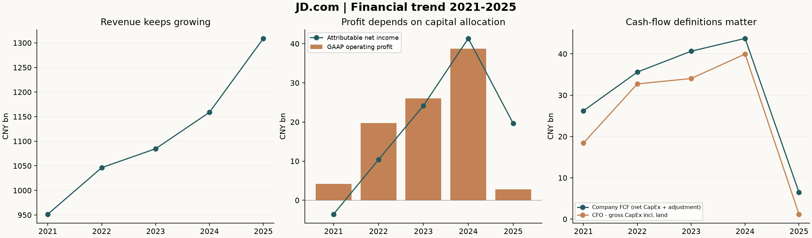
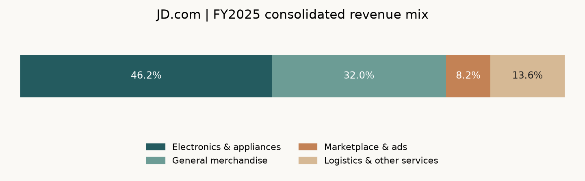

# 京东集团（JD / 9618.HK）研究报告

**研究及信息截止：2026-11-24（Asia/Shanghai）；财务截止：2026-09-30。**证券为 JD.com, Inc.（京东集团股份有限公司），NASDAQ:JD 每份 ADS 代表两股 A 类普通股；HKEX:09618 为港元柜台、89618 为人民币柜台，不能重复加总股本。京东健康、京东物流、京东工业是子公司，不是集团的另一交易代码。[证券身份与交割公告](https://www.sec.gov/Archives/edgar/data/1549802/000119312526456897/d114554dex991.htm)

**行情与估值：**11 月 24 日港股收盘 **97.05 港元**；以 9 月底披露的 26.91 亿流通普通股作研究代理，复算市值约 **2,611.62 亿港元／2,235.20 亿元人民币**，近似 TTM 归母 PE **13.95 倍**、PB **0.99 倍**。这不是已核准至 11 月 24 日的实时法定股本。汇率采用当日中间价：1 港元兑 0.85587 元、1 美元兑 6.7111 元、1 欧元兑 7.3008 元。[港股行情](https://stockanalysis.com/quote/hkg/9618/)、[Google 行情对照](https://www.google.com/finance/quote/9618:HKG)、[外汇局](https://www.safe.gov.cn/AppStructured/hlw/RMBQuery.do)

**研究主线：**京东能持续出售可信赖的商品与履约服务，但普通股东得到多少回报，取决于新业务、海外扩张和营运资本占用；“账上现金多”尚不足以推出“核心零售免费”。

本次承接[8 月研究](京东集团-research-20260811.md)，并复核已归拢的[10 月研究](京东研究报告-20261021.md)。保留历史观点，新的价格纪律以本文为准。本报告用于学习研究，不构成投资建议。

---

## AI研究偏见自觉

**信息丰富度评级：A级。AI研究局限性声明：**审计财务、季度分部与证券信息充分；餐饮外卖的单均贡献、撤补贴留存、交叉购买增量利润及欧洲并购后的完整资金需求仍不可见。AI 能核查报表，无法替代经营实验、客户与商户访谈。

- [x] 把披露充分与投资确定性分开；不因资料丰富提高新业务胜率。
- [x] 同时检验“低 PS、子公司资产多”的多头与“核心利润不断被花掉”的空头。
- [x] 即使报道减半，正品和仓配价值仍在；外卖及海外投入回报仍看不清。
- [x] 所有情景利润、增长率、概率、倍数和价带均为研究判断；不是公司指引。

本报告的数据置信度高于对新业务终局的置信度。没有可验证的新数据时，不用合理故事补齐未知项。

---

## 第一步：核心数据总览

### 五年经营与现金趋势

金额为人民币亿元；毛利采用美国会计准则的“收入减收入成本”，履约费用仍在毛利以下。全毛资本开支包含土地使用权，未抵物业与设备出售款；公司 FCF 则采用净资本开支并调整消费金融应收款。两列不能互换。

| 年度 | 收入 | 毛利率 | 经营利润 | 归母净利 | 经营现金流 | CFO减全毛CapEx | 公司FCF | 现金及短投（不含受限） |
|---|---:|---:|---:|---:|---:|---:|---:|---:|
| 2021 | 9,515.92 | 13.56% | 41.41 | -35.60 | 423.01 | 184.20 | 262.28 | 1,853.31 |
| 2022 | 10,462.36 | 14.06% | 197.23 | 103.80 | 578.19 | 327.36 | 355.95 | 2,199.56 |
| 2023 | 10,846.62 | 14.72% | 260.25 | 241.67 | 595.21 | 340.38 | 406.51 | 1,901.46 |
| 2024 | 11,588.19 | 15.87% | 387.36 | 413.59 | 580.95 | 399.68 | 437.40 | 2,339.95 |
| 2025 | 13,090.85 | 16.04% | 27.74 | 196.31 | 189.91 | 12.00 | 64.76 | 2,132.32 |

来源：[2025 审计年报](https://www.hkexnews.hk/listedco/listconews/sehk/2026/0416/2026041601497_c.pdf)及[2022 年业绩](https://ir.jd.com/news-releases/news-release-details/jdcom-announces-fourth-quarter-and-full-year-2022-results-and)、[2023 年业绩](https://ir.jd.com/news-releases/news-release-details/jdcom-announces-fourth-quarter-and-full-year-2023-results-annual)、[2024 年业绩](https://ir.jd.com/news-releases/news-release-details/jdcom-announces-fourth-quarter-and-full-year-2024-results-and)。收入、归母、CFO、现金与短投由 [StockAnalysis 财务表](https://stockanalysis.com/stocks/jd/financials/)和[资产负债表](https://stockanalysis.com/stocks/jd/financials/balance-sheet/)独立处理数据复核。2021–2022 全毛资本开支依赖第三方分项加总；2023–2025 另核审计现金流量表，差异及覆盖见附件。



2025 年收入继续增长，经营利润却被新业务投入大幅压低。更值得警惕的是现金质量：2025 年公司 FCF 为 64.76 亿元，但扣全部现金资本开支、保留消费金融营运资金影响后仅 **12.00 亿元**。对账为：CFO 189.91 − 毛资本开支 177.91 + 物业/设备出售款 50.56 + 消费金融调整 2.20 = 公司 FCF 64.76。出售资产能释放资金，不等于可以永久重复的经营现金。[审计年报现金流量表，第267页](https://www.hkexnews.hk/listedco/listconews/sehk/2026/0416/2026041601497_c.pdf)

### 收入结构与四季度分部地图

2025 年四类合并收入：电子家电 6,051.31 亿元、日用百货 4,186.71 亿元、平台及广告 1,071.31 亿元、物流及其他服务 1,781.52 亿元。前两项以自营商品总额入账，平台广告主要按服务费入账；把它们的收入相加后与纯平台 PS 比较，会系统性夸大“便宜”。[2025 年业绩公告](https://ir.jd.com/news-releases/news-release-details/jdcom-announces-fourth-quarter-and-full-year-2025-results-and)



下表金额为人民币亿元；“毛利率”均为分部收入减分部收入成本所得，尚未扣履约、营销、研发等费用。分部收入含内部交易，不能直接相加为集团收入。

| 季度 | 零售收入 | 零售毛利率 | 零售经营利润 | 物流收入 | 物流毛利率 | 物流经营利润 | 新业务收入 | 新业务毛利率 | 新业务经营利润 |
|---|---:|---:|---:|---:|---:|---:|---:|---:|---:|
| 2025Q4 | 3,019.02 | 17.14% | 97.89 | 635.31 | 9.08% | 18.84 | 140.85 | -2.32% | -148.01 |
| 2026Q1 | 2,685.88 | 18.60% | 149.60 | 605.81 | 7.81% | 10.20 | 62.79 | 29.38% | -103.52 |
| 2026Q2 | 2,953.83 | 18.53% | 134.78 | 641.02 | 9.53% | 22.63 | 72.60 | 32.36% | -98.54 |
| 2026Q3 | 2,579.66 | 20.08% | 150.68 | 639.53 | 9.10% | 19.21 | 78.31 | 29.59% | -96.42 |

四季集团收入分别为 3,522.84、3,156.94、3,464.01、3,095.93 亿元；同比约 +1.5%、+4.9%、−2.9%、+3.5%。分部成本与收入分别取[2025Q4](https://ir.jd.com/news-releases/news-release-details/jdcom-announces-fourth-quarter-and-full-year-2025-results-and)、[2026Q1](https://ir.jd.com/node/12206)、[2026Q2](https://ir.jd.com/news-releases/news-release-details/jdcom-announces-second-quarter-and-interim-2026-results)、[2026Q3](https://ir.jd.com/node/12441)同口径表。

2025 年全年零售收入 11,263.99 亿元、经营利润 514.02 亿元；物流收入 2,171.46 亿元、经营利润 52.69 亿元；新业务收入 492.82 亿元、经营亏损 466.41 亿元。进入 Q3，零售收入同比约 +2.9%，物流约 +16.1%，新业务约 −49.8%；最后一项受重分类影响，不能直接读作业务收缩。

各期披露的分部收入同比为：

| 季度／年度 | 零售 | 物流 | 新业务 |
|---|---:|---:|---:|
| FY2025 | +10.9% | +18.8% | +157.3% |
| 2025Q4 | −1.7% | +21.9% | +200.9% |
| 2026Q1 | +1.8% | +29.0% | +9.1% |
| 2026Q2 | −4.7% | +24.3% | −47.6% |
| 2026Q3 | +2.9% | +16.1% | −49.8% |

同比来自上列各期公告／同口径收入复算，不代表剔除收购和重分类后的内生增长。FY2025分部毛利率按原始收入成本复算约为零售17.59%、物流8.80%、新业务−1.45%；新业务尚未扣经营费用已经接近零毛利。

**分类断点：**2025 年 10 月底即时配送转入物流；2026 年起部分原集团内部配送改为向平台第三方商户提供服务，物流外部收入与新业务收入随之重分类。物流增长、外卖毛利率改善和分部同比必须一并看这条变更。新业务毛利为正而经营亏损很大，说明获客、履约和扩张费用才是关键，不能只报毛利改善。[Q3 分部口径说明](https://ir.jd.com/node/12441)

### 最新季度究竟改善了什么

Q3 归母净利 **65.03 亿元**，同比 +23.26%；集团经营利润 **51.54 亿元**。新业务亏损 **96.42 亿元**，同比收窄 38.73%，但较 Q2 的 98.54 亿元仅收窄 **2.15%**。减亏成立，减亏速度已经明显慢于从 2025Q4 到 2026Q1 的阶段，不能线性外推至盈亏平衡。

TTM 归母为 **160.21 亿元**、经营利润 **76.59 亿元**，两者差距提示权益法投资收益和其他非经营项目很重要。前三季权益法投资收益 63.59 亿元；它可能有真实价值，却不等于国内零售经营利润或已汇回母公司的现金。[Q3 损益表](https://www.sec.gov/Archives/edgar/data/1549802/000119312526464688/d179042dex991.htm)

> 段永平式追问：什么数字最接近生意的真实回报？
>
> 先看稳定的零售利润能否穿过新业务亏损、资本开支、少数股东权益和资本配置，最终落到每股可支配现金。

---

## 第二步：生意本质分析

**京东向消费者出售“正品、现货、送达与售后”的确定性，用重复订单摊薄仓配成本，再向品牌商、第三方商家和外部企业出售流量及供应链服务。**

| 业务 | 谁付钱、为何重复 | 利润变量 | 资产与约束 |
|---|---|---|---|
| 自营零售 | 消费者为可信商品、履约和售后复购 | 采购价差、品类、周转、订单密度 | 库存与仓网；价格透明，难单独提价 |
| 平台及广告 | 商家为成交和可衡量的转化付费 | 商家供给、有效流量、广告回报 | 流量竞争；不是全部商品交易额都归平台 |
| 物流及供应链 | 企业为仓储、运输与交付可靠性续约 | 外部客户留存、网络利用率、客户组合 | 固定成本、劳动成本和资本开支 |
| 外卖及海外新业务 | 用户与商户为便利和交易付费 | 本地密度、撤补贴复购、单位贡献 | 必须再建立商户与配送网络，不能假定复制成功 |

仓储、干线运输、末端配送、库存预测和售后系统互相配合，重建难度高；但用户可以同时使用淘宝、拼多多、抖音、美团，京东并没有把消费者锁住。相比高毛利软件和纯平台，零售的增量收入必须带着采购和履约成本一起增长。

经营杠杆有两面：订单密度提高，仓配成本能被摊薄；库存与新区域先投入、订单不足时，固定成本会放大亏损。Q3 履约费用率 7.6%，高于上年同期 7.4%，不能把服务收入增长自动视为净利润率上升。[Q3 费用说明](https://ir.jd.com/node/12441)

### 现金防御垫：先区分集团与股东

截至 9 月底，金额为人民币亿元：

| 项目 | 数值 | 边界 |
|---|---:|---|
| 现金及短投，不含受限 | 2,044.97 | 合并口径，包含子公司的资金 |
| 受限现金 | 101.66 | 不作为自由可支配现金 |
| 借款及优先票据 | 736.67 | 含流动部分，不含经营租赁 |
| 净现金，排除受限、不含租赁 | 1,308.30 | 不是归母净现金，更不是清算分红 |
| 经营租赁负债 | 368.70 | 与仓配使用权相对应的经济义务 |
| 扣租赁后净额 | 939.60 | 仅为保守诊断，不与含租金的盈利重复扣除 |
| 少数股东账面权益 | 644.48 | 不能把全部合并资产当作集团普通股东资产 |

来源：[Q3 资产负债表](https://ir.jd.com/node/12441)，原始现金与债务项目复算，详见附件。11 月 12 日 CECONOMY 付款 13.35 亿欧元，按本文汇率约 **97.47 亿元人民币**；9 月资产负债表尚未包含这项付款及新子公司的并表资产负债。不能把 9 月现金视为交易后的现金，也不能只扣付款而忽略获得的资产，本文不以静态净现金单独给股价托底。[交割公告](https://www.ceconomy-mms.com/en/article/closing-artikel)

Q3 公司 FCF **−238.61 亿元**，同期去年为 −112.49 亿元；TTM 为 +188.03 亿元，2026 前三季累计仅 +14.93 亿元。Q3 应付账款较六月底回落 **313.65 亿元**，解释部分季节性流出，但不能直接把流出全部加回：9 月底库存已升至 1,161.66 亿元，较年末增长 21.73%；库存周转从 37.8 天升至 41.2 天。应付账款仍高于年末 92.17 亿元，供应商融资仍在支持经营。[Q3 现金与周转](https://ir.jd.com/node/12441)

因此，TTM 公司 FCF 收益率 8.41% 只是合并报表诊断，尚未扣少数股东现金分配，也受净资产出售与白条调整影响，**不能当作普通股可持续收益率**。

> 段永平式追问：这门生意好在哪？
>
> 好在消费者愿意持续购买可靠履约；股东回报则还需要管理层把钱留在能产生回报的地方。

---

## 第三步：护城河评估

| 来源 | 研究判断 | 可验证机制 | 什么会破坏判断 |
|---|---|---|---|
| 品牌与定价权 | 中等 | 高客单商品的正品、售后信任 | 用户只按最低价选择，服务无法减少流失 |
| 转换成本 | 消费者低，企业客户中等 | 企业仓配接入和业务流程具有迁移成本 | 标准化接口与第三方履约缩小差距 |
| 网络效应 | 中等偏弱 | 用户、商家、广告之间有反馈 | 流量被内容平台和购物助手截走 |
| 规模与仓配密度 | 最强的一项 | 仓、干线、末端和预测协同摊薄成本 | 订单密度下降、履约成本持续上升 |
| 技术与专利 | 效率工具较强，排他性有限 | 库存预测、自动仓、调度、商家工具 | 行业都能买到相近模型与设备 |

过去五年，核心仓配及服务能力积累仍在，集团可分配回报的护城河却受新业务投入削弱。未来五年，更可能是“核心零售壁垒仍在、利润池由资本配置决定”，不宜给整家公司套上轻资产平台溢价。

同行比较也应比较交易机制：拼多多的匹配、营销和性价比网络，淘宝的商家与内容供给，美团的本地履约密度，分别作用在不同环节。没有取得一致口径的最新 GMV 和外卖订单份额，本文不伪造精确市场份额表。集团自营收入不等于行业 GMV，不能直接除全国网上零售额求份额。

> 巴菲特式追问：十年后它还在吗？什么能摧毁它？
>
> 仓配与品牌信用大概率仍有用；若服务无法覆盖额外成本，或者集团不断把利润投入无回报领域，资产仍在，普通股回报也可能很差。

---

## 第四步：逆向思考与风险清单

下列“概率”是定性研究判断，互相重叠，不是可相加的统计概率。

| 失败路径 | 概率判断 | 影响 | 可以观察的证据 |
|---|---|---|---|
| 新业务亏损在高位稳定，无法走向正单位经济 | 中高 | 持续吞噬零售利润 | 连续两季亏损反弹、补贴退出后复购不足 |
| 自营库存和补贴拉动收入，真实周转恶化 | 中 | 毛利和现金同时受压 | 库存周转继续上升、减值、CFO弱于利润 |
| 欧洲整合需要持续输血 | 中 | 资本开支、融资和管理复杂度上升 | 完整年度现金消耗、资本承诺、并表净债 |
| 核心零售陷入长期价格竞争 | 中 | 薄利润率缺少缓冲 | 份额与利润率同时下降，广告变现转弱 |
| 创始人资本配置与小股东回报分离 | 中 | 低回报投入难被制约 | 新项目预算缺少退出纪律，回购不抵稀释 |
| 食品安全、劳动或数据合规冲击 | 低至中 | 成本跳升或业务受限 | 官方处罚、实际现金成本、服务限制 |
| VIE失效或中美金融制裁 | 低频、不可可靠估计 | 极高，可能突破全部估值区间 | 法律结构、交易或资金流动的实质改变 |

**最强空方论点：**零售利润真实，问题在于这笔钱是否归小股东。外卖已经不是一次可轻忽的实验，欧洲又增加投入半径。负营运资本一旦逆转，现金与账面利润能同时恶化；“低 PS + 净现金”可能是对此的合理折价。

**最强多方回应：**核心零售没有崩塌，Q3 新业务同比减亏显著、归母利润恢复；若新业务只需要有限亏损维持，现有市值对未来盈利恢复的要求并不高。需要证明的是恢复能转成归属现金，而非证明仓配资产存在。

历史类比宜用京东自身：2021 年亏损后，2022–2024 年利润恢复，说明零售具备调整能力；2025 年利润再度被投入吞掉，又说明恢复并不会自动留给股东。不能用亚马逊“先亏后赢”的故事证明外卖或欧洲一定成功。

最可能的分析错误，是把负营运资本产生的现金当作永久闲钱，或把减少补贴后的留存当成已经观察到的事实。

> 芒格式追问：聪明人为什么不买？
>
> 因为他们承认零售有价值，却不相信自己能约束或预测这些利润的最终用途。

---

## 第五步：管理层评估

| 时间 | 决策 | 已有结果 | 研究评分 |
|---|---|---|---|
| 长期仓配投入 | 自建履约与供应链体系 | 形成消费者可感知的服务能力 | 正面 |
| 2023–2025 核心零售提效 | 品类、平台和运营调整 | 2025 零售利润514.02亿元 | 正面，但不能外推至集团全部资本 |
| 2025 回购与股息 | 回购约30亿美元；维持年度分红 | 兑现现金回报，同时占用可用资金 | 正面，须与完整FCF比较 |
| 2026H1 回购 | 约10亿美元、6,990万普通股 | 回购有执行证据 | 正面；不额外假设未来股数下降 |
| 2025起发展外卖等新业务 | 为高频入口与协同投入 | 2025亏损466.41亿元，2026Q3仍亏96.42亿元 | 回报未证实 |
| 2026-11 欧洲交割 | 以13.35亿欧元取得CECONOMY 59.8% | 完成控股，尚无并表后完整现金报告 | 待验证 |

回购依据[2025 审计年报](https://www.hkexnews.hk/listedco/listconews/sehk/2026/0416/2026041601497_c.pdf)与[2026H1 公告](https://ir.jd.com/news-releases/news-release-details/jdcom-announces-second-quarter-and-interim-2026-results)。Q3 公告未给出新的回购执行段落，**不能据此声称暂停回购**。本文不把授权余额当成已经回购，也不把回购收益率加在 EPS 增长之外重复计数。

刘强东为创始人及董事长，许冉为 CEO。最新可核持股日为 2026 年 3 月 18 日：刘实益权益约 12.7%、投票权约 73.1%；前者包含未来六十天已归属但未行权的 2,000 万股权利，后者还含员工计划等代行表决安排。Max Smart 实际持有约 12.0%经济权益。每 B 股二十票、每 A 股一票，经济权益与控制权不能混用。比例仅来自发行人披露，未取得同日同口径独立复核。[审计年报第219页](https://www.hkexnews.hk/listedco/listconews/sehk/2026/0416/2026041601497_c.pdf)

技术上，京东的价值主要在需求预测、库存分配、自动化和供应链软件，而非一个可以独立收费的通用大模型。2021–2025 研发费用分别为 163.32、168.93、163.93、170.31、222.29 亿元，2026 前三季为 218.95 亿元。投入在增长，但没有可分离的项目现金回报，不能据此计算“AI 研发 ROI”。[财务表](https://stockanalysis.com/stocks/jd/financials/)与[Q3 研发披露](https://ir.jd.com/node/12441)

组织判断是混合的：职业团队能够优化零售，重大资本方向仍受创始人支配。最新管理层薪酬的细分激励、单项并购回报和完整减持清单不足以独立复核，不能用一句“利益一致”略过。

> 段永平／巴菲特式追问：若 CEO 或创始人退休，公司还能维持吗？
>
> 仓配、采购与售后具有系统性；跨业务投资纪律还没有同等充分的证据。

---

## 第六步：行业与文明趋势

电商已是基础设施，增量来自效率、服务和份额迁移。国家统计局披露，2026 年 1–10 月社会消费品零售总额同比 +1.0%，全国网上商品和服务零售额 169,811 亿元、同比 +3.7%；其中网上商品 +2.9%、服务 +5.0%。今年统计范围有变化，不能把新口径总额与旧网上零售额直接连成增长曲线。[国家统计局](https://www.stats.gov.cn/sj/zxfb/202611/t20261116_1965839.html)、[商务部口径解读](https://www.mofcom.gov.cn/syxwfb/art/2026/art_6e553bb7350b4b9baa166993444ebf50.html)

TAM 很大，但价值捕获取决于谁承担库存、谁控制流量、谁承担配送成本。AI 可以降低预测和客服成本，也可能把消费者入口移到平台之外；两者作用方向相反，暂不加独立 AI 估值。供应链数字化是长期趋势，京东能否获取高于资本成本的回报仍须看现金和增量 ROIC。

欧洲的增量也受到明确约束。欧委会对 CECONOMY 交易的批准附带承诺：集团内部交易与融资按市场条件进行，仓储物流和技术服务须向第三方提供相同条件，承诺有效期十年并受独立监督。这会影响协同实现方式，不能把中国的资金与供应链优势无条件复制过去。[欧委会2026-11-03决定说明](https://ec.europa.eu/commission/presscorner/api/files/document/print/en/ip_26_2300/IP_26_2300_EN.pdf)

消费者和品牌来源分散，但热门电子家电品牌、关键流量入口与国内市场是经济依赖点。未取得足够一致的最新客户／供应商集中度数字，本文不填估计比例；欧洲并表后地域和供应商结构须重建。

> 李录式追问：二十年后是基础设施还是被替代的中间商？
>
> 京东有望保留供应链基础设施的位置，但基础设施存在不等于股东能赚取高资本回报。

---

## 第七步：估值与安全边际

### 当前市场定价

统一人民币现金流与港股价格折算，市值使用 9 月底流通股代理；各项均经工具复算。

| 指标 | 结果 | 正确读法 |
|---|---:|---|
| TTM归母PE | 13.95倍 | 市值÷160.21亿元；不是官方稀释EPS的PE |
| TTM Non-GAAP归母PE | 8.69倍 | 不能把股权激励和所有调整项视为无成本 |
| FY2025归母PE | 11.39倍 | 年度低谷利润口径，与TTM不同 |
| 归母PB | 0.99倍 | 账面不等于可清算资产 |
| PS | 0.169倍 | 自营总额法收入大，解释力很低 |
| 公司FCF收益率 | 8.41% | 合并、净CapEx和白条调整口径，不是股东现金收益率 |
| 延续上次年度股息的指示收益率 | 4.04% | 每普通股0.5美元是历史派息；未来需再次批准 |
| EV/收入诊断 | 0.119倍 | 加少数股东账面权益、债务，减不含受限现金短投；非市场化SOTP |

**数据冲突保留：**StockAnalysis 港股页报市值 2,670.7 亿港元，Google 报 2,735.2 亿港元，均不等于本文用流通股复算的 2,611.62 亿港元。差异约 2.26%／4.73%，可能涉及已发行股、库存股、时点及类别映射；未取得供应商完整桥，不能宣称已解决。本文固定使用同一披露流通股代理，执行前应更新股本。独立平台约 13.5 亿 ADS 的四舍五入股数只能做量级核对。

TTM 四季稀释 ADS EPS 相加为 11.07 元，独立平台为 10.97 元；不同期间加权股数、潜在稀释和四舍五入使它们不能与“160.21亿元÷9月底股本”混为一谈。本文后者所得 **5.95355元／普通股**只作股数不变的情景起点，已计入GAAP股权激励费用，尚未承诺覆盖未来新增稀释。额外增发10%的敏感性会把基准现值从124.61降至113.28港元。[独立财务与统计](https://stockanalysis.com/stocks/jd/statistics/)

同一第三方快照的 TTM PE：拼多多约 9.22 倍、阿里约 11.95 倍、京东 ADS 约 15.50 倍。它们包含不同业务、利润与市场时点，只说明京东并非显然最便宜。京东第三方历史年末 PE 在2023、2024、2025年约为13.34、8.87、14.50倍；盈利波动很大，不据此声称历史分位。[PDD](https://stockanalysis.com/stocks/pdd/statistics/)、[BABA](https://stockanalysis.com/stocks/baba/statistics/)、[JD历史比率](https://stockanalysis.com/stocks/jd/financials/ratios/)

### 反向估值：现价要求什么

若未来每年可持续归属现金零增长，8%人民币门槛对应年现金约 **178.82亿元**。TTM 公司 FCF 188.03亿元看似够，但口径尚未扣少数分配等项，2026 前三季只产生14.93亿元，安全垫并不厚。

另从三年退出看：假设每普通股维持每年约3.35555元人民币股息、三年后12倍PE，现价大致要求2029年归母约 **210.21亿元**。这并不激进，但前提是利润能转成现金、股息可维持、股本不增加。现价买入的核心假设是减亏后盈利恢复，不是无需经营兑现的资产套利。

### 三年三情景：回答“贵不贵”

下面为研究情景，不是预测。以快照每股归母起点、人民币折现率8%、固定股数推算。悲观假设股息降至每普通股每年1元；基准和乐观维持3.35555元。未来利润已包含子公司归属与现金收益，**不再加上市子公司市值、合并净现金或累计留存利润**，回购也不再额外加收益。

| 情景 | 概率 | 三年EPS年增速 | 退出PE | 2029归母（亿元） | 三年后股价（港元） | 含假设股息今日现值（港元） | 三年含息总回报 |
|---|---:|---:|---:|---:|---:|---:|---:|---:|
| 悲观 | 25% | -10% | 8 | 116.79 | 40.57 | 35.22 | -54.6% |
| 基准 | 50% | +20% | 12 | 276.84 | 144.24 | 124.61 | +60.7% |
| 乐观 | 25% | +35% | 15 | 394.18 | 256.72 | 213.90 | +176.6% |

基准276.84亿元归母意味着核心零售保持竞争力，新业务减亏抵消部分海外投入；乐观要求更强减亏与服务化，悲观对应投入久拖、核心受压。三年倍数是定价情景，十年终值另用永续模型，不能混用。

概率加权今日值 **124.58港元**，扣25%研究安全边际的线约 **93.44港元**。这些数依赖盈利恢复，悲观现值只有35.22港元，不能把加权数叫保本价。研究评估带向下取整为 **85–93港元**；更低先核永久损失，上行 **140港元**作为模型未增强时的仓位复核线，均非自动交易指令。

### 十年折现：回答“仓位能否加重”

| 输入 | 选择及理由 |
|---|---|
| r与币种 | 人民币8%；以Rf 1.8% + β1.0 × ERP6.2%作规范化建模锚，不声称1.8%是11/24国债实时报价 |
| 稳态增量ROIC | 12%；低于2024年第三方存量口径19.95%，接近更成熟的零售再投回报；高于新业务亏损压低后的当期集团ROIC，因此是恢复假设，不是已实现事实 |
| 永续g | 悲观0%、基准1.5%、乐观2.0%；均为2036年以后，基准不超过人民币2%上限，敏感性中g保持不变 |
| 2036归母 | 80／320／600亿元；概率25%／50%／25%，已含子公司归属及净资金收益，不再另加资产 |
| 股息减稀释k | 工具取每年3%，低于当前指示股息率；假设未来净回报可维持，不包含回购增厚 |
| 离散风险 | 外卖、海外整合与劳动监管列经营情景；VIE失效及金融制裁未建模，未塞入r或β |

ROIC 的选择是最大判断项之一。当前股息和利润不能稳定反解成熟留存率，所以没有伪造“精确的增量ROIC”；12%是在核心成熟期与高投入低谷间的恢复情景，若新增资本最终只赚资本成本，终值应下调。

终值PE只按 **(1−g/ROIC)/(r−g)** 得出。基准为(1−1.5%/12%)/(8%−1.5%)，并非拿今天同业PE作十年终值。

| 情景 | 2036归母（亿元） | g | 退出PE | r−g | 工具近似年化回报 | 固定现金股息精算IRR |
|---|---:|---:|---:|---:|---:|---:|
| 悲观 | 80.00 | 0.0% | 12.50 | 8.0pp | -4.73% | -3.43% |
| 基准 | 320.00 | 1.5% | 13.46 | 6.5pp | +9.78% | +9.08% |
| 乐观 | 600.00 | 2.0% | 13.89 | 6.0pp | +17.06% | +15.87% |

工具把“终值资本利得年化+净股息率”直接相加，是近似年化，不是逐年现金流IRR。本报告补做每年支付初始市值3%现金、第十年回收终值的现金流求根：基准 **9.08%**，三档IRR的概率加权约 **7.65%**；后者也不是一笔确定投资的实际IRR，更不是风险调整后的承诺回报。

按技能要求保留 `flip` 原始算法的敏感性，并用逐年现金复核：

| r | 工具概率加权近似回报 | 工具是否覆盖r | 逐年现金IRR的加权值 | 现金复核是否覆盖r |
|---|---:|---|---:|---|
| 6%（−2pp） | +11.83% | 通过 | +11.17% | 通过 |
| 7%（−1pp） | +9.71% | 通过 | +9.22% | 通过 |
| 8%（基准） | +7.97% | 未通过 | +7.65% | 未通过 |
| 9%（+1pp） | +6.51% | 未通过 | +6.34% | 未通过 |
| 10%（+2pp） | +5.24% | 区间外，仅供参考 | +5.21% | 区间外，仅供参考 |

**仓位压力测试在人民币合理区间内随折现率翻转。**不能用6%的通过论证应重仓，也不能用8%的未通过单独否决买入。基准r各档分母均≥5pp；6%敏感性下正增长情景分母低于5pp，属于上行情景参考，即使忽略该档，7%到9%的有效复核仍然翻转。最终参数审计C1/C2/C3通过，但VIE与制裁仍为未建模缺口。

### 估值分歧对账

三年定价模型显示约124.58港元的加权现值，说明97.05港元已有折价；十年压力模型却对折现率敏感、基准期望未覆盖门槛。前者是“贵不贵”，后者是“仓位能多重”，不能互相替代。

与10月报告的分歧还有方法层面：旧SOTP用子公司净利润近似扣除零售经营利润，又把非核心资产和累计核心现金并列估值，利润层级、归属与留存再投资容易发生不一致；其所谓市值八成有资产支撑是模型输出，不是清算保证。本次改用归母盈利模型、不另加现金及子公司市值，并把股数/稀释、全毛CapEx与欧洲交割边界写清楚。旧报告并非被一条十年IRR推翻。

最终综合六维：核心零售有质量，新业务可见度和资本纪律仍不足；现价略高于本文安全边际线，现金证据也未满足，空仓者先等条件；已有合理小仓可持有复检，研究仓上限参考收紧至组合2%，首笔参考约0.5%，不是针对个人财务状况的仓位方案。

> 巴菲特式追问：r错两个百分点会怎样？
>
> 会翻转仓位压力结论，所以不能把单一折现率的估值当成确定收益。
>
> 段永平式追问：关市五年是否愿持有？
>
> 可以接受证据持续有效的小仓，尚不愿以“现金多”支持重仓锁定五年。

---

## 第八步：最终决策与行动清单

| 维度 | 并列结论 | 信心度 |
|---|---|---|
| 生意质量 | 核心零售与供应链有长期需求，但薄利、库存与履约需要持续管理 | 中高 |
| 护城河 | 仓配密度和信誉较强；用户切换成本与平台定价权有限 | 中高 |
| 管理层 | 零售提效和回购有证据；外卖与欧洲的增量资本回报待验证 | 中 |
| 最大风险 | 核心利润被持续投入消耗，现金回报弱于报表利润 | 中高 |
| 文明趋势 | 供应链数字化受益；成熟电商与即时零售竞争不自动创造超额回报 | 中 |
| 估值 | 三年：现值124.58港元、安全边际线93.44；十年：基准加权现金IRR约7.65%，合理r内翻转，收紧仓位 | 中低 |

**估值解除语：**十年压力测试没有一票否决权。本文空仓者暂不新增，同时依据当前价格相对安全边际、全口径现金尚不完整、库存变慢及海外整合未知；持仓者也不因十年未通过而自动卖出。

| 策略 | 建议 |
|---|---|
| 空仓者 | **观望新增。**85–93港元且下述经营、现金门槛满足后，才评估约0.5%的研究首笔；低于85先核永久损失，不因更便宜跳过条件 |
| 持仓者 | **合理小仓有条件持有，暂停加仓。**研究总仓参考≤2%；超出者先按自身风险预算复核，不以模型上限机械交易 |
| 建仓／加仓条件 | 最新新业务单季亏损不高于100亿元且环比未反弹；零售经营利润率≥4.5%；库存周转不再高于41.2天；下一正式披露补足全部现金CapEx（含土地）、少数分配与并购资金桥，滚动归属股东现金为正，并且欧洲无新增失控融资／补贴承诺 |
| 失效／卖出复核 | 新业务连续两季亏损升至120亿元以上；零售连续两季利润率低于4%；扣完整资本开支后的滚动现金持续为负；重大治理、VIE或监管损害。单季季节性流出不是自动卖出信号 |
| 上行复核 | ≥140港元、盈利和现金模型未增强时，停止追价并复核超配；这是估值警戒，不是自动卖出价 |
| 人工复检 | 2026-12-31检查资本承诺／整合；2027-03-31检查全年披露与现金桥（研究兜底日，非公司已确认财报预约日；提前披露即提前核） |

85–93港元按本文汇率机械折合 **21.68–23.72美元／ADS**；140港元折合35.71美元。该换算未含实际跨市场价差、费用与税务，港股和美股须分别核价，不等于两地同时可成交。

大师原话与代言边界：8月旧报告的四段“模拟点评”没有给出足够出处，本次不沿用为引语。巴菲特、芒格、段永平对本文京东价带均**资料不足，不模拟代言**。李录的本地原文可核短引为“明确知道自己哪些懂、哪些不懂”，见[北大演讲实录“能力圈”](../李录/李录-北大演讲-20241207.md)；本文只据此要求承认外卖与海外盲区，不据此推断其对京东买卖的立场。上文所有“大师式追问”均为本报告的框架提问，不是本人说过的话。

---

## AI分析置信度与投资确定性

**AI分析置信度：财务事实中高，长期情景中低。**收入、归母、CFO、现金及短投有公司原件与独立数据库对照；分部重分类、精确流通股与控制权仅有发行人原始披露。全年全毛CapEx可核，最新TTM完整资本开支与少数现金分配仍存在缺口。

**实际投资确定性：中低。**可靠履约的商业价值较确定；新业务终局、欧洲资金回报和创始人的退出纪律不确定。85–93港元是在这些限制下的条件研究带，不会把不确定变成确定。

需要补足的一手验证：撤补贴后用户复购和商户贡献利润；品牌对京东渠道的真实增量回报；物流外部客户留存与价格；欧洲并表现金流及融资条款；少数股东可分配现金、最新完整股本和薪酬稀释。

---

## 数据来源与审计记录

原始材料与定位：2025年审计年报财务／现金流／持股页，2025Q4与2026Q1/Q2/Q3公告分部、资产负债、现金流和周转表；2026-11-12交割公告；2026-11-03欧委会批准条件。独立核验优先尝试AAStocks与Macrotrends：前者被403拦截，后者未取得足以复核本次最新季度的完整表；改用StockAnalysis/S&P及Google行情，并保留独立源缺口，没有把IR、SEC、HKEX三个载体冒充三家独立数据源。

本次15%固定种子抽样共14项：2项为年份提取噪声，12项完成事实／公式／研究输入一致性核对；另补查16项财务、股权与行情事实。合计28项均在1%误差内、无警告；其中模型假设只证明转录一致，不算外部预测验证。精确股本和持股比例的独立来源缺口仍保留。

完整摘数、链接与口径缺口：[source-data.json](research-20261124/source-data.json)；计算：[model.py](research-20261124/model.py)、[results.json](research-20261124/results.json)；工具原始记录：[financial-rigor.log](research-20261124/financial-rigor.log)、[terminal-value.log](research-20261124/terminal-value.log)。数据抽检与覆盖分类见[audit-results.json](research-20261124/audit-results.json)及[audit-verdict.log](research-20261124/audit-verdict.log)。准出只说明所查事实及运算通过，不说明假设正确，也不掩盖单源缺口。

### 关键数据交叉验证记录（工具原始输出节选）

```text
市值验算 (Market Cap Verification)
  股价 (Price):       97.05 HKD
  总股本 (Shares):    2.69B
  计算市值:           261.16B HKD
  报告市值:           261.16B HKD
  偏差:               0.00%
  ✅ 验证通过, 偏差仅 0.00%
交叉验证: FY2025收入 (Cross-Validation)
  数据来源数: 2
  参考中位数: 1.31M CNY million
  ✅ IR                  : 1.31M CNY million  (偏差 0.00%)
  ✅ StockAnalysis       : 1.31M CNY million  (偏差 0.00%)
  ✅ 所有来源偏差 ≤ 1.0%, 数据一致
  共识值 (加权中位数): 1.31M CNY million
交叉验证: FY2025归母 (Cross-Validation)
  数据来源数: 2
  参考中位数: 19,631.00 million
  ✅ IR                  : 19,631.00 million  (偏差 0.00%)
  ✅ StockAnalysis_or_Google: 19,631.00 million  (偏差 0.00%)
  ✅ 所有来源偏差 ≤ 1.0%, 数据一致
  共识值 (加权中位数): 19,631.00 million
交叉验证: FY2025现金短投不含受限 (Cross-Validation)
  数据来源数: 2
  参考中位数: 213,232.00 million
  ✅ IR                  : 213,232.00 million  (偏差 0.00%)
  ✅ StockAnalysis_or_Google: 213,232.00 million  (偏差 0.00%)
  ✅ 所有来源偏差 ≤ 1.0%, 数据一致
  共识值 (加权中位数): 213,232.00 million
估值指标验算 (Valuation Verification)
  当前股价: 83.0621835
  PE (TTM):  83.0621835 / 5.953548866592345 = 13.95x
  盈利收益率: 7.17%
  PB:        83.0621835 / 83.55369751021925 = 0.99x
  ROE:       5.953548866592345 / 83.55369751021925 = 7.13%
  P/FCF:     83.0621835 / 6.987365291713118 = 11.89x
  FCF Yield: 8.41%
  股息率:    3.35555 / 83.0621835 = 4.04%
  PS:        83.0621835 / 492.0 = 0.17x
  ✅ 以上指标均使用精确十进制计算, 无浮点误差
```

最终估值口径复检：人民币 r=8%、ROIC=12%、g=0%／1.5%／2%，三档分母8／6.5／6个百分点；C1/C2/C3均准出。VIE失效及中美金融制裁未建模，不包含在任何价格下限保证内。

监控登记沿用既有ID“京东”，以本文替换旧价格依据，保留历史事件；价格每日扫描，事件仅供人工复核。跟踪表新增本次建议事件并接续旧活跃事件。未提交、未推送或发布到外部页面。
