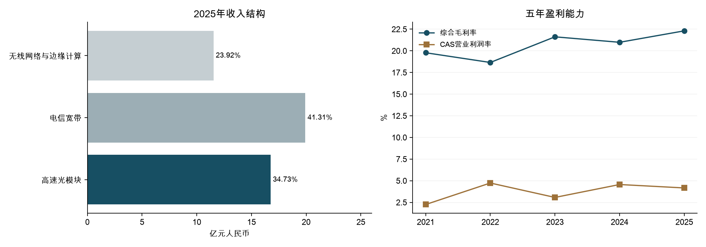

# 剑桥科技（603083.SH / 06166.HK）研究报告

> **研究及数据截止日：2026-11-14，Asia/Shanghai。** 行情采用11月13日最近收盘快照：A股116.79元，H股60.60港元。公司为上海剑桥科技股份有限公司，英文正式名称 **CIG Shanghai Co., Ltd.**，常用集团名称 Cambridge Industries Group；A、H为同一发行人不同市场股份，本报告不涉及ADR。
>
> **定价快照：** A股TTM PE 59.05倍，H股折人民币TTM PE 26.23倍；两类股份按各自价格加总市值379.50亿元人民币。**研究主线：** 800G放量已经改变利润结构，真正待验证的是扩产、战略备货与上游投资能否转为每股自由现金流，尤其能否跨过2027年可转债到期。

本次复用既有公司目录、监控ID“剑桥科技”，接续2026-08-17报告；保留历史报告，不将历史预告、股本、汇率或估值方法作为本期事实。

---

## AI研究偏见自觉

**信息丰富度评级：A。** A+H年报、季报、融资文件及业绩说明会资料充裕。信息优势并不来自重复“AI光模块高景气”；研究重点是盈利与现金的背离、融资期限、技术切换及同业机会成本。

**AI研究局限性声明：** 未取得匿名客户采购合同、取消条款、实际ASP、模块良率、1.6T分项营收、2026最新客户集中度及募集资金逐笔用途。订单旺盛、新客户突破、产能利用率高是管理层表述，不能替代客户独立确认。所有预测、概率、价带及仓位均为研究假设，不是公司指引。

- [x] 不用资料数量替代生意确定性；少一半新闻，也不改变现金流和债务事实。
- [x] 不把800G盈利外推为1.6T/NPO已经兑现，不把设计产能当销量。
- [x] 不把H股折价、零票息或融资到账当作无风险收益。
- [x] 对“成长很好所以任何价格都合理”与“负FCF所以公司必坏”做双向检验。

---

## 第一步：核心数据总览

### 五年财务：盈利改善，现金回报仍不稳定

单位均为亿元人民币；2021—2025为年度，2026为累计期间，不能直接同比全年。综合毛利率统一为（收入−营业成本）÷收入；营业利润率采用中国会计准则“营业利润”，包含财务费用、投资/减值等影响，不能与美股EBIT margin直接对比。FCF统一为CFO减购建固定、无形及其他长期资产支付现金，未扣股权投资、收购或全部租赁融资现金。

| 期间 | 收入 | 归母净利 | 综合毛利率 | 营业利润率 | CFO | 现金CapEx | FCF | 期末货币资金 |
|---|---:|---:|---:|---:|---:|---:|---:|---:|
| 2021 | 29.20 | 0.67 | 19.78% | 2.25% | -0.62 | 0.93 | -1.55 | 2.45 |
| 2022 | 37.86 | 1.71 | 18.66% | 4.74% | 0.56 | 1.80 | -1.23 | 3.90 |
| 2023 | 30.87 | 0.95 | 21.62% | 3.07% | 1.43 | 2.03 | -0.60 | 4.38 |
| 2024 | 36.52 | 1.67 | 20.99% | 4.56% | 5.62 | 3.07 | 2.55 | 5.27 |
| 2025 | 48.23 | 2.63 | 22.31% | 4.17% | -4.71 | 9.58 | -14.28 | 47.91 |
| 2026H1 | 27.05 | 3.28 | 30.77% | 10.21% | -11.13 | 6.85 | -17.98 | 34.44 |
| 2026前三季 | 49.21 | 7.61 | 33.12% | 16.14% | -16.27 | 11.55 | -27.81 | 18.50 |

来源为正式历年财报与东方财富财务数据库双入口核对（[S1]—[S5]）。2026中期和季度数据未经审计。此前报告部分年份使用“主营毛利率”，本期改用综合口径：例如2022年为18.66%，不能与主营口径18.12%混用。2025年归母净利高于合并净利，存在少数股东亏损和税项影响；不能仅凭归母增速认定全部子公司盈利改善。

### 近四季：总量可拆，产品分季不能补造

| 单季 | 收入（亿元） | 归母净利（亿元） | 综合毛利率 |
|---|---:|---:|---:|
| 2025-12-31 | 14.63 | 0.0419 | 20.65% |
| 2026-03-31 | 12.87 | 1.18 | 29.33% |
| 2026-06-30 | 14.18 | 2.09 | 32.08% |
| 2026-09-30 | 22.16 | 4.33 | 35.99% |

上述单季值由累计报表相减。公司未披露完整近四季产品收入、增速和毛利率，故不提供虚构的产品季度表。2026前三季收入同比+46.46%、归母同比+193.35%；第三季归母4.33亿元、同比+212.81%。低基数、产品组合和经营杠杆共同作用，Q3不能简单乘四作为正常利润。

### 2025产品结构与2026变化

| 产品 | 收入（亿元） | 收入占比 | 同比 | 产品毛利率 |
|---|---:|---:|---:|---:|
| 高速光模块 | 16.75 | 34.73% | +240.85% | 34.49% |
| 电信宽带 | 19.92 | 41.31% | -1.98% | 14.01% |
| 无线网络与边缘计算 | 11.54 | 23.92% | +2.51% | 19.00% |

三项为主营业务，余量为其他业务及四舍五入。2026前三季高速光模块收入占比已超过一半，800G占模块出货绝大部分；这支持“组合升级”，并不足以确认1.6T收入规模或新一代独立毛利。[S1][S3][S7]



### 从现金余额走到偿债能力

截至2026-09-30，货币资金及现金等价物18.50亿元；短借10.49亿元、长借1.70亿元、一年内到期非流动负债2.21亿元、非流动租赁负债1.54亿元。以这些负债全部纳入保守债务口径，合计15.94亿元，严格净现金仅2.57亿元。到期非流动负债包含租赁，不能全部称银行贷款。交易性金融资产3.91亿元缺品种明细，未纳入严格净现金。[S3][S5]

应收账款由2025年底19.98亿元增至35.56亿元，存货由23.76亿元增至37.81亿元，预付款由1.69亿元增至6.42亿元。收入增长需要更多营运资金是合理机制；但供应链“战略储备”最终须通过交付和回款证明，不能凭名称豁免库存跌价。2026前三季FCF为-27.81亿元，TTM FCF为-31.43亿元，扩产期利润尚未转成可分配现金。

10月融资在上述报表之后：新增H股18,446,000股；配售净募19.2984亿港元，可转债净募46.0552亿港元，合计65.3536亿港元。可转债本金为**人民币39.6亿元、美元结算、零票息，2027-10-12到期**；不是39.6亿港元，也不是多年期永久资本。资金用途为55%扩产、30%上游投资、15%营运，期限错配值得优先复核。[S6]

没有11月现金余额和完整资金使用表，不能用9月现金加全部融资推断“当前净现金”。可转债到账同时增加债务；盈利估值也没有额外叠加一笔“融资现金价值”。

> 段永平式追问：增长赚来的钱最终在哪里？目前一部分是应收和库存，另一部分正投向产能与上游；经营回款还没有回答完这个问题。

---

## 第二步：生意本质分析

**这门生意是把核心光电器件、客户认证和制造良率组织成可批量交付的高速互连，让设备商和云基础设施客户按一支支模块付款。** 高速模块具有重复采购，但不是订阅收入：复购依赖客户扩容、代际升级和供应商份额，不能自动续约。

| 环节 | 谁付钱、为什么付 | 利润和现金由什么决定 |
|---|---|---|
| 高速光模块 | 设备商及数据中心客户，为带宽、功耗、可靠性与按时交付采购 | 出货×ASP、产品组合、DSP/光芯片/激光器成本、良率 |
| 宽带接入 | 设备商及运营商供应链，为符合标准的接入设备采购 | 规模、成本下降、客户项目与价格竞争 |
| 无线及边缘 | 企业/运营商网络设备需求，ODM/JDM开发与交付 | 产品周期、工程效率、项目订单 |
| 扩产及备货 | 公司先付设备款、材料款及上游投资 | 回款时差、库存周转、产能利用率、融资期限 |

截至9月初设计产能约100万支/月，管理层计划到2027年底额外新增至少1,000万支年产能，分布中国嘉善、马来西亚、墨西哥和美国；这是规划，不是锁定销售。产能拉升先带来固定成本和营运资金需求，再决定能否形成利润杠杆。[S7]

公司H1披露800G批量交付、部分1.6T产品完成认证测试，并预计下半年增加交付；11月说明会仍以800G占绝大部分出货表述。NPO/ELSFP/XPO等处于不同开发和验证阶段，应追踪正式收入而非术语数量。海外制造有助交付和供应韧性，同时增加管理、良率及重复投资成本。[S2][S7]

研发费用2025年3.55亿元、2026前三季3.27亿元。研发和供应链协调有实际价值，但不是拥有所有DSP、激光器及光芯片IP。最重要的三项变量是：**模块毛利能否留住、营运资金能否回收、新增资本能否提高每股盈利。**

> 段永平式追问：好在哪里？客户验证过、能规模交付是优点；长期是否“好生意”，还要看下一代产品及现金回报能否复制。

---

## 第三步：护城河评估

| 来源 | 现有证据 | 强度与可证伪条件 |
|---|---|---|
| 品牌/定价权 | 面向专业客户，产品按性能、价格及交期竞争 | 偏弱；没有持续提价而不丢份额的证据 |
| 转换成本 | 可靠性测试、协同开发和认证耗时 | 中等；代际切换会重新竞标，多供策略限制锁定 |
| 网络效应 | 模块销量不直接提高其他客户的使用价值 | 无；不能套平台倍数 |
| 制造规模/供应链 | 批量交付、关键器件预订、海外产能 | 中等；须以单位成本、良率、周转兑现，靠融资备货不是永久优势 |
| 技术/专利 | 800G硅光量产，1.6T及新封装储备 | 中等且需续证；未找到“领先几年”的可靠量化依据 |

过去五年工程能力、产品组合和全球交付明显强化；从2025的高速模块毛利与2026整体毛利改善，可以判断竞争力增强。尚不能证明护城河已变为十年稳定特许权。未来五年每一次速率和封装切换，都可能延长优势，也可能重新分配利润。

2025年前五客户销售占86.10%、前五供应商采购占35.61%。公司称客户拓展有突破，但没有披露2026最新客户集中度及新增客户收入，不能写成集中度已经下降。[S1][S7]

> 巴菲特式追问：十年后什么还在？工程组织与客户信任可能延续；旧代产品认证、关键器件紧缺和某年的高ASP不会自动延续。

---

## 第四步：逆向思考与风险清单

最有力的反方论点是：**高速互连需求真实，但公司正在用短期融资承接长期扩产、库存与上游投资，而买方未必愿意长期支付今天的毛利。** 因此盈利上行与股东价值上行可能不同步。

以下为主观风险等级，非统计违约概率；各路径高度相关，不能相加。

| 失败路径 | 概率判断 | 影响 | 领先观察指标 |
|---|---|---|---|
| 集中大客户压价、份额重分配 | 中高 | 高 | ASP下降快于器件成本，模块毛利持续下滑 |
| 供给释放或重复下单后库存修正 | 中 | 高 | 交期缩短、取消订单、库存与应收增长快于销售 |
| 可转债不转股、偿债与扩产争夺资金 | 中 | 高 | 2027到期覆盖安排、融资用途及现金缺口 |
| 上游投资或战略采购无法回收 | 中 | 高 | 长期预付/存货减值、投资亏损、现金转化恶化 |
| 1.6T/NPO技术或客户认证落后 | 中 | 高 | 量产收入缺失、竞争者良率与成本领先 |
| 出口限制/客户合规要求变更 | 低至中 | 极高 | 法案进展、关键器件许可、客户采购资格 |
| 海外产能执行偏差及汇率波动 | 中 | 中高 | 爬坡进度、当地认证、汇兑及结算现金 |
| 创始人继任、股东稀释与治理失当 | 中 | 中高 | 团队接续、关联交易、融资后的每股回报 |

LightCounting在2026年7月明确提醒，关键零件短缺和重复下单可能放大未来库存修正；这比泛泛说“行业有周期”更值得纳入反证。[S9] 美国S.5548为9月24日提出的法案文本，涉及联邦关键系统采购，提出时点名若干同行而非单独点名剑桥；本文不把它写成已生效的剑桥禁售令。其后立法状态仍须持续核查。[S11]

历史类比应提取机制：网络设备浪潮中的订单并不都是最终需求，产品迭代很快时客户认证也会重置。资料不足以给出某个历史企业与剑桥一一对应的概率，故不拿“下一个某公司”代替论证。跨学科看，这是牛鞭效应、技术S曲线和寡头买方议价同时作用；每个模型都指向跟踪订单质量与回款，而非只看行业TAM。

最可能的分析错误有两个：低估1.6T真正放量后的利润，或把800G的景气高点当作长期常态。前者需要正式分项业绩纠偏；后者需要毛利、周转、减值和资本回报共同检验。未取得可核验的专业做空报告，以上是作者构建的最强反方，不冒充真实空头观点。

> 芒格式追问：如果投资失败，最可能不是AI消失，而是订单、产能与现金期限没有匹配好，或付出的价格没有留出这些错误的空间。

---

## 第五步：管理层评估

董事长兼CEO为Gerald G Wong，中文名黄钢；公司正式说明会确认这一身份。其毕业于MIT，曾任朗讯光网络部副总裁；产业履历与全球客户资源有价值，但本报告不据此给予“诚信已证实”或“资本配置优秀”的笼统评级。[S7]

| 时间 | 决策 | 可见结果 | 研究评价 |
|---|---|---|---|
| 近年 | 扩大高速光模块与海外交付能力 | 产品组合及利润率改善 | 执行正面；长期回报未完整兑现 |
| 2025 | H股IPO | 现金和净资产显著增加 | 融资能力得到验证，经营造血仍需独立判断 |
| 2026年6月 | H股配售、核心物料战略储备 | 降低缺料风险，资金占用上升 | 机会与库存风险并存 |
| 2026年10月 | 新配售、短期可转债、扩产及上游投资 | 扩张资源增加，但引入2027偿债节点 | 资本纪律的关键考试尚在前面 |

10月完成公告中，Wong通过其全资CIG Cayman持29,542,735股，占本次配售后总股本7.64%；控股股东及一致行动人合计8.78%。须区分直接持股、穿透权益、H股类别持股和总股本占比。公开资料没有显示本公司有AB股差异投票权，不应套用互联网公司投票权倍数。[S6]

2026H1披露H股激励向91名参与者授出合计2,285,000股；授出不等于全部已发行或已归属。当前股数仍取10月月报，后续激励费用、取得股份方式与归属稀释须继续核验。[S2]

减持与融资须分别看：8月7日结果公告披露，CIG开曼在本轮计划中实际减持2,483,000股，一致行动人上海康令减持1,455,300股；这是真实股权出售，不能全归因于稀释。10月新股配售造成的比例下降则另有明确被动稀释因素。[减持结果原公告转录](https://vip.stock.finance.sina.com.cn/corp/view/vCB_AllBulletinDetail.php?id=12480909) 未完成全部历史减持、薪酬和激励穿透核验，不宣称激励完美。同样未取得足够交易后回报数据来量化历次并购成功率、研发ROI或回购择时能力。比给主观高分更有用的检验是融资后EPS、现金与资本回报是否持续提高。

如果CEO退休，客户认证、研发、供应链和海外运营需要由组织接续。目前缺少接班和关键工程团队留任的充分证据，管理层维度评为“产业执行能力有证据，资本纪律与继任待证”。

> 段永平式追问：愿不愿意让这群人继续配置资本？可以继续观察其工程执行，但大额短期融资投入长期项目，必须拿资金覆盖和每股回报来回答。

---

## 第六步：行业与文明趋势

AI训练、推理和跨机房部署推动带宽、功耗与连接密度提升；这是一条真实长期趋势。剑桥位于连接芯片/激光器与设备商、云客户之间的工程和制造环节，行业增量不必然按比例留在模块厂商利润中。

| 外部研究 | 预测对象与时点 | 用法与限制 |
|---|---|---|
| TrendForce，2026年4月 | AI光模块2025年165亿美元、2026年260亿美元 | 特定AI口径的预测，不是已实现销售 |
| LightCounting，2026年7月 | 2031年以太网光模块约800亿美元 | 不同年份与口径，不能当上述预测的第二来源确认 |
| LightCounting，2026年9月 | 高速互连需求扩张，传统全重定时可插拔仍为收入主力 | LPO/LRO/NPO新闻热度不能替代实际收入 |

这些注明发布日期的预测用于理解数量级，不冒充截至11月的统一“最新TAM”。公司10月融资文件引用了更高的行业增长预测，但对应原始行业公开页未完全定位，不把转载数字升级为主估值输入。[S8][S9]

LightCounting的2026年5月厂商资料显示中际旭创、新易盛领先，剑桥处于全球头部名单较后位置。公开可核验资料不足以给出每家准确份额；排名口径调整也妨碍直接跨年比较。[S10]

| 公司 | 2026前三季收入（亿元） | 归母净利（亿元） | 整体毛利率 | 11/13供应商PE快照 |
|---|---:|---:|---:|---:|
| 中际旭创 | 695.47 | 222.38 | 46.39% | 21.20倍 |
| 新易盛 | 318.50 | 113.72 | 47.69% | 17.95倍 |
| 光迅科技 | 116.83 | 12.84 | 25.52% | 51.75倍 |
| 剑桥科技 | 49.21 | 7.61 | 33.12% | A59.05倍 / H折人民币26.23倍 |

利润和收入来自同一期正式三季报，毛利率按收入和成本计算；产品组合不同，不能直接用同行总毛利率断言同一模块成本高低。[S12] 同行PE为腾讯行情商原样字段，仅作定价背景，未对其滚动/年化、股本及非经常项重新完整审计；剑桥则已逐股复算。**即使H明显便宜于A，也不能因此忽略盈利更强的同行可能报价更低。** 本报告没有据此形成对同行的买入建议。

“电力/互联网式基础设施革命”可以说明长期需求，不能证明一家模块公司会获得标准石油式持久超额收益。更稳妥的定位是技术迭代较快的全球供应链参与者；未来价值取决于谁能在芯片、封装、模块与系统间保留议价权。

> 李录式追问：二十年后还会需要高速互连；今天这家公司的每股所有者收益能否持续增长，需要独立证明。

---

## 第七步：估值与安全边际

### 先统一股份、利润和货币

最新股本为A股275,588,373股、H股111,108,000股，合计386,696,373股；全部可转债按初始条件转股后为422,679,714股。增加35,983,341股，相当于现股数的9.31%；同利润下每股收益下降8.51%，两个百分比不能混用。[S4][S6]

TTM归母净利为2025全年2.634852亿元减2025前三季2.592930亿元加2026前三季7.606389亿元，合计7.648311亿元。除以最新现股得到EPS1.977859元。季报加权EPS2.13元与9月末/10月末现股分母都不同，不能跨期加减EPS凑TTM。

汇率采用11月13日外汇管理局公布的中间价：1港元=0.85604元人民币。H价折人民币51.876024元，H相对A折价55.58%。该中间价用于估值可比，不是银行可成交价格或十年汇率预测。[S13]

| 指标 | A股每股入场口径 | H股每股入场口径 |
|---|---:|---:|
| 市价 | 116.79元 | 60.60港元 |
| 全股本假设按该地价估值（亿元人民币） | 451.62 | 200.60 |
| 当前现股TTM PE | 59.05倍 | 26.23倍 |
| TTM PS | 7.07倍 | 3.14倍 |
| PB（9月权益/10月现股，非期后配售备考） | 4.62倍 | 2.05倍 |
| EV/收入（只用9月严格净现金的示意值） | 7.03倍 | 3.10倍 |
| TTM FCF收益率 | -6.96% | -15.67% |
| 仅2025末期0.28元的示意税前股息率 | 0.24% | 0.54% |

该股息率只示意2025末期每股0.28元，不含2025中期及2026中期分红，非TTM股息率，不是未来派息承诺。

两类实际交易权益加总：A类别321.86亿元人民币，H类别67.33亿港元，折人民币后合计379.50亿元。451.62亿元和234.34亿港元分别是行情商按A/H价乘全股本的展示，不能相加，也不能拿H类别小市值去除整个公司利润。每股价值测算以各自购买价除同一每股权益，允许比较两地真实入场成本。

EV示意值和PB都未把10月融资后的全部资金使用、可转债会计分拆及后续利润纳入，故不是当前完整备考财务指标。PEG不列数字：TTM低基数增速不适合作长期增长分母，没有可靠一致的未来EPS预测。

### 反向DCF：现价要求现金发生什么

假设正常化全年归母利润10亿元，只有一半形成所有者现金流，即起始5亿元；此后现金连续十年按固定速度增长，r=8%、终值现金永续g=1%，不另加净现金。逐年折现及求根表明：按A股入场价，需要约**25.58%**的十年现金增长；按H股价需要约**14.58%**。这些是假设的隐含条件，不是预测；目前实际FCF为负，第一步“现金先转正”本身就没有实现。若现金转化低于一半、债务占用更多或需进一步稀释，要求会更高。

### 三年三情景：回答“贵不贵”

以当前现股TTM EPS1.977859元为起点，三年EPS增长假设为-5%/+20%/+35%，到2029年的PE为15/25/35倍。PE为分析假设，反映周期硬件竞争与成长持续性的不同判断，非公司指导，也非十年终值倍数。基准起点含2025Q4低盈利，可能低估当前运行速度；但不把Q3高点直接年化，避免另一种偏见。未来股息未另外加值。

| 情景 | EPS年增速 | 2029E现股EPS（元） | 2029E PE | 2029年价值（元） | 按8%折回现值（元） | 同一现值折H（港元） | 完全转股现值敏感性（元 / 港元） |
|---|---:|---:|---:|---:|---:|---:|---:|
| 悲观 | -5% | 1.70 | 15倍 | 25.44 | 20.19 | 23.59 | 18.47 / 21.58 |
| 基准 | +20% | 3.42 | 25倍 | 85.44 | 67.83 | 79.23 | 62.05 / 72.49 |
| 乐观 | +35% | 4.87 | 35倍 | 170.32 | 135.21 | 157.94 | 123.70 / 144.50 |

区分“2029年可能成交的价值”与“今天可付的价格”：基准85.44元是未来值，今天现值67.83元；考虑全部转股敏感性则为62.05元/72.49港元。完全转股一列仅显示同利润摊薄的影响，不假定H股低于转换价时必然转股；若不转股，现金偿债要求反而更重要，不能用这列证明悲观情景安全。

三年模型给出的判断：A股现价接近乐观现值，安全边际不足；H股比A有显著缓冲，但对完全转股基准现值的折让还不足以忽略负FCF、到期融资与竞争。与8月报告相比，经营证据增强，价格已下跌；本次降低价带主要还包含未来值折回今天、减少基准倍数及加入最新股数/潜在稀释的口径修正，并非简单声称利润变差。

没有取得已统一复权、股本和TTM口径的多年估值序列，故不报“历史最低PE”或历史分位。与旧报告的静态倍数只作口径说明，不作为历史估值套利证据。

### 十年折现：只作仓位压力测试

现金流与利润均用人民币，H股先按当前汇率折人民币；这不是HKD现金流模型，不将人民币r与港币永续g混用。**r取8%=合成无风险基准2%+β1×ERP6%**；2%是长期分析锚而非冒称当天国债实时报价。人民币r合理区间为6%—9%，基准永续g上限2%。

稳态增量ROIC取12%：客户认证和工程能力支持一定超额回报，硬件竞争、海外厂及上游投资降低复制能力，因此不按高峰模块毛利或历史ROE充当增量ROIC。缺少可靠、可剔闲置融资现金的存量ROIC及维持性CapEx数据，8%—15%仅为判断参考范围，12%属低置信假设，不伪称已精准测量上下界。永续g取0%/1%/1%，反映十年后成熟硬件行业，基准与乐观的差异主要在此前赚到的利润，而非无期限高增长。

2036公司归母利润三档设3/40/80亿元，主观概率30%/50%/20%。悲观档同时覆盖客户流失、出口限制和技术替代；基准及乐观按全部转股后现股东权益比例摊薄，归属现股的有效终值利润为36.59/73.19亿元。悲观档假定未转股、债务已通过资金/资产处置安排清偿，若不能清偿将更差。该模型没有再以k重复扣一次稀释；k=0，不将小额历史股息率保证到未来。

终值PE唯一来自（1−g/ROIC）÷（r−g）：r=8%时为12.50/13.10/13.10倍，分母8/7/7个百分点，全部通过准出。基准40亿元利润已经比当前TTM高出很多，**即使公司增长很强，买入价格和到期资金仍会决定股东回报**。

| 情景 | 2036公司利润（亿元） | 概率 | 终值PE | A股十年年化 | H股十年年化 |
|---|---:|---:|---:|---:|---:|
| 尾部/悲观 | 3 | 30% | 12.50倍 | -22.03% | -15.44% |
| 基准 | 40 | 50% | 13.10倍 | +0.59% | +9.10% |
| 乐观 | 80 | 20% | 13.10倍 | +7.81% | +16.93% |

这是终值资本利得年化加k的工具口径，不是含逐期股息、融资、清算损失的完整现金流XIRR。“期望IRR”是情景IRR概率加权，不能理解为保证收益，亦非先加权终值再求IRR。

| r | A期望IRR | A是否覆盖r | H期望IRR | H是否覆盖r | 准出边界 |
|---|---:|---|---:|---|---|
| 6% | -1.61% | 否 | +6.71% | 是 | CNY合理区间内；分母6/5/5个百分点 |
| 8% | -4.75% | 否 | +3.30% | 否 | 基准；分母8/7/7个百分点 |
| 10% | -7.05% | 否 | +0.81% | 否 | 区间外，仅供参考，不参与翻转裁决 |
| 7%补查 | -3.32% | 否 | +4.86% | 否 | 区间内 |
| 9%补查 | -5.98% | 否 | +1.97% | 否 | 区间内 |

实际运行flip显示：A在人民币合理区间不翻转；**H在r=6%与8%之间翻转，对折现率敏感，仓位建议须降级**。7%—9%补查均未通过，不得挑6%单点为买入背书。会计舞弊和突发清算导致的全损未量化；悲观3亿元利润也不能囊括所有灾难，模型可能高估真正尾部回报。

### 估值分歧对账

三年模型是定价判断：H价低于基准现值，经营增长能带来潜在回报；十年模型在r=8%下是仓位压力测试：概率加权后尚未覆盖资本成本，且H会随合理r变化而翻转。两者可以同时成立：短期高增长与较高倍数可能给出回报，十年成熟后倍数和失败路径会收窄可承受仓位。

最终观望还依据生意非强定价权、客户集中、现金转换和2027偿债覆盖未核验，以及三年安全边际不够宽；**不是用十年未通过一票否决。** 小额持仓者可保留研究仓观察，十年压力仅将参考总仓位收紧到约1%，未证明可扩大为长期核心仓。若经营条件满足并进入价带，重新研究买入，不因今天的十年结果永久排除公司。

> 巴菲特式追问：r错2个百分点会怎样？A仍不通过；H在6%与8%间翻转，所以不能靠挑折现率做重仓。段永平式追问：市场关闭五年是否愿持有？A现价不愿；H只愿在能穿透资金与技术周期的极小研究仓中继续验证。

---

## 第八步：最终决策与行动清单

| 维度 | 结论 | 信心度 |
|---|---|---|
| 生意质量 | 高速互连需求真实、利润结构升级；尚未证实稳定所有者现金流 | 中 |
| 护城河 | 工程、认证和交付构成中等壁垒；代际切换需续证 | 中 |
| 管理层 | 产业执行有证据；资本纪律、上游投资和继任待验 | 中低 |
| 最大风险 | 营运资金与扩产消耗、客户集中，以及短期可转债的期限安排 | 高 |
| 文明趋势 | 长期带宽升级明确，单家公司利润份额不确定 | 中高/中 |
| 估值 | 三年：A贵，H有缓冲但安全垫有限；十年：A不覆盖，H基准不覆盖且合理r内翻转，只限制仓位 | 中 |

估值只是六个并列维度之一。十年压力测试未覆盖r，只能收紧仓位，不能单独决定买入、持有或回避。

| 策略 | 建议 |
|---|---|
| 空仓者 | **A股回避现价新仓；H股观望。** 当前H60.60港元相对更优，仍不因55.58%折价自动下单。 |
| 已持A股 | 不加仓；超出约1%研究仓参考上限者，复核是否减至能承受永久损失的水平，不据此强制清仓。 |
| 已持H股 | 小额研究仓可持有观察、不加；优先核2027本金覆盖、两次正式披露的现金及周转，而非等待A/H价差消失。 |
| 加仓信号 | 进入下述条件价带，并同时通过现金、债务、产品与治理检查；首笔约0.5%、总参考≤1%，非个性化配资。 |
| 卖出/减仓信号 | 偿债覆盖无法核清或恶化；高速模块份额/毛利持续下降；库存减值和应收风险累积；治理红线或技术认证显著失速。 |

| 市场 | 价位带 | 行动与经营前提 |
|---|---|---|
| A股 | 45—55元 | 仅条件式小仓分批复核；低于45先查是否永久损坏 |
| A股 | 55—90元 | 观察，需更强现金或更高已证实盈利才能上调模型 |
| A股 | ≥90元 | 若模型未增强，不追高，复核超配；是警戒线而非自动卖出指令 |
| H股 | 45—55港元 | 优先条件复核，首笔约0.5%；低于45先核偿债及经营破坏 |
| H股 | 55—80港元 | 观察；到价不等于基本面过关，现价位于此区间 |
| H股 | ≥80港元 | 若证据仅达当前基准，不追高、复核仓位 |

以上下行价带采用摊薄基准现值并额外留出现金和融资不确定性折让，不是由十年压力“未通过”机械推出。新价带替代8月A≤80元、H60—80港元条件；历史入带不证明原买入条件曾满足。

进入价带后仍须逐项核验：连续两次正式披露显示模块增长和毛利未明显恶化、应收/存货周转改善；滚动CFO/归母净利达到研究阈值70%左右且趋势改善，维持性CapEx可区分；可用资金和确定融资能覆盖2027可转债本金及必要扩产，不能预设强制转股；1.6T真实营收、客户集中及上游投资回报取得更充分证据。70%为作者设定的条件，不是历史达成事实。

复检安排：2026-12-31检查资金用途和偿债方案；2027-03-31检查年报披露日历及最新正式业绩（研究检查日，非确认预约日，提前披露则提前复核）；2027-04-14检查发行人赎回条件开始适用后的融资安排；2027-10-12核可转债到期/赎回/转换结果。投资者的停损不是固定股价线，而是资金、客户、技术和诚信假设被证伪。

### 原文约束下的四位大师视角

以下引文不代表任何大师研究过或持有剑桥科技；延伸判断均为作者所作。

- **巴菲特原话：** “Growth is always a component in the calculation of value.”（1992股东信。）[原文](https://www.berkshirehathaway.com/letters/1992.html) 延伸：增长需体现增量资本回报，不能因当前FCF负就否定所有扩产，也不能因增长而豁免价格与回款。
- **段永平原话：** “不懂不碰的就是好的投资者”（2011-09-07）。已读取仓库[原发言存档](../段永平/段永平雪球全量原发言.md)，[雪球原帖](https://xueqiu.com/1247347556/20385652)。延伸：如果看不清偿债和下一代客户份额，保留观望是能力边界判断，不是断言公司差。
- **李录原话：** “对价值投资人来说，他提供的是服务，而不是指导。”这里“他”指市场先生。已读取[2024北大演讲存档](../李录/李录-北大演讲-20241207.md)，其所列[公开来源](https://news.qq.com/rain/a/20241226A03XAF00)。延伸：H折价提供一个报价，需要研究价值，不能把折价本身当作价值证明。
- **芒格：资料不足，不模拟代言。** 本轮未读取足以支持此处短引的一手原文；第四步逆向分析为作者方法应用，非芒格针对该公司的判断。

---

## AI分析置信度与投资确定性

**AI分析置信度：财务、股本、融资期限和算术较高；技术商业化与长期估值中低。** 核心财务已核正式文件及东方财富独立信息入口；二者最终可能同源于公司申报，不是两次独立审计。未来三年盈利、十年利润、概率、稳态ROIC及现金转化都属于有限信息推理。

**实际投资确定性：中低。** 确定的是高速模块已经增长、A/H真实价格不同、现金占用和到期债务存在；不确定的是客户份额、1.6T/NPO毛利、库存兑现、上游资本回报和偿债路径。没有匿名客户合同、最新现金余额、订单可取消性、2026客户集中度、维持性CapEx及全损风险模型，这些限制会直接影响可承受仓位。

本报告用于学习和研究，不构成投资建议。

---

## 数据来源与审计记录

- [S1] [2025年年报，巨潮](https://static.cninfo.com.cn/finalpage/2026-03-31/1225053610.PDF)；[A+H年报版本](https://static.cninfo.com.cn/finalpage/2026-04-03/1225078549.PDF)。同一公司申报的不同入口，不能计作两份独立研究。
- [S2] [2026半年报](https://static.cninfo.com.cn/finalpage/2026-08-25/1225496844.PDF)。
- [S3] [2026三季报，HKEX正式披露](https://www1.hkexnews.hk/listedco/listconews/sehk/2026/1030/2026103002353.pdf)；[中文公告转录核对](https://vip.stock.finance.sina.com.cn/corp/view/vCB_AllBulletinDetail.php?id=12683924)。
- [S4] [2026年10月股本月报](https://www1.hkexnews.hk/listedco/listconews/sehk/2026/1103/2026110300944.pdf)；[经济通股本资料](https://www.etnet.com.hk/www/tc/stocks/realtime/quote_ci_brief.php?code=6166)。经济通公司页可能缓存旧行情，不用其页头旧价代替11/13价格。
- [S5] [东方财富财务入口](https://data.eastmoney.com/stockdata/603083.html)，实际读取datacenter-web API的财务指标及利润、资产负债、现金流表；[2023年报](https://static.cninfo.com.cn/finalpage/2024-03-19/1219330244.PDF)、[2021—2023财务决算比较表](https://static.cninfo.com.cn/finalpage/2024-05-11/1220033513.PDF)、[2022年报转录](https://money.finance.sina.com.cn/corp/view/vCB_AllBulletinDetail.php?stockid=603083&id=8902891)。
- [S6] [10月融资条款](https://www1.hkexnews.hk/listedco/listconews/sehk/2026/1008/2026100800139.pdf)、[完成公告](https://static.cninfo.com.cn/finalpage/2026-10-15/1225605853.PDF)；[HKEX完成公告](https://www1.hkexnews.hk/listedco/listconews/sehk/2026/1014/2026101400763.pdf)。
- [S7] [11月9日说明会，11月10日公告](https://www.hkexnews.hk/listedco/listconews/sehk/2026/1110/2026111001011_c.pdf)。
- [S8] [TrendForce 2026年4月预测](https://www.trendforce.com/presscenter/news/20260420-13017.html)。
- [S9] [LightCounting 2026年7月](https://lightcounting.com/newsletter/en/july-2026-cloud-data-center-optics-385)、[2026年9月](https://www.lightcounting.com/newsletter/en/september-2026-quarterly-market-update-371)。
- [S10] [LightCounting 2026年5月厂商格局](https://lightcounting.com/newsletter/chinese/may-2026-optical-vendor-landscape-376)。
- [S11] [美国S.5548提出文本](https://www.govinfo.gov/content/pkg/BILLS-119s5548is/html/BILLS-119s5548is.htm)，仅作为立法情景，非已生效全面禁令。
- [S12] 2026三季报：[中际旭创](https://static.cninfo.com.cn/finalpage/2026-10-30/1225643953.PDF)、[新易盛](https://static.cninfo.com.cn/finalpage/2026-10-30/1225642947.PDF)、[光迅科技](https://static.cninfo.com.cn/finalpage/2026-10-26/1225619530.PDF)。
- [S13] [2025末期分红实施公告](https://www.hkexnews.hk/listedco/listconews/sehk/2026/0512/2026051201142_c.pdf)；[外汇管理局中间价](https://www.safe.gov.cn/AppStructured/hlw/RMBQuery.do)；[腾讯A/H行情](https://qt.gtimg.cn/q=sh603083,hk06166)，11/13 A显示16:14、H显示16:08的收盘后快照；[中财A历史价格](https://quote.cfi.cn/quote_603083.html)、[老虎H价格](https://www.laohu8.com/m/hq/s/06166)复核116.79及60.60。

### 关键数据交叉验证记录

以下为financial_rigor工具实际输出的核心记录，单位保持一致；完整参数和派生表见[模型记录](剑桥科技-model-20261114.json)、[十年配置](剑桥科技-terminal-config-20261114.json)。金额的计算使用该工具Decimal上下文；终值/IRR使用terminal_value工具。没有将主观假设伪装成第三方事实。

```text
============================================================
交叉验证: 2025收入 (Cross-Validation)
============================================================
  数据来源数: 2
  参考中位数: 4.82B 元

  ✅ 审计年报                : 4.82B 元  (偏差 0.00%)
  ✅ 东方财富API             : 4.82B 元  (偏差 0.00%)

  ✅ 所有来源偏差 ≤ 2.0%, 数据一致

  共识值 (加权中位数): 4.82B 元

============================================================
交叉验证: 2025归母净利润 (Cross-Validation)
============================================================
  数据来源数: 2
  参考中位数: 263.49M 元

  ✅ 审计年报                : 263.49M 元  (偏差 0.00%)
  ✅ 东方财富API             : 263.49M 元  (偏差 0.00%)

  ✅ 所有来源偏差 ≤ 2.0%, 数据一致

  共识值 (加权中位数): 263.49M 元

============================================================
交叉验证: 2025货币资金 (Cross-Validation)
============================================================
  数据来源数: 2
  参考中位数: 4.79B 元

  ✅ 审计年报                : 4.79B 元  (偏差 0.00%)
  ✅ 东方财富API             : 4.79B 元  (偏差 0.00%)

  ✅ 所有来源偏差 ≤ 2.0%, 数据一致

  共识值 (加权中位数): 4.79B 元

============================================================
交叉验证: 2026九月现金 (Cross-Validation)
============================================================
  数据来源数: 2
  参考中位数: 1.85B 元

  ✅ 官方季报                : 1.85B 元  (偏差 0.00%)
  ✅ 东方财富API             : 1.85B 元  (偏差 0.00%)

  ✅ 所有来源偏差 ≤ 2.0%, 数据一致

  共识值 (加权中位数): 1.85B 元

============================================================
交叉验证: 最新总股本 (Cross-Validation)
============================================================
  数据来源数: 2
  参考中位数: 386.70M 股

  ✅ HKEX月报              : 386.70M 股  (偏差 0.00%)
  ✅ 经济通及腾讯              : 386.70M 股  (偏差 0.00%)

  ✅ 所有来源偏差 ≤ 2.0%, 数据一致

  共识值 (加权中位数): 386.70M 股

============================================================
交叉验证: 2026前三季归母 (Cross-Validation)
============================================================
  数据来源数: 2
  参考中位数: 760.64M 元

  ✅ 官方季报                : 760.64M 元  (偏差 0.00%)
  ✅ 东方财富API             : 760.64M 元  (偏差 0.00%)

  ✅ 所有来源偏差 ≤ 2.0%, 数据一致

  共识值 (加权中位数): 760.64M 元
```

市值与估值验算也已实际运行：全A价451.622694亿元人民币、全H价234.338002亿港元；A类别321.859661亿元人民币、H类别67.331448亿港元。分别与腾讯展示值核对，四舍五入误差低于1%；验证PE为A59.05倍/H26.23倍、PB为A4.62倍/H2.05倍。管理层经济权益采用完成公告及同花顺当前公司资料7.64%，东方财富9月股东原始数量29,542,735股可与公告交叉核对；经济通旧日期9.08%并非同日同分母，差异不能直接当作当前权益误差。

报告完成后按15%随机抽样核验，抽样不删除主观假设或误抓日期，分别标注“外部事实”“计算复核”及“模型假设”，不能把假设对配置的一致性当作外部预测已验证。最终审计结果见[审计记录](剑桥科技-audit-20261114.md)及[全部抽样核验](剑桥科技-audit-samples-20261114.json)；终值参数在定稿后重新audit，未建模全损风险如上明示。

本报告抽样核验全部通过；终值口径复检通过。原监控ID已更新，跟踪表新增本期建议并接续旧记录，配置校验及临时状态定点运行通过。
