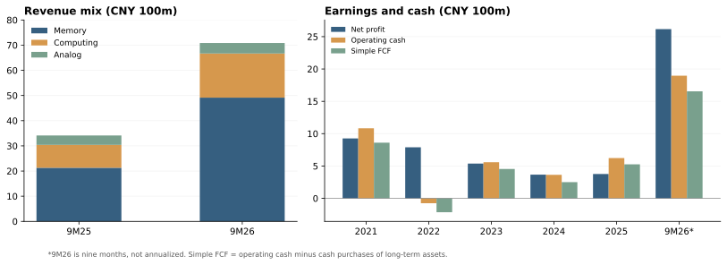

# 北京君正（300223.SZ / 03223.HK）研究报告

**研究日期／数据截止日**：2026-11-25（Asia/Shanghai，盘后）。最新财务为2026年三季报，未经审计；完整附注以2026H1及2025年报为补充。  
**行情**：A股81.67元、H股65.45港元，均为11月25日收盘双源核对值。A股同价全股本估值420.56亿元；H股同价全股本估值337.04亿港元，折合288.30亿元人民币；两地股份分拆计价的集团市值412.52亿元。  
**关键估值**：按当前注册总股本重算，TTM归母PE为A股15.37倍／H股10.53倍，简单FCF收益率分别为4.11%／6.00%。  
**研究主线**：车规与工业存储的认证、渠道及供应能力是真实资产；本轮利润跃升也包含强烈的涨价和成本时差。决定投资回报的是正常化每股现金盈利，而非当前低PE能维持多久。

本报告接续[10月8日H1复核](北京君正-earnings-2026H1-20261008.md)及[8月17日研究](北京君正-research-20260817.md)，保留原文件。行情已更新至11月25日，不再使用此前11月24日快照。价格来源为[腾讯A/H行情](https://qt.gtimg.cn/q=sz300223,hk03223)、[新浪A股行情](https://hq.sinajs.cn/list=sz300223)和[华盛通H股行情](https://www.hstong.com/hk/quotes/10000-03223-HK)；折算采用[外管局11月25日中间价](https://www.safe.gov.cn/AppStructured/hlw/RMBQuery.do)：1港元＝0.85539元人民币。这是估值换算基准，非保证成交汇率。

---

## AI研究偏见自觉

**信息丰富度评级：A。** 定期报告、港股招股书和管理层交流充分，公开数据能解释历史利润，却不能观察终端客户实际消耗、库存逐批成本、晶圆厂未来报价或尚未量产新品的经济性。

AI研究局限性声明：本报告能较高置信度复核财报、股本和算术；20亿元正常化利润、未来增长、退出折价和可释放现金均为研究判断，不是公司指引。信息多不等于周期转折可预测。东方财富与监管报表属于两个独立获取渠道，但财务事实最终同源于公司披露，不能替代审计、客户和供应链访谈。

- [x] 不把资料数量当作生意确定性；减少一半新闻报道，不应改变现金与利润之间的判断。
- [x] 不把“AI需求＋存储缺货”直接换算为永久高毛利；单列管理层承认的回落风险。
- [x] 不以A/H折价收敛作为必要盈利来源；保留H股退出折价。
- [x] 不因旧报告90—115元复核带已到达，就默认满足买入条件。

> 研究追问：如果没有“AI”和“国产替代”这两个标签，仅看客户、供给、价格和现金，这家公司仍值得付多少？

---

## 第一步：核心数据总览

### 身份、股本与资本事项

法人名为北京君正集成电路股份有限公司，英文名Ingenic Semiconductor Co., Ltd.；300223.SZ自2026年8月13日起简称“君正股份”，03223.HK为同一公司的H股。不要与601216.SH君正集团混淆。继续复用现有“北京君正”目录及触发器ID。[证券简称变更公告](https://static.cninfo.com.cn/finalpage/2026-08-12/1225469525.PDF)

| 项目 | 截止日采用口径 | 对每股价值的影响 |
|---|---:|---|
| 注册总股本 | 514,951,667股 | 全文采用这个分母，避免使用发行前股数 |
| A股／H股 | 483,664,367／31,287,300股 | 两地股价不同，集团实际市值须分拆相加 |
| A股库存股 | 1,018,300股 | 尚未完成注销；保守估值仍计入注册股数 |
| 扣库存后的外部总股数 | 513,933,367股 | 仅作交叉说明，不在模型提前切换分母 |
| 11月26日15:00临时股东会 | 拟审议回购用途改注销、减资修章 | 截止11月25日尚未表决，不能预写“已通过” |

H股于8月25日上市；11月工商变更及11月6日通函确认上述股本。后续拟注销股份只占注册股本约0.198%，不足以实质改变本报告价格区间。[工商变更公告](https://static.cninfo.com.cn/finalpage/2026-11-04/1225657360.PDF)、[股东会通函及股本表](https://www1.hkexnews.hk/listedco/listconews/sehk/2026/1106/2026110601350.pdf)

### 五年财务与本轮跃升

金额单位为人民币亿元。简单FCF＝经营现金流－购建固定资产、无形资产及其他长期资产支付的现金；现金储备此表仅指货币资金，不混用现金等价物。

| 年度 | 收入 | 归母净利 | 毛利率 | 营业利润率 | 经营现金流 | 简单FCF | 货币资金 |
|---|---:|---:|---:|---:|---:|---:|---:|
| 2021 | 52.7406 | 9.2618 | 36.96% | 17.68% | 10.8324 | 8.6050 | 29.1852 |
| 2022 | 54.1187 | 7.8924 | 38.56% | 15.04% | -0.7551 | -2.1479 | 34.0075 |
| 2023 | 45.3093 | 5.3725 | 37.10% | 12.02% | 5.5815 | 4.5413 | 39.2727 |
| 2024 | 42.1263 | 3.6620 | 36.73% | 9.70% | 3.6345 | 2.5035 | 37.1665 |
| **2025** | **47.4101** | **3.7623** | **34.09%** | **8.74%** | **6.2260** | **5.2574** | **40.9164** |
| 2026前九月，非全年 | 71.0200 | 26.1612 | 58.03% | 40.71% | 18.9619 | 16.5455 | 71.5934 |

2021—2025年利润持续回落，2026年前九月出现跃升，说明公司有客户和产品积累，也说明利润不宜按稳定复利企业处理。2026前九月扣非归母25.9482亿元，非经常性损益仅占归母约0.81%，本轮高利润主要来自经营，并非大额处置收益；“经营产生”仍不等于“可以长期持续”。[2025年报](https://static.cninfo.com.cn/finalpage/2026-03-28/1225045085.PDF)、[2026三季报](https://static.cninfo.com.cn/finalpage/2026-10-28/1225631045.PDF)、[东方财富财务数据](https://data.eastmoney.com/stockdata/300223.html)

图中2026为九个月实绩，未年化；分部图不含小额其他业务，柱体不能直接当作合并收入全额。

### 最近四季度：利润加速，现金没有同步加速

| 期间 | 收入 | 归母净利 | 扣非归母 | 毛利率 | 经营现金流 | 现金资本开支 | 简单FCF |
|---|---:|---:|---:|---:|---:|---:|---:|
| 2025Q4 | 13.0451 | 1.2048 | 1.0775 | 33.82% | 1.1223 | 0.3635 | 0.7588 |
| 2026Q1 | 15.5977 | 3.1898 | 3.1222 | 43.49% | 2.1669 | 0.2679 | 1.8990 |
| 2026Q2 | 23.9750 | 8.7858 | 8.5401 | 57.12% | 7.4226 | 0.5725 | 6.8501 |
| 2026Q3 | 31.4474 | 14.1856 | 14.2859 | 65.93% | 9.3723 | 1.5760 | 7.7964 |
| TTM | 84.0651 | 27.3661 | 27.0256 | 54.27% | 20.0842 | 2.7798 | 17.3044 |

Q2、Q3由累计报表相减，Q4由年报减前三季度计算；单季毛利率用单季收入与成本重算，不能拿累计毛利率直接相减。原始累计数据与东方财富结构化三表一致。Q3简单FCF／归母仅54.96%；前九月经营现金流／归母72.48%、简单FCF／归母63.24%。现金为正是支持，转化未同步提升是约束。[三季报利润及现金流量表](https://static.cninfo.com.cn/finalpage/2026-10-28/1225631045.PDF)、[完整H1报告](https://static.cninfo.com.cn/finalpage/2026-08-29/1225524759.PDF)

### 收入结构：不要把所有存储都当作同一周期

| 产品 | 2025收入 | 2025毛利率 | 2026前九月收入 | 前九月同比 | 前九月毛利率 |
|---|---:|---:|---:|---:|---:|
| 存储芯片 | 29.1125 | 31.95% | 49.1581 | +130.73% | 56.53% |
| 计算芯片 | 12.9341 | 30.86% | 17.5227 | +92.89% | 64.04% |
| 模拟芯片／2025模拟与互联 | 5.0564 | 51.09% | 4.1752 | +11.70% | 49.28% |

产品表采用披露分类；年度与九个月绝对额不能直接作同比。[2025年报产品表](https://static.cninfo.com.cn/finalpage/2026-03-28/1225045085.PDF)、[三季报产品表](https://static.cninfo.com.cn/finalpage/2026-10-28/1225631045.PDF)

以下补齐最近四季产品收入；除Q1外，单季主要由累计数相减。单位为亿元，括号内为毛利率：

| 产品 | 2025Q4收入约数 | 2026Q1 | 2026Q2约数 | 2026Q3约数 |
|---|---:|---:|---:|---:|
| 存储 | 7.81 | 10.18（38.89%） | 16.14（53.85%） | 22.84（66.28%） |
| 计算 | 3.85 | 4.03（51.90%） | 6.41（66.82%） | 7.09（68.42%） |
| 模拟 | 1.32 | 1.32（50.88%） | 1.37（48.87%） | 1.48（48.22%） |

Q1和前三季度产品表仅披露至万元小数两位，Q2／Q3毛利率由累计毛利额差分得到，受披露舍入影响，均为推算值，不能当成直接披露的精确单季数。未取得足够资料可靠推算2025Q4产品毛利，留空。[2026Q1产品表](https://static.cninfo.com.cn/finalpage/2026-04-29/1225229907.PDF)、[H1产品收入与成本](https://static.cninfo.com.cn/finalpage/2026-08-29/1225524759.PDF)

产品明细目前以公司监管披露为唯一完整数据源，尚未取得独立第二渠道的全序列；差分计算不构成独立信源。该缺口不影响集团三表的双源核验，但降低分产品预测的置信度。

### 资产负债表：现金缓冲强，但不等于可全部分配

| 2026年9月底项目 | 金额／亿元 | 口径 |
|---|---:|---|
| 货币资金 | 71.5934 | 含不属于现金等价物的部分 |
| 现金及现金等价物 | 70.7511 | 与货币资金分别展示 |
| 交易性金融资产 | 14.9041 | 包含理财及股票投资，不能全称无风险现金 |
| 长短期借款 | 0 | 季报相应项目无余额 |
| 一年内到期非流动负债＋租赁负债 | 0.1350 | 保守合并扣除，非全部负债 |
| 保守净现金代理 | 70.6161 | 现金等价物减上述租赁相关负债 |
| 广义净金融资产代理 | 86.3626 | 货币资金＋交易性金融资产－上述负债 |
| 存货／应收账款 | 35.9943／12.3173 | 高库存既保供，也暴露价格与需求风险 |
| 商誉／归母权益 | 30.0778／174.8443 | 并购回报须穿越周期验证 |

货币资金上升包含H股发行募资，不能全部解释为内生现金创造。交易性金融资产未取得理财与股票的完整季末拆分；其他权益工具投资不计作现金。其他非流动资产1.3241亿元增幅与办公楼采购意向金有关，但这是科目总余额，不能全称意向金金额；购建现金是否已包含该付款缺少完整附注，故不重复扣减，也不声称已完成全部投资现金穿透。[三季报变动说明与三表](https://static.cninfo.com.cn/finalpage/2026-10-28/1225631045.PDF)

简单FCF还没有完整扣除租赁本金、股份支付经济成本及少数股东分配，也不含未来产能预付款承诺，属于可比现金指标，不是股东可立即取走的现金。

> 段永平式追问：如果暂时去掉涨价，这门生意还剩什么？答案是认证、客户、产品与稳定供货，但正常利润会明显低于当前季度的外推值。

---

## 第二步：生意本质分析

**一句话定义：公司为需要长期可靠供货的汽车、工业和影像设备客户设计芯片，通过设计导入、认证和持续迭代获得重复器件订单。**

公司采用无晶圆厂模式，向晶圆厂、IDM和封测供应商购买产能或服务，再以器件或方案向客户及经销商销售。收入不是订阅费；重复采购来自同一设备平台持续生产，而不是用户数量增加带来的网络效应。客户换料需要重新验证可靠性和系统兼容性，这延长了关系，也不妨碍客户双供、压价或下调订单。

利润主要由三组变量决定：

1. **DRAM售价、数量与加权成本。** 10月27日交流披露前三季度DRAM销量同比约增20%，收入增长主要来自ASP；管理层当时预计2027年出货量与2026年相近。11月交流又提示长协价格和数量均在调整、2027产能仍紧。收入高增不能视作相同幅度的可持续量增。[10月27日IR](https://static.cninfo.com.cn/finalpage/2026-10-28/1225637336.PDF)、[11月12日IR](https://static.cninfo.com.cn/finalpage/2026-11-13/1225670112.PDF)
2. **NOR放量与计算芯片毛利回归。** NOR增长更多由销量驱动；计算芯片则受存储KGD供应紧缺和调价影响，管理层明确提示Q3可能是毛利高点，未来可能回落。两条产品线不能套用同一个长期利润率。[11月10日IR](https://static.cninfo.com.cn/finalpage/2026-11-11/1225667474.PDF)
3. **研发与营运资本的回报。** 2025年研发费用7.1203亿元，2026前九月6.2655亿元。研发是持续竞争的必要成本；库存与回款决定账面利润多少能成为现金。供给不增加时，研发投入也不能立即变成更多可售产品。[年报](https://static.cninfo.com.cn/finalpage/2026-03-28/1225045085.PDF)、[三季报](https://static.cninfo.com.cn/finalpage/2026-10-28/1225631045.PDF)

库存可保供至2027年底是管理层对供应连续性的判断，不能推出已经锁定相同的低成本、售价和毛利。H1披露存货发出采用加权平均法，后续采购成本、产品结构与跌价准备都会影响利润。现有数据不足以把毛利增量精确拆成“永久产品升级”和“暂时库存价差”。[H1会计政策](https://static.cninfo.com.cn/finalpage/2026-08-29/1225524759.PDF)

> 段永平式追问：这门生意好在哪？好在可靠性与长期供货能让设计赢单反复产生订单；弱点是价格与上游产能仍能大幅改变股东回报。

---

## 第三步：护城河评估

| 来源 | 判断 | 支持证据 | 可证伪条件 |
|---|---|---|---|
| 品牌／独立定价权 | 有限 | ISSI品牌、质量记录有利于导入 | 只有缺货时才可涨价，供需恢复即回吐毛利 |
| 转换成本 | 中等偏强 | 车规、工业验证和长供货周期 | 客户快速转双供、认证周期缩短或丢失平台 |
| 网络效应 | 弱 | 未发现用户越多产品本身越好的机制 | 不应据渠道扩大赋予平台估值 |
| 规模与供应关系 | 中等 | 全球渠道及长期供应关系 | 不能获得足够晶圆量，或成本上涨超过提价 |
| 技术与产品组合 | 中等 | SRAM、利基DRAM、NOR、视觉SoC积累 | 新工艺延期、新品不能量产或研发回报下降 |

港股招股书引用公司委托Frost & Sullivan统计，按2025年收入，公司SRAM全球第二、份额23.9%；利基DRAM第七、2.1%；NOR第七、5.0%；IP-Cam SoC第二、17.6%。这些是特定市场的排名，不能改写为全部DRAM、全部SoC或端侧AI市场份额，也不是独立客户访谈验证。[招股书行业章节，印刷第101—102页](https://www1.hkexnews.hk/listedco/listconews/sehk/2026/0817/2026081700004_c.pdf)

竞争不能只看同属芯片设计的上市公司。年报列出的存储同行包括英飞凌、旺宏、美光、三星，计算同行包括联咏、国科微、星宸科技、富瀚微。前者分别在产品组合、规模与供给方面形成约束，后者争夺影像平台和客户设计导入；君正的优势应在具体器件的可靠性、成本及平台延续中验证，不能由单一细分排名推广为全产品领先。[2025年报行业与竞争说明](https://static.cninfo.com.cn/finalpage/2026-03-28/1225045085.PDF)

过去五年的产品与客户基础有所积累，但2021—2025年利润回落，尚不能证明护城河持续变宽。未来五年最可信的支撑仍是可靠性、生命周期与细分产品；供给约束和新产品交付则可能成为瓶颈。高毛利不是护城河本身，供需恢复后还能留下多少毛利才是检验。

> 巴菲特式追问：十年后什么还在？可能是客户验证、产品维护与渠道；能摧毁它们的是质量事故、供货失信、客户迁移，以及技术路线落后。

---

## 第四步：逆向思考与风险清单

**最强空方论点：市场看见的是高现金、高增速与低PE，但公司可能正在确认售价快速上升与旧成本库存共同形成的异常利润；当销量受限、成本补涨、计算芯片毛利回落，便宜的分母会先缩小。** 这不否认经营改善，而是质疑改善中有多少能延续。

下表概率为定性研究判断，不是统计频率；也不等同后文三情景权重。

| 失败路径 | 主观可能性 | 影响 | 观察指标 |
|---|---|---|---|
| DRAM提价结束、成本补涨 | 较高 | 利润率和每股盈利下降 | 季度ASP、存储毛利、长协重签、存货成本 |
| 供给不足限制销量 | 较高 | 收入增长越来越依赖价格 | 实际取得产能、2027出货指引、交付延迟 |
| 客户／渠道补库存转去库存 | 中等 | 应收、存货与减值上升 | 回款、渠道库存、取消订单、跌价准备 |
| 计算芯片毛利回归 | 较高 | 第二大利润源承压 | KGD价格、新品占比、计算分部毛利 |
| 新品投片或量产延迟 | 中等 | 估值叙事先于现金兑现 | T42、3D DRAM、Wide I/O与AI-MCU里程碑 |
| 地缘、出口限制或供应链中断 | 不可可靠量化 | 极高，可能永久损失 | 代工伙伴许可、供货地区、客户准入 |
| 重大质量问题或商誉减值 | 低至中，证据有限 | 高 | 召回、设计平台丢失、减值测试参数 |
| 资本配置失误／H股流动性折价 | 中等 | 每股价值和退出价格受损 | 并购投入、投资资产、回购价格与长期现金回报 |

历史类比优先采用公司自身：2022年收入仍高于2021年，经营现金流却转负；2025年收入恢复，归母利润仍弱。这比简单类比某家AI龙头更能说明库存周期与利润率的重要性。它不是2027必然重演的预言。

跨学科看，这是供给滞后与存货成本传导问题：短期需求增加时，稀缺产能和库存拥有者分享利润；客户加单、厂商扩产与高价补库存又可能形成反向反馈。客户认证提高替换成本，却不能消除行业供需反馈。

本研究最可能犯的错有两个方向：低估价格和产品升级能维持的时间；或者把已实现的高毛利当作永久改善。前者会错过行情，后者会损失本金。模型给正常化利润留出范围，但不声称已找到周期顶点。

> 芒格式追问：聪明人为什么不买？因为他可能相信财报，却无法可靠估计下一轮正常利润，也不愿用估值扩张补偿这种未知。

---

## 第五步：管理层评估

| 事项 | 已知事实 | 评价 |
|---|---|---|
| 收购北京矽成／ISSI平台 | 建立全球汽车、工业存储产品与渠道，现仍有30.0778亿元商誉 | 战略效果可见；跨周期资本回报尚不能仅靠2026峰值利润下结论 |
| 持续研发 | 维护多产品线并布局RISC-V、端侧视觉及新存储 | 方向合理，以量产、设计赢单与现金回报验收 |
| H股发行 | 新增31,287,300股并获得资金 | 降低资金约束；同时要核募资用途和摊薄后回报 |
| 9月A股回购 | 花1.5001亿元回购1,018,300股，均价约147.32元 | 当前价较均价低44.56%；短期表现提示时点判断不足，不能据此直接指控诚信 |
| 11月拟改注销 | 从激励／员工持股用途改为注销，待股东会 | 股东回报方向改善，但约0.198%缩股幅度有限 |
| 2025年度分红方案 | 每股0.15元 | 相对当前股价回报较小，不能主要靠股息支撑投资 |

回购及注销事实以[11月通函](https://www1.hkexnews.hk/listedco/listconews/sehk/2026/1106/2026110601350.pdf)为准；分红和并购背景见[2025年报](https://static.cninfo.com.cn/finalpage/2026-03-28/1225045085.PDF)。短期股价不能单独评价管理层，但高价回购确实消耗真实资本，不应只看“回购”二字就加分。

Q3刘强持有40,475,544股、7.86%，李杰持有15,917,785股、3.09%，两人为一致行动人，合计约10.95%。这是按全部注册股本计算的普通股权益比例，不存在本报告可据以另算的AB股超级投票权。香港中央结算代理持股不是一名独立经济股东。[三季报股东表](https://static.cninfo.com.cn/finalpage/2026-10-28/1225631045.PDF)

7月披露的减持计划完成记录包括刘强控制的四海君芯减持400万股、李杰200万股、刘飞299,975股。须区分本人、控制载体及持股时期，不能直接把载体减持全部写成刘强个人直接减持。[减持实施结果公告](https://static.cninfo.com.cn/finalpage/2026-07-06/1225411737.PDF)

管理层在11月交流承认计算毛利可能见顶、存储毛利不会一直上升，这种边界表达有用；它不保证能择时周期。组织中已有ISSI渠道、产品与客户验证体系，但继任安排和关键团队稳定性仍缺少充分一手访谈。本报告对资本配置及治理给中等信心，不给“卓越管理层”溢价。

> 段永平式追问：如果CEO退休，公司还能竞争吗？既有客户与产品体系应能延续，但未来新品、供给协调和资本配置不能假设自动延续。

---

## 第六步：行业与文明趋势

数字化、智能汽车与边缘AI增加了数据处理和存储需求；北京君正处在器件与嵌入式方案环节，主要通过产品设计、可靠性和供给兑现价值。AI需求不是直接传导的利润合同：上游晶圆厂可提高价格，下游可延后订单，公司也未必取得足够产能。

管理层11月披露，DRAM约占存储收入一半以上、Flash接近四成、SRAM不足一成；DDR4／LPDDR4占DRAM收入超过40%。这些均为分部内部概数，不能换成全公司精确占比。NOR约七至八成用于汽车、工业，其余约两成涵盖AI服务器、光模块、硬盘等多个高可靠领域，**不等于AI服务器占NOR收入两成**。[11月10日IR](https://static.cninfo.com.cn/finalpage/2026-11-11/1225667474.PDF)、[11月12日IR](https://static.cninfo.com.cn/finalpage/2026-11-13/1225670112.PDF)

现阶段的新市场应按证据分层：

| 项目 | 证据状态 | 估值处理 |
|---|---|---|
| 现有车规、工业及高可靠存储 | 已有收入、份额与毛利 | 进入正常化经营基座 |
| NOR新应用与产品结构升级 | 管理层披露增长，AI客户及收入未单列 | 进入增长假设，保持折扣 |
| T42／端侧更大算力、AI-MCU | 研发、验证及未来量产计划 | 作为上行情景，不能计作现有成熟利润 |
| 3D DRAM／Wide I/O | 投片受产能制约、仍推进研发 | 不因“已布局”给予确定收入 |

11月20日公司回答转载称目前没有单独算力芯片；T42预计2027量产，3D DRAM投片因产能延后。原始互动易页面本次未直接取得，故降为公司回答的二级转载证据；其方向与11月正式IR相符，不把转载日期写成量产日期。[公司回答：算力芯片](https://yuanchuang.10jqka.com.cn/20261120/c682048646.shtml)、[公司回答：投片及新品](https://yuanchuang.10jqka.com.cn/20261120/c682048239.shtml)

本报告不提供一个把DRAM、视觉SoC和所有端侧AI相加的“统一TAM”。目前缺少定义一致、可独立核验的远期细分TAM和公司可获得量，给出精确增长曲线反而会制造确定性。已核份额用于说明当前位置，未来空间通过明确的增长情景表达。

> 李录式追问：二十年后它处在哪一层？更可能是持续提供可靠器件与方案的细分供应商；能否成为高资本回报资产，要看技术迁移后客户关系和每股现金能否保留。

---

## 第七步：估值与安全边际

### 当前价格买到什么

以下每股指标都用514,951,667股重算。财报披露的累计EPS采用期内加权股数，不能直接与当前全股本市值混算。H股以人民币现金流折算，汇率固定仅为模型假设。

| 指标 | A股 | H股 | 解释 |
|---|---:|---:|---|
| 价格 | 81.67元 | 65.45港元 | 11月25日收盘 |
| 同价全股本市值 | 420.56亿元人民币 | 337.04亿港元／288.30亿元人民币 | 两个每股定价视角，不是两个可相加的集团市值 |
| TTM归母PE／扣非PE | 15.37／15.56倍 | 10.53／10.67倍 | 都含本轮异常高利润 |
| PB | 2.41倍 | 1.65倍 | 归母每股净资产33.9535元 |
| PS | 5.00倍 | 3.43倍 | TTM收入84.0651亿元 |
| 广义EV／收入代理 | 3.98倍 | 2.40倍 | 扣广义净金融资产；股票投资并非无风险，非标准可变现EV |
| 简单FCF收益率 | 4.11% | 6.00% | TTM简单FCF17.3044亿元，未完整扣经济稀释等 |
| 正常化利润20亿元对应PE | 21.03倍 | 14.41倍 | 假设口径，非新增披露数据 |

H股折成人民币后较A股每股低31.45%；这反映两个市场的定价，不是无风险套利。扣库存股后的分拆市值约411.69亿元；本文采用包含库存的412.52亿元分拆市值，并以各市场同价全股本市值评价各自的每股投资回报。

不采用PEG：当前同比受周期和低基数主导，拿极高利润增速作分母会掩盖风险。自身历史比较也须防止误读：2025年盈利低，今天相对2025利润的倍数仍高；TTM PE下降同时来自股价下跌及利润跃升，不能全部解释为安全边际增加。未取得经核验的完整历史PE分位序列，不填“历史最低分位”。

同业比较应区分兆易创新的存储／MCU组合、聚辰股份的EEPROM等产品和全志科技的计算SoC。当前周期阶段、产品结构与现金转化不同；本次没有取得上述公司同步的双源正常化盈利估计，因此不发布看似精确的同业目标PE均值，也不据同行高PE提高君正估值。这是同行估值的数据缺口，不是默认君正便宜的依据。

### 正常化盈利：20亿元不是保底

本报告不将Q3归母14.1856亿元简单乘四。将正常化、扣除闲置资金收益后的经营归属利润设为20亿元，构造依据为年收入约100亿元、净利润率约20%；这是研究假设，不是对报表净利逐项调整得到的已验证数字。该利润率高于2021—2025多数年份，却明显低于2026Q3归母净利率45.11%，已经给了产品升级和业务规模扩大的信用。

这是最重要也最不确定的输入。若收入回落、晶圆成本补涨而售价下降，20亿元仍会偏高；若NOR、新品和产能持续兑现，则会偏低。后文给出15亿元正常利润的压力值，不将20亿元伪装成精确预测。

### 三年三情景：回答贵不贵

起点为20亿元正常化利润、对应每股3.88386元；三年期每股增长取悲观-10%、基准+8%、乐观+20%，目标PE分别12、18、22倍。倍数是周期和业务质量的研究判断，不是十年终值倍数。基准18倍要求客户关系及正常利润可信；乐观22倍还要求新品和量增兑现，不能只靠ASP。

三年价格没有再次加净现金，亦未另计派息，避免在利润倍数中重复奖励资产和现金回报。现值统一按人民币8%折现。

| 情景／主观权重 | 三年利润／亿元 | 三年A股价格／元 | 今日A股现值／元 | H股同权现值／港元 | H股保留20%折价／港元 |
|---|---:|---:|---:|---:|---:|
| 悲观／25% | 14.5800 | 33.98 | 26.97 | 31.53 | 25.22 |
| 基准／55% | 25.1942 | 88.07 | **69.91** | 81.73 | **65.38** |
| 乐观／20% | 34.5600 | 147.65 | 117.21 | 137.02 | 109.62 |
| 概率加权今日值 | — | — | **68.63** | — | **64.19** |

概率是组织判断的工具，不是实证胜率。A股现价高于基准现值；H股现价接近保留折价后的基准值，尚缺足够安全边际。即使经营改善，薄折价也不足以抵消正常利润估错的风险。

反向定价检查：在三年后18倍PE、要求年化8%且暂不计派息的条件下，当前A价要求三年后归母利润约29.43亿元，H价约20.18亿元。前者要求持续明显增长，后者对利润要求较低，但仍承受流动性、汇率和折价风险。这是反向盈利桥，不冒称完整反向DCF。

### 十年折现：输入、约束与仓位压力

| 输入 | 采用值 | 理由和边界 |
|---|---|---|
| 现金流币种及r | CNY，8% | 统一假设无风险利率1.7%＋β1×ERP6.3%；1.7%为模型标准化假设，并非声称11月25日国债实时报价 |
| 合理r区间 | 人民币6%—9% | H股先换算人民币买入成本；并未用港元现金流配人民币r |
| 稳态增量ROIC | 12% | 承认利基认证和轻制造资本优势，同时低于高景气利润可反推的水平；是稳态判断，非报表已证的增量ROIC |
| 永续g，悲／基／乐 | 0%／1%／1% | 基准低于人民币2%上限；乐观主要体现在前十年经营，永续阶段不再重复奖励AI高增 |
| r－g | 8／7／7个百分点 | 三档均高于5个百分点约束 |
| 十年经营利润增速 | -4%／+6%／+12% | 从正常化20亿元起算；长期基准低于三年基准，反映成熟与竞争 |

H股只是将人民币价值按固定汇率转成港元展示，不据此声称港元投资者的资本成本只有8%。汇率变动、交易税费与市场折价仍需单列。离散的供应链断供、出口限制、质量召回及治理事件没有塞入β或r，也未被可靠概率化，属于未建模尾部风险；不能把模型数字视为已覆盖这些永久损失。

终值PE唯一来自永续模型：`(1－g/ROIC)÷(r－g)`。悲观为12.50倍，基准与乐观均13.0952倍；没有引用同行今日PE来证明十年后PE。

| 情景 | 2036正常化利润／亿元 | 终值PE | 仅终值代理年化A | 仅终值代理年化H |
|---|---:|---:|---:|---:|
| 悲观 | 13.2967 | 12.50倍 | -8.87% | -5.36% |
| 基准 | 35.8170 | 13.10倍 | +1.10% | +4.99% |
| 乐观 | 62.1170 | 13.10倍 | +6.82% | +10.93% |

本表按项目`terminal_value.py`标准形式计算，股息减稀释k取0，未计中间现金分配及今日多余现金，因此是保守的终值回报代理，不能冒充完整现金流IRR。工具打印“IRR”时亦应按此限制阅读。固定汇率下H股资本投入较低，所以代理回报较高。

必须检查折现率扰动；以下是25%／55%／20%概率加权的**各情景年化代理值**，不是组合现金流精确IRR：

| r | A股期望代理年化 | 相对r | H股期望代理年化 | 相对r | 参与翻转判定 |
|---|---:|---|---:|---|---|
| 6% | +3.05% | 未通过 | +7.01% | 通过 | 是；最窄r－g为5个百分点 |
| 8% | -0.25% | 未通过 | +3.59% | 未通过 | 是 |
| 10% | -2.66% | 未通过 | +1.08% | 未通过 | 区间外，仅供参考 |

再以7%／8%／9%复核：A股分别+1.25%／-0.25%／-1.54%，均未通过；H股+5.15%／+3.59%／+2.25%，均未通过。**A股压力测试在已检验人民币合理r档位内未翻转；H股在6%与8%之间翻转，对折现率敏感，仓位建议须降级。** 较窄7%—9%采样没有翻转，不抵消较宽有效区间已发生的翻转。

### 补上中间现金，检查终值代理的偏差

补充经营权益现金DCF，将十年各期现金与终值分别折现。悲观／基准／乐观的利润转现金比例为65%／60%／40%，均为扣再投资、租赁及稀释准备后的假设；高增情景保留更多再投资。它们不是已观察到的长期可分配比例。基准6%增长、40%利润再投入，隐含增长期新增资本回报约15%；乐观12%增长、60%再投入，隐含约20%，不能只提高增长而不付资金代价。

模型另计50亿元潜在多余现金，低于保守净现金代理70.62亿元；约20.62亿元继续留作经营及风险缓冲。50亿元不是已获董事会承诺可分配的金额；若资金受限、海外税费或经营所需高于预期，须下调。经营利润假设已排除闲置资金收益，避免该现金与利息收益双计。

| 情景 | 完整经营现金DCF A／元 | 同权H／港元 | 仅H股终值保留20%折价／港元 |
|---|---:|---:|---:|
| 悲观 | 38.64 | 45.17 | 41.67 |
| 基准 | **72.96** | 85.29 | **75.42** |
| 乐观 | 101.96 | 119.19 | 102.09 |
| 概率加权 | **70.18** | 82.04 | **72.32** |

补充模型只对H股退出终值施加折价，中间现金按可归属金额估计；三年价格折价作用于届时整个股价，二者不是完全相同的估值口径。

关键压力值：H股基准若终值折价扩大至40%，现值为65.56港元，接近现价；若正常利润从20亿元降至15亿元、仍保留20%终值折价，现值降至59.41港元。若不承认50亿元多余现金，基准A值减少约9.71元、H值减少约11.35港元。现金归属与正常利润的重要性高于小数点后的估值精度。

完整反向DCF检查：固定基准增长、现金转化、50亿元多余现金和8%折现率，当前A价要求起点正常化经营利润约22.76亿元；H价在保留20%终值折价后要求约16.89亿元。前者高于本报告20亿元假设；后者较低，但一旦正常利润只有15亿元或可释放现金不足，折价即可消失。这才是包含中间现金的反向DCF，与前面的三年盈利桥及仅终值代理分别呈现。

### 估值分歧对账

三年基准认为A股偏贵、H股接近合理；计入中间现金的DCF对H股显示一定折价；终值代理的基准压力测试则均未覆盖8%，且H股对r敏感。这些差异首先来自模型是否计入中间现金、可释放金融资产及退出折价，不是任选一个结果为结论背书。

三年模型和完整DCF承担定价判断；十年终值模型承担重仓压力测试。最终观望新增，依据的是正常利润不稳、供给限制、计算毛利回落及现价安全边际薄的综合结果，**不是十年未通过的一票否决**。保留对合理小仓的有条件持有；十年压力结果把研究性总仓参考上限压到A/H合计约1.5%，而非要求机械清仓。若后续经营证据增强，应先重估现金与正常利润，再讨论提高仓位。

> 巴菲特式追问：r错两个百分点会怎样？A股的压力测试仍不足；H股会在有效区间翻转，所以不能用单一折现率下的“便宜”支持重仓。
>
> 段永平式追问：股市关闭五年，愿意按今天价格持有吗？适度小仓可基于客户与现金有条件持有；对空仓者，当前价格尚不足以补偿利润正常化的不确定性。

---

## 第八步：最终决策与行动清单

| 维度 | 结论 | 信心度 |
|---|---|---|
| 生意质量（段永平） | 有真实重复订单与长期供货价值，但利润周期性强 | 中等 |
| 护城河（巴菲特） | 认证、产品组合与ISSI渠道构成中等壁垒，独立定价权有限 | 中等 |
| 管理层（段永平＋巴菲特） | 产业平台与研发有积累，回购时点及跨周期资本回报需打折 | 中等 |
| 最大风险（芒格） | ASP与库存成本时差回归，供给受限，新品兑现不足 | 风险机制较高；发生时点低 |
| 文明趋势（李录） | 存储与边缘智能长期需求存在，价值捕获仍受产能与竞争限制 | 中等 |
| 估值（巴菲特＋段永平） | 三年：A偏贵、H近合理；十年终值压力未过，H在有效r区间翻转；完整现金DCF更高但依赖现金与转化假设 | 中低 |

估值维度不是唯一裁决；十年压力未通过只收紧仓位，不能单独否定生意与经营改善。

| 策略 | 建议 |
|---|---|
| 空仓者 | **A/H均观望新增。** A股50—58元、H股55—60港元为条件式分批研究带；价到仍须以下经营验证通过 |
| 持仓者 | **合理小仓有条件持有，暂停加仓。** 不知用户实际成本与仓位，不能据本报告推定已持有或已执行；如存在超出风险预算的集中持仓，应先复核集中度 |
| 研究性仓位 | 条件满足后首笔参考约0.5%，A/H合计总仓参考不超过1.5%；这是主观风险预算示例，不是模型算出的最优仓位 |
| 加仓信号 | 后续连续两次正式财务披露确认单季CFO为正、滚动CFO覆盖现金资本开支；滚动简单FCF／扣非归母向至少65%改善；存储／计算毛利变化与采购成本可解释，库存减值、应收回款及未来产能无实质红线；正常化经营利润约20亿元仍有证据支持后，才重新估值 |
| 卖出／减仓信号 | 公司质量、客户、供给或治理出现永久损害；正常利润显著低于假设且不能解释，或资本被低回报项目消耗；价格高于A110元／H100港元而经营仅达基准时复核超配，警戒价不代表自动卖出 |
| 低于研究带 | A低于50元／H低于55港元，先核永久损失与模型失效，再讨论价格；不自动抄底 |

新研究带替代旧A股90—115元复核带。改变来自新增Q3／11月资料对价格、产能和毛利来源的澄清，以及正常化估值与安全边际的重建，不能表述为“10月后财报突然恶化”。旧带本来就要求经营复核，触价不等于满足买入条件，也不等于历史建议命中。

| 下一节点 | 关注事项 | 日期性质 |
|---|---|---|
| 2026-11-26 15:00 | 回购用途改注销、减资修章表决，后续注销登记及真实股数 | 公司已公告的会议日；非已生效注销日 |
| 2026-12-31 | 价格与成本传导、产能、库存回款、新品进度、资金用途 | 人工研究检查日，非财报预约日 |
| 2027-04-30 | 全年及Q1正式财务、减值、完整现金流与附注 | 披露窗口兜底检查，非已确认预约日；正式披露即提前复检 |

价格带在同一“北京君正”target内登记，保留A/H代码及历史已完成事件。每日监控仅扫描价格；以上事件留存供人工复检，不声称系统会自动执行事件分析或交易。

### 四位大师框架的应用

以下原话用于约束本报告推理；后面的应用为研究者推演，不是四人对北京君正的真实推荐。

- 巴菲特：“You only have to be able to evaluate companies within your circle of competence.” 已读[1996年股东信](https://www.berkshirehathaway.com/letters/1996.html)。应用：对库存成本、未来产能看不清时，应缩小判断和仓位，不用丰富新闻填补能力边界。
- 芒格：“If you turn problems around into reverse, you often think better.” 已读[Stripe Press授权《Poor Charlie’s Almanack》Talk Ten](https://stripe.press/poor-charlies-almanack/book)。应用：反问如果不再涨价、计算毛利回落、产能不增，今天的盈利还能留下多少。
- 段永平：“不懂不碰的就是好的投资者”。已读[2011年9月7日原帖的本地存档，第77条](../段永平/段永平雪球全量原发言.md)，对应[雪球原帖](https://xueqiu.com/1247347556/20385652)。应用：无法形成正常利润判断，可以选择不买；这不构成他本人否定北京君正或半导体行业的证据。
- 李录：“One common problem for investors is that they tend to swing too often.” 已读[喜马拉雅资本官网Investment Philosophy](https://www.himcap.com/)。应用：不把一次急跌自动当作甜蜜点；证据和价格真合适时，也不应让长期等待变成永不行动。

> 综合追问：如果未来一段时间市场不再给AI题材溢价，只按正常现金回报定价，我是否仍愿承担同样的仓位？

---

## AI分析置信度与投资确定性

AI分析置信度：财报、股本、A/H身份和现金算术较高；管理层公开披露的方向中等；正常化利润、终端库存、未来产能价格、资金可分配性及新品商业结果中低。对“财报高利润确实存在”有信心，对“它会长期维持”没有同等信心。

实际投资确定性：中低。认证和渠道提供经营基础，价格与成本周期决定其中多少能留给股东。20亿元正常化利润、未来增长、50亿元多余现金及20%退出折价均基于有限信息推演，不是充分数据证明的事实。

最值得补的一手问题：逐批库存成本与库龄；未来季度的可交付晶圆数量及报价；主要客户真实消耗与渠道库存；NOR新应用收入与毛利；新品量产订单及研发回报；海外现金可调回与税负；办公楼、产能预付款、租赁和股份支付的完整现金归属。未经这些核验，不把本报告升级为高确定性重仓论文。

---

## 数据来源与审计记录

一手财务以[2022完整年报](https://static.cninfo.com.cn/finalpage/2023-04-10/1216358936.PDF)、[2024完整年报](https://static.cninfo.com.cn/finalpage/2025-04-19/1223154348.PDF)、[2025完整年报](https://static.cninfo.com.cn/finalpage/2026-03-28/1225045085.PDF)、[2026完整中报](https://static.cninfo.com.cn/finalpage/2026-08-29/1225524759.PDF)、[2026三季报](https://static.cninfo.com.cn/finalpage/2026-10-28/1225631045.PDF)为准；独立获取渠道为东方财富完整财务三表和主要指标接口。研究过程中重新获取原文与结构化数据，不把旧报告当独立信源。

### 关键数据交叉验证记录

下列为`financial_rigor.py cross-validate`实际输出的汇总，金额单位为元，持股比例为百分数；完整核验覆盖16项。

| 字段 | 监管原文 | 东方财富 | 工具偏差 | 结果 |
|---|---:|---:|---:|---|
| 2025收入 | 4,741,007,597.96 | 4,741,007,597.96 | 0.00% | 一致 |
| 2025归母净利 | 376,226,023.06 | 376,226,023.06 | 0.00% | 一致 |
| 2025货币资金 | 4,091,644,233.30 | 4,091,644,233.30 | 0.00% | 一致 |
| 2026前九月收入 | 7,102,003,680.70 | 7,102,003,680.70 | 0.00% | 一致 |
| 2026前九月归母 | 2,616,124,605.04 | 2,616,124,605.04 | 0.00% | 一致 |
| Q3货币资金 | 7,159,342,476.27 | 7,159,342,476.27 | 0.00% | 一致 |
| Q3交易性金融资产 | 1,490,409,919.88 | 1,490,409,919.88 | 0.00% | 一致 |
| 前九月CFO | 1,896,187,263.62 | 1,896,187,263.62 | 0.00% | 一致 |
| 前九月购建现金 | 241,634,358.87 | 241,634,358.87 | 0.00% | 一致 |
| 总股本／股 | 514,951,667 | 514,951,667 | 0.00% | 一致 |
| 刘强／李杰持股比例 | 7.86／3.09 | 7.86／3.09 | 0.00% | 一致；与股数相除复核 |

市值验算输出：A股81.67元×514,951,667股＝42,056,102,643.89元，对行情420.56亿元，偏差小于0.001%；H股65.45港元×相同股数＝33,703,586,605.15港元，对行情337.0359亿港元，偏差小于0.001%。H股行情页显示的总市值可能使用不同或截短股数，本报告统一采用公告股本重算。

估值验算输出：A股PE15.37倍、PB2.41倍、简单FCF收益率4.11%；H股PE10.53倍、PB1.65倍、简单FCF收益率6.00%。季度差分、情景估值与现金折现均以程序计算；估值采用十进制运算，终值工具的年化及翻转计算采用其内置数值算法。

最终估值参数复检准出：CNY、r8%、ROIC12%、g0%／1%／1%、β1；币种、分母和风险归属三项均通过。供应链中断、出口限制、重大质量召回及管理层治理四项尾部风险仍未建模，已在正文保留。

随机数据抽检准出：固定种子为研究日的八位日期数，按默认比例抽得二十五个候选；其中一个为汇率链接后的单位误识别，人工剔除。有效二十四项全部通过、无警告或失败：十六项是财务／行情及其派生值，八项是模型重算或研究输入核对。分产品明细缺少独立第二完整来源的限制仍然存在；模型输入通过核对不代表预测被外部事实证实。

监控验证通过：原有标的ID内接续价带及事件，配置校验和临时状态下的A/H定点价格扫描均通过；未写正式机器状态，未发送通知。跟踪表新增本次建议、关闭旧H1接续事件，并重算全表及看板摘要；旧报告保持原样。

*仅供学习与研究，不构成投资建议。*
