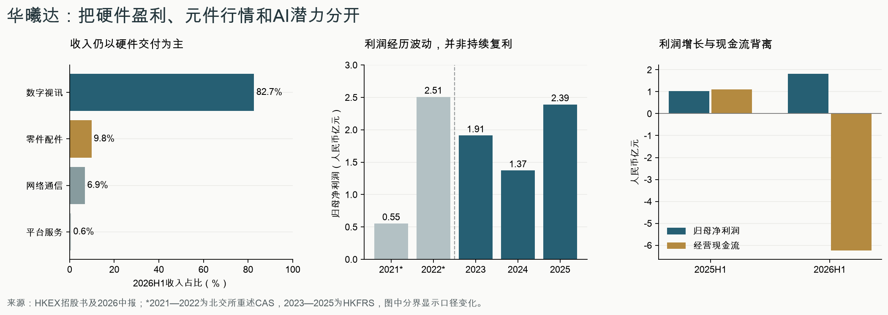

# 华曦达（00901.HK）研究报告

> **研究与信息检索截止日**：2026年11月3日，Asia/Shanghai；财务截至2026年6月30日，最新完整年度为2025年。  
> **行情锚**：2026年11月2日收盘60.50港元；总股本209,540,070股；复算总市值126.77174235亿港元，约108.5103亿元人民币；TTM PE约34.20倍。11月3日盘中行情不混入估值。  
> **研究主线**：运营商认证、软硬件集成和交付能力有价值；当前需要证明的是，元件涨价及大额备货带来的利润，能否转化为稳定现金回报，以及Cedar能否形成独立收费。  
> **信息丰富度评级 B**：招股书与中报较充分，上市历史短，订单、库存构成和AI商业化信息有限。本文仅用于学习研究，不构成投资建议。

## AI研究偏见自觉

AI研究局限性声明：公开披露可以支持“交付能力、盈利、现金占用”的判断，尚不足以验证Cedar的客户付费、留存、获客成本和推理成本。不能因为材料反复提到Google和AI，就给整家公司软件平台倍数；也不能因为现金流暂时为负，就断言备货必然滞销。

- [x] 将公司披露、外部平台核对、模型假设和研究判断分别标注。
- [x] 用现金流和竞争者的同类合作检验AI叙事。
- [x] 不将公司付费委托的行业顾问预测视为独立需求验证。
- [x] 不把资料缺口当成负面事实，也不填造四个季度数据。

**研究定位**：本次为华曦达首次研究。此前检索未发现同一标的的既有研究档案，用户已确认按首次研究处理。本文以“北交所时期—港股招股—上市后中报”的公开披露建立初始研究基线，后续更新以本报告的判断、估值假设和监控条件为参照。

下表对照历史公开讨论与本次首次核验的证据，用于建立初始判断。

| 历史判断 | 本次证据 | 当前处理 |
|---|---|---|
| 上市前利润下降，增长质量受质疑 | 最新年报及中报确认利润恢复，但现金转换恶化 | 上调经营恢复评价，现金质量仍未通过 |
| 外协制造意味着资本需求低 | 材料备货和应收需要借款及客户预付款 | 将营运资金纳入生意质量与估值 |
| Google认证构成先发壁垒 | 同行也扩大Google合作，开放框架可被复制 | 保留集成交付优势，降低排他性判断 |
| AI家庭入口可能带来平台化 | 产品和试点推进，独立付费及单位经济仍未披露 | 作为待验证上行空间，不提前给平台倍数 |
| 关联渠道与治理风险 | 相关销售下降、直销增加，历史监管事实仍在 | 检查终端穿透和整改，不能因上市成功自动消除 |

公司身份为深圳市华曦达科技股份有限公司，英文 Shenzhen SDMC Technology Co., Ltd.，简称SDMC；2026年5月27日港交所主板上市，旧新三板代码430755。十月月报显示H股与未上市股共同构成总股本，无库存股。9月提出的小额全流通属于股份类别转换，不是发行新股。[S1][S3]

---

## 第一步：核心数据总览

### 五年盈利及现金记录

除比率外，单位均为人民币百万元；2021—2022为北交所招股书重述后的中国会计准则数据，2023—2025为港股招股书HKFRS数据。两个区间的毛利率、营业利润和现金流分类不可直接当作完全同口径趋势。

| 指标 | 2021 CAS重述 | 2022 CAS重述 | 2023 HKFRS | 2024 HKFRS | 2025 HKFRS |
|---|---:|---:|---:|---:|---:|
| 收入 | 1,295.506 | 2,529.242 | 2,366.870 | 2,540.936 | 3,367.659 |
| 归母净利润 | 55.356 | 250.856 | 191.209 | 137.228 | 239.112 |
| 毛利率 | 15.94% | 19.46% | 21.1% | 19.0% | 19.5% |
| 经营净现金流 | -111.021 | 60.573 | 28.670 | 125.854 | -134.043 |
| 现金资本开支 | 2.322 | 11.663 | 44.464 | 15.717 | 21.295 |
| 简单自由现金流 | -113.342 | 48.910 | -15.794 | 110.137 | -155.338 |
| 期末现金等价物 | 109.919 | 313.455 | 280.956 | 455.770 | 273.353 |
| 研发费用 | 51.627 | 96.447 | 149.229 | 160.706 | 163.900 |
| 未扣财务成本税前利润率代理 | 不横比 | 不横比 | 8.61% | 5.79% | 7.59% |

来源为北交所重述招股书及港股招股书财务附录，收入、归母、现金等以etnet或历史独立报道核对。[S1][S4][S5] “简单自由现金流”=经营现金流−购买物业设备−土地使用权−无形资产，未扣租赁本金；2023年包含35.254百万元土地支出。“利润率代理”=(税前利润+财务成本)/收入，仍含其他收益，不能称公司正式披露的纯主营经营利润率。

旧版2021年报收入约13.07亿元、归母约0.60亿元，后经重述为上表金额；直接拼接旧数据会夸大早期盈利。2023年新三板报表毛利率与HKFRS口径亦不同。五年数据最有用的结论是利润会波动、现金转化反复，而非一条稳定增长曲线。

### 最新半年：利润恢复，现金占用显著扩大

| 指标 | 2025H1 | 2026H1 | 变化/解释 |
|---|---:|---:|---|
| 收入（百万元） | 1,536.830 | 2,095.437 | +36.35% |
| 归母净利润（百万元） | 103.108 | 181.281 | +75.82% |
| 总利润（百万元） | 103.134 | 181.416 | 媒体常用+75.9%，与归母口径不同 |
| 毛利（百万元） | 271.247 | 443.158 | 增长含原材料销售贡献 |
| 毛利率 | 17.6% | 21.1% | 主业与零配件需分别看 |
| 经营净现金流（百万元） | 111.279 | -623.755 | 备货与应收占用 |
| 简单自由现金流（百万元） | 101.246 | -647.818 | 资本支出24.063百万元 |
| 扣租赁本金后FCF（百万元） | 96.941 | -652.086 | 再扣4.268百万元租赁付款 |
| 研发费用（百万元） | 78.774 | 82.658 | 占本期收入3.94% |
| 未扣财务成本税前利润率代理 | — | 9.81% | 仍受元件行情和其他项目影响 |

来源为中报第26、30—31页，etnet损益及现金流平台校对。[S2][S4] 2026H1公司没有派中期股息；最近完整三年亦无股息，不能把未来假设的现金分配当成已有股东回报政策。

### 收入结构与毛利来源

| 收入类别 | 2025全年收入（百万元） | 2026H1收入（百万元） | H1收入占比 | 2025H1毛利率 | 2026H1毛利率 |
|---|---:|---:|---:|---:|---:|
| 数字视讯设备 | 2,454.359 | 1,734.028 | 82.7% | 16.8% | 18.2% |
| 网络通信设备 | 560.887 | 143.598 | 6.9% | 22.1% | 16.0% |
| 系统平台及服务 | 36.847 | 11.900 | 0.6% | 54.1% | 42.8% |
| 零件及配件 | 315.566 | 205.911 | 9.8% | 12.2% | 48.2% |

数字视讯以流媒体终端为主，另含投影等。软件收入同比增长，规模仍小；软件捆绑硬件的价值可能未单独列收，因此0.6%不能被解释为“全部软件价值为零”，同样不能被解释为已经形成订阅平台。[S1，第11—12页；S2，第7、11—12页]



零件及配件H1毛利按公告四舍五入毛利率推算约99.25百万元，上年同期约7.45百万元，增量约91.80百万元，占集团毛利增量约53.40%。这是研究推算，不是已披露的精确分部利润。剔除这部分后，其余业务合计毛利率约18.20%。**集团毛利率升至21.1%，不能直接证明AI软件护城河已经变现。**

地区亦并非全面繁荣：亚洲收入806.288百万元、同比+197.09%；欧洲738.067百万元、+36.49%；美洲400.788百万元、-33.64%。海外占92.9%，按客户所在地分类，不等于最终消费者所在地。[S2，第8、34页]

近四季度没有完整单季披露。可核算2025H2收入1,830.829百万元、归母136.004百万元，但不将其均分成两个季度，也没有虚构2026Q3业绩。

> 数据追问：利润恢复已经有证据，为什么现金尚未同步回来？下一次验证应看回款和库存，而不只看收入增速。

---

## 第二步：生意本质分析

**一句话：全球运营商和零售品牌付钱，让华曦达把芯片、Google等生态认证、软件适配和硬件交付整合成能上市使用的家庭终端；复购主要来自客户项目、设备升级和交付表现。**

| 环节 | 谁付钱、为何付钱 | 复购与经济性 |
|---|---|---|
| 流媒体终端/投影 | 运营商及零售品牌需要合规、稳定、适配内容生态的产品 | 设备升级和中标续单，非天然订阅 |
| 宽带/网关 | 运营商部署连接设备 | 产品迭代和网络升级；本期新品认证使收入承压 |
| XMediaTV/XHome | 客户购买模块、授权及配套服务 | 存在许可收费机制，收入占比尚不足以支撑平台估值 |
| 零配件销售 | 外部客户购买部分采购储备原材料 | 规模采购优势叠加元件行情，持续性弱于核心交付 |
| Cedar/AI Station | 目标是让运营商家庭终端承载AI交互和服务 | 尚缺独立收入、付费用户和单位经济披露 |

招股书写明硬件采用成本加成定价，部分软件与硬件捆绑。软件平台存在一次性模块费和定期许可收费，不能把全部收入都归为纯代工；但软件服务占比及现金记录又不足以证明它是一家SaaS公司。[S1，正文第167、189页]

真正影响利润的三个变量是：出货及产品结构、元件采购与售价传导、营运资金回收。2026H1数字视讯毛利提升，网络通信收入却因新一代产品仍处验证而下降，显示“项目已拿到”与“产品能交付”之间存在时间和成本。收入增长还能摊薄研发等固定费用，但库存与借款会吞噬这种经营杠杆的现金成果。

“轻工厂”也不等于“轻资本”。中报称存货上升与存储芯片供应紧张、价格上涨及需求预测备货有关。外协制造减少厂房设备投入，却不消除材料、应收和履约资金需求。

> 段永平式追问：这门生意好在哪？好在替全球客户解决认证、集成和交付难题；能否好到长期重仓，要看客户愿否为这项能力持续支付高于资金占用成本的利润。

---

## 第三步：护城河评估

| 护城河 | 证据及反证 | 判断 |
|---|---|---|
| 品牌与定价权 | 运营商交付信誉有用；硬件成本加成，材料涨价仍需传导 | 有信誉，无强消费者定价权 |
| 转换成本 | 认证、系统适配、测试及维护使换供应商有成本；新招标仍可引入对手 | 中等，依项目而异 |
| 网络效应 | 更多设备可能改善维护经验；第三方AI框架和Matter同样开放 | 未证明专属网络效应 |
| 规模与采购 | 批量采购、供应链协调和多地区交付；2026备货大幅占用现金 | 存在优势，回报不稳定 |
| 技术与认证 | 早期Google Android TV认证、Google TV投影ODM认证经验 | 工程门槛真实，非永久排他许可 |

需第三方生态认证的产品收入占比从2023年的20.5%升至2025年的57.9%。这个比例同时支持两种判断：认证业务能力扩大，对Google、Netflix、Amazon等权限的依赖也扩大。不能只取前半句。[S1，正文第45页]

竞争者并未停止学习。创维数字已公开Google智能家居合作。其2026H1智能终端分部毛利率16.37%，九联科技整体毛利率21.07%；华曦达数字视讯18.2%并没有显示出软件平台级别的超额毛利。三者产品和会计范围不同，只比较经济结构，不据此做精确估值排名。[S8][S9]

过去几年，跨国客户覆盖、产品适配及直销能力有所增强；平台依赖与元件风险也随规模上升。未来护城河能否变宽，取决于平台服务和AI收费能否提高客户终身收益，而不是发布会次数。若上游直接整合终端、运营商多源采购加剧，或竞争者同样取得认证，现有能力容易变成行业入场券。

> 巴菲特式追问：十年后护城河还在吗？认证与项目经验可能仍在，但控制内容、系统和AI入口的上游可以改变规则；必须持续验证客户是否仍为华曦达的集成能力付费。

---

## 第四步：逆向思考与风险清单

最强空方论点是：这是一家有工程能力的硬件方案商，正处材料涨价与下游复苏周期，却被部分投资者按AI入口估值；其库存、短借和历史治理问题，要求更低价格和更强现金证据。最强多方反驳是：认证积累、直销转型和现有装机渠道，可能让AI产品获得较低获客成本，并提高终端价值。两者的分水岭是现金和独立收费数据。

以下概率为主观风险等级，不是统计发生率；缺少样本时不伪造百分比。

| 失败路径 | 主观概率等级 | 影响 | 可观察指标 |
|---|---|---|---|
| 备货未按预期交付、价格回落导致跌价 | 中高 | 利润和现金同时受损 | 库存周转继续上升、减值、订单延期 |
| 零配件高毛利回落 | 高 | 本期毛利增量难持续 | 原材料销售毛利与数字视讯毛利分化 |
| 网络产品验证延迟 | 中 | 增长来源集中于视讯 | 网络收入、毛利和新产品批量交付 |
| AI增加成本但客户不付费 | 中高 | 研发/推理支出无回报 | 有无付费合同、净增利润、活跃及续费 |
| 大客户/最终终端客户流失 | 中 | 订单、应收和备货受冲击 | 终端客户合并口径集中度与逾期 |
| 平台授权或贸易准入中断 | 低频、难量化 | 可严重破坏业务 | Google/内容认证、出口及本地合规 |
| 关联交易或披露问题再犯 | 无法可靠量化 | 直接损害少数股东判断基础 | 新监管措施、关联方现金流、审计意见 |

### 现金压力不能忽略，但也不能只讲坏的一面

2026年6月底存货2,092.737百万元，较2025年底+140.72%；应收及票据1,246.314百万元，+37.69%；短期计息借款732.319百万元，+239.72%。存货周转由102日升至162日。[S2，第15—16、27页]

正面证据是合同负债从30.236升至361.428百万元，公司提高客户预付款比例，客户有部分资金承诺；应收周转94日降至93日，并非所有现金恶化都来自回款变慢。但合同负债仅相当于库存约17.27%，不能证明全部库存已有不可取消订单。合同负债也可能涉及不同商品及交付时点，不能机械相减得到“安全库存”。

现金桥更直接：期初现金273.353百万元，经营净流出623.755百万元、投资净流出185.295百万元、融资净流入1,036.996百万元，加汇率影响后期末499.923百万元。融资主要含IPO与净增借款516.755百万元。现金余额增加依靠融资，不能当作经营自我造血改善。[S2，第30—31页]

压力测试：如果期末库存额外发生10%的账面损失，税前影响约209.27百万元，已超过本期归母净利润。这只是库存敏感性，不是预测损失率，也没有将税前冲击等同税后利润减少。

历史类比以本公司更可靠：2022高利润之后，2023和2024利润下降，说明项目和采购周期会反转；2025复苏也未带来正OCF。网络设备和机顶盒行业过去的共同教训是，协议、芯片和认证可能逐步标准化，工程优势未必长期转化成高估值。这里用的是行业机制类比，不宣称某家失败公司必然预示华曦达结局。

最可能的研究错误是把“收入中含软件技术”理解成“收入具有软件订阅经济性”，其次是把材料价格上涨形成的毛利当成长期定价权。控制叙事偏差、IPO价锚定和只看成功AI公司的幸存者偏差，比给预测加小数更重要。

> 芒格式追问：聪明人为什么不买？因为增长已经需要付高价，而现金流、AI收费和治理可信度仍有独立的验证任务。

---

## 第五步：管理层评估

创始人李波兼任董事长、总经理。其直接持有50,286,768股，约24.00%；连同受控实体等的控制或视同权益69,689,568股，约33.26%。不能把33.26%全称为其个人经济权益，也没有证据支持用AB股投票权解释本公司。[S1，正文第212、229页；S2，第23—25页；S4]

| 时间 | 决策或记录 | 已见结果 | 研究评价 |
|---|---|---|---|
| 早期至上市前 | 累积Google认证与海外运营商交付 | 建立实际收入和盈利 | 正面，工程与商业执行有证据 |
| 2020—2022关联交易，2023监管处理 | 未及时履行智慧媒体关联交易审议及披露义务 | 深圳证监局对公司及相关人员出具警示 | 重大减分，属于正式监管事实 |
| 2023—2025 | 持续研发及投影、平台拓展 | 收入恢复，软件规模仍有限 | 产品执行合格，AI资本回报待证 |
| 2026H1 | 借款锁定原材料、提高客户预付款 | 提高供货保障；库存与资金占用扩大 | 暂不评分为成功或失败，等交付回款 |
| 2026上市融资 | 募集资金用于产品、AI及全球拓展 | 截至中期指定募集资金尚未使用 | 融资完成不等于投资回报已实现 |

深圳证监局2023年监管决定列明，2020—2022年智慧媒体关联交易未及时审议、披露，公司、李波等受到警示。报告采用监管认定的事项，不将媒体“空壳客户”等质疑升级为已证实欺诈。[S6]

对智慧媒体销售金额和中间商收入占比随后下降、直销增加，是积极变化。不过Altice既可能直接采购，也可能经渠道采购，渠道占比下降不等于最终客户风险等比例下降。需要持续检查最终客户穿透、关联方回款和利益冲突。

资本配置方面，研发的收入占比2023—2025约为6.30%、6.32%、4.87%，2026H1为3.94%；不能误用招股书以“运营开支”为分母的比率。研发尚有硬件订单支撑，但AI独立回报没有公开验证。2026H1末另有楼宇合同资本承诺84.812百万元，应纳入后续资金检查。[S1][S2，第41页]

没有足够证据对最新高管净减持、激励的全部经济成本、核心人才流失和接班安排作无保留结论；“未取得证据”不写成“没有风险”。主要老股法定转让限制及控股股东承诺覆盖上市起一年，2027年5月27日前后复核相关限制及实际减持，不能写成2026年11月普通六个月大解禁。[S1，正文第228、284—285页]

> 段永平式追问：CEO退休还能保持竞争力吗？现有认证和组织经验可以延续，但关键客户、资本配置纪律及接班能力缺乏独立证据，不能仅凭高持股认定“对的人”已经通过。

---

## 第六步：行业与文明趋势

家庭交互从遥控器进入语音、多模态与AI代理，方向值得研究。华曦达处在终端集成与运营商交付层，上游有芯片、系统、内容与模型平台，下游有运营商和品牌。谁控制用户入口、收费与数据权限，谁更可能持续取得高利润；终端出货增长并不自动把利润池转给硬件方案商。

公司招股书概览仍引用2024年全球第八、中国大陆第三及2.7%份额；更新后的行业概览按2025年收入列全球第七、中国大陆第三、约3.3%。这是同一文件不同数据年度，采用最新2025年口径评估位置，不能改写成全部智能家居或家庭AI市场份额。[S1，行业概览；S10]

[单一行业顾问测算，未完成同口径独立验证] 招股行业概览将全球企业智慧家庭产品市场从2025年148亿美元预测至2030年354亿美元，称复合增长19.1%。这包括设备、基础设施及系统平台，不是全部可被华曦达获取的收入。预测来自发行人委托研究，本报告不以该增速外推公司利润，也不把3.3%视为最新实时份额。

| 价值链变量 | 有利趋势 | 不能跨过的验证 |
|---|---|---|
| 流媒体及终端更新 | 运营商和品牌需要新产品与内容适配 | 新机型交付、ASP、毛利和售后成本 |
| 更快连接与网关 | 网络升级提供替换需求 | 本期网络业务下滑，认证未完成不能提前确认销售 |
| 家庭AI代理 | 现有设备渠道可能降低获客门槛 | 用户是否实际使用并付费，云推理成本由谁承担 |
| 标准协议和开放模型 | 降低开发门槛、扩大兼容性 | 同时降低竞对进入成本 |

2026年9月Google Cloud Physical AI加速计划、与晶晨联合展示、AI Station技术预览，以及10月Altice Labs技术交流，支持产品推进和生态接触；公告未提供足以验证Cedar收入及利润的订单数据。10月27日活动、10月30日发稿也不能写成新大单签约。[S7]

客户集中度虽在改善，仍然较高：招股书列前五客户收入占比2023—2025年为60.7%、50.6%、47.7%，最大客户为23.6%、14.3%、15.9%；前五供应商采购占比为46.9%、40.0%、37.0%，2025最大供应商11.9%。渠道名称的分散不等于终端客户穿透后的分散。上述数据截至2025年，不能冒称2026H1集中度。[S1，正文第7、179、190页]

相较电力或互联网早期，当前家庭AI仍有使用频率、隐私权限与付费分配问题。若AI只推动一次性硬件换代，公司可能得到一轮产品升级收益；若形成按户授权并可持续回款，商业模式才可能跃迁。研究时要保留后一种上行可能，但不能提前把它资本化到全部业务。

> 李录式追问：二十年后它是平台还是供应商？现有证据更支持“有能力的供应商”，要升级为平台，需要公司能够控制并收取经常性用户价值的证据。

---

## 第七步：估值与安全边际

### 当前定价与口径

以11月2日收盘和同日外汇中间价1港元兑0.85595元人民币换算；汇率为记账比较基准，不是实际可成交汇价。该基准与Wise等市场中间价存在差异，不混用两套口径。[S11]

| 指标 | 复算值 | 口径 |
|---|---:|---|
| 总股本 | 209,540,070股 | H股加未上市股，10月月报 |
| 价格 | 60.50港元 | 11月2日完整交易日 |
| 总市值 | 126.7717亿港元 | 价格乘全部股本 |
| 人民币市值 | 108.5103亿元 | 使用上述固定汇率 |
| 2025静态PE | 45.38倍 | 归母净利239.112百万元 |
| TTM归母净利润 | 317.285百万元 | 2025全年+2026H1−2025H1 |
| TTM PE | 34.20倍 | 用当前股本重算，非历史加权EPS |
| TTM PS | 2.76倍 | TTM收入3,926.266百万元 |
| PB | 5.49倍 | 6月底归母权益1,975.555百万元 |
| EV/TTM收入代理 | 2.78倍 | 期末现金加定存、扣借款及租赁；非当前实时资产负债表 |
| 净现金（含定存、扣租赁） | -81.894百万元 | 实际为净债务；排除受限及质押存款 |

现金499.923百万元，加定存163.573百万元，扣借款732.319百万元及租赁13.071百万元，得到上表净债务；若只认可现金等价物，净债务扩大至245.467百万元。IPO“尚未使用募集资金”不得另加一次。六月底债务与十一月行情之间存在时间差，EV只能作为代理。

H1现金流为负，不能据此给出正的可持续FCF收益率；2025经营现金流亦负。PEG没有可靠持续盈利增速分母，列为不适用。上市不足一年，没有可用的跨周期历史PE分位；IPO价格也不是价值底线。同行缺乏本次同日全面价格、股本和正常化利润验证，故不编造精确PE便宜榜。

### 正常化盈利与三年情景

本次以正常化年度归母利润250百万元作估值起点，**这是研究假设，不是2026年指引**。它接近2025归母水平，低于将H1简单翻倍，也不把零件配件48.2%毛利永续化。举例若元件毛利回到25%、税率假设15%，H1归母代理约140.68百万元；这个演示不能替代按客户、订单和费用逐项调整的盈利预测。

正常化EPS折港元约1.39388；对应现价正常化PE43.40倍。三年目标是退出时的情景价格，尚未折现、未计分红或汇率变动，不能当成今天的内在价值。

| 三年情景 | 利润年增速假设 | 三年退出PE假设 | 三年后价格 | 相对60.50港元总价差 |
|---|---:|---:|---:|---:|
| 乐观 | +20% | 28倍 | 67.44港元 | +11.47% |
| 中性 | +8% | 18倍 | 31.61港元 | -47.76% |
| 悲观 | -10% | 10倍 | 10.16港元 | -83.20% |

三年PE是对届时市场可能支付价格的假设；其中乐观档已要求较强盈利增长和较高退出定价。它不用于十年终值模型。未为三档分配缺乏证据的概率，也不把简单平均值包装为期望回报。

### 十年折现：全部人民币口径

基准资本成本r取8%，敏感性取9%。参考11月2日中国十年国债收益率约1.63%，β取模型默认1.0；基准可理解为1.63%加6.37%的长期股权风险溢价判断。风险溢价不是对当日市场的实测值。人民币现金流不套港元折现率，未来港元兑人民币按本次基准汇率不变仅为换算假设。[S12]

稳态增量ROIC取12%。按税前利润加财务成本、近似税率及平均净投入资本计算的2025存量ROIC代理约23.92%，但它含其他收益及元件行情，不能复制为稳态回报。公司没有分红，无法用派息反解出可靠的增量ROIC下界；12%属于保守判断，依据是成本加成硬件属性、竞争及营运资金需求，非统计估计。预测期再投资回报与稳态ROIC分别定义，避免把高速增长期回报永久化。

永续增速g分别为0%、1%、2%，均是第十年之后的增长，人民币基准不超过2%。十年退出PE只来自：

\[
PE_{终值}=\frac{1-g/ROIC}{r-g}
\]

| 终值档位 | 稳态ROIC | 永续g | r=8%时r−g | r=8%退出PE | r=9%时r−g | r=9%退出PE |
|---|---:|---:|---:|---:|---:|---:|
| 悲观 | 12% | 0% | 8个百分点 | 12.50倍 | 9个百分点 | 11.11倍 |
| 中性 | 12% | 1% | 7个百分点 | 13.10倍 | 8个百分点 | 11.46倍 |
| 乐观 | 12% | 2% | 6个百分点 | 13.89倍 | 7个百分点 | 11.90倍 |

均通过同币种、分母至少5个百分点及离散风险归属检查。改变r时g保持不变。平台授权和贸易中断列为独立尾部压力，库存及产品迭代进入经营情景；没有把这些事件藏进β。

预测期用250百万元为起点，十年利润年增速悲观0%、中性8%、乐观15%；对应预测期增量资本回报假设12%、16%、20%，可分配现金占利润比例=1−增长率/增量资本回报，即100%、50%、25%。这要求营运资金恢复正常，且可分配现金可以实现，绝非本期实际现金转换率。

| 十年情景 | 第十年归母利润（百万元） | r=8%模型价值/股 | r=9%模型价值/股 | r=8%下仅退出价差年化 | r=8%下含模拟分配IRR |
|---|---:|---:|---:|---:|---:|
| 悲观 | 250.00 | 17.42港元 | 15.49港元 | -11.70% | -7.60% |
| 中性 | 539.73 | 25.22港元 | 21.19港元 | -4.20% | -1.98% |
| 乐观 | 1,011.39 | 41.28港元 | 33.09港元 | +2.62% | +3.77% |

模型价值=十年可分配现金现值+第十年利润乘终值PE的现值。归母利润起点已经扣除财务成本，采用权益现金流近似；不重复扣一次净债务、不另加IPO款，假设未来债务成本及股本无重大改变。它不是精细FCFF。若继续依靠债务备货，或未来增发，价值需下修。

“仅退出价差年化”由terminal_value工具自零计算，不含中间股息；最后一列按逐年模拟分配现金求IRR。公司没有承诺如此派息，留存现金若被低效使用也不能按模型价值兑现。在r=9%下，含模拟分配IRR依次约-8.39%、-3.10%、+2.30%；情景价值排序未变，现价缺乏安全边际的结论也未翻转。本表比较的是同一公司的情景，不是未经研究的跨公司收益排名。

反向权益DCF固定r=8%、终值g=1%、稳态ROIC12%、中间现金分配比例50%：要支撑现价，从250百万元起点需要十年利润年增速约19.00%。这同时暗含预测期新增资本回报约38.00%，远高于中性假设。这里是“市场需要什么”的压力刻画，并非市场确实一致预期如此。

额外尾部档假设Google关键授权或严重贸易中断导致股权价值永久损失80%，剩余价值20%。不分配无法可靠估计的发生概率，不纳入期望IRR；普通悲观档仍假设利润存续，并不能覆盖这种尾部。治理再犯、制裁发生时点、强制再融资及永久汇率变化尚未量化，构成模型限制。

由中性模型得出的当前价值参考约21—25港元，研究性分批评估带收紧至16—19港元；并非保证价值，也不代表跌到就买。价格带是对模型、库存和治理不确定性的留白；如果后续高质量现金盈利明显超出250百万元起点，必须重建模型，不能机械等待旧价。

> 巴菲特式追问：r提高后会不会翻转？本次r从8%到9%使中性价值明显下降，但不改变现价回避新增的判断。  
> 段永平式追问：关闭股市五年愿意按现价持有吗？目前尚没有足够现金回报和AI收费证据支持这一把握。

---

## 第八步：最终决策与行动清单

| 维度 | 结论 | 信心度 |
|---|---|---|
| 生意质量 | 有认证及交付价值的硬件方案商，现金稳定性不足 | 中高 |
| 护城河 | 工程、客户及采购积累真实，非排他平台 | 中 |
| 管理层 | 商业执行有成果，历史关联交易披露问题必须折价看待 | 中 |
| 最大风险 | 以高估值买入材料行情利润，随后库存与现金同时反转 | 中高 |
| 文明趋势 | 家庭AI方向有空间，价值归属尚未证明 | 中低 |
| 估值 | 现价缺安全边际；模型价值受正常化利润和现金转化支配 | 中 |

**结论为回避现价新仓、保留研究跟踪。** 不是否认产品机会，而是现价已经需要较强的长期业绩兑现；当前证据仍集中在硬件复苏、元件毛利与备货。

| 投资者/信号 | 动作 |
|---|---|
| 空仓者 | 60.50港元不新增；21—25港元先复核估值，16—19港元且经营条件通过才研究性小额分批 |
| 持仓者 | 暂停加仓，复核单一公司集中度与流动性；若原持仓依据是“成熟AI订阅平台”，应重新评估并考虑减仓，不因成本高而摊低 |
| 加仓必要条件 | 至少连续两个可观察报告期确认现金转化修复；库存周转回落至约120日以内；滚动经营现金流能覆盖现金资本开支及租赁；借款下降；关联交易和审计无新增重大问题 |
| AI升级估值条件 | 披露独立付费合同、收入和毛利/推理成本；可区分硬件捆绑、试点、经常性收费，不能只报产品发布或合作数量 |
| 减仓/退出复核 | 库存周转继续恶化且现金持续流出；跌价、取消订单或回款风险实质化；平台权限受损；重大关联交易披露或审计可信度问题 |
| 价格警戒 | 50港元以上且经营证据无实质增强，维持回避新仓并复核持仓；不是机械止盈线，当前已在该区间 |
| 低于16港元 | 先查是否发生论文破坏，不把更低价自动视作更安全 |

上表120日等为本次研究门槛，非公司指引。正常化盈利需要验证；若现金短期回流只是去库存、而核心毛利与订单同时下滑，也不能简单认定通过。

跟踪节点采用研究日历：2026年12月31日复核库存、订单和AI收费新信息；2027年3月31日核全年业绩披露情况并在正式结果后复检；2027年5月27日前后核老股转让限制和实际股东行为。后两者分别是研究检查日、上市周年复核日，不冒充公司已确认的业绩发布日或卖出计划。

以下为方法论模拟，并非本人真实发言：

> 段永平视角：先弄清谁持续付钱，再谈AI能让这门生意变多好。现在能看清的是交付，尚不是稳定的AI订阅回报。

> 巴菲特视角：认证有用，但钱能否按可接受的资本投入不断赚回来更重要。不能用高增长的期望替代安全边际。

> 芒格视角：反过来想，如果元件价格不再帮忙，库存却留在账上，现有估值还有什么保护？

> 李录视角：趋势可以长期正确，利润仍可能归上游。要研究谁真正控制用户价值的收费权。

---

## AI分析置信度与投资确定性

财务原文、股本、利润现金背离及历史监管事项的AI分析置信度较高；原材料毛利贡献为有据推算，置信度中等；正常化盈利、稳态ROIC、十年增长及Cedar付费前景属于假设和有限信息推理，置信度较低。投资确定性取决于未来客户、现金和资本回报，不能由资料数量提高。本公司暂不符合“高确定性、可重仓复利”的证据标准。

优先补充的一手验证是：大额库存的芯片型号、库龄、已锁订单比例及取消条款；期后去化和收款；原材料对外销售的交易对象、毛利及可持续性；Altice穿透口径收入与回款；Cedar付费、使用频率和云成本分摊；Google合作权限与对手差别；财务内控及关联方复核。可通过客户/供应链访谈和真实产品使用补足，访谈观点仍需与正式披露核对。

## 数据来源与审计记录

- [S1 港交所2026年5月18日招股书](https://www.hkexnews.hk/listedco/listconews/sehk/2026/0518/2026051800028_c.pdf)：2023—2025财务、商业模式、认证依赖、客户供应商、治理及转让限制；页码以正文或附录标号为准。
- [S2 2026中期报告，9月22日披露](https://www.hkexnews.hk/listedco/listconews/sehk/2026/0922/2026092200427_c.pdf)：业务及毛利第7—12页、营运资金第15—16页、报表第26—31页、财务附注第34—41页。
- [S3 十月证券变动月报，11月2日披露](https://www1.hkexnews.hk/listedco/listconews/sehk/2026/1102/2026110201016_c.pdf)：总股本、H股及未上市股，无库存股。
- S4 etnet独立平台：[损益表](https://etnet.com.hk/www/sc/stocks/realtime/quote_ci_pl.php?code=901&quarter=latest)、[资产负债表](https://etnet.com.hk/www/sc/stocks/realtime/quote_ci_bs.php?code=901&quarter=latest)、[现金流量表](https://www.etnet.com.hk/www/tc/stocks/realtime/quote_ci_cashflow.php?code=00901)、[公司资料](https://etnet.com.hk/www/sc/stocks/realtime/quote_ci_brief.php?code=901)。独立平台处理不等于独立审计，底层会计数据仍来自发行人。AAStocks可见旧IPO缓存且无ADR可作Macrotrends匹配，本次采用原文加etnet核对，没有伪称已完成不存在的ADR核验。
- S5 [北交所2023年6月30日招股书](https://www.bse.cn/disclosure/2023/2023-06-30/1688115493_253752.pdf)，采用重述版本；BSE直取受限时交叉阅读[发行人PDF镜像](https://qccdata.qichacha.com/ReportData/PDF/85a90b24a50e8dd0b30ef6f065c550bd.pdf)，并以[DoNews历史报道](https://www.donews.com/news/detail/4/3596870.html)核对重述主要指标；不混用旧2021年报。
- [S6 深圳证监局2023年监管警示决定](https://www.csrc.gov.cn/shenzhen/c104320/c7415024/content.shtml)：关联交易未及时审议及披露。
- S7 公司最新产品与交流信息：[Google Cloud Physical AI计划](https://www.sdmctech.com/news/companynews_175.html)、[AI Station技术预览](https://www.sdmctech.com/news/companynews_176.html)、[晶晨联合展示](https://www.sdmctech.com/news/companynews_177.html)、[Altice Labs交流](https://en.sdmctech.com/news/companynews_2064.html)。均为公司材料，不作为独立需求验证。
- [S8 创维数字2026H1报告](https://disc.static.szse.cn/disc/disk03/finalpage/2026-08-28/c2a94bc3-f438-4d1a-b044-9bde371399bc.PDF)，第11、15页；另见[Google合作官方说明](https://www.skyworthdigital.com/article_info_1_232_19.html)。只作同期经营对比，不宣称已研究其最新投资价值。
- [S9 九联科技2026H1报告](https://static.cninfo.com.cn/finalpage/2026-08-12/1225468746.PDF)，第7页及经营风险；[证券之星指标页](https://stock.quote.stockstar.com/finance/summary_688609.shtml)交叉阅读。
- [S10 中国证券报关于上市与沙利文服务的报道](https://www.cs.com.cn/ssgs/07/2026/06/03/detail_2026060310015797.html)：说明行业研究服务关系及份额统计口径。
- S11 [Investing历史行情](https://cn.investing.com/equities/shenzhen-sdmc-technology-co-ltd-historical-data)和[etnet行情及基本数据](https://www.etnet.com.hk/www/tc/stocks/realtime/quote_ci_basicdata.php?code=901)核对11月2日60.50港元；[外汇局汇率中间价](https://www.safe.gov.cn/AppStructured/hlw/RMBQuery.do?COLLCC=546877760)核人民币换算。网页缓存时点不同，采用带日期行情行，未用无日期快照。
- [S12 财政部—中债国债收益率曲线](https://yield.chinabond.com.cn/cbweb-czb-web/czb/moreInfo?locale=cn_ZH&nameType=1)，11月2日十年期约1.63%；[新华财经同期债市报道](https://m.cnfin.com/zs-lb/zixun/20261102/4489736_1.html)作数量级核对。

### 关键数据交叉验证记录

financial_rigor核验了市值、收入、归母、现金、股本、估值及情景；计算结果另用Decimal重算。关键原值核对如下，单位为人民币千元，股本及价格另注明。

| 字段 | 官方原文/历史重述 | 独立平台/报道 | 差异 |
|---|---:|---:|---|
| 2025收入 | 3,367,659 | 3,367,659 | 0 |
| 2025归母净利润 | 239,112 | 239,112 | 0 |
| 2025现金等价物 | 273,353 | 273,353 | 0 |
| 2026H1收入 | 2,095,437 | 2,095,437 | 0 |
| 2026H1归母净利润 | 181,281 | 181,281 | 0 |
| 2026H1现金等价物 | 499,923 | 499,923 | 0 |
| 2026H1存货 | 2,092,737 | 2,092,737 | 0 |
| 总股本（股） | 209,540,070 | 209,540,070 | 0 |
| 11月2日价格（港元） | 60.50（Investing） | 60.50（etnet） | 0 |

工具输出原文摘录：

```text
股价 (Price):       60.5 HKD
总股本 (Shares):    209.54M
计算市值:           12.68B HKD
偏差:               0.00%
✅ 验证通过, 偏差仅 0.00%
PE (TTM):  60.5 / 1.7690253644439167 = 34.20x
PB:        60.5 / 11.014724628816369 = 5.49x
```

精确输入与实际完整输出见[关键数据工具记录](关键数据工具记录-20261103.txt)及[估值与数据验算](估值与数据验算-20261103.json)。ROE若由EPS/期末BVPS派生只是代理，不作为平均权益ROE引用；工具内置的宏观参考值也不替代本报告按日期读取的国债观测。

研究取证的剩余缺口包括历史研发、资本开支、部分半年度现金流及品类细目未取得完整独立平台复核；行业TAM亦只有同一行业顾问口径。相关数据以原始披露为准，审计JSON逐项注明，不把重复转载算作独立审计，也不宣称所有字段均已双源验证。

最终抽样从可识别数据点中随机选取，保留原始样本及分类；财务事实和派生数值完成原文核对或复算，模型假设仅核对输入一致，误识别的历史年份不计入核验分母。结果见[数据抽检记录](数据抽检-20261103.json)、[工具判决](数据抽检判决-20261103.txt)及[终值准出](终值准出-20261103.txt)。工具判决通过不消除上述第二来源缺口，也不表示十年假设已被现实验证。

抽检、末轮终值检查、触发配置校验及隔离状态的单标的监控试运行已完成。触发点、研究复检日和建议事件已新增至本地监控配置及非重点台账；报价和HKEX源试运行正常，不污染正式机器状态、不发送通知、不包含证券交易。
