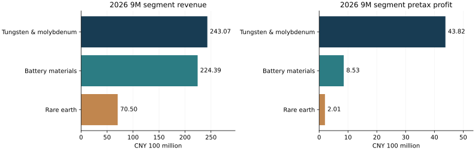
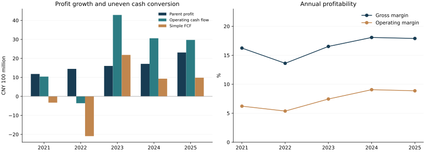

# 厦门钨业（600549.SH）研究报告

**研究与数据截止：2026-11-24，北京时间；最新定期报表截至2026-09-30，未经审计。**  
**证券身份：** 厦门钨业股份有限公司，Xiamen Tungsten Co., Ltd.，上海证券交易所A股600549，人民币交易；控股子公司厦钨新能688778是另一只证券。沿用既有“厦门钨业”目录及监控ID。[S1][S2]  
**价格与估值：** 11月24日收盘31.95元，腾讯16:14:59快照；总股本1,587,585,826股，复算市值507.23亿元；估算TTM PE 13.48倍、PB 2.67倍。[S1][S3]  
**一句话论点：** 钨钼工艺和客户认证有价值，第三季度回款确已改善，但中游库存风险、上升的净债务和待建矿山投入，仍限制低市盈率转化为长期股东回报。

## AI研究偏见自觉

**信息丰富度评级：A级。** 上市历史长、定期披露充分，市场熟悉“钨、稀土、正极材料”叙事。真正需要检验的是：原料涨价贡献了多少盈利，现金回报是否足以承担扩产、收购和分红。

**AI研究局限性声明：** 公开资料不能穿透每批存货成本、客户订单和矿山建设预算。分部经营数据主要来自公司披露及其投资者记录，两者不是独立商业调查。未来利润、概率、资本成本和价位带均为研究假设。年报历史序列存在同一控制合并的追溯变化；本文明确区分正式年度数、最新重述比较数及拼接TTM估算，避免制造统一口径的假象。

- [x] 不把材料价格上涨等同于自主定价权。
- [x] 同时检查利润、现金、存货、应收和融资。
- [x] 新增矿山控制权不提前当作产量和现金流。
- [x] 旧报告和大师观点不替代原始披露与本次估值。

---

## 第一步：核心数据总览

### 盈利集中在哪里

| 业务 | 2025收入（亿元） | 2026年前三季收入（亿元） | 同比 | 前三季利润总额（亿元） | 主要驱动 |
|---|---:|---:|---:|---:|---|
| 钨钼 | 201.52 | 243.07 | +67.28% | 43.82 | 原料与产品均价上升；切削工具等深加工销量增长 |
| 电池材料 | 198.80 | 224.39 | +71.83% | 8.53 | 动力正极销量增长，但钴酸锂销量下降 |
| 稀土 | 61.83 | 70.50 | +56.38% | 2.01 | 磁材增量、产品组合改善 |

另有房地产等小额业务。分部收入可能含内部交易，不能直接相加替代合并收入；利润总额也不是归母净利。前三季合并净利润43.77亿元中，少数股东损益11.51亿元，归母32.26亿元。不能把厦钨新能等子公司全部利润归给母公司股东。[S1][S2][S4]



业务披露显示，前三季动力正极材料销量6.31万吨、同比+19%，该口径包含三元、磷酸铁锂及其他，不能全称为磷酸铁锂；钴酸锂4.31万吨、同比-8%；磁材1.02万吨、同比+25%。收入高增同时包含金属价格传导，不能都视作需求增长。[S1][S4]

最近四季度的分部对照如下，单元格为“收入／利润总额”，单位亿元。差额采用公司披露的四舍五入累计数，精度止于此，不能当作审计单季数。

| 季度 | 钨钼收入／税前利润 | 电池收入／税前利润 | 稀土收入／税前利润 | 可比性 |
|---|---|---|---|---|
| 2025Q4 | 不列可靠单季值 | 不列可靠单季值 | 不列可靠单季值 | 全年与旧Q3之间有厦钨电机同控合并，未取得统一分部重述，机械相减会制造误导 |
| 2026Q1 | 73.21／17.63 | 65.85／2.60 | 18.26／0.70 | 当期原披露；随后H1新增九江大地同控合并 |
| 2026Q2 | 88.30／15.33 | 79.03／3.12 | 25.29／0.75 | H1减原Q1的差额估算，合并范围有差异 |
| 2026Q3 | 81.56／10.86 | 79.51／2.81 | 26.95／0.56 | 前三季减H1，显示钨钼税前利润下降 |

各单季分部成本及同口径同比基数不足，因此不补造季度毛利率或同比增速。最近完整分部毛利率为H1：钨钼36.79%、电池8.29%、稀土11.51%，不得冒充Q3毛利率；税前利润率也不是毛利率。[S1][S2][S13]

### 五年盈利和现金

| 年度 | 收入（亿元） | 归母净利（亿元） | 毛利率 | 营业利润率 | CFO（亿元） | 现金CapEx（亿元） | 简化FCF（亿元） | 货币资金（亿元） |
|---|---:|---:|---:|---:|---:|---:|---:|---:|
| 2021 | 318.52 | 11.79 | 16.24% | 6.21% | 10.40 | 13.70 | -3.30 | 15.51 |
| 2022 | 482.23 | 14.46 | 13.61% | 5.37% | -3.60 | 17.33 | -20.93 | 21.72 |
| 2023 | 393.98 | 16.02 | 16.52% | 7.45% | 42.86 | 21.04 | 21.82 | 28.51 |
| 2024 | 353.73 | 17.12 | 18.07% | 9.06% | 30.58 | 21.28 | 9.31 | 69.84 |
| 2025 | 462.65 | 23.09 | 17.90% | 8.87% | 29.71 | 19.89 | 9.82 | 39.71 |
| 2026年前三季 | 539.39 | 32.26 | 20.68% | 10.14% | -6.40 | 13.78 | -20.18 | 55.78 |

CFO为合并经营现金流；CapEx为购建固定资产、无形资产和其他长期资产支付的现金；简化FCF＝CFO−该CapEx，未扣并购、租赁本金及少数股东分配，并非母公司可分配现金。历史行采用东方财富当前序列并与年度原报表核对：2021采用2022年报重述比较数、2024采用2025年报重述比较数；2025年末资产负债数采用最新追溯列示，而年度损益、现金流仍用正式年报。2026九个月与全年不能直接比较。[S1][S2][S5]



### 与9月报告相比，哪些事实变了

| 核心指标 | 2026H1 | 2026年前三季/期末 | 判断 |
|---|---:|---:|---|
| 累计归母净利（亿元） | 22.01 | 32.26 | Q3单季10.26亿元；同比+27.44%，增速明显低于H1 |
| 累计CFO（亿元） | -24.63 | -6.40 | Q3单季+18.23亿元，改善是真实的 |
| 累计简化FCF（亿元） | -33.80 | -20.18 | Q3单季+13.62亿元，累计仍为负 |
| 存货账面净额（亿元） | 232.23 | 218.14 | 环比-6.07%，目前只有一次季度下降 |
| 应收账款（亿元） | 103.87 | 115.09 | 环比+10.80%，占款向应收端延伸 |
| 统一融资负债代理（亿元） | 174.27 | 182.45 | 已补入Q3短期融资券，不能据借款下降判去杠杆 |
| 净债务代理，扣货币资金（亿元） | 116.35 | 126.67 | 增加10.32亿元，现金改善尚未带来净债下降 |

融资负债代理包括短借、长借、一年内到期非流动负债、应付债券、非流动租赁负债，以及确认的超短融本金。Q3的“其他流动负债”包含两期各5亿元超短融；H1附注显示当时没有短期应付债券。到期非流负债可能含矿权出让金等，故这是保守代理，不能冒称纯银行有息债；超短融使用本金近似，未补应计利息。净债若再扣全部交易性金融资产，则H1约101.02亿元、Q3约103.28亿元，方向仍未下降；其中理财的可动用性、期限和子公司归属不能忽略。另有应付票据H1约103.58亿元、Q3约129.99亿元，不无依据全算有息债，也不能忽视其供应链融资约束。[S1][S2][S6]

**不能把存货下降全部归因于卖出回款。** Q3新增存货跌价损失4.57亿元、信用减值损失0.65亿元，存货账面净额同时受减值影响。Q3单季综合毛利率约18.55%，低于H1的21.83%；钨价回落仍在侵蚀利润率。管理层也未承诺此后没有进一步减值。[S1][S4][S7]

> 段永平式追问：如果剔除原料涨价，这门生意还能以持续回款和可分配现金证明自身价值吗？目前只能说改善，尚未完成证明。

---

## 第二步：生意本质分析

**一句话：** 工业与电池客户持续购买经过认证、性能稳定的难加工材料，公司赚取工艺和交付溢价，同时承担金属备货和客户账期。

钨钼链条从矿、冶炼和粉末延伸至硬质合金、刀具、丝材及回收。终端加工客户在意刀具寿命、加工效率、断线率及一致性，更换供应商需要试用和验证。正极材料客户为能量密度、安全、循环寿命和批次稳定付费。这些需求形成复购，但订单不具有订阅合同的稳定性。[S2][S4]

售价通常随原料变化重新协商，原料涨价可推高收入，却也提高备货资金。成本结转滞后时毛利会放大，随后降价又带来存货跌价。刀具、细钨丝和高电压钴酸锂的加工溢价，比金属涨价本身更接近长期竞争力；但公司没有充分披露“剔除库存价差后的经常利润”，无法精确分拆两者。

| 关键资产/能力 | 当前状态 | 对股东的经济含义 |
|---|---|---|
| 宁化行洛坑、都昌金鼎 | 现有在产矿山；豫鹭停产后其他在产矿合计年产精矿约8,500吨，为公司披露 | 有原料保障，但不能由此推算完整自给率 |
| 洛阳豫鹭 | 停产涉及原料供给争议；仲裁已中止等待条款效力审查 | 法律权利不等于恢复供料，不能提前恢复正常产量 |
| 博白巨典、九江大地 | 分别处在在建、待建阶段 | 先需要资金，贡献时间与回报尚不确定 |
| 江西巨通/大湖塘 | 11月完成股权过户、协议控制安排；截至10月底披露尚未开建、无经营收益 | 资源权益增强，短期更像新增资本承诺 |
| 深加工与回收体系 | 工具产线和研发积累；公司披露2025回收资源1万吨APT当量 | 降低部分供应约束，但回收当量不能直接加到精矿产量 |

矿山状态和产量来自公司投资者记录，未获矿端独立核产；不对未来自给率作精确承诺。[S4][S8][S9]

经营杠杆有两面：销量增长可摊薄研发和工厂固定成本，原料占款与减值也会吞掉账面利润。因此最该跟踪的是深加工量及单位利润、原料价格与库存成本差、营运资本及新增项目现金回报，不能只跟踪营业收入。

> 段永平式追问：这门生意好在哪里？难复制的是工艺与认证；需要折价的是重库存和周期。若交易所关闭五年，以现价重仓仍缺把握。

---

## 第三步：护城河评估

| 护城河来源 | 能证实什么 | 反证和弱点 | 判断 |
|---|---|---|---|
| 品牌与定价权 | 工业材料质量信誉、合格供应商资格 | 原料联动涨价不等于自主提价；本季毛利下降 | 中 |
| 转换成本 | 客户测试、配方和生产线适配 | 客户会引入替代供应商，具体认证年限未独立核实 | 中 |
| 网络效应 | 未发现直接证据 | 客户增加不会自动提升现有材料性能 | 弱 |
| 规模与成本 | 全链技术、采购、回收与客户服务共享 | 多元业务及少数股权削弱利润与母公司现金的对应关系 | 中 |
| 技术与专利 | 高电压钴酸锂、细钨丝、硬质合金工艺积累 | 不能核实“领先几年”；产能扩大后仍需靠客户购买验证 | 中 |
| 矿权与制度准入 | 资源获取门槛、钨及稀土产业准入 | 停产、出口政策、环保及建设预算会成为自身约束 | 中、双刃剑 |

2025研发投入17.40亿元，占收入3.76%，全部费用化，研发人员2,826名；2026前三季研发费用19.68亿元。这支持持续技术投入，却不能直接计算研发回报率，因为新产品利润及投入分组未充分披露。[S1][S2][S5]

过去五年的局部工艺和客户壁垒仍有支撑，但现金流大幅波动，不能认定集团护城河整体持续变宽。未来五年能否变宽，取决于工具和高端材料增量能否超过低回报产能、原料占款及资源开发的资金需求。最强反证是：深加工仍增长，而单位利润和现金转换持续恶化。

> 巴菲特式追问：十年后留下的是高于资本成本的回报，还是不断追加资本才能维持的规模？前者才足以称为宽护城河。

---

## 第四步：逆向思考与风险清单

最有力的空方论点是：当前低PE使用的是仍受高钨价支持的盈利，账面利润不是现金；库存下降部分来自减值，同时应收和净债务继续增加，矿山收购又扩大后续资本需求。低PE可能是市场在提前折算盈利回落，未必是漏定价。

| 失败路径 | 主观发生可能性 | 潜在影响 | 可以观察的证据 |
|---|---|---|---|
| 原料继续下跌、成本转嫁滞后 | 中高 | 利润率与存货价值双压 | 存货跌价、钨钼利润率、订单重定价 |
| 回款改善只是去库存阶段现象 | 中 | 利润持续但母公司现金不足 | 滚动CFO、应收账龄、统一净债 |
| 大湖塘等资本支出高于回报 | 中 | 低价资源权益被追加投入抵消 | 可研、建设预算、投产时间及实际增量ROIC |
| 豫鹭争议拖延或出现不利结果 | 中，无法可靠量化 | 自给率与原料成本承压 | 法院裁定、仲裁恢复、实际供料与复产公告 |
| 正极路线竞争、钴酸锂需求下滑 | 中 | 营收增长掩盖加工利润恶化 | 销量组合、分部税前利润率、客户验证 |
| 出口约束、重大安全环保事故 | 低频高影响 | 订单受限、停产或永久损失 | 官方政策、事故与停产披露 |

各路径相关，不可相加为总失败概率；这些等级不是统计预测。十年三档权重另为估值判断。

历史对照先用公司自身：2022年盈利增长而经营现金流为负，2023年现金集中回流，已说明营运资本时点能显著改变单年FCF。反面也要防止把2026必然类比为2023——价格、库存量和产能基数已经不同。伯克希尔2007年股东信对航空业的历史讨论则提示，需求长期增长与股东资本回报可以长期分离；这里只借资本强度机制，不把不同行业结局照搬。[S2][S5][M1]

本报告最可能犯的错，是把30亿元中周期归母利润估得过低，错过深加工持续升级；第二个错误方向则是把新矿山未来收益算得过早。两个方向都应由每股现金、资本回报和实际产量纠错，不能以股价上涨或下跌自证。

> 芒格式追问：如果我要让这笔投资失败，最容易的做法是什么？把钨价上涨、存货收益和低动态PE重复当作三个独立安全垫。

---

## 第五步：管理层评估

董事长钟可祥、总裁吴高潮的现任身份可由公司管理团队页面与9月激励草案交叉确认。黄长庚已经退休，不能继续按其作为现任董事长评价。国资体系与内部接班使业务较依赖组织，尚不足以证明新管理层已通过完整下行周期。[S2][S10]

| 决策 | 已知结果 | 评价 |
|---|---|---|
| 资源与回收体系建设 | 原料保障来源更丰富；部分矿山尚未贡献收益 | 战略合理性中等偏正，财务回报待证 |
| 九江大地收购、江西巨通收购 | 九江大地同控合并需追溯；巨通30.1683%股权对价5.93亿元，11月完成过户 | 必须逐项审视关联交易、协议控制及后续资本金；暂不按储量直接给利润 |
| 2026限制性股票激励草案 | 拟新发行2,232.68万股，约现股本1.4063%，授予价24.99元 | 有利益绑定，也有稀释和费用；草案不等于已授予 |
| 中期分红及Q3分红提议 | H1每股0.42元已经实施；11月提出Q3每股0.20元 | 股东回报积极，但后者仍需决策程序，不能当作已获现金 |
| 融资结构优化 | 公司称10月16日发行5亿元科创债用于置换较高息银行贷款 | 可改善成本，不等于债务总量下降；9月末后无完整资产负债快照 |

巨通原直接持股1.3483%，交易后直接持股31.5166%，控制来自股权与一致行动协议组合，不能把控制权误读成拥有全部经济权益。[S4][S8][S10][S11]

最近完整董高直接持股明细仍截至6月末：按现任名单合计78.6万股，约总股本0.0495%，并非11月实时核准；已退休人员股份不计入。福建稀土直接持股28.38%、福建冶金直接持股2.31%，最终实控人为福建省国资委。这是国资控制权，不是经理人个人经济权益，也不存在AB股投票权差异。董高详细持股尚缺同日独立平台逐人复核，不提高其证据置信度。[S2][S10]

资本配置评分为中等：分红、研发费用化、资源保障有正面证据；大额营运资本、关联矿权交易和扩建回报是约束。不能根据国资背景推定诚信或回报，也不能仅凭一次警示函否定整个组织；旧报告记录的治理整改问题仍应持续跟踪。[S2]

> 段永平与巴菲特式追问：董事长退休后，客户与工艺有组织承接；接下来要证明的是，在材料价格下行时是否愿意减少低回报投资并保护每股现金。

---

## 第六步：行业与文明趋势

制造业升级、电气化和电池材料迭代提供长期需求。厦钨位于资源、材料加工与下游制造交界处，真正可留住的利润来自可靠工艺和客户认证；并非每一元新能源或AI资本开支都能变成厦钨利润。

公司前五大客户2025销售占比34.72%，前五大供应商采购占比33.27%。公司10月称主要客户账龄健康，但未公开足够逐客户账龄和订单数据供外部穿透。不能将其表述视为独立信用审计。[S2][S4]

| 趋势 | 可能的机会 | 价值捕获的限制 |
|---|---|---|
| 高端制造与自动化 | 刀具、硬质合金及高性能材料需求 | 单位寿命改善可能降低耗材消耗，客户议价仍在 |
| 光伏切割及丝材迭代 | 细钨丝工艺和良率 | 下游产能周期、替代路线、降价要求 |
| 动力及消费电池升级 | 高电压材料、差异化磷酸铁锂 | 不同技术路线利润不可简单相加；钴酸锂已出现销量下降 |
| 战略资源与回收 | 资源保障、废料回收 | 政策席位不自动产生可分配现金，矿山开发先要资本 |

没有取得同口径、可独立验证的细钨丝和高电压正极TAM序列，因此不采用一个拼接的高增长市场规模。用销量、认证、加工利润、现金与增量资本回报跟踪机会，可信度高于宏大市场总额。

> 李录式追问：二十年后工业仍需要这些材料，谁能把需求增长变成持续高资本回报？公司具有参与资格，尚没有成为整个时代利润收集者的证据。

---

## 第七步：估值与安全边际

### 现价买到了什么

| 指标 | 数值 | 使用限制 |
|---|---:|---|
| 股价 | 31.95元 | 11月24日未复权收盘快照 |
| 复算市值 | 507.23亿元 | 股价乘当前已披露总股本，未把激励草案当已发行 |
| 2025正式年报PE | 21.96倍 | 归母23.09亿元 |
| 估算TTM归母净利 | 37.62亿元 | 2025正式全年＋2026九个月−最新重述2025九个月 |
| 估算TTM PE | 13.48倍 | 存在下述拼接口径限制，且仍受周期盈利影响 |
| PB | 2.67倍 | Q3归母每股净资产约11.9807元 |
| 估算TTM PS | 0.75倍 | 收入大且原料金属占比高，低PS不能证明便宜 |
| 宽口径EV/TTM收入代理 | 1.08倍 | 市值＋净债代理＋账面少数权益；未扣非经营股权资产，非严格可比EV |
| 估算TTM简化FCF | -22.53亿元 | CFO约-1.93亿元、CapEx约20.60亿元 |
| 过去已实施每股现金分红合计 | 0.82元 | 2025年度0.40元＋2026H1的0.42元；对应现价约2.57%，非未来承诺 |
| PEG | 不适用 | 周期盈利的短期同比不能当稳定增长率 |

TTM估算存在合并范围的不完全一致：2025正式年报与2026九江大地同控合并后的比较数并非完全同一口径。本文不把估算小数精度当经济精度；估值核心另用正常化利润。1月业绩快报曾披露全年营收约464.69亿元，但那是未经审计初值，不能代替正式年报462.65亿元，更不能误称最新重述全年收入。[S1][S2][S3][S5]

同日腾讯口径，中钨高新、章源钨业、北方稀土TTM PE分别约23.12、22.74、26.18倍，PB约6.32、6.40、4.10倍，厦钨相对较低。这说明市场有折价，不证明折价错误：资源自给、深加工结构、利润周期和少数股权不同。同行倍数只作背景，**不作为十年终值来源**。旧报告9月28日估算TTM PE约19.50倍，本次降至13.48倍同时包含股价下降与盈利更新，不能称为严格历史估值分位。[S3][S12]

### 三年三情景：回答“贵不贵”

将30亿元归母利润作为中周期起点，对应每股1.8897元；这是沿用旧报告正常化思路的判断，位于2025已实现23.09亿元与当前较高盈利之间，不是公司指引。与旧稿三年直接使用TTM EPS不同，本次避免把2026库存/材料景气水平完整外推。这个方法修正必须与基本面变化区分。

| 情景 | 三年利润年增速假设 | 第三年PE | 第三年每股价格 | 相对现价价格回报 | 三年每股股息假设合计 | 按8%折现的含息现值 |
|---|---:|---:|---:|---:|---:|---:|
| 悲观：需求、价格和回款承压 | -5% | 10倍 | 16.20元 | -49.29% | 2.05元 | 14.63元 |
| 基准：现金修复、加工温和增长 | +6% | 16倍 | 36.01元 | +12.71% | 2.55元 | 30.77元 |
| 乐观：深加工增长和资本回报改善 | +15% | 22倍 | 63.23元 | +97.89% | 3.02元 | 52.77元 |

股息按各年模型EPS的40%支付，并逐年折现，退出价格在第三年末折现，未从已除息现价重复扣历史股息。三档不是目标价承诺；PE为三年估值情景判断，不是永续终值。当前价略高于基准含息现值，不能因相对同行PE低就认定已有充足安全边际。

条件评估带取**25—28元**：在基准现值下留出额外折价，但仍需后续现金和净债务验证。由旧28—32元下调，主要因为三年模型改用中周期盈利、补全股息现值，同时确认净债与应收约束，并非因为十年压力测试单独否决。

### 十年折现：只约束仓位

人民币现金流用人民币资本成本，主档r＝8%。Rf采用仓库方法的历史校准锚1.70%，β＝1、ERP＝6.30%；Rf不是11月24日最新国债收益率实测。r是要求回报的判断，遵守人民币6%—9%合理区间，不随希望买入而下调。

稳态增量ROIC取10%，参考2025平台ROIC约9.59%、2026九个月约10.91%的量级，且以“6%增长、40%分配、60%再投资”反解约10%作一致性检验；季度累计ROIC没有机械年化。它是判断，不是已证实的新矿山回报。永续g三档0%/1%/1.5%，基准低于人民币上限2%；g不随r变化。

终值PE仅来自 `(1−g/ROIC)/(r−g)`。2036归母利润仍从中周期30亿元出发：悲观十年每年-4%、基准+6%、乐观+12%。权重35%/50%/15%为主观情景权重；悲观档包含钨价、需求和政策约束，未把离散风险加入r或β。

| 十年情景 | 权重 | 2036归母利润（亿元） | 永续g | r−g | 退出PE（r为8%） | 工具近似十年IRR |
|---|---:|---:|---:|---:|---:|---:|
| 悲观 | 35% | 19.94 | 0% | 8个百分点 | 12.50倍 | -5.86% |
| 基准 | 50% | 53.73 | 1% | 7个百分点 | 12.86倍 | +4.14% |
| 乐观 | 15% | 93.18 | 1.5% | 6.5个百分点 | 13.08倍 | +10.16% |

工具采用“终值几何年化＋净派息率”的近似，净派息减稀释统一假设每年1%，不是逐年现金流求根得到的严格IRR，也不是已承诺股息；未来稀释与分配改变会影响结果。三年模型逐期含息现值与此近似不能混用。

| r敏感性 | 期望近似IRR | 是否覆盖该档r | 适用性 |
|---|---:|---|---|
| 6% | +4.87% | 未通过 | 人民币合理区间内 |
| 8% | +1.54% | 未通过 | 主档 |
| 10% | -0.89% | 未通过 | 区间外，仅供参考，不参与翻转判定 |

6%时三档r−g为6/5/4.5个百分点，其中乐观档不足5个百分点，**只作情景参考，不是合格单点估值**；主档8%三档均合格，10%为10/9/8.5个百分点但r在区间外。为避免依赖6%的狭分母，再以±1pp复核：r为7%/8%/9%时，期望近似IRR分别为+3.06%/+1.54%/+0.24%，均未覆盖各自r；三档分母分别为7/6/5.5、8/7/6.5、9/8/7.5个百分点，全部合格。**结论在币种合理区间内的有效抽测未翻转。** 该结论只限制仓位，不自动将公司判为回避。

反向看，若沿用主档退出PE、要求8%回报并按1%净派息近似，今天市值隐含2036归母约77.61亿元，相对30亿元正常化起点约需每年+9.97%增长。公司有可能做到，但需要深加工、资源与资金回报共同兑现；这不是仅凭当前低PE就能确定的门槛。

### 估值分歧对账

三年基准含息现值30.77元，提示现价接近中性定价，和过去43.50元时相比已经更有吸引力；十年概率加权压力测试仍未覆盖r，提示不适合重仓。这两者的用途不同：前者判断价格，后者压低组合敞口。旧稿28—32元评估带已经触价，但“存货连续两期下降、现金持续为正”的组合要求尚未全部达成。

综合六维后，空仓维持观望，合理小仓持有者可以复检持有，不因十年模型未通过而机械清仓；25—28元且经营条件满足后才研究首笔。通用研究仓位参考首笔约0.5%、合计不超过组合1%，上限受十年压力测试及现金不确定性约束；不是针对未知个人资产和风险承受力的配置方案。

> 巴菲特式追问：r错两个百分点，结论会翻转吗？工具抽测没有翻转覆盖资本成本的结论，6%端还有一格分母不足；因此不能靠调低r支持重仓。  
> 段永平式追问：愿意关市五年吗？需要先接受商品周期与建设资金风险，现价不足以支持核心仓位的肯定答案。

---

## 第八步：最终决策与行动清单

| 维度 | 结论 | 信心度 |
|---|---|---|
| 生意质量 | 认证与工艺支持复购；重库存、重资金降低生意纯度 | 中高 |
| 护城河 | 局部中等壁垒，不能外推为集团现金复利护城河 | 中 |
| 管理层 | 内部接班、研发与分红有支撑；收购和营运资本纪律待考 | 中 |
| 最大风险 | 高价库存和应收、上升净债、待建矿山追加资本 | 高 |
| 文明趋势 | 高端材料需求长期存在，公司捕获超额回报尚待验证 | 中 |
| 估值 | 三年接近中性，25—28元才留额外折价；十年压力未过、区间内抽测未翻转，只收紧仓位 | 中低 |

**最终结论：观望；已有合理小仓可持有复检，暂停加仓。** 估值是六个维度之一，十年未覆盖r不能单独否决买入或持有。本次观望也基于现金转换、应收、净债和周期性盈利证据，而不是单一折现率。

| 策略 | 具体动作 |
|---|---|
| 空仓者 | 现价不新增长期价值仓；25—28元且下列经营条件满足后，重新估值再研究性分批 |
| 持仓者 | 合理小仓可持有复检；超出周期材料风险预算者先审视集中度，不以低PE自动摊薄 |
| 加仓信号 | 后续连续两次正式披露显示存货净额与同口径净债下降、可推导单季CFO为正；滚动CFO覆盖全部现金CapEx；综合季度毛利约不低于18%，并核明应收账龄、减值及矿山预算，无新增供料/合规红线 |
| 减仓/卖出信号 | 深加工单位盈利持续恶化、回款再次逆转并伴净债增加、矿山资本回报或治理出现永久损害；价格低于25元先核论文损坏，不能机械补仓 |
| 估值警戒 | 股价达到或超过40元而正常化盈利与现金模型未上修时，复核超配；这是警戒，不是自动卖出 |
| 下一复检 | 2026-12-31检查分红决策、矿山及仲裁/融资；2027-04-30检查2026年报与2027Q1披露，后者是法定窗口研究检查，并非已确认预约日，提前披露即提前复核 |

### 四位大师的方法参照

以下仅为从可核验原文出发的方法应用，不表示四人研究或评论过厦门钨业。

- **巴菲特原话：** “A truly great business must have an enduring ‘moat’ that protects excellent returns on invested capital.”（2007年股东信，短引）应用：应以长期资本回报验证工艺优势，不能仅用研发和规模代替护城河。[M1]
- **芒格原话：** “many hard problems are best solved only when they are addressed backward.”（1986年演讲，短引）应用：先检查库存、供料与融资会怎样让投资失败，再讨论材料需求。[M2]
- **段永平原话：** “未来现金流折现不是公式，是思维方式。”（2011-09-07雪球发言）应用：模型必须回到未来能分给股东的现金，不能把精确小数当作确定性。[M3]
- **李录原话：** “长期持有的前提是真正理解，而不是为了长期持有而长期持有。”（2024-12-07演讲中文存档）应用：持仓者应复核经营证据与能力圈，而非给永久持有找理由。[M4]

---

## AI分析置信度与投资确定性

**AI分析置信度：核心报表高，经营机制中高，正常化利润及估值中低。投资确定性：中低。** Q3现金改善、存货净额下降、应收上升和融资券负债有充分披露支持；“改善尚未完成”有财务依据。30亿元盈利中枢、矿山收益、稳态ROIC、情景概率和未来现金分配依赖有限信息推理。

未建模的矿权仲裁极端损失、重大安全环保事故必须保留为模型限制；三档情景并不覆盖所有尾部结果。资源储量经济可采性、矿山全周期资本预算、存货批次成本、客户真实账期以及细分市场份额仍有一手验证缺口。资料充分只提高核对数字的把握，不会消除商品周期和资本配置风险。

## 数据来源与审计记录

- [S1] [2026年第三季度报告，巨潮原件](https://static.cninfo.com.cn/finalpage/2026-10-27/1225624998.PDF)：主要财务数据、分部讨论、合并报表，尤其合并现金流而非母公司现金流。
- [S2] [2025年年度报告](https://static.cninfo.com.cn/finalpage/2026-04-24/1225166560.PDF)；[2026半年度报告](https://static.cninfo.com.cn/finalpage/2026-08-21/1225485968.PDF)：分部、研发、治理、持股及短期债券附注。
- [S3] [腾讯厦钨行情](https://qt.gtimg.cn/q=sh600549)；[Investing厦钨行情](https://cn.investing.com/equities/xiamen-tungst)：11月24日价格核对。外部市值字段可能更新不同步，采用核实股本乘股价；Google显示的市值与本次股本不符，未采用。
- [S4] [公司投资者活动记录，2026-投关-005](https://vip.stock.finance.sina.com.cn/corp/view/vCB_AllBulletinDetail.php?id=12683558&stockid=600549)：截至10月30日的业绩说明和问答，公司原始披露的转载，独立性不高于公司。
- 五年原始报表补充：[2022年报及2021比较期](https://static.cninfo.com.cn/finalpage/2023-04-22/1216523566.PDF)、[2023年报原文件入口](https://vip.stock.finance.sina.com.cn/corp/view/vCB_AllBulletinDetail.php?id=9998467&stockid=600549)、[2024年报](https://static.cninfo.com.cn/finalpage/2025-04-26/1223318066.PDF)。2024重述数优先以2025年报比较期为准。
- [S5] 东方财富财务数据接口：[主要指标](https://datacenter-web.eastmoney.com/api/data/v1/get?reportName=RPT_F10_FINANCE_MAINFINADATA&columns=ALL&filter=%28SECUCODE%3D%22600549.SH%22%29&pageSize=100&pageNumber=1&sortColumns=REPORT_DATE&sortTypes=-1)、[合并利润表](https://datacenter-web.eastmoney.com/api/data/v1/get?reportName=RPT_F10_FINANCE_GINCOME&columns=ALL&filter=%28SECUCODE%3D%22600549.SH%22%29&pageSize=100&pageNumber=1&sortColumns=REPORT_DATE&sortTypes=-1)、[合并资产负债表](https://datacenter-web.eastmoney.com/api/data/v1/get?reportName=RPT_F10_FINANCE_GBALANCE&columns=ALL&filter=%28SECUCODE%3D%22600549.SH%22%29&pageSize=100&pageNumber=1&sortColumns=REPORT_DATE&sortTypes=-1)、[合并现金流量表](https://datacenter-web.eastmoney.com/api/data/v1/get?reportName=RPT_F10_FINANCE_GCASHFLOW&columns=ALL&filter=%28SECUCODE%3D%22600549.SH%22%29&pageSize=100&pageNumber=1&sortColumns=REPORT_DATE&sortTypes=-1)。接口值按最新更新日期，跨年重述限制见正文。
- [S6] [第一期超短融发行结果](https://static.cninfo.com.cn/finalpage/2026-08-17/1225476068.PDF)、[第二期超短融发行结果公告](https://vip.stock.finance.sina.com.cn/corp/view/vCB_AllBulletinDetail.php?id=12586598&stockid=600549)。两期均在6月30日后到账，不能加入H1时点债务；[10月第三期超短融](https://static.cninfo.com.cn/finalpage/2026-10-21/1225612591.PDF)属于Q3时点之后，进一步说明9月底净债不是11月实时净债。
- [S7] [Q3计提资产减值准备公告，巨潮原件](https://static.cninfo.com.cn/finalpage/2026-10-27/1225624986.PDF)。
- [S8] [江西巨通收购过户进展，11月4日](https://static.cninfo.com.cn/finalpage/2026-11-04/1225655587.PDF)。
- [S9] [仲裁中止进展，11月11日](https://static.cninfo.com.cn/finalpage/2026-11-11/1225665999.PDF)。
- [S10] [2026限制性股票激励草案摘要，9月29日](https://static.cninfo.com.cn/finalpage/2026-09-29/1225585622.PDF)；[公司管理团队](https://www.cxtc.com/About_mgteam.aspx)。
- [S11] [董事长提议Q3利润分配，11月21日](https://static.cninfo.com.cn/finalpage/2026-11-21/1225681949.PDF)。
- [S12] [腾讯同日同行行情](https://qt.gtimg.cn/q=sz000657,sz002378,sh600111)；[9月28日研究](厦门钨业-research-20260928.md)仅用于假设和旧条件对照。
- [S13] [2026第一季度报告](https://static.cninfo.com.cn/finalpage/2026-04-24/1225166666.PDF)，分部讨论；[2025第三季度公司原披露](https://paper.cnstock.com/html/2025-10/25/content_2134645.htm)，与全年合并范围不同，不能机械算可靠Q4。
- [M1] [巴菲特2007年股东信](https://berkshirehathaway.com/letters/2007ltr.pdf)，印刷第6—8页附近的生意质量讨论。
- [M2] [芒格1986年Harvard School演讲实录](https://worldlypartners.com/wp-content/uploads/2024/01/1986-commencement-speech-by-charlie-munger-at-harvard-school-now-harvard-westlake.pdf)，第3页，保存的演讲原文。
- [M3] [段永平雪球原帖](https://xueqiu.com/1247347556/20386904)，另有[仓库原发言存档](../段永平/段永平雪球全量原发言.md)第79条；只引用段本人回复，不把转发正文当其原话。
- [M4] [李录2024-12-07演讲原文存档及来源索引](../李录/李录-北大演讲-20241207.md)，问答；中文首发转载和官方英文稿链接见该文。

### 关键数据交叉验证记录

以下列出原始核对输入，金额单位与运行参数一致；精确计算、模型参数和完整输出见[本次核验记录](证据/20261124-计算与核验.txt)。工具核对数字和输入规则，不核实预测会实现。

```text
市值验算：31.95 CNY × 1,587,585,826股 = 50,723,367,140.70 CNY
行情报告市值：50,723,000,000 CNY；舍入误差小于0.001%。
2025收入：东方财富462.6458268814 / 巨潮462.6458268814 亿元
2025归母：东方财富23.0937421397 / 巨潮23.0937421397 亿元
Q3货币资金：东方财富55.7831305796 / 巨潮55.7831305796 亿元
Q3股本：东方财富15.87585826 / 巨潮15.87585826 亿股
2026九月累计收入：双方539.3883852832 亿元
2026九月累计归母：双方32.2646128353 亿元
以上cross-validate各项偏差均为0.00%，通过。
```

共享工具直接输出节选如下（完整记录见上链）：

```text
============================================================
市值验算 (Market Cap Verification)
============================================================
  股价 (Price):       31.95 CNY
  总股本 (Shares):    1.59B
  计算市值:           50.72B CNY
  报告市值:           50.72B CNY
  偏差:               0.00%

  ✅ 验证通过, 偏差仅 0.00%

============================================================
交叉验证: 2025收入 (Cross-Validation)
============================================================
  数据来源数: 2
  参考中位数: 462.65 亿

  ✅ 东方财富                : 462.65 亿  (偏差 0.00%)
  ✅ 巨潮原报表               : 462.65 亿  (偏差 0.00%)

  ✅ 所有来源偏差 ≤ 2.0%, 数据一致

  共识值 (加权中位数): 462.65 亿
```

分部毛利、数量、董高详细直接持股及资源产量的独立第二来源仍不充分，已降低置信度；转载同一公告不算两个独立事实来源。完整年度历史数据核对与最新季度关键数交叉验证分别留痕。

**数据抽检：通过。** 固定种子20261124，工具从108个抽取点随机取17项；其中5项实际是Q3、年份或日期噪声，保留剔除理由，并从历史财务事实池按同一种子补抽5项，最终17项有效检查均在1%误差内、无警告。有效检查包含事实、假设登记和模型内部算式，后二者通过不表示预测获得外部证实；两项分部数仍只有公司原始源，未冒称独立双源验证。[抽检明细](证据/20261124-数据抽检.json)及[判决输出](证据/20261124-抽检判决.txt)可复核。终值主档最终参数再次通过币种、分母与离散风险归属审查，未建模风险已列示。

**跟踪收尾：** 沿用原监控target，登记25—28元条件评估带、40元警戒和两个人工研究检查点；原Q3节点标为已复检。非重点台账新增20261124-600549事件，并关闭由新报告接续的9月建议；其余历史报告保留。价格监控配置和临时状态定点运行通过。事件登记仅供人工复核，每日价格扫描不会自动提醒事件。

*本项目用于学习与研究，不构成投资建议。*
