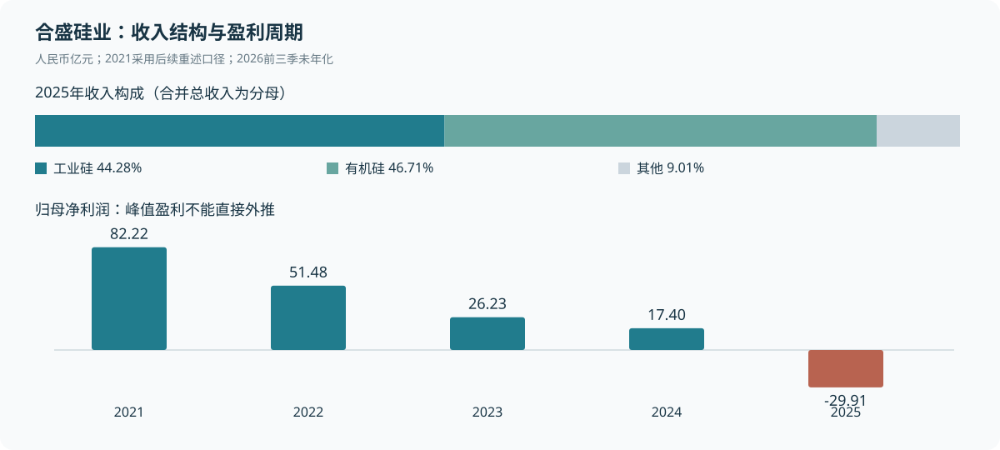

# 合盛硅业（603260.SH）研究报告

**研究日与数据截止日：2026-11-13，Asia/Shanghai。** 行情采用当日收盘，最新财务为2026年第三季度未经审计报告；正式披露检索至11月13日，最新取得的经营沟通为11月12日业绩说明会。金额除特别注明外均为人民币亿元。

| 当前快照 | 内容 |
|---|---|
| 公司身份 | 合盛硅业股份有限公司；Hoshine Silicon Industry Co., Ltd.；上海证券交易所主板603260，未将其他硅材料公司或关联子公司当作同一证券 |
| 收盘价 | 28.07元（2026-11-13，不复权；Tushare、东方财富、腾讯交叉核对） |
| 法定总股本／复算市值 | 1,182,206,941股／331.8455亿元 |
| PB／PS TTM | 1.11x／1.66x；TTM归母亏损，PE与PEG不适用 |
| 核心判断 | 成本优势有实物基础，但股东回报仍受商品价格、光伏资产和融资期限约束；账面扭亏尚未证明可以稳定创造归属股东的现金。 |

## AI研究偏见自觉

**信息丰富度评级：A级。** 年报、季报、监管问询与行业研报充裕，容易把“龙头＋低估值＋反内卷”组合成过度确定的复苏故事。本次重点检验盈利质量、资金能否自由使用、资产是否真正产生回报。

AI研究局限性声明：披露足以核验历史财务，不能替代工厂成本审计、客户访谈、银行续贷确认和光伏设备残值评估。文中明确区分【披露事实】【本次计算】【研究判断】【情景假设】；同一公告的多家转载不算多个原始来源。

- [x] 不以研报数量代替生意确定性；即使少一半资料，大宗品定价机制仍相同。
- [x] 不用峰值盈利代表常态，不把高科技产品的中试进度当成利润。
- [x] 同时承认成本竞争力、扣非改善和嘉兴限制范围调整，避免只寻找负面证据。
- [x] 估值假设与事实分开；价格便宜与仓位大小分别判断。

---

## 已有研究与本次更新

本次沿用已有“合盛硅业”目录与触发标的ID“合盛硅业”。不是首次覆盖；未改写旧报告。

| 历史基线 | 研究日／数据范围 | 本次用途 |
|---|---|---|
| [7月7日研究](合盛硅业-research-20260707.md) | 2026-07-07；主要财务至2026Q1 | 识别旧假设、明显误数及无出处模拟点评 |
| [7月19日完整研究](最终报告.md)与[财务分报告](02-财务估值分析-巴菲特视角.md) | 2026-07-19；2025年报、2026Q1及H1预告；行情取7/17 | 最近完整基线；原稳健评估带22—28元，要求连续扣非转正和定增条款明确 |
| [买入前Checklist](合盛硅业-checklist-20260719.md) | 2026-07-19；同期数据 | 复核资本配置、治理与长期持有门槛 |
| [商业模式](01-商业模式分析-段永平视角.md)、[行业竞争](03-行业竞争分析-芒格视角.md)、[风险管理层](04-风险管理层评估-李录视角.md) | 2026-07-19 | 检验成本、产能口径、监管与股权变化 |
| [兴发集团同行研究](../兴发集团/兴发集团投资研究报告_20260708.md)、[11月12日每日监控](../daily-monitor/daily-monitor-20261112.md) | 各文件所载截止日 | 前者仅提供比较问题；后者仍在跟踪旧22—28元带，不代表买入许可 |

未找到独立的合盛硅业H1/Q3财报解析，故本次直接读正式披露补齐。全仓检索出现的美团、平安文件多是URL数字巧合，不作为同公司研究证据。

| 旧判断／未解问题 | 最新证据 | 重验结果及影响 |
|---|---|---|
| 低成本一体化是核心优势 | H1披露多数工业硅炉台直接冶炼电耗已低于万度/吨；主业工厂仍盈利 | 维持。只能称成本曲线左侧，未取得全球逐厂成本排名 |
| H1预告归母扭亏、扣非仍负 | 正式H1归母3.24、扣非-0.30；9M归母4.34、扣非0.49 | 小幅强化经营恢复；不能将归母扭亏全部归于主营利润 |
| 有机硅持续涨价支持修复 | Q3硅橡胶与环体均价环比-11.98%、-7.94%；Q3综合毛利率11.80% | 削弱持续复苏判断；同比改善与环比走弱同时存在 |
| 债务下降应改善安全性 | 窄口径融资债务274.28降至254.56，但一年内到期非流动负债58.24升至133.96 | 仅总量改善；期限结构与流动性约束强化 |
| 2025现金FCF约28.21 | 合并现金流量表核算正确，仍有票据资本支付及融资还本 | 维持算术，修正经济含义；不可当持续可分红现金 |
| 光伏退出后拖累逐步消失 | 中部合盛在2026上半年净亏11.41；11/12仍说适当收缩，未给最终退出时点 | 待验证，不能假设损失已经全部出清 |
| 控股家族持股约70%且质押高 | 9月减持完成；11/7合计67.69%，质押占所持53.31% | 更新事实，治理与融资尾部压力仍在 |
| 美国限制风险没有改善 | 公司披露嘉兴合盛7/14被移出WRO适用范围 | 部分推翻；只限该主体，集团其他限制不能视为解除 |
| 22—28元是原研究评估带 | 重估正常化盈利、未来价格折现及稀释影响 | 旧带停止作为新增仓位依据；改为16—20元且经营条件同时通过才重新研究 |

7月7日稿将2021归母净利写作“约52亿元”，本次纠正为后续重述口径82.22亿元；7月19日稿的约82.12亿元属于早期披露口径，不把重述差异误判为同类错误。旧稿2024“约33亿元FCF”也不采用；正式现金口径为-10.92亿元。

覆盖范围：已读2021—2025年度原文、2026Q1/H1/Q3、最近四季经营数据、9月再融资更新与减持、11月质押及11/12活动记录。未取得11/13新增重大公告；检索不保证公告索引零延迟。定增发行完成证据、Q3票据资本/融资用途细分、逐季分产品毛利、高端产品盈利及海关法律原件仍有缺口。

> 研究追问：旧结论哪一部分来自事实，哪一部分只是当时对周期的猜测？

---

## 第一步：核心数据总览

### 五年财务：先看资本消耗，再看周期恢复

以下为正式财报与东方财富结构化数据交叉核对；2021按后续重述口径，现金FCF代理＝经营现金流－购建固定资产、无形资产等长期资产支付的现金。营业利润率采用中国会计报表营业利润，包含投资及公允价值损益，不等同纯制造EBIT率。

| 年度 | 收入 | 归母净利 | 毛利率 | 营业利润率 | CFO | 现金CapEx | 现金FCF代理 | 期末货币资金 |
|---|---:|---:|---:|---:|---:|---:|---:|---:|
| 2021 | 213.85 | 82.22 | 52.84% | 46.07% | 37.07 | 26.49 | 10.58 | 9.54 |
| 2022 | 236.57 | 51.48 | 34.39% | 27.10% | -6.26 | 114.84 | -121.10 | 23.82 |
| 2023 | 265.84 | 26.23 | 20.15% | 12.86% | -7.90 | 186.57 | -194.47 | 17.87 |
| 2024 | 266.92 | 17.40 | 20.54% | 8.51% | 45.17 | 56.09 | -10.92 | 17.91 |
| 2025 | 204.99 | -29.91 | 7.29% | -12.81% | 40.13 | 11.92 | 28.21 | 20.47 |

来源：[2025年报](https://static.cninfo.com.cn/finalpage/2026-04-17/1225113194.PDF)、[2024年报](https://static.cninfo.com.cn/finalpage/2025-04-24/1223239280.PDF)、[2023年报](https://static.cninfo.com.cn/finalpage/2024-04-30/1219925421.PDF)、[2022年报含2021重述](https://static.cninfo.com.cn/finalpage/2023-04-21/1216498472.PDF)及[东方财富财务页](https://emweb.securities.eastmoney.com/NewFinanceAnalysis/Index?code=SH603260&type=soft)。2022扣非按2023年修订定义的比较数对齐，但本表不依赖该数估值。



### 最新财务：归母、扣非与现金分别看

| 指标 | 2026Q1 | 2026Q2单季 | 2026Q3单季 | 2026前三季累计 |
|---|---:|---:|---:|---:|
| 营收 | 50.06 | 51.55 | 45.57 | 147.17 |
| 归母净利 | 0.77 | 2.47 | 1.10 | 4.34 |
| 扣非归母 | -0.49 | 0.19 | 0.79 | 0.49 |
| 综合毛利率 | 19.08% | 17.71% | 11.80% | 16.35% |
| CFO | 12.62 | 13.73 | 11.55 | 37.90 |

【披露事实】Q3收入同比-16.09%、归母同比+45.36%、扣非同比-69.74%。公司将扣非下降主要归因于工业硅套保影响。Q2、Q3单季扣非已连续为正，旧研究的“连续转正”条件只实现了一部分：盈利厚度、套保与现金可持续性仍未验证，不能继续写成“仍无一季扣非盈利”。来源：[Q3正式报告](https://static.cninfo.com.cn/finalpage/2026-10-30/1225644114.PDF)、[H1报告](https://static.cninfo.com.cn/finalpage/2026-08-26/1225505925.PDF)、[Q1报告](https://static.cninfo.com.cn/finalpage/2026-04-30/1225256050.PDF)与东方财富。

9M非经常损益税后归母合计3.85亿元，占归母利润88.71%；其中债务重组收益5.03亿元是税前项目，**不能直接从4.34亿元税后归母中相减**。扣非是更谨慎的盈利入口，也不是纯实物经营利润：未采用套期会计的衍生品损益与现货毛利可能跨期错配。既不能把套保亏损全部视为经营崩溃，也不能一律剔除当作不花钱。

### 收入结构与最近四季

【披露事实＋计算】2025工业硅收入90.77亿元、毛利率16.48%；有机硅95.75亿元、毛利率11.77%。占合并总收入分别44.28%、46.71%，其余9.01%。旧报告的44.84%、47.30%使用主营业务收入作分母；不是合并总收入占比。

H1报告附注“分部信息”还披露了下表，与东方财富分产品数据一致。主业毛利恢复是真实的，不能因为现金和债务压力而忽略；光伏则吞掉部分主业成果。

| H1分部，亿元 | 主营收入 | 主营成本 | 计算毛利率 |
|---|---:|---:|---:|
| 工业硅 | 50.17 | 39.48 | 21.31% |
| 有机硅 | 44.37 | 32.15 | 27.55% |
| 光伏产品 | 2.35 | 7.12 | -202.71% |

分部毛利不是分部净利润，光伏成本高于收入反映停产/低利用率等负担，不应把负毛利率当成交价格为负。H1存在分部收入和成本，缺口仅是逐季分产品毛利。来源：[H1分部信息](https://static.cninfo.com.cn/finalpage/2026-08-26/1225505925.PDF)及[东方财富经营分析](https://emweb.securities.eastmoney.com/BusinessAnalysis/Index?type=web&code=SH603260)。

以下是不含税的主要产品对外销售收入，不能将内部自用环体和下游成品重复加总；产品经营公告与会计分部并非完全同口径。

| 产品收入，亿元 | 2025Q4 | 2026Q1 | 2026Q2 | 2026Q3 |
|---|---:|---:|---:|---:|
| 工业硅 | 23.09 | 26.72 | 23.40 | 20.65 |
| 硅橡胶 | 22.54 | 16.54 | 20.89 | 19.01 |
| 硅油 | 1.54 | 1.04 | 1.68 | 1.59 |
| 环体硅氧烷 | 0.60 | 0.70 | 0.85 | 0.49 |

2025Q4为全年减前三单季的【本次计算】，未把全年数据冒充单季。原始公告：[2025全年](https://static.cninfo.com.cn/finalpage/2026-04-17/1225113208.PDF)、[2025Q1](https://static.cninfo.com.cn/finalpage/2025-04-24/1223239306.PDF)、[2025Q2](https://static.cninfo.com.cn/finalpage/2025-08-28/1224598383.PDF)、[2025Q3](https://static.cninfo.com.cn/finalpage/2025-10-30/1224764630.PDF)、[2026Q1](https://money.finance.sina.com.cn/corp/view/vCB_AllBulletinDetail.php?id=12276253&stockid=603260)、[2026Q2](https://money.finance.sina.com.cn/corp/view/vCB_AllBulletinDetail.php?id=12536140&stockid=603260)、[2026Q3](https://money.finance.sina.com.cn/corp/view/vCB_AllBulletinDetail.php?id=12679304&stockid=603260)。逐季分产品毛利未披露，不用半年数据冒充单季；产品表为单一原始披露路径，低于核心合并财务的双路径核验强度。

### 资金：总量下降，期限更紧

| 项目 | 2025末 | 2026Q3末 | 含义 |
|---|---:|---:|---|
| 短期借款 | 53.93 | 62.82 | 上升 |
| 一年内到期非流动负债 | 58.24 | 133.96 | 到期压力集中，含融资款/租赁等 |
| 长期借款 | 162.11 | 57.78 | 不全是偿还，部分转入到期项 |
| 三项窄口径融资负债 | 274.28 | 254.56 | 不是全部经济融资负债 |
| 加长期应付款和非流动租赁后的广义融资负债 | 302.05 | 274.64 | 报表行项目口径，含应计项目；不可称全部为纯银行贷款 |
| 货币资金 | 20.47 | 22.66 | 含保证金等非自由资金 |
| 现金及现金等价物 | 4.81 | 3.77 | 与货币资金不等义 |
| 流动比率 | 0.328x | 0.245x | 继续下降 |

广义净融资负债减货币资金为251.98亿元；若只扣现金等价物则270.87亿元，两者是不同流动性口径。H1另有对合盛集团资金往来25.48亿元，季报未细分最新关联余额；不能盲目把全部其他应付款都加成有息债务，也不能忽略依赖关联资金的事实。股东层质押贷款不并入上市公司融资债务。

9M现金FCF代理29.90亿元。票据背书同时绕过销售现金流入和资本支付，模拟还原须两边一起调整：前三季公司模拟CFO为49.59亿元，但不允许用该数仅减8.00亿元现金CapEx来夸大FCF。H1现金购建4.57亿元，另票据购建7.50亿元；售后回租另列融资用途。现金FCF代理不是全部经济投资额，也不等于偿还债务、维持产线后可分配给股东的现金。

> 数据追问：利润、回款、自由现金和可以还债的钱，是否被当成了同一个数字？

---

## 第二步：生意本质分析

**这门生意把硅石、煤与电力转成工业硅，再加工为有机硅，向制造业客户反复出售材料，主要赚工艺与能源成本低于市场价格的差额。**

客户复购来自持续生产的材料消耗，不是订阅锁定。通用料可更换供应商，特殊配方与认证料具有更高黏性，但本轮没有取得高端产品收入、毛利和续购占比，不能把未来计划计为现有护城河。

| 资产／环节 | 最新已披露能力 | 对股东的实际意义 |
|---|---|---|
| 工业硅 | H1产能122万吨/年；部分基地配套资源与电力 | 成本与开工率影响生存能力；销量增加不保证单吨利润增加 |
| 有机硅 | 单体产能173万吨/年 | 单体、DMC、聚硅氧烷口径不同，不能拼接市场份额；内部环体自用较多 |
| 多晶硅／光伏 | 多晶硅5万吨/年；H1中部合盛净亏11.41亿元 | 仍是利润消耗项，不是已处置完毕的历史包袱 |
| 新半导体业务 | H1阿尔法半导体收入约0.17亿元，净亏约0.68亿元 | 规模小，尚不能支撑显著科技溢价 |
| 固定资产／在建工程 | Q3分别293.87／325.96亿元 | 资产规模大；在建工程不自动等于未来有效产能或可变现抵押品 |

盈利取决于三个变量：一是工业硅和有机硅实际销售价格减单位成本，二是产量与固定费用分摊，三是光伏损失、资金成本与新项目回报。9M财务费用8.42亿元、利息费用8.22亿元；低价阶段，毛利的很大部分先被资金成本消耗。

Q3工业硅均价7,803.85元/吨，环比+0.70%；硅橡胶11,404.63元，环比-11.98%；硅油13,599.17元，环比+6.55%；环体12,299.00元，环比-7.94%。同季硅厂煤和电厂煤价格分别环比+6.31%、+8.50%。这解释了为什么“同比价格改善”与“环比利润承压”可以同时发生。[经营公告](https://money.finance.sina.com.cn/corp/view/vCB_AllBulletinDetail.php?id=12679304&stockid=603260)

> 段永平式追问（本报告的问题，并非本人引语）：这门生意好在哪？答：成本与工艺有优势；但股东必须同时判断周期和资本配置，远没有材料需求长期存在那么简单。

---

## 第三步：护城河评估

| 来源 | 判断 | 可验证证据／反证 |
|---|---|---|
| 品牌与定价权 | 弱 | 通用材料按供需定价，龙头仍经历亏损；不能自主保持售价 |
| 转换成本 | 通用料低，特殊料待验证 | 认证、质量稳定性有作用；高端占比与客户留存未披露 |
| 网络效应 | 无明显证据 | 多一个客户不会直接提升另一客户的产品价值 |
| 规模与成本 | 较强，核心优势 | 自备电、产业协同、单耗改善；同行能源与工艺改进也会压缩差距 |
| 技术与专利 | 工艺能力有价值，长期超额回报待验证 | 9M研发费用3.20亿元；新品中试与送样不等于取得高利润订单 |

过去五年制造能力扩张，股东层面的护城河没有同步加宽：归母利润跨周期大幅下降，资本投入锁定大量现金。未来五年能否变宽，看高端产品能否形成可披露的收入和毛利、能源优势能否抵消碳约束，以及新投资回报是否超过资本成本。

巴菲特2007股东信原话：“A truly great business must have an enduring ‘moat’ that protects excellent returns on invested capital.” 他在同段明确承认低成本生产者可以构成壁垒。本报告据此承认合盛成本优势，并进一步检验能否保护资本回报；不能推导成“大宗商品必然没有护城河”。[原文，Businesses章节](https://www.berkshirehathaway.com/letters/2007ltr.pdf)

> 巴菲特式追问：十年后优势还在吗？可能仍在，但煤电政策、低碳采购、竞争者降本和错误资本配置，都可能让优势留在工厂而没有变成每股财富。

---

## 第四步：逆向思考与风险清单

最强反方论点是：低成本生产能力已经建成，但未来回款先偿债、续建和弥补光伏损失，普通股东获得现金的顺序很靠后。“最后存活的厂商”与“值得长期持有的股权”之间仍有距离。

下表概率为【研究判断】的定性等级，不是假装精确的统计概率，事件可以同时发生。

| 失败路径 | 概率判断 | 影响 | 可观察信号 |
|---|---|---|---|
| 协同减产反复、供给恢复压低价格 | 中高 | 毛利与开工承压 | 实际成交价、库存及开炉量；不只看行业倡议 |
| 光伏和在建工程再减值 | 中高 | 净资产及融资空间下降 | 中部合盛亏损、设备利用率、转固与减值明细 |
| 短债续作条件恶化 | 中 | 股权稀释或被动出售资产 | 到期债覆盖、银行续作、自由现金与关联往来 |
| 再融资完成但新增项目回报低 | 中 | 每股经济价值下降 | 发行价、资金用途、项目真实节煤收益和维持资本开支 |
| 治理问题再次出现 | 中 | 估值折价加深 | 新监管措施、关联采购审议和款项可回收性 |
| 境外限制突变或碳合规成本上升 | 低频、难量化 | 部分市场或供应链长期受损 | 具体法律主体、客户采购资格、可追溯原料 |

历史类比采用重资产商品行业的资本周期：高价吸引扩产，投产后供给压价，低价又削弱更新能力。钢铁、铝和光伏均能出现相同机制，但没有理由认为每家公司最终都会重复某个成功或失败案例。这里最有用的是进入与退出博弈、经营杠杆和沉没成本，不是网络效应叙事。

我最可能犯的错：把正常化利润15亿元当作已得到证明的底部；或者低估高成本产能永久退出后价格弹性。反方也可能错在只看非经常收益，忽略主业工厂已经赚钱、两季扣非转正和经营回款尚在。下一次验证应同时查现货与衍生品，而非选择对自己有利的一项。

> 芒格式追问：聪明人为什么不买？因为要同时押中价格、融资和资本配置，账面PB接近1倍还不足以覆盖三项判断出错。

---

## 第五步：管理层评估

罗立国为董事长，罗烨栋为董事、总经理，罗燚为副董事长。家族一致行动控制稳定，但不能把家族合计67.69%写成罗立国个人的经济权益；也不能将通过合盛集团的间接权益再加一遍。未发现AB股额外投票权结构。

| 决策／行为 | 最新结果 | 研究评价 |
|---|---|---|
| 煤电硅一体化与有机硅延伸 | 形成主业规模与成本能力 | 正面，属于已验证的经营能力 |
| 光伏大规模投资 | 2025大额亏损后，H1中部合盛仍亏11.41亿元 | 重大资本配置失误；不能仅凭战略收缩宣告纠错完成 |
| 出售中创智芯 | 四月完成处置，价款约4.79亿元（2026年），接近处置净资产 | 聚焦主业方向合理；不把其当巨额处置收益，也不能替代关联交易公允性审查 |
| 拟募资58亿元 | 41亿元能源配套、17亿元补流偿债；最新取得9/10申报更新 | 用途与降本相连，但发行及回报仍待验证，未取得已完成证据 |
| 控股股东减持 | 6/3—9/2完成减持总股本3%，9/4公告 | 股东收到钱，不是上市公司融资；少数股东利益需独立判断 |
| 监管整改 | 关联交易及重大投资披露存在违规 | 折损信任；行政监管措施不等于已认定财务造假或资金挪用 |

上交所2026年1月16日决定明确指出关联交易未履行审议披露、投资框架扩大后未及时披露。该判断来自监管原件，不能只凭媒体语气升级成刑事或造假结论。[监管决定](https://www.sse.com.cn/disclosure/credibility/supervision/measures/focus/c/10805373/files/91d7f6f9c25a4ff4a8658bc0c63b3aa6.pdf)

11/7公告显示家族合计持股67.69%，其中质押占所持53.31%、总股本36.09%；未来一年到期质押融资余额24.42亿元是股东层数据。公司称控制权稳定，不能因此认为质押风险为零。[最新质押](https://money.finance.sina.com.cn/corp/view/vCB_AllBulletinDetail.php?id=12695158&stockid=603260)、[减持结果](https://money.finance.sina.com.cn/corp/view/vCB_AllBulletinDetail.php?id=12582713&stockid=603260)

研发与高端化有投入，但缺少产品级投入回报；2025不分红，也没有证据表明持续回购和高回报再投资已经建立。母公司可分配利润、债权约束和融资需求，应先于“恢复派息”的推测。

> 段永平式追问：CEO退休后还剩什么？工厂、能源协同和工程团队仍在；资本配置纪律与少数股东保护需要制度化证据，家族接班本身不能证明这一点。

---

## 第六步：行业与文明趋势

硅基材料参与电子、新能源、建筑、日化与汽车，长期需求不难理解。公司位于原料与中间体环节，增量需求能否变成股东利润，要看供给是否跟得更快、产品是否形成认证壁垒、以及每新增一吨收入需要投入多少资本。

【公司引用行业数据，未独立取得协会底表】2025国内聚硅氧烷消费约240万吨、同比+9.5%；2026H1工业硅产量约186万吨，有机硅DMC产量约110万吨。产量不是TAM，单体与DMC吨数也不可直接比较。本轮不编造全球市场规模或机械增长曲线；量的长期增长可以与价格、利润下降并存。[2025年报](https://static.cninfo.com.cn/finalpage/2026-04-17/1225113194.PDF)、[H1报告](https://static.cninfo.com.cn/finalpage/2026-08-26/1225505925.PDF)

11/12管理层称新能源、AI相关需求较强，传统建筑与纺织较平淡。医疗液体硅橡胶及0度人体胶基本完成中试、电子级产品仍在储备；未给高端收入占比。D4对光纤客户销量增加也不能自动等同高利润AI业务。[业绩说明会原记录](https://money.finance.sina.com.cn/corp/view/vCB_AllBulletinDetail.php?id=12703715&stockid=603260)

同行比较要区分产品组合：东岳硅材更集中有机硅，新安股份叠加农化，兴发集团有磷化工及资源。2026H1公司再融资财务回复列示合盛综合毛利18.39%、东岳22.50%、新安14.37%；这说明“一体化规模最大”不能推成“所有口径毛利最高”。这是公司汇总的同业数据，未独立重审所有同行报表，仅作辅助。[财务问询回复](https://money.finance.sina.com.cn/corp/view/vCB_AllBulletinDetail.php?id=12592820&stockid=603260)

2025前五客户销售占21.07%，前五供应商采购占54.68%。客户并非单一巨头锁定，但能源采购与关联交易的集中度值得跟踪。技术路线风险主要是高端配方、低碳原料认证和新工艺替代公司增量机会，不能简单写成“SiC会消灭全部工业硅需求”。

嘉兴合盛WRO范围调整是实质改善，依据公司H1/募股披露及独立新闻佐证；本轮未取到CBP原始法律文件，不能认证所有进口资格已恢复。鄯善等主体和新疆供应链的其他美国限制仍须逐项核实。该事件不计入折现率，而作为情景或未建模风险单列。[公司申报稿](https://money.finance.sina.com.cn/corp/view/vCB_AllBulletinDetail.php?id=12592817&stockid=603260)、[独立新闻](https://www.ecns.cn/m/cns-wire/2026-08-18/detail-ihfimvaz1908357.shtml)

> 李录式追问：二十年后材料需求仍在，利润会留给谁？目前能确认合盛有供应位置，尚不能确认它拥有像长期垄断者一样的利润分配能力。

---

## 第七步：估值与安全边际

### 当前定价与反向验证

| 指标 | 计算结果 | 口径与限制 |
|---|---:|---|
| PB | 1.11x | Q3归母净资产298.61亿元；每股25.2589元，未把账面资产当清算价值 |
| PS TTM | 1.66x | TTM收入200.10亿元 |
| PE TTM／PEG | 不适用 | TTM归母-22.35亿元；亏损PE没有“很便宜”的含义 |
| 正常化PE | 22.12x | 以15亿元正常化利润假设计算，不是2026预测或已实现盈利 |
| EV代理／2025收入 | 2.85x | 股权市值＋广义融资负债－全部货币资金；未加少数权益、未加未明细关联往来，受限资金还会抬高可比EV |
| 2025现金FCF代理收益率 | 8.50% | 仅历史现金口径，不是预期股息率；不能据此承诺回报 |
| 2025年度分红 | 0元/股 | 最新年度不分红，行情软件历史股息字段不能替代实际政策 |

行情核验：[东方财富快照接口](https://push2.eastmoney.com/api/qt/stock/get?secid=1.603260&fields=f43,f57,f58,f59,f84,f116,f117,f164,f167,f173)、[腾讯快照](https://qt.gtimg.cn/q=sh603260)及Tushare 20261113日线/每日指标。法定股本同时与Q3原文核对。回购专户约644万股未另行扣除；法定总股本口径略保守，潜在员工持股转让和发行须持续核。

与自身比较：7月19日原研究的PB约1.38x，当前1.11x；这只是不同日期净资产和价格的快照，未取得一致复权的长期估值序列，不声称“历史最低”或给伪精确分位。

与同行比较：11/13腾讯快照东岳硅材PB2.81x、PE TTM28.76x；新安PB0.89x、PE41.97x；兴发PB1.06x、PE20.01x。该同日比较尚为单一行情提供商，作为背景列示、未纳入价值锚。产品和杠杆差异很大；合盛PB低于东岳也高于新安，不能据相对便宜替代资产收益判断。未将旧7月的同行估值冒充当前。

反向DCF采用可复核的简化终值形式，不假装有逐项十年预测：若三年不分红、退出PE15x，要以今日市值获得年化8%，2029归母利润须达27.87亿元；在下述2036基准终值PE12.857x下，十年同样无中途净分配，要覆盖8%需2036利润55.72亿元。它们是反推门槛，不是预测。该终值近似没有单独估值三年或十年内逐期现金分配，因此不是完整逐年DCF。当前定价对盈利恢复的要求明显高于9M扣非所展示的厚度。

### 三年三情景：回答现在贵不贵

【情景假设】从15亿元正常化利润出发，对应EPS1.268813元。选择理由：低于2023—2024盈利水平、远低于2021峰值，但远高于最新已实现扣非，**是一项尚待证明的恢复假设**。不用亏损EPS计算“增长扭亏”，也不把15亿元冒充2026年指引。

乐观要求价格与开工修复、光伏拖累显著下降，三年正常化利润增长25%；基准为温和复苏15%；悲观为过剩延续、常态利润下调20%。三年退出PE18/15/10倍是情景定价假设，不用于十年终值。均假设总股本不变、净中期股息为零，未来股价用8%折现回2026研究时点。

| 情景 | 正常化年增速 | 2029利润 | 退出PE | 2029价格，元 | 今日现值，元 | 现价买入三年价格年化 |
|---|---:|---:|---:|---:|---:|---:|
| 乐观 | +25% | 29.30 | 18x | 44.61 | 35.41 | +16.70% |
| 基准 | +15% | 22.81 | 15x | 28.95 | 22.98 | +1.03% |
| 悲观 | -20% | 7.68 | 10x | 6.50 | 5.16 | -38.60% |

工具对未来价格输出的涨跌幅并非今天的安全边际；基准三年后28.95元看似接近现价，但今天现值只有22.98元。悲观现值5.16元也说明研究带不是价格底部。终值PE依赖盈利质量恢复，若持续重资本低回报，15倍仍可能过高。

发行风险：申报上限新增股数约为现有股本30%。在利润尚未受益、只看机械股数变化的演示中，基准每股现值降至17.68元；完整增发估值还必须计入募资、债务利息节约、资金用途与新增收益，不能只砍EPS，也不能提前将58亿元现金加到当前资产。9月30日“完成”在预案中只是摊薄测算假设，未取得实际完成证据。

### 十年折现：只作仓位压力测试

所有现金流与估值币种为CNY。资本成本r＝8%，拆为1.7%无风险参数＋β1.0×6.3%ERP；这是研究标尺，1.7%不是当日国债实时报价。人民币合理区间6%—9%，基准永续g上限2%。ROIC取稳态增量10%：承认一体化成本能力，但不给高端化未证实的超额回报；不是将峰值ROE当增量ROIC。

三档2036归母利润5／25／45亿元，对应长期过剩、温和恢复与较强复苏；主观概率30%／50%／20%。ROIC均10%，g为0%／1%／2%，不随r调整。k＝股息率－稀释率取0：没有假定已恢复稳定派息，也没有给未完成发行一个精确年化稀释率。该简化遗漏中期分配/稀释路径，实际每股回报可更好或更差。

终值倍数唯一来源：PE＝(1−g/ROIC)/(r−g)。工具先通过币种、分母和风险归属audit后出数。

| 2036情景 | 利润 | 概率 | g | r−g | 终值PE | 十年价格IRR（k=0） |
|---|---:|---:|---:|---:|---:|---:|
| 悲观 | 5 | 30% | 0% | 8个百分点 | 12.50x | -15.38% |
| 基准 | 25 | 50% | 1% | 7个百分点 | 12.86x | -0.32% |
| 乐观 | 45 | 20% | 2% | 6个百分点 | 13.33x | +6.10% |

例如基准：留存率g/ROIC＝10%，可分配比例90%，PE＝0.90/0.07＝12.857x。利润已用归母口径，市值也用股权口径，不再减一次净债务。未来利润假设须包含融资和经营压力，不能把企业价值现金流与股权PE混搭。

| 折现率敏感性 | 工具概率加权IRR | 相对r压力测试 | 有效性 |
|---|---:|---|---|
| 6%（r−2pp） | -0.2271% | 未通过 | 币种区间内，但乐观档r−g仅4个百分点；整组仅作情景参考，不作有效估值翻转依据 |
| 8% | -3.55% | 未通过 | 三档分母均达标 |
| 10%（r＋2pp） | -5.95% | 未通过 | 区间外，仅供参考 |
| 7%（追加区间内复核） | -2.05% | 未通过 | 最窄分母5个百分点，达标 |
| 9%（追加区间内复核） | -4.83% | 未通过 | 达标 |

已实际运行flip的±2pp及±1pp两组。**在有效的人民币7%—9%档位，仓位压力测试结论没有翻转。** 工具所谓期望IRR是各情景IRR的主观概率加权，不是先算期望终值再求复合回报，也不是收益承诺。6%档不能用来论证便宜。

未建模离散风险：美国进口限制突变、流动性断裂造成永久损失，可能使三档最低利润仍过于乐观；没有给它们一个虚假的精确概率。过剩、光伏减值、再融资稀释放在情景讨论中，未塞入r或β。

### 估值分歧对账与价格带

本次三年基准现值低于现价，十年压力也不支持大仓，两者方向一致。与旧22—28元评估带的差别来自未来价格折现、盈利恢复证据与融资口径重新核验，不能伪装成公司内在价值在四个月内精确下降。

若未来16—20元同时满足经营条件，三年安全边际可能出现，十年测试仍可能限制仓位。那时定价判断可以支持小仓研究，十年未覆盖r不能单独改成回避。当前维持观望由商品属性、较薄扣非、光伏与期限风险、治理及三年估值共同决定。

| 价格区间，元 | 研究含义 |
|---|---|
| 低于16 | 先核是否发生资产、融资或经营永久损坏；下跌本身不构成买点 |
| 16—20 | 条件式重新评估带；相对22.98元基准现值约13%—30%折价，仍须经营/融资同时通过 |
| 20—23 | 接近基准价值但缓冲有限，观察为主 |
| 23—35 | 需要好于基准的恢复兑现；现价28.07元在此，不新增长期价值仓 |
| 高于35 | 接近或超过本模型乐观现值35.41元，若盈利与融资未升级则复核超配；仅研究警戒，不是自动卖出指令 |

> 巴菲特式追问：r错2个百分点会推翻决定吗？有效区间内压力结论未翻转；但这只说明本组假设不支持重仓，不能证明利润预测正确。
>
> 段永平式追问：股市关闭五年，愿意以28.07元持有吗？以目前尚未澄清的到期债和光伏资产路径，本报告不愿将其作为长期核心仓。

---

## 第八步：最终决策与行动清单

| 并列维度 | 本次结论 | 信心度 |
|---|---|---|
| 生意质量（段永平） | 可理解的成本差生意，周期和资本需求降低长期复利质量 | 较高 |
| 护城河（巴菲特） | 成本与规模优势真实，定价权、特殊料壁垒仍不足以证实 | 中高 |
| 管理层（段永平＋巴菲特） | 主业经营能力有证据；跨界配置和信披纪律明显扣分 | 中高 |
| 最大风险（芒格） | 到期融资与受限现金、光伏损失、股权稀释相互叠加 | 高（风险存在）；低（精确发生概率） |
| 文明趋势（李录） | 材料需求长存，高端化给机会；利润不自动归属上游产能龙头 | 中 |
| 估值（巴菲特＋段永平） | 三年基准现值22.98元，现价缓冲不足；十年有效7%—9%均未过仓位压力、无翻转 | 中低（依赖假设） |

估值维度不是唯一裁决。十年未覆盖r只能收紧仓位，最终选择还取决于其余五个维度及三年定价。

| 投资者／信号 | 具体行动建议（研究用途） |
|---|---|
| **空仓者** | **观望，28.07元不新增长期价值仓。16—20元只是重新研究带，必须核验下列条件。** |
| 持仓者 | 小仓且能承担融资与周期风险者可按条件复核；若已作为长期核心重仓，优先降低集中度，不以成本价决定加仓。未掌握用户组合，不给个性化卖出数量 |
| 加仓／首次参与条件 | 在16—20元，且再连续两季扣非为正并能解释现货/套保匹配；滚动经营现金覆盖现金与票据维持资本支出；广义融资负债下降、到期债续作或置换明确；光伏损失与新增资金用途可核 |
| 仓位约束 | 条件满足后也只研究总资产约0.5%的首笔，合计约1%以内的周期观察仓；不是适合所有人的统一配比，十年压力尚不支持核心重仓 |
| 减仓／卖出复核信号 | 再现重大未披关联交易或款项回收问题；融资续作失败；光伏再减值破坏偿债能力；扣非与现金流同时恶化。高于35元且模型未增强，复核超配，不机械按价清仓 |
| 下一次复检 | 2026-12-31研究检查：产品价格、融资/发行、在建与光伏处置；2027-04-30年度报告窗口复检，非公司已预约披露日，正式年报若提前发布则提前检查 |

机会成本：同样承担股权风险，投资者还可以研究资金结构更宽裕、资本配置记录更稳定的企业。合盛的反弹弹性可能更大，但弹性不能替代持有期间每股现金积累的确定性。

### 四位大师出处与代言边界

本轮检索已读公司目录旧稿并查公开资料；没有取得巴菲特、芒格、段永平或李录对合盛硅业的可核验直接观点。四位均**资料不足，不模拟代言**。本报告各模块使用其方法论提出研究问题，不把本报告判断写成他们的原话。上文仅引用已读取的巴菲特一般原则；不沿用旧稿无出处的公司专属“点评”，不据此推断大师会买或卖。

## AI分析置信度与投资确定性

历史合并财务、股本、披露的产品价格及到期结构：置信度较高；成本相对位置、治理评价与行业协同持续性：中等；15亿元正常化入口、2029/2036利润与价格带：中低，均为推理与假设。资料量丰富提高了核对能力，没有让商品价格、银行续贷、设备残值变得确定。

实际投资确定性为中低。下一步最有价值的一手验证是工厂完全成本及维持资本需求、银行续作承诺、光伏资产处置/转固计划、高端产品客户认证与盈利、以及限制措施的具体适用主体。不能用“数据抽检通过”宣称这些预测已经被证实。

---

## 数据来源与审计记录

核心合并财务采用巨潮原PDF＋东方财富独立取数路径；两者共同底层仍是公司财报，并非两家独立审计。经营公告、股东公告及公司展望按单一原始披露标记；转载镜像不重复计数。相关原文已在各节就近链接。下载的PDF、全文提取和完整提示词未写入仓库。

### 关键数据交叉验证记录

以下为financial_rigor实际输出原文节选，保留单位和误差；通用工具用年度EPS标注的负PE与简化ROE不作为本报告TTM/加权ROE；更细的计算参数见[估值复算数据](合盛硅业-valuation-20261113.json)。模型股权市值、情景与现值同时用Decimal复算；终值与IRR调用terminal_value。

```text
市值验算 (Market Cap Verification)
============================================================
  股价 (Price):       28.07 CNY
  总股本 (Shares):    1.18B
  计算市值:           33.18B CNY
  报告市值:           33.18B CNY
  偏差:               0.00%

  ✅ 验证通过, 偏差仅 0.00%

交叉验证: 2025营业收入 (Cross-Validation)
============================================================
  数据来源数: 2
  参考中位数: 20.50B 元

  ✅ 正式披露                : 20.50B 元  (偏差 0.00%)
  ✅ 东方财富或股本复算           : 20.50B 元  (偏差 0.00%)

  ✅ 所有来源偏差 ≤ 2.0%, 数据一致

  共识值 (加权中位数): 20.50B 元

交叉验证: 2025归母净利 (Cross-Validation)
============================================================
  数据来源数: 2
  参考中位数: -2.99B 元

  ✅ 正式披露                : -2.99B 元  (偏差 -0.00%)
  ✅ 东方财富或股本复算           : -2.99B 元  (偏差 -0.00%)

  ✅ 所有来源偏差 ≤ 2.0%, 数据一致

  共识值 (加权中位数): -2.99B 元

交叉验证: 2026Q3货币资金 (Cross-Validation)
============================================================
  数据来源数: 2
  参考中位数: 2.27B 元

  ✅ 正式披露                : 2.27B 元  (偏差 0.00%)
  ✅ 东方财富或股本复算           : 2.27B 元  (偏差 0.00%)

  ✅ 所有来源偏差 ≤ 2.0%, 数据一致

  共识值 (加权中位数): 2.27B 元

  PB:        28.07 / 25.25887685451341 = 1.11x
  P/FCF:     28.07 / 2.386284311166128 = 11.76x
  FCF Yield: 8.50%
  股息率:    0.0 / 28.07 = 0.00%
```

审计状态：**【准出】**。固定随机样本二十三项，剔除六项日期或期号误提取，保留十七项，并补核十八项关键数据；三十五项均通过、无警告。事实核对、情景参数和算术验证分别记录于[抽检记录](合盛硅业-audit-20261113.json)。其中两项运营事实只有原始披露路径，明确保留来源缺口；没有将其标成双源。第一次审计因极小负收益率四舍五入触发相对误差阈值，已提高该格显示精度后重验。定稿终值参数复检通过；审计不验证未来预测。

触发登记沿用既有ID“合盛硅业”，本次条件带替代旧22—28元带；登记不代表自动交易。自动跟踪由非重点标的台账接续，历史事件保留并关闭，不以是否触价冒充投资结果命中。

本报告仅供学习和研究，不构成投资建议。
