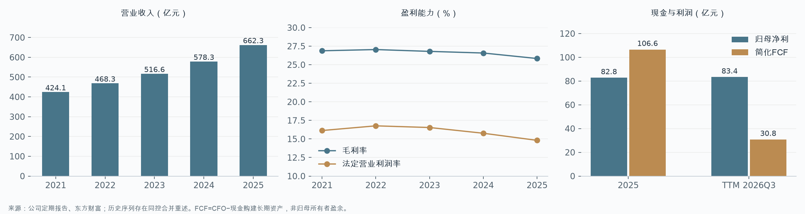

# 国电南瑞（600406.SH）研究报告

| 项目 | 内容 |
|---|---|
| 研究日／数据截止 | 2026-11-25（北京时间）；最新财务为2026年三季报，未经审计 |
| 公司身份 | 国电南瑞科技股份有限公司，NARI Technology Co., Ltd.，上海证券交易所A股600406；本报告不涉及ADR |
| 价格与股本 | 24.60元（11月25日收盘）；注册股本8,031,756,156股，含回购库存股 |
| 市值与估值 | 市值1,975.8120亿元；TTM归母PE 23.70倍、PB 3.76倍、简化FCF收益率1.56% |
| 信息丰富度 | **A级**：上市历史长、覆盖密集，主要风险是把行业共识误当成安全边际 |
| 研究主线 | 核心控制保护能力仍有价值，但新增收入的利润率、占款和归母现金需要重新验证 |

行情由[腾讯快照](https://qt.gtimg.cn/q=sh600406)与[新浪收盘页](https://stocks.sina.cn/sh/?code=sh600406&page_type=simple&vt=1)交叉核对；注册股本与权益取[三季报第6—9页][Q3]，并核对东方财富结构化财务表。市值以价格乘注册股本计算，未将已回购但未注销股份当作永久缩股。

本文承接[7月19日旧报告](最终报告.md)，保留旧文件作为历史记录。研究仅供学习，不构成个性化投资建议。

## AI研究偏见自觉

**AI研究局限性声明：** 财报能揭示已确认收入、成本和现金，却不能证明设备安全可靠性的长期优势，也不能替代客户访谈、投标跟踪和项目回款核查。公司对“阶段性因素”的解释属于待验证陈述。本文没有独立可复算的细分市场份额、季度分部利润、AI单独盈利或海外订单信用数据库；这些位置保留空白。

- [x] 不把国网投资计划直接等同于南瑞收入与利润增长。
- [x] 不因资料多，就把未来回款和新增资本回报判为高确定性。
- [x] 先纠正上市主体和报表口径，再讨论护城河。
- [x] 用现金和归母利润反检“海外高增长”的共识。

即使资料量减半，核心控制系统的转换成本判断仍成立；但新增项目能留下多少现金、应该给多少倍估值，置信度会下降。这是本次研究最需要克制的地方。

---

## 第一步：核心数据总览

### 五年账本：收入扩张，利润率下行

单位：亿元；比率除外。2021—2022采用2022年报比较口径，2023采用2024年报追溯口径，2024—2025采用2025年报追溯口径。各期均与东方财富年度行核对；这些是不同分发渠道对同一法定报表的核验，不是两次独立审计。[2022年报全文][AR22]、[2024年报全文][AR24]、[2025年报][AR25]。

| 年度 | 收入 | 归母净利 | 毛利率 | 法定营业利润率 | CFO | 现金CapEx | 简化FCF | 货币资金 |
|---|---:|---:|---:|---:|---:|---:|---:|---:|---:|
| 2021 | 424.11 | 56.42 | 26.88% | 16.14% | 46.71 | 20.16 | 26.54 | 125.09 |
| 2022 | 468.29 | 64.46 | 27.04% | 16.77% | 87.60 | 34.15 | 53.45 | 147.44 |
| 2023 | 516.55 | 71.75 | 26.80% | 16.54% | 112.78 | 19.52 | 93.26 | 167.50 |
| 2024 | 578.29 | 76.10 | 26.58% | 15.77% | 110.87 | 18.50 | 92.37 | 90.33 |
| **2025** | **662.29** | **82.79** | **25.84%** | **14.81%** | **127.69** | **21.10** | **106.58** | **73.23** |

简化FCF＝合并CFO减购建固定资产、无形资产和其他长期资产支付现金，尚未扣除并购、全部租赁本金及少数股东分配，不能直接称为归母所有者盈余。法定营业利润包含其他收益、投资收益等，也不是纯主营EBIT。

2025年同控收购网能科技后，年报又将2023收入追溯为519.61亿元、归母71.79亿元、CFO113.17亿元；上表保留可逐项核对成本及现金的2024年报口径，不把混合序列用于精确有机增长CAGR。现金资产也不只货币资金：购买结构性存款会改变资产分类，不能由货币资金下降直接推断经营失血。[2025年报“会计数据”“同一控制合并”][AR25]



### 最新四季：季节性存在，恶化也存在

单位：亿元。单季数由累计报表相减；来源为[年报][AR25]、[一季报][Q1]、[中报][H1]与[三季报][Q3]。

| 期间 | 收入 | 归母净利 | 毛利率 | CFO | 现金CapEx |
|---|---:|---:|---:|---:|---:|
| 2025Q4 | 276.52 | 34.24 | 24.95% | 80.55 | 8.73 |
| 2026Q1 | 95.64 | 7.21 | 25.10% | -15.14 | 4.52 |
| 2026Q2 | 182.03 | 23.51 | 25.47% | 21.05 | 3.03 |
| 2026Q3 | 161.12 | 18.39 | 25.63% | -35.11 | 4.24 |

前三季度收入438.80亿元，同比增长13.75%；归母49.12亿元，同比增长1.16%；单Q3归母同比下降3.37%。前三季毛利率25.45%，归母净利率11.19%，上年同期归母净利率12.59%。不能用单季毛利率环比改善，掩盖同比盈利转化下降。[三季报第1—2、10—12页][Q3]

TTM收入715.32亿元、归母83.35亿元、CFO51.35亿元、现金CapEx20.51亿元、简化FCF30.84亿元。**利润基本稳定，现金流已明显弱化**，因此旧稿约6%的2025年度FCF收益率不适合作为当前滚动收益率。

### 增长从哪里来

单位：亿元。以下为分产品主营收入，不能与地区口径叠加；2025主营合计661.56亿元、2026H1主营合计276.99亿元，均略低于合并收入。[2025年报主营表][AR25]、[2026中报第23—24页][H1]

| 板块 | 2025收入 | 2025毛利率 | 2026H1收入 | H1收入同比 | H1毛利率 |
|---|---:|---:|---:|---:|---:|
| 电网智能 | 334.22 | 30.12% | 133.06 | +8.85% | 29.90% |
| 数能融合 | 123.03 | 22.62% | 36.96 | -5.24% | 25.55% |
| 能源低碳 | 167.30 | 20.21% | 96.14 | +46.98% | 18.64% |
| 工业互联 | 30.14 | 21.56% | 9.54 | -23.38% | 24.42% |
| 集成及其他 | 6.87 | 26.64% | 1.29 | -56.98% | 39.53% |

2026H1国内主营收入218.05亿元，同比下降1.89%；海外58.94亿元，同比增长196.61%。2025海外毛利率19.19%，低于国内26.45%，但其自身同比上升0.17个百分点。应区分“低毛利业务占比上升”与“该业务自身毛利率下降”；2026年11月说明会才明确海外毛利同比略降。[年报][AR25]、[中报][H1]、[三季度说明会][IR]

公司未披露最近四季度各分部的完整收入、增速和毛利率，本文以年度／中期分部和四季合并表替代，不补造季度分部。

> 数据追问：增长来自核心产品量价改善，还是更多低毛利交付？现有证据更偏后者，但尚不能据此判定核心技术退化。

---

## 第二步：生意本质分析

**一句话：南瑞向电网和能源业主交付经过安全验证的控制、保护和电力电子系统，靠复杂工程投运与持续改造赚钱。** 客户购买的是停电、失稳和设备损坏风险的降低，以及新增电源和负荷安全接入的能力。

| 商业环节 | 收入如何形成 | 投资者应看什么 |
|---|---|---|
| 调度、保护、稳定控制 | 软件算法、专用设备、模型与工程联调一起交付 | 标准平台复用率、核心产品份额、升级价格 |
| 柔直与电力电子 | 换流阀、控保、成套系统随工程建设交付 | 中标结构、交付节奏、器件成本及质保 |
| 能源低碳及海外集成 | 储能、网源协调及系统方案扩展收入 | 毛利、垫资、质保、汇率和回款，不能只看签约 |
| 存量系统更新与服务 | 新建之后仍需改造、维护和技术升级 | 持续需求存在，但没有已披露的订阅收入占比可供年金化 |

需要安装调试的系统通常在初验投运等控制权转移节点确认；其他产品、服务或工程按各自履约政策确认。因此平台和工程经验可以复用，收入与现金仍受项目预算、验收和结算影响。[中报“收入确认政策”][H1]

决定利润的三个变量是：核心电网产品和集成业务的组合、项目毛利能否覆盖交付与信用成本、以及供应商付款和客户收款之间的占款。研发和服务队伍具有固定成本，平台复制可形成经营杠杆；但2025营业利润率下降，表明规模扩张没有自动转化为利润率提升。

**现金流反证。** 2026前三季销售收现467.88亿元，上年449.74亿元；购买商品和劳务付款417.96亿元，上年324.69亿元，付款增加93.27亿元。应付账款从年初278.29亿元降至224.75亿元。公司解释为缩短账期、增加中小企业付款。这支持“供应商融资回吐”的解释，不能全归咎于客户突然不付款；但也不能假设新付款政策会逆转，过去的高CFO可能部分依赖更长账期。[三季报第3、8、13页][Q3]

> 段永平式追问：生意好在哪里？好在安全控制的经验、验证和迁移成本；能否把这份优势转成新增现金，比多卖多少工程更关键。

---

## 第三步：护城河评估

先修正主体：**南京南瑞继保电气有限公司是并表子公司，2026H1直接持股87%**，不是上市公司的外部竞争者。其少数股东权益需要扣除，但不能把它的中标当作上市公司份额流失。南瑞集团整体仍不等于上市公司。[中报第192、196页][H1]

| 来源 | 判断 | 可证伪的边界 |
|---|---|---|
| 转换成本 | 强：运行模型、接口、联调、人员操作及事故责任共同形成迁移成本 | 若大批核心存量系统低成本换供、而安全与运维无损，判断削弱 |
| 技术与工程经验 | 较强：复杂实时控制和高压工程验证难以只靠资本复制 | 新架构量产后替代既有控保方案，或连续丢失关键项目 |
| 规模 | 中等：研发平台、跨产品交付和服务网络可摊薄成本 | 项目定制化使人员和占款随收入同比扩张，规模优势被抵消 |
| 品牌与定价权 | 安全信用有价值，提价权有限 | 国网采购和招标约束价格，尚无持续提价且不损失订单的证据 |
| 网络效应 | 弱，主要是经验学习和平台复用 | 新增一个客户并不会已被证明直接提高其他客户的效用 |

过去五年技术与产品范围扩大，但集团毛利率和营业利润率下行，不能宣布“经济护城河整体变宽”。未来五年核心控制系统可能更重要，新增集成收入却未必享有同等回报。

同行对照提供约束，而非直接可比估值。许继电气属于中国电气装备集团，并非国网旗下；四方更聚焦二次设备，业务组合与南瑞不同。[许继中报][XJ]、[四方中报][SF]

| 公司 | 2026H1收入／归母（亿元） | 综合毛利率 | 11月25日行情商TTM PE |
|---|---|---:|---:|
| 国电南瑞 | 277.67／30.73 | 25.34% | 23.70倍 |
| 许继电气 | 65.25／4.16 | 19.90% | 30.09倍 |
| 四方股份 | 44.82／5.14 | 32.11% | 24.10倍 |

同日估值取[腾讯同行快照](https://qt.gtimg.cn/q=sz000400,sh601126)，为供应商口径，仅作比较。四方二次设备毛利率36.66%、储能系统11.53%，也提示利润池在经过验证的控制产品，而不在所有“电力”收入。[四方中报第15页][SF] 本文没有用同行当前PE推导十年终值倍数。

> 巴菲特式追问：十年后护城河还在吗？核心安全控制大概率仍需要；能摧毁股东回报的，也可能是买方议价、资本配置和过高买价。

---

## 第四步：逆向思考与风险清单

最强的不买理由是：**技术壁垒真实，但增长向利润更薄、垫资更多的业务迁移，股东未必按收入增速受益。** 相较突然被技术替代，更常见的失败形态可能是持续增收、盈利平缓、现金受压与估值下修同时发生。这是机制推演，不是发现公司造假或已丧失竞争力。

| 失败路径 | 主观可能性，非统计概率 | 影响 | 应观察的证据 |
|---|---|---|---|
| 低毛利业务持续稀释 | 中高，已有迹象 | 利润增速长期落后收入 | 核心／低碳分部毛利、单季扣非、信用成本 |
| 账期重置成为永久现金负担 | 中，待全年验证 | 可分配现金和分红承受力下降 | 滚动CFO、现金CapEx、应付变化及真实回款 |
| 海外客户信用、EPC履约和汇率损失 | 中 | 收入增长但现金损失 | 减值、账龄、合同资产、担保和项目索赔 |
| 强买方压价或采购规则改变 | 中 | 核心业务回报下台阶 | 同类产品中标、关联交易定价和毛利 |
| 研发／新业务资本配置失误 | 中 | 低回报资产积累 | 投产后现金、资本化项目减值、退出纪律 |
| 极端质量、网络安全或控制链治理事件 | 低频但不可量化 | 尾部损失重大 | 官方事故调查、处罚、关联资产安排 |

不能用国网“十五五”景气叙事消除以上风险，也不能用一个季度现金为负认定永久损失。2025Q4集中回款确实明显，但2026Q3相较去年同季恶化，证明季节性不足以解释全部变化。

历史参照是GE并购阿尔斯通相关业务后，2018年在发电、电网和水电业务确认大额商誉减值，说明工业技术地位不能保证扩张投资的回报。[GE原始年报附注](https://www.sec.gov/Archives/edgar/data/40545/000004054520000009/R15.htm) 南瑞没有被证明面临同样的商誉或燃机周期问题，此例仅用于提醒增长领域、买价与现金假设必须分别核对，不能据此预测同样结局。跨学科看，安全系统的可靠性和迁移成本提高准入壁垒，采购博弈却将相当一部分价值留给大买方；两者可以长期并存。

最可能的分析错误是高估未来现金恢复速度，或反过来把一次付款政策变化当成永久经营恶化。观察窗口应跨完整年度和后续可比季，避免锚定旧18—20元价格带和旧年度FCF。

> 芒格式追问：聪明人为什么不买？他可能认可技术优势，却认为当前价格没有补偿利润结构与资金占用的不确定性。

---

## 第五步：管理层评估

这是依赖技术组织与央企治理体系的公司，不是创始人个人控制的企业。董事长郑宗强兼任控股股东国网电科院主要职务；副董事长、总经理罗汉武有电网经营管理履历。郑宗强2025年选举公告及2025年报第48页均披露直接持股20,736股，按年末注册股本约0.000258%；罗汉武2026年3月公告披露无持股，与年报持股表相符。这是披露时点值，不能当作全体管理层实时合计持股。公司存在员工限制性股票激励，不能由两人持股少推导“没有激励”。[董事长公告][CHAIR]、[年报][AR25]、[副董事长公告][CEO]、[中报第33页][H1]

控股股东国网电科院持股56.91%，最终实控人为国务院国资委。2025股权无偿划转改变直接股东，未改变最终控制。2026H1关联销售披露中，国网及所属、不含国网电科院体系为40.59%，国网电科院0.93%、南瑞集团0.55%；三项合计42.07%，并非全部关联方的穷尽合计。2025年报则直接披露国家电网及所属销售占55.40%、前五客户占66.96%。不用销售合同金额除收入，也不把半年占比下降全部解释为客户质量改善。[年报客户表][AR25]、[中报第40—41页][H1]

| 时间／决策 | 证据与结果 | 资本配置评价 |
|---|---|---|
| 2025研发与实验平台 | 研发投入47.39亿元；利润表研发费用36.04亿元 | 长期能力建设必要，新增回报仍须验证；差额包含统计口径差异，不能全当资本化 |
| 2025网能科技同控收购 | 收购56%股权并追溯比较数 | 规模有限，尚不足证明并购创造价值；需看现金和整合 |
| 2025利润分配 | 全年每股0.622元，现金分红49.68亿元，归母分红率60.01% | 股东现金回报明确；回购另算，不把全部回购视为注销 |
| 2026中期分红 | 每股0.153元，9月29日已实施；实际约12.21亿元 | 已支付事实，不再写“预案”；未来全年分红未承诺 |
| 2026新回购 | 计划5—10亿元用于激励；截至10月底已付2.01亿元 | 可支持激励交付，但不能按永久缩股叠加收益率 |

分红原件：[2025年度实施公告][DIV25]、[2026中期实施公告][DIV26]；回购：[11月3日进展公告全文][BUYBACK]。研发原件见[年报][AR25]，自主与受托研发口径需区分。

10月29日尚学伟因工作变动不再任总工程师，仍任党委委员；这是组织变更，不是已证实的技术能力流失。[公告全文](https://finance.sina.com.cn/stock/ggzz/2026-10-30/doc-iniwzazt8125650.shtml) 评价为“组织能力较强、少数股东利益需持续核对”，没有足够证据升级为所有者型管理，也没有证据指控侵占。

> 段永平式追问：CEO退休还能否保持竞争力？较大程度可以，技术平台和服务体系更关键；但跨任期的研发、项目责任和激励必须保持。

---

## 第六步：行业与文明趋势

电气化、波动电源接入、跨区输送和可调负荷增加，要求更复杂的实时协调。南瑞位于电网控制与执行层，需求的长期性强于某一个储能技术方案。这是产业方向判断，不等于任何价格买入都能获得高回报。

国家电网“十五五”固定资产投资预计4万亿元、较“十四五”增长40%，为多年的需求提供支持。但总投资还包括土建、线路和一次设备，**4万亿元不是南瑞的TAM**，增长40%也不是每年增长40%。缺少足够可核的二次设备和公司具体可寻址预算，本文不填一个看似精确的TAM。[国资委刊载国家电网信息][GRID]

价值能否被上市公司捕获，取决于核心产品含量、采购价格及现金回报。AI辅助决策、数字孪生和算电协同可以增强存量产品；公司表示部分AI已嵌入产品并转化收入，但没有披露独立利润，不再额外叠加一笔AI估值。[11月说明会][IR]

客户高度集中而供应商相对分散：2025前五供应商采购占比8.65%。这有助于理解议价权为何主要受客户约束。国产器件、网络安全和控制架构变化是持续研发任务；国际业务还需满足本地标准及贸易限制。[年报供应商与风险说明][AR25]

能源监管关注公平竞争与关联竞争性业务的独立核算，但监管要求不能写成公司已被处罚或将被强制剥离。极端治理变化保留为未定量风险。[国家能源局2025通知][REG]

> 李录式追问：二十年后看，这是否仍是重要能力？大电网的安全控制大概率仍重要；投资回报仍要由每股可分配现金证明。

---

## 第七步：估值与安全边际

### 当前价格买到了什么

所有计算已用共享金融工具并作Decimal复核，记录见[计算文件](审计-20261125/calculations.json)和[工具输出](审计-20261125/tool-output.txt)。TTM＝2025全年＋2026前三季－2025前三季，避免将季节性很强的一季度年化。

| 指标 | 当前口径与结果 |
|---|---|
| 注册股本市值 | 24.60元×8,031,756,156股＝1,975.8120亿元 |
| TTM归母／每注册股盈利 | 83.3534亿元／1.0378元；与法定加权平均股本EPS口径有别 |
| PE／PB／PS | 23.70倍／3.76倍／2.76倍 |
| 简化FCF收益率 | 30.8401亿元／市值＝1.56%；FCF／归母＝37.00% |
| 已付股息收益率 | 2026年至今每股0.475＋0.153＝0.628元，对现价2.55%，税前；不是未来承诺 |
| 可见现金金融资产净额 | 货币69.32亿＋交易资产60.14亿－债务代理4.88亿＝124.58亿元 |
| EV／Revenue示意 | 加少数股东权益、减上述净额后约2.64倍；不是完整EV审计值 |
| PEG示意 | 按本报告假设8%增长约2.96倍；增长是假设，非已实现或市场一致预测 |

债务代理包括短借、长借、一年内非流动负债和租赁负债。上述净额没有纳入其他资产科目的定存／大额存单，也未逐项扣受限货币资金；既不是完整净现金，也不全是可分配超额资金。不把该净额再次加到包含利息收益的归母盈利估值上。资料为[三季报][Q3]与东方财富全量资产负债表。

历史比较只能谨慎使用：[理杏仁11月24日页面][HIST]显示PE 23.82倍、页面所选窗口中位24.79倍，但本次未确认该窗口的起止期限，因此不声称“五年低分位”。相较7月报告约21倍静态PE，如今滚动PE约24倍，口径不同也不能直接当估值涨幅。同行PE并不显示南瑞有压倒性折价。

### 三年情景：回答贵不贵

以TTM每注册股盈利1.037798元为起点，未来三年归母每股增长为0%／8%／12%，退出PE为16／22／24倍，主观概率30%／50%／20%。基准要求利润恢复、低碳业务止住稀释；乐观需要核心需求与海外盈利同时兑现。不是公司指引。

假设每年派息为当年盈利60%，不另算回购，折现率8%。三年退出PE体现阶段性定价情景，不能挪作十年稳态倍数。

| 情景 | 盈利年增 | 三年退出PE | 三年后价格 | 三年现金股息合计 | 含息总回报 | 含息年化近似 | 今日含息现值 |
|---|---:|---:|---:|---:|---:|---:|---:|
| 悲观 | 0% | 16倍 | 16.60元 | 1.87元 | -24.91% | -9.11% | 14.79元 |
| **基准** | **+8%** | **22倍** | **28.76元** | **2.18元** | **+25.79%** | **+7.95%** | **24.70元** |
| 乐观 | +12% | 24倍 | 34.99元 | 2.35元 | +51.81% | +14.93% | 29.79元 |

“含息年化近似”是期末价格加未再投资股息的三年复合率，不是假装已算逐笔股息IRR；“今日现值”则将股息逐年折现。概率加权今日现值22.74元。**现价大致贴近基准，低于乐观，却没有稳健安全边际。**

反向估值：固定退出22倍、每年60%派息、要求8%回报，现价隐含未来三年每股盈利年增约7.85%；忽略股息时需要约10.72%。这是有限期反向盈利折现，不是完整永久DCF。考虑最新利润增长仅约1%，市场已在为恢复付钱。

### 十年折现：用于仓位压力测试

以下均为人民币，r取8%＝11月25日十年国债约1.59%＋β 1.0×研究用ERP 6.41%。ERP是长期要求回报的主观设定，不是当天可直接观测值；不因短期低国债利率下调到不合理区间。[财政部收益率曲线][RF]

稳态增量ROIC取15%：以2025加权ROE 16.26%作为约束之一，以6%增长／40%留存隐含15%作为保守参照。粗略扣除可见现金、用13%假设税率估算的存量经营资本回报上界约26.22%，并非经审计ROIC，不能原样外推。稳态15%是判断，仍需敏感性；公司净现金、债务较少，使资本回报向股东回报的近似较可用，但ROIC与ROE并不等同。

十年盈利年增采用2%／6%／10%，低于三年基准是因为长期竞争、低碳收入组合和大基数；终值以后永续g仅取0%／1.5%／2%，不随r改变。它不同于未来十年的增长率。基准g低于人民币2%上限。

终值PE仅由 `(1−g/ROIC)/(r−g)` 决定。三档r−g为8.0／6.5／6.0个百分点，均通过5个百分点约束。主观概率沿用30%／50%／20%。先验估值审计通过后出数。

| 情景 | 十年盈利年增 | 终值g | 第十年归母，亿元 | 公式退出PE | 工具简化十年回报 | 完整年度经济现金IRR |
|---|---:|---:|---:|---:|---:|---:|
| 悲观 | +2% | 0% | 101.61 | 12.50倍 | -1.82% | +0.79% |
| 基准 | +6% | 1.5% | 149.27 | 13.85倍 | +2.95% | +4.42% |
| 乐观 | +10% | 2% | 216.20 | 14.44倍 | +7.18% | +7.58% |

共享工具的“IRR”口径是终值几何回报加固定净派息率2.5%，不是逐年现金流IRR；净稀释假设为零，未额外计入激励回购的永久缩股。故本文另以完整年度经济现金校验：近十年新增投入资本回报假设20%，每年可分配现金＝当年归母×`(1−当期增长/20%)`，三档为90%／70%／50%；第十年另回收公式终值，不再重复加终值下一年的股息。

该现金是扣除模型再投资后的经济可分配额，包含可保留或回购的剩余，不是公司承诺的现金派息。20%假设较成熟期15%高，理由是近端核心项目仍可复用平台；若新业务回报下降，模型高估现金。基准将该假设改为15%／25%时，现值为17.55／19.05元，主假设为18.48元。未将简化FCF30.84亿或2025的106.58亿永久外推。

完整经济现金法的概率加权现值18.26元、期望情景IRR约3.96%，均为模型输出，期望情景IRR也不是组合确定回报。该模型未把现有现金当作即时可分红款另行加回，原因是其经营与投资分类尚未穿透，并非断言全部现金都无价值。

### 折现率翻转检验

`terminal_value.py flip` 使用r＝10%、原始人民币g的逐档PE及IRR作为重标定锚，g-shift为0。10%只用于生成锚点和区间外敏感性，不能当成人民币基准资本成本。

| r | 工具期望简化回报 | 是否覆盖r | 完整经济现金期望IRR | 有效性说明 |
|---|---:|---|---:|---|
| 6% | +5.95% | 未通过 | +6.97% | 币种区间内，但基准／乐观r−g仅4.5／4.0个百分点，只作情景参考 |
| 7% | +3.98% | 未通过 | +5.30% | 币种及分母约束均有效；完整现金亦未覆盖 |
| **8%** | **+2.37%** | **未通过** | **+3.96%** | **基准；完整现金亦未覆盖** |
| 9% | +1.00% | 未通过 | +2.85% | 币种及分母约束均有效；完整现金亦未覆盖 |
| 10% | -0.19% | 未通过 | +1.91% | 人民币合理区间外，仅供参考，不参与翻转判定 |

规定的±2个百分点与额外±1个百分点检验均已运行。**共享flip在币种合理区间内没有翻转；进一步限于币种和分母同时有效的7%—9%，完整现金法也不翻转。** 6%下完整现金法出现覆盖、而简化法未覆盖，是分红处理与终值敏感性共同造成；该档分母不合格，不用其“通过”证明可重仓。不同计算形式也会影响回报，不应只讨论折现率。

### 估值分歧对账

三年基准24.70元说明：如果盈利恢复8%增长、三年后仍给22倍，当前价格接近合理。十年模型则假设较低长期增长和由永续公式推出的较低终值倍数，即使承认经济现金多于实际股息，当前价也不足以覆盖8%的要求回报。**前者是定价情景，后者是仓位压力测试。**

相较旧稿，本次支持下调新增积极性的直接经营证据是利润转化下降和滚动现金变弱，而不是十年模型一票否决。生意质量与核心护城河仍支持合理小仓有条件持有；空仓者当前缺少三年安全边际。十年压力进一步把研究性仓位上限收紧至权益组合约2%，不支持把它升为核心重仓。

**条件分批研究带为17—19元**，相对三年基准现值折价约31.17%—23.08%；它也接近十年基准8%回报对应的18.48元，不是十年现金估值的深度折扣。必须同时验证下文现金及分部条件，尤其19元上沿不能仅因“跌进区间”买入。相比旧18—20元带，下移反映最新利润／现金证据及估值口径重建，不表示公司价值在7月后机械下跌同一幅度。

明确上行复核线为30元：若盈利和现金模型没有升级，回避追价并复核超配；这是研究警戒，不是把乐观目标价当自动卖出信号。

> 巴菲特式追问：r错2个百分点会翻转吗？共享工具不翻转；完整现金在合格的7%—9%也不翻转，6%窄分母情景不可作为重仓依据。
>
> 段永平式追问：关闭股市五年愿意按现价持有吗？已有合理小仓可以承受，但新增资金缺少足够回报补偿；需要现金验证或更好的价格。

---

## 第八步：最终决策与行动清单

| 维度 | 结论 | 信心度 |
|---|---|---|
| 生意质量 | 核心控制保护业务较好，项目制和低碳集成降低整体纯度 | 中高 |
| 护城河 | 安全验证、转换成本和工程经验真实，弱定价权约束回报 | 中高 |
| 管理层 | 技术组织与经营延续性较强；关联控制、任期和新项目回报需盯 | 中 |
| 最大风险 | 新增收入变成低毛利、长回款工程，供应商融资回吐常态化 | 中 |
| 文明趋势 | 长期受益于电力系统复杂化，不能用总投资替代可捕获利润 | 中高 |
| 估值 | 三年基准接近现价、加权略低，安全边际不足；十年压力未覆盖，合格区间不翻转，限制仓位 | 中低 |

估值不是唯一裁决，十年未覆盖r也不自动等于清仓或回避公司。上述六维共同支持：**现价观望新增，合理小仓有条件持有、暂停加仓。**

| 策略 | 明确动作 |
|---|---|
| 空仓者 | 24.60元观望。17—19元且经营条件通过，再研究首笔约权益组合0.5%；不因触价自动交易 |
| 持仓者 | 合理小仓持有不加；研究参考总仓不超过2%。超配者按自身集中度、成本和税费复核，不因一个模型机械清仓 |
| 加仓信号 | 下一完整财报及随后一次可比披露中，滚动CFO／归母恢复至少80%、简化FCF为正；电网智能毛利大致守住29%、低碳毛利不继续下行，信用减值和回款可解释；重新估值仍有三年安全边际，才从首笔逐步增加 |
| 卖出／减仓信号 | 核心系统持续失标、重大质量／合规事件导致优势削弱；完整年度与随后可比期现金持续弱且无可核解释、分红靠变卖金融资产维持；或≥30元而盈利／现金模型未增强时复核超配 |
| 低于研究带 | <17元先查永久损失与合同信用，不用更低价格豁免经营条件 |
| 研究复检 | 2026-12-31人工核回购、项目及分红；2027-04-30全年与Q1信息兜底检查，若提前披露立即提前核。这是研究检查日，不是已公告预约日 |

上述阈值是本报告研究纪律，不是公司承诺或通用行业标准。仓位仅为未获个人风险预算情况下的研究参考，电网／能源同类敞口需合并考虑；机会成本是其他可核现金资产和分散配置，不为“好公司”标签放弃回报要求。

### 四位大师：原话与本报告推演分开

未找到四人对国电南瑞的可核验直接买卖意见。以下模拟只延伸已读方法论，不代表本人评价或背书。

| 人物 | 可核验短引及出处 | 本报告推演 |
|---|---|---|
| 巴菲特 | “Price is what you pay; value is what you get.”——[2008股东信第5页](https://www.berkshirehathaway.com/letters/2008ltr.pdf)，他重申格雷厄姆的话 | 行业重要和公司优秀，仍不能代替价格与可分配现金核算 |
| 芒格 | “He wanted decisions that maximized long-term results”——[2014独立回顾第40页](https://www.berkshirehathaway.com/letters/2014ltr.pdf)，He指巴菲特 | 检查轮岗之后项目责任、研发回报和资本纪律是否持续，不能用此句代替对国企治理的实证评价 |
| 段永平 | “总而言之，不懂不做，不要跟消息走，跟着理解走。”——[2011年10月7日雪球原帖](https://xueqiu.com/1247347556/20416338)，已读[仓库原发言归档](../段永平/段永平雪球全量原发言.md)对应条目 | 先理解安全控制与项目现金，不能只因国网投资或AI消息决定买价 |
| 李录 | “Energy is obviously essential, an essential layer of the economy.”——[哥大2026年10月5日对谈实录第19页](https://business.columbia.edu/sites/default/files-efs/imce-uploads/36th%20Annual%20Graham%20%26%20Dodd%20Luncheon%20Transcript%20%2820261005%29%20CBS.pdf) | 电力的基础地位支持长期需求，但价值是否留给供应商股东仍须验证 |

> 最终追问：如果去掉“电网龙头”“出海”“AI”三个标签，现金和价格本身是否已经足够有吸引力？目前证据尚不足支持新增重仓。

---

## AI分析置信度与投资确定性

AI分析对公司身份、合并范围、已披露财报和现金流变化的置信度较高；对护城河机制为中等偏高；对回款恢复、未来资本回报、情景概率及合理价格为中低。后几项是有限信息下的推理，不因计算精确而成为精确预测。

实际投资确定性来自核心业务的长期需求、组织能力及最终现金回报，现阶段仍受业务组合与付款政策影响。A级资料只提高核对能力，不等于A级投资确定性。

未建模尾部风险包括重大电网安全／网络事故和控制链治理突变；未给伪精确概率，也没有把它们藏进β或r。另有季度分部、真实增量ROIC、完整可分配金融资产、海外订单信用及AI独立利润等数据缺口。2026全年财务及未来分红尚不可得。

## 数据来源与审计记录

### 与旧报告的关键对账

- 南瑞继保已并表，旧稿外部竞争者表述错误；许继为外部同业，不能写作同属国网。
- 2025国网客户实际销售占比有55.40%的披露，不再用合同额除收入。
- 2024追溯口径毛利率26.58%，对比2025的25.84%，不沿用旧26.66%。
- 高年度现金流并非“持续每年均覆盖”：2021 CFO也低于归母；最新TTM更不能沿用2025强现金结论。
- 回购用于激励时不算永久注销；2026中期股息已实施，旧预案不能当未来新增回报。

### 关键数据交叉验证记录

以下摘录共享工具输出；原始元数、算式、Decimal交叉复核、两次最终估值audit及完整flip见[审计输出](审计-20261125/tool-output.txt)，可由[复现脚本](审计-20261125/reproduce.py)重算。年度原值核验定位见[信源记录](审计-20261125/source-register.md)。

```text
市值验算：计算值 197,581,201,437.60 CNY；行情报告 197,581,000,000；偏差约0.00% → 一致
2025营业收入：巨潮 66,228,963,223.21／东方财富 66,228,963,223.21 → 一致
2025归母净利润：巨潮 8,278,971,723.32／东方财富 8,278,971,723.32 → 一致
2026Q3货币资金：巨潮 6,932,263,372.88／东方财富 6,932,263,372.88 → 一致
2026Q3交易性金融资产：巨潮 6,013,927,424.63／东方财富 6,013,927,424.63 → 一致
2026Q3股本：巨潮 8,031,756,156／东方财富 8,031,756,156 → 一致
2026Q3累计CFO：巨潮 -2,919,538,534.11／东方财富 -2,919,538,534.11 → 一致
保守净现金代理：两渠道分别取分项后相减 12,458,412,998.96 → 一致
估值准出：C1币种／C2分母／C3风险归属通过；两个未建模风险已披露
```

抽检状态以[最终数据抽检记录](审计-20261125/report-audit-verdict.txt)为准。抽样中的模型项验证参数与独立重算，不冒充外部已发生事实；财务项核对法定报表及东方财富分发，所有差异要求不超过1%。

### 跟踪落点

沿用`data/triggers.json`既有target id“国电南瑞”，以本报告替代旧18—20元主价带，登记17—19元条件带和30元警戒；旧报告保留历史链接。复检事件仅供人工检查，当前每日监控只扫描价格。非重点标的台账新增本次建议事件，旧建议关闭接续，未重建完整历史执行和总回报，因此不判旧建议命中。

[AR25]: https://static.cninfo.com.cn/finalpage/2026-04-30/1225257886.PDF
[AR24]: https://vip.stock.finance.sina.com.cn/corp/view/vCB_AllBulletinDetail.php?id=11033834
[AR22]: https://vip.stock.finance.sina.com.cn/corp/view/vCB_AllBulletinDetail.php?id=9137289
[Q1]: https://static.cninfo.com.cn/finalpage/2026-04-30/1225257868.PDF
[H1]: https://static.cninfo.com.cn/finalpage/2026-08-27/1225508099.PDF
[Q3]: https://static.cninfo.com.cn/finalpage/2026-10-29/1225635689.PDF
[IR]: https://sns.sseinfo.com/resources/images/upload/202611/202611041001053718450310.pdf
[XJ]: https://static.cninfo.com.cn/finalpage/2026-08-20/1225483623.PDF
[SF]: https://static.cninfo.com.cn/finalpage/2026-08-27/1225508922.PDF
[GRID]: https://wap.sasac.gov.cn/n4470048/n35313464/n35346844/n35346859/c35325777/content.html
[REG]: https://www.nea.gov.cn/20250410/eb005babc0954c2e81a55b3748fb8408/c.html
[CHAIR]: https://static.cninfo.com.cn/finalpage/2025-06-18/1223898748.PDF
[CEO]: https://static.cninfo.com.cn/finalpage/2026-03-25/1225028391.PDF
[DIV25]: https://static.cninfo.com.cn/finalpage/2026-06-24/1225383654.PDF
[DIV26]: https://static.cninfo.com.cn/finalpage/2026-09-22/1225575117.PDF
[BUYBACK]: https://epaper.cs.com.cn/zgzqb/html/2026-11/03/nw.D110000zgzqb_20261103_1-B013.htm
[RF]: https://yield.chinabond.com.cn/cbweb-czb-web/czb/moreInfo?locale=cn_ZH&nameType=1
[HIST]: https://www.lixinger.com/equity/company/detail/sh/600406/600406/fundamental/valuation/pe-ttm
