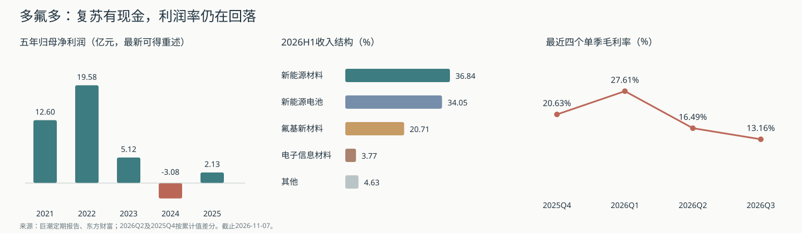

# 多氟多（002407.SZ）研究报告

> **研究日期 / 数据截止**：2026-11-07（Asia/Shanghai）；行情为2026-11-06收盘，财报截至2026-09-30，重大公告查至11月6日。  
> **证券身份**：多氟多新材料股份有限公司，Do-Fluoride New Materials Co., Ltd.，深交所A股002407；沿用既有“多氟多”目录与监控ID。  
> **股价 / 市值**：23.20元 / 276.18亿元；法定总股本1,190,432,569股。  
> **估值快照**：重算TTM PE 37.99倍、归母PB 3.15倍、PS 2.03倍；TTM简化自由现金流收益率1.69%。  
> **研究主线**：氟化学工艺与资源综合利用形成制造基础，锂盐和电池拉动收入；现金流已有修复，但单季利润率连续回落，长期价值取决于扩产后的资本回报。

仅用于学习与研究，不构成投资建议；本次未获知用户持仓，持仓策略均为条件方案。

---

## AI研究偏见自觉

**信息丰富度：A级。** 定期报告、调研与行业报道充足，最容易犯的错，是把新能源需求、国产替代和材料纯度转化成永续定价权，或把上一轮景气峰值当作正常利润。

- [x] 区分累计同比高增与单季盈利趋势。
- [x] 区分经营现金改善、银行承兑与供应商信用、真正归属普通股的现金。
- [x] 区分电子级HF总产能、半导体级子口径和募投项目效益。
- [x] 检查历史财报追溯重述、最新质押变动及旧报告有效性。

**AI研究局限性声明**：无法独立观察客户认证深度、产品实际结算价、单吨现金成本及工厂良率；没有两个独立可靠来源支持当下LiPF6现货/长协实际成交价，因此不拼凑单吨利润。2026Q3没有分部与受限资金明细。模型中的盈利、概率和价格带均为研究假设，不是公司指引或统计置信区间。

## 第一步：核心数据总览

### 五年周期与最新四季

下表收入、归母和CFO采用最新可得年报追溯口径；2022使用2024年报比较数，2023使用2025年报比较数。2021统一使用营业收入77.99亿元，未把当年的金融利息收入并入。重述意味着五年仍非完全恒定合并范围，不据此机械计算复合增速。

| 年度 | 营业收入（亿元） | 归母净利（亿元） | CFO（亿元） |
|---|---:|---:|---:|
| 2021 | 77.99 | 12.60 | 19.75 |
| 2022 | 123.58 | 19.58 | 17.67 |
| 2023 | 119.92 | 5.12 | 3.17 |
| 2024 | 82.49 | -3.08 | -3.13 |
| 2025 | 94.34 | 2.13 | 1.99 |

历史盈利率、资本支出及现金补充如下。**2021—2023保留历史接口/当时披露口径**，用于辨认周期，未与上表重述收入混算；2021盈利率采用当时营业总收入分母。2024—2025已经核对最新报表。简化FCF=CFO减购建固定资产、无形资产及其他长期资产现金支出。

| 年度 | 毛利率（历史原口径） | 营业利润率（历史原口径） | 货币资金（亿元） | 购建长期资产支出（亿元） | 简化FCF（亿元） |
|---|---:|---:|---:|---:|---:|
| 2021 | 32.14% | 18.05% | 14.43 | 12.17 | 7.58 |
| 2022 | 30.52% | 18.31% | 36.84 | 25.74 | -8.21 |
| 2023 | 16.01% | 5.31% | 68.75 | 15.13 | -11.83 |
| 2024 | 8.86% | -4.72% | 59.89 | 10.20 | -13.34 |
| 2025 | 13.96% | 2.29% | 50.31 | 10.57 | -8.58 |

2023 CFO两源确有超1%差异：东方财富历史接口3.3008亿元，最新年报重述3.1688亿元。原因是同一控制下企业合并追溯，**核心表采用年报值，没有取两源均值**。2022归母也有小幅重述。历史FCF表使用其自身原口径CFO，不能与核心表CFO交叉相减。[2025年报](https://static.cninfo.com.cn/finalpage/2026-04-16/1225107815.pdf)、[2024年报](https://static.cninfo.com.cn/finalpage/2025-04-24/1223233779.PDF)、[东方财富财务数据](https://datacenter.eastmoney.com/securities/api/data/v1/get?reportName=RPT_F10_FINANCE_MAINFINADATA&columns=ALL&filter=(SECUCODE%3D%22002407.SZ%22)&pageNumber=1&pageSize=20&sortTypes=-1&sortColumns=REPORT_DATE&source=HSF10&client=PC)。

| 单季 | 收入（亿元） | 归母（亿元） | 扣非归母（亿元） | 毛利率 | CFO（亿元） | 简化FCF（亿元） |
|---|---:|---:|---:|---:|---:|---:|
| 2025Q4 | 27.05 | 1.35 | 1.22 | 20.63% | -1.13 | -3.24 |
| 2026Q1 | 32.16 | 3.76 | 3.80 | 27.61% | -6.88 | -8.12 |
| 2026Q2 | 38.20 | 1.36 | 1.16 | 16.49% | 10.24 | 6.63 |
| 2026Q3 | 38.91 | 0.80 | 0.64 | 13.16% | 12.42 | 9.40 |

**核心变化：收入继续增加，盈利率连续下降。** Q3归母环比−41.06%；不能只看前三季归母同比+658.72%，就推断景气仍加速。Q2、Q4使用累计值差分，不是季度分部披露。2026H1与Q3均未经审计。[Q1正式报告](https://disc.static.szse.cn/download/disc/disk03/finalpage/2026-04-24/b372fe46-ce66-4141-8e5b-38c42dc7c3c1.PDF)、[中报](https://static.cninfo.com.cn/finalpage/2026-08-18/1225478600.PDF)、[三季报](https://static.cninfo.com.cn/finalpage/2026-10-22/1225613679.PDF)。

### 分部：利润主线仍是锂盐

| 业务 | 2025收入（亿元） | 2025毛利率 | 2026H1收入（亿元） | H1收入占比 | H1毛利率 |
|---|---:|---:|---:|---:|---:|
| 新能源材料 | 31.34 | 21.74% | 25.92 | 36.84% | 35.34% |
| 新能源电池 | 28.50 | 12.57% | 23.96 | 34.05% | 11.91% |
| 氟基新材料 | 27.89 | 9.05% | 14.57 | 20.71% | 12.69% |
| 电子信息材料 | 4.09 | 11.46% | 2.65 | 3.77% | 18.26% |
| 其他 | 2.53 | -8.45% | 3.26 | 4.63% | 25.45% |

新能源材料贡献H1毛利约60.35%，电子信息材料收入仅占3.77%。前者决定当前利润弹性；后者具有认证与国产替代价值，但还不足以支撑整个集团按半导体材料公司定价。Q3没有分部表，不能认定其全部毛利下降都来自LiPF6。[2025年报第25—26页及成本附注](https://static.cninfo.com.cn/finalpage/2026-04-16/1225107815.pdf)、[中报第19、156页](https://static.cninfo.com.cn/finalpage/2026-08-18/1225478600.PDF)、[东财分部接口](https://datacenter-web.eastmoney.com/api/data/v1/get?reportName=RPT_F10_FN_MAINOP&columns=ALL&filter=%28SECURITY_CODE%3D%22002407%22%29&pageSize=100&sortColumns=REPORT_DATE&sortTypes=-1)。

### 现金改善，负债结构仍需追踪

| 2026年前三季或9月末指标 | 数值 | 应怎样理解 |
|---|---:|---|
| 累计收入 / 归母 / 扣非 | 109.27 / 5.92 / 5.60亿元 | 利润同比修复，单季已回落 |
| CFO / 购建长期资产现金支出 | 15.78 / 7.87亿元 | 简化FCF为7.91亿元；CFO/归母266.47% |
| CFO加投资现金流净额 | 1.47亿元 | 净投资流出14.31亿元，含理财、股权等，不能全视为维护支出 |
| 货币资金 / 现金及等价物 | 58.93 / 41.20亿元 | 两者差额不全等于受限资金，Q3未给明细 |
| 交易性金融资产 | 4.15亿元 | 不直接假定均可即时自由支取 |
| 有息负债近似（含租赁） | 88.06亿元 | 短借、长借、一年内到期非流动负债、非流动租赁合计 |
| 净债务：仅减现金等价物 | 46.86亿元 | 审慎流动性口径；未扣交易金融资产 |
| 净债务：再减交易金融资产 | 42.71亿元 | 以金融资产可变现为前提 |
| 净债务：减全部货币资金及交易资产 | 24.98亿元 | 宽口径，不能据此认定现金自由可用 |
| 应收账款 / 存货 | 31.95 / 25.12亿元 | 相较H1仍未明显去化 |
| 应付账款 / 应付票据 | 31.85 / 42.50亿元 | 合计较H1增加11.83亿元；较年初增加26.49亿元 |

公司将CFO改善归因于销售与回款增加、银行承兑汇票到期解付。Q3应付账款和票据同时扩大，是审阅现金持续性的线索，**不能仅凭余额变动就精确归因全部CFO**。有息借款下降也可能伴随商业信用增加，须看完整负债结构。H1受限货币资金合计20.00亿元，主要为承兑保证金；不能当作Q3最新受限余额。简化FCF尚未扣融资现金中的利息、租赁本金及少数股东分配，也不等于普通股可派现金。[三季报第3—4、6—11页](https://static.cninfo.com.cn/finalpage/2026-10-22/1225613679.PDF)、[中报第118页](https://static.cninfo.com.cn/finalpage/2026-08-18/1225478600.PDF)。

> 段永平式追问：增长最后留下了什么？本期留下了更多经营现金，但其稳定性和普通股可分配程度仍须全年附注验证。

---

## 第二步：生意本质分析

**一句话：把氟资源转成客户反复采购的合格化学品与电池，靠成本、品质及交付赚钱；利润由产品价差、利用率和追加资本共同决定。**

| 环节 | 客户为何付钱 | 重复收入来源 | 核心约束 |
|---|---|---|---|
| 铝用氟盐、工业氟产品 | 电解铝等工业流程必需 | 客户持续生产耗用 | 大宗价格、资源与能耗 |
| LiPF6及新型电解质 | 电解液导电、稳定性及一致性 | 电池材料持续消耗 | 同质供给、锂价、结算价差 |
| 电子级HF及硅烷 | 半导体/光伏工艺所需纯度及可靠性 | 通过验证后持续供货 | 认证转化、洁净质量、产能利用 |
| 新能源电池 | 电芯性能、交付与成本 | 按设备/车辆需求采购 | 电池价格战、良率、保修及资本强度 |

收入以实物销售为主，复购来自耗材使用，不形成订阅式锁定。部分长单确定月度数量，其余按行情、原料与库存报价；长单不自动锁定长期毛利。最重要的三个变量是锂盐价差、电池单位资本回报、电子材料认证转成有效订单。[年报经营模式与产能章节](https://static.cninfo.com.cn/finalpage/2026-04-16/1225107815.pdf)。

| 经营底座（2025年末披露） | 能力 | 研究判断 |
|---|---|---|
| 无水氟化铝 | 33万吨/年；利用率70%—80% | 资源综合利用和工艺平台 |
| LiPF6 | 6.5万吨/年；利用率70%—80% | 有规模，新增供给也会限制售价 |
| 电子级HF总口径 | 8万吨/年；利用率30%—40% | 含不同等级，不代表半导体子口径负荷 |
| 其中半导体级HF | 4万吨/年；公司称G5可用于12英寸晶圆 | 验证有价值，当前精确利用率未获同口径更新 |
| 新能源电池 | 20GWh/年；利用率50%—60% | 利用率与新增投入约束回报 |

2025年新能源材料销量5.62万吨包含多种产品，不能全部当成LiPF6出货。公司调研转录称LiPF6当年出货约5万吨、全球份额约20%、2026计划约6万吨；份额属于公司自述，计划不是已实现销量。[年报](https://static.cninfo.com.cn/finalpage/2026-04-16/1225107815.pdf)、[4月16日投资者关系记录转录](https://guba.eastmoney.com/news,002407,1695258095.html)。

电子材料也不能一概否定：H1超净高纯HF项目效益1704.65万元，为正但未达到预期；湿电子化学品项目亦未达预期。未达预期不等于亏损。电子信息收入虽恢复，体量和利润贡献仍小。[中报募集资金项目表](https://static.cninfo.com.cn/finalpage/2026-08-18/1225478600.PDF)。

> 段永平式追问：这门生意好在哪？难处理原料的综合利用、稳定品质和合格交付有价值；尚未证明能够在材料价格下行时持续获得高资本回报。

---

## 第三步：护城河评估

| 来源 | 强弱判断 | 已有证据 | 可证伪条件 |
|---|---|---|---|
| 品牌、定价权 | 弱 | 工业客户更看质量、成本及交付；单季毛利波动大 | 涨价能否持续且不失量 |
| 转换成本 | 中等，集中于高纯电子材料 | 认证、洁净管理、供应稳定 | 认证后仍被多供应商压价、订单不放量 |
| 网络效应 | 无 | 客户增多不会直接提高其他客户产品价值 | 没有网络效应证据，不为其计价 |
| 规模与成本 | 中等 | 氟硅酸综合利用、工艺一体化、LiPF6规模 | 对手自供、工艺迭代使成本差消失 |
| 技术与专利 | 中等、需持续投入 | 高纯分离、合成结晶及质量一致性 | 技术进步所得全部通过降价转给客户 |

2025研发投入5.03亿元，占收入5.33%，资本化比例3.12%；与利润表研发费用口径不同。研发投入证明努力，不能证明经济租金。[年报研发章节](https://static.cninfo.com.cn/finalpage/2026-04-16/1225107815.pdf)。

过去数年电子材料认证范围扩展，但集团经历高盈利、亏损、再修复；综合护城河仍属**窄、依赖持续投入**。未来能否变宽，取决于电子材料真实利润增长以及锂盐低成本优势能保留多少收益。天赐、新宙邦也在锂材料及自供环节整合，资源一体化并非独占。[天赐中报](https://static.cninfo.com.cn/finalpage/2026-08-21/1225486883.PDF)、[新宙邦三季报](https://static.cninfo.com.cn/finalpage/2026-10-27/1225627130.PDF)。

> 巴菲特式追问：十年后还能剩下什么？工艺组织和客户可靠性可能仍在；大宗材料稀缺带来的超额利润可能随着扩产消失。

---

## 第四步：逆向思考与风险清单

下列概率是主观风险分层，指未来数年的可能性，彼此重叠、不相加，也不进入折现率。

| 失败路径 | 主观可能性 | 影响 | 可观察信号 |
|---|---|---|---|
| 锂盐供给恢复，量增但价差继续缩 | 高 | 盈利下降且估值压缩 | 单季毛利继续低于Q3、扣非不随销量增加 |
| 电池扩张吸收资本，回报不足 | 中高 | 利润增长却低现金回报 | 新增产能低利用率、保修/减值上升 |
| 营运资金、承兑和信用期限反转 | 中高 | CFO回吐、融资需求回升 | 应收未收、票据保证金增加、供应商信用收紧 |
| 电子材料验证未形成足够利润 | 中 | 科技溢价回落 | 收入占比与项目效益停滞 |
| 固态电池或新盐路线替代超预期 | 中，时间不确定 | 产品结构重估、既有资产减值 | 客户路线变化、现有锂盐订单持续下降 |
| 重大安全环保或严重治理损失 | 未量化尾部 | 停产、永久损失 | 正式事故、处罚、资金占用或异常关联回款 |

最强空方论点是：公司有制造竞争力，但处于客户强、供给能扩、资产重的价值链，成长未必为股东留下高回报。更便宜的股价也可能只反映盈利中枢下降。

本报告最可能犯错的地方，是低估电子材料与电池盈利的持续升级；反向错误则是把Q1利润率当常态、把Q3现金流当永续。历史类比仅采用芒格讲述的纺织业技术升级：全行业都能降本时，收益可能流向客户；不据此断言化工与纺织相同，也不凭类比预测倒闭。跨学科上，这是资本周期和供给反应的问题，不适合用互联网网络效应推演。

> 芒格式追问：聪明人为什么不买？因为既要判断产品价差，又要判断资本支出、客户回款与供给反应；当前价格并未给这些判断留出宽裕容错。

---

## 第五步：管理层评估

李世江为控股股东及实际控制人，李云峰为董事长兼总经理。家族、组织与工艺经验有延续性；不能从技术成就直接推定资本配置优秀。[年报治理与履历](https://static.cninfo.com.cn/finalpage/2026-04-16/1225107815.pdf)。

| 时间 / 决策 | 已知结果 | 评价 |
|---|---|---|
| 氟资源综合利用及高纯材料研发 | 形成产业化能力与产品覆盖 | 技术执行有积累 |
| 2023定增与10万吨电解液关键材料项目 | 项目总投资51.50亿元，募资拟投14.88亿元；推进较慢 | 不能只看募资进度就认为总资金压力已消失 |
| 2026年7月控制项目节奏 | 可用日期推迟至2027-11-30；部分设备安装中 | 保现金有合理性，也说明计划不能直接当利润 |
| 2026年11月新增实施地点 | 增加原厂区；总额、主体、建设内容不变 | 不是再次延期，也不是新增产能已经投产 |
| 向电池进一步配置资金 | H1电池收入增长、毛利率11.91% | 未来需以资本回报而非产能目标评价 |

项目事实见[7月10日延期公告](https://static.cninfo.com.cn/finalpage/2026-07-10/1225416469.PDF)、[11月6日新增地点公告原文](https://vip.stock.finance.sina.com.cn/corp/view/vCB_AllBulletinDetail.php?id=12692807&stockid=002407)。

**质押风险已有改善。** 最新公告中，李世江持股10.29%，一致行动人合计持股约13.75%，合计质押占所持股份8.95%、占总股本1.23%；李凌云392万股解押后，质押余额归零。不能沿用旧报告“近全部质押”的当前化描述。持股比例是普通股经济权益口径，不存在AB股投票权换算。[11月5日解押公告原文](https://money.finance.sina.com.cn/corp/view/vCB_AllBulletinDetail.php?id=12690926&stockid=002407)、[三季报股东表](https://static.cninfo.com.cn/finalpage/2026-10-22/1225613679.PDF)。

2025年度每股派息0.20元，当前价格对应历史股息率0.86%；它不是未来派息承诺。2025年报还披露回购专户股份，回购专户不等于已注销，市值统一按法定总股本复算；未把它虚构成永久减少股数。H1存在关联采购、销售和工程交易，已履行程序不等于独立证明价格公允。下一次需核关联回款、工程验收、担保存续及股权融资后归母份额。[利润分配公告](https://static.cninfo.com.cn/finalpage/2026-04-16/1225105184.PDF)、[中报关联方附注](https://static.cninfo.com.cn/finalpage/2026-08-18/1225478600.PDF)。

管理层结论为中等置信度：制造组织能力有证据，跨周期资本配置仍未充分证明。未发现足够量化数据，不能给研发回报率、并购IRR或薪酬激励效果编造评分。

> 段永平式追问：CEO退休后还能竞争吗？工艺与客户组织可能延续，但扩产纪律、关联交易约束和资本配置仍需制度证据。

---

## 第六步：行业与文明趋势

电气化、储能与半导体是长期需求背景。工信部披露2026H1全国锂电池产量超过1240GWh、同比+44%，储能420GWh。需求扩张可信，但没有理由假设每一吨材料的利润同步扩大。[工信部行业运行数据](https://wap.miit.gov.cn/gxsj/tjfx/dzxx/art/2026/art_09763880ab3b4f3da2dcd747b0a4058d.html)。

公司位于电池/芯片客户上游，价值捕获依靠制造成本和合格供应能力，定价仍受客户采购与材料供给约束。长期电动化可类比电力扩散：基础需求增长不保证所有设备、材料供应商都获得高回报。

**不提供伪精确TAM。** 工信部H1电解液约220万吨；公司中报引用行业机构的“全球148万吨”口径与其明显不一致，统计范围未查清，禁止把两者拼成份额或增长曲线。LiPF6公司自述份额也不作为独立第三方真值。未来需求应按有效产量、每单位电池材料消耗、替代路线和价格分别建模。[中报行业章节](https://static.cninfo.com.cn/finalpage/2026-08-18/1225478600.PDF)。

2025前五客户占销售33.49%、最大13.70%，前五供应商占22.38%；匿名客户不能自动认作某家车企或晶圆厂。Q3未更新同口径集中度。固态路线、新型锂盐、钠电池可能改变材料组合，相关新产品布局并不等于足以对冲全部既有资产风险。[年报主要客户供应商章节](https://static.cninfo.com.cn/finalpage/2026-04-16/1225107815.pdf)。

> 李录式追问：二十年后是持续受益者吗？需求可能仍在；能否成为有吸引力的股权资产，要靠有效资本回报和现金回流证明。

---

## 第七步：估值与安全边际

### 当前定价与同行

| 项目 | 重算值 | 口径 |
|---|---:|---|
| 总股本 | 11.90432569亿股 | 法定总股本，非流通股、非EPS加权股数 |
| 市值 | 276.18亿元 | 23.20元乘1,190,432,569股 |
| TTM收入 / 归母 | 136.32 / 7.27亿元 | 2025全年减2025前三季加2026前三季 |
| TTM PE / 归母PB | 37.99 / 3.15倍 | PB分母归母权益87.70亿元，不是含少数权益的113.98亿元 |
| PS | 2.03倍 | 同期集团收入 |
| EV/Revenue粗估 | 2.40—2.56倍 | 加含租赁债务及少数权益账面值；现金宽/窄口径；非精确市场EV |
| TTM简化FCF | 4.67亿元 | CFO 14.65亿元减购建支出9.98亿元；不是归母FCFE |
| 简化FCF收益率 | 1.69% | 尚未扣融资利息、租赁本金等 |
| PEG | 不适用 | 周期低基数增速不能当稳定盈利增速 |

腾讯和东方财富均核到11月6日23.20元及总股本、市值；部分网页PB采用含少数股东权益，行情字段PE亦有差别，本报告统一自行复算。未把有息债务再从PE估值中重复扣除。[腾讯行情](https://qt.gtimg.cn/q=sz002407)、[东方财富行情](https://push2.eastmoney.com/api/qt/stock/get?secid=0.002407&fields=f43,f84,f116)、[三季报](https://static.cninfo.com.cn/finalpage/2026-10-22/1225613679.PDF)。

| 公司 | 2026前三季集团毛利率 | TTM归母（亿元） | 11月6日市值（亿元） | 近似TTM PE |
|---|---:|---:|---:|---:|
| 多氟多 | 18.57% | 7.27 | 276.18 | 37.99倍 |
| 天赐材料 | 29.43% | 48.43 | 583.84 | 12.05倍 |
| 新宙邦 | 23.53% | 18.92 | 412.30 | 21.80倍 |

同行PE按东财三期归母数据与腾讯市值复算，年报及Q3原表核对；市值为行情亿元展示值，故为近似。产品组合、少数股东与周期位置不同，不构成简单换股或终值倍数依据。多氟多当前倍数已包含一定恢复期待；不能因为它较旧股价下跌就称便宜。2024亏损时PE失效，历史高景气时低PE也可能是陷阱，未取得统一调整的完整估值序列，不伪造历史分位。[天赐2025年报](https://disc.static.szse.cn/disc/disk03/finalpage/2026-03-10/ec4e9518-be76-457d-9a6d-9ef0ac247297.PDF)、[天赐Q3](https://vip.stock.finance.sina.com.cn/corp/view/vCB_AllBulletinDetail.php?id=12678404&stockid=002709)、[新宙邦年报](https://static.cninfo.com.cn/finalpage/2026-03-24/1225026296.PDF)、[新宙邦Q3](https://static.cninfo.com.cn/finalpage/2026-10-27/1225627130.PDF)。

### 三年三情景：现在贵不贵

以正常化EPS 0.65元为模型起点，略高于重算TTM 0.6107元，意味着仍允许一定恢复；不是将Q1年化。假设股数不变、三年后再按情景PE定价，不额外计股息。三年PE是周期盈利的研究估值假设，不作为十年终值来源。

| 情景 | EPS年增速假设 | 三年后PE假设 | 三年后EPS | 三年后归母（亿元） | 三年后价格 | 以8%折现至今日 | 相对现价价格收益 |
|---|---:|---:|---:|---:|---:|---:|---:|
| 悲观 | -10% | 15倍 | 0.4738 | 5.64 | **7.11元** | 5.64元 | -69.36% |
| 基准 | 10% | 20倍 | 0.8652 | 10.30 | **17.30元** | 13.74元 | -25.42% |
| 乐观 | 30% | 25倍 | 1.4280 | 17.00 | **35.70元** | 28.34元 | +53.88% |

悲观反映价差收窄与低回报扩张，基准反映温和恢复，乐观要求锂盐与电池/电子材料同时兑现。20倍基准PE已经允许恢复质量改善，不能把它当作无条件合理倍数。三年后17.30元与今日价值13.74元回答不同时间点的问题。三年价格年化收益约为悲观−32.59%、基准−9.31%、乐观+15.45%，未含分红与税费。

倒推来看，若三年后仍给20倍PE、且希望获得8%年回报，届时归母需约17.40亿元，已接近历史高景气水平，而非只要保持当前利润即可。

### 反向DCF：需要兑现多少现金增长

另用真正包含逐年现金的股权DCF作条件检查：假设正常化归属普通股可分配FCFE起点为4亿元，未来十年同速增长，r=8%、第十年后g=0.5%，第1—10年现金及终值均折现。**4亿元是模型假设**，不是把TTM简化FCF直接认作归母可派现金，额外资本、利息、租赁与少数股东应由该FCFE口径承担。

要解释当前276.18亿元市值，FCFE需连续十年约+22.60%增长，十年后约30.68亿元。它揭示现价对现金转化和扩张成功的要求；起点和资本需求不确定，不能把这个增速当成市场唯一真实预期。完整Decimal计算与公式留在[模型](多氟多-model-20261107.json)。

### 十年折现：只做仓位压力测试

现金流币种为CNY。基准r=8%，取β=1；11月6日中债10年国债曲线1.5868%，配约6.4132个百分点ERP达到8%。ERP为要求回报的判断值，β不是回归估计，不因某项离散风险额外抬高。人民币合理区间按技能为6%—9%，基准永续g上限2%；本模型更低。[中债曲线](https://yield.chinabond.com.cn/cbweb-pbc-web/pbc/more?locale=cn_zh)。

稳态增量ROIC取10%，理由是制造工艺、认证带来优势，但新投电池和常规锂盐不能复制高景气存量资产收益。该值是判断，不是已测得的公司ROIC。2023—2025盈利和现金起伏不支持直接沿用周期峰值资本回报。

终值PE仅来自 `(1−g/ROIC)/(r−g)`。假设2036年归母悲观4亿元、基准12亿元、乐观24亿元，主观概率35%/50%/15%；不是管理层预测。基准意味着盈利高于当前、低于历史峰值，乐观则要求多业务升级。g分别0%、0.5%、1%，与未来十年盈利增长不是同一个变量。

| 情景 | 2036归母假设 | 概率 | 永续g | r−g | 终值PE | 终值价格年化回报 |
|---|---:|---:|---:|---:|---:|---:|
| 悲观 | 4亿元 | 35% | 0% | 8个百分点 | 12.50倍 | −15.71% |
| 基准 | 12亿元 | 50% | 0.5% | 7.5个百分点 | 12.67倍 | −5.80% |
| 乐观 | 24亿元 | 15% | 1% | 7个百分点 | 12.86倍 | +1.12% |

按工具口径，k=股息率减稀释率取0；**这里是终值价格回报压力，未计中途现金分配，不是完整股东现金流IRR**。年度FCFE另在上面的反向DCF处理，不能混为同一模型。若机械每年加当前历史股息率0.86%、且不发生稀释，期望值也只提高约0.86个百分点，仍不覆盖资本成本；未来派息并无保证。

| r敏感性 | 期望价格回报（工具IRR口径） | 是否覆盖该r | 合法性 |
|---|---:|---|---|
| 6%（r−2pp） | −5.37% | 未通过 | 人民币合理区间内；最窄分母5个百分点 |
| 8%（基准） | −8.23% | 未通过 | 合理区间内 |
| 10%（r+2pp） | −10.36% | 未通过 | **区间外，仅供参考，不参与翻转判断** |

**在币种合理区间内没有随Δr翻转，压力测试均未通过。** 两侧并非都在区间外，无需再以±1pp补测。r=10%的逐档IRR仅作为工具换算锚点，不是人民币基准估值。r±2pp时g保持不变。C1/C2/C3已通过；锂盐价格战、扩产回报不足、替代路线放在情景，不进入r/β。重大环保安全事故与严重治理损失未量化，留作未建模尾部，不能说概率加权已覆盖所有风险。

### 与旧研究的分歧对账与价格带

[8月研究](多氟多-research-20260810.md)及[H1精读](多氟多-earnings-2026H1.md)的26—30元评估带不再沿用。本次不是因为十年压力测试单独否决，而是重新核到：Q3经营现金改善、Q1后盈利率连续回落、资本项目延期，以及旧质押风险解除。现金维度上修、盈利持续性维度下修，价格与盈利假设一并重建。

三年模型用于“贵不贵”，基准今日值13.74元；十年模型用于限制仓位。两者目前均不支持现价重仓，未发生方向冲突；旧带被替换源于六维证据与三年定价，不是把十年未覆盖r当作清仓票。

| 价格范围（人民币） | 研究动作 | 必要前提 |
|---|---|---|
| **9—11元** | 条件性分批研究带 | 毛利止跌、回款可验证、滚动CFO覆盖购建支出及必要融资现金、净债务和票据风险可解释；治理无新红线 |
| 11—14元 | 接近基准定价的观察区 | 等经营证据，不自动买入 |
| 14—25元 | 需要更强盈利兑现 | 23.20元处于此范围，当前不新增 |
| **≥25元** | 估值警戒、复核超配 | 若盈利和现金模型未升级，不为叙事加仓；不是自动卖出 |
| 低于9元 | 先查论文是否破坏 | 下跌本身不构成更强买入信号 |

9—11元是相对三年基准现值预留风险补偿的研究区间，不是精确底部；价格到达仍须满足经营条件。若电子材料或正常化盈利被新证据证实上台阶，应重跑模型，而非永远固定这些价格。

> 巴菲特式追问：r错2个百分点，结论翻转吗？合理币种区间内压力结果未翻转，但盈利中枢比r更不确定。段永平式追问：股市关闭五年，愿意以现价持有吗？对缺少成本与现金穿越周期证据的投资者，尚不具备足够把握。

---

## 第八步：最终决策与行动清单

| 六个并列维度 | 判断 | 信心度 |
|---|---|---|
| 生意质量 | 有重复工业需求，重资产、强价差周期 | 高 |
| 护城河 | 工艺和认证形成窄护城河，集团定价权有限 | 中高 |
| 管理层 | 制造执行有积累；质押改善，扩产资本回报待证 | 中 |
| 最大风险 | 利润率下行、扩产与商业信用掩盖持续现金回报 | 中高 |
| 文明趋势 | 电气化与高纯材料需求向上，公司价值捕获未锁定 | 高/中 |
| 估值 | 三年基准现值13.74元，现价缺乏安全边际；十年终值价格压力未过、合理r内不翻转，仅限制仓位 | 中低 |

**最终结论：现价观望，不新增；已持有者按小额周期仓管理。** 这一结论来自六维并列判断，估值不是唯一裁决，十年压力测试尤其不能单独否决买入、持有或强制清仓。

| 策略 | 条件方案 |
|---|---|
| 空仓者 | 当前不建仓；9—11元且经营条件通过后，才研究首笔约0.5%—1%，总仓参考不超过2% |
| 持仓者 | 合理小仓可持有复检、不加仓；若明显超过约2%，按现金需求和风险承受能力评估缩减，不能把本报告假定成已知用户仓位 |
| 卖出/减仓信号 | 正常化盈利继续下修且现金再转弱；票据/净债务显著恶化、实质治理红线；或≥25元而模型无增强时复核超配 |
| 加仓信号 | 毛利连续可观察期止跌，现金改善可解释，资本开支和借款/票据约束可控，且买价有安全边际；仅股价进入区间不够 |
| 下一次复检 | 2026-12-31研究检查现金、募投及订单；2027-03-31检查全年披露日历及2026Q4/年报证据，**不是确认财报日**；2027-11-30检查项目目标兑现 |

### 四位大师原文与方法延伸

以下只模拟方法，不模拟其本人对多氟多的立场，未找到四位对本公司的可核直接观点。

- 巴菲特原话：“Investors have poured money into a bottomless pit, attracted by growth when they should have been repelled by it.” 出处：[2007年股东信，航空业案例](https://www.berkshirehathaway.com/letters/2007ltr.pdf)。本报告的方法延伸：把扩产增长和追加资本一起算；不据此认定所有重资产公司都差。
- 芒格原话：“All of the advantages from great improvements are going to flow through to the customers.” 出处：[1994年演讲，Stripe Press出版原文Talk Two](https://www.stripe.press/poor-charlies-almanack/book)。方法延伸：技术降本是否被竞争转移给客户，要看完整周期回报；不将纺织业等同高纯材料。
- 段永平原话：“价格战的最后结果往往是优不胜”。出处：[2011-10-07太阳能硅片讨论原帖](https://xueqiu.com/1247347556/20416265)，本仓库[本人原发言存档](../段永平/段永平雪球全量原发言.md)。方法延伸：低成本与行业份额不能自动证明利润留存；这不是其对多氟多的评价。
- 李录原话：“资本市场提供的不仅是资金，更重要的是信用体系”。出处：[2024-12-07演讲授权实录](https://news.qq.com/rain/a/20241226A03XAF00)。方法延伸：技术需求增长应通过可信资本配置转为现金回流；宏观文明趋势不能替代公司盈利证据。

---

## AI分析置信度与投资确定性

财务真值、最新股价、股数及单季利润率方向的AI分析置信度较高；单吨成本、长期增量ROIC、尾部风险及正常化盈利仅中低置信度。2023历史CFO存在明确重述差异，已隔离处理。

**投资确定性低于资料置信度。** 可以较清楚地认识这家公司，仍无法较确定地预测下一轮价差、扩产回报和可分配现金。提高研究置信度最有用的补充，是客户与供应链验证、工厂成本/良率观察、票据与回款附注，而非再增加同一叙事的媒体报道。

未建模限制：重大安全环保事故、严重治理损失；2026Q3缺分部及受限资金附注；行业电解液统计冲突未解；未取得统一前复权历史估值序列；调研转录曾发现附件错配，未用该错配PDF确认产能、客户或订单。

## 数据来源与审计记录

核心来源：巨潮/深交所2021—2025年报及2026Q1、H1、Q3原件；东方财富独立财务、分部与股本取数；腾讯与东财行情。不同平台转载同一公告不算两个独立来源。两渠道通常最终都来源于公司报表，交叉验证用于防录入和口径错误，不是两次独立审计。

数值、来源URL、假设与Decimal派生计算见[模型及数据](多氟多-model-20261107.json)；工具原始输出见[关键数据交叉验证记录](多氟多-validation-20261107.md)。市值复算为27,618,035,600.80元；2025及2026前三季收入、归母、货币资金、股本核对一致，历史重述例外已明确说明。所有估值计算通过金融工具复核，终值参数通过C1/C2/C3检查。

数据抽检：固定种子42、15%抽样，抽到19项；1项误抓年份被人工排除，13项财务事实/派生与5项模型参数/算术核对通过，偏差均不超过1%。模型假设通过核对不等于预测获外部证明。最终终值口径复检通过。触发登记与台账：已沿用监控ID“多氟多”，登记9—11元条件研究带、25元警戒及三项未来复检；2026Q3事件已完成。跟踪表新增20261107-002407事件，旧事件接续关闭，不重复建公司。配置及状态校验通过；临时状态、临时报告目录下单标的无AI扫描成功（不触碰正式运行状态）。
