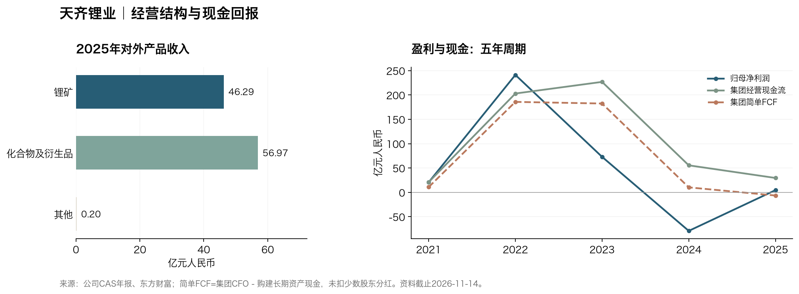

# 天齐锂业（002466.SZ / 09696.HK）研究报告

> **研究日与资料截止：2026-11-14，北京时间。** 已执行date核对；最新财务期2026Q3，季度未经审计。A股11月13日收盘34.60元；H股同日16:08快照22.82港元，未冒充已另核最终收市价。真实A/H混合市值557.16亿元人民币；按H价统一全部股本价值334.65亿元，TTM归母PE5.69倍。
> 一句话论文：优质矿山可以在商品周期中保住相对盈利，但普通股回报还要穿过少数股东、冶炼亏损、SQM收益安排和母公司融资。

## AI研究偏见自觉

信息丰富度A级。最容易把“格林布什优质”直接推成“天齐所有现金都优质”，或把2026复苏利润当永久盈利。AI研究局限性声明：无法现场核验矿山完整维持成本、现金跨主体调度、SQM未来分红与新协议全生命周期回报；Q3权益法收益部分依赖SQM尚未披露业绩的估计。

- [x] 矿山100%口径与最终26.01%经济权益分开。
- [x] 不把全部经营现金流减capex当归母FCF。
- [x] 可转债按偿债义务核对，不默认低价自动转股。
- [x] 区分能源转型、资源护城河和当前买入价格。

---

## 第一步：核心数据总览

### 五年周期与最新四季

金额均为亿元人民币，采用中国会计准则CAS。官方年报、季报与东方财富独立整理数据库对照。[S1][S2][S3][S4][S5]

| 年度（亿元） | 收入 | 归母净利润 | 毛利率 | CAS营业利润率 |
|---|---:|---:|---:|---:|
| 2021 | 76.63 | 20.79 | 61.97% | 52.05% |
| 2022 | 404.49 | 241.25 | 85.12% | 98.67% |
| 2023 | 405.03 | 72.97 | 84.99% | 89.61% |
| 2024 | 130.63 | -79.05 | 46.07% | 10.96% |
| 2025 | 103.46 | 4.63 | 39.47% | 38.82% |

CAS营业利润包含权益法投资收益，不等于矿盐业务纯EBIT；2022接近收入的利润率不能理解为每吨锂盐经营率。2024集团仍有营业利润而归母大亏，说明投资收益、税项和少数权益会使毛利与股东利润分离。

| 年度（亿元） | 经营现金流 | 现金资本支出 | 简单FCF | 期末货币资金 |
|---|---:|---:|---:|---:|
| 2021 | 20.94 | 10.09 | 10.86 | 19.87 |
| 2022 | 202.98 | 17.16 | 185.82 | 124.61 |
| 2023 | 226.88 | 44.43 | 182.45 | 95.89 |
| 2024 | 55.54 | 45.24 | 10.30 | 57.67 |
| 2025 | 29.61 | 36.03 | -6.43 | 43.82 |

上述简单FCF=集团CFO−购建长期资产现金，不等于归母FCF。特别是2023对少数股东现金分红201.80亿元，远不能忽略。下一张表同样保持集团口径，不将单季现金季节性当永久分配能力。

| 单季（亿元） | 收入 | 归母净利润 | 经营现金流 | 现金资本支出 |
|---|---:|---:|---:|---:|
| 2025Q4 | 29.49 | 2.83 | 7.67 | 11.22 |
| 2026Q1 | 51.28 | 18.76 | 2.59 | 6.22 |
| 2026Q2 | 71.14 | 23.66 | 19.53 | 4.59 |
| 2026Q3 | 60.37 | 13.60 | 34.33 | 4.00 |

Q3归母13.60亿元，环比-42.53%，但CFO较Q2增加。9M收入182.79亿元、归母56.02亿元、合并净利润103.73亿元，其中少数股东损益47.71亿元。不能用合并利润给天齐全部普通股算PE。[S1][S5]

### 收入结构与关键资产

| 对外产品 | 2025收入（亿元） | 2026H1收入（亿元） |
|---|---:|---:|
| 锂矿 | 46.29 | 51.22 |
| 锂化合物及衍生品 | 56.97 | 71.01 |
| 其他 | 0.20 | 0.19 |

H1锂矿毛利率74.19%、化合物57.35%，为公司产品口径；Q3未披露完整分产品表，因此没有编造逐季分部收入和毛利。未抵消分部表里矿山收入与内部销售会重叠，不能直接相加计算占比。[S2][S3]

| 关键资产 | 天齐经济权益与最新事实 | 对股东价值的含义 |
|---|---|---|
| Greenbushes格林布什 | 天齐51%×TLEA持Windfield51%=26.01%；Q3全矿产43.5万吨精矿 | 控制并表不等于拥有全矿现金 |
| Kwinana奎纳纳 | TLEA体系、天齐权益51%；IGO披露Q3仅产氢氧化锂918吨 | 上游优势可能被加工低效吞噬 |
| SQM | 最新持股21.90%，权益法；不沿用旧22.10% | 利润、分红和项目权益不能混同 |
| 措拉 | 间接80%；11月13日资源储量备案 | 尚非在产现金流，不提前计入基准利润 |

IGO独立季报给出Greenbushes现金生产成本418澳元/吨、实现价2,130美元/吨、EBITDA率83%；成本和售价币种不同，不能直接相减。成本不含全部税费、财务和维持资本，本文不声称已拿到完整成本曲线。该季Windfield派息6.801亿澳元，TLEA收到3.47亿澳元，但TLEA当季没有向股东宣派股息，拟在12月季度由董事会评估；现金仍可能停留在中间控股层。[S6]

### 现金与可转债：不能略过的桥

| 2026年9月末/9M资金（亿元） | 数值 | 口径 |
|---|---:|---|
| 货币资金 | 128.25 | 集团余额，不是母公司随时可动用现金 |
| 现金及交易性金融资产 | 139.28 | 现金宽口径 |
| 广义债务 | 181.56 | 含全部其他流动负债，包含部分票据与税项 |
| 广义净债务 | 42.29 | 同口径相减，不声称精确纯有息净债 |
| 9M经营现金流 | 56.45 | 全额合并 |
| 9M现金资本支出 | 14.80 | 简单FCF为41.65亿元 |
| 子公司支付少数股东股利 | 24.76 | 已发生现金分流，不完整代表全部少数权益 |
| 扣capex和少数股东股利后桥接余量 | 16.88 | 不是规范归母FCF |
| 再扣其余股利、利润及利息支付后余量 | 12.38 | 不把其余4.51亿元全当利息 |
| 投资活动取得投资收益现金 | 11.41 | 不把应计权益法收益当同额回款 |

Q3其他流动负债24.80亿元包含可转债账面负债。H1附注显示该科目还含已背书未到期票据和税项，Q3未给全拆分；若只加常见借款、债券和租赁，会漏掉可转债而低估净债。H1部分货币资金为三个月以上定存，不能把现金与现金等价物差额全部称永久受限，也不能假定跨境集团余额都可偿母公司债。[S1][S3][S5]

截至10月底可转债未偿本金22.79亿元，2027年2月9日到期，转换价51.85港元，明显高于现价；需按偿还或再融资准备。潜在转换49,508,558股不是现在股数。若未来全部转股，应同步考虑债务消失与稀释，不能只计好的一面。[S7][S8]

> 数据追问：矿山的高现金利润，有多少能够合法、及时穿过合资公司和融资约束来到母公司？

## 第二步：生意本质分析

**这是一门依靠优质矿山成本优势及盐湖投资权益参与锂需求增长的生意，优势在资源禀赋，价格由行业决定。** 客户是锂盐、正极和电池供应链；合格锂精矿和高纯锂盐存在持续采购，但多数合同随商品价格重定价。

Greenbushes资源品位、规模和设施使其在低价环境具有更强韧性；下游Kwinana却需要独立验证转化效率。国内外锂盐产能有认证与工艺门槛，但没有消费品牌式的任意提价权。利润由精矿和化合物价格、矿山单位成本、SQM权益法收益与税项共同驱动。

重复需求可预测性高于利润可预测性。2026Q3矿端成本和产量改善有独立合作方佐证，但母公司股东仍承受加工投资、分红时点和融资期限风险。

> 段永平式追问：资源好之外，天齐是否已证明每一笔新投资也能赚到合理回报？

## 第三步：护城河评估

| 来源 | 强度 | 证据与可证伪点 |
|---|---|---|
| 品牌、定价权 | 弱 | 难独立于锂价提价，客户仍有替代 |
| 转换成本 | 中 | 高纯认证、持续供应；并非永久排他 |
| 网络效应 | 无明显证据 | 规模增加不自动提高产品效用 |
| 资源成本、规模 | 较强，最关键 | Greenbushes成本和产量有IGO独立披露；若全成本恶化须重估 |
| 技术与专利 | 中 | 加工能力不能豁免Kwinana低效 |
| 许可和资源寿命 | 中强但有政策边界 | 长资源寿命有价值，续期和利益分配由政府影响 |

过去五年上游资产仍有竞争力，CGP3已达名义产能；同时新增加工回报、SQM控制安排和持股稀释削弱了“优质资产完全传导到每股价值”的直觉。未来五年矿端护城河大概率仍在，股东整体护城河能否拓宽取决于资本配置与归母现金。

IGO披露Kwinana该季EBITDA亏损6,540万澳元，其中含库存减值及IGO自身资本支出费用化口径；这证实项目经营困难，但不能原数搬成天齐CAS归母损失。PLS同季成本也具竞争力，本文不在成本口径不一致时给全球第几名。[S6][S9]

> 巴菲特式追问：十年后矿山仍可能优质，投资者买入的持股链和分配权会否已经改变？

## 第四步：逆向思考与风险清单

| 失败路径 | 定性可能性 | 影响 | 观察指标 |
|---|---|---|---|
| 锂价回落抵消量增、利润再次低谷 | 中高 | 高 | 实现价、产销和库存减值 |
| 母公司现金不到位且CB到期 | 中 | 高 | TLEA/SQM实际分红、定存期限、偿债安排 |
| Kwinana低效与新增资本吞噬矿山现金 | 中高 | 中高 | 产量、转化成本、追加投入和减值 |
| SQM2031经济安排低于预期 | 中 | 高 | Novandino税租、项目分红、资本支出 |
| 权益法收益估计下修 | 中 | 中 | SQM正式财报与天齐已确认估计对账 |
| 资源许可、环境与社区冲突 | 难精确量化 | 高 | 监管原文、开工和许可 |

9M联营/合营投资收益22.11亿元，以SQM为重要组成但不全等于SQM；天齐Q3部分采用尚未公布的SQM业绩估计。SQM三季报预定11月17日，不能把未来公告当已读事实。[S1][S10]

最强空方论点是：一块好矿，经过少数股东、负回报加工厂、参股公司政策与控股层融资之后，普通股可能只有周期交易价值。公司2018并购SQM后的融资压力，以及2022高利润与2024大亏的反差，是资本配置与商品周期的自身历史案例，不是利润会线性增长的证据。

最可能的分析错误，是低估2031后SQM收益变化和Kwinana资本消耗，同时把9M强现金误当母公司自由现金。未给缺乏统计基础的精确失败概率；估值权重只是研究假设。

> 芒格式追问：即使格林布什保持优秀，哪一层结构仍能让天齐普通股股东失望？

## 第五步：管理层评估

蒋安琪任董事长、夏浚诚任董事兼总裁。9月末天齐集团持股24.30%，张静直接持股4.01%，来自Q3及东方财富股东渠道；没有把夫妻、公司持股与SFO视作权益重复相加。未取得CEO个人持股的独立精确双源，不写未经确认比例。[S1][S11]

| 关键决策 | 结果与后续 | 评价 |
|---|---|---|
| 控股优质上游资源 | 建立难复制资源地位 | 正面，须看最终经济权益 |
| 2018收购SQM大额权益 | 获取优质资产，也带来重大杠杆压力 | 资产判断与融资时机必须分别评价 |
| 引入IGO、H股上市等融资 | 缓解债务，分摊项目投入及未来收益 | 改善生存能力，存在稀释代价 |
| Kwinana扩张 | 仍有生产与减值问题 | 资本配置拖累，未用资源质量抵销 |
| 2026配股及零息可转债 | 补现金，但2027到期需要兑现 | 零票息不等于无资金成本 |

管理层不是只有好矿或坏融资一种标签。技术、资源经营需要团队，企业不完全依赖单人；但家族控制、投资纪律和融资期限仍影响少数股东。最新研发投入与客户集中度没有完整双源刷新，不编造精确回报率。

> 段永平式追问：如果董事长更换，能留下的是稳定的投资制度，还是下一轮高价扩张的惯性？

## 第六步：行业与文明趋势

IEA预计STEPS情景锂需求至2040超过当前三倍；澳洲REQ同时预测短期供应过剩、2027后价格从高位回落。长期需求增长与中期资源利润下降可以同时成立。LFP仍需要锂，钠电短期全面替代证据不足；但高锂价会刺激新矿、回收及替代方案。[S12][S13][S14]

天齐的价值链位置优于纯加工企业：资源现金成本决定周期底部韧性。不过SQM与Codelco合资已在2025年12月完成，相关天齐上诉于2026年1月被终审驳回，不能继续写“待批准”或用未知诉讼反转支撑价值。[S15][S16]

SQM保留项目少数股权和特定权利，2025—2030有特殊经济安排，2031以后Codelco取得控制；同时矿权经营延至2060。**不是现在把天齐SQM权益再砍一半，也不是2031什么都不变。** 正确反事实还包括旧许可2030到期后能否延续。基准长期利润已对收益结构变化保持约束，尾部监管冲击仍未精确建模。[S15]

措拉11月13日备案：资源矿量2,508.7万吨、Li2O30.8189万吨，储量矿量1,351.9万吨、Li2O17.5292万吨。它扩大可开发选择，不是当期收入或可直接按现货锂价乘出的资产价值。[S17]

> 李录式追问：电气化发展二十年之后，收益会由资源股东保留，还是被政府、合资方、买方和扩产吸收？

---

## 第七步：估值与安全边际

### 定价、股本与反向DCF

10月月报及东方财富确认总股本1,713,105,208股，A1,476,959,670股/H236,145,538股；8月注销后不再使用旧17.062亿股。11月13日汇率1港元=0.85604元人民币，固定汇率用于模型，不计换汇、股息预提及交易税费。[S5][S7][S18]

| 指标 | A股 | H股 |
|---|---:|---:|
| 股价 | 34.60元 | 22.82港元 |
| 本市场价格×全部股本（亿元人民币） | 592.73 | 334.65 |
| TTM归母PE | 10.07倍 | 5.69倍 |
| 最新归母PB | 1.21倍 | 0.68倍 |
| TTM PS | 2.79倍 | 1.58倍 |

A股较H股人民币等值溢价77.12%。两项全股本价值不能相加，真实混合市值557.16亿元。TTM收入212.28亿元、归母58.84亿元，重建为FY2025+9M2026−9M2025，按全部当前股本EPS3.4350元。强周期的低PE不能直接等同资产便宜；PEG无稳定意义。EV/Revenue需匹配少数权益和SQM权益法投资，不给未经调整的简单倍数。

与同日赣锋相比，天齐A/H PE10.07/5.69倍低于赣锋11.38/6.26倍，且本轮上游成本和现金桥更强；这是偏好天齐的经营证据，不是用同行市场价格给十年终值PE背书。[赣锋横向报告](../赣锋锂业/赣锋锂业-research-20261114.md)

反向DCF假设起始正常化可分配现金30亿元、十年增长、r8%及其后g2%，A股隐含增长约3.95%，H股隐含约-3.53%。30亿元是研究假设，参考9M扣融资分配后现金桥和投资收益现金，仍受分红链、受限资金及维持投入影响；不是已经确认的归母FCF。历史PE受2022峰值、2024亏损和SQM税项影响，未取得统一前复权序列，不编造历史分位。

### 三年三情景：价格是否提供缓冲

采用正常化起点EPS2.50元，即年度归母42.83亿元，低于TTM；并非公司指引。悲观增长-12%反映价格与SQM收益压力，基准4%表示产能效率抵消一部分价差回落，乐观12%需量价与加工改善。三年退出PE10/12/14倍仅是周期重估假设；以8%折现得到今天参考。[模型记录](天齐锂业-model-20261114.json)

| 三年情景 | EPS年增速 | 退出PE | 2029归母（亿元） | 2029价格A元/H港元 | 折现现值A元/H港元 | 至2029年化A/H |
|---|---:|---:|---:|---:|---:|---:|
| 悲观 | -12.00% | 10倍 | 29.19 | 17.04 / 19.90 | 13.52 / 15.80 | -21.03% / -4.46% |
| 基准 | +4.00% | 12倍 | 48.18 | 33.75 / 39.42 | 26.79 / 31.29 | -0.83% / +19.99% |
| 乐观 | +12.00% | 14倍 | 60.17 | 49.17 / 57.44 | 39.03 / 45.60 | +12.43% / +36.03% |

以上不含股息、税费和净稀释；未来目标价与今日现值分开。A价较基准现值26.79元偏高；H价22.82相对基准现值31.29港元已有缓冲。该缓冲可能被弱周期、SQM收益修正或融资成本消耗，因此只能支持研究性小仓。

### 十年折现：仓位承受能力

利润和现金按人民币，H股先转人民币，资本成本统一用CNY。r=8%，由中债11月13日十年1.6123%加β1×研究ERP6.3877%组成；ERP是判断。人民币合理区间6%—9%，永续基准g上限2%。稳态增量ROIC取12%，高于赣锋源于低成本矿山，低于高景气存量回报以反映加工和新资本拖累。[S19]

永续g0%/1%/2%，r−g8/7/6个百分点；退出PE严格由(1−g/ROIC)/(r−g)导出。2036归母15/60/110亿元不是把当前利润复利十年：包含低价、资源成熟及2031后SQM安排的研究判断。权重30/50/20为主观，不是统计发生概率。k=0，未预先保证未来净分红；CB与新资本的稀释/偿债另列风险，不能只加潜在新股却不减债。

| 十年情景 | 研究权重 | 2036归母（亿元） | 永续g | 终值PE | A股十年回报 | H股十年回报 |
|---|---:|---:|---:|---:|---:|---:|
| 悲观 | 30% | 15 | 0% | 12.50倍 | -10.87% | -5.63% |
| 基准 | 50% | 60 | 1% | 13.10倍 | 2.86% | 8.91% |
| 乐观 | 20% | 110 | 2% | 13.89倍 | 9.93% | 16.40% |

十年工具为终值价格几何回报加净分配的近似，本次净分配为零；加权回报并非完整逐年现金流IRR。若实际净分红每年贡献1个百分点，工具近似回报也相应增加1个百分点，但这不是本文确定收入。r10%仅为工具换算锚，不作为人民币合法决策基准。

| 市场 | r | 概率加权回报近似 | 覆盖r判断 |
|---|---:|---:|---:|
| A股 | 6% | 3.60% | 未通过；乐观档分母4pct，仅作情景参考 |
| A股 | 8% | 0.15% | 未通过 |
| A股 | 10% | -2.34% | 未通过；区间外，仅供参考 |
| A股 | 7% | 1.72% | 未通过 |
| A股 | 9% | -1.18% | 未通过 |
| H股 | 6% | 9.70% | 通过；乐观档分母4pct，仅作情景参考 |
| H股 | 8% | 6.05% | 未通过 |
| H股 | 10% | 3.41% | 未通过；区间外，仅供参考 |
| H股 | 7% | 7.70% | 通过 |
| H股 | 9% | 4.64% | 未通过 |

r6%的乐观档分母4pct，整档只作情景参考；r10%超人民币合理区间，仅供参考，不能用其通过或不通过论证买卖。额外7%/8%/9%复核满足最窄5pct：**H股在7%时通过、8%和9%未通过，合理区间内确实翻转；A股持续未通过。** 本结论对折现率敏感，仓位建议须降级，禁止为凑买入调低r。

同组排序扫描中，天齐H、赣锋H、天齐A、赣锋A次序在6%—9%不变；这说明本组研究假设下相对偏好比绝对回报更稳健，不构成未来业绩保证。

### 估值分歧对账

三年H股基准现值31.29港元、基准价格回报近似年化19.99%，支持当前22.82港元存在研究价值；十年概率加权6.05%未覆盖8%，且随r翻转，要求收紧仓位。前者判断贵不贵，后者衡量可承受多大权重。

最终维持H股有条件小仓分批，依据是资源成本证据、9M现金改善、净债相对规模及价格折价；同时将研究仓上限收紧到约1%—1.5%，首笔约0.5%，而非把十年测试当唯一否决票。A股缺少同样折价，观望当前价新仓。

尚未建模的尾部风险是CB再融资失败、海外矿权永久损伤和现金传导受阻；SQM与价格的常规变化在情景利润中考虑，重大监管断裂未精确赋概率。这些风险没有加进r或β，仍可能使模型高估价值。

> 巴菲特式追问：r改变两点会翻转吗？7%与8%已经翻转，答案是会，因此不支持重仓。
>
> 段永平式追问：若关闭市场五年，是否愿意用少量资金承担矿山之外的融资和治理结构？

## 第八步：最终决策与行动清单

| 六个并列维度 | 结论 | 信心度 |
|---|---|---|
| 生意质量 | 资源业务优于纯加工，利润仍周期化 | 高 |
| 护城河 | Greenbushes成本优势较强，股权链分流 | 中高 |
| 管理层 | 资源布局好，融资与加工资本配置有明显历史成本 | 中 |
| 最大风险 | CB到期、母子公司现金传导、SQM与加工亏损 | 中高 |
| 文明趋势 | 锂需求长期增长，供给与制度决定利润归属 | 中高 |
| 估值 | 三年H有折价/A不足；十年H随r翻转、只能限仓 | 中低 |

**当前结论：优先天齐H股，22.2—24.5港元可有条件小仓分批；A股34.60元观望新仓。** 十年未覆盖r只下调仓位建议，与其他五个维度并列，不能单独否决H股研究价值。

| 策略 | 行动与价格 | 条件 |
|---|---|---|
| 空仓者 | H22.2—24.5港元研究首笔约0.5%；A19—21元再研究 | 可承受周期回撤；已核9M和CB义务，并在11/17 SQM披露后复检；无法接受短期收益修正者等复检后再下首笔 |
| 持仓者 | 适量小仓可持有复检；A股不因10倍PE机械加仓 | 不预设用户已有持仓；跨A/H换仓还需账户、税费与交易限制核对 |
| 加仓信号 | 价格在带、SQM正式披露未实质推翻9M、CB偿付来源明确 | 随后一次正式披露现金桥继续为正，Kwinana亏损与新增资本受控；总研究仓约≤1%—1.5% |
| 重审/减仓 | A≥40元 / H≥47港元且盈利模型未增强时复核超配；任意价触红线 | 到期还债无方案、资金受限扩大、持续现金恶化或资源权益永久受损 |

两家锂股有高度共同因子，合计研究仓原则≤2%，不能当分散投资。H下沿以下先检查永久损失，不机械抄底。A19—21元与H22.2—24.5港元按固定汇率基本经济等价，约为基准现值再留安全边际；不是假定A/H价差会收敛。

旧A30—35元带由本文替代。变化部分来自股本更新、正常化EPS和三年折现/风险余量的完整化，并非声称Q3经营差于旧预期。新价位应与新假设一起使用，不能把旧带已经命中算作投资成功。

后续：11月17日为SQM预定Q3披露，按其当地公告时间取得后复检；12月31日核资金与Kwinana；2027年1月15日提前核CB偿债安排，2月9日正式到期；4月30日为全年披露研究检查窗口，非已确认年报日。

### 四位大师的原文与方法延伸

以下是方法论推演，不是四位本人对这两只股票的观点，也不是拟造的本人发言。

| 原文短引与出处 | 本报告的延伸判断 |
|---|---|
| 巴菲特：“a cost advantage that is both wide and sustainable”。[1982致股东信，商品企业段](https://www.berkshirehathaway.com/letters/1982.html) | 要买的是能够穿越低锂价的成本优势，并核对实际归属权益。 |
| 芒格：“But he has no magic wand”。[Wesco 2009股东信，第5页](https://www.berkshirehathaway.com/wesco/cm2009.pdf) | 管理者再努力，也不能用能力叙事消除行业过剩和低回报投资。 |
| 段永平：“有社会意义的东西未必能赚钱”。[2011-11-22雪球原帖](https://xueqiu.com/1247347556/20522344)，已读[仓库原发言汇编](../段永平/段永平雪球全量原发言.md)，第328条 | 原话讨论航空业和微博。延伸到锂业，能源转型的社会价值仍须通过每股现金回报检验。 |
| 李录：“preserve and increase your purchasing power”。[2024北大演讲官方英文稿，第17页](https://cdn.prod.website-files.com/5ef3c7300432b40ed865991a/67a4f75703627bd3a927077e_Global%20Value%20Investing%20in%20Our%20Era%20(2024-12-07).pdf) | 产业增长是背景，维持和增加购买力要同时考察企业竞争力与买入价格。 |

## AI分析置信度与投资确定性

历史财务、股数、CB合同和Greenbushes季度事实置信度高；归母可分配现金、2031后SQM经济回报及正常化利润只有中低置信度。资料丰富使AI能解释结构，不会消除商品价格和资本配置的不确定性。实际投资确定性明显低于数据置信度，建议只作为学习研究，不构成投资建议。

## 数据来源与审计记录

公司CAS与东方财富独立数据渠道核对，底层仍同一发行人报表；合作方IGO构成矿山经营的独立披露。[StockAnalysis标准化财务](https://stockanalysis.com/quote/she/002466/financials/)的2025毛利、营业利润分别约37.83/30.90亿元，与CAS40.84/40.17亿元有分类/准则差异，未找到完整桥接，不能标全表一致。现金债务与少数权益差异已逐项保留。

抽检、交叉验证工具原文节选及最终估值准出见[审计记录](天齐锂业-audit-20261114.md)，参数见模型JSON。最新逐季分产品、Q3现金限制明细、精确纯有息净债、CEO个人持股和研发回报仍有资料缺口。

[S1]: https://static.cninfo.com.cn/finalpage/2026-10-26/1225620881.PDF "2026Q3 CAS"
[S2]: https://static.cninfo.com.cn/finalpage/2026-03-28/1225044817.PDF "2025年报"
[S3]: https://static.cninfo.com.cn/finalpage/2026-08-28/1225522276.PDF "2026H1 CAS"
[S4]: https://static.cninfo.com.cn/finalpage/2025-03-27/1222913103.PDF "2024年报；早期年报另存审计索引"
[S5]: https://emweb.securities.eastmoney.com/PC_HSF10/NewFinanceAnalysis/Index?type=web&code=SZ002466 "东方财富财务数据库"
[S6]: https://www.igo.com.au/site/pdf/dd3bde88-4ef3-466d-89c2-ab99d1d66e59/Platform/ListPage/September-2026-Quarterly-Activities-Report.pdf "IGO九月季度"
[S7]: https://www1.hkexnews.hk/listedco/listconews/sehk/2026/1105/2026110501360.pdf "10月股本与未偿CB月报"
[S8]: https://static.cninfo.com.cn/finalpage/2026-02-04/1224967716.PDF "CB条款"
[S9]: https://www.pls.com/invest/results "PLS季度结果"
[S10]: https://ir.sqm.com/ "SQM披露日历"
[S11]: https://emweb.securities.eastmoney.com/PC_HSF10/ShareholderResearch/Index?code=SZ002466&color=w&type=web "东方财富股东数据"
[S12]: https://www.iea.org/reports/global-critical-minerals-outlook-2026/outlook "IEA 2026需求情景"
[S13]: https://www.industry.gov.au/publications/resources-and-energy-quarterly-september-2026 "澳洲REQ 2026年9月"
[S14]: https://www.iea.org/commentaries/sodium-ion-battery-momentum-grows-but-challenges-remain "IEA钠电专题"
[S15]: https://www.sec.gov/Archives/edgar/data/909037/000090903726000023/sqm-20251231.htm "SQM 2025年20-F，Novandino安排"
[S16]: https://www.codelco.com/prontus_codelco/site/docs/20160401/20160401130745/20260127_info_de_interes.pdf "终审结果"
[S17]: https://www1.hkexnews.hk/listedco/listconews/sehk/2026/1113/2026111300166.pdf "措拉备案"
[S18]: https://www.safe.gov.cn/AppStructured/hlw/RMBQuery.do?COLLCC=546877760 "11月13日汇率"
[S19]: https://yield.chinabond.com.cn/cbweb-cbrc-web/cbrc/showCbrc "11月13日中债曲线"
