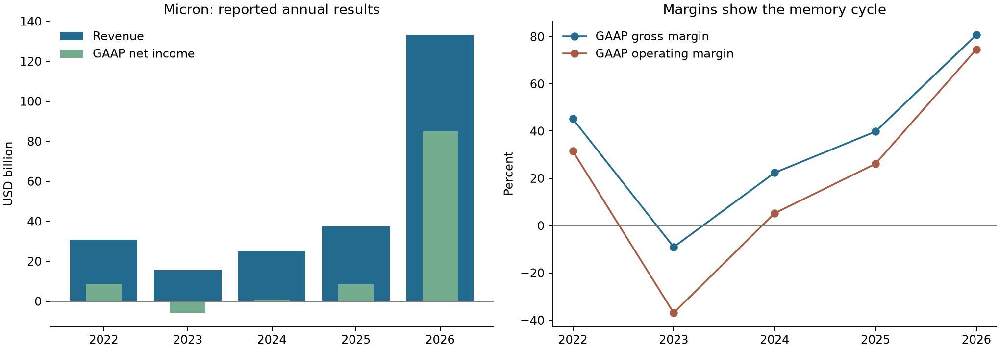
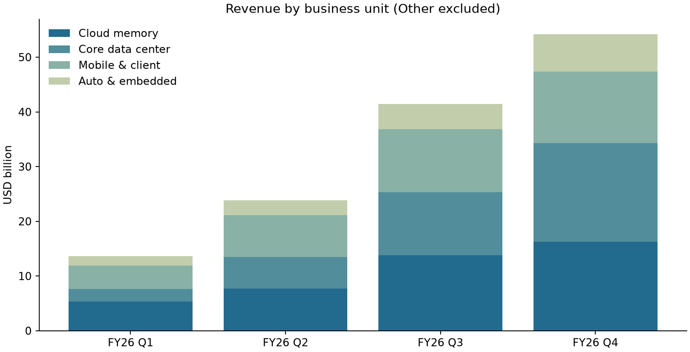

# 美光科技（MU）研究报告

> **研究与数据截止日：2026-11-24，上海时间。** 已执行系统日期核验。公司：Micron Technology, Inc.，美光科技；NASDAQ Global Select Market：MU，普通股，非 ADR。财务截至 2026-09-03 的 FY2026；该财年为 53 周。行情统一采用 2026-11-23 常规盘完整收盘 **707.70 美元**，不是 11/24 实时价；研究时 11/24 已开盘。
>
> **估值锚：**在外普通股 1,131,423,212 股，复算市值 **800.7082 十亿美元**；稀释 EPS 口径 PE 9.52 倍，统一现金 CapEx 后 P/FCF 13.58 倍。
>
> **核心判断：**美光开始用多年合约改善存储周期的下限，但今天的利润仍高度依赖涨价。研究的关键，是合约能保护多少现金回报，以及扩产后还剩多少利润。
>
> 本报告用于学习研究，不构成投资建议。全部金额除特别注明外为美元；B＝十亿美元，m＝百万美元。模型是分析者假设，不是公司指引。

---

## AI研究偏见自觉

**信息丰富度评级：A。** 财报、技术资料和市场讨论充分，最容易犯的错是把材料多误当作未来确定。本报告同时检验两种叙事：“AI 已经消灭周期”和“存储永远只能按旧周期估值”。

AI研究局限性声明：无法检查客户未公开合同、真实终端库存、HBM 良率和晶圆厂项目的增量回报。公司预测、行业机构预测和本报告推算分别标注；不把搜索到的传闻当作事实。Macrotrends 本次页面访问受限，历史利润率可通过搜索索引复核，财务其余主要以 SEC 原报与 StockAnalysis 独立整理复核；部分分部利润率及治理数据只有一手披露，缺口留在附录，不伪装双源一致。

- [x] 把已发生的利润与跨周期可持续利润分开。
- [x] 承认 SCA 多年协议构成实质变化，不能机械套用旧年利润。
- [x] 同时检验 11 月 NAND 转弱证据，不把 HBM 紧缺外推至全部产品。
- [x] 不用李录历史持仓或段永平期权交易替代当前估值。

本次复用已有研究最集中的 `reports/存储/`，保留 7/30 原报告；5 月专题研究与李录历史材料继续作为各自专题档案，不另建中英文公司目录。检索触发配置与两张台账后，未发现既有 MU target 或建议事件，因此本次按 MU 新增登记。

---

## 第一步：核心数据总览

### 五年财务：先看利润怎样变化

| 财年 | 收入 USDm | GAAP净利 USDm | 毛利率 | 营业利润率 | CFO USDm | 全部现金CapEx USDm | 统一FCF USDm | 现金及可交易证券 USDm |
|---|---:|---:|---:|---:|---:|---:|---:|---:|
| FY2022 | 30,758 | 8,687 | 45.18% | 31.54% | 15,181 | 12,067 | 3,114 | 10,978 |
| FY2023 | 15,540 | -5,833 | -9.11% | -36.97% | 1,559 | 7,676 | -6,117 | 10,438 |
| FY2024 | 25,111 | 778 | 22.35% | 5.19% | 8,507 | 8,386 | 121 | 9,152 |
| FY2025 | 37,378 | 8,539 | 39.79% | 26.14% | 17,525 | 15,857 | 1,668 | 11,936 |
| **FY2026** | **133,188** | **84,969** | **80.72%** | **74.59%** | **89,675** | **30,712** | **58,963** | **73,453** |

统一 FCF＝CFO－购建固定资产现金支出，不把政府补助作为经常性经营现金。历史原值采用 [FY2023 10-K（含FY2022）](https://www.sec.gov/Archives/edgar/data/723125/000072312523000054/mu-20230831.htm) 与 [FY2026 10-K（含FY2024–26）](https://www.sec.gov/Archives/edgar/data/723125/000072312526000023/mu-20260903.htm)，独立复核见 [StockAnalysis损益表](https://stockanalysis.com/stocks/mu/financials/income-statement/)、[现金流表](https://stockanalysis.com/stocks/mu/financials/cash-flow-statement/) 及 [资产负债表](https://stockanalysis.com/stocks/mu/financials/balance-sheet/)。

**一项重要差异：**StockAnalysis 把 FY2023 库存减值等项目标准化重分类，毛利润列为 +415m、营业利润 -3,574m；公司原始 GAAP 分别为 -1,416m 和 -5,745m。差异超过校验阈值，本表采用原始 GAAP，不把两者混成一条盈利趋势。FY2022 营业利润也有小额分类差异，取公司 9,702m。FY2023原始利润率另由Macrotrends搜索可见的历史行支持：[毛利率](https://www.macrotrends.net/stocks/charts/MU/micron-technology/gross-margin/1000)、[营业利润率](https://www.macrotrends.net/stocks/charts/MU/micron-technology/operating-margin)。不能声称所有平台每个字段都完全一致。



FY2026 收入同比 +256.33%，净利同比 +895.07%。对照 FY2023 的亏损，不能从最近一年直接推断永续利润；但也不能忽略公司规模、产品和合约已经变化。

### 最近四季度：不只HBM赚钱

| 财季 | 收入 USDm | GAAP净利 USDm | 稀释EPS 美元 | 毛利率 | 营业利润率 |
|---|---:|---:|---:|---:|---:|
| FY26 Q1 | 13,643 | 5,240 | 4.60 | 56.0% | 45.0% |
| FY26 Q2 | 23,860 | 13,785 | 12.07 | 74.4% | 67.6% |
| FY26 Q3 | 41,456 | 28,243 | 24.67 | 84.6% | 80.4% |
| FY26 Q4 | 54,229 | 37,701 | 32.87 | 86.8% | 80.7% |

来源：[Q1公司公告](https://micron.gcs-web.com/news-releases/news-release-details/micron-technology-inc-reports-results-first-quarter-fiscal-2026)、[Q2公司公告](https://micron.gcs-web.com/news-releases/news-release-details/micron-technology-inc-reports-results-second-quarter-fiscal-2026)、[Q4公告及Q3对照](https://investors.micron.com/news/press-release/2026/Micron-Technology-Inc--Reports-Record-Fiscal-Fourth-Quarter-and-Full-Year-2026-Results/)。

以下每格依次为“收入 USDm / 分部毛利率 / 分部营业利润率”。分部口径由公司提供，不等于独立核算后可直接分配给股东的利润。

| 新分部 | FY26 Q1 | FY26 Q2 | FY26 Q3 | FY26 Q4 | FY26全年收入 USDm |
|---|---|---|---|---|---:|
| 云内存 CMBU | 5,284 / 66% / 55% | 7,749 / 74% / 66% | 13,769 / 83% / 78% | 16,283 / 83% / 76% | 43,085 |
| 核心数据中心 CDBU | 2,379 / 51% / 37% | 5,687 / 74% / 67% | 11,524 / 87% / 83% | 18,002 / 90% / 85% | 37,592 |
| 移动及客户端 MCBU | 4,255 / 54% / 47% | 7,711 / 79% / 76% | 11,521 / 87% / 86% | 13,114 / 90% / 88% | 36,601 |
| 汽车及嵌入式 AEBU | 1,720 / 45% / 36% | 2,708 / 68% / 62% | 4,634 / 79% / 75% | 6,824 / 84% / 79% | 15,886 |

另有全年 Other 24m；四个分部并不包含这部分。全年收入占比依次 32.35%、28.22%、27.48%、11.93%。旧 CNBU 等分部不能与新表直接拼接。来源同各季公告；全年与四季加总已复算。

以下增速由同口径重列后的上年分部收入复算：

| 分部收入同比 | FY26 Q1 | FY26 Q2 | FY26 Q3 | FY26 Q4 | FY26全年 |
|---|---:|---:|---:|---:|---:|
| 云内存 CMBU | +99.55% | +162.95% | +306.65% | +258.42% | +218.58% |
| 核心数据中心 CDBU | +3.80% | +210.77% | +653.20% | +1041.53% | +420.02% |
| 移动及客户端 MCBU | +63.15% | +244.86% | +253.95% | +248.78% | +208.63% |
| 汽车及嵌入式 AEBU | +48.53% | +161.90% | +311.18% | +375.87% | +234.23% |

基期与计算结果留在[分部增速底稿](美光科技-研究底稿-20261124/segment-growth.json)，对应[独立季度分部表](https://stockanalysis.com/stocks/mu/financials/?p=quarterly)。这些增长包含价格、产品组合和FY26多一周影响，不能解释成纯位元增长。



两个观察决定后面的估值。其一，移动与客户端分部 Q4 毛利率也达到 90%，说明利润爆发不只是 HBM 产品结构改善。其二，云内存分部并非当前利润率最高的部门，不能预设“HBM 占比上升一定继续提高集团毛利率”。这是根据分部数据作出的分析。

### 钱是否能留下

| FY26资金桥（USDm） | 金额 | 口径 |
|---|---:|---|
| 现金及等价物 | 38,364 | 可交易金融资产起点 |
| 短期投资 | 5,070 | 不等于全部投资 |
| 长期可交易证券 | 30,019 | 排除非市场化股权投资 |
| 全部现金及可交易证券 | 73,453 | 不含受限现金27m |
| 债务及融资租赁 | 5,179 | 流动491m＋非流动4,688m |
| 广义净现金 | 68,274 | 未扣客户押金返还义务 |
| 预留客户押金本金 | 12,747 | 融资现金流，不在CFO内 |
| 模型剩余净金融资产 | 55,527 | 保守预留押金后；并非可立即分红承诺 |
| 统一FCF | 58,963 | 89,675－30,712 |
| 再扣SBC的所有者现金代理 | 57,630 | 额外扣1,333m，防止把股权薪酬当免费 |

公司调整 FCF 为 62,310m，使用净资本开支及其他调整；本报告保持更保守的全部现金 CapEx 口径。**客户押金 12,747m 列融资现金流，不能再从 CFO/FCF 扣一次。**只在净金融资产中预留未来返还，亦不把 9/30 后新增客户承诺机械加到 9/3 的资产负债表。[官方现金流及对账](https://www.sec.gov/Archives/edgar/data/723125/000072312526000018/a2026q4ex991-pressrelease.htm)

还有一项现金质量检查：FY26 所得税费用 14,761m、现金缴税 1,254m，差额 13,507m；应收增加也占用现金。因此本年高 CFO 含税款支付时点的支持，不能假设未来现金转化率不变。差额不应全部直接当成确定即期补税，更不能据此简单扣完后称“真实 FCF”。[FY26 10-K现金流与税项](https://www.sec.gov/Archives/edgar/data/723125/000072312526000023/mu-20260903.htm)

FY27 Q1 官方指引为收入 61.5B±1.5B、GAAP 毛利率约 85.95%、稀释 EPS 37.84±1.00。它支持短期强经营，不是全年或十年利润保证。[公司指引](https://investors.micron.com/news/press-release/2026/Micron-Technology-Inc--Reports-Record-Fiscal-Fourth-Quarter-and-Full-Year-2026-Results/)

> 数据追问：扣除全部再投资、股权稀释和融资性资金后，跨周期每股现金是否仍在增长？目前能确认现金规模已显著增强，不能确认本年利润率可以延续。

---

## 第二步：生意本质分析

**一句话：云厂商、设备商为更快、更省电地存取数据反复购买美光芯片，美光用持续巨额研发和建厂换取少数合格供货者的位置。**

| 生意环节 | 收入与成本机制 | 投资含义 |
|---|---|---|
| DRAM / HBM | 计算中的工作内存；HBM还需堆叠、先进封装和客户认证 | HBM差异化更强，但普通DRAM仍受供需价格影响 |
| NAND / SSD | 数据持久存储；控制器、固件、系统认证提高企业级门槛 | 位元需求长期增长，制程升级也会增加位元供给 |
| 重复需求 | 新平台与容量升级驱动再次购买，没有软件订阅式的永久续费 | 客户切换有摩擦，仍能向多家合格供应商采购 |
| 经营杠杆 | 晶圆厂折旧、研发及大量制造成本先发生 | 涨价利润弹性很大，降价或闲置也会放大损失 |
| 再投资 | 制程、封装、厂房、电力与人才持续投入 | 旧利润不是免费可分配利润；停投会丢竞争力 |

本报告把利润驱动归结为三个变量：**单位位元售价、每位元完全成本、合约保护的交付量与现金回报。**销量增长不足以解释所有利润变化。FY26 DRAM/NAND 均价分别约上涨 180%/200%，位元出货为二成多增长，主要盈利跳升来自价格。[公司经营分析](https://www.sec.gov/Archives/edgar/data/723125/000072312526000023/mu-20260903.htm)

真正的新变化是 Strategic Customer Agreements（SCA）。9/3 年报时点剩余履约义务约 134B；9/30 电话会更新为约 150B、26 份协议，预计覆盖至 2030 年期间收入超过 35%；其中预期协议收入约四分之三有定价框架，其余仍会按市况议价。这提升可见度，但不等于全部收入、全部价格、全部利润均已锁定。[Q4电话会准备稿](https://s25.q4cdn.com/621799436/files/doc_financials/2026/q4/Q4-FY26-Prepared-Remarks.pdf)

从客户角度，交押金换稳定供给可以降低缺货损失；从美光角度，客户承诺为扩产分担风险。双方仍有重新谈判、履约条件和技术更迭风险。管理层称价格底对应的毛利会高于过去周期峰值，这是需要未来业绩检验的判断。

> 段永平式追问：这门生意好在哪？好在最难的平台离不开少数合格供货者；难在这个位置必须持续花钱维护，紧缺也会刺激扩产。

---

## 第三步：护城河评估

| 护城河 | 强度判断 | 可验证证据与反证 |
|---|---|---|
| 品牌及定价权 | 中低 | 客户重视质量与供货，短缺可涨价；传统品类90%毛利更像稀缺租金，不能当品牌永久溢价 |
| 转换成本 | 中，HBM及企业SSD更高 | 认证、封装和平台共同开发耗时；进入下一代平台后仍会重新竞争 |
| 网络效应 | 弱 | 多一个购买者不会自动提高另一个客户的产品价值 |
| 规模与成本 | 强，但非独占 | 巨额研发、采购和制造学习形成门槛；三星、SK海力士同样有规模 |
| 技术与专利 | 中高、持续更新 | 制程、功耗、堆叠及良率协同重要；领先不能简单换算成固定领先年数 |
| 合约与资金安排 | 正在增强 | SCA提高已覆盖项目的交付确定性；价格上限也可能让渡上涨收益 |

独立行业研究显示，CY2026 Q2 HBM 收入份额为 SK 海力士 50%、三星 33%、美光 18%；四舍五入合计 101%，不强行归一。美光由 Q1 的 21% 降至 Q2 的 18%，不能据此直接推断绝对收入下降，但足以反驳“技术领先必然不断拿份额”。[Counterpoint原始研究](https://counterpointresearch.com/en/insights/global-dram-and-hbm-market-share)

同季普通 DRAM 美光份额，Counterpoint 为 24%，TrendForce 为 23.3%。方法、统计边界不同，保留差异；不把收入份额当出货位元份额。[TrendForce原始DRAM研究](https://www.trendforce.com/presscenter/news/20260907-13219.html)

过去五年，HBM、数据中心与合约协作提升了美光的进入壁垒和客户连接；未来五年，决定壁垒能否变成股东回报的，是新制程和新厂的增量资本回报。拿很多钱也难以立刻复制合格产线，但行业现有巨头能够扩产、追赶和争夺下一代认证。公司拥有强进入壁垒，尚没有不可替代的定价垄断。

> 巴菲特式追问：十年后护城河还在吗？制造、认证和规模壁垒很可能仍在；能摧毁投资回报的，可能是供给超过需求以及维持壁垒的成本，而非公司消失。

---

## 第四步：逆向思考与风险清单

最强的反方观点不是“AI 没用”，而是：**客户今天为防缺货采购、供应商今天用高利润扩产，未来位元供给增加时，价格可能比成本下降得更快；长约保护部分收入，却不足以保证全部资本开支的回报。**

| 失败路径 | 主观可能性／期限 | 对投资影响 | 应观察什么 |
|---|---|---|---|
| NAND先转弱并传导利润 | 高，未来一年 | 市场价业务利润、库存估值承压 | 合同价、客户库存、SSD采购与价格底执行 |
| DRAM需求破坏、客户降低规格 | 中高，未来一至两年 | 原本高利润的传统产品先回落 | PC/手机销量、单机容量、分部毛利额 |
| 三星/海力士竞争及HBM认证失误 | 中，未来三年 | 份额和价格双压 | HBM份额、量产良率、实际客户收入；不以送样代替量产 |
| 多年合约重谈或客户违约 | 中低但不易量化，合约期内 | 盈利下限低于模型 | 已定价覆盖比例、豁免条款、押金退还、应收与RPO转化 |
| 扩产回报低、税款支付追上 | 中高，未来三年 | 利润很高但自由现金缩水 | 全额CapEx、现金税、维护与增长开支、每股FCF |
| 台湾重大中断、出口限制升级 | 低频高损失；不赋伪精确概率 | 严重甚至永久损失 | 制造集中、设备许可、客户转移与保险限额 |
| 估值付出过多 | 持续存在 | 好公司也可能长期低回报 | 正常化利润，而非仅TTM PE |

这些风险相互相关，定性概率不能相加，也不等同于估值三情景权重。

**最新反证来自11月。**TrendForce 11/19 预计 2027 年 NAND 位元供给增长 25%–30%，合同价从 Q1 开始下跌、Q2 各品类进入降价周期；原因包括供给提升和中国云客户削单。它与美光 9/30 仍判断供给紧张的预期存在实质分歧。两者都是前瞻判断，不能把较新的预测写成已经发生的崩盘，也不能因其不利而省略。[11/19 NAND原始研究](https://www.trendforce.com/presscenter/news/20261119-13314.html)

11/11 的 PC 研究还指出，提前备货、成品库存与降低规格的计划已出现。涨价与需求受损可以暂时并存，现价继续上涨并不证明最终需求健康。[11/11 PC原始研究](https://www.trendforce.com/presscenter/news/20261111-13303.html)

历史类比首先看美光自己：FY2022 高利润后，FY2023 毛利率转负。类比提供的是固定成本与供给反应机制；本轮的 SCA、HBM 和资本实力使重演程度不能照搬。从博弈论看，三家大厂都想保持纪律，却都有在高利润时扩产的激励；从需求弹性看，昂贵内存会迫使客户减少容量。它们比“AI空间很大”更直接影响利润。

**最可能犯的分析错误：**低估 SCA 对利润下限的保护，过早做周期回归；第二种相反错误是高估合同执行保障，把 86.8% 的单季毛利率变成长期常态。本报告用较高于旧周期的正常化盈利承认前者，用下行情景和现金压力检查防范后者。

> 芒格式追问：聪明人为什么不买？因为便宜的可能是短缺期会计利润，而真正要买的是扩产、补税、客户议价之后的现金。

---

## 第五步：管理层评估

Sanjay Mehrotra 仍任董事长兼 CEO，曾联合创办 SanDisk，2017 年加入美光。2026 年 8 月 Manish Bhatia 任总裁兼 COO，Scott DeBoer 任总裁兼首席技术与产品官，分析时应使用更新后的分工。[公司领导任命](https://investors.micron.com/news/press-release/2026/Micron-Announces-Leadership-Appointments-to-Accelerate-Innovation-and-Growth/default.aspx)

| 时点与决策 | 结果／尚待验证 | 分析者评价 |
|---|---|---|
| HBM与数据中心投入 | 产品组合与盈利规模已增强，仍有份额竞争 | 执行加分，不能用集团涨价利润全算作研发回报 |
| 2025年底退出Crucial消费零售业务 | 稀缺供给向战略客户倾斜 | 有取舍；并非退出全部PC、移动芯片 |
| FY26引入SCA再扩产 | 客户分担资金和需求风险 | 比完全无合同扩产更有纪律，跨周期收益仍待证实 |
| FY26回购与SBC | 回购650m，SBC1,333m | 不能把回购授权直接当股数减少 |
| 2026年10月新增回购安排 | 新授权尚需实际执行 | 未来观察每股现金及净在外股数，不预先记入回报 |

来源：[Crucial退出公告](https://investors.micron.com/news/press-release/2025/Micron-Announces-Exit-from-Crucial-Consumer-Business-12-03-2025/default.aspx)、[10-K资本配置](https://www.sec.gov/Archives/edgar/data/723125/000072312526000023/mu-20260903.htm)。

研发投入 FY2022–26 分别为 3,116m、3,114m、3,430m、3,798m、5,650m。利润增长主要还受价格影响，无法从本年利润直接识别研发的因果回报。本报告不给出无依据的“研发ROI”。

治理以本次查到的最新完整代理声明——2025-11-25 提交版本为基础。CEO 截至 2025-10-31 实益持股 1,084,078 股，占该披露分母约 0.0964%；不是创始人控股型公司。长期股权激励兼有业绩与时间归属，仍需防止周期性利润带来薪酬顺风。[代理声明原文](https://www.sec.gov/Archives/edgar/data/723125/000072312525000038/mu-20251125.htm)

较新的 2026-10-13 Form 4 列出归属后直接普通股 355,146 股、GRAT 间接普通股 607,075 股；以本次公司股数作近似分母，合计约 0.0850%。它与旧代理声明的实益持股范围、日期不同，不能直接当成主动减持比例；表内 F 交易是扣股缴税，也不等于在公开市场看空出售。普通股无双层投票权差异证据；上述是经济股数，不包括把所有未来条件奖励预先计作已持有。[Form 4原文](https://www.sec.gov/Archives/edgar/data/1242654/000124265426000016/xslF345X06/primarydocument.xml)

整体判断是“经营执行强、资本纪律需要跨周期验证”。接班梯队比依赖一位创始人的组织稳健，技术领导者离任仍会考验预算、人才和客户关系。

> 段永平式追问：CEO退休后还能竞争吗？工艺、客户与组织不会立刻消失，但是否能在利润最高时控制无效投资，比个人愿景更值得跟踪。

---

## 第六步：行业与文明趋势

AI 推理和数据处理会扩大内存、带宽与存储需求，这是长期顺风；股东收益则取决于美光能留住多少价格、必须投入多少资本。更大的 TAM 可以和更差的单位资本回报同时出现。

美光在 2025-12-17 的材料中预计 HBM TAM 从 CY2025 约 35B 增至 CY2028 约 100B。这是注明日期的管理层预测，不是独立核实的最新市场总额，也不把它提前写成 CY2027 已兑现。[当时官方演示稿](https://investors.micron.com/static-files/530bd7ed-a8c8-4687-af4a-8c129f740e09)

| 产业问题 | 对美光的含义 |
|---|---|
| AI平台带宽与功耗成为瓶颈 | HBM、低功耗服务器内存和高容量SSD受益 |
| 制程、堆叠与封装同时升级 | 更高工程门槛，也有良率、成本和路线选错风险 |
| 平台客户定制化 | 认证黏性提高，同时依赖少数生态和代际设计 |
| 普通DRAM/NAND供给提升 | 技术进步可能增加位元产出，稀缺利润不能永久外推 |
| 美国及其他地区建厂 | 供应安全改善，但厂房、设备和运营成本必须回收 |

官方产能计划包括 ID1 在 CY2027 年中首片、ID2 在 CY2028 年末首片、纽约在 CY2030 首片，以及新加坡封装和日本扩建。**首片不等于满产，更不等于达到目标资本回报。**FY27 净资本开支指引 Q1 约 11.5B、上半年约 25B，下半年更高，反映未来现金需求显著。[Q4演示稿](https://s25.q4cdn.com/621799436/files/doc_financials/2026/q4/Q4-26-Earnings-Deck.pdf)

FY26 无单一直接客户达到收入 10%，但直接买方分散不代表终端平台风险分散；客户采购可能共同依赖 AI 资本开支周期。部分设备和材料单一来源、台湾制造集中及出口限制也不能由美国新厂在短期内完全解除。[10-K客户及风险披露](https://www.sec.gov/Archives/edgar/data/723125/000072312526000023/mu-20260903.htm)

机会成本也要明确：这里购买的是需要持续再投资的制造资产，不能因为行业重要就接受接近无风险利率的回报。若对客户库存、合同和产能缺乏判断能力，等待可验证现金回报本身有价值。

> 李录式追问：二十年后更像标准石油还是3Com？美光更可能持续拥有重要制造位置；能否成为高回报投资，仍取决于竞争、资本纪律和买入价格，重要性本身不足以回答。

---

## 第七步：估值与安全边际

### 当前估值：低PE包含什么

| 指标 | 复算结果 | 解释 |
|---|---:|---|
| 股价 | 707.70美元 | 11/23完整常规盘收盘 |
| 当前在外股数 | 1,131,423,212股 | 10/2官方口径，独立行情源同值；非全年稀释均股 |
| 市值 | 800.7082B | 股价乘当前在外股数 |
| 稀释EPS口径PE | 9.52倍 | 707.70 / 74.33 |
| 总市值／全年净利 | 9.42倍 | 股数时点与历史加权稀释口径不同，非算术冲突 |
| PS | 6.01倍 | 采用FY26收入 |
| PB | 5.79倍 | 采用权益138,378m与当前在外股数 |
| P/FCF | 13.58倍 | FCF58,963m，全额现金CapEx |
| FCF收益率 | 7.36% | 未预先假设未来保持 |
| P/（FCF减SBC） | 13.89倍 | 所有者现金代理57,630m |
| EV/Revenue | 5.50倍 | EV减广义净现金68,274m，不扣押金义务；仅机械参考 |
| 年化股息 | 0.60美元 | 假设季度0.15延续，非保证 |

价格与股数：[TMX/QuoteMedia](https://money.tmx.com/quote/MU%3AUS)、[FundLibrary](https://www.fundlibrary.com/Stocks/Detail/201168)、[StockAnalysis历史行情](https://stockanalysis.com/stocks/mu/history/)；财务分母回源上述财报。本报告重算比例，不使用 TMX 滞后的 PE 或 FundLibrary 滞后的每股净资产。前瞻 PE、PEG 对周期峰谷和预测误差非常敏感，不作为安全边际证据；未给未经验证的 PEG。

历史年末表列 PE 为 FY2022 7.28 倍、FY2023 亏损无意义、FY2024 136.21 倍、FY2025 15.99 倍。高低主要也受利润周期影响。这里只比较当时倍数，不计算未经统一前复权的长期股价涨幅。[历史倍数表](https://stockanalysis.com/stocks/mu/financials/ratios/)

同行仅作非交易性背景：SNDK 在 11/23 收盘对应平台表列 TTM PE 5.65 倍；SK 海力士 11/24 韩国收盘表列 4.37 倍。两者产品、会计与时点不同，且 SK 第三方股数存在更新风险，未完成同口径双源重建，因此不用于给美光目标倍数或终值背书。共同信息只是“市场也在怀疑峰值利润”，并非美光必然应该跌到同行倍数。[SNDK倍数](https://stockanalysis.com/stocks/sndk/financials/ratios/)、[SK海力士表列快照](https://stockanalysis.com/quote/krx/000660/statistics/)

### 三年三情景：正常化后贵不贵

先设正常化 EPS **50美元**，而非把 FY26 的 74.33 或 Q1 指引乘四。它对应按当前股数净利 56.5712B；若收入 150B，净利率约 37.71%。这仍明显承认 SCA、数据中心和规模改善，没有强行退回旧周期。150B 收入与利润率均为本报告判断，不能误认公司预测。

下表“增长”指从这一正常化基点出发的模型路径，不是从实际 FY26 EPS 连续增长的预测。三年 PE 是定价情景参数，**不用于十年终值**。权重悲观/基准/乐观＝25%/50%/25%，是研究者压力权重，并非统计概率。

| 情景 | 正常化EPS年变化 | 第三年EPS 美元 | 第三年PE | 第三年价格 美元 | 价格总变动 | 含小额股息今日值 美元 |
|---|---:|---:|---:|---:|---:|---:|
| 悲观 | -20% | 25.60 | 10倍 | 256.00 | -63.83% | 193.83 |
| 基准 | +6% | 59.55 | 15倍 | 893.26 | +26.22% | 672.61 |
| 乐观 | +18% | 82.15 | 18倍 | 1,478.73 | +108.95% | 1,112.48 |

第三年指估值日起约三年，非已公布的某个财年指引。今日值用美元折现率 10%，每年股息假设 0.60 美元；概率加权今日值 **662.88美元**。基准含息年化约 +8.14%。股息不是买入理由，后续若停发也须重算。

悲观情景体现合同保护不完全、传统品类降价和资本开支压力；基准保留结构性改善而回归更正常利润率；乐观需要平台增长、SCA与制造执行共同兑现。现价不是没有上涨空间，而是相对这套判断没有充分安全边际。

### 十年折现：资本与现金回报压力

参数先于结论：美元 r＝10%，参考美联储 11/23 发布 H.15 中最新列示的 **11/20 十年美债4.92%**，加分析者选取 ERP5.08%、β1.0。β是统一长期建模假设，并非声称历史回归β为1。美元合理 r 区间沿用工具的9%–11.5%；g 上限4%。[H.15原表](https://www.federalreserve.gov/releases/h15/)

稳态增量 ROIC 取18%：显著低于本轮短缺利润对应的存量回报，保留行业寡头与工程壁垒的溢价；高于低谷资本回报。这个数仍缺少新厂跨周期历史证明，属于中低置信判断。永续 g 悲观/基准/乐观＝1%/2.5%/3.5%，不是未来十年营收增速，也不随 r 改变。

终值 PE 只用 `(1−g/ROIC)/(r−g)`。表内均已通过终值审计：

| 情景 | 权重 | 2036正常化净利 B | 永续g | r−g | 合法终值PE | 仅终值近似IRR | 完整现金流IRR | 完整现金流今日值 美元/股 |
|---|---:|---:|---:|---:|---:|---:|---:|---:|
| 悲观 | 25% | 25 | 1.0% | 9.0个百分点 | 10.49倍 | -10.56% | -4.88% | 243.05 |
| 基准 | 50% | 100 | 2.5% | 7.5个百分点 | 11.48倍 | +3.67% | +10.60% | 737.90 |
| 乐观 | 25% | 180 | 3.5% | 6.5个百分点 | 12.39倍 | +10.79% | +19.36% | 1,321.61 |

基准100B利润可理解为2036收入250B、净利率40%；悲观25B对应100B收入、25%净利率；乐观180B对应360B收入、50%净利率。它们是需求、价格和资本投入共同作用的条件情景，不能读成精确盈利预测。

**两种IRR必须区分。**`terminal_value.py irr/flip` 仅算终值价格的几何回报，股息减稀释近似项 k 设0；它没有自动计入十年内自由现金，不能冒称完整DCF。为防止由此误杀高现金流公司，本报告另用逐年现金流求解真实折现根；模型路径如下，均为扣全部再投资、正常税款与股权薪酬补偿后的所有者可分配现金假设。

| 情景 | 第1至第10年所有者现金 B |
|---|---|
| 悲观 | 60、40、20、10、10、12、14、16、18、20 |
| 基准 | 65、70、55、45、50、55、60、65、70、75 |
| 乐观 | 75、85、90、95、100、105、110、120、130、140 |

前两年允许强经营延续，中段体现周期/新厂支出压力，后段才恢复；不是把 EPS 平滑增长伪装成现金。现有净金融资产预留客户押金后55.527B，保守假设到第10年才释放，纳入终值现金一次；未在每年再加一遍。路径不含新收客户押金与政府补助的重复收益。

完整现金流 IRR 假设现金可为股东分配：若公司实际将剩余现金留存并低回报再投资，回报会更差。未来股数按净稳定处理，SBC已在所有者现金中扣偿，故不再另扣一遍稀释。终值PE采用工具约定，以终值年正常化利润为基数；期末转换到稳态投资强度，未再乘一次永续增长因子。

概率加权完整现金流今日值 **760.11美元**，但概率加权情景 IRR **+8.92%**；它与“先取平均现值再求一个IRR”不是同一数学对象。仅终值近似的加权 IRR 为 **+1.89%**。主判断不使用后者替代全部现金回报。

### 折现率敏感性与翻转

| r | 终值工具加权IRR | 工具压力测试 | 完整现金流加权IRR | 完整现金流压力测试 |
|---|---:|---|---:|---|
| 8% | +5.13% | 未通过；区间外，仅供参考 | +11.33% | 通过；区间外，仅供参考 |
| 9% | +3.37% | 未通过 | +10.00% | 通过 |
| 10% | +1.89% | 未通过 | +8.92% | 未通过 |
| 11% | +0.62% | 未通过 | +8.02% | 未通过 |
| 12% | -0.50% | 未通过；区间外，仅供参考 | +7.25% | 未通过；区间外，仅供参考 |

已运行 r±2pp；两侧都在美元工具区间外，因此再运行±1pp。**工具的仅终值近似在合理区间9%–11%采样中不翻转；完整现金流压力测试在9%与10%之间翻转。**本结论对折现率及现金能否归股东敏感，仓位应降级，不能用单个r下未通过直接否决买入或持有。8%/12%只作参考，不据其结果证明应买入。

### 反向DCF：现价要求什么

以第一年正常化所有者现金40B（低于本年57.630B代理）、此后逐年增长、r10%、永续g2.5%和相同净金融资产处理反解，现价要求第2至第10年现金年增长约 **+8.68%**，第10年现金约84.57B、稳态利润约98.21B。这里先对利润率与现金转化作了正常化，因此不能再把“只要求8.68%”解释成轻松。

反过来看，当前定价未要求86.8%毛利率永久持续；它要求美光在周期、扩产与税款回归后仍能留下大额增长现金。多头与空头真正分歧在这里。

### 估值分歧对账

| 判断来源 | 得到什么 | 对决策的作用 |
|---|---|---|
| 三年正常化定价 | 加权今日值662.88、基准672.61美元 | 当前安全边际有限，回答“贵不贵” |
| 十年完整现金流 | 基准IRR10.60%、加权IRR8.92%；加权现值760.11 | 现金回报并非差到必须回避，但合理区间会翻转，只收紧仓位 |
| 仅终值工具 | 加权IRR1.89%，遗漏中间可分配现金 | 是保守局部压力，不得当完整投资回报或一票否决 |
| 7/30旧报告 | 430–500美元分批、1100美元警戒 | 本次有正式SCA数据与新现金表，重新建模后更新下行带 |

三年较低，是正常化初始盈利与较短观察期的限制；十年现值较高，包含中间现金释放和后段业务扩展。二者差异揭示了“现金何时属于股东”的核心不确定，不能挑一个数替结论背书。综合六维，本报告保留合理小仓的持有价值；新仓需更充分的价格余量与合同/现金验证，十年测试只限制仓位。

### 价格转成行动

**500–540美元**作为新的条件研究性分批带，对三年加权今日值约有18.54%–24.57%的折让；较7/30旧430–500带适度上移，依据是SCA与财务实力改善，不声称供需风险已经解除。低于500先检查是否发生永久损失，不因更便宜自动扩大仓位。

540–800美元：等待或复核已有合理小仓，不仅凭低PE新增。800–1100美元：需要上调现金与合同兑现假设才考虑新增。**1100美元及以上**保留为估值/集中度复核线；它是研究警戒而非自动卖出或做空信号。模型上行情景1478.73不是卖出线。

> 巴菲特式追问：r错2个百分点会怎样？区间外结果只参考；合理区间内完整现金压力已翻转，因此不能重仓押单一参数。
>
> 段永平式追问：市场关门五年是否愿意持有？只有能承受存储降价、再投资和合同执行风险的小仓持有人适合；现价缺少让不懂周期的人也能从容持有的余量。

---

## 第八步：最终决策与行动清单

| 六个并列维度 | 结论 | 信心度 |
|---|---|---|
| 生意质量 | 必需的关键部件、重复需求强；资本密集且价格弹性大 | 高 |
| 护城河 | 制造规模、技术与认证强；没有独占定价权，SCA改善下限 | 中高 |
| 管理层 | 执行强，新扩产及回购的每股回报仍需跨周期检验 | 中 |
| 最大风险 | NAND转弱、传统产品需求破坏、扩产现金与合同重谈 | 中；尾部损失幅度低置信 |
| 文明趋势 | AI长期顺风清楚，公司资本回报不自动跟随TAM | 中高 |
| 估值 | 三年现价安全边际不足；十年完整现金基准可过但加权未过，合理r内翻转，限制仓位 | 中低 |

**最终结论：空仓者观望；已有合理小仓者有条件持有，现价暂停加仓。**这是六维综合判断，估值中的十年压力测试不是唯一裁决，不据此建议清仓。

| 投资者／信号 | 研究建议 |
|---|---|
| 空仓者 | 707.70美元基准下不急于建立长期价值仓；等待500–540美元与下述经营验证共同出现 |
| 持仓者 | 能承受周期的小仓有条件持有；超配先降集中度，不用成本价代替未来价值；不了解周期者复核是否在能力圈 |
| 加仓信号 | 在研究带，且下一正式披露核验SCA定价/RPO转化与押金无重大不利、HBM客户交付正常、滚动CFO覆盖全部现金CapEx、扣SBC后现金仍为正；现金税与新厂预算可解释，NAND下行已进入新模型 |
| 仓位约束 | 未知用户组合，不假定适用仓位；示例首笔不超过权益0.5%，验证后研究总仓参考不超过2%，并与SK海力士等合并看存储暴露；不是最优比例测算 |
| 卖出或减仓信号 | 合同价格底实质失效、客户持续不履约或技术竞争力受损，应重做论文；≥1100而现金模型未提高，复核估值与超配，不自动交易 |
| 复检节点 | 12/17美国盘后FY27Q1电话会，上海12/18清晨；2027/3/31检查NAND实际合同价与下一季现金，后者为自定研究检查日，不冒称公司预约日 |

公司已正式公告 12/17 14:30 Mountain time 电话会，对应上海12/18 05:30。关注的不是只报出高EPS，而是合同履约、现金税、全部资本开支、押金和净股数的对账。[正式日程](https://investors.micron.com/news/press-release/2026/Micron-Technology-to-Report-Fiscal-First-Quarter-Results-on-December-17-2026/default.aspx)

### 大师原文约束下的方法延伸

以下是把已读原文方法用于本报告的分析，**不是四位本人对当前MU的最新推荐**。不以大师名字为本报告观望评级背书。

| 人物 | 可核验短引与出处 | 本报告的方法延伸 |
|---|---|---|
| 巴菲特 | “a sensible price tag”，[2007股东信](https://www.berkshirehathaway.com/letters/2007ltr.pdf)，印刷页6 | 生意、长期经济特征、管理层与价格需同时成立，不能只看行业重要 |
| 芒格 | 资料不足，不模拟代言。读到第三方2023 Daily Journal实录，但未完成原始视频该段听读核验 | 不杜撰“芒格一定不买MU”的结论；再投资分析由本报告独立负责 |
| 段永平 | “存储一时半会缓不了”，[本人2026-08-15雪球](https://xueqiu.com/1247347556/405149181) | 公开立场认可紧缺，且自述参与过MU期权；不能模拟成“不碰美光”。本报告不同持有期与估值须自行负责 |
| 李录 | “big boom and bust cycles”，[2026-10-05哥大访谈](https://business.columbia.edu/sites/default/files-efs/imce-uploads/36th%20Annual%20Graham%20%26%20Dodd%20Luncheon%20Transcript%20%2820261005%29%20CBS.pdf)，第8页，谈AI | 承认AI变革与资本繁荣萧条并存；该段未谈MU，不能推演其当前买卖意见 |

喜马拉雅最新可读13F于2026-11-16申报，持仓截至9/30，公开信息表八条未列MU。它只代表可申报证券的期末快照，不等于李录11/24个人全资产。仓库历史报告里的买卖均价、退出原因推算也不作为已知事实。[SEC信息表](https://www.sec.gov/Archives/edgar/data/1709323/000204358526000030/13fhciq326.xml)

> 最后追问：去掉大师姓名与AI叙事，仅凭合同、工厂和未来现金，本报告的价格与风险是否仍站得住？目前支持小仓研究与等待安全边际，尚不足支持重仓确信。

---

## AI分析置信度与投资确定性

财报原值、股数、市值算术与已发生现金流的分析置信度较高；分部经济、协议改善与竞争格局判断为中等；正常化利润、稳态ROIC、十年现金路径和价带为中低置信。

**投资确定性低于资料充分程度。**模型对合约保护范围、NAND价格、未来税款及现金留存回报敏感。三情景不能囊括一切；台湾重大中断与SCA集中违约/极端重谈未作单列损失概率建模，可能产生超出悲观档的损失。

仍需一手补证：SCA各产品的底价与数量范围、押金退还条件；客户终端库存与重复订单；新厂达到量产良率后的现金成本；增长与维持性资本开支；FY26税款低支付的后续节奏。无法得到这些材料，就应保留仓位和价格余量，不能用更长报告填平未知。

## 数据来源与审计记录

原始取证与口径分别留存在[财务来源](美光科技-研究底稿-20261124/财务来源.md)、[产业与管理来源](美光科技-研究底稿-20261124/产业与管理来源.md)、[大师原文核验](美光科技-研究底稿-20261124/原文核验.md)。计算输入、逐年现金及结果见[可复算模型](美光科技-研究底稿-20261124/model.py)、[输出JSON](美光科技-研究底稿-20261124/model-output.json)。

### 关键数据交叉验证记录

下列为共享工具原样输出节选；完整记录见[金融验证日志](美光科技-研究底稿-20261124/tool-verification.log)，终值单点、IRR、两次flip见[终值验证日志](美光科技-研究底稿-20261124/terminal-verification.log)。

```text
  计算市值:           800.71B USD
  报告市值:           800.71B USD
  偏差:               0.00%
  ✅ 验证通过, 偏差仅 0.00%

  ✅ SEC10K              : 133,188.00 USDm  (偏差 0.00%)
  ✅ StockAnalysis       : 133,188.00 USDm  (偏差 0.00%)
  ✅ SEC10K              : 84,969.00 USDm  (偏差 0.00%)
  ✅ StockAnalysis       : 84,969.00 USDm  (偏差 0.00%)
  ✅ SEC10K              : 73,453.00 USDm  (偏差 0.00%)
  ✅ StockAnalysis       : 73,453.00 USDm  (偏差 0.00%)
```

现金的独立复核是对现金、短投和长期可交易证券重构后口径，并未把平台全部长期投资直接视为现金。全部股数以SEC与TMX复核。FY2023原始GAAP与平台标准化差异保留，不强行“修成一致”；分部收入有独立平台整理复核，但分部利润率、个人持股和合同条款没有独立第二套原始账，主张仅限公司正式披露。审计不能替代对管理层陈述的独立调查。

随机抽检与终值定稿复检均已通过，详见[审计覆盖与限制](美光科技-研究底稿-20261124/审计覆盖.md)及[抽检判决](美光科技-研究底稿-20261124/audit-verdict.log)。抽检包含事实回源、模型独立重算、假设一致性和非数值误提取排除，逐项留痕，不把重新抄一遍模型假设称为外部核实。

触发监控登记：MU为新增target，下行500–540美元，上行1100美元警戒；12/18上海复检和2027/3/31研究节点仅保留人工复核，当前每日监控只扫描价格。建议事件新增至[标的跟踪表](../标的跟踪表.md)，不重复加入重点公司主表。
