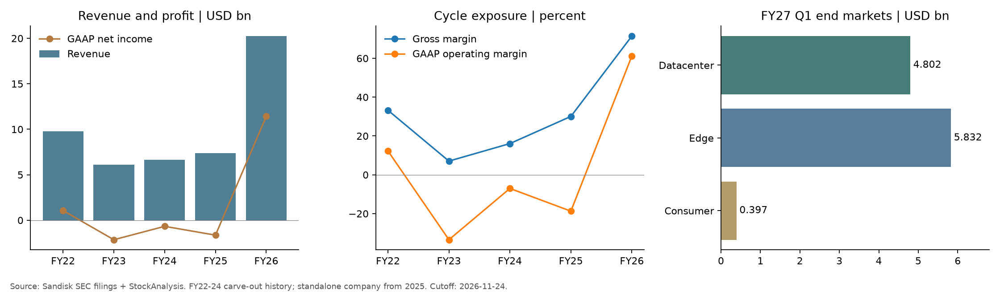

# 闪迪 Sandisk（SNDK）研究报告

**研究及数据截止日：2026-11-24（北京时间）**  
行情基准：2026-11-23 美股常规盘收盘 **87.71 美元**；最新可核封面股数经拆股调整为 1,138,314,920 股，对应市值 **998.42 亿美元**。财务截至 2026-10-02（FY2027Q1），最新年报为 FY2026。TTM 稀释 PE 5.64 倍；美元计价，以下财务表统一为百万美元，另注明者除外。

盘中补充：写作时第三方页面显示 11/24 09:50 EST 为 81.04 美元，已经进入下文 75—85 美元研究带；这只是带时间戳的单源快照，执行前须核实时价。全篇估值保持前收盘统一基准，避免各页刷新时间不同造成倍数混乱。[盘中页面](https://stockanalysis.com/stocks/sndk/financials/income-statement/?p=quarterly)

研究主线：闪迪正在把部分 NAND 生意变成带价格下限的多年供货关系。当前价格隐含利润显著回落，投资胜负取决于下行周期中合同、技术和现金回报能保住多少，而非本季利润再增长多少。

身份核验：Sandisk Corporation，中文常称闪迪，NASDAQ:SNDK，CIK 2023554，普通股、非 ADR。现公司于 2025 年从 Western Digital 分拆，WDC 是另一家以 HDD 为主的上市公司；也不能将 2016 年以前旧 SNDK 的股数和估值连续拼接。本报告复用既有“存储半导体”目录，保留[2026-05-12 历史合并研究](SanDisk_Western_Digital_投资研究报告_20260512.md)，重新核验 SNDK，不改写历史稿。[公司季报](https://www.sec.gov/Archives/edgar/data/2023554/000162828026068601/sndk-20261002.htm)

---

## AI研究偏见自觉

**信息丰富度评级：B。** 产品和制造历史很长，公开资料丰富，但独立上市记录短，NBM 新合同还没有经历完整降价周期。信息数量不足以让合同保护效果获得 A 级置信度。

**AI研究局限性声明：** 没有取得逐份客户合同、客户库存、晶圆实际良率和内部成本曲线。企业 SSD 认证、价格下限与担保的事实可以核实；未来利润率和估值概率属于研究判断。本报告既不把“低 PE”自动视为便宜，也不把“周期股”自动视为坏生意。

- [x] 将历史事实、公司指引、第三方预测与模型假设分别标识。
- [x] 同时检验“AI 长期缺货”和“存储终将过剩”两种叙事。
- [x] 检查拆股、合资厂现金投入、预付款和投资收益，避免漂亮数字制造虚假确定性。
- [x] 若资料减半，仍能成立的是客户需求与供给成本机制；不能成立的是对多年高毛利的精确确信。

> 研究追问：我对确定性的感受，来自合同真实约束力，还是来自最近几个季度惊人的利润？

---

## 第一步：核心数据总览

### 五年周期与最近财年

| 指标 | FY2022 | FY2023 | FY2024 | FY2025 | FY2026 |
|---|---:|---:|---:|---:|---:|
| 收入 | 9,754 | 6,086 | 6,663 | 7,355 | 20,248 |
| 毛利 | 3,244 | 430 | 1,072 | 2,212 | 14,472 |
| 毛利率 | 33.26% | 7.07% | 16.09% | 30.07% | 71.47% |
| GAAP 经营利润 | 1,200 | -2,035 | -468 | -1,377 | 12,389 |
| GAAP 经营利润率 | 12.30% | -33.44% | -7.02% | -18.72% | 61.19% |
| GAAP 净利润 | 1,064 | -2,143 | -672 | -1,641 | 11,433 |
| 经营现金流 CFO | 1,151 | -713 | -309 | 84 | 11,671 |
| 简单 FCF：CFO 减直接 PPE 支出 | 741 | -932 | -475 | -120 | 11,494 |
| 现金及等价物 | 335 | 292 | 328 | 1,481 | 4,762 |
| 研发费用 | 1,362 | 1,167 | 1,061 | 1,132 | 1,328 |

FY2022—2024 为分拆前 carve-out 财务，并非五年独立运营实绩；FY2026 为 53 周财年。FY2025 含 1,830 商誉减值，亏损不能全部解释为当期制造现金亏损。FY2024 此处统一扣总 PPE 支出，未抵卖楼收入，因此为 -475；历史公司净资本开支口径 FCF 为 -338，二者已对账。StockAnalysis 的标准化经营利润与 GAAP 不同，经营利润行采用原始申报，未照搬平台标签。[FY2026 10-K](https://www.sec.gov/Archives/edgar/data/2023554/000162828026057406/sndk-20260703.htm)、[历史分拆申报](https://investor.sandisk.com/static-files/8066cf82-0134-407b-9a74-f162ffd74bbb)、[StockAnalysis 财务](https://stockanalysis.com/stocks/sndk/financials/)

### 最近四季度：企业业务扩大，消费业务收缩

| 指标 | FY26Q2 | FY26Q3 | FY26Q4 | FY27Q1 |
|---|---:|---:|---:|---:|
| 季末 | 2026-01-02 | 2026-04-03 | 2026-07-03 | 2026-10-02 |
| 总收入 | 3,025 | 5,950 | 8,965 | 11,031 |
| 数据中心收入 | 440 | 1,467 | 2,977 | 4,802 |
| Edge 收入 | 1,678 | 3,663 | 5,432 | 5,832 |
| 消费收入 | 907 | 820 | 556 | 397 |
| GAAP 毛利率 | 50.9% | 78.4% | 84.6% | 85.0% |
| GAAP 净利润 | 803 | 3,615 | 6,903 | 8,101 |
| CFO | 1,019 | 3,038 | 7,126 | 6,363 |
| 直接 PPE 现金支出 | 39 | 45 | 43 | 54 |
| 减：JV 净现金投入 | 137 | 38 | 110 | 148 |
| 减：NBM 预付款及押金净影响 | 0 | 538 | 1,938 | 465 |
| 公司 Adjusted FCF | 843 | 2,417 | 5,035 | 5,696 |
| SBC 股权薪酬 | 58 | 54 | 67 | 91 |

Adjusted FCF 使用最新可比口径：Q3 最初披露 2,955，后续追溯再扣 NBM 影响成为 2,417。FY27Q1 数据中心占收入 43.53%，Edge 占 52.87%，消费占 3.60%；FY2026 全年三类收入分别为 5,153、12,160、2,935。公司只披露一个经营分部，三个终端市场没有独立毛利率，不能虚构“数据中心分部利润”。最新季度同比比较还受 13 周对去年 14 周影响。[Q2 公告](https://investor.sandisk.com/news-releases/news-release-details/sandisk-reports-fiscal-second-quarter-2026-financial-results)、[Q3 公告](https://investor.sandisk.com/news-releases/news-release-details/sandisk-reports-fiscal-third-quarter-2026-financial-results)、[Q4 公告](https://investor.sandisk.com/news-releases/news-release-details/sandisk-reports-fiscal-fourth-quarter-2026-financial-results)、[Q1 官方材料](https://investor.sandisk.com/static-files/4ca97b6e-7da4-4d52-b4ac-0e80f462716f)、[第三方季度表](https://stockanalysis.com/stocks/sndk/financials/income-statement/?p=quarterly)

### 三个容易看错的数字

**拆股。** 2026-11-20 开始 8 拆 1 后交易。10 月财报全部每股数据为拆前口径：Q1 GAAP EPS 52.60 美元，折成当前股数口径为 6.575 美元，不能拿 52.60 直接除现价。股本采用 10 月 26 日封面 142,289,365 股乘八，并由 Signal8 精确表及 Yahoo/StockAnalysis 约数复核；仍非实时股东名册。[拆股公告](https://www.sandisk.com/company/newsroom/press-releases/2026/2026-10-29-sandisk-reports-fiscal-first-quarter-2027-financial-results)、[股数复核](https://signal8.ai/companies/NASDAQ%3ASNDK/float)

**现金。** 现金 5,136、短期投资 70，有息借款为零；保守扣经营租赁 201 后，严格净现金为 5,005。另有南亚科技股票 2,289，受三年锁定约束，不能当现金。可退客户保证金负债约 1,597，也限制“净现金都能拿来分配”的理解。[10-Q 附注 4、6、9](https://www.sec.gov/Archives/edgar/data/2023554/000162828026068601/sndk-20261002.htm)、[第三方资产负债表](https://stockanalysis.com/stocks/sndk/financials/balance-sheet/)

**利润与现金。** Q1 GAAP 净利 8,101 含股权证券收益 513，非 GAAP 净利为 7,624；不是所有净利都来自卖 NAND。普通 FCF 为 6,309，扣 JV 148、客户预付及押金影响 465 后为 5,696；再扣 SBC 的保守经济费用代理为 5,605。最后一个数是研究调整，仍不是可持续年金，也未把员工代扣税现金误当新增经营费用。

下一季公司指引为收入 12,200—12,600、GAAP 毛利率 84.4%—85.4%，非 GAAP EPS 拆前 55—57 美元，即拆后 6.875—7.125 美元。它是前瞻指引，不能列作已经实现的利润，也不等于保证全年持续这一水平。

> 段永平式追问：如果只记住一个经营指标，应记什么？——扣合资厂投入与预付款后的跨周期每股现金，而非高峰季度 EPS。

---

## 第二步：生意本质分析

**这门生意的本质：把不断降成本的闪存制程，做成客户通过认证、愿意长期锁量的存储产品，赚取售价与全生命周期供给成本之间的差额。**

| 环节 | 客户为何付款 | 复购与利润驱动 | 约束 |
|---|---|---|---|
| 数据中心 SSD | 读写性能、容量、可靠性、能耗和总拥有成本 | 新服务器部署、容量扩充、设计导入与长期采购 | 客户可多源，架构与缓存效率会改变需求 |
| Edge | 手机、PC、汽车、工业设备嵌入式存储 | 单机容量、出货量、产品升级 | 高价格会诱发降配，OEM 有采购议价力 |
| 消费品牌 | 存储卡、移动 SSD 的便利与渠道信任 | 设备更新、摄影及内容创作 | 替代品多，涨价后销量可能明显收缩 |
| Flash Ventures 制造 | 与铠侠共同研发和承担设备成本 | 单位 bit 成本、良率、产能利用率 | 固定成本刚性，资本支出分散在不同报表项目 |

这不是订阅模式。芯片交付才形成收入，合同让复购更可见，但设备投入、技术迭代和客户履约依然存在。制程成本下降若能留在公司，是股东收益；若竞争迫使同幅降价，则主要让利给客户。

合资制造解释了“账面资本开支很低、业务却不轻资产”的矛盾：晶圆采购成本中含设备折旧与租赁，此外仍有 JV 放款和资本投入。公司持有主要合资主体 49.9%，产出通常约占一半。2026 年将合作延至 2034 年末，并约定 2026—2029 年向铠侠合计支付 12 亿美元制造服务款；不能将该款与已经计入成本和现金流的项目重复扣减。[合作续期](https://www.sandisk.com/company/newsroom/press-releases/2026/2026-01-29-kioxia-and-sandisk-extend-yokkaichi-joint-venture-agreement-through-2034)

### NBM：足以改变判断，但尚不足以取消周期

| 披露项目 | 数额或范围 | 投资含义 |
|---|---|---|
| 已签客户 | 8 家 | 覆盖数据中心和 Edge，仍有集中度 |
| 最低定价下合同收入总额 | 939 亿美元 | 多年合同总额，不是当年收入 |
| 剩余履约义务 RPO | 889 亿美元 | 已包含在合同关系中，不能与 939 亿叠加 |
| 其中未开票 / 合同负债 | 874 / 15 亿美元 | 大部分尚未收款、尚待交货 |
| 担保总指标 | 165 亿美元 | 现金押金与金融工具混合，不是公司净现金 |
| 合同覆盖 bits | FY27 约一半，FY28 约三分之二 | bit 占比不能直接视为收入占比 |
| 加权期限 | 超过四年，最长五年 | 跨过短周期，不跨过所有技术和续签风险 |

约 20% RPO 预计未来十二个月确认，即 177.8 亿美元；它不是总收入预测，更不是利润保证。第三方机构持有、特定客户违约时才能调用的抵押约 128 亿美元，不在公司资产内。上述担保与押金分类不能凭近似数强行拼成一张现金表。[Q1 演示第 11 页](https://investor.sandisk.com/static-files/4ca97b6e-7da4-4d52-b4ac-0e80f462716f)、[10-Q 附注 4](https://www.sec.gov/Archives/edgar/data/2023554/000162828026068601/sndk-20261002.htm)

11 月 19 日管理层会议转录称，多数合同初期固定价、以后有 floor/ceiling，合同总体在 floor 下仍具很高毛利保护。但该转录有 AI 辅助提示，未逐字核音频，相关毛利表述只作为管理层说法。原始 10-K 明确：公司达不到数量、时间或规格可被索赔、罚款或终止；客户违约也可能需要诉讼，担保未必覆盖全部损失。本报告没有证据把 NBM 称为“无条件不可取消、无交付义务的现金年金”。[会议转录](https://in.investing.com/news/stock-market-news/sandisk-at-morgan-stanley-asia-pacific-summit-data-center-pivot-deepens-93CH-5714014)、[年报风险条款](https://www.sec.gov/Archives/edgar/data/2023554/000162828026057406/sndk-20260703.htm)

> 段永平式追问：好在哪？——比普通现货 NAND 好在客户认证与合同下限；是否已成为好到可以闭眼持有的生意，仍需降价周期验证。

---

## 第三步：护城河评估

| 护城河 | 强度与趋势 | 可核机制 | 怎样被证伪 |
|---|---|---|---|
| 品牌与定价权 | 消费中等；整体有周期限制 | 消费渠道、企业性能；NBM 下限 | 消费提价丢量、未覆盖售价下滑、合同改约 |
| 转换成本 | 中等，正在增强 | 控制器固件、客户认证、共同开发和供货锁定 | 客户快速转移 SKU，认证无法转成持续份额 |
| 网络效应 | 弱 | 标准兼容有生态效应 | 卖出更多 NAND 本身不会让老客户产品自然更好 |
| 规模和成本 | 中高，动态优势 | JV 分担研发设备、良率学习、采购规模 | 对手单位成本下降更快，利用率不足 |
| 技术与专利 | 中高，须持续投入 | CBA、BiCS、控制器及系统集成 | 节点延误、良率/耐久性不达标、替代路线成功 |

过去五年，制造积累始终存在，亏损却证明规模不能消除周期；近一年企业 SSD 和 NBM 增强了客户粘性。未来五年护城河能否继续变宽，取决于把技术优势转成可靠交货及现金，而非层数排名。

旧报告以“218 层低于 321 层”直接判技术落后，证据不足。BiCS8 是当前生产基础；BiCS10 TLC 已公布 332 层样品，CBA 分别制造并键合 CMOS 与阵列。层数、密度、良率、性能和成本必须一起判断。HBF 已完成首颗 memory die tape-out，首批产品样品目标是 2027 年；尚无已核实成熟量产收入，本报告基准不依赖 HBF 成功。[BiCS10 公告](https://www.sandisk.com/company/newsroom/press-releases/2026/2026-07-02-sandisk-announces-bics10-1tb-tlc)、[HBF 官方技术材料](https://investor.sandisk.com/static-files/cf296cec-371c-4773-9280-7e591e9cf026)

> 巴菲特式追问：十年后还在吗？——制造和系统能力可能在，今天的合同价格和高毛利未必在；真正威胁是客户多源、技术失误和扩产把稀缺性消耗掉。

---

## 第四步：逆向思考与风险清单

**最强空方论点：市场不是没看到便宜，而是在给峰值利润、未来扩产和合同重谈打折。** 如果把 85% 毛利、客户提前付款、投资升值与合资融资形式都理解为永久自由现金，5 倍 PE 仍可能是陷阱。相反，若长期合同真能在行业降价时兑现，机械套用过去亏损周期也会严重低估价值。

| 失败路径 | 主观可能性；非统计频率 | 影响 | 观察指标 |
|---|---|---|---|
| 2027 供给扩张压低未签约价格和续签价 | 中高 | 利润正常化、估值下调 | bit 供给、非 NBM 售价、客户库存 |
| NBM 延期、部分违约或交付不合格 | 中 | 收入下限失效、赔偿及现金退回 | RPO 转化、应收、修改/终止和退款披露 |
| 技术节点/控制器认证失误 | 中 | 成本劣势、错过客户设计 | 量产良率、产品认证和出货结构 |
| 高位回购、低估未来再投入 | 中 | 每股资本永久损失 | 回购价格、JV 资金需求、每股现金回报 |
| 日本地震、能源与供应链长期中断 | 低但不可可靠量化 | 极高，模型未单独定价 | 工厂恢复、保险、替代产能 |
| 出口限制和客户融资冲击 | 中低 | 部分市场/订单受限 | 许可、客户资本开支和信用状况 |
| HBF 未被采用 | 中 | 主要损失上行期权 | 样品、客户验证、标准和量产订单 |

历史类比首先采用公司自身：FY2023 收入下降、毛利率约 7%，FY2025 又有巨额商誉减值。它们证明制造规模不能天然抵挡供给周期，却不能证明新的合同保护必然无效。跨学科看，制程改进提高 bit 产量，既降低自身成本，也扩大行业供给；这是竞争博弈而非单向利好。客户提前囤货还会把未来需求拉到现在。

本报告最可能犯的错有两个：低估 NBM 的下限，导致一直等不到所谓“正常利润”；或高估合同执行和现金分配能力，把经营高峰误认为新常态。主观三情景概率用于暴露这两种判断，不能当作精确预测。

> 芒格式追问：聪明人为什么不买？——因为他们不愿用未经降价检验的合同，加上持续扩产，去承诺十年的高回报。

---

## 第五步：管理层评估

David Goeckeler 曾任 Cisco 高管和 Western Digital CEO，2025 年起领导独立闪迪，现兼董事长。他是职业经理人。CFO Luis Visoso、CTO Alper Ilkbahar 和 JV 工艺团队同样关键；独立公司文化与资本配置记录仍短。

| 时间 | 决策 | 已见结果 | 研究评价 |
|---|---|---|---|
| 2025 | 分拆 NAND 与 HDD | 业务、资本配置更聚焦 | 正面，不能全归功于个人 |
| 2026-01 | JV 延至 2034 年末 | 提高供给连续性，也锁定资金责任 | 正面但有代价 |
| 2026 | 推动 NBM | 八客户、多年收入下限与担保 | 最重要进步，下行执行待验 |
| FY26Q4—FY27Q1 | 回购合计 95 亿美元 | 约回购 600 万拆前股 | 时点有争议，不能只凭回购规模赞扬 |
| 2026 | BiCS 与 HBF 投入 | 现有节点支撑交付，新品处于样品路线 | 过程合理，结果尚未完全兑现 |

Q1 回购 50 亿美元、约 320 万拆前股，粗算拆后均价约 195.31 美元，高于本报告价格。该均价以公司约数计算，并非逐笔成交统计；它提醒我们，擅长经营不等于擅长择时。剩余授权 105 亿美元不是已经执行，更不是未来确定增厚。

2026-09-04 proxy 中，CEO 实益持股 304,184 拆前股，统一分母 145,327,682 股，约 0.2093%；11 名董高合计约 0.2917%，包括规则允许计入的近期归属权益。经济利益关联存在，但远非创始人重仓式绑定，未见 AB 股控制结构。FY2026 CEO 总薪酬约 1,518 万美元，含股票授予日公允价值，不能等同当年现金所得。9 月 14 日 Form 4 有代码 S 的计划减持，按 5 月订立的 10b5-1 计划；不是“从未减持”，也不能仅凭减持认定看空。全体董高交易未做穷尽汇总。[Proxy 原件](https://www.sec.gov/Archives/edgar/data/2023554/000130817926000423/sndk-20261005.htm)、[CEO Form 4](https://www.sec.gov/Archives/edgar/data/1713941/000124264826000032/xslF345X06/edgardoc.xml)

> 段永平式追问：CEO 退休怎么办？——工艺、固件、认证和 JV 系统可以延续，但客户合同与资本纪律要靠团队验证；目前不足以给“关键人完全无关”的高分。

---

## 第六步：行业与文明趋势

AI 推理、长上下文和检索让 NAND 不只保存训练数据，还承接部分更活跃的数据与缓存。HBM/DRAM 服务最高性能层，SSD 提供容量和成本上的补充；不能把 HBM 的利润与份额直接算给 SNDK。价值链中，控制器、固件、可靠性和认证决定能否从通用芯片升级为客户方案，稀缺时的高价最终能否保留则取决于供给纪律。

最新矛盾需要正面处理：公司 10 月仍看好 2027 数据中心需求；TrendForce 11 月预测行业供给增长快于需求，2027 资本开支约 299 亿美元、bit 供给增长 25%—30%，中国 CSP 削减采购及消费降配可能压价。二者可以同时发生：美国 AI 需求继续增长，全球 NAND 仍转松。NBM 保护覆盖部分，也存在未来续签价格暴露。[TrendForce 11 月预测](https://www.trendforce.com/presscenter/news/20261119-13314.html)

市场规模必须分清 bits 与美元。单位存储需求增长，不保证售价或利润同步增长。本次没有取得可双源验证的远期美元 TAM，因此不填看似精确的十年市场天花板。最新第三季度份额数值表有付费遮罩，公开摘要仅支持三星仍第一、铠侠超过美光等排名信息；不捏造闪迪最新百分比。[最新排名摘要](https://www.trendforce.com/research/download/RP261118ID)

产业趋势总体有利，价值分配却不是必然。竞争者三星、SK 海力士/Solidigm、美光、铠侠和中国供应链均会响应利润信号；先进节点和 QLC 增加供给。公司与铠侠共同规划的多年日本投资附带政策支持等条件，不能视为已完成支出，也不应忽视它对未来稀缺性的侵蚀。

> 李录式追问：二十年后是什么？——闪存很可能仍是基础设施，但某一家企业今天的超额毛利并不是文明演进的必然受益权。

---

## 第七步：估值与安全边际

### 当前定价已经反映显著下行

| 指标 | 固定 11/23 收盘口径 | 解释 |
|---|---:|---|
| 市值 | 998.42 亿美元 | 价格乘最新已披露并拆股调整股数 |
| TTM 收入 | 289.71 亿美元 | 截至 FY27Q1 |
| TTM GAAP 净利 | 194.22 亿美元 | 含投资收益 |
| 股价 / TTM 稀释 EPS | 5.64 倍 | EPS 15.54 美元 |
| 市值 / TTM 净利 | 5.14 倍 | 当前股数与历史加权稀释股数不同 |
| PS | 3.45 倍 | 同时点重算 |
| 严格现金、含租赁 EV / 收入 | 3.27 倍 | 未把锁定股票当现金 |
| 简单 FCF 收益率 | 17.39% | 未扣 JV、预收调整，不作持续收益率 |
| FY27E 调整 EPS 对应 PE | 3.08 倍 | 第三方预测 EPS 28.47，单源共识 |

Yahoo TTM EPS 为 15.64，较 StockAnalysis 15.54 差异不足 1%，采用后者并保留差异；股价由两家历史行情核对。PEG 不采用：从周期低谷到高峰的增速不适合作长期 PEG 分母。[Yahoo 历史](https://finance.yahoo.com/quote/SNDK/history/)、[StockAnalysis 历史](https://stockanalysis.com/stocks/sndk/history/)、[预测口径](https://stockanalysis.com/stocks/sndk/forecast/)

同为 11/23 美股收盘，MU 的显示 TTM PE 约 9.52 倍、WDC 约 11.53 倍；前者混合 DRAM/HBM，后者是 HDD 且有非经常收益，不能直接证明 SNDK 应取多少倍。自身独立历史过短，FY2023—2025 亏损也使五年 PE 分位失去意义，不拼接旧 SNDK 制造“历史便宜”。[MU](https://stockanalysis.com/stocks/mu/financials/ratios/)、[WDC](https://stockanalysis.com/stocks/wdc/)

### 反向估值：市场到底要求多少长期现金？

美元资本成本 r 取 10%，长期增长 g 取 2%。若忽略过渡期、今天就进入稳定状态，当前市值要求每年约 **79.87 亿美元可分配现金**；对应 ROIC 18% 的稳态利润约 **89.86 亿美元**。这是反向永续现金流检验，不是假装知道未来增长曲线。

它远低于最新季度现金年化，但能否跨周期兑现才是问题。反向结果没有证明“未来必须继续高速增长才能支撑现价”，也没有证明高峰利润可以原封不动资本化。

### 三年三情景：回答贵不贵

起点为拆后 TTM EPS 15.54 美元，包含投资收益，因此基准主动假设盈利下降，不将其简单外推。期限约到 2029 年末，倍数是三年重估情景判断；它们不是十年终值倍数。股息不作确定假设，也不额外把回购收益叠加到目标价。

| 情景 | 主观概率 | EPS 年变化 | 三年 EPS | 情景 PE | 三年价格 | 以 10% 折现至今日 | 不含息年化回报 |
|---|---:|---:|---:|---:|---:|---:|---:|
| 悲观 | 30% | -35% | 4.27 | 10 倍 | 42.68 美元 | 32.06 美元 | -21.35% |
| 基准 | 50% | -10% | 11.33 | 14 倍 | 158.60 美元 | 119.16 美元 | +21.83% |
| 乐观 | 20% | +5% | 17.99 | 18 倍 | 323.81 美元 | 243.28 美元 | +54.55% |

把 EPS 假设还原成生意：用三年后约 12.5 亿稀释股做一致性检查，悲观/基准/乐观利润约为 53.35 / 141.61 / 224.87 亿美元；对应收入假设 250 / 350 / 450 亿美元，净利率约 21.34% / 40.46% / 49.97%。这些是模型，不是公司指引。增长率包含投资收益滚出、定价正常化与稀释影响。

基准仍承认 NBM 的保护：不能因为行业现货降价就把全部合同收入同幅下调。悲观则要求未覆盖业务和续签明显降价，部分合同受重谈/履约冲击、再投入与成本抬升；它不是只把一张“现货下跌”新闻机械套到全部收入。乐观依赖合同兑现、数据中心扩容和技术执行，仍未使用 HBF 量产收入。

**三年判断：当前基准价格有折价，仍承担很大的情景下行，不能用低 PE 证明有无条件安全边际。**

### 十年折现：先说明判断输入

| 输入 | 本报告选择 | 理由与边界 |
|---|---|---|
| 币种和 r | USD，10% | 11/23 美国十年国债 4.92% + β 1 × 研究假设 ERP 5.08%；合理区间 9%—11.5% |
| 稳态增量 ROIC | 18% | 低于高峰存量表现，承认工艺/认证价值和 JV 再投资；并非已观测到的长期回报 |
| 永续 g | 悲观 0%、基准 2%、乐观 3% | 全部美元口径，基准低于 4% 上限；并非未来十年收入增速 |
| 第十年净利润 | 30 / 120 / 280 亿美元 | 合同到期后也要重新竞争；基准比三年利润更低 |
| 第十年后留存比例 | g / ROIC | 为永续增长保留必要资本 |

无风险利率来源为[美国财政部日曲线](https://home.treasury.gov/resource-center/data-chart-center/interest-rates/TextView?field_tdr_date_value=2026&type=daily_treasury_yield_curve)。ROIC 18% 缺乏独立公司完整周期数据支撑，是中等偏低置信度判断，不用高峰账面 ROIC 冒充稳态增量回报。

终值全部由 `PE=(1−g/ROIC)/(r−g)` 生成，悲观/基准/乐观为 10.00 / 11.11 / 11.90 倍；分母分别为 10 / 8 / 7 个百分点，均通过最小 5 个百分点检查。没有用同行今天的价格推十年终值。

### 必须把中间现金计进去

只看十年后的公司价值，会漏掉眼前可能真实获得的现金。因此同时保留技能要求的“终值本体年化”与完整年度现金流 IRR，两者不是同一个指标。

模型年度所有者现金已假设扣除必要 JV/设备投入、税、正常营运资本及 SBC 经济成本，排除客户预付增量；视作每年等效分配。它不是确定派息计划。采用固定股数，避免同时计入现金分配和回购缩股的双重好处；不另加现有现金及南亚持股，留作押金、营运和风险缓冲。

单位：十亿美元；Y1 为研究日起约一年，Y10 约到 2036 年。

| 情景 | Y1 | Y2 | Y3 | Y4 | Y5 | Y6 | Y7 | Y8 | Y9 | Y10 |
|---|---:|---:|---:|---:|---:|---:|---:|---:|---:|---:|
| 悲观 | 14 | 7 | 2 | 2 | 2 | 2 | 2 | 2 | 2 | 3 |
| 基准 | 20 | 16 | 12 | 8 | 8.5 | 9 | 9.5 | 10 | 10.3 | 10.667 |
| 乐观 | 24 | 26 | 26 | 24 | 24 | 24 | 24 | 24 | 24 | 23.333 |

Y10 现金与终值利润乘可分配比例衔接。基准前期现金从最近季度扣 SBC 后约 56 亿美元出发，逐步降至中周期；没有把当前现金年化直接永久化。低谷与再投入后逐步恢复，也低于管理层长期高毛利愿景。现金能否等效回到股东，是估值敏感假设：若高位回购或低回报扩产消耗它，实际回报会低于模型。

| 情景 | 不计中间现金的终值本体年化 | 含年度所有者现金的十年 IRR | 10% 折现每股价值 |
|---|---:|---:|---:|
| 悲观 | -11.33% | -5.41% | 34.51 美元 |
| 基准 | +2.93% | +14.13% | 110.40 美元 |
| 乐观 | +12.81% | +30.15% | 245.00 美元 |
| 概率算术加权 | +0.63% | +11.47% | 114.55 美元 |

“概率加权 IRR”是三档 IRR 的算术均值，不是保证复合收益，也不是对某条确定现金路径求得的 IRR。估值概率为主观判断。年度现金折现与完整 IRR 使用高精度 Decimal 计算，并与共享工具输出核对，参数见[模型底稿](SNDK-研究底稿-20261124/model.json)。

### r 敏感性与翻转检查

| r | 工具终值本体期望年化 / 是否覆盖 r | 完整现金流期望 IRR / 是否覆盖 r | 使用范围 |
|---|---|---|---|
| 8% | +3.51% / 未通过 | +13.41% / 通过 | 区间外，仅供参考 |
| 9% | +1.96% / 未通过 | +12.35% / 通过 | 合理区间 |
| 10% | +0.63% / 未通过 | +11.47% / 通过 | 基准 |
| 11% | -0.52% / 未通过 | +10.73% / 未通过 | 合理区间 |
| 12% | -1.55% / 未通过 | +10.09% / 未通过 | 区间外，仅供参考 |

按要求先跑 ±2pp，两侧都在美元合理区间外，再跑 ±1pp。**工具终值本体压力在区间内不翻转，始终未覆盖 r；完整现金流判断在 9%—11% 内翻转，仓位建议必须降级。** g 和经营现金假设全程保持不变，不通过调低 r 迎合买入。

### 估值分歧对账

三年模型和完整现金流 DCF 判断“有折价”；工具终值本体压力测试未通过。原因是后者 k=0，只计算终值资本利得，没有把年度现金放进来，不能将 +0.63% 称为完整持有回报，也不能据此一票否决公司。

三年价格与完整 DCF 是定价判断；十年压力及其对现金分配的依赖，是仓位约束。综合处理：承认 5 月“昂贵周期股”的旧结论已不能直接沿用，承认新合同的改善；同时不把 114.55 美元加权值当确定价值。完整模型在合理折现率内也翻转，故只讨论参考总仓不超过 2% 的研究仓，达不到核心持仓所需确定性。

**研究性条件价带为 75—85 美元**，相对基准现金现值 110.40 美元提供约 23%—32% 折让；不是按照十年压力未通过强行压出的价格。85—110 美元持有复检为主；低于 75 美元先检查合同与永久损失；达到 140 美元且现金模型未改善时复核超配。140 是仓位复核阈值，不是目标价或自动卖出价。

> 巴菲特式追问：r 错两个百分点会怎样？——终值本体一直偏弱；把中间现金计全后，合理区间内仍会翻转，所以不能重仓押一个 r。  
> 段永平式追问：关市五年愿不愿意持有？——仅愿以可承受大回撤的小仓参与，前提是合同持续兑现、再投入没有吞噬现金；不愿把最新季度年化当五年确定回报。

---

## 第八步：最终决策与行动清单

| 维度 | 结论 | 信心度 |
|---|---|---|
| 生意质量 | 制造与系统产品能力强；合同改善周期下限，仍需降价验证 | 中 |
| 护城河 | 中等且加深，来自技术/认证/JV 与合同，不靠网络效应 | 中 |
| 管理层 | 执行有进展，高位回购与低内部持股限制资本配置信心 | 中 |
| 最大风险 | 供给转松、合同执行及再投入，使峰值利润不能转成股东回报 | 中高 |
| 文明趋势 | AI 增加存储需求，企业价值捕获仍取决于成本与竞争 | 中高 |
| 估值 | 三年基准现值 119.16、现金基准 110.40 美元；终值本体压力未过，完整现金流在合理 r 内翻转 | 中低 |

**综合决策：75—85 美元有条件小仓分批，合理小仓持有复检。** 87.71 美元收盘基准下应等待；写作中的约 81 美元盘中快照已到价格条件，核实时价和经营条件后才评估首笔。这来自六维综合：价格已具吸引力，但合同尚未经历降价周期、行业转松和现金再配置风险要求更厚折价。十年压力测试只收紧仓位，不是决定买卖的唯一理由。

| 策略 | 建议 |
|---|---|
| 空仓者 | 75—85 美元且最新公司披露未撤回主要经营指引、无重大 NBM 违约/改约，剔预付与 JV 后现金仍为正时，才研究首笔约权益 0.5%；研究总仓参考≤2%。若实时价格已入带，同样先核条件，不能把旧收盘观望当永久禁买。 |
| 持仓者 | 合理小仓可持有，不按高峰 PE 补到核心仓；超配者复核集中度，不推定用户真实成本与仓位。 |
| 加仓信号 | 入价带后，下一正式季报验证收入/交付、RPO 转化、预付/JV 调整现金与回款，未见重大合同破坏；每次更新模型再分批，不能只因又跌一段加仓。 |
| 减仓/卖出信号 | 重大合同终止或交付失败、持续真实现金恶化、低回报扩产/高位回购消耗价值；≥140 美元且无模型增强时复核超配。经营永久损坏时不等价格反弹。 |
| 复检安排 | 2026-12-31 核行业、合同与资本配置；2027-02-15 检查 FY27Q2 是否已披露并复核，正式日期未确认，提前公布即提前核。 |

与无风险资产的机会成本明确：10 年美债基准收益率为 4.92%，而本模型悲观现金 IRR 为负。要接受权益风险，靠的应是可验证的合同现金和价格折让，不能仅靠“AI 总会增长”。

### 四位大师：原文与方法延伸

以下均不是他们对 SNDK 的公开买卖意见。没有足够公司级一手表态，不模拟代言。

- 巴菲特原话：“After each round of investment, all the players had more money in the game and returns remained anemic.” 原文谈纺织资本竞赛。本报告延伸为检查 NAND 降本是否留给股东，不能由此直接判定闪迪等同纺织。[1985 股东信](https://berkshirehathaway.com/letters/1985.html)
- 芒格原话：“All of the advantages from great improvements are going to flow through to the customers.” 同样讨论资本竞争。本报告追问技术进步如何变成股东现金，未借其能力圈观点否定所有科技投资。[授权出版社原文 Talk Two](https://stripe.press/poor-charlies-almanack/book)
- 段永平原话：“价格战的最后结果往往是优不胜。” 原文为 2011 年太阳能讨论。方法延伸是不能只赌行业洗牌后自然高利润，须核成本与供需；不是其对 SNDK 的评价。[雪球原帖](https://xueqiu.com/1247347556/20416265)、[已读本地原发言第 161 条](../段永平/段永平雪球全量原发言.md)
- 李录原话：“留出充足的安全边际。” 引自已读 2024 年北大演讲授权转录。方法延伸是将模型不确定性反映到买价与仓位；本次未成功打开官方英文 PDF，不冒称已核英文原稿。[本地转录](../李录/李录-北大演讲-20241207.md)

> 综合追问：如果把公司名字和最近涨跌遮住，我是否仍愿意为这些合同、成本与现金流付同样的钱？

---

## AI分析置信度与投资确定性

财报金额、拆股、股本和现金调整的 AI 分析置信度较高；NBM 真实保护幅度、未来利润率和资本回报的置信度中等偏低。实际投资确定性为中等偏低，原因是生意和合同仍需穿越周期，并非因为公开资料太少。

限制包括：逐份合同的客户、floor/ceiling、价格重谈、性能豁免与违约金未完整公开；没有独立验证晶圆良率和客户库存；最新数值份额/TAM 未补齐；管理层全部交易未穷尽核查。日本灾害导致的长期停供、全面客户违约及其他永久损失未单独赋予精确概率，模型可能低估尾部损失。三情景并未穷尽所有结果。

值得一手验证：客户是否按最低价格下单和付款；产品合格条件是否易触发豁免；合资节点过渡的实际良率和未来资金需求；资本配置是否将经营现金变成每股价值。不得把本报告的完整模型误当成对合同可执行性的法律确认。

---

## 数据来源与审计记录

取数遵循官方申报优先、独立第三方复核。Macrotrends 财务页面本次受限，未完成验证，采用 SEC/IR 与 StockAnalysis（S&P Global 数据），价格另用 Yahoo，股数另用 Signal8；这不是两家独立审计机构的证明。季度 JV/NBM 调整和管理层交易等独有披露缺少独立重算来源，明确标作一手单源事实，不伪称全部数字双源成功。

关键原始资料为 [FY2026 年报](https://www.sec.gov/Archives/edgar/data/2023554/000162828026057406/sndk-20260703.htm)、[FY27Q1 季报](https://www.sec.gov/Archives/edgar/data/2023554/000162828026068601/sndk-20261002.htm)、[Proxy](https://www.sec.gov/Archives/edgar/data/2023554/000130817926000423/sndk-20261005.htm)；辅助为 [StockAnalysis 现金流](https://stockanalysis.com/stocks/sndk/financials/cash-flow-statement/)、[资产负债表](https://stockanalysis.com/stocks/sndk/financials/balance-sheet/)、[Yahoo 统计](https://finance.yahoo.com/quote/SNDK/key-statistics/)。

市值、年度收入、净利、现金与股数已运行 `financial_rigor.py`，关键输出原样保存在[关键数据交叉验证记录](SNDK-研究底稿-20261124/tool-validation.md)。估值参数及高精度运算见[主模型](SNDK-研究底稿-20261124/model.json)、[敏感性与比率](SNDK-研究底稿-20261124/extra-calculations.json)、[十年工具配置](SNDK-研究底稿-20261124/terminal-config.json)。程序一致不代表假设已被事实证实。

报告随机数据抽检与最终估值准出结果见[审计记录](SNDK-研究底稿-20261124/report-audit.md)。最终结论应连同该记录的来源缺口阅读。

本项目用于学习研究，不构成投资建议。
