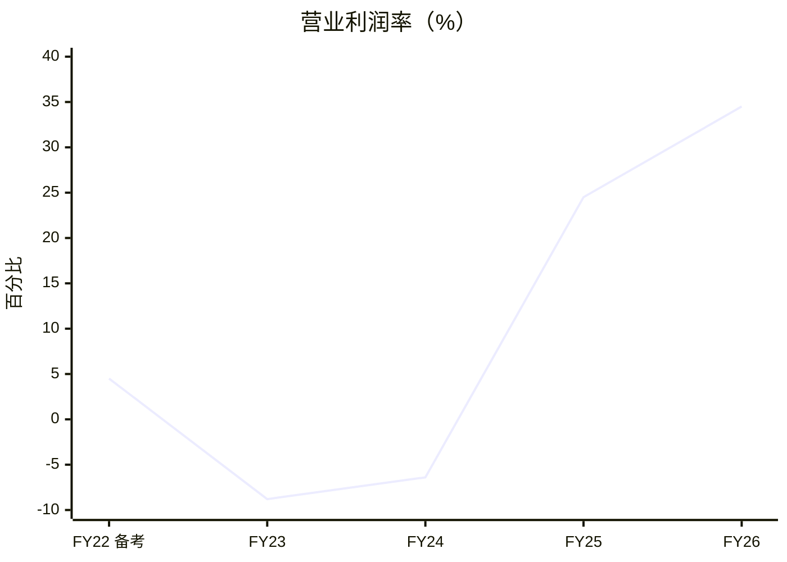
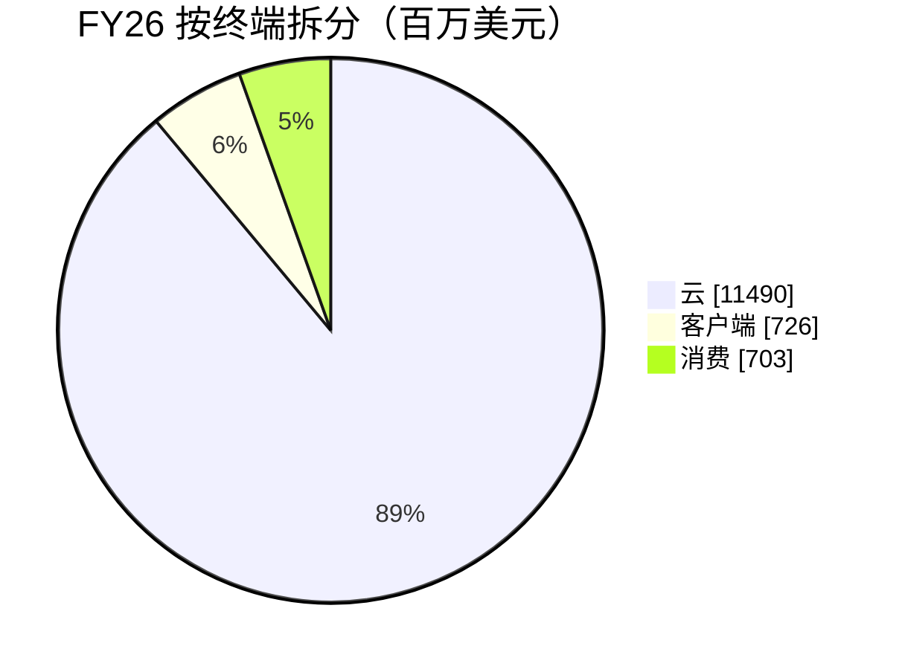

# 西部数据（NASDAQ: WDC）研究报告

**数据截止** 2026-11-28（北京时间）。最新行情为 11 月 27 日美东 13:00 常规盘收盘 **292.11 美元**，按最近正式披露的 374,323,269 股复算市值 **1,093.44 亿美元**。截至 FY27 Q1，滚动调整后市盈率约 **22.38 倍**、简单自由现金流收益率 **3.92%**。全文以美元计，汇率按 USD/USD＝1，无需换汇。[StockAnalysis 行情](https://stockanalysis.com/stocks/wdc/history/) · [嘉信行情](https://www.schwab.wallst.com/Research/Public/stocks/summary/?symbol=wdc) · [WDC 10-Q](https://www.sec.gov/Archives/edgar/data/106040/000162828026066933/wdc-20261002.htm)

云客户买的是通过认证、可按期部署的低成本存储容量。新一代硬盘让西数用更多 TB 摊薄每块硬盘的成本，供需紧张又抬高了每 TB 售价。两股力量正在同时推高现金流，其中能穿越下一轮供给扩张的部分决定今天值付多少钱。

**信息丰富度 A。AI 研究局限性声明**：财务与交易记录充分，客户合同的保底量、重议条款和各厂实际良率仍未披露。研究自查的三处锚点是五月股价、刚公布的高毛利，以及把两家龙头都涨价误读成西数独有定价权。本报告用同行盈利、历史低谷和价格／容量拆分检验这三项判断。

## 已有研究与本次更新

Western Digital Corporation，中文西部数据／西数，CIK 106040，在 Nasdaq Global Select Market 上市，WDC 为普通股。2025-02-21 分拆后，Sandisk Corporation（NASDAQ: SNDK）承接 Flash 业务。本次仅重研 WDC。仓库既有监控目标为 `Western Digital`，沿用其链接所在的「存储半导体」目录。AI 基建的 WDC 专题保留在原系列，便于对照同行。用户提供的网页访问失败，历史基线取同名本地源稿。[分拆后 FY25 10-K](https://www.sec.gov/Archives/edgar/data/106040/000010604025000038/wdc-20250627.htm)

| 历史记录 | 日期及可识别的数据截止 | 对本次研究的用途 |
|---|---|---|
| [WDC 与闪迪合并研究](SanDisk_Western_Digital_投资研究报告_20260512.md) | 2026-05-12；覆盖 FY26 Q3 与当时行情 | 旧观望带 $340–380，与单篇核对 |
| [WDC 单篇专题](../AI产业研究/AI基建-光通信与存储-20260512/西部数据-WDC-投资研究报告-20260512.md) | 2026-05-12；覆盖 4/3 财季、历史稿锚价 $480 | 旧价值型 $280–320；跟踪 HAMR、定价和盈利 |
| [存储行业漏斗](../存储-funnel-20260708.md) · [行业产业链研究](../存储/存储行业产业链投资研究报告-20260730.md) | 2026-07-08、2026-07-30；各按报告期资料 | 核验寡头、冷存储和供给纪律 |
| [闪迪独立更新](Sandisk-research-20261124.md) | 2026-11-24；对照估值取 11/23 WDC 行情 | 仅作替代技术、业务边界和表观倍数的历史参照 |

| 旧判断 | 本次核验 | 对行动的影响 |
|---|---|---|
| 云存储缺货有真实需求 | **强化**。FY27 Q1 云收入同比 +54%，容量同比逾 +20%，云业务每 EB 售价约 +25%。希捷同期毛利也升到相近水平。 | 抬高近端盈利，仍以供需周期对待当前定价。 |
| 产能售罄、长期订单护航 | **部分维持**。管理层称部分协议延伸到 2029 年，头部客户需求规划延伸到 2030–31 年。保底量、执行价及重议条件待验证。 | 估值保留价格回吐档，需求规划按前瞻信息处理。 |
| 两家占全球 95% 以上，东芝边缘化 | **推翻该精度**。东芝仍在送样。HEPiX 报告的 2026 年迄今按 EB 出货估计是 WD 46%、希捷 43%、东芝 11%，是特定时点的数据快照。 | 用两家龙头加有效第三供应商的竞争格局估值。 |
| WDC 以 ePMR 桥接并在 2027 年切入 HAMR | **维持，桥接进展强化**。10 月管理层称最高 40 TB 产品开始提量，第一代 HAMR 客户认证及放量仍待兑现。 | 价带要求确认 ePMR 成本改善与 HAMR 认证进度。 |
| HDD 每 TB 较 SSD 有固定倍数优势，AI 服务器存储为传统服务器的 8–10 倍 | **待验证**。留存期、写入特征、可访问时间和电力约束因客户而异；旧倍数缺少可比样本。 | 删除固定倍数；按工作负载和部署成本比较。 |
| 去杠杆后具备净现金和回购能力 | **维持财务改善，削弱回购推论**。资产负债表转净现金，但本季回购约 2 百万股的同时，转债等使期末股数增加。 | 估值直接按每股赚钱能力衡量，股数桥单独复检。 |
| 五月 $340–380／$280–320 进入研究机会 | **由本次估值接替**。历史价锚、盈利口径和要求回报不同；当前调整后滚动 EPS 13.05 美元。 | 只按新价带及经营前提研究。 |

最新正式财务覆盖 FY26 10-K（7/3 截止，8/14 披露）、FY27 Q1（10/2 截止，10/22 公布，10/23 申报）；公告复核至 11/28，覆盖 11/13 信贷协议（11/16 申报）、11/18 净现金补充、11/20 股东会结果及 11/27 前可见的相关持股申报。FY27 Q2 已有指引，正式业绩、可转债最终交割股数、各客户承诺量及价格仍是下一期的关键缺口。[全年 10-K](https://www.sec.gov/Archives/edgar/data/106040/000162828026057139/wdc-20260703.htm) · [季报 10-Q](https://www.sec.gov/Archives/edgar/data/106040/000162828026066933/wdc-20261002.htm) · [电话会](https://investor.wdc.com/investor-events/conference-calls) · [电话会文字](https://stockanalysis.com/stocks/wdc/transcripts/725285-q1-2027/) · [11 月 20 日 8-K](https://investor.wdc.com/static-files/1118f145-0e6d-44bd-ac08-99e7d57ea073) · [HEPiX 技术与成本资料](https://indico.cern.ch/event/1655190/contributions/7302770/attachments/3373008/6054506/Update%20on%20technology%20and%20costs%201.0.pdf)

## 第一步　核心财务和收入结构

### 五年经营轨迹

金额为百万美元。FY22 经营栏用分拆 8-K 的备考持续经营口径，现金与资本开支仍用原集团合并口径。FY23 至 FY25 经营栏已重列为持续经营，现金流量表涵盖分拆前闪迪。FY24 现金为持续经营资产负债表口径。FY26 为 53 周，其余所列财年为 52 周。简单 FCF 定义为经营现金流减现金购建固定资产。

| 指标 | FY22 | FY23 | FY24 | FY25 | FY26 |
|---|---:|---:|---:|---:|---:|
| 净收入 | 9,039 | 6,255 | 6,317 | 9,520 | 12,919 |
| GAAP/备考毛利 | 2,535 | 1,391 | 1,773 | 3,692 | 6,311 |
| GAAP/备考营业利润 | 409 | -548 | -403 | 2,334 | 4,453 |
| 持续经营净利润 | -290 | -902 | -765 | 1,643 | 9,424 |
| 简单自由现金流 | 758 | -1,229 | -781 | 1,279 | 3,511 |
| 现金及现金等价物 | 2,327 | 2,023 | 1,551 | 2,114 | 1,579 |

GAAP／备考毛利率 FY22 至 FY26 依次为 28.0%、22.2%、28.1%、38.8%、48.9%；营业利润率为 4.5%、-8.8%、-6.4%、24.5%、34.5%。最能提醒投资者周期的数字是 FY23–24 在云需求长期增长的背景下仍连续出现经营亏损。FY25 公司定义的 FCF 为 1,432 百万美元，包含分拆前 Flash Ventures 项目调整，口径对齐后简单 FCF 为 1,279 百万美元。[FY22 备考](https://www.sec.gov/Archives/edgar/data/106040/000010604025000012/wdc8-khardxspin.htm) · [FY22 10-K](https://www.sec.gov/Archives/edgar/data/106040/000010604022000055/wdc-20220701.htm) · [FY25 10-K](https://www.sec.gov/Archives/edgar/data/106040/000010604025000038/wdc-20250627.htm) · [FY26 10-K](https://www.sec.gov/Archives/edgar/data/106040/000162828026057139/wdc-20260703.htm) · [StockAnalysis 现金流](https://stockanalysis.com/stocks/wdc/financials/cash-flow-statement/)

### 最近四季与年度终端市场

金额为百万美元，市占和客户份额另计。西数有一个报告分部，云、客户端、消费为销售终端；公司披露整体毛利率。FY26 Q4 的终端明细以全年减前三季复算。

| 指标 | FY26 Q2 | FY26 Q3 | FY26 Q4 | FY27 Q1 | FY26 全年 |
|---|---:|---:|---:|---:|---:|
| 总收入 | 3,017 | 3,337 | 3,747 | 4,381 | 12,919 |
| 云收入 | 2,673 | 2,972 | 3,335 | 3,868 | 11,490 |
| 客户端收入 | 176 | 179 | 225 | 320 | 726 |
| 消费收入 | 168 | 186 | 187 | 193 | 703 |
| GAAP 毛利率 | 45.7% | 50.2% | 54.1% | 57.8% | 48.9% |
| GAAP 营业利润率 | 30.1% | 35.7% | 41.7% | 46.7% | 34.5% |
| 调整后稀释 EPS（美元） | 2.13 | 2.72 | 3.56 | 4.64 | 10.22 |
| 简单自由现金流 | 653 | 978 | 1,281 | 1,377 | 3,511 |

四季总收入同比分别约 +25%、+45%、+44%、+55%；FY26 云、客户端、消费同比 +38%、+31%、+13%，FY27 Q1 分别 +54%、+119%、+19%。FY27 Q1 GAAP 净利润 1,779 百万美元、稀释 EPS $4.63。其 1,604 百万美元 CFO 减 227 百万美元 CapEx 后，FCF 为 1,377 百万美元。库存从 1,511 升至 1,781 百万美元，应收由约 2,030 升至约 2,230 百万美元。税款、回款和出货节奏会影响现金时点。FY27 Q2 管理层指引为收入 $5.0–5.2B、调整后毛利率 60%–61%、调整后 EPS $5.60–6.00。[FY26 Q2](https://wdc.gcs-web.com/static-files/9156ba67-47c8-4be7-8513-acfdbc8b149b) · [FY26 Q3](https://www.sec.gov/Archives/edgar/data/106040/000162828026029054/wdc-20260403.htm) · [FY26 Q4](https://www.sec.gov/Archives/edgar/data/106040/000162828026053305/a4ex991-pressreleaseq426.htm) · [最新季报](https://www.sec.gov/Archives/edgar/data/106040/000162828026066933/wdc-20261002.htm) · [公司指引](https://investor.wdc.com/news-releases/news-release-details/wd-reports-fiscal-first-quarter-2027-financial-results) · [第三方季度财务](https://stockanalysis.com/stocks/wdc/financials/?p=quarterly)

FY26 合并净利润为 9,424 百万美元，基本普通股归属为 9,286 百万美元，GAAP 稀释 EPS 为 $24.28。税前利润包含 6,498 百万美元保留闪迪权益收益，也包含数笔置换成本。FY27 Q1 的 $4.63 GAAP 与 $4.64 调整后 EPS 数值接近，调节项目仍包括股权激励、重整和税项，不能把两者差额当成全部股权成本。滚动简单 FCF 4,289 百万美元，扣除按现金流量表估算的滚动股权激励 291 百万美元，研究用现金流代理约 3,998 百万美元。后者是持有人经济成本敏感性。[FY26 10-K](https://www.sec.gov/Archives/edgar/data/106040/000162828026057139/wdc-20260703.htm) · [FY27 Q1 调节表](https://investor.wdc.com/news-releases/news-release-details/wd-reports-fiscal-first-quarter-2027-financial-results)

> 巴菲特式追问：若每 TB 售价回归 FY26 年度涨速，哪一部分毛利改善仍能留在账上？

---

## 第二步　生意本质

**云客户为能够批量部署、稳定运行且单位容量便宜的硬盘付钱；数据保留和替换旧盘驱动重复采购。** 销售以硬件交付确认收入。大客户采购按认证代际进入机柜，年度量和价格可以在长期协议内谈判，其后仍有具体采购、配置、部署和回款环节。

影响自由现金流的三项变量是交付的 EB、每 EB 的实现价、每 EB 的现金成本。盘片面密度上升时，同一盘架提供更多 TB，客户少用槽位、供电和维护，西数也可用较少驱动器实现相同容量。FY26 云容量 +27%、每 EB 平均售价 +8%；FY27 Q1 季报称相应增速为逾 +20% 和约 +25%。后一项加速，与新品和紧供给一起扩大毛利。对比希捷 FY27 Q1 同时达到 57.3% GAAP 毛利率，和西数 57.8% 接近。共同涨价比品牌独占更能解释两家利润率同步向上。[10-K 管理层讨论](https://www.sec.gov/Archives/edgar/data/106040/000162828026057139/wdc-20260703.htm) · [Q1 季报管理层讨论](https://www.sec.gov/Archives/edgar/data/106040/000162828026066933/wdc-20261002.htm) · [希捷季报公告](https://investors.seagate.com/news/news-details/2026/Seagate-Technology-Reports-Fiscal-First-Quarter-2027-Financial-Results/)

> 段永平式追问：只靠客户每年多买 TB、每 TB 价格恢复下行，这门生意还剩多少议价和现金？

## 第三步　护城河

| 来源 | 判断 | 可证伪的证据 |
|---|---|---|
| 品牌与定价 | 中等，当前议价较强。云端信任来自质保、故障表现和供货能力，涨价受供需影响。 | 行业库存恢复后，WDC 每 TB 实现价和同代毛利能否领先。 |
| 转换成本 | 中等。更换机型要验证固件、错误恢复、性能和大规模可靠性；客户有多源采购的动力。 | 出现新一代驱动的同效替代时，客户是否快速改配。 |
| 网络效应 | 弱。出货增加能够产生现场可靠性数据和工艺经验，用户的使用价值仍由硬盘与系统自身决定。 | 成本和故障率能否随规模持续领先。 |
| 规模与成本 | 中强。磁头、介质、封装、测试、供应链与良率经验共同形成门槛。 | 对手用更高密度摊薄成本，或小厂产能扩张削弱供给约束。 |
| 技术与专利 | 中强，且需持续重投。ePMR 利用能量辅助改善磁记录密度，UltraSMR 通过叠瓦和编码提高容量，需要主机配合；HAMR 借局部加热写入更高稳定性的介质。 | 双路线公用架构能否转化为量产良率、故障率、成本和客户份额。 |

过去五年，供应商数量有限、客户认证及协同投入提高了进入门槛；大客户集中度与希捷先投产 HAMR 也增强了买方和竞争者的制衡。FY26 GAAP 研发支出 1,161 百万美元，FY25 为 994 百万美元。管理层 10 月报告，最高 40 TB ePMR 已开始量产，预计 FY27 Q2、Q3 分别占近线出货容量约 30%、50%；计划 2027 年一季度完成两家首代 HAMR 认证、上半年开始量产、下半年启动二代认证。希捷已经有量产实绩，但双方领先时差和西数良率难以独立核验。未来五年护城河宽度取决于量产经济性。[西数路线图](https://www.westerndigital.com/en-au/company/newsroom/press-releases/2026/2026-02-03-western-digital-accelerates-storage-innovation-for-ai-era) · [西数电话会](https://stockanalysis.com/stocks/wdc/transcripts/725285-q1-2027/) · [希捷电话会](https://s24.q4cdn.com/101481333/files/content_files/STX-US-CORRECTED-TRANSCRIPT-Seagate-Technology-Holdings-PlcSTXUS-Q1-2027-Earnings-Call-27-ET-PM-26-10-2026-2026-10-26-0.pdf)

> 巴菲特式追问：十年后还有多少超额回报来自客户认证和成本优势？价格短缺消失后，哪些优势仍能写进合同？

## 第四步　逆向检验

| 失败路径 | 三年主观概率 | 影响 | 观察指标 |
|---|---|---|---|
| 价格回落与需求放缓重合 | 中高 | 高 | 每 TB 同比回到负值、毛利率持续下滑、库存快于收入增长 |
| HAMR 认证延误或可靠性不达标 | 中 | 高 | 2027 年上半年量产里程碑延后、大客户调整采购、质保成本上升 |
| 东芝扩张或希捷密度跃迁 | 中 | 中高 | 第三供应商通过新认证且出货加快，希捷单位容量成本下降 |
| 企业级 QLC SSD 在更多温数据场景胜出 | 中；极冷层更低 | 中高 | 大客户按功耗、密度、重建时间比较的 TCO 反转 |
| 回购价格高于内在价值，叠加股权稀释 | 中 | 中高 | 现金回购持续，但普通股数仍增长或现金下降 |
| 工厂／关键材料中断，或重大贸易限制 | 低至中 | 高 | 磁头／介质交货期、跨境限制和集中生产地记录 |

最强空方解释是云商同时买走供应商的高端产能，毛利和现金流一度跃升；等客户消化库存、对手增加每块硬盘容量、长约在新一轮采购重定价时，西数同时失去涨价、产品组合和产能利用率三项利好。FY23–24 已示范下行经营杠杆。上行观点则在于今天高容量产品能真实降低部署成本，只要增量产能和客户需求比过去更好地匹配，利润中枢有理由高于 FY25。分析容易把“制造商减少”与“经营不再周期化”等同；2012 年 HGST 并购的监管资产剥离也提醒，监管会主动维持第三供应来源。最新季报称截至该季美国贸易政策变化未造成重大经营影响；SPEX 专利案双方仍在上诉，公司未计提。[FY25 历史财务](https://www.sec.gov/Archives/edgar/data/106040/000010604025000038/wdc-20250627.htm) · [Q1 风险披露](https://www.sec.gov/Archives/edgar/data/106040/000162828026066933/wdc-20261002.htm) · [FTC 决定](https://www.ftc.gov/news-events/news/press-releases/2013/05/ftc-issues-modified-final-order-settling-charges-western-digitals-acquisition-hitachi-global-storage)

> 芒格式追问：假设售价回落、竞争对手密度进步、客户延迟部署恰好同时发生，眼下最容易高估哪项利润？

## 第五步　管理层与资本配置

| 决策 | 可观察结果 | 研究评价 |
|---|---|---|
| 2025-02 按 HDD／Flash 分拆 | 形成两套经营与资本决策，WDC 盈利口径更清楚。 | 正面。执行归功于跨任期的董事会和团队。 |
| FY26 出清保留的闪迪权益并去杠杆 | 年末财务债务 1,052 百万美元、现金 1,579 百万美元。对价包括债转权益及股权互换。 | 正面。股数和交换成本需一起审视。 |
| FY27 Q1 回购约 2 百万股 | 支出约 1,000 百万美元，粗算约 $500／股；转债结算等使期末股数由约 361 百万升至约 374 百万。 | 有保留。按公告期价格和每股内在价值检查执行。 |
| 2026-11-13 更新循环信贷 | 取得到 2031 年的五年期 15 亿美元无抵押额度，旧安排终止并结清其项下余额。 | 正面。额度提高流动性，净债务要等更新后的实账。 |
| 2026-10-21 提高季度股息 | 每股 $0.175，12/4 登记，12/17 支付。 | 现金回报可见，现价股息率较低。 |

Irving Tan 于 2025 年 2 月任 CEO，曾负责 WDC 全球运营，此前在 Cisco 任职。2026-09-08 委托书口径下，CEO 受益持有 366,678 股（约 0.098%），全体董事和高管合计 732,929 股（约 0.196%），基准普通股 373,567,980 股，持股定义含部分递延和临近归属股份。2026-11-21 Form 4 的逐项披露复算约 566,525 股，覆盖直接及间接持仓，日期和口径不同。11/13 的 20,000 股交易是已披露的 10b5-1 计划内卖出。单一类别普通股，委托书受益归属也不能直接当作实际即时表决数。外部供应商的全体内部人统计范围不同，无法独立确认同口径百分比。

FY26 CEO 股权授予目标中 PSU 占 60%、RSU 占 40%。PSU 对调整后 FCF 与 EPS 各赋一半权重，短期激励以调整后营业利润和收入为主。股东大会通过薪酬咨询表决，回购后的每股现金与可转债稀释仍须分开核对。Q1 现金为 1,314 百万美元、金融借款 789 百万美元、租赁负债 133 百万美元，严格净现金 525 百万美元，含经营租赁后 392 百万美元。9 月赎回通知的 11/16 日期已过，下一财季核实际转股、现金和回购后的净股数。[10-Q](https://www.sec.gov/Archives/edgar/data/106040/000162828026066933/wdc-20261002.htm) · [委托书](https://www.sec.gov/Archives/edgar/data/106040/000162828026064909/wdc-20261005.htm) · [FY26 净现金补充](https://investor.wdc.com/static-files/c2bfc47f-ba77-42aa-bbd6-f25c8d133dbe) · [11/13 Form 4](https://wdc.gcs-web.com/static-files/790304e2-609d-4214-8d3d-b31bc5a7ec51) · [11/21 Form 4](https://www.sec.gov/Archives/edgar/data/106040/000126682426000247/xslF345X06/edgardoc.xml) · [信贷 8-K](https://investor.wdc.com/static-files/228abd6f-d576-4e31-87b8-2ad45833029f) · [转债通知](https://www.sec.gov/Archives/edgar/data/106040/000119312526389859/d23939dex991.htm)

> 段永平式追问：假如 Tan 退休，头部客户认证、良率管理和回购纪律有多少已经成为公司的制度？

## 第六步　行业趋势和价值链

训练数据集、备份、日志和内容副本会随云与 AI 增长，数据冷热决定硬件选择。热数据重延迟，企业 SSD 较强。保留几年、访问频率较低但需要在线调取的内容适合近线 HDD。极少访问的长存档还会比较磁带。西数赚取的是近线硬盘制造与交付的利润，云厂商按存储服务年费向用户收费，保有定价和系统架构的选择权。对西数而言，AI 的意义类似互联网令云端存量数据增长，仍要看每 TB 利润和重复采购，而非总生成字节数。

TDK 投资者资料所引行业预测示意，近线 HDD 约从 2026 年 1,800 EB 升至 2030 年 3,900 EB，图表隐含约 21% 的年复合增长，单盘容量也提高。该预测用来说明容量扩张和硬盘台数的区别；合同实现价、客户备份策略与替代介质决定收入 TAM。WDC 前十客户占比 FY27 Q1 为 64%，按更新的终端归属口径，上年同季为 73%；同期前两大占 14% 和 13%。全年旧口径的 73% 不与最新单季直接画趋势。供应商份额与单客合同详情未公开，10-K 仍把有限合格供应商列为风险。Toshiba 已公告 30 至 34 TB SMR 送样，需继续跟踪其认证和扩产速度。希捷和西数在当期披露的收入及毛利相近，应同时看两家的位密度和量产进度。[TDK 行业图表](https://www.tdk.com/system/files/IR_Meeting_Material_2026.May_sent.pdf) · [WD 投资者日](https://wdc.gcs-web.com/news-releases/news-release-details/western-digital-unveiled-go-forward-strategy-investor-day-2025) · [东芝送样](https://www.toshiba-storage.com/ru/about/press-center/toshiba-begins-sampling-of-30-34-tb-smr-nearline-hard-disk-drives/) · [客户归属口径](https://www.sec.gov/Archives/edgar/data/106040/000162828026066933/wdc-20261002.htm)

> 李录式追问：二十年后，价值会留在能以最低总成本交付容量的磁盘制造商，还是留在可以随时重新选择介质的云平台？

---

## 第七步　估值与安全边际

### 现价付了多少

| 指标 | 复算值 | 口径 |
|---|---:|---|
| 股权市值（百万美元） | 109,343.57 | $292.11 × 374.323269 百万实股 |
| GAAP TTM 市盈率 | 11.34 倍 | 第三方 TTM 稀释 EPS $25.77，含早前闪迪收益 |
| 调整后 TTM 市盈率 | 22.38 倍 | 公司最近四季调整后 EPS 合计 $13.05 |
| FY27 市场一致预期市盈率 | 11.83 倍 | 单一可复核样本的调整后 EPS $24.69，11/24 更新 |
| 市净率 | 11.70 倍 | 10/2 股东权益 $9,348 百万；每股 $24.97 |
| 市销率 | 7.55 倍 | TTM 收入 $14,482 百万 |
| EV／收入 | 7.51 倍 | 财务债务口径 EV $108,819 百万；含经营租赁 7.52 倍 |
| 简单 FCF 收益率 | 3.92% | TTM 简单 FCF $4,289 百万 |
| 年化指示股息率 | 0.24% | 最近宣布的 $0.175 × 4 |
| PEG | — | 复苏期增长和含投资收益 EPS 均会扭曲分母 |

Yahoo 的 TTM EPS 显示 $28.43，与 StockAnalysis 的 $25.77 偏差超过 1%。两家滚动分母的差异未充分披露，表观 GAAP 倍数只作口径展示。自家历史，FY25、FY26 财年末第三方 P/FCF 约 17.26 和 52.92 倍，现为 25.49 倍；分拆早期或亏损年份的 PE 历史缺乏可比性。希捷同一行情截点 TTM PE 26.73 倍、预期 PE 10.84 倍、P/FCF 28.14 倍。同行横比看，西数的近端前瞻倍数没有明显低一档，现金流倍数略低，两家一致预期都要求当前景气继续兑现。[WDC 估值序列](https://stockanalysis.com/stocks/wdc/financials/ratios/) · [WDC 一致预期](https://stockanalysis.com/stocks/wdc/forecast/) · [Yahoo WDC](https://finance.yahoo.com/quote/WDC/) · [希捷行情](https://investors.seagate.com/stock-information/stock-data/default.aspx) · [希捷估值](https://stockanalysis.com/stocks/stx/statistics/)

### 反向现金流折现

用股权市值作为目标，简化股权现金流以 TTM 经营现金流减资本开支 $4.289B 为起点，假设前五年等比增长、之后持续增长 3%。折现率 10% 时，当前价格隐含前五年现金流每年约 **+16.43%**，第 5 年约 **$9.18B**。若用 FY26 的 $3.511B 作更低的起点，要求提高到 **+21.63%**。前一模型在折现率 9%／11% 下，所需增速约 +12.39%／+20.13%。计算为逐年现金流折现加第 5 年的永续价值，忽略未来净举债，已公布的回购和税收时点未单独资本化。$9.18B 约为最新单季自由现金流年化的 1.67 倍；近端指引上修能缩短差距，随后仍需周期内维持现金转化。

### 三年估值

起点用可持续稀释 EPS 假设 $15，介于滚动调整后 $13.05 与最新单季调整后 $4.64 简单年化之间，给近期已交付的利润改善权重。用 3.85 亿股做第三年盈利落地检验。期末价格＝$15 ×（1＋EPS 年增速）³ × 情景 PE。每年末假设股息 $0.70，按 10% 折现，回报为从 $292.11 出发的含息 IRR。终点倍数反映三年盈利可见度与周期位置。

| 情景 | 主观权重 | EPS 年变化 | 第三年 EPS | 第三年 PE | 期末价格 | 含息今日值 | 含息年化 |
|---|---:|---:|---:|---:|---:|---:|---:|
| 悲观 | 30% | -8% | 11.68 | 11 倍 | 128.48 | 98.27 | -23.63% |
| 基准 | 50% | +5% | 17.36 | 17 倍 | 295.19 | 223.52 | +0.59% |
| 乐观 | 20% | +17% | 24.02 | 22 倍 | 528.53 | 398.83 | +22.05% |

对应第三年收入假设分别为 $16.5B、$20.5B、$25.0B，模型净利率约 27.3%、32.6%、37.0%。乐观档依赖高 TB 盘换代按期、供给纪律维持，并持续赚到接近当前高位的利润；基准档允许单价回归、合同采购量稳定；悲观档包括认证或价格失利。概率加权含息今日值 **$221.01**。在 17 倍估值下，要让 $292.11 赚到 10% 含息年化，第三年 EPS 须约 **$22.73**，接近乐观档盈利。市场一致预期的 FY27 $24.69 即便兑现，也要看到下一轮订单重定价后仍能留住这份利润。按基准现值计算，$175–205 约提供 22%–8% 折扣，故带上沿只适合在经营条件全部验证后研究小额首笔。

### 十年仓位压力测试

十年终值倍数统一用 `(1−g/ROIC)/(r−g)`。美元 r 取 10%，落在 9%–11.5% 区间内，11/27 同币种十年国债为 4.94%。永续增速上限 4%，三档分别 1%、2.5%、3.5%，基准折现率下利差为 9.0、7.5、6.5 个百分点。稳态增量 ROIC 假设 20%。以 15 美元中周期 EPS 和仅现金股息 0.70 美元反解，基准留存口径隐含增量 ROIC 约 2.62%；用 FY26 期末净财务资产调整后的账面资本和 20% 现金税假设，存量回报的粗略上界约 42.7%。20% 位于两者之间，体现竞争、替换资本以及账面资本未充分反映历史研发。当前实股为终值利润演算分母，EPS 情景已按稀释后股东经济口径设定；年化加项仅用 $0.70／$292.11＝0.2396%，附加净稀释假设 0、不另加回购收益。此为终值加当期指示股息率的压力模型。

| 情景 | 权重 | 2036 EPS 假设 | 2036 利润（百万美元） | 永续增速 | 退出 PE | 十年压力 IRR |
|---|---:|---:|---:|---:|---:|---:|
| 悲观 | 30% | 8 | 2,994.59 | 1.0% | 10.56 倍 | -11.43% |
| 基准 | 50% | 20 | 7,486.47 | 2.5% | 11.67 倍 | -1.98% |
| 乐观 | 20% | 39 | 14,598.61 | 3.5% | 12.69 倍 | +5.66% |

期望 IRR 在 r 为 8%／10%／12% 时分别为 -0.29%／-3.29%／-5.52%。两个外档超出美元区间，8% 的乐观分母亦低于 5 个百分点，仅作参考。有效的 r 为 9%／10%／11% 时，对应 -1.92%／-3.29%／-4.47%，压力判定未翻转。二期以后现金分配、股权稀释、产能再投资是实得回报的重要变量；该模型只用于约束仓位。量价反转和 HAMR 失利计入情景，重大贸易限制和工厂灾害未建模。[美国财政部收益率](https://home.treasury.gov/resource-center/data-chart-center/interest-rates/TextView?field_tdr_date_value_month=202611&type=daily_treasury_yield_curve)

### 估值分歧对账

三年基准含息回报接近零，已经解释现价为何等待。十年压力放大终值、技术替代与再投资的不确定性，约束未来价带买入后的总仓。若 HAMR 兑现且价格进入研究带，仍可重新评估小仓。即使三年进入乐观路径，也要等新增现金与净股数证据再放宽仓位。

> 巴菲特式追问：折现率降一个百分点仍无法带来基准安全边际，哪些可以观察到的现金流变化足以提高估值？

## 第八步　决策与行动

| 维度 | 结论 | 信心度 |
|---|---|---|
| 生意质量 | 低成本容量面向重复采购，议价与现金流受供给周期影响 | 中高 |
| 护城河 | 规模、认证和制造良率形成门槛，希捷和东芝制约溢价 | 中等 |
| 管理层 | 分拆、降债及扩展流动性可核，回购与净股数需要复检 | 中等 |
| 最大风险 | 量价回落叠加 HAMR 认证失利，或客户压缩采购 | 中高 |
| 文明趋势 | 云与 AI 推升存储字节，制造商利润取决于每 TB 经济性 | 中高 |
| 估值 | 三年基准含息 +0.59% 年化、现值 $223.52；十年压力未过，美元有效区间无翻转，仅限仓 | 中等 |

| 策略 | 条件与动作 |
|---|---|
| 空仓 | **观望。** $175–205 且下一正式财报调整后 EPS 至少 $5.60、公司重申首代 HAMR 在 2027 年上半年量产、滚动简单 FCF 至少 $4.0B、转债及回购后股数可解释，才考虑条件式首笔约 0.5%，总研究仓位参考上限约 1.5%。 |
| 已持有 | 合理小仓有条件持有，现价暂停加仓。持仓显著高于研究上限时复核敞口。美元十年期国债收益率 4.94% 提供了比较基准，估值基准情景的含息年化仅 +0.59%。 |
| 价格偏离 | 低于 $175 先核永久损失。高于 $205 至低于 $340 继续观察。达到 $340 且每股现金流模型没有上修，复核超配。 |
| 卖出／加仓证据 | 若 HAMR 连续延期并伴随主要客户削减采购，或两个季度云单位售价与简单 FCF 同向明显恶化，则重审退出。落入研究带并满足首笔条件后，加仓还需看到认证落地、现金兑现和净股数可解释。 |

**人工复检**：12/1 美东 14:15 和 12/8 美东 10:00 公司出席投资者会议，核报价、长期协议范围与平台进度。12/4 股息登记，12/17 支付。2027-02-15 是下一份正式季报的人工兜底复检，若提前披露即提前核。上市公司公布的财报日程以 IR 为准。[公司会议日程](https://investor.wdc.com/news-releases/news-release-details/wd-participate-upcoming-investor-conferences-0) · [股息及季报](https://www.sec.gov/Archives/edgar/data/106040/000162828026066933/wdc-20261002.htm)

### 四位投资者的原则

以下为公开原话及本报告按其原则推演，原话均未涉及西数。

- **巴菲特**：“A truly great business must have an enduring ‘moat’ that protects excellent returns on invested capital.” 西数需要证明换代结束、供给缓和后，每 TB 成本和股东回报仍领先。[伯克希尔 2007 年股东信，第 5 页](https://www.berkshirehathaway.com/letters/2007ltr.pdf)
- **芒格**：“Get the incentives right.” 评估回购用净股数和回购价格，评估保供用客户实际采购，两项都核对各方激励。[《The Psychology of Human Misjudgment》演讲全文](https://www.ivey.uwo.ca/media/2975916/the-best-of-charlie-munger-1994-2011.pdf)
- **段永平**：“碰到不懂的东西的时候，你是可以学会的。” 下一步最值得搞清的是大客户认证怎么影响切换，以及单位售价回落时公司还能赚多少钱。[雪球《方略》原节目预告](https://xueqiu.com/8152922548/360454236)
- **李录**：“The only way to gain an edge is through long and hard work.” 对公开可见的 AI 需求之外，持续跟踪认证、实现价和现金回款，才有机会比市场更准确地理解盈利中枢。[哥伦比亚商学院《Graham & Doddsville》访谈，第 25 页](https://business.columbia.edu/sites/default/files-efs/imce-uploads/Graham%20%26%20Doddsville%20-%20Issue%2018%20-%20Spring%202013_0.pdf)

> 决策追问：下一次季度报告公布时，量产、现金和每股价值三方面，哪条证据能让现有仓位的回报预期真正提高？

---

## 关键数据交叉验证与审计

来源层级为 SEC 与公司 IR 优先，StockAnalysis（S&P 数据）提供另一条取数渠道，行情另用嘉信、Yahoo、YCharts，同一公司法定披露经转载时仍是同一底层发行人。Macrotrends 相关入口返回 403，搜索缓存未取到同比期可比的最新财务，使用 SEC 原始报表及第三方标准化财务对照。标准化营业利润通常重分类部分费用，GAAP 采用原表；以报表的百万美元和股价分单位复算。[Macrotrends 收入页](https://www.macrotrends.net/stocks/charts/WDC/western-digital/revenue) · [StockAnalysis 财务](https://stockanalysis.com/stocks/wdc/financials/) · [StockAnalysis 资产负债表](https://stockanalysis.com/stocks/wdc/financials/balance-sheet/) · [YCharts 市值](https://ycharts.com/companies/WDC/market_cap)

- 市值工具以精确股数计算 109,343,570,107.59 美元，与 StockAnalysis 的 $109.34B、YCharts 的 $109.25B 偏差分别低于 0.01%、约 0.09%。10-Q 实股与 StockAnalysis 374.32 百万股一致至显示精度。
- 工具交叉验证 FY26 收入 $12,919M、基本普通股净利润 $9,286M、现金 $1,579M，以及最新季现金 $1,314M、含租赁净现金 $392M，配对取数偏差均为 0.00%。借款与租赁口径差异可在财报附注复算。
- 管理层持股用委托书和随后 Form 4 核对人名、交易和申报口径；没有找到独立的同日同范围持股百分比，结果按日期保留。
- 估值工具验算每股净资产 $24.9731、每股滚动简单 FCF $11.4580、每股滚动收入 $38.6885、年化指示股息 $0.70，并以 $13.05 调整后 EPS 验算核心倍数。独立十进制复算三年现值、IRR 和反向折现。

**随机抽检准出。** 工具识别 146 项，按 15% 抽取 22 项，种子为 20261128。实际入判 16 项，包括 12 项财务和派生指标、4 项单独算术复算。全部通过，零警告、零打回。报告值与复核值依次列示，金额单位为百万美元，百分比和每股项另注。

- 抽样 15，净收入 · FY26，报告 12919，复核 12,919（FY26 10-K）、12,919（StockAnalysis 年度财务）。
- 抽样 12，净收入 · FY23，报告 6255，复核 6,255（FY25 10-K 重列）、6,255（StockAnalysis 年度财务）。
- 抽样 25，GAAP/备考营业利润 · FY26，报告 4453，复核 4,453（FY26 10-K）、4,453（The Filings Report 年度表）。
- 抽样 30，持续经营净利润 · FY26，报告 9424，复核 9,424（FY26 10-K 合并持续经营）、9,424（The Filings Report 年度 GAAP）。
- 抽样 32，简单自由现金流 · FY23，报告 -1229，复核 -1,229（FY25 10-K 的 FY23 经营现金流与 CapEx）、-1,229（StockAnalysis 现金流）。
- 抽样 49，云收入 · FY27 Q1，报告 3868，复核 3,868（FY27 Q1 10-Q）、3,870（StockAnalysis 经营指标显示 3.87B）。
- 抽样 53，客户端收入 · FY26 Q4，报告 225，复核 225（FY26 10-K 扣 FY26 Q3 10-Q 前九月）、225（公司 FY26 Q4 电话会实数，同发行人）。
- 抽样 60，消费收入 · FY26 全年，报告 703，复核 703（FY26 10-K）、703（StockAnalysis 年度财务）。
- 抽样 59，消费收入 · FY27 Q1，报告 193，复核 193（FY27 Q1 10-Q）、193（StockAnalysis 经营指标）。
- 抽样 69，GAAP 营业利润率 · FY27 Q1，报告 46.7%，复核 46.7（FY27 Q1 10-Q）、46.7017（The Filings Report 营业利润／营收）。
- 抽样 92，FY27 市场一致预期市盈率 · 复算值，报告 11.83倍，复核 11.8311（行情及该预测的算术复算）。
- 抽样 101，简单 FCF 收益率 · 口径，报告 4289，复核 4,289（公司当期及比较期现金流）、4,289（StockAnalysis 现金流）。
- 抽样 100，简单 FCF 收益率 · 复算值，报告 3.92%，复核 3.9225（10-Q 股数与常规盘价复算）、3.9231（StockAnalysis P/FCF 倒数）。
- 抽样 113，基准 · 第三年 EPS，报告 17.36，复核 17.3644（三情景工具及十进制复算）。
- 抽样 124，乐观 · 含息年化，报告 22.05%，复核 22.0538（三年度现金流反解含息 IRR）。
- 抽样 127，悲观 · 2036 利润（百万美元），报告 2994.59，复核 2,994.5862（每股假设 × 实股代理，终值检查）。

其余六项未进入财务偏差判定。抽样 4 为五月历史建议 $280 下沿，已回看原稿；抽样 84 为协议到期年份，其 2031 年由 8-K 核实，属日期；抽样 93 为市场预测只有一个可核查快照，$24.69 亦被解析器与随后日期误拼；抽样 118 为乐观情景权重 20% 为假设；抽样 140 为乐观永续增速 3.5% 为假设，按终值工具做参数检查；抽样 144 为$175 为研究价带下沿，按基准现值约 22% 折扣设定。

Q4 客户端收入的两种取数方式来自同一发行人，业务金额已复算，独立第三方细分数据仍缺。FY26 合并持续经营利润与基本普通股归属口径均按原表匹配，避免把普通股归属差异误作源差。财务原表与第三方解析的底层发行人相同，独立渠道交叉的是取数和口径。[季度经营指标](https://stockanalysis.com/stocks/wdc/financials/metrics/?p=quarterly) · [GAAP 字段复核](https://www.thefilings.report/wdc) · [FY26 Q4 电话会](https://stockanalysis.com/stocks/wdc/transcripts/658556-q4-2026/) · [现金流复核](https://stockanalysis.com/stocks/wdc/financials/cash-flow-statement/)

**终值参数复检准出。** 定稿用美元、r 10%、稳态增量 ROIC 20%、三档 g 为 1%／2.5%／3.5%、Rf 4.94%、β 1.0。币种、分母、风险归属检查均通过。重大贸易限制、工厂灾害为工具提示的两项未建模风险。

## 局限和结论置信度

**AI 分析置信度中高**。正式财报、主要市场收入、股数、回购及报价的证据充分，三年情景和十年压力算术可以复算。**投资确定性中等**。定价持久性、客户保底量、HAMR 量产良率、贸易限制、工厂灾害和新旧转债最终股数都有证据缺口；后两项经营尾部风险中，重大贸易限制和工厂灾害未单独建模。三年预测和十年终值是经营假设，接下来优先用客户认证、单位实现价和股东现金验证。

本报告用于学习和研究。
