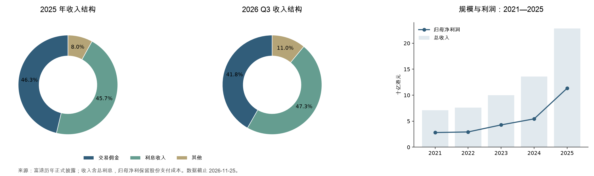

# 富途（NASDAQ:FUTU）研究报告

> **数据截止日：2026-11-25（北京时间）**；财务截至2026-09-30，最新季报发布于11月19日。统一价格快照采用11月24日美股正常收盘 **88.09美元/ADS**，不混入11月25日盘中报价。报价商代理股本140.19百万ADS、参考市值123.4934亿美元；该股数可能滞后于回购，详见第一步。TTM稀释盈利PE约8.75倍，原表归母账面PB约2.29倍。价格由[Yahoo](https://finance.yahoo.com/quote/FUTU/)与[StockAnalysis](https://stockanalysis.com/stocks/futu/statistics/)核对。
>
> **研究主线：**富途把投资者的账户、交易和现金留在同一平台上，反复赚取佣金、利差及产品分销收入；国际扩张是真实进展，佣金率下滑与多地合规缺陷也是真实成本。当前折价值得研究，能否持续取得并向股东分配利润，仍比用户增长更关键。

## AI研究偏见自觉

**信息丰富度评级：A级。**公司上市多年，年报、季度数据和市场讨论充裕。最容易发生的错误是把“账户增长、低PE、腾讯持股”拼成高确定性故事，忽视客户资金口径和监管永久损失。

**AI研究局限性声明：**本文核读公开原表，并以第三方数据交叉核对；未进行产品实测、监管访谈或客户访谈。无法完整拆出各地区收入、利润与资本占用，也未核得回购后的最新期末实股数、全部子公司的可上划资本及最新处罚最终决定。精确计算只能消除算术错误，不能消除这些事实缺口。

- [x] 资料数量充分，不等于利润可预测性高。
- [x] 客户资产与代客现金不属于股东自由现金。
- [x] 海外增长不能自动抵销内地清退和日本整改。
- [x] 本文的差异化检验是单位变现、监管资本和实际股东现金回报；不宣称拥有市场未知信息。

证券身份已核对：富途控股有限公司，英文Futu Holdings Limited，开曼控股公司，纳斯达克代码FUTU；**1 ADS代表8股A类普通股**。富途牛牛、moomoo及各地持牌子公司属于这一集团；老虎证券TIGR及长桥不是同一家公司。本次未发现已有公司专属目录、触发target或台账行，采用新目录“富途”。仓库原有[跨境券商政策文章](../富途老虎长桥全面取缔-政策解读与中概股影响-20260522.md)涉及多家公司，保留原位；其中账户适用范围和业务关停表述应以监管原文及具体主体通知核实，本文不直接继承其结论。[证券与公司原始资料](https://www.sec.gov/Archives/edgar/data/1754581/000110465926043451/futu-20251231x20f.htm)

---

## 第一步：核心数据总览

### 五年收入与盈利

金额单位为**百万港元**。收入使用公司原表、包含总利息收入；利润使用归属于普通股股东的GAAP利润。括号内负数表示现金流出。

| 财年 | 总收入 | 归母净利润 | 毛利率 | 经营利润率 | 自有现金及等价物 | CFO | CFO减现金CapEx |
|------|------:|----------:|------:|----------:|---------------:|----:|--------------:|
| 2021 | 7,115.3 | 2,810.2 | 83.05% | 44.73% | 4,555 | 6,012.0 | 5,941.5 |
| 2022 | 7,614.0 | 2,926.9 | 86.92% | 46.87% | 5,029 | 3,474.9 | 3,384.4 |
| 2023 | 10,008.4 | 4,281.5 | 84.65% | 50.03% | 4,938 | -6,337.4 | -6,415.2 |
| 2024 | 13,590.1 | 5,443.1 | 82.01% | 48.72% | 11,688.4 | 30,996.3 | 30,828.8 |
| **2025** | **22,846.9** | **11,337.7** | **87.12%** | **61.63%** | **10,465.9** | **40,788.1** | **40,733.4** |

数据来自[历年年报](https://ir.futuholdings.com/financial-information/annual-reports)、[2023年度原表](https://ir.futuholdings.com/news-releases/news-release-details/futu-announces-fourth-quarter-and-full-year-2023-unaudited)、[2025年度原表](https://ir.futuholdings.com/news-releases/news-release-details/futu-announces-fourth-quarter-and-full-year-2025-unaudited)，以[StockAnalysis](https://stockanalysis.com/stocks/futu/financials/)及[Morningstar检索所得财务表](https://www.morningstar.com/stocks/xnas/futu/key-metrics)复核。后者直接页面返回403，保留为检索层次的辅助核对；关键收入另完成原表与StockAnalysis净口径桥接。

**最后一列仅是报表算术，不是股东经济FCF。**2025年现金CapEx54.732百万港元；巨额CFO受到客户和券商应付款净增加约449亿港元影响。客户存入资金、券商清算余额及融资贷款变化，使券商CFO与工业企业不可同用。2023年CFO为负也不能单独证明生意恶化。2025年平均普通股权益ROE约33.34%，不能用净利润除期末权益、或套用网站误分类现金后的ROIC替代。[2025年报现金流及资本说明](https://www.sec.gov/Archives/edgar/data/1754581/000110465926043451/futu-20251231x20f.htm)



### 最近四个季度：收入结构与利润质量

金额单位为百万港元。此表净利润为**集团总净利**，与上表归母口径有少量差异。公司只披露合并成本，未披露三类收入各自毛利率，不能虚构分部毛利率。

| 指标 | 2025Q4 | 2026Q1 | 2026Q2 | 2026Q3 |
|------|-------:|-------:|-------:|-------:|
| 佣金及手续费 | 2,770.1 | 2,641.4 | 3,360.6 | 2,793.9 |
| 利息收入（未扣利息成本） | 3,037.9 | 2,650.2 | 3,123.8 | 3,161.8 |
| 其他收入 | 630.4 | 564.3 | 715.8 | 734.8 |
| 总收入 | 6,438.5 | 5,856.0 | 7,200.2 | 6,690.6 |
| 总收入同比 | +45.3% | +24.7% | +35.6% | +4.5% |
| 集团GAAP净利 | 3,369.4 | 831.0 | 3,641.9 | 3,186.7 |
| 合并毛利率 | 88.7% | 87.2% | 86.3% | 84.2% |
| 经营利润率 | 64.4% | 60.3% | 62.0% | 60.4% |

来源：[2025Q4](https://ir.futuholdings.com/news-releases/news-release-details/futu-announces-fourth-quarter-and-full-year-2025-unaudited)、[2026Q1](https://ir.futuholdings.com/news-releases/news-release-details/futu-announces-first-quarter-2026-unaudited-financial-results)、[Q2](https://ir.futuholdings.com/news-releases/news-release-details/futu-announces-second-quarter-2026-unaudited-financial-results)、[Q3](https://ir.futuholdings.com/news-releases/news-release-details/futu-announces-third-quarter-2026-unaudited-financial-results)。季度结构主要依赖公司一手披露，未把IR与SEC同一公告算作两个独立来源；第三方季度明细未能完整取得，这是数据覆盖限制。

Q1利润骤降有明确会计原因：5月拟罚没人民币18.5亿元已作为后续事项进入Q1“Others, net”。公司披露计提前总净利约2,922.0百万港元，计提后约831.0百万港元。**公司non-GAAP仅剔除股份支付，仍包含该罚没。**研究者可另算剔除此项的盈利，不能把它叫官方调整后净利，也不能因为已计提就认定罚款已经支付或风险已经结束。[Q1后续事项说明](https://ir.futuholdings.com/news-releases/news-release-details/futu-announces-first-quarter-2026-unaudited-financial-results)

### 最新经营观察：增长正在被单位变现抵销

| 2026Q3指标 | 已披露数值 | 投资含义 |
|-----------|-----------:|---------|
| 有资产账户 | 4,005,858，同比+27.9% | 客户基础仍扩大，不能等同于同幅利润增长 |
| 客户资产 | 1.33万亿港元，同比+7.6%、环比-4.6% | 市场估值与净流入应分开看 |
| 净资产流入 | 345亿港元 | 下跌市况仍有资金流入，支持平台粘性 |
| 季度成交额 | 5.01万亿港元，同比+28.4% | 总量增长未转化成佣金增长 |
| 混合佣金率 | 5.6基点，上年7.5基点 | 下降约25.33%，可能受市场/产品结构与竞争共同影响 |
| 佣金收入 | 同比-4.1% | 扣佣金直接成本后净额约-7.19%，比成交量更值得盯 |
| 融资融券余额 | 738亿港元，环比-22.3% | IPO与杠杆需求的高基数正在回落 |
| 财富管理资产 | 1,964亿港元 | 分销业务增长，仍不能把全部客户资产按资管费率收费 |
| 公司披露平均留存 | 高于98% | 口径为公司运营指标，不能证明客户资产不流失 |

资料见[Q3原表及管理层说明](https://www.sec.gov/Archives/edgar/data/1754581/000110465926129886/tm2629883d1_ex99-1.htm)。以期末账户粗略除收入，单位账户变现同比代理值约-18.30%；该值不是同一客户群ARPU，因为账户存续时间、地区与资产规模不同。Q3营销费除净新增有资产户约3,340港元，也只是费用代理，不能据此宣称已算出获客成本或客户终身价值。

### 股本、现金与第三方数据的三处对账

1. **股本可能陈旧。**StockAnalysis与ChartExchange同报140.19百万ADS；3月31日20-F披露A+B普通股除8为140.1945百万ADS。但Q3基本/稀释加权ADS分别约136.6778/137.8055百万，且公司已实际回购。前者是旧时点实股，后者是季度加权分母，均不是9月末最新实股。本文将140.19百万仅作保守代理，参考市值123.4934亿美元，不冒称最新法定市值；代理股数上下5%对应市值117.3187—129.6680亿美元。每股估值优先采用披露的稀释盈利。[股本原表](https://www.sec.gov/Archives/edgar/data/1754581/000110465926043451/futu-20251231x20f.htm)、[季度分母](https://ir.futuholdings.com/news-releases/news-release-details/futu-announces-third-quarter-2026-unaudited-financial-results)、[行情商交叉核对](https://chartexchange.com/symbol/nasdaq-futu/)
2. **收入总额与净额不同。**2025年原表22,846.898百万港元，减利息费用1,757.852，得到21,089.046，与StockAnalysis的21,089一致。不能把差额当作造假或增长衰退。Q3同理：6,690.571减585.607=6,104.964百万港元。[第三方损益表](https://stockanalysis.com/stocks/futu/financials/income-statement/)
3. **标准化“净现金”不适用。**9月末原表自有现金11,171.353、短期投资6,937.965、定期存款95.705，合计18,205.023百万港元。减借款9,705.538、回购融资5,684.203、全部租赁748.576，得**机械净额2,066.706百万港元**。代客现金133,897.040完全排除；逆回购资产也未当多余现金加入。即使如此，这个机械净额仍未消除银行客户存款、清算需求、资产质押和监管资本限制，**不是可分配净现金，不加回估值**。StockAnalysis把部分代客资金归入标准化短期投资，导致129,459百万港元的“净现金”和负EV，本文弃用该结论。[原始资产负债表](https://www.sec.gov/Archives/edgar/data/1754581/000110465926129886/tm2629883d1_ex99-1.htm)、[第三方标准化表](https://stockanalysis.com/stocks/futu/financials/balance-sheet/)

> 段永平式追问（本文提出）：客户多了却没有多赚相应的佣金，增长来自更好的生意，还是更便宜的收费？

---

## 第二步：生意本质分析

**一句话：富途用顺手的交易与资产管理工具留住账户，客户每次交易、融资、持有现金或购买基金时，平台都有再次收费的机会。**

| 环节 | 谁付钱、为什么付 | 重复性与成本 |
|------|-----------------|--------------|
| 交易执行与清算 | 投资者为交易便利、市场覆盖及执行服务支付佣金和平台费 | 随交易反复发生；波动受行情影响，清算与行情数据有成本 |
| 融资与证券借贷 | 融资客户支付利息，借券需求形成利息收入 | 资金与风控能力重要，增加客户资产往往也增加资本或融资需求 |
| 现金与存款 | 平台在资金安排、利率与客户收益之间取得息差 | 对利率、客户现金配置与资金成本敏感 |
| 财富管理、换汇、企业服务 | 基金分销、换汇及IPO/ESOP客户付费 | 收入来源更多，但“其他收入”不是纯订阅收入 |

2025年佣金、利息、其他占比分别为46.28%、45.70%、8.02%；Q3已变为41.76%、47.26%、10.98%。因而富途既是软件平台，也是承担资金、信用与监管约束的金融机构。软件部分边际成本低，融资和银行部分不能无资本扩张。

高毛利来自自动化执行、数字分发和规模摊薄；其会计口径未把研发、营销和管理费用放进营业成本。比较券商时应看扣利息成本后的收入与完整费用，不能因为富途毛利率高于传统服务公司就断言护城河更深。

真正决定利润的三个变量是：**客户留下多少可变现资产、每单位资产/成交额赚多少、赚取这些利润要占用多少资本并承担多少合规成本。**Q3客户流入支持第一项，佣金率下降损害第二项，日本整改和银行业务使第三项更复杂。

研发是支撑能力，尚不能量化为领先年数。2025年研发费用1,908.758百万港元，Q3为483.927百万；系统涵盖前端、执行清算、融资风控、社区和财富工具。Q2/Q3云服务成本上升，说明AI也有真实成本；公开资料未证明AI助手产生了增量利润或专利垄断。[2025研发](https://www.sec.gov/Archives/edgar/data/1754581/000110465926043451/futu-20251231x20f.htm)、[2026Q3研发与服务成本](https://ir.futuholdings.com/news-releases/news-release-details/futu-announces-third-quarter-2026-unaudited-financial-results)

> 段永平式追问（本文提出）：如果客户的交易热情恢复正常，富途还能凭什么持续赚钱？答案应是留下来的资产和服务效率，而不是一直上涨的股票。

---

## 第三步：护城河评估

| 护城河来源 | 强度判断 | 支持证据与反证 | 可证伪条件 |
|-----------|---------|--------------|------------|
| 品牌及定价权 | 品牌中等，提价权偏弱 | 国际获客与留存支持品牌；佣金率明显下行，不能证明可无损提价 | 费用优惠取消后资产持续流出 |
| 转换成本 | 中等 | 资产转仓、融资、历史记录和使用习惯造成摩擦；客户也能多平台开户 | 主账户资产转出、留存与净流入同步下降 |
| 网络效应 | 弱至中等 | 社区提高内容和参与度；交易执行本身不必依赖同平台朋友 | 社区活跃不能带来资产与自然获客 |
| 规模经济 | 中等偏强 | 五年经营利润率提升，研发与清算可摊薄 | 收入增长仍长期伴随更快费用增长 |
| 技术及牌照 | 中等 | 全链路系统和多地许可需要时间积累；同业已具备竞争能力 | 系统/合规问题反复，许可限制抵销规模优势 |

**过去五年，规模和国际覆盖变宽，定价与合规方面没有形成同等强的保护。**未来能否变宽，取决于财富资产、客户主账户份额和资本效率，而非再做一个社区功能。竞争者有充分资金仍需时间取得客户信任，但并不存在无法复制的物理瓶颈。

不能称富途为全球垄断平台。IBKR和Robinhood都可继续扩张，老虎与长桥直接争夺部分亚洲客户；低费率与多平台使用会限制其议价能力。监管许可也不是纯护城河：当机构治理跟不上业务扩张，牌照成为约束。

> 巴菲特式追问（本文提出）：十年后客户仍愿把主要资产留在这里，凭的是更低成本和更好服务，还是暂时的行情与优惠？

---

## 第四步：逆向思考与风险清单

**最强空方论点：你买到的可能是高利率、IPO和科技股交易热潮里的高利润，却为其支付了长期平台的估值；跨境业务失去合法经营空间，海外获客又被费用竞争与治理成本吞噬。**

| 失败路径 | 概率判断与期限 | 影响 | 应观察的信号 |
|---------|---------------|------|-------------|
| 内地清退侵蚀高价值客户，处罚或整改超预期 | 未来数年较高关注；不编造精确发生率 | 利润、品牌、人员及技术安排受影响 | 最终处罚、账户分类处置、资产净流入和资金迁移 |
| 海外扩张复制了合规缺陷 | 中等，持续风险 | 新业务停摆，海外增长成本抬高 | 日本整改复查、其他市场正式监管措施 |
| 费率竞争与客户结构下沉 | 中高，已见迹象 | 户数增长不能转化成每股利润 | 混合费率、净佣金、同群客户资产和营销费 |
| 市场下跌、杠杆客户信用损失 | 中等，周期性 | 交易、资产与借贷盈利同时受压 | 贷款质量、保证金缺口、集中抵押品及流动性 |
| 银行或新金融产品占用资本 | 中等，需后续验证 | 账面盈利不能汇至母公司 | 注资、资本充足、风险资产及实际分红上划 |
| 托管欺诈、重大系统损毁、战争或永久交易中断 | 无可靠概率，尾部 | 极端情形永久损失本金 | 正式执法、审计保留意见、隔离资产与结算异常 |

上述概率是研究判断，彼此重叠、不相加；十年估值另外使用明确的情景权重。严重监管/信用重击被放入悲观档，不通过抬高折现率处理；极端托管与地缘损失仍未充分量化。

### 监管事实必须按阶段读

2026年5月22日，证监会已作出行政处罚**事先告知**，拟没收违法所得并处罚；富途披露拟罚没合计人民币18.5亿元。当前取得的资料没有足以确认最终决定和全部付款完成的证据。Q1末内地有资产户占13%只是账户数占比，**不能推出内地只占13%资产或利润**。[证监会原文](https://www.csrc.gov.cn/csrc/c100028/c7634330/content.shtml)、[公司处罚披露](https://ir.futuholdings.com/news-releases/news-release-details/futu-receives-investigation-notice-and-administrative-penalty/)

日本监管于6月19日对moomoo当地法人采取措施，新账户招揽与受理限制期至9月18日；问题涉及NISA不合格产品及系统、内部管理。公司9月24日公告恢复相关开户业务。这说明海外并非免监管区域，恢复业务也不等于长期治理验证完成。[日本监管原文](https://www.fsa.go.jp/news/r7/shouken/20260619.html)、[检查发现](https://www.fsa.go.jp/sesc/news/c_2026/2026/20260605-2.html)、[恢复公告](https://www.moomoo.com/jp/newsroom/fsa-administrative-action-0924)

香港证监会7月冻结某客户约1.25247亿港元资产，明确富途本身不是该调查对象、其他客户不受影响。不能把客户案件误写成富途因欺诈受罚。[SFC澄清](https://apps.sfc.hk/edistributionWeb/gateway/EN/news-and-announcements/news/enforcement-news/doc?refNo=26PR119)

Q3流动贷款及垫款减值准备由2025年末374.604增加至863.165百万港元，约+130.42%。这不等于当期信用损失同比同幅增加，但值得与贷款增长、客户集中和核销一起查；未经附注拆解，不将其全部归因于某一次爆仓。[Q3资产表](https://www.sec.gov/Archives/edgar/data/1754581/000110465926129886/tm2629883d1_ex99-1.htm)

历史类比更接近折扣券商的成长与成熟：自动化降低成本，竞争又把部分收益让给客户。IBKR仍持续获客，说明成熟不等于停止增长；传统券商的历史也不能证明富途必然胜出。这里应使用规模经济、双边激励和委托代理模型，而非把社区用户数直接当成社交网络护城河。

**最可能的分析错误：**将罚没当成完全一次性而全额永久加回，再把代客现金当成第二重安全垫。另一方向的错误是把内地整改推演为全球业务必然归零。两者都跳过了地区利润与资本流动的证据。

> 芒格式追问（本文提出）：如果买入后亏掉大部分本金，最可能是哪项今天能看到的风险被我解释成了“小问题”？

---

## 第五步：管理层评估

李华具有腾讯技术工作背景，创立富途后长期兼任董事长及CEO。产品与执行能力有经营结果支持；对其评价也必须包含合规的外部成本。

| 时段/决策 | 已见结果 | 判断 |
|-----------|---------|------|
| 长期投入自主平台和清算、社区工具 | 形成较大客户资产与高经营效率 | 正面；仍不能证明不可复制 |
| 海外多市场扩展 | Q3马来西亚、新加坡及香港支持新增账户 | 正面；地区利润与资本回报缺少完整披露 |
| 延续内地跨境经营相关安排 | 2026年收到拟罚没及清退要求 | 明显负面，不能只评价为外部不可抗力 |
| 日本快速发展 | 发生产品适当性和内部管理问题，后恢复开户 | 负面；修复成效需持续验证 |
| 2025年新回购授权、2026年股息 | 已证实实付回购与股息安排 | 正面；金额、股数与每股增长要持续对账 |
| 并表Airstar、现EleBank | 增加银行能力，也增加资本与信用约束 | 暂不打高分，等待跨周期回报 |

截至2026年3月31日，李华经济权益36.0%、投票权63.0%；腾讯关联实体经济权益20.2%、投票权30.8%。A类每股1票、B类20票。**腾讯股东身份不是监管担保，小股东也不具有相同控制权。**股数与比例以20-F为主，并与同花顺披露整理交叉核对，不能把新闻转载称作独立原始登记。[20-F股权表](https://www.sec.gov/Archives/edgar/data/1754581/000110465926043451/futu-20251231x20f.htm)、[同花顺](https://basic.10jqka.com.cn/FUTU/holder.html)

公司2025年11月授权回购最多8亿美元、期限至2027年底；截至2026年6月底已实际回购约380万ADS、4.18亿美元。Q3未取得更晚累计实付披露，不把授权余额当作已经回购。2026年4月宣布每ADS2.60美元现金股息，第三方历史记录列4月29日支付，不能视为永久固定派息。[Q2回购原文](https://www.sec.gov/Archives/edgar/data/1754581/000110465926098911/tm2623384d1_ex99-1.htm)、[股息公告](https://ir.futuholdings.com/news-releases/news-release-details/futu-announces-cash-dividend/)、[股息历史](https://stockanalysis.com/stocks/futu/dividend/)

EleBank（原Airstar/天星银行）2026年中期权益1,383.358百万港元，上半年亏损63.131百万港元，期间增资500百万港元。它提供业务协同，也会消耗资金，不能按“科技轻资产”忽略。本文未核得银行最新资本充足率和集团完整可分配资本，保留为下次行动前的验证项。[HKMA登记](https://vpr.hkma.gov.hk/eng/regulatory-resources/registers/register-of-ais-and-lros/info/100329)、[银行中报](https://vpr.hkma.gov.hk/statics/assets/doc/100329/fd_int/fd_int_0626_eng.pdf)

管理层薪酬、关联安排和内幕交易应继续逐份核查；本次没有建立完整逐人减持时间线，不写“管理层从不减持”。股份支付属于股东成本，所有主估值保留这一成本。组织已具多地运营体系，但日本问题使“创始人退休后仍能稳定治理”的答案尚不充分。

> 段永平式追问（本文提出）：如果李华明天不再管理，公司留下的是可靠的合规与风控系统，还是依赖创始人推动的增长组织？

---

## 第六步：行业与文明趋势

全球财富积累、线上投资与跨市场配置是长期趋势；这不意味着每一家交易入口都能获得超额回报。交易所、清算托管、做市、资产管理和券商各取不同利润，富途主要控制客户关系与分发，仍依赖市场基础设施及各地许可。

| 2026Q3经营横向观察 | 富途 | IBKR | Robinhood | 老虎 |
|------------------|-----:|-----:|----------:|-----:|
| 客户资产/平台资产（十亿美元，约数） | 169.50 | 964.7 | 396 | 64.8 |
| 客户指标 | 有资产账户400.59万 | 客户账户558万 | 有资产客户2,870万 | 当季净增有资产客户4.85万 |
| 当季收入（百万美元） | 原表852.7，含总利息 | 净收入1,914 | 净收入1,420 | 总收入172.586 |

来源：[富途Q3](https://ir.futuholdings.com/news-releases/news-release-details/futu-announces-third-quarter-2026-unaudited-financial-results)、[IBKR Q3](https://www.sec.gov/Archives/edgar/data/1381197/000138119726000154/ibkr-ex99_1.htm)、[Robinhood Q3](https://investors.robinhood.com/news-releases/news-release-details/robinhood-reports-third-quarter-2026-results)、[老虎Q3](https://www.globenewswire.com/news-release/2026/11/24/3409027/0/en/up-fintech-holding-limited-reports-unaudited-third-quarter-2026-financial-results.html)。富途客户资产按季报便利汇率7.8467换算；各家“账户/客户”定义不同，收入也有总利息与净利息差异，不据此直接排名净利率。这不是全行业样本，不能计算全球市场份额。

可信TAM应从可合法服务地区的可投资资产、平台渗透率与单位资产收费推导。本文不采用一个无法核实的全球金融科技市场预测；富途相对IBKR的资产规模说明仍有空间，但没有证明这些资产必然向富途迁移。管理层披露的香港IPO服务覆盖率也不等于零售券商市场份额。

AI有机会降低研究、客服和产品分销成本，也会让竞争者复制前端更容易。真正稀缺的是信任、牌照、清算风控与低成本客户资产，不能把“使用AI”直接资本化为额外终值倍数。

公司未充分披露地区客户资产、收入与利润的对应矩阵。客户集中风险更应看是否共同押注科技股、IPO和杠杆策略，而不只是最大单一客户。供应依赖则包括交易所数据、云服务、托管清算及融资对手方；不凭缺少披露推导“不集中”。

> 李录式追问（本文提出）：二十年后金融服务数字化继续发展，富途能保留多少价值，哪些价值会以更低费率转移给投资者？

---

## 第七步：估值与安全边际

### 先校准当前价格包含的盈利

| 指标 | 本文可复现口径 | 结果/限制 |
|------|--------------|----------|
| 参考市值 | 88.09美元×140.19百万代理ADS | 123.4934亿美元，股数新鲜度有缺口 |
| TTM原表总收入 | 2025全年+2026前三季−2025前三季 | 26,185.246百万港元 |
| TTM归母净利 | 同期拼接，保留罚没和股份支付 | 11,081.402百万港元 |
| TTM稀释EPS | Q4 23.92+9M 55.04，除7.8467 | 10.0628美元/ADS |
| PE | 参考价/TTM稀释EPS | 8.75倍；市值/归母口径为8.74倍 |
| PB | 原表归母权益42,248.805百万港元/代理ADS/汇率 | 2.29倍；第三方2.24倍未能完整复现，弃用自动值 |
| PS | 市值/原表总收入，统一港元 | 3.70倍；扣利息成本后收入对应倍数更高 |
| 历史股息率 | 已宣派2.60美元/参考价 | 2.95%，不代表未来承诺 |
| EV/Revenue、FCF收益率 | 券商/银行客户资金与监管资本无法按工业企业处理 | 不采用负EV与CFO衍生的极高FCF收益率 |
| PEG | 正常化利润与长期增速都高度依赖假设 | 不报一个伪精确数值 |

汇率采用Q3披露的9月30日便利汇率，统一换算而非声称11月25日即期汇率。PB第三方差异超过1%，原始权益、股数与换算算式已列明；未能核实网站全部时点规则，不编造一个确定的差异原因。

若单独加回Q1计提对利润的约2,091.015百万港元影响，TTM研究者正常化归母盈利约13,172.417百万港元、以代理股本折算约11.9746美元/ADS。**主模型仍只取10美元EPS**：不把监管成本永远当零，也不直接把Q2高利润年化。

### 三年三情景：回答贵不贵

起点EPS为研究假设10美元，增长均为稀释后每股增长；期间股息暂不计入，避免承诺未来股东分配。下表退出PE仅是三年相对定价假设，**不用于十年终值**。

| 情景 | 主观权重 | 每股盈利年增长 | 三年退出PE | 三年EPS | 三年价格 | 按10%折回今日 | 从88.09计资本年回报 |
|------|--------:|--------------:|----------:|--------:|---------:|-------------:|-------------------:|
| 悲观 | 30% | -10% | 7倍 | 7.29 | 51.03美元 | 38.34美元 | -16.64% |
| 基准 | 50% | +5% | 12倍 | 11.58 | 138.92美元 | **104.37美元** | +16.40% |
| 乐观 | 20% | +15% | 16倍 | 15.21 | 243.34美元 | 182.82美元 | +40.31% |

基准假设海外增长能覆盖内地退出、费率仍承压，利润只温和扩张；乐观要求财富变现与国际规模改善，悲观体现费率、市场及整改同时拖累。权重是判断，不是统计预测。概率加权今日值约**100.25美元**，参考价较之折价约12.13%；不能把三年基准目标138.92当今日公允价值。

两个反面检验：若起点EPS只能维持8美元，基准现值降至83.50美元；若其他不变、三年只给10倍PE，现值约86.97美元。今天的便宜并非无需盈利验证的厚安全垫。

自身年度PE参考：2023年13.92倍、2024年15.74倍、2025年15.70倍，当前约8.74倍。这里比较披露时点估值，不计算跨期股价涨跌，亦不混用复权价格。同行11月25日查询快照：IBKR约27.69倍、Robinhood约28.97倍、老虎约8.26倍，均为网站TTM口径、与富途固定收盘快照非完全同刻。它们只能说明监管与商业结构差异已反映在定价中，不能证明富途理应重估至美资同行倍数。[历史PE](https://stockanalysis.com/stocks/futu/financials/ratios/)、[IBKR](https://stockanalysis.com/stocks/ibkr/statistics/)、[HOOD](https://stockanalysis.com/stocks/hood/statistics/)、[TIGR](https://stockanalysis.com/stocks/tigr/statistics/)

### 反向DCF：市场真正要求什么

以起点EPS10美元、美元资本成本10%、终值g=2%、稳态增量权益回报18%推导终值PE11.1111倍。假设未来十年每年可向股东分配当年利润的一定比例，余额作为资本、再投资与缓冲，不另计多余现金；逐年现金流加第十年终值折现至88.09美元，求解所需盈利增长：

| 研究假设：每年可分配盈利比例 | 隐含未来十年盈利年增长 |
|--------------------------------|---------------------:|
| 30% | 约+4.32% |
| 50% | 约+2.31% |

公式为Σ[EPS₀×(1+h)^t×分配比例/(1+r)^t]+EPS₁₀×PE终值/(1+r)^10。上述“可分配”必须扣除监管资本增长与必要投资，不能以合并CFO替代；比例是情景输入，并非已证实的FCFE率。内含增长不苛刻，但前提是现金能真正流向股东、且没有严重离散损失。三年12倍退出模型隐含的每股增长约-0.77%，与这个十年逐年现金模型的假设不同，不应混为一个结论。

### 十年终值：只做仓位压力测试

**币种与资本成本。**采用美元现金流，r=10%，g三档为0%/2%/3%，美元基准g上限4%。无风险利率参考本次查询[美联储H.15](https://www.federalreserve.gov/releases/H15/Current/)可得的10年期4.92%观察值；取β=1、市场风险溢价研究假设5.08%，合成10%。这不是回归测得的富途β，也没有把监管或战争风险塞进β；工具审计打印的内置Rf=4.70%属于工具静态说明，本报告输入及敏感性使用4.92%，不把静态说明冒充最新利率。

**资本回报。**工具参数名为ROIC；对券商和银行，本文用**稳态增量权益资本回报18%**作对应代理，经济上属于ROE框架，不能照搬工业企业债务扣除后的ROIC。它低于2025年约33.34%的平均权益ROE，用于反映竞争、资本占用及成熟市场。终值留存率g/ROE分别为0%、11.11%、16.67%，终值可分配率100%、88.89%、83.33%；这些是成熟阶段假设，不能当作今天已经实现的派息率。

终值PE唯一来源为 **(1−g/0.18)/(0.10−g)**，逐档推导，没有使用同业股价类比。

| 十年情景 | 主观权重 | 2036归母利润（十亿美元） | 永续g | r−g | 推导终值PE | 工具收益近似 |
|---------|--------:|-----------------------:|------:|----:|-----------:|------------:|
| 监管/信用严重受损、海外未能补足 | 25% | 0.35 | 0% | 10个百分点 | 10.0000倍 | -10.35% |
| 国际业务继续扩张、盈利趋稳 | 55% | 2.50 | 2% | 8个百分点 | 11.1111倍 | +9.94% |
| 财富业务与规模效率共同兑现 | 20% | 4.00 | 3% | 7个百分点 | 11.9048倍 | +15.95% |

当期市值代理为123.4934亿美元，2036利润为研究假设。每档工具计算为“终值市值/今日市值”的十年几何回报，再加k=1.5个百分点。k假设未来平均现金分配收益率2%、净稀释0.5%，并未再把回购授权额加为额外回报；它也**不是逐年现金流求解的精确IRR**。坏情景若停派股息，损失可能更大。

三档收益近似的概率加权为**+6.07%**，属于“情景年回报的加权平均”，不是组合逐年现金流IRR，也不是期望终值的年化。若净分配k降为0，均值约+4.57%。三情景覆盖严重但仍存续的业务重击，未覆盖全部托管欺诈、战争与永久交易中断，因此不能用+6.07%当有保证的年收益。

| 敏感性 | r | 期望收益近似 | 相对IRR≥r的仓位压力测试 |
|--------|--:|-------------:|----------------------|
| r−2pp | 8% | +9.09% | 通过；**币种区间外，仅供参考** |
| 基准 | 10% | +6.07% | 未通过 |
| r+2pp | 12% | +3.79% | 未通过；**币种区间外，仅供参考** |
| 区间内补检 | 9% | +7.46% | 未通过 |
| 区间内补检 | 11% | +4.86% | 未通过 |

±2pp两侧均在美元合理r区间9%—11.5%之外，已按要求补跑±1pp。**在实际检验的合理区间9%/10%/11%内不翻转，均未通过；这不是对连续区间所有点的数学证明。**不使用8%的通过论证买入，也不为通过测试而降低资本成本。

### 估值分歧对账

三年模型说的是“当前价格低于基准与加权定价，但折价并不厚”；十年模型说的是“加入严重损失概率后，当前价格不足以支持高仓位”。前者是**定价判断**，后者是**仓位压力测试**，两者不是互相替代的买卖指令。

最终稳健型选择观望新增，依据是费率与单位变现已走弱、多地治理证据不够好、股本和资本分配仍有缺口，以及加权安全边际只有约12%。**不是因为十年IRR低于r而一票否决。**已有合理小仓可有条件持有；未来若价格与经营门槛同时满足，可研究小额分批，但十年压力把总研究仓位参考上限收紧至约2%，不升级为核心重仓。

> 巴菲特式追问（本文提出）：r错两个百分点会怎样？8%/12%为区间外参考；在9%—11%的有效采样中，仓位压力判断不翻转，真正的争议在利润、分配与严重损失概率。
>
> 段永平式追问（本文提出）：如果市场关闭五年，是否愿意持有？只在已理解合规退出、资本和客户质量且控制仓位时考虑；仅凭低PE尚不够。

---

## 第八步：最终决策与行动清单

| 维度 | 结论 | 信心度 |
|------|------|--------|
| 生意质量（段永平） | 平台效率高，重复变现清晰；交易与利息周期明显 | 中高 |
| 护城河（巴菲特） | 规模和客户习惯有价值，提价权与网络效应有限 | 中 |
| 管理层（段永平、巴菲特） | 产品与国际执行强；内地及日本合规记录必须扣分 | 中 |
| 最大风险（芒格） | 合规永久影响、信用及流动性损失，不能用罚款加回一笔抹去 | 中高 |
| 文明趋势（李录） | 数字财富服务继续发展，利润分配未必集中到富途 | 中 |
| 估值（巴菲特、段永平） | 三年基准现值104.37、加权100.25美元，折价有限；十年压力期望约6.07%，有效r采样不翻转，只约束仓位 | 中低 |

**综合建议：稳健空仓者观望新增；合理小仓持有复检，暂停主动加仓。**它是值得跟踪的有条件价值机会，还不是靠静态低PE就能放心重仓的长期复利资产。估值维度与其他五个维度并列，十年未覆盖r只收紧仓位，不独立决定回避。

| 策略 | 具体行动 |
|------|---------|
| 空仓者 | 当前统一参考价88.09美元，稳健者观望。进入**75—85美元**且下列经营和资本门槛通过，再研究首笔约0.5%；不因盘中到价自动买入 |
| 持仓者 | 已有合理小仓可有条件持有；研究参考总仓上限约2%。用户成本、总组合、税务及风险预算未知，这不是针对现有账户的卖出指令；超配者先核承受力 |
| 加仓信号 | 下一正式季度披露及其后一次可比披露，均确认净资产流入为正、季度佣金率不再低于5.6基点且扣直接成本后的佣金同比止跌；正常化稀释盈利支持约10美元年度水平；核清最新实股、各地监管资本、银行注资及母公司可用现金，新增处罚/许可无重大恶化后才分批，仍限总仓 |
| 卖出/减仓复核信号 | 客户隔离资产、审计或牌照出现实质红线；连续两次正式披露资产净流出并伴随净佣金下行；亏损或资本补充破坏分配能力。**达到140美元且盈利/治理模型未增强时复核超配与减仓**，不是自动卖出 |
| 75美元以下 | 先查永久损失与模型是否失效，不机械摊低成本 |
| 85—110美元 | 持仓观察与证据复核带；不因接近模型现值而追价 |
| 110—140美元 | 新增安全边际更薄，等待盈利模型升级；140以上采用前述仓位复核规则 |

75—85美元相对加权现值约有15.21%—25.19%折价，是研究者选取的安全边际带，非精确内在价值边界。140美元接近三年基准未来价格，是今天预付较多未来增长时的复核线，不是把三年目标直接当立即卖出价值。所有价格均为**每ADS美元**。

人工复检：2026-12-31核最终处罚/整改、日本后续、回购股数与资本信息；2027-04-30作为全年财报信息兜底检查日，**不是已官宣的财报日期**，正式披露在先则提前研究。需连续验证的第二次披露随后接续。价格带登记在`data/triggers.json`，事件只保留人工复核，当前每日监控不自动提醒事件。

### 四位大师的方法论校验

以下已先读出处；“延伸”是本文应用方法的分析，**不是任何人对富途的真实评价或持仓证明**，不用大师名义替估值背书。

| 人物 | 可核验短引与出处 | 本文延伸 |
|------|----------------|---------|
| 巴菲特 | “You only have to be able to evaluate companies within your circle of competence.” [1996年股东信](https://www.berkshirehathaway.com/letters/1996.html) | 能算PE还不足以证明理解券商资本与跨境合规；应先确定能力边界 |
| 芒格 | “wonderful businesses purchased at fair prices”——巴菲特在[2023年股东信首篇](https://www.berkshirehathaway.com/letters/2023ltr.pdf)记录的芒格建议，属于当事人转述 | 应先证明业务质量，再讨论便宜。没有据此断言芒格会买或会做空富途 |
| 段永平 | “是猜测不是预测，把握性不一样。” [2018-09-05雪球原帖](https://xueqiu.com/1247347556/113291246)，已读本仓[原始发言存档第8条](../拼多多/段永平雪球发言-PDD相关.md) | 原话针对拼多多，本文仅借用区分把握性的原则，不能移植为富途背书 |
| 李录 | “如果发现自己犯了错，会第一时间卖出。” [北大演讲问答存档](../李录/李录-北大演讲-20241207.md)，含芒格书院首发来源 | 监管或资本事实改变时重审，不把“长期持有”变成拒绝纠错 |

未找到足够的一手材料证明四位对富途本身的投资判断，**资料不足，不模拟他们对富途的买卖代言**。上表仅是有原文约束的方法应用。

> 四位方法共同的追问（本文提出）：当前建议中，哪些事实已经核实，哪些只是希望？若后者没有兑现，是否知道何时承认错误？

---

## AI分析置信度与投资确定性

**AI分析置信度：历史经营与口径核对中高，正常化利润中等，长期估值与监管结果中低。实际投资确定性：中等偏低。**

支持充分的结论包括：历史规模与利润增长、Q3账户增长与佣金率下降并存、拟罚没已入账、不能把代客现金与CFO视为股东自由现金。基于有限信息的推理包括：长期单位客户价值、各地业务可持续利润、可上划资本、未来分红和严重损失概率。十年情景、仓位和价带是研究假设。

后续优先补证：最新期末流通与潜在稀释股数；内地客户资产和利润占比及处置进度；日本整改后的客户质量和治理；各地资本净额及上划限制；EleBank资本充足与注资需求；佣金率下降的地区/产品/价格拆解；贷款拨备与抵押品集中度。未建模的托管欺诈、战争与永久交易中断可能使压力情景仍低估损失。

本报告用于学习与研究，不构成针对个人情况的投资建议。

---

## 数据来源与审计记录

### 关键数据交叉验证记录

使用仓库`financial_rigor.py`，跨源容差明确设为1%；市值、三情景和其他派生值已程序计算。优先源Macrotrends直接请求403，检索结果部分陈旧或摘要自相矛盾，因此不用其陈旧“最新值”；采用SEC/IR原表，加StockAnalysis、Morningstar检索表及同花顺核对。它们属于不同数据提供方，底层财报仍来自同一公司，不意味着独立审计两遍。

以下为工具输出摘录，详细原始输出和算式保存在[验证记录](富途-validation-20261125.txt)：

```text
市值验算 (Market Cap Verification)
  股价 (Price):       88.09 USD
  总股本 (Shares):    140.19M
  计算市值:           12.35B USD
  报告市值:           12.35B USD
  偏差:               0.01%
  ✅ 验证通过, 偏差仅 0.01%

交叉验证: FY2025收入统一为扣利息支出净口径
  ✅ 20F22846.898减1757.852: 21,089.05 百万HKD  (偏差 0.00%)
  ✅ StockAnalysis       : 21,089.00 百万HKD  (偏差 0.00%)

交叉验证: FY2025归母净利
  ✅ 20F                 : 11,337.72 百万HKD  (偏差 0.00%)
  ✅ StockAnalysis       : 11,338.00 百万HKD  (偏差 0.00%)

交叉验证: 20260930自有现金及等价物
  ✅ 6K                  : 11,171.35 百万HKD  (偏差 0.00%)
  ✅ StockAnalysis       : 11,171.00 百万HKD  (偏差 0.00%)

交叉验证: 20260930融资负债含租赁
  ✅ 6K桥接                : 16,138.32 百万HKD  (偏差 0.00%)
  ✅ StockAnalysis       : 16,138.00 百万HKD  (偏差 0.00%)

估值指标验算 (Valuation Verification)
  PE (TTM):  88.09 / 10.062828959944945 = 8.75x
  PB:        88.09 / 38.40699643162912 = 2.29x
  股息率:    2.6 / 88.09 = 2.95%
  PS:        88.09 / 23.804144275402123 = 3.70x
```

原始字段与完整精度见[模型参数与计算](富途-model-20261125.json)、[十年敏感性配置](富途-terminal-20261125.json)。其他计算调用同一工具的Decimal上下文，避免用工具`calc`内部通用表达式路径可能出现的浮点中间值。终值工具自身以其现有数值实现运行，输出不是财务预测的精度保证。工具自动打印的EPS/BVPS=26.20%并非平均权益ROE，正文未混用；直接采用平均权益算出的FY2025 ROE。

**已知差异已隔离：**总/净利息收入已桥接；集团总净利与归母净利分开；代客资金标准化错位不进入自有现金；网站PB自动值弃用；代理ADS不能证明最新法定股数。机械净额中的短期投资细分只取得可靠原表，第三方分类无法独立对齐，不将其包装为双源确认的可分配现金。

数据随机抽检与最终估值口径审计的结果见[抽检明细](富途-audit-20261125.json)及[判决原文](富途-audit-verdict-20261125.txt)；抽检只验证可抽出的数字，不能补齐上述数据缺口，也不能证明情景预测会发生。

> **核验完成情况：**固定随机种子61125，从工具可提取的127项中随机抽20项，20项数值或模型一致性检查通过、无跳过；其中14项为披露事实或其派生数值，3项为模型算式、3项为主观模型输入。模型输入核对不等于外部事实验证；季度明细的独立双源覆盖仍有保留，不能把工具“准出”解释为数据缺口已消失。最终十年估值口径审计通过C1/C2/C3，未建模尾部风险已在正文列示。
>
> **跟踪已登记：**新增富途target与非重点台账事件20261125-FUTU；台账共171条、待触发80条。75—85美元研究带、140美元警戒线及两个人工复检日均已登记，配置检查通过。独立临时目录的定点价格扫描成功，腾讯返回84.61美元、价格条件已达到；行情成交时间未单独复核，因此不替换统一估值快照。台账仍为“待触发”，指完整经营与资本条件待满足，不表示价格尚未到达。临时扫描为初始基线，未发送通知，也未改写正式每日监控状态。
