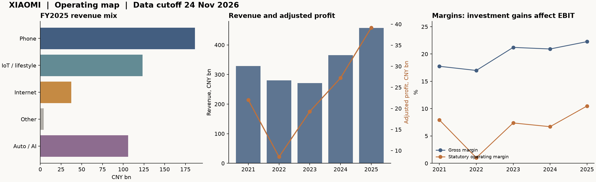

# 小米集团（1810.HK）研究报告

**研究及数据截止日：2026-11-24（北京时间）｜财务截至：2026-09-30｜信息丰富度：A级**  
**行情：11月24日收盘 HK$26.50｜总股本：257.4075亿股｜复算市值：6,821.30亿港元，约5,798.79亿元人民币**  
**估值：滚动归母PE 23.57倍；经调整PE 24.65倍；经调整利润扣税前股份薪酬后约30.75倍。**

校验状态为带缺口研究稿：关键总量已作双源核验，部分季度分部和股份薪酬仍只能回到公司原始披露，不能声称全量独立双源完成。

小米的产品、渠道和技术能力仍在进步，但股东能获得的现金没有同步增长。本次沿用[用户指定的2026H1报告](小米-earnings-2026H1.md)为检验起点，纳入今天发布的Q3：手机毛利修复了一部分，汽车及AI亏损与库存占款则继续恶化。研究的关键是分清暂时备货、长期再投资，以及能够真正分配给股东的剩余。

港股简称小米集团-W，英文 Xiaomi Corporation；01810为港币柜台，81810为同一公司B类证券的人民币柜台，不重复累计股本。本报告估值针对01810，不将海外存托凭证数量当普通股股数。股价经两个行情源核对，原始A+B股数来自11月24日港交所回报；市场换汇统一采用1港元=0.8501元人民币。[港交所股本回报](https://www1.hkexnews.hk/listedco/listconews/sehk/2026/1124/2026112400743.pdf)、[StockAnalysis行情](https://stockanalysis.com/quote/hkg/1810/history/)、[Investing行情](https://www.investing.com/equities/xiaomi-historical-data)、[Wise当日汇率](https://wise.com/us/currency-converter/hkd-to-cny-rate/history/24-11-2026)

---

## AI研究偏见自觉

**AI研究局限性声明：**资料充裕不等于盈利可预测。小米的品牌热度、设备连接数、芯片与大模型发布，很容易使研究高估生态变现；硬件毛利承压又容易让研究忽视高端化和渠道复用。汽车、AI、芯片没有足够独立现金流和增量资本回报披露，不能把它们分别按最乐观估值相加。

- [x] 以现金、毛利和资本投入检验叙事，不把报道数量当确定性。
- [x] 承认手机毛利改善，保留能推翻空方的证据。
- [x] 不继承旧稿缺少统一市场分母的IoT份额和“极强网络效应”。
- [x] 若公开资料减少一半，仍可判断现金转换承压；对汽车、AI十年回报的把握会进一步下降。

这是一份基于公开信息的学习研究，不构成针对个人资产、收入和风险承受能力的投资建议。

---

## 第一步：核心数据总览

### 最新季度：一个改善，三项压力

金额均为人民币亿元；期间利润含少数股东损益，归母利润另列。经营现金流是IFRS口径。

| 指标 | 2026Q3 | 同比或含义 |
|---|---:|---|
| 营业收入 | 1,072.40 | -5.2% |
| 集团毛利率 | 20.2% | Q2为19.8%，部分恢复 |
| IFRS期间利润 | 38.76 | -68.4% |
| 归母净利润 | 38.76 | 精确值38.7558亿元，与期间利润略有区别 |
| 经调整净利润 | 48.84 | -56.8%，环比-21.5% |
| 手机毛利率 | 9.2% | Q2为8.5%，达到旧报告的9%门槛 |
| 汽车、AI等分部经营亏损 | 34 | Q2亏26亿元，继续扩大；不是纯汽车净亏损 |
| 经营现金流 | -230.34 | 前九个月累计-209.84亿元 |
| 期末存货 | 1,083.04 | 较2025年末+33.73% |
| 公司定义现金资源 | 1,969 | 含受限、长期存款及理财，不能全部分派 |

来源：[Q3业绩公告](https://www1.hkexnews.hk/listedco/listconews/sehk/2026/1124/2026112400538.pdf)、[Q3业绩简报](https://ir.mi.com/static-files/c5e93e1b-97ce-4412-947b-6a8b988ce8b1)、[IT之家独立摘录](https://www.ithome.com/1/031/709.htm)、[S&P Capital IQ归母口径](https://www.marketscreener.com/news/xiaomi-corporation-reports-earnings-results-for-the-third-quarter-and-nine-months-ended-september-30-ce7851dbd980f523)。第三方摘要的“净利润”不能不加区分地与公司期间利润混用。

### 收入结构与利润来源

| 业务 | 2026Q3收入（亿元） | 同比 | 毛利率 | 生意含义 |
|---|---:|---:|---:|---|
| 智能手机 | 455.79 | -0.8% | 9.2% | 产品结构上移抵消大部分出货下滑 |
| IoT与生活消费品 | 271.53 | -1.4% | 21.7% | 品类广，但需求与促销仍有周期 |
| 互联网服务 | 94.50 | +0.7% | 73.8% | 高毛利利润来源，增长与毛利均需再验证 |
| 手机×AIoT其他收入 | 11.74 | -2.9% | -1.3% | 上述一级分部内的其他项目 |
| 新能源车、AI等创新业务 | 238.84 | -17.7% | 19.2% | 扩产品后收入仍降，费用与资本投入较重 |
| 集团合计 | 1,072.40 | -5.2% | 20.2% | 不把手机×AIoT合计重复加在子项上 |

四舍五入可能产生尾差。汽车收入约227亿元已包含在最后一个分部内，不能再加一次；AI没有独立收入及利润披露。手机出货3,070万台，同比-29.1%，ASP为1,486.1元、同比+39.8%，这主要说明销售结构变化，不能证明同型号产品能无损提价。互联网毛利率已低于H1的76.8%，不能说利润锚完全未受影响。[Q3公告分部及业务回顾](https://ir.mi.com/static-files/e0d8d0c0-ee3e-40b3-9c2c-b31833e2abc9)、[证券之星分部复核](https://hk.stockstar.com/IG2026112400029708.shtml)、[H1报告及来源](小米-earnings-2026H1.md)



### 五年财务趋势

金额为人民币亿元；利润率为百分比。

| 年度 | 收入 | 归母净利 | 调整净利 | 毛利率 | 法定经营利润率 | CFO | 狭义FCF | 现金等价物 |
|---|---:|---:|---:|---:|---:|---:|---:|---:|---:|
| 2021 | 3,283.09 | 193.39 | 220.39 | 17.75% | 7.93% | 97.85 | 26.16 | 235.12 |
| 2022 | 2,800.44 | 24.74 | 85.18 | 16.99% | 1.01% | -43.90 | -101.89 | 276.07 |
| 2023 | 2,709.70 | 174.75 | 192.73 | 21.21% | 7.38% | 413.00 | 350.32 | 336.31 |
| 2024 | 3,659.06 | 236.58 | 272.35 | 20.92% | 6.70% | 392.95 | 319.98 | 336.61 |
| 2025 | 4,572.87 | 416.43 | 391.66 | 22.26% | 10.48% | 341.42 | 213.73 | 269.14 |

狭义FCF=CFO−投资活动列现金购买固定、土地及无形资产，未扣延期无形对价及租赁。法定经营利润包含投资损益，不能视为纯主营利润率。2025收入、归母采用较后发布的年报精确数，与3月业绩公告有微小尾差。

来源：[2025年报五年摘要](https://www1.hkexnews.hk/listedco/listconews/sehk/2026/0428/2026042800526.pdf)、[2023年报原件存档](https://cdn.financialreports.eu/financialreports/media/filings/50185/2024/RNS/50185_rns_2024-04-25_5b8517e1-92ca-46a1-9bf9-8bbc0bcd5291.pdf)、[2021年报](https://cdn.cnbj1.fds.api.mi-img.com/company/announcement/en-us/2.%202021%20ANNUAL%20REPORT.pdf)、[StockAnalysis损益表](https://stockanalysis.com/quote/hkg/1810/financials/income-statement/)、[现金流](https://stockanalysis.com/quote/hkg/1810/financials/cash-flow-statement/)。

### 最近四季度：关注盈利与投入能否重新匹配

每格为“收入亿元 / 同比 / 毛利率”，四舍五入至一位小数；分部明细以公司披露为主，最新Q3完整独立分部来源尚缺。

| 业务 | 2025Q4 | 2026Q1 | 2026Q2 | 2026Q3 |
|---|---:|---:|---:|---:|
| 手机 | 443.4 / -13.6% / 8.3% | 442.7 / -12.5% / 10.1% | 421.2 / -7.5% / 8.5% | 455.8 / -0.8% / 9.2% |
| IoT与生活消费品 | 246.0 / -20.3% / 20.1% | 246.8 / -23.7% / 25.2% | 312.8 / -19.2% / 20.1% | 271.5 / -1.4% / 21.7% |
| 互联网 | 98.9 / +5.9% / 76.8% | 94.7 / +4.3% / 76.1% | 90.4 / -0.6% / 76.8% | 94.5 / +0.7% / 73.8% |
| 手机×AIoT其他 | 8.8 / +6.4% / -34.4% | 8.5 / +24.5% / -9.6% | 15.9 / +16.3% / 0.2% | 11.7 / -2.9% / -1.3% |
| 汽车/AI等 | 372.2 / +123.4% / 22.7% | 198.6 / +6.9% / 20.1% | 249.0 / +17.1% / 19.2% | 238.8 / -17.7% / 19.2% |
| 集团 | 1169.2 / +7.3% / 20.8% | 991.4 / -10.9% / 22.0% | 1089.2 / -6.1% / 19.8% | 1072.4 / -5.2% / 20.2% |

| 集团指标（亿元） | 2025Q4 | 2026Q1 | 2026Q2 | 2026Q3 |
|---|---:|---:|---:|---:|
| 调整净利 | 63.49 | 60.72 | 62.19 | 48.84 |
| CFO | 6.14 | -17.92 | 38.42 | -230.34 |
| 汽车/AI分部经营结果 | +11 | -31 | -26 | -34 |

来源：[2025Q4公告](https://www1.hkexnews.hk/listedco/listconews/sehk/2026/0324/2026032400608.pdf)、[2026H1公告](https://www1.hkexnews.hk/listedco/listconews/sehk/2026/0818/2026081801014.pdf)、[2026Q3公告](https://www1.hkexnews.hk/listedco/listconews/sehk/2026/1124/2026112400538.pdf)；计算和单源限制见[财务底稿](证据-20261124/financial-sources.md)。

### 现金：偿付缓冲尚在，现金转换已经恶化

公司现金及等价物384.43亿元，加流动定存及短期投资后为1,095.49亿元，减借款454.54亿元，得到约640.96亿元的较窄净现金。这里尚未扣全部租赁及经营义务；公司广义现金资源减借款约1,514.46亿元，覆盖范围更宽。两者都不是可直接另加在估值上的“免费现金”。StockAnalysis同口径现金短投为1,095.49亿元，与分项重建一致。[公司资产负债表及借款附注](https://www1.hkexnews.hk/listedco/listconews/sehk/2026/1124/2026112400538.pdf)、[StockAnalysis资产负债表](https://stockanalysis.com/quote/hkg/1810/financials/balance-sheet/)

Q3库存现金增加约254亿元，是现金流出的主要解释，但解释不等于风险消失。备货若在后续售出并收回现金，是周转波动；若降价去库存或器件跌价，部分占款会变成经济损失。原材料存货由年末约239.74亿元升至589.03亿元；不能仅凭“战略备货”就假设会原额回收。投资现金流转正主要来自存款、短期投资减少，并非主营突然产生了现金。[公司Q3现金流说明及库存附注](https://ir.mi.com/static-files/e0d8d0c0-ee3e-40b3-9c2c-b31833e2abc9)

2025年“经营现金流减现金购买固定、土地与无形资产”为213.73亿元；再扣无形资产延期付款和租赁现金，代理剩余为159.71亿元。前者可与数据商标准FCF比较，后者更接近完整资本现金支出后的结果，均不直接等于未来所有者收益。最新滚动经营现金流约-203.70亿元；Q3公告不足以重建完整滚动现金资本支出，本报告不发布伪精确的最新FCF收益率。Q3经营现金流减管理口径资本开支约-266.15亿元，仅是观察代理数，不能冒充现金流量表FCF。[2025公告](https://ir.mi.com/system/files-encrypted/nasdaq_kms/assets/2026/03/24/5-35-03/25Q4%20EN%20AC%20Xiaomi.pdf)、[StockAnalysis现金流](https://stockanalysis.com/quote/hkg/1810/financials/cash-flow-statement/)、[财务口径底稿](证据-20261124/financial-sources.md)

> 巴菲特式追问：利润增长时，维护竞争力和支持增长之后，还剩多少可以交给股东？当前最缺的是库存现金释放及完整FCF恢复的证据。

---

## 第二步：生意本质分析

**小米用产品开发、采购与渠道效率卖硬件取得用户，再争取跨品类复购和互联网变现，最终价值取决于这些用户留下多少可分配现金。**

| 环节 | 谁付钱、为什么重复 | 稀缺能力 | 利润的约束 |
|---|---|---|---|
| 手机 | 消费者为功能、品牌、价格及换机付费 | 快速产品开发、供应链与渠道 | 元器件成本、换机周期、促销与获客 |
| 家电与IoT | 家庭为便利、性价比与设备更新付费 | 多品类开发和渠道复用 | 售后、安装、库存、跨品牌兼容 |
| 互联网 | 广告主等为触达用户和服务付费 | 设备入口及用户使用时间 | 用户价值、广告需求、体验与监管 |
| 汽车及AI | 消费者购车，未来可能为服务付费 | 产品定义、工程、品牌与软件 | 工厂、车型迭代、保修、研发与算力 |

重复收入大部分来自换新和跨品类购买，不能把全部硬件收入看成订阅。已有设备越多，重新配置和迁移习惯的成本通常越高，但消费者可以逐件换品牌；平台兼容性加强也可能降低迁移成本。小米的生态价值主要体现为更低获客成本、渠道复用与复购便利，而非其他人加入后，每个用户都立刻得到更大的社交网络。

利润主要由三组变量驱动：手机的出货量、单价与毛利率组合；IoT及互联网毛利能否覆盖渠道、研发和营销；汽车、芯片、AI从投入转为现金回报的速度。Q3毛利216.15亿元，减研发、营销及管理费用后约21.36亿元，而报表经营利润65.72亿元还包含投资公允价值等项目，因此不能用后者直接描述核心产品盈利。[公司Q3损益表](https://www1.hkexnews.hk/listedco/listconews/sehk/2026/1124/2026112400538.pdf)、[计算底稿](证据-20261124/model-output.json)

> 段永平式追问：这门生意好在哪？好在能反复做出大众愿意购买的产品并复用渠道；还需证明效率收益能够长期留给股东。

---

## 第三步：护城河评估

| 护城河 | 本次判断 | 有证据的部分 | 什么会推翻它 |
|---|---|---|---|
| 品牌与定价权 | 中等 | 高端渗透在进步，品牌可跨品类使用 | 提价依靠减少低端销量，成本上涨仍侵蚀毛利 |
| 转换成本 | 低至中 | 多设备用户的配置与习惯成本 | 跨平台互联后复购与每户贡献不再提高 |
| 网络效应 | 强用户网络效应未证实 | 生态开发与数据可能有规模协同 | 设备数增加却不改善体验或单位经济性 |
| 规模与渠道 | 中等，最可验证 | 采购、研发、渠道和品牌投入复用 | 周转恶化、竞争者同样降本，节约全部让价 |
| 技术与专利 | 建设中 | 自研芯片和模型已有产品落地 | 依赖外部制造及算力，收益不覆盖投入 |

Q3连接设备达12.035亿台，五件及以上设备用户2,560万人，全球月活7.719亿；这些支持生态覆盖扩大，但IoT收入仍下降、互联网收入仅微增，尚不足以证明每户利润同步增加。自研芯片、MiMo与辅助驾驶技术增加了上行可能，也带来持续研发与供应链约束。[公司Q3简报](https://ir.mi.com/static-files/c5e93e1b-97ce-4412-947b-6a8b988ce8b1)

过去五年，护城河在产品广度、品牌和渠道协同上变宽；集团所需资本和经营复杂度也上升。未来五年是否继续变宽，应由单位利润、库存周转、复购和增量资本回报共同验证。汽车销量扩大与技术发布本身不足以得出结论。

> 巴菲特式追问：十年后护城河还在吗？如果维持竞争必须持续加大投入，而价格仍由竞争决定，它可能只是优秀执行力，尚不足以构成持久经济租。

---

## 第四步：逆向思考与风险清单

最强空方论点是：小米的组织不断创造优秀产品，但电子、汽车、芯片和模型的竞争把大部分效率收益交给消费者；公司必须继续投入，股东因此得不到与收入规模相称的现金。最强多方反驳是：成本冲击与新品投入暂时重合，库存释放、手机高端化、汽车规模化可让利润后移兑现。两者的分歧在正常化现金和追加资本回报，不能靠发布会热度解决。

以下概率是未来三年发生或持续的主观等级，不是统计测量；各风险相互重叠，不相加。

| 失败路径 | 概率判断 | 影响 | 可观察信号 |
|---|---|---|---|
| 存储成本与手机量价取舍持续 | 高 | 高 | 销量继续下降，毛利重回9%以下 |
| 库存占款转为降价或减值 | 中高 | 高 | 原材料继续升、库存周转延长、现金不释放 |
| 汽车、AI长期吞噬生态利润 | 中高 | 高 | 同口径分部亏损扩大，完整资本现金继续增长 |
| 互联网用户增长但变现下滑 | 中 | 高 | 收入慢于用户、毛利额继续受压 |
| 创始人驱动与四线投入失衡 | 中 | 高 | 投入只讲技术指标，不披露每股回报及退出纪律 |
| 安全召回与品牌外溢 | 尾部但已有事件 | 很高 | 补救效果、保修费用或订单受损 |
| 印度、VIE、地缘及供应链中断 | 尾部，无法可靠量化 | 很高 | 冻结、追缴、法律结构与关键零部件受限 |

安全风险已有一手案例：2026年8月21日，监管披露两批SU7召回合计390,435辆，涉及严重碰撞后低压系统失效时应急机械拉手识别和操作问题。不同年度召回可能覆盖同一辆车，不能累加成独立问题车总量；也不能在没有事故因果调查时作额外归因。[市场监管总局召回公告](https://www.samr.gov.cn/zlfzj/qxcpzh/zhdt/art/2026/art_b7c72e145b034f2b972e7b32b612e8d6.html)

历史类比可看伯克希尔纺织业务：单家公司提高设备效率，若全行业也如此投入，最终可能主要表现为更低售价。小米的品牌与服务变现可能打破这种结果，因此这里比较的是经济机制，不预测它必然重演纺织业的结局。[巴菲特1985年股东信](https://www.berkshirehathaway.com/letters/1985.html)

本报告最可能犯的错误，是把短期库存吸收现金永久化，或者反过来，假设所有备货都会按原利润卖出。故后续必须核对实际去化、售价、减值和现金回收，而不只听管理层解释。

> 芒格式追问：聪明人为什么不买？他可以承认小米有优秀产品，却认为跨四个高投入领域取得足够资本回报的证据还不足，而当前价格已经要求盈利复苏。

---

## 第五步：管理层评估

雷军是创始人、董事长兼CEO，卢伟冰等专业管理人员已承担日常业务分工。强产品判断和动员能力有记录，但资本配置须与组织能力分开评分；不能把知名度直接等同于诚信或高投资回报。[公司管理层](https://ir.mi.com/corporate-information/management)

| 时间与决策 | 已观察结果 | 研究判断与评分（五分制） |
|---|---|---|
| 2021起进入汽车 | 已实现规模交付，新增程车型拓宽覆盖 | 产品执行4分；全周期资本回报待验证 |
| 2025年以53.25港元配售8亿股 | 增厚融资缓冲，同时稀释原股东 | 融资时机4分；不是雷军等额个人套现 |
| 持续推进高端化 | Q3 ASP上升，毛利环比修复 | 3分；销量及同比利润承压 |
| 2026年继续芯片与AI投入 | 技术已有部署，AI利润未分拆 | 技术执行有证据；财务回报暂不评分 |
| 2026年至11月19日回购 | 回购约4.3154亿股，支出约131.06亿港元 | 3分；均价约30.37港元，不能只凭金额称择时优秀 |
| 质量与安全处置 | 有正式召回与补救措施 | 需跟踪补救效果及责任闭环，暂不作高分认证 |

融资、回购及技术投入来源：[Q3公告](https://www1.hkexnews.hk/listedco/listconews/sehk/2026/1124/2026112400538.pdf)、[2025中报](https://ir.mi.com/static-files/29a59068-f19f-4199-9114-4450211c9461)、[治理底稿](证据-20261124/market-governance.md)。评分是本报告的判断，不是外部评级；回购均价短期高于现价也不等于长期必然毁值。

雷军最近披露的经济权益约23.53%，普通事项投票权约63.92%。A类十票、B类一票，保留事项另按一股一票处理；不能把中报仅A类贡献的约60.8%当其全部投票权。董事长CEO合一及加权投票权有利长期执行，也限制外部股东纠偏。2026股份薪酬仍有明显成本，评价回购要看净股本和每股现金，不能再把回购金额机械加成股息收益率。[港交所股本回报](https://www1.hkexnews.hk/listedco/listconews/sehk/2026/1124/2026112400743.pdf)、[AAStocks权益披露](https://www.aastocks.com/sc/stock/InterestsDisclosure.aspx?page=1&shareholder=&symbol=01810)、[计算记录](证据-20261124/model-output.json)

组织已经有专业分工，但雷军退休后的产品号召力、重大投入纪律和汽车执行无法从现有公开信息可靠外推。管理层评价是“能力强、利益有绑定、治理集中，资本回报需要继续验证”，不是无条件的“对的人”。

> 段永平式追问：如果CEO退休还能保持竞争力吗？消费电子渠道与研发可部分制度化，跨汽车、芯片、AI的战略取舍仍具有明显关键人依赖。

---

## 第六步：行业与文明趋势

手机已是成熟换机生意。Counterpoint当前公布的2026Q3全球出货同比-19%，三星、苹果、小米份额分别约22%、21%、12%；公司引用Omdia的小米份额为12.1%，行业降幅20%，属于不同样本体系。不能把小米自身出货-29.1%误写成行业跌幅，也不能把多个机构初值和终值拼成没有说明的连续曲线。[Counterpoint季度市场数据](https://counterpointresearch.com/en/insights/global-smartphone-share)、[小米Q3业务回顾](https://ir.mi.com/static-files/e0d8d0c0-ee3e-40b3-9c2c-b31833e2abc9)

IEA预计2026年全球电动汽车销量约2,300万辆、占新车28%，包含纯电与插混；它支持电动化的大方向，但不是小米当年可服务的中国中高端细分市场。全球TAM不能直接乘小米国内份额。中国2026–2027年符合条件新能源乘用车购置税为减半、每辆减税上限1.5万元，也不是“补贴全部取消”。[IEA《Global EV Outlook 2026》](https://www.iea.org/reports/global-ev-outlook-2026/executive-summary)、[税务局政策说明](https://tianjin.chinatax.gov.cn/11200000000/0300/030005/20260901153217416.shtml)

| 领域 | 长期机会 | 小米能否取得利润的约束 |
|---|---|---|
| 智能家居 | 品类渗透、设备互联、海外渠道 | 全品类可比TAM及份额未取得；售后与渠道资本不能忽略 |
| 汽车 | 电动化、软件与家庭出行 | 比亚迪、特斯拉、华为体系及理想等竞争；车型与保修周期更长 |
| AI与芯片 | 自然交互、端侧计算、研发与制造效率 | 投入、先进制造供应、算力成本和商业化回报不透明 |

小米在整机、消费品牌和渠道层捕获价值，上游芯片、存储、代工和算力也会拿走利润。自研能改善成本和产品协同，不自动消除外部供应依赖。Q3研发92.43亿元，前九个月274.28亿元；没有项目级利润与资本基数，就不能算出可信的“研发回报率”。最新简明公告也不足以更新全年前五客户、供应商集中度，本报告不继承旧集中度数字。[Q3研发与技术进展](https://ir.mi.com/static-files/c5e93e1b-97ce-4412-947b-6a8b988ce8b1)

> 李录式追问：二十年后它能否在趋势中留住利润？文明趋势扩大市场，小米的投资价值仍要由追加资本回报和每股现金增长证明。

---

## 第七步：估值与安全边际

### 先统一利润，而不是先挑一个便宜PE

人民币市值5,798.79亿元；滚动期间采用2025全年减2025前九个月、加2026前九个月。全部计算见[可复现模型](证据-20261124/model.py)与[参数及精确输出](证据-20261124/model-output.json)。

| 指标 | 统一口径结果 | 使用限制 |
|---|---:|---|
| 滚动收入 | 4,322.19亿元 | 财报期间截至9月，不是2026全年预测 |
| 滚动归母利润及PE | 246.05亿元；23.57倍 | 含投资相关项目 |
| 滚动经调整利润及PE | 235.24亿元；24.65倍 | 剔除了股份薪酬等项目 |
| 滚动经调整减税前股份薪酬及PE | 188.55亿元；30.75倍 | 保守近似，未回加薪酬税盾，不是IFRS新指标 |
| PS | 1.34倍 | 硬件收入大，低PS不等于便宜 |
| 指示性EV/收入 | 约0.99—1.19倍 | 现金定义不同；未补全租赁及金融业务调整，非严格可比EV |
| 最新FCF收益率 | 不报精确值 | 滚动CFO已负，完整滚动资本现金缺口未填平 |
| PEG | 不适用 | 近期盈利下降，以假设复苏增长率作分母会制造便宜感 |

2025年经调整利润391.66亿元，减2025前九个月328.17亿元，加2026前九个月171.75亿元，得到滚动235.24亿元；对应滚动股份薪酬46.69亿元。本文取**200亿元“正常化扣薪酬经济利润”作为判断假设**，比上述188.55亿元高6.07%，不是公司指引或已经实现的利润。净现金不在以下PE和现金模型外再次全额加回，股权激励亦不另假设净稀释，以免重复扣除；若未来融资，则重算每股价值。[官方年度及季度公告索引](https://ir.mi.com/financial-information/quarterly-results)、[财务底稿](证据-20261124/financial-sources.md)

### 三年三情景：现在贵不贵

模型以200亿元人民币经济利润及当前总股本起算，每股盈利0.7770元人民币，按当前汇率展示为0.9140港元；不假设分红及净回购额外增益。三年退出PE是对2029年经营成熟度的情景判断，**不用于十年终值**。与十年模型统一，以人民币现金流按8%折现，再将现值按当期汇率换成港元。价格和回报展示均为恒定汇率等值，不预测未来汇率，港元投资者实际回报还受汇率与换汇成本影响。

| 情景 | 主观概率 | 经济利润年增速 | 三年后利润（亿元） | 退出PE | 三年后等值价格（港元） | 今日现值（港元） | 恒汇率年化价格回报 |
|---|---:|---:|---:|---:|---:|---:|---:|
| 悲观 | 30% | -5% | 171.48 | 14倍 | 10.97 | 8.71 | -25.47% |
| 基准 | 50% | +15% | 304.18 | 22倍 | 30.58 | 24.28 | +4.89% |
| 乐观 | 20% | +30% | 439.40 | 30倍 | 60.24 | 47.82 | +31.49% |

悲观代表手机及库存压力延续；基准要求手机恢复、IoT稳定、汽车与AI拖累逐步减少；乐观要求几项改善同时兑现。14、22、30倍是三年情景输入，具有判断误差，不是市场保证。加权今日现值约24.32港元，低于26.50港元。若坚持2029年22倍退出并要求人民币年回报8%，现价隐含三年经济利润年增速约18.41%，高于本报告15%的基准。

反向DCF的另一种看法是：在下文相同利润路径、再投资与终值假设下，人民币8%的完整现金现值折成每股仅20.47港元。现价需要更高长期利润、更高再投资回报，或更少现金占用。不能只看到24.65倍经调整PE就称已充分反映悲观。

### 历史与同行：用来定位，不能替代内在价值

StockAnalysis按各年末及摊薄EPS计算的PE，2023、2024、2025分别约20.30、34.39、21.98倍；当前页面约24.61倍。本文23.57倍按当前实际股数与滚动归母总利润复算，两者分母不同。2022年利润低谷的高PE尤其无助于证明今天便宜；汽车加入后业务组合也已变化。[历史比率及口径](https://stockanalysis.com/quote/hkg/1810/financials/)、[股数及EPS明细](https://stockanalysis.com/quote/hkg/1810/financials/income-statement/)

| 比较对象 | 数据商TTM PE / PS | 为什么不能套倍数 |
|---|---|---|
| 小米（11/24收盘） | 约24.61倍 / 1.35倍 | 数据商摊薄口径；本文实际股数PE为23.57倍 |
| 苹果（11/23完整收盘） | 38.87倍 / 10.59倍 | 品牌定价、服务毛利及资本回报结构不同，不能直接给予小米苹果倍数 |
| 比亚迪（11/24收盘） | 14.86倍 / PS不作精确锚 | AAStocks同日PE15.13倍；EPS口径存在差别，多股类PS未完成归集核对 |

上述仅为数据商报告利润倍数观察，不与小米扣SBC经济利润PE直接相减；苹果11/24交易日尚未结束，未混入盘中值。[苹果统计](https://stockanalysis.com/stocks/aapl/statistics/)、[苹果FY2026财表](https://www.apple.com/newsroom/pdfs/fy2026q4/FY26_Q4_Consolidated_Financial_Statements.pdf)、[比亚迪统计](https://stockanalysis.com/quote/hkg/1211/statistics/)、[比亚迪Q3财报](https://www.hkexnews.hk/listedco/listconews/sehk/2026/1029/2026102900816.pdf)、[口径差异底稿](证据-20261124/market-governance.md)。

### 十年折现：只做仓位压力测试

这里现金流、市值及IRR均为人民币名义口径，港元仅展示当期换算价值，采用**r=8%**，由正常化无风险利率假设2%+β1×ERP6%构成；2%不是本日国债收益率报价。人民币合理区间按技能取6%—9%，基准永续增长上限2%。稳态增量ROIC取15%，是成熟生态与更重汽车资本的组合判断，没有足够数据将其视作已证实事实。永续g分别0.5%、1.5%、2%，与r独立，敏感性不改g。

合法终值仅由下式得出：

\[
PE_T=\frac{1-g/ROIC}{r-g}
\]

| 十年情景 | 主观概率 | 2036经济利润（亿元） | g | r−g | 留存率g/ROIC | 终值PE | 仅终值年化回报 | 含中间现金的近似IRR |
|---|---:|---:|---:|---:|---:|---:|---:|---:|
| 悲观 | 30% | 200 | 0.5% | 7.5个百分点 | 3.33% | 12.89倍 | -7.79% | -2.86% |
| 基准 | 50% | 500 | 1.5% | 6.5个百分点 | 10.00% | 13.85倍 | +1.79% | +4.77% |
| 乐观 | 20% | 1,000 | 2.0% | 6.0个百分点 | 13.33% | 14.44倍 | +9.56% | +11.00% |

`terminal_value.py`强制模型的股息减稀释率k取0，只计算终值变现；概率加权年化回报约+0.47%。**它遗漏中间可分配现金，不能称为完整DCF，也不能单独否决买入。**

为补足这一限制，完整现金对照模型令经济利润从200亿元平滑增长至各档2036利润，过渡期增量ROIC假设20%，逐年可分配现金=当年经济利润−利润增量/20%，并在第十年加同一终值。增长最快的乐观档仍需保留大部分利润，不能把利润全当现金再叠加增长。模型假设可分配现金按年交给股东或产生同等价值，现实中目前没有这种分派承诺。基准档十年利润复合增速9.60%，乐观17.46%；过渡ROIC20%高于稳态15%也是一项需验证的假设。

完整现金情景的概率加权IRR约+3.73%，概率加权现值约20.47港元，仍不支持重仓。概率加权IRR是各情景IRR的加权平均，不是“平均现金流的IRR”；它也未量化下述灾难尾部风险。现有净现金作为经营及投资缓冲，不额外分配、也不再次加在模型外。若实际继续扩大融资和低回报投入，模型会高估股东可得现金。

### r敏感性与翻转检查

| r | 仅终值期望年化 | 含中间现金期望IRR | 是否覆盖r | 准用范围 |
|---|---:|---:|---|---|
| 6%（r−2pp） | +4.15% | +6.93% | 终值未过；完整现金表面通过 | 币种区间内，但两档r−g不足5pp，仅作情景参考，不据此买入 |
| 7%（补充r−1pp） | +2.13% | +5.15% | 均未过 | 币种及分母均合规 |
| 8%（基准） | +0.47% | +3.73% | 均未过 | 币种及分母均合规 |
| 9%（补充r+1pp） | -0.93% | +2.54% | 均未过 | 币种及分母均合规 |
| 10%（r+2pp） | -2.15% | +1.53% | 均未过 | 区间外，仅供参考，不参与结论 |

已运行±2pp的flip；由于6%的分母约束不全通过，再做7%—9%的±1pp复核。**在币种合理区间且三档分母都有效的7%—9%内，压力测试结论不翻转，均不支持扩大仓位。**不能利用6%的表面通过去放宽仓位，也不能将当前未通过直接当成买卖裁决。[完整工具记录](证据-20261124/tool-validation.log)、[完整现金敏感性](证据-20261124/model-output.json)

### 估值分歧对账

三年基准今日价值24.28港元，支持18—20港元、附带经营门槛的研究区间；十年在当前价的压力测试明显较弱。前者假设未来三年恢复并保留22倍阶段估值，后者要求持续再投资后按永续模型收敛，估值与现金时间分布都不同。

三年负责价格是否有余地，十年负责仓位能承受多少。本报告的现价观望来自**当前价高于三年基准现值、现金转换恶化、汽车/AI投入回报尚未成立及护城河仍需验证**的合并判断，不能归因于十年IRR单一未过。即使未来价格进入18—20港元且经营条件达到，也只研究首笔约0.5%、总仓参考上限1.5%，不因触价升级为核心重仓。以上为不含个人约束的研究纪律示例。

### 明确价格区间

| 价格（港元） | 研究动作 | 必须同时成立的条件 |
|---|---|---|
| 低于18 | 先检查永久损失 | 不能越跌越自动加；重核召回、库存减值、融资和盈利基线 |
| 18—20 | 条件式研究首笔 | 后续连续两次正式季度披露：手机毛利≥9%、汽车/AI亏损收窄、单季CFO为正；滚动CFO覆盖完整现金资本支出，库存去化及净现金可解释 |
| 20—25 | 继续观察 | 经营验证充分且200亿元经济利润基线可上调时重算 |
| 25—35 | 现有模型不支持新增 | 现价26.50港元在此；合理小仓按独立长期论文复核 |
| 35及以上 | 复核超配与估值 | 若盈利、现金与资本回报模型未增强，不追高；不是自动清仓线 |

18—20港元相对三年基准现值约有17.62%—25.85%的折价。保留H1价带是因为新模型独立计算仍大体支持这一条件研究区间，不是锚定旧目标价。基本面条件比单纯触价更重要。

> 巴菲特式追问：r错两个百分点会怎样？低到6%时完整现金模型出现表面翻转，但违反部分分母约束；有效7%—9%内不翻转，仓位仍应克制。
>
> 段永平式追问：股市关五年愿意按现价持有吗？只有能独立解释汽车、AI再投资及现金回收的投资者才有条件回答愿意；本报告证据尚不足以支持新建核心仓。

---

## 第八步：最终决策与行动清单

| 维度 | 结论 | 信心 |
|---|---|---|
| 生意质量 | 有真实产品、渠道与生态复用能力，资本现金回报不稳定 | 中 |
| 护城河 | 规模、品牌与协同有证据，强网络效应和定价权不能高估 | 中 |
| 管理层 | 产品执行强、权益绑定较多；控制集中、资本配置结果待验证 | 中 |
| 最大风险 | 库存现金、汽车/AI投入和质量尾部风险可能相互放大 | 中高 |
| 文明趋势 | 智能化、电动化空间存在，价值未必由整机厂独占 | 中 |
| 估值 | 三年基准现值24.28港元，低于现价；十年完整现金期望IRR约3.73%，有效7%—9%不翻转，仅限制仓位 | 中低 |

**估值维度不是最终决策的唯一裁决。**手机毛利改善应承认；库存及汽车/AI恶化也应落实到持仓纪律，而不能因为科技方向正确就无限等待。

| 策略 | 建议与执行条件 |
|---|---|
| 空仓者 | **观望新增。**不在26.50港元追入；18—20港元只触发研究，须同时通过上表经营与完整现金条件 |
| 已持仓者 | **暂停加仓并复核风险暴露。**若H1“Q3现金和汽车亏损修复”是主要持仓前提，现已未兑现，应执行原先的降风险复核；有独立长期论文的合理小仓可有条件持有，超配优先收缩 |
| 减仓或卖出信号 | 库存占款转为持续减值、汽车/AI亏损继续扩大且无回报纪律、重大安全/治理风险损害论文；35港元以上而模型未增强时复核超配。价格线本身不代替经营判断 |
| 加仓信号 | 后续连续两次正式季度披露通过手机、分部亏损、CFO及完整资本现金门槛，再结合18—20港元或重新计算后的价格；不凭一季9.2%手机毛利就加仓 |

### 与H1论文逐项对账

| H1检验项 | 本次结果 | 对论文的影响 |
|---|---|---|
| 手机毛利回到至少9% | Q3为9.2% | 局部修复，不能再写未达标 |
| 汽车/AI亏损持续收窄 | Q3扩大至34亿元 | 未兑现，削弱 |
| CFO及营运资金改善 | 单季流出230.34亿元、库存明显上升 | 未兑现，明显削弱 |
| 生态与互联网防御性 | 用户及设备仍增，收入和毛利变现承压 | 生态存在，经济价值需再验证 |
| AI提供上行可能 | 产品部署进展增加，独立盈利未披露 | 保留期权，不额外叠加独立高估值 |

下次人工研究检查设2026年12月31日，核库存、回购、召回与正式日历；2027年3月31日是全年业绩披露窗口的兜底检查日，**不是公司确认的预约财报日**，正式披露提前则随即复核。事件仅登记供人工检查，当前每日监控只自动扫描价格。

### 大师原话与框架应用

以下已核原文，均为方法论；未取得四位对小米当前价格的充分直接公开评论，**资料不足，不模拟个股买卖代言**。应用文字由本报告负责。

- 巴菲特：“A truly great business must have an enduring ‘moat’ that protects excellent returns on invested capital.” 本报告据此检查生态投入是否留下持续资本回报，而非数产品数量。[2007年股东信，PDF第4页](https://www.berkshirehathaway.com/letters/2007ltr.pdf)
- 芒格：“Never, ever, think about something else when you should be thinking about the power of incentives.” 本报告据此区分销量、技术指标与每股现金激励，不据此推断管理层不诚信。[出版方原文，第十一讲](https://stripe.press/poor-charlies-almanack/book)
- 段永平：“不懂不投，哪天搞懂了，看见便宜的还是可以投的。” 原问题是金融股，不是小米；本文应用为先解释现金和追加资本，再谈价格。[雪球原帖](https://xueqiu.com/1247347556/20317351)、[本地原发言第28条](../段永平/段永平雪球全量原发言.md)
- 李录：“investors need to build their own circle of competence”。本文应用为不把文明趋势代替公司经济性。[喜马拉雅资本官方讲稿，打印第21页](https://cdn.prod.website-files.com/5ef3c7300432b40ed865991a/67a4f75703627bd3a927077e_Global%20Value%20Investing%20in%20Our%20Era%20(2024-12-07).pdf)

> 四种方法共同追问：证据是否支持这门生意、这套激励和这个价格？答案需要持续核验，不由名人名字替报告承担责任。

---

## AI分析置信度与投资确定性

AI分析对已披露收入、毛利、股本和现金流的置信度较高；对品牌协同、正常化200亿元经济利润及中期修复速度为中等；对汽车、AI、芯片十年资本回报为中低。实际投资确定性为**中等偏低**，主要来自业务资本需求和竞争结果，而不是资料不足。

明确未充分建模的限制：严重召回赔偿及声誉外溢、印度最终追缴和冻结资金可用性、VIE失效、地缘断供、未来融资及股权激励的完全摊薄股数。它们没有被偷偷塞入r或β，也没有在30%悲观概率中获得独立精确估计；因此十年回报不是已含全部尾部风险的保证值。印度程序仍在进行，不将监管主张等同最终司法定论。[公司Q3或有事项及限制](https://www1.hkexnews.hk/listedco/listconews/sehk/2026/1124/2026112400538.pdf)

未来最值得一手验证的是：芯片真实成本及复用收益、跨品牌互联后的复购与每户利润、汽车和AI各自费用与现金、库存售价及去化、完整资本现金及净股数。A级信息只使报表更容易读，不使这些长期结果自动确定。

---

## 数据来源与审计记录

主依据是[公司季度资料库](https://ir.mi.com/financial-information/quarterly-results)及港交所公告，独立财务复核采用StockAnalysis/S&P、AAStocks可读披露及当日新闻摘录。AAStocks若干页面403或缓存、Macrotrends的小米页面未成功获取，不声称已完成不可得来源的核验；S&P的多个转载也只算一个数据源。公司IR与HKEX同文披露同样不算两个独立来源。

- [财务来源、五年及季度口径底稿](证据-20261124/financial-sources.md)
- [股本、现金和治理原始证据](证据-20261124/market-governance.md)
- [行业、风险及大师原文证据](证据-20261124/business-risks.md)
- [模型与参数](证据-20261124/model.py)、[精确计算结果](证据-20261124/model-output.json)、[工具原始核验输出](证据-20261124/tool-validation.log)

### 关键数据交叉验证记录

以下节选工具原始输出；未省略任何超差项，完整记录在上述底稿。

```text
市值验算 (Market Cap Verification)
  股价 (Price):       26.50 HKD
  总股本 (Shares):    25.74B
  计算市值:           682.13B HKD
  报告市值:           682.13B HKD
  偏差:               0.00%
  ✅ 验证通过, 偏差仅 0.00%
```

固定种子随机抽检后，修正提取器对季度、月份标签的误识别，并补核五年表及股份薪酬桥；数值与模型合计核验二十八项，误差均在要求范围内，无警告及失败。公司单源分部、股份薪酬和研究假设分别标注，模型复算没有冒充第二外部来源。**数值抽检通过不等于单源缺口已经补齐**；本稿保留该限制，不宣称达到全量独立双源发布标准。[原始抽检](证据-20261124/audit-extract.log)、[修正与覆盖说明](证据-20261124/audit-coverage.json)、[逐项核验](证据-20261124/audit-results.json)、[工具判决](证据-20261124/audit-verdict.log)

定稿参数已再次通过终值币种、分母及离散风险归属审计。未建模尾部风险已在限制章节逐项披露。[最终终值审计](证据-20261124/terminal-final-audit.log)
