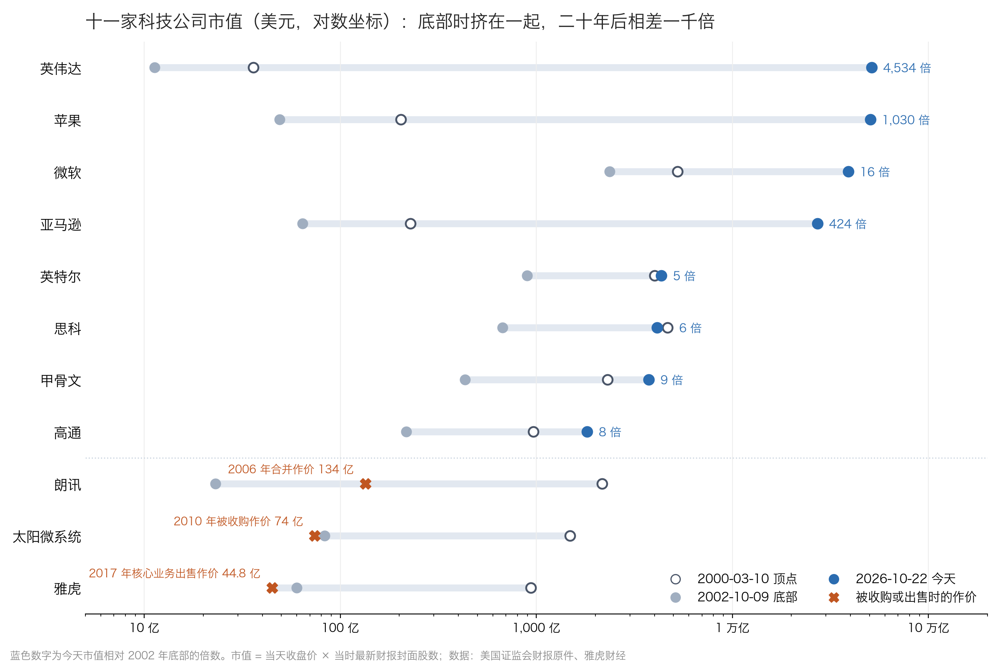

# 纳指崩盘 78%：苹果从底部涨了 1000 倍

2002 年 10 月 9 日，苹果市值 49 亿美元，账上现金和短期投资 43 亿美元。扣掉现金，市场给苹果的生意估价不到 10 亿美元。

同一天，纳斯达克综合指数收于 1,114 点，两年七个月前它在 5,048 点，跌掉 78%。

2026 年 10 月 22 日，苹果市值 5.05 万亿美元，是那天的 1,030 倍。

同一场崩盘，有的公司涨回来上千倍，有的公司没了。把当年的财报原件和今天的财报放在一起看，分界线只有一条：崩盘之后，利润还能不能持续增长。

## 一、崩盘时，所有公司一起跌

纳指 2000 年 3 月 10 日收于 5,048 点，2002 年 10 月 9 日跌到 1,114 点，2008 年金融危机又跌了一次，直到 2015 年 4 月才回到 5,048 点。

这场崩盘不分好坏。2000 年 3 月到 2002 年 10 月，苹果市值跌了 76%，亚马逊跌了 72%，微软跌了 55%，思科跌了 86%，雅虎跌了 94%，朗讯跌了 99%。

苹果当时市盈率只有 32 倍，是科技巨头里最便宜的之一，照样跌了四分之三。

暴跌的原因是估值。纳斯达克100 的市盈率 1999 年末是 104 倍，2000 年顶点各家测算在 150 到 300 倍之间，2002 年末降到 38 倍。估值从天上掉回地面，所有公司都要跟着跌一遍。

但跌完之后往哪走，估值说了不算，利润说了算。

## 二、二十四年后：利润涨多少，市值就涨多少

| 公司 | 2002 年底部市值 | 今天市值 | 市值涨了 | 年利润：2002 年 → 今天 | 利润涨了 |
| --- | --- | --- | --- | --- | --- |
| 英伟达 | 11.3 亿 | 51,234 亿 | 4,534 倍 | 2.1 亿 → 1,929 亿 | 937 倍 |
| 苹果 | 49 亿 | 50,457 亿 | 1,030 倍 | 1.8 亿 → 1,289 亿 | 733 倍 |
| 亚马逊 | 64 亿 | 27,143 亿 | 424 倍 | 亏 2.8 亿 → 1,353 亿 | 扭亏 |
| 微软 | 2,366 亿 | 38,947 亿 | 16 倍 | 78 亿 → 1,337 亿 | 17 倍 |
| 甲骨文 | 432 亿 | 3,747 亿 | 9 倍 | 21 亿 → 188 亿 | 9 倍 |
| 思科 | 672 亿 | 4,122 亿 | 6 倍 | 19 亿 → 133 亿 | 7 倍 |
| 英特尔 | 897 亿 | 4,340 亿 | 5 倍 | 20 亿 → 亏 113 亿 | 转亏 |
| 朗讯 | 23 亿 | 2006 年作价 134 亿并入阿尔卡特 | — | 亏 177 亿 | — |
| 太阳微系统 | 83 亿 | 2010 年作价 74 亿被甲骨文收购 | — | 亏 6 亿 | — |
| 雅虎 | 60 亿 | 2017 年核心业务作价 44.8 亿出售 | — | 亏 0.7 亿 | — |

金额单位为美元。市值按当天收盘价乘以当时财报股数计算；利润为最近四个季度净利润，取估值日前已公布的财报。

微软利润涨了 17 倍，市值涨了 16 倍；甲骨文 9 倍对 9 倍；思科 7 倍对 6 倍。二十多年的长度里，股价几乎就是利润的影子。

英伟达和苹果的市值涨得比利润还多，因为 2002 年市场对它们极度悲观，给的估值太低。利润从 2 亿涨到上千亿，再叠加估值修复，才有了上千倍。

另一头，朗讯、太阳微系统、雅虎的利润没有回来，市值也就没有回来。英特尔利润转亏，二十四年只涨了 5 倍。

## 三、看懂公司，看的是利润还能不能长

赢家在底部时一点不像赢家：

- **苹果**：收入还在下降，市值约等于现金。一年前推出的 iPod，当时撑不起任何估值。
- **亚马逊**：净资产是负 14 亿美元，市场只给 1.9 倍市销率。但收入还在增长 21%，毛利率从 18% 升到 26%，剔除一次性项目后已接近盈亏平衡。
- **英伟达**：刚因美国证监会问询重述了三年财报，市盈率只有 5 倍。但收入还在翻倍增长。

输家的问题，在顶点时也已经露出来：

- **朗讯**：客户是举债建网的电信公司，泡沫一破订单就断。2000 年 3 月最新一个季度收入同比只增长 0.6%，市值却是 2,168 亿美元。到 2002 年，单季收入同比腰斩。
- **雅虎**：收入几乎全是广告，大广告主是互联网创业公司。底部时生意其实没崩，收入比顶点还高 31%，后来在搜索上输给了谷歌，利润增长断了。

看懂一家公司，不是看它当下有多火，而是判断十年后它的利润还能不能比现在大很多。苹果、亚马逊、英伟达在 2002 年的利润都很小甚至亏损，但都有一样还在长的东西：苹果的新产品，亚马逊的毛利率，英伟达的收入。朗讯、雅虎当年利润更大、名气更响，可它们的利润建立在泡沫客户和会被替代的位置上。

## 四、看懂了，也要看价格

思科是反面提醒。2000 年它收入增长 49%，毛利率 65%，一度是全球市值最高的公司，当时没有人怀疑它是优秀公司。此后它的利润涨到 7 倍，但因为买入时市盈率是 231 倍，今天市值仍比 2000 年 3 月低 12%。

微软 2000 年净利率 40%，市盈率 60 倍，股价到 2016 年才回到 1999 年的高点。

优秀公司能穿越暴跌，前提是利润继续长；它能给你多少回报，还取决于买入时付了多少钱。在 2002 年的底部买苹果，二十四年是 1,030 倍；在 2000 年的顶点买，是 249 倍；在 2000 年的顶点买思科，市值至今没回到当年。

## 五、苹果是幸存者，能提前看懂的只有一部分

这篇文章挑出苹果、亚马逊、英伟达，是因为今天知道了结局。站在 2002 年 10 月，和它们挤在同一个价位的还有雅虎和太阳微系统。

更大的样本更残酷。美国亚利桑那州立大学教授贝森宾德统计了 1926 年以来所有美国上市股票：大多数股票一生的回报跑不赢一个月期国债，整个美国股市的净财富增长，全部来自表现最好的 4% 的公司（[《金融经济学期刊》2018](https://ideas.repec.org/a/eee/jfinec/v129y2018i3p440-457.html)）。本文这 11 家也一样：3 家涨了几百到几千倍，3 家消失，其余 5 家只涨了几倍到十几倍。

能提前看懂的，是写在当时财报里的东西：亚马逊的毛利率在升、亏损在收窄，英伟达的收入在翻倍。苹果的千倍主要来自 2007 年才出现的 iPhone，2002 年的财报里看不到，这里面有很大的运气成分。

所以“核心是看懂公司”要加一个限定：能用今天的财报说清楚它的利润为什么还会长很多，才算看懂；说不清的，就承认看不懂。纳指本身能在 15 年后回本，靠的正是指数不断剔除失败者、纳入新赢家，买指数的人不用事先猜中苹果。

## 结尾

2002 年 10 月 9 日，苹果、亚马逊、英伟达和雅虎、朗讯一起躺在谷底，股价没法告诉你谁是谁。

能告诉你的，只有接下来二十年的利润。

---

**数据来源**：指数取自美联储圣路易斯分行数据库（[NASDAQCOM](https://fred.stlouisfed.org/series/NASDAQCOM)）与雅虎财经；纳斯达克100 市盈率取自[纳斯达克指数研究 2025](https://www.nasdaq.com/docs/is-ai-another-bubble-for-the-nasdaq-100)、[2022](https://indexes.nasdaqomx.com/docs/NDX%20Research%202022.pdf)；公司财务取自各公司在估值日前提交美国证监会的财报原件，今天的数据取自美国证监会结构化财报接口；历史股价为当天实际成交收盘价。今天指 2026 年 10 月 22 日收盘。
