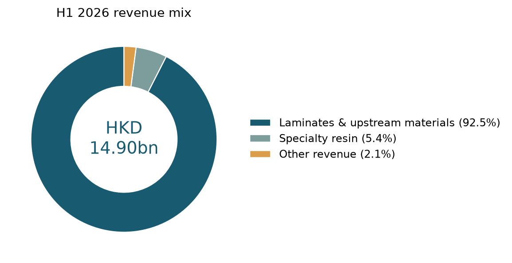
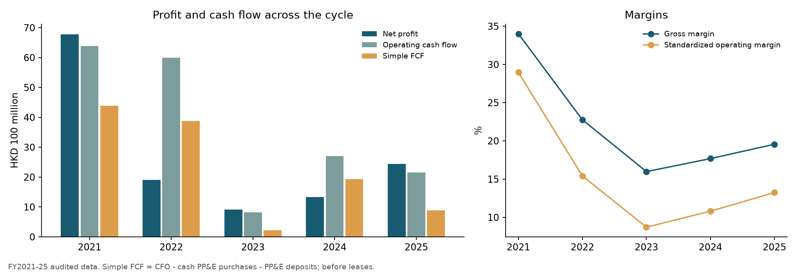

# 建滔积层板（01888.HK）研究报告

> **研究日期／数据截止：2026-11-25（Asia/Shanghai）**。价格取当日16:08收市快照；财务截至2026-06-30，年度截至2025-12-31。  
> **上市主体：** 建滔积层板控股有限公司，Kingboard Laminates Holdings Limited，港交所主板01888；母公司建滔集团00148为另一上市主体。  
> **价格／股本／市值：** HK$20.98／3,151,450,000股／HK$661.17421亿。  
> **估值快照：** 以最新股本重算TTM PE 15.04倍，归母PB 3.61倍，TTM PS 2.57倍。  
> **研究主线：** 垂直整合使公司在缺料涨价期同时赚取覆铜板与上游材料利润；当前要验证的是，这份利润有多少能跨越扩产周期并变成股东现金。

本报告用于学习研究，不构成投资建议。完整行动建议在第八步。延续[2026-07-16报告](建滔积层板-research-20260716.md)所在目录；旧报告作为历史记录保留，本次重新建立估值和行动条件。

---

## AI研究偏见自觉

**信息丰富度评级：A。** 财务与上市披露充分；高阶板材占比、特种纱良率、具名终端认证和产品利润分拆仍不透明。公开报道很多，不能据此认为利润中枢已经确定。

**AI研究局限性声明：** 公司主要按半年披露财务，未取得可供完整核验的2026第三季度分部财务，不能拼造“最近四个单季”。本报告展示连续半年窗口和已披露的7月经营信息。AAStocks基本面页面访问失败，未取得可验证Macrotrends ADR财务覆盖；采用公司／HKEX原文与StockAnalysis、ETNet交叉核对，绝不把公司官网和同份HKEX副本算成两个独立来源。竞争技术与客户结论弱于历史报表结论。

- [x] 区分“AI需求增长”与“本公司取得永久超额回报”。
- [x] 同时检查提价、产能、营运资金、证券投资与债务。
- [x] 不把股价跌幅、母公司增持价或券商目标价当成价值底线。
- [x] 将模型假设与已发生数据分开，并检验盈利起点与折现率。

---

## 第一步：核心数据总览

### 经营地图与半年窗口

覆铜板是PCB的基材；纱、布、树脂和铜箔决定其电气性能、可靠性与成本。以下为外部收入产品口径，不能再把同一批上游材料的内部销售相加。产品分拆目前仅公司原文，未取得独立同口径复核，低于双源历史总额的证据等级。[2025年报][ar25]、[2026中报第9–10页][interim]

| 产品口径 | 2025收入（亿港元） | 2026H1收入（亿港元） | 2026H1占比 |
|---|---:|---:|---:|
| 覆铜板及上游材料 | 183.66 | 137.86 | 92.5% |
| 特种树脂 | 15.70 | 8.07 | 5.4% |
| 其他，包括物业、酒店、租金与投资收入 | 4.64 | 3.11 | 2.1% |
| 合计 | 204.00 | 149.04 | 100.0% |



| 连续报告期 | 收入（亿港元） | 归母净利（亿港元） | 毛利率 | 说明 |
|---|---:|---:|---:|---|
| 2025H1 | 95.88 | 9.33 | 18.39% | 已披露半年数据 |
| 2025H2 | 108.12 | 15.09 | 20.61% | 全年减上半年推导，非独立季度披露 |
| 2026H1 | 149.04 | 28.87 | 30.73% | 收入同比+55.44%，归母同比+209.28% |
| 截至2026H1的TTM | 257.16 | 43.95 | 26.47% | FY2025＋H1新期－H1旧期 |

公司称上半年覆铜板销量同比+14%、月均超过1,000万张，接近满产；玻纤纱布利润约10亿港元、同比约+280%。**收入和利润的增长远超过销量，量价结构和短缺利润是主因。** 中报还称7月利润约11亿港元，但未给这一单月的完整报表、归母及税项口径；它是重要向上证据，不能直接年化当成2027年可分配利润。[中报第21–22、27页][interim]

### 五年跨周期财务

单位：亿港元；利润率除外。资本开支采用购买固定资产现金加设备订金现金，简化FCF＝CFO－该现金资本开支，未扣租赁本金、另列使用权资产投入或收购。

| 财年 | 收入 | 归母净利 | 毛利率 | 标准化经营利润率 | CFO | 现金资本开支 | 简化FCF | 现金 |
|---|---:|---:|---:|---:|---:|---:|---:|---:|
| 2021 | 288.00 | 67.82 | 34.01% | 28.97% | 63.84 | 19.90 | 43.94 | 28.65 |
| 2022 | 223.64 | 19.09 | 22.76% | 15.41% | 59.92 | 21.07 | 38.85 | 32.90 |
| 2023 | 167.50 | 9.07 | 15.98% | 8.71% | 8.24 | 6.01 | 2.23 | 20.27 |
| 2024 | 185.41 | 13.26 | 17.68% | 10.80% | 27.08 | 7.74 | 19.34 | 19.24 |
| 2025 | 204.00 | 24.42 | 19.56% | 13.24% | 21.60 | 12.77 | 8.83 | 16.28 |

来源：[2022年报][ar22]、[2023年报][ar23]、[2025年报][ar25]；分别与[独立损益表][sa-is]、[现金流表][sa-cf]、[资产负债表][sa-bs]核对。经营利润为标准化口径：毛利减分销、行政及单列债券预期信用损失，排除其他收入、股票与物业公允价值及利息；公司原损益表未单列同名营业利润，不能冒充公司披露指标。



2021与2023的利润差异说明，复购不等于稳定利润率。2025利润恢复，但证券公允价值收益也有贡献；2026H1则在证券亏损下仍实现制造利润改善，不能将本轮全部增幅说成炒股所得。

### 现金、债务与利润质量

| 2026-06-30项目 | 金额（亿港元） | 解读 |
|---|---:|---|
| 银行现金 | 21.96033 | 狭义现金，不含股票 |
| 银行借款 | 77.13584 | 其中一年内64.85927 |
| 租赁负债 | 0.01968 | 纳入本报告有息债务 |
| 现金减银行及租赁负债 | -55.19519 | 净债务，不能称净现金公司 |
| 股票投资，流动及非流动 | 29.54494 | 有价格风险，不等同银行存款 |
| 债券投资 | 2.56432 | 按公允价值，非本金原值 |
| 现金＋全部证券－有息债务 | -23.08593 | 更宽的资产覆盖口径，仍为负 |
| 归母权益 | 183.36822 | PB使用它，不混入少数权益 |
| H1经营现金流／归母净利 | 10.65487／28.86561 | 现金转化36.91% |

原文：[中报第1、3–7、23–25页][interim]。独立核验：[ETNet中期净利][etquote]、[StockAnalysis资产负债表][sa-bs]。第三方“净债务31.12亿”抵扣了流动股票；与本报告现金口径55.20亿不同，已完成口径对账。

现金回收需谨慎，但**并非全面恶化**：H1 CFO由上年同期-3.27亿转为+10.65亿；公司披露周转周期由年末132天下降至126天、应收天数96降至82天。库存和净贸易应收加票据较年末分别增加44.82%、33.26%，包含规模扩张与战略备铜，不能将这两个环比余额增幅与半年收入同比机械比较并断言坏账恶化。

滚动CFO可核算为35.52653亿；**2026H1和TTM精确FCF不可取得**。中报固定资产会计添置11.3614亿、管理层所称约18亿新产能投入，都不等于现金流量表中的资本开支。StockAnalysis滚动FCF沿用旧年度资本开支，本报告弃用该值。研发金额、产品级毛利与现金CapEx明细列为来源缺口。

> 追问：本轮利润增加后，有多少留在应收、存货和新设备，又有多少能在不增加借款的情况下分给股东？

---

## 第二步：生意本质分析

**一句话：建滔向PCB厂反复供应合格基材，靠自制关键上游材料降低成本与断供概率，并在短缺时同时获取材料和加工利润。**

| 经营环节 | 钱从哪里来 | 竞争或现金约束 |
|---|---|---|
| 普通覆铜板 | 数量、原料传导与加工价差 | 替代供应多，价格受供需影响 |
| 高速高频覆铜板 | 稳定性能、认证、良率与交付 | 认证需要时间，竞争对手也在迭代 |
| 玻纤纱布、铜箔、树脂 | 内供节约采购和断供成本，外销取得利润 | 必须扣设备、能源、环保及周转投入 |
| 客户复购 | PCB持续生产就持续消耗基材 | 不是订阅；需求、产品规格和供应商可变 |
| 资金循环 | 收款后再采购、扩产及分配 | 账面毛利先于现金到账 |

2026H1毛利率30.73%，接近但尚未证明能长期超越上一轮高景气水平。普通板涨价主要来自缺货；高端材料若能在供给恢复后保住客户、价差和资本回报，才是护城河变宽。

经营杠杆也向下作用：窑炉、铜箔线与织布设备先发生固定成本，利用率下降时利润率会更快收缩。垂直整合在短缺期是一站式供货优势，在过剩期也会同时暴露多环节产能风险。

> 段永平式追问：如果不能再提价，这门生意靠什么赚钱？答案应当是合格率、单位成本和认证后的持续订单，而不是又一封涨价函。

---

## 第三步：护城河评估

| 类型 | 判断 | 已有证据 | 证伪指标 |
|---|---|---|---|
| 品牌与定价权 | 中等，主要随供需而变 | 缺料期多次涨价 | 供给恢复后价差与毛利迅速回落 |
| 转换成本 | 普通板偏低，高端板较高 | 高端产品认证及客户扩张 | 认证有进展却无持续量产收入 |
| 网络效应 | 未成立 | 客户增加不会自动改善材料性能 | 不赋网络效应溢价 |
| 规模与成本 | 证据最强 | 覆铜板与纱布、铜箔、树脂协同；近满产交付 | 同行成本追平、产能利用率失守 |
| 技术与工艺 | 有进步，领先程度未证实 | 特种玻纤、高频高速材料布局 | 良率、认证和代际升级落后 |

[Prismark于2026年6月公布的2025年统计][prismark]与[台光2026-10-28官方简报第7–8页][emc]显示，Kingboard按供应商口径的刚性CCL销售份额12.4%，落后台光16.2%与生益13.2%。这里含半固化片，不含柔性及mass laminate；**供应商品牌统计不能直接等同01888合并收入。** 2024“第一”的说法不适用于最新年度。

在另一个“无卤高速基板”细分口径，台光、联茂、台燿的份额领先；Kingboard未单列不等于没有份额。公开产品参数缺少完全相同的测试条件，也不能据单个Df指标宣布谁落后几代。[台光产品数据表][emc-product]、[建滔HSD产品页][kb-product]

过去五年可观察到的是上游整合与新材料能力增强，同时高端CCL竞争更强。未来五年护城河能否扩大，要看缺货结束后的高端收入和增量资本回报。不能假定买齐设备就能复制良率与认证，也不能假定认证一过就永久独占。

> 巴菲特式追问：十年后还在的很可能是制造体系；今天的稀缺价差是否还在，必须由新增资本的回报证明。

---

## 第四步：逆向思考与风险清单

下列概率为研究判断的定性排序，不是统计发生率；影响为股东长期价值影响。

| 失败路径 | 主观概率 | 影响 | 可观察的预警 |
|---|---|---|---|
| 普通纱布短缺被错当永久AI租金 | 中高 | 高 | 扩产交付后价格、毛利和订单同时降温 |
| 高端认证未转化成可盈利量产 | 中 | 高 | 只披露研发／认证，持续不披露商业化证据 |
| 扩产与需求下行重叠 | 中 | 高 | 利用率下行、CapEx维持高位、净债持续升 |
| 铜价与成本传导失配 | 中 | 中高 | 库存跌价、售价调整慢于采购成本变化 |
| 利润兑现但现金长期不跟随 | 中 | 高 | 滚动现金转化下降、账龄与票据风险升高 |
| 证券投资和关联交易损害资本配置 | 中 | 中高 | 主业需融资时继续大幅增持证券、非公平定价证据 |
| 环保、能源、出口或地缘断供 | 低至中 | 高 | 停产、关键设备／客户准入受限 |
| 严重侵占或永久技术出局 | 低置信尾部 | 极高 | 治理红线或核心产品失去替代价值；未完整建模 |

**最强空方论点：** AI让部分产能转向特种纱布，普通材料随之缺货；建滔因整合优势赚到的部分钱，可能是扩产能够消灭的短缺利润。若用高速板龙头估值给普通纱布利润定价，盈利与倍数会同时回落。

最强反证也要保留：H1制造利润改善真实存在，公司在证券投资亏损时仍大幅增长；7月利润信息与特种产能投放，意味着简单套用旧周期中枢也可能严重低估公司。

历史类比采用本公司2021高景气后至2023低谷的实际路径，不冒用其他技术龙头的命运作预测。这里更适用“供给响应滞后”的蛛网模型与固定成本经营杠杆，而不是网络效应。最可能犯的错，是把利润中枢已升至每股2港元当成已证实事实；第二个错是因股价下跌而忽略它的上行可能。

> 芒格式追问：聪明人为什么不买？因为在缺少现金CapEx与高端收入拆分时，无法知道自己买到的是持续回报，还是周期高点的利润。

---

## 第五步：管理层评估

主席张国华、董事总经理张国强仍在任；长期制造经验与家族控制并存。家族关系不自动证明治理差，但也不能替代独立股东监督。[2025年报第15–16页][ar25]、[2026中报董事名单][interim]

| 时间／决策 | 结果与评价 |
|---|---|
| 长期向关键原料垂直整合 | 本轮缺料下保持交付，是明确经营加分项 |
| 2025–2027特种材料和纱布扩产 | 已有部分投产，其他仍是计划；最终按现金回报评价 |
| 2025全年每股分配0.68，含特别股息0.28 | 积极回报，但特别股息不构成持续承诺 |
| 2026H1证券投资由18.04亿升至32.11亿 | 主业扩产与借款增加时扩大投资组合，资本配置扣分 |
| 母公司先配售、后增持 | 不能只保留旧报告的减持叙事；也不能把增持价当价值保证 |
| 2026-10-30关联框架获独立股东批准 | 程序得到披露，公平交易的实质仍需持续核查 |

截至已检得的2026-11-03申报，母公司持股1,977,508,000股，披露62.74%；当日增持150万股、均价32.7065港元。[HKEX权益披露][di]与[ETNet][etbrief]相互印证。该比例是母公司权益，不能冒充张氏家族个人经济权益；普通股没有已发现的AB投票权差异，受控链也不能重复加总。未能完整取得11月25日全部最新DI清单，因此不声称此后绝无交易。

2026H1对同系企业销售25.90亿，占收入17.38%；另有对Hallgain相关股东的销售及设备采购。前八个月对母公司体系销售已达37.02亿，后续提高了年度上限；**上限不是订单，更不是利润。** 相关框架已获批，不能写成待审批。[9月16日关联公告][connected]、[10月30日表决结果][poll]

1888自身有投资物业12.30亿和待开发物业1.10亿；不能把00148全部地产与负债装进本公司。证券公允价值2025盈利5.03544亿、2026H1亏损2.69242亿；公司所谓“基本利润”只剔除投资物业变动，不能当作纯主业扣非利润。[年报][ar25]、[中报][interim]

组织优势更多来自制造体系和资深团队，不完全依赖一位明星经理人。接班、资本分配、关联定价及是否愿意披露高端经营成果，仍需折价看待。

> 段永平式追问：如果CEO退休，工厂可以继续运转；新增资本是否仍投向股东回报最高的项目，则需要制度和监督作保证。

---

## 第六步：行业与文明趋势

AI计算、数据传输和汽车电子提高PCB层数、频率与可靠性要求，带动低损耗树脂、特种纱布和低粗糙度铜箔的价值量。**需求增长可以长期成立，供应商的超额利润仍取决于工艺、认证和供给纪律。**

2025刚性CCL市场约187亿美元，同比增长24.4%，是当前规模参照而非长期增长预测；公司的上游外销市场与它部分重叠，不能再全部相加生成TAM。[Prismark][prismark] 长期增长采用情景假设，未伪造可靠的远期市场总量。

| 关键资产／项目 | 已披露状态 | 应核实的下一步 |
|---|---|---|
| 特种玻纤纱窑炉 | H1新投4座、合计5座 | 低Dk、低CTE与石英纱各自量产良率和外销贡献 |
| 韶关7万吨电子纱 | 公司称2026年6月底投产 | 利用率与传统纱价格走势 |
| 清远特种纱及其他纱布项目 | 规划新增8座特种窑炉，部分拟H2投产 | 计划、实际投产、合格出货分开确认 |
| 清远铜箔2.1万吨 | 预计2027Q3投产 | 交付、认证、单位成本与现金投入 |
| 织布产能 | 公司目标2028年10.5亿米 | 不是当前产能，也不是已经取得的订单 |

以上来自[中报第22、27–28页][interim]；不将集团全部资产直接归属于01888。

竞争对手也在扩产：[联茂2026年11月官方简报][iteq]列出M9／M10产品并规划增产，3Q毛利率34.33%，高于建滔H1的30.73%；期间、产品和地区不同，不能据此直接排名优劣。它证明高端与景气受益并非建滔独有。主要客户身份、最终AI客户占比及2026最新供应商集中度未取得充分独立证据，保留为验证问题。

> 李录式追问：二十年后电子材料需求大概率更大，但只有持续降低损耗、通过认证并获得高于资本成本回报的供应商，才能把文明进步变成股东收益。

---

## 第七步：估值与安全边际

### 当前定价与口径

所有市值、比率、情景价格使用金融严谨性工具及Decimal复算。价格为11月25日、资产负债为6月30日，EV是混合时点估计，不声称实时债务。

| 指标 | 本报告值 | 含义／限制 |
|---|---:|---|
| 市值 | 661.17421亿港元 | 20.98×31.5145亿股 |
| TTM每股利润 | 1.394729港元 | 43.95418亿除以期末现股；非加权平均法披露EPS |
| TTM PE | 15.04倍 | 第三方15.07倍的微差来自每股及四舍五入口径 |
| 归母PB／TTM PS | 3.61／2.57倍 | 归母净资产口径 |
| 保守EV／TTM销售 | 716.63亿／2.79倍 | 市值＋银行与租赁债务＋少数权益－银行现金 |
| 抵扣全部证券后的EV／销售 | 684.52亿／2.66倍 | 只作资产口径敏感性，证券不当现金 |
| TTM CFO收益率 | 5.37% | 非股东自由现金收益率 |
| 2025历史简化FCF／今日市值 | 1.34% | 历史代理，不能冒充最新TTM |
| 最近两期分配合计／现价 | 0.81港元／3.86% | 含2025末特别股息及尚待付的2026中期股息，不是永久股息率 |

[报价与统计][sa-stat]、[月报][monthly]、[独立财务][sa-is]。PEG不作为决策指标：跨周期利润从低谷暴增时，低PEG没有稳定的经济含义。

同行TTM PE仅作市场背景，不能决定十年退出倍数：台光约35.9倍（StockAnalysis35.97，Goodinfo35.94）；生益约18.6倍（StockAnalysis18.59，腾讯18.63）。公司覆盖周期、利润结构、地域估值和上市市场不同，建滔低于它们并不自动意味着错价。[台光统计][emc-stat]、[Goodinfo][goodinfo]、[生益统计][sy-stat]、[腾讯生益快照][qt-sy]

自身2021–2025年末第三方PE约为6.10、14.02、23.11、16.96、16.93倍，PB约2.17、1.78、1.40、1.46、2.53倍。该序列只作粗略估值背景，未独立逐年重建，不计算分位或历史股价收益率；低谷PE高、顶点PE低正是周期估值陷阱。[历史比率][sa-ratio]

### 三年情景：2港元是有条件的盈利能力假设

**起点EPS 2.00港元不是已证实的正常化中枢，也不是2026全年预测。** 它高于TTM的1.3947，考虑H1年化约1.84及7月强劲表现，又不把单月高利润永久年化。公司必须证明增长能留下现金、且高端份额提升，否则应下调起点。

自当前时点按三个年度期末建模；每股增速已视为扣除未来稀释后的增长。三年倍数8／12／16反映低谷、部分结构升级与明显升级的不同判断，不是套同行现价。主观概率30／50／20并非统计预测。

| 情景 | 假设概率 | 三年年增速 | 三年PE | 第三年EPS | 第三年股价 | 含分红今日现值 | 含分红年化回报 |
|---|---:|---:|---:|---:|---:|---:|---:|
| 悲观 | 30% | -18% | 8 | 1.103 | 8.82 | 7.66 | -22.51% |
| 基准 | 50% | 8% | 12 | 2.519 | 30.23 | 24.06 | +15.20% |
| 乐观 | 20% | 26% | 16 | 4.001 | 64.01 | 50.03 | +47.36% |

现值按10%要求回报折现；悲观每年派息率30%，基准及乐观前两年15%、第三年40%。已宣派0.28包含在前期分配假设内，不另加一次。现实派息日期与年度期末模型有差别，个人税项未计。概率加权今日值24.33港元；基准24.06，现价折让仅12.78%，不足以抵消盈利起点与资金投入的不确定性。

最重要的敏感性不是把PE调高，而是盈利起点是否真实。其他假设不变，按比例复算：

| 假设起点EPS | 三年基准含息现值 | 三年加权现值 | 十年加权现金现值，r=10% |
|---|---:|---:|---:|
| 1.4 | 16.84 | 17.03 | 14.48 |
| 1.6 | 19.24 | 19.47 | 16.55 |
| 1.8 | 21.65 | 21.90 | 18.62 |
| 2.0 | 24.06 | 24.33 | 20.69 |

因此17–19港元也不是无条件便宜；若起点只有1.6，19港元已接近三年基准价值。

### 反向DCF：现价需要什么

采用下文永续模型推导的退出PE10.7143、十年、每年固定分配0.60港元作为独立检验，当前20.98对应第十年EPS约4.1864，即相对假设起点2.00年增约7.67%。0.60是建模假设，不是派息承诺。这比“未来只需维持7月利润”更能揭示市场对持续升级的要求。

### 十年压力测试：约束仓位

终值只来自永续模型：PE＝(1－g／ROIC)／(r－g)。

- **币种与r：** 港元现金流，r=10%；合理区间按工具规范9%–11.5%。采用长期规范化无风险锚4.7%＋β1×ERP5.3%，不是声称当前国债利率为4.7%。[HKMA公开数据][hkma]的2026年10月十年收益率为3.838%。工具将Rf与固定基准核对，不是实时利率模型；10%的长期要求保持不变，不因买入倾向调低r。
- **稳态增量ROIC：** 假设14%。粗略下界是“稳态增长2%／留存50%”反推4%；上界参照第三方TTM存量ROIC23.38%，后者受景气与口径影响、仅单源。选14%是中间判断，不是测得的新项目回报；特别股息与周期利润使直接按历史派息反解失真。
- **永续g：** 悲观0%、基准2%、乐观3%，均按港元名义口径，基准低于4%的币种上限；g只描述2036年以后，不随r变化。大陆经营与汇率影响并未凭港元计价消失。
- **现金分配：** 前两年15%、第三至五年40%、第六至十年50%，悲观恒30%。后期提高派息以经营现金覆盖完整CapEx、债务趋稳为前提；每股利润增长已含稀释，不再额外扣一遍。模型没有逐年构建完整资产负债表，无法证明这些分配必然可行。

三年前段与上表一致，之后七年增长如下；第十年按当前股数展示利润规模，经济估值直接用每股利润，避免重复扣净债务。

| 情景 | 后七年EPS增速 | 第十年利润（亿港元） | 永续g | r－g | 永续退出PE | 工具简化IRR | 完整年度分配IRR |
|---|---:|---:|---:|---:|---:|---:|---:|
| 悲观 | 0% | 34.75 | 0% | 10pct | 10.00 | -4.23% | -3.99% |
| 基准 | 5% | 111.72 | 2% | 8pct | 10.71 | +8.12% | +10.10% |
| 乐观 | 8% | 216.08 | 3% | 7pct | 11.22 | +15.88% | +18.65% |

工具简化IRR＝终值资本回报＋固定净股息率2%，是技能规定的统一代理，不是逐期现金IRR。补充完整模型按每年分配与第十年残值逐笔求根，基准结果10.10%；三情景IRR概率加权平均为7.59%。**7.59%不是“概率加权现金流的IRR”**，后者是9.82%；非线性导致两者不同，不能混称。

下表“通过”均表示相应统计量≥该行r；没有把区间外档位当买入依据。已执行工具flip的±2pp，并因两端都出界，追加±1pp；完整现金流亦同步重算。

| r | 工具代理E[IRR]／检验 | 完整E[IRR]／检验 | IRR(加权完整现金流)／检验 | 比较资格 |
|---|---|---|---|---|
| 8% | 8.93% / 通过 | 10.09% / 通过 | 12.57% / 通过 | 区间外，仅供参考 |
| 9% | 7.33% / 未过 | 8.73% / 未过 | 11.07% / 通过 | 有效比较档 |
| 10% | 5.96% / 未过 | 7.59% / 未过 | 9.82% / 未过 | 有效比较档 |
| 11% | 4.77% / 未过 | 6.60% / 未过 | 8.77% / 未过 | 有效比较档 |
| 12% | 3.72% / 未过 | 5.75% / 未过 | 7.85% / 未过 | 区间外，仅供参考 |

**翻转判断：** 按技能规定E[IRR]，9%–11%有效采样档始终未覆盖资本成本；按加权完整现金流IRR，9%通过、10%及11%未过，在币种合理区间内翻转。因此本结论对折现率和聚合方法敏感，仓位建议降级；不能声称稳健低估，更不能以单一r未过否决持有。±2pp端点的分母最窄也为5个百分点，基准三档分母为10／8／7个百分点。

### 估值分歧对账

三年模型在起点2元成立时给出现价低于基准值的**定价判断**；十年模型给出的是**仓位压力**，且尾部损失拉低三情景平均回报。两者并列保留：短中期升级可能有收益，长期仍可能赚不到要求回报。

最终新增观望同时依据有限价差、盈利起点未确认、现金CapEx缺口、扩产和治理风险；**不是十年未过的一票否决**。持仓小仓可有条件持有；17–19候选带若经营证据成立，仍可研究小额分批。十年压力将研究仓参考上限收紧至2%，不是模型算出的最优仓位，个人组合风险未知时不适合直接套用。

> 巴菲特式追问：r错两个百分点会不会改变判断？区间外结果不可作证；有效9%–11%内，加权现金流检验会翻转，因此不能重仓押一个折现率。
>
> 段永平式追问：股市关闭五年是否愿意持有？理解公司材料技术、能容忍深度周期亏损的投资者可以讨论；只因目标价很高而买入，证据不足。

---

## 第八步：最终决策与行动清单

| 维度 | 结论 | 信心 |
|---|---|---|
| 生意质量 | 耗材复购、整合供货有价值；盈利和再投资仍具周期性 | 中高 |
| 护城河 | 成本与制造体系较强，最高阶AI板领先尚未证明 | 中 |
| 管理层 | 经营执行有正面证据；证券配置、关联定价需折价 | 中 |
| 最大风险 | 把缺料利润当永久租金，同时忽略扩产与现金投入 | 中高 |
| 文明趋势 | AI与电子化提高材料要求，公司能否持续捕获利润需验证 | 趋势中高／公司兑现中 |
| 估值 | 三年起点2元时略有折价、起点1.6元则不足；十年仅限仓，完整现金流在有效r内翻转 | 中低 |

**结论：20.98港元，空仓者观望新增；合理小仓持有者有条件持有、暂停加仓。** 相比旧报告，“太贵”的程度已明显缓解，但“跨周期盈利与现金”尚不足以支持重仓。

| 策略 | 可执行的研究条件 |
|---|---|
| 空仓者 | 17–19港元为候选分批研究带；须最新完整财务仍支持约2港元盈利能力、高端商业化证据增强、滚动CFO／归母≥70%且CFO覆盖全部现金CapEx，新增证券与债务可解释后，才研究首笔约0.5% |
| 持仓者 | 小仓且上述经营基础未破坏，可有条件持有；高成本不构成补仓理由。下一正式财报及随后一次可比披露继续核实现金与高端化，符合后才考虑增加，研究总仓参考≤2% |
| 跌破17港元 | 先查利润起点、坏账、产品代际与融资；不能机械越跌越买 |
| 卖出／减仓信号 | 出现治理侵占、核心认证或竞争力永久受损，或借款长期支撑派息与证券扩张，优先重审退出；达到32港元且盈利／现金模型未增强时复核超配，32只是估值警戒而非自动卖出 |
| 加仓信号 | 进入17–19且完整现金条件成立；其后再用一次可比正式披露确认订单、利润质量及资本支出没有反转 |

70%、2港元与仓位数字是本报告研究门槛，不是公司指引。当前悲观三年现值7.66港元，候选入场价仍可遭受很大损失；模型没有覆盖最坏的永久损失，条件买入不等于下行有限。

**旧方案接续：** 7月报告30–35港元等待带与55港元以上动作仅保留为历史研究，不再作为本次有效触发。新带下调主要来自重新建立跨周期EPS与现金折现，而非声称中报经营变差。没有将旧建议追溯计为命中。

复检安排：2026-12-11除息、12-16登记、2027-01-05派付0.28港元为[官方已披露日期][dividend]。2026-12-31为自定扩产、证券、债务与DI人工检查；2027-04-30为全年信息兜底检查，正式披露在先即提前研究，**不是已预约财报日**。不采用第三方12月1日“预计业绩日”冒充公司日历。

价格带与警戒线登记至`data/triggers.json`；事件只供人工复核，当前每日监控只扫描价格。该公司本轮新增到非重点标的跟踪表，完整经营条件尚未判定，初始状态“待触发”。

### 四位大师的方法论延伸

四人均无本报告已核实的建滔个股观点，以下不是其本人推荐或第一人称代言。

- 巴菲特原话：“A truly great business must have an enduring ‘moat’ that protects excellent returns on invested capital.” [2007股东信第6页][buffett]。本报告由此检验缺货结束后的资本回报，而不只看收入增长。
- 芒格原话：“He wanted decisions that maximized long-term results”。[2014副主席信第40页][munger]。本报告据此把扩产的长期现金回报置于短期利润及股价之上。
- 段永平原话：“不懂不做，不要跟消息走，跟着理解走。” [2011-10-07原帖][duan]；正文依据[仓库原发言存档](../段永平/段永平雪球全量原发言.md)已读，在线原帖读取受限。本报告据此要求理解材料周期与估值假设，不能因为母公司增持就跟随。
- 李录原话：“One common problem for investors is that they tend to swing too often.” [喜马拉雅资本官网Investment Philosophy][lilu]。原文同时强调真正好机会出现时应行动；本报告延伸为先定义可验证的好球条件，而非永久观望。

> 综合追问：如果没有近期股价、券商目标价和AI标签，单看产品、客户、资本回报与现金，是否仍愿意拥有这门生意？

---

## AI分析置信度与投资确定性

历史财务、股本、报价、已披露分配与关联程序的AI分析置信度较高；技术层级、盈利中枢及扩产回报中等或更低。**投资确定性为中等偏低**：需求趋势较清楚，未来利润率、竞争与现金分配并不确定。资料量高，不等于适合重仓。

需要一手补证：高阶CCL及特种纱收入／利润占比、认证后的稳定订单、良率和客户替换成本；扩产现金付款与投产回报；证券组合及关联定价；更新后的完整股权披露。严重关联侵占、永久技术出局及极端地缘停产未完整建立概率与损失模型，现有三情景不是全风险覆盖。按半年取数也不能回答11月即时经营是否已变化。

---

## 数据来源与审计记录

### 关键数据交叉验证记录

下列为`financial_rigor.py`实际输出节选，完整精度输入与补充现金流计算留在[估值与核验数据](建滔积层板-validation-20261125.json)。独立信息商亦可能追溯到同一公司原报表，双源验证降低转录和口径错误，不代表两次独立审计。

```text
============================================================
市值验算 (Market Cap Verification)
============================================================
  股价 (Price):       20.98 HKD
  总股本 (Shares):    3.15B
  计算市值:           66.12B HKD
  报告市值:           66.12B HKD
  偏差:               0.00%

  ✅ 验证通过, 偏差仅 0.00%
============================================================
交叉验证: 2025收入 (Cross-Validation)
============================================================
  数据来源数: 2
  参考中位数: 20.40M 千港元

  ✅ 年报                  : 20.40M 千港元  (偏差 0.00%)
  ✅ StockAnalysis       : 20.40M 千港元  (偏差 0.00%)

  ✅ 所有来源偏差 ≤ 1%, 数据一致

  共识值 (加权中位数): 20.40M 千港元
============================================================
交叉验证: 2025归母净利 (Cross-Validation)
============================================================
  数据来源数: 2
  参考中位数: 2.44M 千港元

  ✅ 年报                  : 2.44M 千港元  (偏差 0.00%)
  ✅ StockAnalysis       : 2.44M 千港元  (偏差 0.00%)

  ✅ 所有来源偏差 ≤ 1%, 数据一致

  共识值 (加权中位数): 2.44M 千港元
============================================================
交叉验证: 2025现金 (Cross-Validation)
============================================================
  数据来源数: 2
  参考中位数: 1.63M 千港元

  ✅ 年报                  : 1.63M 千港元  (偏差 0.00%)
  ✅ StockAnalysis       : 1.63M 千港元  (偏差 0.00%)

  ✅ 所有来源偏差 ≤ 1%, 数据一致

  共识值 (加权中位数): 1.63M 千港元
============================================================
交叉验证: 2026H1收入 (Cross-Validation)
============================================================
  数据来源数: 2
  参考中位数: 14.90M 千港元

  ✅ 中报                  : 14.90M 千港元  (偏差 0.00%)
  ✅ StockAnalysis_TTM倒推 : 14.90M 千港元  (偏差 0.00%)

  ✅ 所有来源偏差 ≤ 1%, 数据一致

  共识值 (加权中位数): 14.90M 千港元
============================================================
交叉验证: 2026H1归母净利 (Cross-Validation)
============================================================
  数据来源数: 2
  参考中位数: 2.89M 千港元

  ✅ 中报                  : 2.89M 千港元  (偏差 0.00%)
  ✅ ETNet               : 2.89M 千港元  (偏差 0.00%)

  ✅ 所有来源偏差 ≤ 1%, 数据一致

  共识值 (加权中位数): 2.89M 千港元
============================================================
交叉验证: 按SA可交易股票口径净债务 (Cross-Validation)
============================================================
  数据来源数: 2
  参考中位数: 3.11M 千港元

  ✅ 中报重算                : 3.11M 千港元  (偏差 0.00%)
  ✅ StockAnalysis       : 3.11M 千港元  (偏差 0.00%)

  ✅ 所有来源偏差 ≤ 1%, 数据一致

  共识值 (加权中位数): 3.11M 千港元
============================================================
交叉验证: 2026H1现金 (Cross-Validation)
============================================================
  数据来源数: 2
  参考中位数: 2.20M 千港元

  ✅ 中报                  : 2.20M 千港元  (偏差 0.00%)
  ✅ StockAnalysis       : 2.20M 千港元  (偏差 0.00%)

  ✅ 所有来源偏差 ≤ 1%, 数据一致

  共识值 (加权中位数): 2.20M 千港元
============================================================
交叉验证: 2026H1银行及租赁债务 (Cross-Validation)
============================================================
  数据来源数: 2
  参考中位数: 7.72M 千港元

  ✅ 中报                  : 7.72M 千港元  (偏差 0.00%)
  ✅ StockAnalysis       : 7.72M 千港元  (偏差 0.00%)

  ✅ 所有来源偏差 ≤ 1%, 数据一致

  共识值 (加权中位数): 7.72M 千港元
============================================================
交叉验证: 总股本 (Cross-Validation)
============================================================
  数据来源数: 2
  参考中位数: 3.15B 股

  ✅ 10月月报               : 3.15B 股  (偏差 0.00%)
  ✅ ETNet               : 3.15B 股  (偏差 0.00%)

  ✅ 所有来源偏差 ≤ 1%, 数据一致

  共识值 (加权中位数): 3.15B 股
============================================================
交叉验证: 母公司已申报权益 (Cross-Validation)
============================================================
  数据来源数: 2
  参考中位数: 62.74 %

  ✅ HKEX_DI             : 62.74 %  (偏差 0.00%)
  ✅ ETNet               : 62.74 %  (偏差 0.00%)

  ✅ 所有来源偏差 ≤ 1%, 数据一致

  共识值 (加权中位数): 62.74 %
============================================================
估值指标验算 (Valuation Verification)
============================================================
  当前股价: 20.98

  PE (TTM):  20.98 / 1.39472877564295800345872534864903457 = 15.04x
  盈利收益率: 6.65%
  PB:        20.98 / 5.81853496009773278966824794935664535 = 3.61x
  ROE:       1.39472877564295800345872534864903457 / 5.81853496009773278966824794935664535 = 23.97%
  股息率:    0.81 / 20.98 = 3.86%
  PS:        20.98 / 8.16004283742404290088689333481413318 = 2.57x

  ✅ 以上指标均使用精确十进制计算, 无浮点误差
============================================================
三情景估值模型 (Three-Scenario Valuation)
============================================================
  当前股价: 20.98 HKD
  当前EPS:  2
  预测期:   3年

  情景                年增速     目标PE      目标EPS       目标股价      涨跌幅
  ------------ -------- -------- ---------- ---------- --------
  乐观 (Bull)         26%      16x       4.00      64.0  +205.1%
  中性 (Base)          8%      12x       2.52      30.2   +44.1%
  悲观 (Bear)        -18%       8x       1.10       8.8   -58.0%

  ✅ 所有计算使用精确十进制, 结果可审计复现
```

十年模型已执行三档`pe`、`irr`以及两轮`flip`。终值审计C1币种、C2分母、C3离散风险归属通过；“严重关联侵占：未建模”保留警告，不能据准出误称风险完整。完整逐年现金流为Decimal补充求根，工具代理与完整口径都已在正文明确。

数据抽检：随机种子1888，提取107点、按15%抽样17点，数值偏差均≤1%，程序判定【准出】。其中6项事实／衍生财务和11项假设／模型计算分开核验；产品分拆及H1精确现金转化仅公司原文，已明示未完成独立双源。模型复算通过不等于未来盈利得到证实。

[ar25]: https://www1.hkexnews.hk/listedco/listconews/sehk/2026/0422/2026042201131.pdf
[ar23]: https://www.kblaminates.com/upload/portal/20240418/202404181755063261.pdf
[ar22]: https://www.kblaminates.com/upload/portal/20230424/202304242009234514.pdf
[interim]: https://www.kblaminates.com/en/upload/portal/20260918/202609180905142933.pdf
[monthly]: https://www.kblaminates.com/en/upload/portal/20261103/202611031032062540.pdf
[sa-is]: https://stockanalysis.com/quote/hkg/1888/financials/income-statement/
[sa-bs]: https://stockanalysis.com/quote/hkg/1888/financials/balance-sheet/
[sa-cf]: https://stockanalysis.com/quote/hkg/1888/financials/cash-flow-statement/
[sa-stat]: https://stockanalysis.com/quote/hkg/1888/statistics/
[sa-ratio]: https://stockanalysis.com/quote/hkg/1888/financials/ratios/
[etquote]: https://www.etnet.com.hk/www/sc/stocks/realtime/quote.php?code=1888
[etbrief]: https://www.etnet.com.hk/www/eng/stocks/realtime/quote_ci_brief.php?code=1888
[qt-sy]: https://qt.gtimg.cn/q=sh600183
[prismark]: https://www.prismark.com/post/rigid-ccl-market-june-2026-update-ai-infrastructure-drives-continued-growth
[emc]: https://www.emctw.com/upload/media/New_Investors/Financial_Information/Presentation_Materials/EN/115/Investor%20Conference%20Presentation_20261028%20final%20EN.pdf
[emc-product]: https://www.emctw.com/upload/website/item/EM-892K%28A%29%20Datasheet-20240716_24101109299.pdf
[kb-product]: https://www.kblaminates.com/en/list/189.html
[iteq]: https://www.iteqcorp.com/wp-content/uploads/2026/11/2026-Nov_ITEQ_IR-Presentation-%E4%B8%AD%E6%96%87.pdf
[di]: https://di.hkex.com.hk/di/NSForm2.aspx?fn=CS20261105E00222&lang=EN&src=MAIN
[connected]: https://www.kblaminates.com/en/upload/portal/20260917/202609170751238733.pdf
[poll]: https://www.kblaminates.com/en/upload/portal/20261102/202611020813412142.pdf
[dividend]: https://www.kblaminates.com/en/upload/portal/20260824/202608241224271359.pdf
[hkma]: https://www.hkma.gov.hk/eng/data-publications-and-research/data-and-statistics/economic-financial-data-for-hong-kong/
[emc-stat]: https://stockanalysis.com/quote/tpe/2383/statistics/
[goodinfo]: https://goodinfo.tw/tw/StockDetail.asp?STOCK_ID=2383
[sy-stat]: https://stockanalysis.com/quote/sha/600183/statistics/
[buffett]: https://www.berkshirehathaway.com/letters/2007ltr.pdf
[munger]: https://www.berkshirehathaway.com/letters/2014ltr.pdf
[duan]: https://xueqiu.com/1247347556/20416338
[lilu]: https://www.himcap.com/
