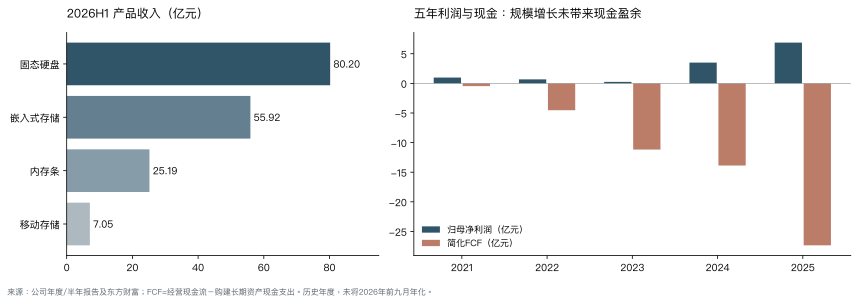

# 德明利（001309.SZ）研究报告

> **数据截止日：2026-11-18（Asia/Shanghai）**。行情采用11月17日收盘价；财务更新至2026年三季报，重大事项核查至11月17日。公司全称：深圳市德明利技术股份有限公司；英文名：Shenzhen Techwinsemi Technology Co., Ltd.；深圳证券交易所主板A股，无另行合并的ADR。本报告接续[8月26日研究](德明利-research-20260826.md)，保留旧文历史记录。

| 研究日期 | 股价与股本 | 估值快照 | 本次研究的核心问题 |
|---|---|---|---|
| 2026-11-18 | 177.25元；317,580,018股；市值562.91亿元 | TTM PE 5.95倍；PB 4.68倍；TTM简化FCF为负 | 企业级业务已经形成收入，但能否在存储价格转弱前，把利润和库存变成现金？ |

股价由[新浪行情](https://stocks.sina.cn/sh/?code=sz001309&vt=1)与[长桥行情](https://longbridge.com/zh-HK/quote/001309.SZ)复核，股本由[权益分派实施公告](https://static.cninfo.com.cn/finalpage/2026-09-29/1225585295.PDF)、11月公告及东方财富核对。市值与倍数均重新计算，未直接采用平台的静态标签。

## AI研究偏见自觉

**信息丰富度评级：A级。** 法定披露较完整，AI存储叙事及市场讨论密集。资料能证明历史规模和盈利，无法直接证明这些利润可以穿越价格下行周期。

**AI研究局限性声明：** 本报告无法取得订单取消条款、库存批次成本、原厂采购配额、逐客户回款安排及企业级业务独立现金流。2026半年报已审计，意见为标准无保留意见；三季报未经审计。“库存价差贡献大”是有依据的经济解释，不能写成公司已披露了具体的库存收益金额。常态利润、情景概率与价格区间均为研究假设。

- [x] 不将资料数量等同于投资确定性。
- [x] 同时保留企业级业务放量的正面证据与现金恶化的反面证据。
- [x] 先处理送转、分红和总股本，再比较旧价格与新价格。
- [x] 不把5.95倍周期利润PE自动解释为便宜，也不把负经营现金流自动解释为财务造假。

---

## 第一步：核心数据总览

### 五年财务与最近四个季度

金额单位为人民币亿元。毛利率按收入与营业成本计算；营业利润率采用中国会计报表“营业利润/营业收入”，包含投资等项目。简化FCF＝经营现金流（CFO）－购建固定资产、无形资产和其他长期资产支付的现金，未扣并购投资及融资性支出。

| 年度 | 收入 | 归母净利润 | 毛利率 | 营业利润率 | CFO | 简化FCF | 期末货币资金 |
|---|---:|---:|---:|---:|---:|---:|---:|
| 2021 | 10.7978 | 0.9817 | 20.29% | 9.75% | +0.1062 | -0.4652 | 1.1763 |
| 2022 | 11.9066 | 0.6750 | 17.19% | 5.26% | -3.3074 | -4.5308 | 1.0887 |
| 2023 | 17.7591 | 0.2500 | 16.66% | 0.50% | -10.1541 | -11.1757 | 2.7436 |
| 2024 | 47.7255 | 3.5055 | 17.75% | 7.90% | -12.6337 | -13.8703 | 9.1586 |
| **2025** | **107.8910** | **6.8833** | **14.81%** | **6.64%** | **-22.4089** | **-27.3457** | **7.0617** |

来源：[2022年报](https://static.cninfo.com.cn/finalpage/2023-04-29/1216688469.PDF)、[2023年报](https://static.cninfo.com.cn/finalpage/2024-02-27/1219187780.PDF)、[2024年报](https://static.cninfo.com.cn/finalpage/2025-04-26/1223313672.PDF)、[2025年报](https://static.cninfo.com.cn/finalpage/2026-02-28/1224989020.PDF)及东方财富三张财务报表。2022归母采用追溯后的口径；与原年报存在递延所得税会计政策调整差异，见证据包。

| 单季度 | 收入 | 归母净利润 | 毛利率 | CFO | 简化FCF |
|---|---:|---:|---:|---:|---:|
| 2025Q4 | 41.2999 | 7.1541 | 27.14% | -7.4633 | -10.7801 |
| 2026Q1 | 75.3836 | 33.4619 | 57.42% | -2.4079 | -3.1610 |
| 2026Q2 | 93.7220 | 26.7093 | 38.84% | -64.9478 | -67.2998 |
| **2026Q3** | **116.4470** | **27.2857** | **32.89%** | **-69.5501** | **-71.4463** |

单季由正式累计报表相减，2025Q4收入、利润及CFO另与年报分季度表核对。依据：[2025Q3](https://static.cninfo.com.cn/finalpage/2025-10-31/1224772122.PDF)、[2026Q1](https://static.cninfo.com.cn/finalpage/2026-04-30/1225259081.PDF)、[2026H1](https://static.cninfo.com.cn/finalpage/2026-08-28/1225522456.PDF)、[2026Q3](https://disc.static.szse.cn/download/disc/disk03/finalpage/2026-10-26/e8eabd45-e97f-4bed-b05d-27f58665dc50.PDF)，并与东方财富字段复核。

这组数据揭示两个同时存在的事实：规模继续上升，单季利润维持高位；毛利率已从Q1峰值连续下降，而现金流出没有减轻。不能只挑其中一面。

### 产品收入与利润来源

| 产品 | 2025收入 | 2025毛利率 | 2026H1收入 | H1收入占比 | H1毛利率 |
|---|---:|---:|---:|---:|---:|
| 固态硬盘 | 45.8151 | 12.69% | 80.1953 | 47.42% | 39.90% |
| 嵌入式存储 | 36.6343 | 11.86% | 55.9169 | 33.07% | 62.99% |
| 内存条 | 10.5138 | 25.91% | 25.1889 | 14.90% | 38.47% |
| 移动存储 | 14.7431 | 20.74% | 7.0544 | 4.17% | 36.36% |
| 其他 | 0.1848 | 19.14% | 0.7502 | 0.44% | 29.03% |

数据来自年报、半年报产品表及合并附注，与东方财富主营构成核对。企业级存储H1收入为48.15亿元，占总收入约28.47%，这是跨SSD、企业级内存等产品的应用口径，**包含在上表内，不能再加一次**。该数另由证券时报报道复核，底层仍为公司披露。企业级SSD、自研主控芯片各自的独立收入及利润尚未披露。产品分季收入、分季毛利不足以构建最近四季的分产品序列，本文保留缺口，不按比例分摊。[半年报，第22–25、33–34页](https://static.cninfo.com.cn/finalpage/2026-08-28/1225522456.PDF)、[证券时报报道](https://www.stcn.com/article/detail/4143915.html)



### 现金与债务：需要先看清的资产负债表

| 2026年9月末项目 | 金额 | 口径 |
|---|---:|---|
| 货币资金 | 9.5097 | 合并口径；与现金等价物期末余额相同 |
| 存货账面价值 | 289.8615 | 占总资产72.06%；不等于可随时按账面价格出售的现金 |
| 应收账款 | 51.3740 | 需结合账龄和客户回款核查 |
| 短期借款 | 101.4967 | 不含下列一年内到期项目 |
| 长期借款 | 91.0006 | 期限长于一年 |
| 一年内到期的非流动负债 | 10.6073 | 按整体纳入广义有息负债；非流动租赁另列，避免重复 |
| 非流动租赁负债 | 1.1096 | 仅非流动部分 |
| 广义有息负债合计 | 204.2142 | 上述四项合计 |
| 扣全部货币资金后的净债务 | 194.7045 | 为宽松现金口径；并非已证明全部资金可自由支配 |
| 前三季简化FCF | -141.9071 | CFO -136.9058，现金CapEx 5.0013 |
| 前三季筹资现金净流入 | +143.9269 | 不应作为经营现金创造能力 |

来源：三季报合并三表及东方财富。三季报应付票据栏为空，未另加一笔假设票据债；应付账款属于经营性负债。H1明确披露保函保证金510.204万元，但不能将该数套用于Q3；Q3缺少完整受限资金附注，流动性仍需核实。

> 段永平式追问：客户付款后，到底有多少现金最终归股东？目前报表能证明赚了利润，尚不能证明已收回支持增长所投入的资本。

---

## 第二步：生意本质分析

**一句话：德明利为终端厂商、服务器客户和渠道提供能可靠交付的存储产品，把外购颗粒、自研主控和固件、测试制造组织在一起，赚产品能力与采购销售时差共同决定的利润。**

客户买的是容量、性能、一致性、寿命和交付保障。颗粒采购通常先付出现金，产品完成生产、认证和销售后才能回款；订单增长若伴随颗粒涨价，所需营运资金会迅速增加。客户认证可以推动复购，但仍是一次性硬件销售，没有订阅收费，也没有用户增加便增强的网络效应。

| 利润驱动因素 | 有利方向 | 反向检验 |
|---|---|---|
| 颗粒销售价格相对库存成本 | 老库存成本较低，涨价扩大销售毛利 | 新采购成本抬高后，售价不再上涨会压缩毛利 |
| 企业级与嵌入式产品组合 | 适配、固件和可靠性要求提高，可能获取技术溢价 | 需在价格回落后仍保住客户、毛利和现金回报 |
| 周转速度与融资成本 | 更快交付和回款，减少资金占用 | 库存累积、账期拉长和借款增加会吃掉收益 |

嵌入式业务H1毛利率高于SSD业务，说明利润不能全部归为“企业级SSD技术升级”。价格、成本批次和产品组合未被单独量化，无法可靠地把当期利润分成周期收益和技术收益。采购付款与收入确认存在时差，也解释了为什么负CFO可以与真实利润同时出现；真正的问题在于这些现金能否在下一轮价格下行前收回来。

> 段永平式追问：如果原厂颗粒价格停止上涨，公司还剩下什么？留下的是主控、固件、客户认证和交付体系；它们的价值存在，但穿越周期的回报率仍待验证。

---

## 第三步：护城河评估

| 来源 | 当前判断 | 已有证据 | 推翻判断的观察 |
|---|---|---|---|
| 品牌与定价权 | 弱到中低 | 企业客户重视可靠性，整体毛利仍明显波动 | 同类颗粒价格下跌后，公司仍能稳定获取产品溢价 |
| 转换成本 | 中等，企业级高于零售 | 客户认证、固件定制、平台适配需要时间；已有企业级收入 | 客户迅速切换、退货或降价抵消认证价值 |
| 网络效应 | 无 | 产品并不因购买者增加而直接提高效用 | 无需为不存在的网络效应付费 |
| 规模与采购 | 中等、伴随资金风险 | 规模、测试能力和原厂关系有用 | 采购放量只带来更大库存和融资需求 |
| 技术与专利 | 中等、商业回报未充分验证 | H3361已发布并有搭载应用，固件和介质算法有积累 | 客户量产、单独毛利与现金回报长期不能核实 |

H8560回片验证、H9560回片计划与TE619A量产计划属于不同进度，不能合并描述为全部量产。美光官方已披露9650 PCIe Gen6 SSD量产，Solidigm亦有高容量企业级产品；德明利的机会在国产适配及客户交付，全球独占技术尚无证据。[半年报](https://static.cninfo.com.cn/finalpage/2026-08-28/1225522456.PDF)、[美光官方](https://micron.gcs-web.com/news-releases/news-release-details/micron-high-volume-production-hbm4-designed-nvidia-vera-rubin)、[Solidigm产品页](https://www.solidigm.com/products/data-center/d5/p5336.html)

过去五年，产品范围和客户认证的护城河在扩大；同时，资金占用和供应链依赖也在扩大。未来五年关键是单位资本能产生多少现金，而非芯片型号和产能数字增长多快。竞争者投入100亿元有可能复制产能和部分团队，却未必迅速复制客户认证；同样，认证也不能阻止整个行业价格下行。

> 巴菲特式追问：什么能摧毁这条护城河？产品标准化、原厂或同行强化方案能力，以及在价格下跌时被高成本库存和借款迫使低价出货。

---

## 第四步：逆向思考与风险清单

下表概率为未来三年内相关风险显著暴露的主观等级，风险可能同时发生，不能相加为总概率。

| 失败路径 | 概率判断 | 影响 | 可观察信号 |
|---|---|---|---|
| 售价转弱，高成本库存消化慢 | 高 | 极高 | 分产品毛利、跌价准备、出货及订单取消同时恶化 |
| 借款续作受限或营运资金继续膨胀 | 中 | 极高 | 可用授信不足、现金减少、到期借款与融资成本增加 |
| 企业级放量但回报不足 | 中 | 高 | 收入上升而现金、毛利和回款不改善 |
| 主要供应商或客户发生变化 | 中 | 高 | 供货配额、认证、账期或客户集中度突变 |
| PCM技术与投资不能形成商业回报 | 中高 | 中高 | 协议长期停留框架、客户验证延期、持续追加资金 |
| 原厂断供、合规或贸易冲击 | 无法可靠赋概率 | 极高 | 采购许可、出口规则或关键供应关系变化 |

存货账面价值若额外减记10%，税前冲击约28.99亿元，相当于当前归母权益的24.10%。**这是账面价值的敏感性，不是“现货价格跌10%必然计提同额减值”**；实际取决于库存成本、已签订单、可变现净值及既有准备。

最强空方论点是：公司可能在上一轮低成本库存中赚取巨额利润，又把现金和借款投入更昂贵的新库存。若需求或售价反转，低PE会和盈利下修同时出现。最强反驳则是：企业级收入已有实质规模，负CFO也可能是可盈利订单的备货；若随后回款兑现，市场可能低估经营能力。两种解释的分水岭是现金与订单质量，不是题材热度。

跨学科上，这是“价格上行—补库存—融资扩张”的正反馈，也可能成为反向出清的放大器。历史技术反例可参考Intel退出Optane：技术性能并不足以保证成本、生态和资本回报。该类比不能推出PCM必然失败，也不能认定两者技术完全相同。[Intel 2022年报](https://www.intc.com/filings-reports/all-sec-filings/content/0000050863-23-000039/a1231.pdf)

> 芒格式追问：我最可能在哪里犯错？一是把所有高利润都当库存红利，低估客户升级；二是因为企业级收入变大，就忽略采购价、回款和融资仍能支配结果。

---

## 第五步：管理层与资本配置

李虎有电子产品市场背景并创立公司；总经理杜铁军曾任朗科科技存储业务及经营管理职务。履历与供应链和客户拓展相匹配，但“懂行业”仍需用跨周期资本回报检验。[2025年报任职情况](https://static.cninfo.com.cn/finalpage/2026-02-28/1224989020.PDF)

| 时间与决定 | 可核实结果 | 本报告评价 |
|---|---|---|
| 2023—2026：主控、企业级和研发投入 | H1企业级收入48.15亿元；研发投入3.4287亿元 | 产品升级有收入证据；独立研发回报率尚不能计算 |
| 2025—2026：大规模备货与借款 | Q3库存、债务及负现金流继续扩大 | 上行期执行有效；资本纪律需要补证 |
| 2026年10月：实施中期送转与现金分红 | 10转4、每旧股派1.5元已实施 | 送转本身不创造价值；必须及时调整每股口径 |
| 2026年11月：定增注册获批 | 拟募资32亿元，用于扩产、研发及补流 | 是注册获批，尚不能当现金到账或发行完成 |
| 2026年11月：拟投资宏祺芯 | 拟投入约4亿元，完成后持股约7.06%，不并表 | 有技术协同可能，也新增资本配置和关联治理检验 |
| 2026年11月：第二次中期分红预案 | 拟每股派0.60元，合计约1.9055亿元 | 尚待11月20日股东会；现金支出应与备货、借款一并审视 |

融资与分红状态分别核对[定增注册批复公告](https://money.finance.sina.com.cn/corp/view/vCB_AllBulletinDetail.php?id=12704444&stockid=001309)、[募集说明书注册稿](https://vip.stock.finance.sina.com.cn/corp/view/vCB_AllBulletinDetail.php?id=12704447&stockid=001309)及[分红预案公告](https://money.finance.sina.com.cn/corp/view/vCB_AllBulletinDetail.php?id=12692083&stockid=001309)。尚未实施的每股0.60元未用于调整当前价格。

宏祺芯公告时协议尚未签署，仍处研发、客户验证及产能建设阶段，H1经营现金流约为-5.50亿元。李虎已先行受让该公司老股，上市公司随后参与增资，不能仅因履行关联交易程序就认定交易回报合理；也没有证据据此指控利益输送。需核对估值、权利保护、付款条件和追加出资义务，当前基准估值不另加PCM概念溢价。[关联投资原公告](https://static.cninfo.com.cn/finalpage/2026-11-14/1225672002.PDF)

股东一致性方面，李虎当前持有111,174,181股，约35.01%，并延长不减持承诺至2028年7月26日；最新累计质押700万股，占其持股约6.30%。质押不等于卖出，11月17日更正主要涉及历史质押起始日，不能解释成新增巨额质押。2025年发生的减持亦不能写成近期减持。[不减持承诺](https://static.cninfo.com.cn/finalpage/2026-11-05/1225658356.PDF)、[东方财富／证券日报持股复核](https://finance.eastmoney.com/a/202611043922265767.html)、[质押更正公告](https://money.finance.sina.com.cn/corp/view/vCB_AllBulletinDetail.php?id=12707552&stockid=001309)

> 段永平／巴菲特式追问：若创始人退休，公司还能依靠制度管理采购和库存风险吗？研发与客户体系已有组织化迹象；采购周期判断、资金纪律和继任安排仍未得到充分证明。

---

## 第六步：行业与文明趋势

AI推理、向量检索和数据中心扩容增加了容量、带宽及可靠性需求。这是长期需求动力；价格由短期供需决定，技术进步还会降低单位比特成本，压缩、分层存储和架构升级也可能降低特定应用的存储用量。

广义TAM不能直接拿来给德明利估值。WSTS春季预测将2026年全球存储器市场规模估至8000亿美元以上，公司半年报亦引用相近预测；它包括DRAM、HBM与NAND等原厂市场，既不是模组商可服务市场，也不是公司订单。本文不把它乘以一个猜测份额来推算收入。公开资料未支持可靠的公司全球企业SSD份额或最新可服务TAM，予以留空。[WSTS发布](https://www.wsts.org/76/Recent-News-Release)、[公司半年报](https://static.cninfo.com.cn/finalpage/2026-08-28/1225522456.PDF)

| 价值链层次 | 利润来源 | 对德明利的含义 |
|---|---|---|
| 颗粒原厂 | 工艺、产能与供需配置 | 既是供应保障，也可能优先拿走涨价收益 |
| 控制器与固件 | 算法、介质管理、接口及客户适配 | 自研可以提高话语权，需有商业回报证明 |
| 模组与方案交付 | 测试、良率、认证、定制及供应管理 | 公司当前主要位置；工程价值与资金占用同时存在 |
| 客户与系统平台 | 工作负载、规模采购及软件生态 | 大客户可提高认证门槛，也能压价、延迟采购 |

H1前五客户收入占41.34%、前五供应商采购占66.59%，高于2025年披露的34.09%及55.75%；这是原始披露的方向变化，半年与全年不等长，不能机械认定客户质量变差。集中度最新数据来自募资说明书，尚未取得独立第二来源，不列为双源已验证事实。[募资说明书，第5页](https://static.cninfo.com.cn/finalpage/2026-09-15/1225564381.PDF)

尤其要更新行业时钟：TrendForce的11月5日摘要已提示现货库存与价格压力；11月17日进一步预测中国CSP削减2027年企业SSD订单，NAND合约价转跌可能提前至2027Q2。该判断属于机构预测，不能等同德明利遭遇已确认砍单；但继续沿用半年报中的强景气外推已不稳健。[11月5日摘要](https://www.trendforce.com/research/download/RP261105BM)、[11月17日摘要](https://www.trendforce.com/research/download/RP261116WI)

> 李录式追问：二十年后，数字化存储仍重要吗？大概率重要。公司是否能把需求增长变成超过资本成本的回报，则取决于技术、客户与资金效率，产业趋势没有替它回答。

---

## 第七步：估值与安全边际

### 当前倍数与旧报告口径

| 指标 | 重算结果 | 含义 |
|---|---:|---|
| 2025归母／当前股本EPS | 2.1674元 | 用当前股本统一比较，区别于年报加权EPS |
| 2025静态PE | 81.78倍 | 不能与旧文126.85倍直接比较而忽略股本和价格变化 |
| TTM归母净利 | 94.6109亿元 | 2025全年＋2026前三季－2025前三季 |
| TTM EPS／PE | 29.7912元／5.95倍 | 反映高景气盈利，不能直接代表常态收益率 |
| 当前股本口径PB | 4.68倍 | 归母权益120.2729亿元；平台53.02元每股净资产仍属旧股本口径 |
| TTM收入／PS | 326.8525亿元／1.72倍 | 收入增长包含价格变化 |
| 广义EV／TTM收入 | 2.32倍 | 市值加上述净债务；混合当前行情和Q3财务时点的代理口径 |
| TTM简化FCF | -152.6872亿元 | 现阶段不适合用正FCF收益率给估值背书 |
| PEG | 不适用 | 去年低基数或亏损附近的增长不支持稳健PEG比较 |

2026年10月13日实施10转4并每旧股派1.50元。旧报告390.69元对应的机械除权参考约277.99元，旧200—260元评估带对应约141.79—184.64元。177.25元已经进入旧带；**旧带附带的连续两季CFO转正等条件没有达成**。该桥接仅解释旧价位口径，不是完整历史总回报或连续前复权价格序列。

与自身历史比较，过去财年毛利和现金波动很大，低谷利润会使PE异常高，峰值利润会使PE异常低；未取得同口径历史估值序列，不编造历史分位。与同行比较，江波龙、佰维同受颗粒价格周期影响，且业务结构、融资、股本变化不同。同日江波龙平台PE存在6.14倍与4.83倍的重大口径差异，未完成统一校准，故不据此给相对便宜排名，也不用同行今日倍数证明十年退出倍数。[中财网快照](https://quote.cfi.cn/301308.html)、[金融界快照](https://summary.jrj.com.cn/stock/sz/301308)

### 三年：先把常态利润说清楚

本报告设**常态归母利润30亿元**，是分析起点，不是公司指引。其业务含义为约375亿元收入、8%净利率；已包含企业级转型的积极假设，高于2025水平，又没有将2026峰值毛利永久化。若后续现金与分产品证据推翻8%的假设，应改模型，不能只改PE。

以当前股本折算常态EPS为9.4464元，当前常态PE约18.76倍。三年增长率指从这一假设起点出发，**不代表公司实际2026归母利润还会增长相同幅度**。退出PE为研究判断：悲观缺乏持续溢价，基准保留方案能力，乐观要求企业级能力进一步验证；它们只服务三年定价。

| 三年情景 | 假设年增速 | 2029归母利润 | 三年退出PE | 2029价格 | 按8%折回今日 | 从现价持有的年化价格回报 |
|---|---:|---:|---:|---:|---:|---:|
| 悲观：价差回落、转型回报不足 | -20% | 15.36亿元 | 10倍 | 48.37元 | 38.39元 | -35.14% |
| 基准：订单消化、毛利正常化 | +5% | 34.73亿元 | 16倍 | 174.97元 | 138.89元 | -0.43% |
| 乐观：企业级兑现、周转修复 | +25% | 58.59亿元 | 22倍 | 405.90元 | 322.22元 | +31.81% |

主观概率为悲观35%、基准50%、乐观15%；概率加权现值131.22元，仅用于展示假设分布，不能视为精确目标价。模型未计未来股息，亦未把尚未到账的定增资金加为现金；当前股数假定不变。若仅做“新增20%股数而不计资金用途收益”的保守敏感性，基准现值降至115.75元；这不是发行规模预测，实际需同时计入融资现金、成本和回报。

**反向估值：** 若三年后按16倍退出、要求8%年回报，今日市值需要2029年归母利润约44.32亿元，对30亿元常态起点要求约+13.89%的年增长。TTM的94.61亿元已高于该门槛，因此多方并非没有逻辑；市场真正的分歧是高利润能否持续、多少能转成股东现金，而非增长率算术。由于当前FCF为负，这里采用反向退出估值替代假精确的现金流DCF，不将利润当FCF。

### 十年：仓位压力测试

人民币口径取r＝8%，β＝1。参考11月17日中国10年国债1.61%，权益风险溢价取6.39个百分点；这是分析要求回报的构造，不是已观测β或市场ERP。稳态增量ROIC设12%，承认方案能力，同时约束重营运资金模式；它低于本轮高景气账面回报，但仍是待验证假设。由于当前净分配现金为负，无法严肃地用派息反解增量ROIC，只能降低该输入的置信度。永续增长三档为0%、0.5%、1%，基准低于人民币2%上限，均不随r改变。[财政部收益率曲线](https://yield.chinabond.com.cn/cbweb-czb-web/czb/moreInfo?locale=cn_ZH&nameType=1)

终值PE严格采用 `(1－g/ROIC)/(r－g)`。2036年利润假设与三年模型另行声明：悲观15亿元（收入300亿元、净利率5%）；基准60亿元（600亿元、10%）；乐观150亿元（1000亿元、15%）。这些是终值业务状态，未将2026利润直线外推。

| 十年情景 | 主观概率 | 2036归母利润 | 永续g | r－g | 终值PE | 十年年化回报 |
|---|---:|---:|---:|---:|---:|---:|
| 悲观 | 35% | 15亿元 | 0% | 8个百分点 | 12.50倍 | -10.41% |
| 基准 | 50% | 60亿元 | 0.5% | 7.5个百分点 | 12.78倍 | +3.14% |
| 乐观 | 15% | 150亿元 | 1% | 7个百分点 | 13.10倍 | +13.31% |

模型按股息率减稀释率k＝0简化，未承诺未来不分红、不稀释；中期仍需投入的现金没有逐年建模，也未另给现有库存清算价值。加权结果是三档年化回报的算术期望，不是加权终值再求得的单一路径IRR。按基准终值PE，要在当前价格实现8%十年回报，2036年归母利润约需95.11亿元，且要具备可分配性。

| r敏感性 | 概率加权年化回报 | 是否覆盖对应r | 使用边界 |
|---|---:|---|---|
| r＝6% | +3.04% | 未通过 | 人民币合理区间内；最小r－g为5个百分点 |
| r＝8% | -0.08% | 未通过 | 基准 |
| r＝10% | -2.40% | 未通过 | 区间外，仅供参考，不参与翻转判定 |
| r＝7%（补充） | +1.35% | 未通过 | 合理区间内复核 |
| r＝9%（补充） | -1.31% | 未通过 | 合理区间内复核 |

`terminal_value.py flip`结果：**在人民币合理区间内，压力测试结论不随本次折现率扰动翻转，均未覆盖资本成本。** 原厂断供、关联投资重大损失尚未量化；库存周期及融资压力进入情景，定增影响另作股数敏感性，没有通过提高r隐藏离散风险。

### 估值分歧对账

与旧研究相比，企业级收入和产品能力的证据增强，现价相对除权后的旧锚也更低；如果当前峰值利润能维持，多方的低PE论点成立。本报告的三年基准现值却低于现价，十年压力测试也偏弱，分歧来自常态利润及现金转换假设，而非否认企业级业务存在。

三年模型作定价判断；十年模型约束能承担多大仓位。即使未来进入110—125元、相对三年基准出现约10%—21%的折价，也不能据此升为核心仓；现金、债务和客户证据须先改善。十年未通过只收紧仓位，当前观望还同时依据周期定价权、融资压力、关联投资和三年安全边际，不能由十年结果一票裁决。

> 巴菲特式追问：r错两个百分点会改变仓位压力测试吗？在本次合理区间内不会；真正支配结果的是常态利润、周转和股数假设。
>
> 段永平式追问：愿意按现价封仓五年吗？对需要稳定现金回报的投资者，当前证据不足；研究重点应先从利润增长转向资本回收。

---

## 第八步：最终决策与行动清单

| 维度 | 综合判断 | 信心度 |
|---|---|---|
| 生意质量 | 有工程与交付价值，资金占用大，利润仍具强周期性 | 中 |
| 护城河 | 企业级收入增强认证与产品证据，独立定价权和现金回报待验证 | 中 |
| 管理层 | 股东持股一致性较强；库存、融资与关联投资纪律需复检 | 中 |
| 最大风险 | 高库存、现金缺口与价格转弱相互放大 | 中高 |
| 文明趋势 | AI存储需求有长期基础，产业供需已出现反向预测 | 中 |
| 估值 | 三年基准现值138.89元，现价缺乏安全边际；十年测试未通过且不随r翻转，只用于限仓 | 中低 |

**综合建议：观望，现价不新增长期价值仓。** 这不是对公司技术和增长的否定；它要求企业级转型先给出可收回资本的证据。估值维度与其他五维并列，十年模型本身不决定买卖。

| 投资者或信号 | 行动 |
|---|---|
| 空仓者 | 177.25元继续观望；以110—125元作为新的条件研究带，替代旧除权后约141.79—184.64元带，不以跌价自动买入 |
| 持仓者 | 暂停摊低成本；依赖稳定现金回报的核心仓应降为周期风险敞口或退出。原有极小周期仓仅在能承受损失且融资无异常时持有复检，不按原买入价决定去留 |
| 小仓评估条件 | 进入110—125元，且随后连续两次正式披露可推导的单季CFO为正、滚动CFO覆盖现金CapEx、同口径净债务下降；库存周转及跌价风险可解释，企业级业务持续交付回款，宏祺芯付款义务与定增股数可核。满足后才研究首笔约0.25%—0.5%，参考总上限1% |
| 下破110元 | 先查融资、库存及客户是否永久受损；仍适用全部经营条件，不自动扩大仓位 |
| 价格≥220元 | 若常态盈利和现金证据没有上调，复核估值与超配，不将此线设为机械卖单 |
| 卖出或降仓信号 | 授信/借款续作出现实质困难，库存减值与售价下调共振、企业级订单明显流失，或关联交易损害股东权利；原“稳定高毛利复利股”假设被证伪应及时纠错 |

上述仓位仅为研究中的风险预算示例，未掌握读者的持仓、资金期限和承受能力。新的价格带来自常态利润重估和资金风险要求，区别于单纯送转调整；若再实施分红送转或完成定增，须重算。

| 复检节点 | 要确认的证据 |
|---|---|
| 2026-11-20股东会 | 第二次中期分红方案表决；后续实施与除息安排另核 |
| 2026-12-31研究检查 | 宏祺芯协议/付款、定增发行及股数、现金与授信、库存和订单；非公司承诺披露日 |
| 2027-04-30全年披露检查窗口 | 年报若提前发布即提前复检，重点核Q4单季CFO、毛利、跌价准备和完整债务；不是已确认预约日 |
| 2027-06-30行业研究检查 | NAND供需与合约价预测兑现情况、公司经营传导；非已确认公司事件日 |

### 四位大师的方法论延伸

以下短引均来自已读取的原文或可核验存档；延伸分析为本报告作者判断，四人均未因此被认定评价过德明利。旧文的拟人化评论不作为原话沿用。

- 巴菲特原话：“It's far better to buy a wonderful company at a fair price than a fair company at a wonderful price.” 延伸：先验证跨周期资本回报，再判断低PE的意义。[1989年股东信](https://www.berkshirehathaway.com/letters/1989.html)
- 芒格原话：“add to it wonderful businesses purchased at fair prices”。这是巴菲特在信中对芒格建议的明确引述。延伸：工程进步需要最终形成好生意，题材和规模不足以独立证明。[2023年股东信首页](https://www.berkshirehathaway.com/letters/2023ltr.pdf)
- 段永平原话：“不懂不做，不要跟消息走，跟着理解走。” 延伸：不懂库存和融资怎样决定利润时，放弃机会也可接受。[2011年10月7日原帖](https://xueqiu.com/1247347556/20416338)，仓库[原发言存档](../段永平/段永平雪球全量原发言.md)第163条。
- 李录原话：“对价值投资人来说，他提供的是服务，而不是指导。” 延伸：股价下跌会给出新报价，不会替投资者证明库存与客户的真实价值。[2024年12月7日演讲存档](../李录/李录-北大演讲-20241207.md)，原文转载与官方英文出处见该存档。

---

## AI分析置信度与投资确定性

**AI分析置信度：历史财务较高，常态盈利与估值中低。** 收入、利润、现金、债务、股本和产品表已有官方与东方财富交叉验证；企业级业务的应用收入有正式披露，独立主控利润、全球份额、库存批次成本及回款条款仍不足。集中度、关联投资条款与行业预测的来源边界已单独标注，未包装为全部二源验证。

**实际投资确定性：低到中低。** 生意的未来依赖价格、库存和融资的共同变化；报表可读性较好，并不使现金回报同样可预测。原厂断供与关联投资重大损失未概率化建模；ROIC、常态净利率、未来发行股数和中期现金投入均可能显著改变估值。

最有价值的一手验证是：逐批库存成本与可变现净值、订单锁价/取消安排、企业级客户实际回款、按产品的资本占用、银行授信可用余额与限制条款，以及宏祺芯后续出资责任。缺少这些证据，不能将本报告的情景计算当作确定的内在价值。

## 数据来源与审计记录

主要证据为上述法定财报、权益分派与重大事项公告；东方财富[公司数据入口](https://data.eastmoney.com/stockdata/001309.html)及主营、利润表、资产负债表、现金流接口用于独立平台取数核对。平台数据仍源自法定披露，交叉核对只能发现转录、时点或口径错误，不能替代独立审计。

精确输入、原始值与页码见[财务证据包](德明利-sources-20261118.json)，假设及派生结果见[估值模型](德明利-model-20261118.json)，金融工具原始输出见[验算记录](德明利-validation-20261118.txt)。没有保存完整PDF、公告全文或提示词。

### 关键数据交叉验证记录

下列为金融严谨性工具直接输出的核心字段摘要，完整输出保存在验算记录；亿元为展示单位，输入使用元或股。

| 验证字段 | 公司法定披露 | 东方财富复核 | 工具结论 |
|---|---:|---:|---|
| 当前总股本（股） | 317,580,018 | 317,580,018 | 一致，偏差0.00% |
| 2025收入（元） | 10,789,100,246.68 | 10,789,100,246.68 | 一致，偏差0.00% |
| 2025归母（元） | 688,329,031.23 | 688,329,031.23 | 一致，偏差0.00% |
| Q3末货币资金（元） | 950,969,238.51 | 950,969,238.51 | 一致，偏差0.00% |
| 前三季归母（元） | 8,745,688,431.00 | 8,745,688,431.00 | 一致，偏差0.00% |
| 前三季CFO（元） | -13,690,577,650.00 | -13,690,577,650.00 | 一致，偏差0.00% |

```text
市值验算：177.25 × 317,580,018 = 56,291,058,190.50 CNY；偏差0.00%
多源验证：2025收入/归母、2026前三季收入/归母/CFO、Q3现金/存货一致。
十年估值准出：C1币种、C2分母、C3风险归属通过；未建模风险须保留。
```

报告随机抽检与最后一次估值口径检查均已准出，结果见[抽检记录](德明利-audit-20261118.json)。提取器误识别的芯片型号单列为非财务项；模型假设抽中时核对其输入和计算，不冒称第三方预测已经证实。资料缺口不因数值抽检通过而消失。

本次沿用既有trigger ID“德明利”，替换已过时价带、保留已完成中报事件并登记新复检节点；在非重点标的跟踪表新增本次建议事件，旧建议由新报告接续。未提交或推送Git。

*本报告用于学习与研究，不构成投资建议。*
