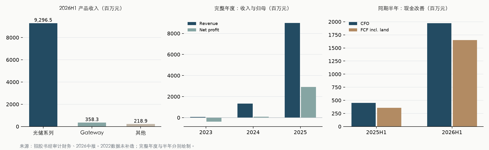

# 思格新能（06656.HK）研究报告

> 研究日期／数据截止：2026-11-24（北京时间22:57；行情取当日收盘，公告含19:06回购披露）｜最新财务期：2026H1\
> 股价：72.25港元｜首轮转增后含库存经济股数：746,498,790股｜保守总市值：539.35亿港元\
> TTM PE：10.09倍｜含土地支出TTM自由现金流收益率：1.57%\
> 研究主线：家庭和安装商为省心的一体化光储充系统付钱；公司已证明产品放量能力，长期每股价值取决于渠道回款、持续创新和多年售后成本。

公司全称为思格新能源股份有限公司，英文 Sigenergy Technology Co., Ltd.，香港主板代码06656；原名思格新能源（上海）股份有限公司，同一主体，未发现需要合并的ADR。复用现有「思格新能」目录及触发配置ID。本文接续用户指定的[10月8日报告](思格新能-earnings-refresh-20261008.md)，保留旧报告原文。

截至检索[港交所公告目录](https://www1.hkexnews.hk/search/titlesearch.xhtml?category=0&lang=EN&market=SEHK&stockId=1000298729)，未见更新的2026第三季财务公告；第三方自动财报日历不作为已经披露的证据。

除另有说明，财务金额为人民币百万元，股价为港元。估值统一用1港元兑0.8496元人民币；[Yahoo现货](https://query1.finance.yahoo.com/v8/finance/chart/HKDCNY=X?range=5d&interval=1d)与[XE当日异步现货0.84979547](https://www.xe.com/zh-cn/currencyconverter/convert/?Amount=1&From=HKD&To=CNY)相互核验，二者不代表可成交汇率。本报告用于学习研究，不构成个性化投资建议。

## AI研究偏见自觉

**信息丰富度B，AI研究局限性：财务可核，商业耐久性尚难核。** 招股书与完整中报足够核对资产负债和现金流，但公司成立时间短，没有完整五年经营史；安装商复购、独立终端销量、渠道库龄、召回完成比例、成熟质保损失率仍缺一手数据。资料多了，不能直接把一家年轻硬件公司的投资确定性提高到成熟消费品水平。

- [x] 将产品放量与提价权分开；将厂商出货与终端安装分开。
- [x] 将股票除权与经济损失分开，统一价格和股数口径。
- [x] 不把「AI能源平台」叙事直接换算为软件订阅收入。
- [x] 不因资料不足否认产品价值，也不因十倍PE忽略现金占用。

---

## 第一步：核心数据总览

### 先处理除权，才能谈便宜

[11月17日公告](https://www1.hkexnews.hk/listedco/listconews/sehk/2026/1117/2026111701457.pdf)确认，第一轮每10股转增20股，11月19日起除权、11月24日登记、预计11月26日新增H股开始交易。第二轮再每10股转增20股，须分别确定权益；[10月29日方案](https://www1.hkexnews.hk/listedco/listconews/sehk/2026/1030/2026103000175.pdf)给出的第二轮完成后理论总股本为2,239,496,370股。第二轮尚不能提前计入当前报价分母，具体实施另等公告。

| 口径项目 | 核定值 | 使用方法 |
|---|---:|---|
| 第一轮前已发行总股数 | 248,832,930股 | 法律披露仍可出现旧单位 |
| 第一轮后含库存经济股数 | 746,498,790股 | 与11月24日已除权股价配对，含在途转增权益 |
| 11月24日收盘价 | 72.25港元 | 腾讯、Yahoo及ETNet一致 |
| 计算总市值 | 53,934.538百万港元 | 包括非上市股经济权益，不只计算H股类别 |
| 对应人民币市值 | 45,822.783百万元 | 同一汇率统一估值 |

[11月24日回购表](https://www1.hkexnews.hk/listedco/listconews/sehk/2026/1124/2026112400965.pdf)仍以旧单位列H股，并披露当日回购22,400股作为库存。腾讯股本约为746,431,590股，其处理在途转增及库存的算法与本报告保守分母稍有差异。本文使用含库存上限，未假称转增股份当日已经全部登记上市；市值与腾讯539.2968亿港元的差异约0.01%，不影响结论。

10月8日225港元对应现在的75.00港元，因此本次同口径变化为-3.67%。旧250港元研究线机械重述为83.33港元。直接拿225与72.25相比，会严重夸大回撤；将现价乘旧股本，又会把市值低估。行情来源：[腾讯](https://qt.gtimg.cn/q=hk06656)、[Yahoo](https://query1.finance.yahoo.com/v8/finance/chart/6656.HK?range=5d&interval=1d)、[ETNet](https://www.etnet.com.hk/www/eng/stocks/realtime/quote_ci_pl.php?code=6656&quarter=interim)。

### 历史与本期经营

| 财务指标（百万元；比例另注） | 2023 | 2024 | 2025 | 2025H1 | 2026H1 |
|---|---:|---:|---:|---:|---:|
| 收入 | 58.302 | 1,329.838 | 9,000.512 | 2,733.786 | 9,873.625 |
| 毛利 | 18.249 | 623.630 | 4,504.853 | 1,419.377 | 3,998.996 |
| 毛利率 | 31.30% | 46.90% | 50.05% | 51.92% | 40.50% |
| 归母净利润 | -373.452 | 83.845 | 2,918.832 | 806.605 | 2,427.716 |
| 融资前税前收益率近似值 | -632.11% | 5.00% | 36.89% | 32.13% | 31.04% |
| 研发费用 | 193.005 | 280.253 | 494.028 | 228.024 | 371.339 |
| 经营现金流CFO | -369.714 | -95.805 | -199.990 | 450.762 | 1,974.001 |
| 设备＋无形资产＋土地现金支出 | 92.916 | 43.539 | 371.373 | 92.830 | 324.450 |
| 含土地自由现金流 | -462.630 | -139.344 | -571.363 | 357.932 | 1,649.551 |
| 期末现金等价物 | 233.306 | 424.294 | 1,109.293 | 1,166.554 | 8,236.289 |

2025财务来自[招股书会计师报告I-4、I-5、I-9、I-10](https://www1.hkexnews.hk/listedco/listconews/sehk/2026/0408/2026040800018_c.pdf)，属于经审计年度数据；没有虚称另读一份2025年报。中期来自[2026完整中报印刷29–35页](https://www1.hkexnews.hk/listedco/listconews/sehk/2026/0911/2026091101520_c.pdf)，经审阅而非年度审计。独立副核采用[ETNet年度损益](https://www.etnet.com.hk/www/eng/stocks/realtime/quote_ci_pl.php?code=6656&quarter=final)、[中期损益](https://www.etnet.com.hk/www/eng/stocks/realtime/quote_ci_pl.php?code=6656&quarter=interim)、[年度现金流](https://www.etnet.com.hk/www/eng/stocks/realtime/quote_ci_cashflow.php?code=6656&quarter=final)及[StockAnalysis现金流组成](https://stockanalysis.com/quote/hkg/6656/financials/cash-flow-statement/)。

公司2022年成立，本次取得的可比财务从2023年开始，故不拼出五年趋势。融资前税前收益率近似值定义为（税前利润＋融资成本）÷收入，包含其他收益与减值，并非公司单列的审计营业利润率，避免与数据商重分类后的Operating Margin混用。2024毛利率46.90%延续10月对旧稿错误的订正。



### 产品与地区结构

| 产品分类（2026H1） | 收入百万元 | 披露毛利率 | 经济含义 |
|---|---:|---:|---|
| 思格光储系列 | 9,296.494 | 40.7% | 核心硬件组合；含SigenStor、SigenStack、SigenTerra等 |
| Gateway | 358.254 | 25.4% | 配套能源网关 |
| 其他 | 218.877 | 57.6% | 规模小，不能把其高毛利外推至公司整体 |

中报印刷5、10–12页列明，94.2%是**光储系列的收入占比**，不应再写成单一SigenStor占比。系列内部尚未给出足以核验的完整收入与利润拆分，既不能断言第二曲线为零，也不能断言已经成熟。公司只有一个正式报告分部，上表是产品分类而非分部营业利润。

产品毛利率、主要产品收入和地区结构另经[ETNet业务概览](https://www.etnet.com.hk/www/tc/stocks/realtime/quote_ci_detail.php?code=6656&eyear=0&pyear=0)独立发布的数据核对；该页也列出首轮转增后的746,498,790股，支持保守经济股数口径。

| 客户所在地（2026H1） | 收入百万元 |
|---|---:|
| 欧洲 | 4,179.347 |
| 亚太 | 3,894.238 |
| 中国内地 | 1,298.540 |
| 非洲 | 375.763 |
| 其他 | 125.737 |

来源为中报印刷37页；欧洲和亚太是主收入来源，未取得同期澳洲单列比例，不能用历史澳洲占比充当2026H1现值。

### 现金质量比单期利润更重要

| 滚动与资金指标（百万元） | 核算值 |
|---|---:|
| TTM收入 | 16,140.351 |
| TTM归母净利润 | 4,539.943 |
| TTMCFO | 1,323.249 |
| TTM含土地现金资本开支 | 602.993 |
| TTM含土地自由现金流 | 720.256 |
| 六月银行现金余额 | 8,247.419 |
| 六月现金等价物 | 8,236.289 |
| 六月银行借款 | 3,119.835 |
| 六月租赁负债 | 35.777 |
| 六月净现金（扣借款及租赁） | 5,080.677 |
| 六月应收账款及票据 | 5,385.808 |
| 六月存货 | 3,403.592 |

TTM按2025全年减2025H1加2026H1计算。H1 CFO／归母为81.31%、含土地FCF／归母为67.95%，显著改善；但TTM这两个比率仅29.15%和15.86%。2025年度扩张消耗应收、库存及预付款，不能直接将其判为坏账；同样不能用一个强半年证明已经稳定造血。

现金余额与现金等价物相差11.130百万元应收银行利息，不将二者当作来源冲突；也不把IPO融资增加的现金当经营利润。净现金采用六月已披露余额，不能冒充11月24日现金。资产负债独立核验见[ETNet](https://www.etnet.com.hk/www/eng/stocks/realtime/quote_ci_bs.php?code=6656&quarter=interim)，现金支出组成副核见[Weidn](https://market.weidn.com/cn/company/hk/06656/)。StockAnalysis的TTM FCF约787.15百万元仅扣设备资本开支，本报告另扣无形与土地，不将两种定义误判为财报错误。

> 段永平式追问：这门生意赚到的钱，有多少已经回到公司，又有多少还在渠道、库存和工厂里？

---

## 第二步：生意本质分析

**这家公司把家庭和安装商原本需要拼接的光伏、储能、充电与控制系统做成可扩容的一体化产品，用安装效率、使用体验和本地售后争取硬件订单。**

最终家庭为电费节约、备用电源、便利性付费，安装商为更少布线、调试和返工选择产品；主要直接客户则是分销商。现金回来的链条是家庭需求、安装商推荐、分销商补货与付款。老用户可加电池或配件，但家庭不会像订阅软件一样每年重买整套系统；持续增长更依赖新家庭、新地区和安装商持续推荐。

| 商业环节 | 优势来源 | 必须承担的成本或约束 |
|---|---|---|
| 产品整合 | 同一平台完成逆变、储能、充电与控制 | 软硬件兼容、认证、安全与持续研发 |
| 模块扩容 | 安装后继续加配件有便利性 | 只形成局部转换成本，新客户仍可选择竞品 |
| 渠道复制 | 培训过的安装商更容易推荐熟悉产品 | 返点、授信、售后支持会分享利润 |
| 云与调度 | 诊断、能源计划和动态电价调度 | 未披露足够独立软件收入、付费留存率或增量节费数据 |
| 工商储扩展 | 可把既有电力电子技术用于更大项目 | 招标、交付、融资、运维及客户回款要求更高 |

H1收入同比+261.2%，毛利率却由51.92%降到40.50%。公司中报解释包括原材料成本和渠道激励；规模扩大带来费用摊薄，使融资前税前收益率近似值只小幅下降。这里同时存在经营杠杆和毛利压力，不能只选择有利的一面。

招股书印刷229–230页显示，SigenStor销售容量从2024年的447MWh增至2025年的3,947MWh，同时ASP由2.69元/Wh降到2.12元/Wh，销售返利由83.1百万元增至870.8百万元。容量组合与渠道激励会影响单价，价格下降不全是竞争降价，却足以说明「销量增长」还没有证明提价权。

> 段永平式追问：它最值得付钱的价值，是省下安装和使用麻烦；这个价值在下一代竞品面前还能值多少钱？

---

## 第三步：护城河评估

| 护城河来源 | 现有证据 | 判断与证伪条件 |
|---|---|---|
| 品牌与定价权 | 全球渠道快速接受；已有规模收入 | 中弱。毛利和返利变化不能支持已具强提价权；看同类产品净售价与安装商推荐 |
| 转换成本 | 同平台扩容、App与网关、安装培训 | 中等且局部。存量家庭较强，新安装项目可重新比价 |
| 网络效应 | 设备数据可改进诊断和调度 | 尚未证明强网络效应；用户增长没有直接证明每个用户可获得更高经济收益 |
| 规模效应 | 采购、制造、认证及售后网络可以摊薄 | 正在形成；须扣除返利、信用和保修成本后验证 |
| 技术壁垒 | 直流耦合、隔离DC-DC、电池包故障隔离及系统集成 | 有工程能力，未证明不可复制；必须持续投入研发 |

中报印刷6页披露隔离DC-DC使不同电芯供应商和新旧电池包能够协同，这是具体工程价值。竞争者也在模块化：[阳光电源SBR官方规格](https://uk.sungrowpower.com/upload/file/20240827/EN_DS_SBR064_SBR096_SBR128_SBR160_SBR192_SBR224_SBR256_Datasheet.pdf)、[华为官方储能用户手册](https://info.support.huawei.com/Energy/info/zh_CN/solar/docView/EDOC1100339926)、[Tesla官方扩展包资料](https://energylibrary.tesla.com/docs/Public/EnergyStorage/Powerwall/3/InstallManual/BackupSwitch/en-us/GUID-C06DFDA3-BC93-4688-A1B0-76955B93EDF9.html)表明，模块扩容本身不是思格独占。

招股书中的2024年28.6%份额，分母是「可堆叠分布式光储一体机」这一细分市场；同段列出的全球DESS和整体储能份额分别只有0.6%及0.2%。该调查由招股书转引行业顾问，不当作第二个独立份额证据。公司此后转引S&P称2026H1户储出货领先，但本次未取得原始跟踪表，保留为低置信度旁证，不用于反推确定的全球护城河。

过去数年，产品、渠道和服务覆盖的壁垒明显从无到有；目前仍不足以写成「过去五年持续变宽」，因为公司没有这样的历史长度。未来五年要看安装商的净收益、故障率和扩容兼容性能否持续优于竞品。如果竞争者用相近价格提供同样省心的产品，渠道优势可能转成返点竞赛。竞争者拿到巨额资本可以复制很多硬件与产能，较难快速复制的是可靠运行记录和售后信誉，而这两项恰恰仍在积累。

> 巴菲特式追问：十年后最难复制的是哪一项？如果答案仍只是一体化外观和短期份额，宽护城河就尚未得到证明。

---

## 第四步：逆向思考与风险清单

**最强空方论点：当前利润可能处于渠道扩张与有利需求环境的高位，厂商先确认收入，坏账、返利、故障和多年质保成本却在以后兑现。** 这是需要验证的风险路径，并非本报告指控公司造假。

| 失败路径 | 发生可能性判断 | 损害 | 可观察证据 |
|---|---|---|---|
| 终端需求跟不上渠道进货 | 中高 | 高；去库与回款同时承压 | 激活／安装落后出货、账期拉长、折让增加 |
| 竞品压价与渠道返点竞争 | 高 | 中高；规模增长而每单位利润下降 | 产品毛利、净售价、安装商选择改变 |
| 召回扩大或长期质保低估 | 中 | 很高；现金、声誉和准入受损 | 更换完成率、重复故障、索赔与费用率 |
| 补贴退坡与提前抢装 | 中高 | 中高；地区订单波动 | 政策前后订单、渠道库存和终端安装 |
| 工商储扩张超出组织能力 | 中 | 高；项目回款及资本开支上升 | 验收延期、应收库龄、资本回报下降 |
| 地缘限制／关键市场准入收紧 | 无法可靠量化 | 极高 | 正式限制、认证或供应链变化 |

表内概率为研究者定性判断，风险相互关联，不是可加总的统计概率。

### 召回已经发生，不能继续只写成假设

[澳洲ACCC原始召回页](https://www.productsafety.gov.au/search-consumer-product-recalls/sigenstor-ec-80100120kw-sp-au-energy-controllers)记载，2025年11月19日召回部分带快插AC插头的单相8/10/12kW控制器，原因是插头可能过热损坏并有火灾风险；页面称已发生事故，但没有报告财产损失、伤亡。措施包括联网固件临时降额、免费更换及额外两年保修。[澳洲清洁能源监管机构说明](https://cer.gov.au/news-and-media/news/2025/november/recall-issued-sigenergy-single-phase-81012-kw-energy-controllers)不能被解读成「仅需召回约百台」，实际故障数和召回覆盖范围是两回事。

招股书称当时财务影响低于2025年收入1%，这是当时估计；本次没有取得截至11月的完整结案证明。中报额外保修拨备164.550百万元属于总体产品保修计提，不能全标为该次召回费用。一般5–10年保修承诺长于现有产品商业化历史，成熟损失率还没有充分经历周期。

### 渠道的正面与反面证据都要保留

招股书印刷162–163页披露通常预付及单向销售安排、公司可观察设备激活，这些有助于需求管理，但大额应收说明不能假设所有订单都现金预付。公开信息没有完整渠道库龄和终端销售对账，不能把App可看激活等同于投资者已验证无压货。

历史类比应看机制：硬件企业即便产品很好，也可能在补贴驱动扩张后面临去库；反过来，安装商一旦因可靠性和服务建立习惯，也可能把新品公司推成长期品牌。本报告不选取单一幸存者给思格套结局。技术采纳曲线解释放量速度，渠道库存周期解释现金波动，激励博弈解释返点上升，可靠性工程则提醒我们长期售后成本会滞后。

最可能犯的研究错误，是把一个强劲上半年当成长期稳态，并把公司声称的安装原因完全当作产品容错设计已经过关。另一个错误是因股价除权或旧IPO价格产生锚定。

> 芒格式追问：如果三年后投资失败，最可能是没有需求，还是需求真实但利润被渠道、竞争和售后拿走？后者更容易被高速增长掩盖。

---

## 第五步：管理层评估

许映童在华为近23年，曾负责智能光伏及昇腾AI业务；张先淼有长期逆变器研发与产品规划经验。履历支持技术组织与执行能力，不能替代独立上市公司的长期资本配置成绩。来源为招股书印刷185页。

| 决策 | 已见结果 | 研究评价 |
|---|---|---|
| 2022–2023创业并推出一体化旗舰 | 短时间形成收入与国际渠道 | 执行强，但可靠性仍需时间 |
| 扩大渠道并给予返点和信用支持 | 收入跃升，2025 CFO为负 | 扩张有效；现金回报尚待完整周期 |
| IPO募集资金配置研发、售后与产能 | 中报披露资金用途，尚处投入早期 | 方向可理解，不能先计未实现回报 |
| 2026布局更多家庭及工商储产品 | 新品发布与产品线扩展 | 技术复用有潜力，新增收入和利润未充分拆分 |
| 2026首轮转增与股权激励 | 降低名义股价、扩充激励工具 | 转增不增加经济价值，关键看激励是否创造每股价值 |
| 11月24日实际回购 | 当日花费1,590,035港元 | 正面但规模小，不能当作大额估值背书 |

中报印刷19–20页显示，许映童直接持股合计23,745,860旧股，约占全公司股本9.54%；加上受控法团的法定视同权益合计约46.19%。平台受控权益不等于个人全部经济收益，配偶重复披露不能再相加；同样不能把H股类别百分比当全公司比例。以上为六月披露口径，未取得足以确认11月个人净经济权益不变的独立资料，故不把它标为已完成双源核验的当前持仓比例。

[10月29日激励通函](https://www1.hkexnews.hk/listedco/listconews/sehk/2026/1030/2026103000178_c.pdf)及11月17日表决材料显示，新股授权上限为转增前24,883,293股，相当于10%；对象可含分销商及售后等服务提供者。也可通过存量股份、库存或创始人捐赠权益安排，授权不等于已稀释。未来要核授予价格、对象、业绩条件与股份来源，不能把所有激励都按新股算，也不能全部忽略。若将来净新增10%股份而利润不变，每股价值会下降约9.09%，这是压力情景。

创始人兼任董事长和CEO有利于决策，也形成关键人依赖。公司有搭建研发组织的证据，尚无跨周期继任检验；若创始人退休，本报告目前不能给出「竞争力不受影响」的高信心判断。

> 段永平式追问：奖励的是出货规模，还是扣除返利、坏账和售后后的每股现金？下一次激励授予会给出更具体的答案。

---

## 第六步：行业与文明趋势

电力系统增加风光占比，会提高移峰、备用与灵活性的价值。储能属于电气化基础设施的一部分，方向有长周期支持；但设备厂商是否长期获得超额利润，取决于竞争和客户价值分配，不能从行业增长直接跳到公司永续高增长。

[IEA《Global Energy Review 2026》](https://www.iea.org/reports/global-energy-review-2026/technology-battery-storage)称2025年全球新增电池储能108GW、同比+40%，约80%为电网级；这些不是全部属于思格家庭储能的可寻址市场。没有取得同口径、可独立核验的最新全球户储TAM金额，本报告不把整体储能、户储与工商储市场混加，也不借行业预测给公司确定份额。

[澳洲官方补贴规则](https://www.dcceew.gov.au/energy/programs/cheaper-home-batteries/small-scale-technology-certificates)对不同容量实行递减支持。其影响既可能是长期普及，也可能是政策节点前抢装和容量结构变化，须观察补贴之后的终端订单。[10月27日SigenCube发布](https://www.sigenergy.com/en/company-news/0c36c5fe-36fa-43d4-bea0-7d7c0dc0570b)是进入工商储的产品证据，尚不能计成成熟利润。

招股书显示2025五大客户占收入45.0%、最大客户13.4%；五大供应商占采购37.0%、最大12.2%，大部分材料采购来自中国内地。海外销售和中国供应之间的跨境链条带来认证、物流和政策风险。公司位于电芯与电力电子上游之后、分销安装与终端家庭之前，价值捕获要同时与供应商、安装商和其他系统品牌竞争。

技术路线的主要危险未必是锂电被立刻淘汰，而是产品标准化、接口开放、兼容性改善，使一体化产品原有溢价被压缩。AI调度可能成为行业标配，也可能形成服务收入；在单独收入与客户付费意愿披露前，按产品功能看待更稳妥。

> 李录式追问：二十年后储能可能更重要，但思格能否把安装体验和可靠性沉淀为品牌，而非只做这一轮增长的设备供应商？

---

## 第七步：估值与安全边际

### 当前定价与现金对照

| 估值指标 | 结果 | 口径 |
|---|---:|---|
| TTM EPS | 7.1582港元 | 归母利润÷首轮转增后保守股数÷汇率 |
| TTM PE | 10.09倍 | 当前全部经济权益市值 |
| TTM PS | 2.84倍 | 同上，收入与利润均非全年简单年化 |
| PB | 4.61倍 | 六月归母净资产9,936.487百万元 |
| EV／TTM收入近似值 | 2.52倍 | 市值减六月净现金；资产负债日期滞后 |
| TTM P／FCF | 63.62倍 | CFO减设备、无形和土地 |
| TTM FCF收益率 | 1.57% | 未扣融资类利息与租赁本金，仍非可全部分配现金 |

PEG不列精确值：低基数、高速扩张与利润率变动使单年增速不适合作稳定分母。当前PE比10月同口径10.53倍略低，不能说因11月名义股价大跌而出现估值坍塌。上市时间很短，没有有意义的五年历史估值分位。

同行只作市场报价参照：[阳光电源](https://stockanalysis.com/quote/she/300274/statistics/)与[德业股份](https://stockanalysis.com/quote/sha/605117/statistics/)当日TTM PE约18–19倍，腾讯快照分别18.66、19.30倍，数据商股本和更新时点使结果略异。思格按利润显得更便宜，但按现金未必更便宜；两家公司业务结构、市场、财务期不同，本次未重做同行完整审计，不用其PE作为思格十年终值来源。

### 三年三情景：当前价格有吸引力，但不是深度折价

起点为TTM EPS 7.1582港元，假设没有新增稀释，不计尚未宣派的未来分红；三年期末倍数是估值判断，和十年永续终值严格分开。

| 情景 | EPS年增长假设 | 三年退出PE假设 | 三年末价格港元 | 按10%折现今日值港元 | 从现价起年化资本回报 |
|---|---:|---:|---:|---:|---:|
| 悲观 | -15% | 8倍 | 35.17 | 26.42 | -21.34% |
| 基准 | +8% | 12倍 | 108.21 | 81.30 | +14.41% |
| 乐观 | +20% | 16倍 | 197.91 | 148.69 | +39.92% |

悲观对应去库和毛利回落，基准对应温和增长及盈利正常化，乐观要求新地区与新品持续兑现。权重为研究者主观设定的悲观30%、基准50%、乐观20%；概率加权今日值78.31港元，不是精确内在价值。三年结果由financial_rigor三情景工具复算，再用Decimal折现；不能把三年末108.21直接当成今天合理买价。

### 反向DCF：便宜依赖于现金转化改善

以十年期、港元资本成本10%、稳态增量ROIC15%、永续增长2%为锚，终值PE由永续模型推导；逐年可分配现金取归母利润的一定比例。保守地不额外加六月净现金，视为经营储备；汇率固定，不预测汇兑收益。

| 过渡期每年利润可分配比例假设 | 当前价格隐含的十年利润年增长率 |
|---|---:|
| 20% | +7.18% |
| 60% | +3.30% |
| 80% | +1.46% |

这不是预测公司会派这些钱，而是问买家付的价格需要什么现金能力。目前TTM含土地FCF／利润只有15.86%，而H1达到67.95%；两者显示改善潜力和待验证差距。若长期只能转出很少现金，十倍PE也不自动便宜；若稳定转出大部分利润，当前价格对增长的要求其实不高。模型采用的是假设可分配现金，实际还要扣融资利息、租赁本金并验证营运资金需求，不能把会计FCF全视为已收到的股息。

### 十年折现：用于仓位压力测试

现金流折成港元，r取10%，处于本项目HKD合理区间9%–11.5%。分解采用工具固定长期基准Rf4.7%＋β1.0×ERP5.3%；**Rf是模型基准，不声称是11月24日实时国债收益率**，ERP也是研究判断。稳态增量ROIC取15%，用于反映产品成熟后仍有竞争与制造、渠道投入，不用上市初期高利润直接外推新资本回报。派息反解与长期ROIC历史不足，该输入置信度低。

永续g悲观1%、基准2%、乐观3%，是2036年以后增长，均低于HKD模型4%的上限；不与未来十年利润增速混用，也不随r变。终值倍数唯一来自：PE＝（1－g／ROIC）／（r－g）。

| 情景 | 主观权重 | 2036归母利润假设百万元人民币 | 对当前TTM隐含年增长 | 永续g | r−g | 推导终值PE | 十年终值近似年化回报 |
|---|---:|---:|---:|---:|---:|---:|---:|
| 悲观 | 30% | 2,000 | -7.87% | 1% | 9个百分点 | 10.37倍 | -7.62% |
| 基准 | 50% | 10,000 | +8.22% | 2% | 8个百分点 | 10.83倍 | +8.99% |
| 乐观 | 20% | 22,000 | +17.09% | 3% | 7个百分点 | 11.43倍 | +18.56% |

以上以今日市值和2036终值计算，调用terminal_value的pe与irr，k＝股息率减稀释率暂取0；没有预测中间十年逐期分红，亦未额外加现金。因此这是**终值近似压力回报，不是包含实际中间现金流的完整投资IRR**。三档年化回报的概率算术均值5.92%，并非确定可实现的组合复利收益率；分红可能提高回报，实际新股激励可能降低回报。

| r敏感性 | 三档加权近似年化回报 | 相对该档r的压力测试 | 合理区间判定 |
|---|---:|---|---|
| 8%（r−2个百分点） | +9.03% | 通过 | 区间外，仅供参考 |
| 10% | +5.92% | 未通过 | 区间内 |
| 12%（r＋2个百分点） | +3.58% | 未通过 | 区间外，仅供参考 |
| 9%（补做−1个百分点） | +7.35% | 未通过 | 区间内 |
| 11%（补做＋1个百分点） | +4.68% | 未通过 | 区间内 |

由于±2个百分点两侧都在合理区间外，已补做±1个百分点复核。**在币种合理区间内，压力测试结论不随本次r扰动翻转。** 不得拿区间外8%的通过论证买入，也不得拿10%的未通过单独否决持有。

### 估值分歧对账

三年基准今日值81.30港元高于现价，回答的是「当前价对温和增长是否有吸引力」；十年终值近似回报低于r，回答的是「只靠保守终值能否支持较重仓位」。反向DCF还显示，只要利润有较好的持续现金转化，当前价格并未隐含极高增长。三者的现金分配假设不同，不能互相偷换结论。

最终保留小仓持有研究空间、对空仓稳健投资者继续要求经营验证，依据是产品真实价值、护城河未成熟、管理层执行强、渠道和售后风险、行业趋势正向及安全边际有限六维综合判断。即使不看十年压力测试，现金质量与成熟可靠性证据仍未充分；十年模型只把研究组合参考仓位上限收紧到约1%，并不要求已持仓者因为模型一个数字清仓。若后续现金转化与持续分红获得证据，应改用完整现金流路径重算，再讨论提高仓位。

> 巴菲特式追问：r错两个百分点，本次合理区间内压力判断没有翻转；但现金转化假设变化会显著改变定价，这才是目前更需要研究的变量。
>
> 段永平式追问：如果股市关闭五年，愿意持有的人应能解释渠道卖到了哪里、售后需要花多少钱，而不能只回答PE便宜。

---

## 第八步：最终决策与行动清单

| 维度 | 综合判断 | 信心度 |
|---|---|---|
| 生意质量 | 一体化解决具体麻烦，已验证需求和扩张；现金占用仍大 | 中 |
| 护城河 | 渠道和系统工程优势形成中，十年宽护城河未证实 | 中低 |
| 管理层 | 技术与执行能力较强，资本配置和继任记录短 | 中 |
| 最大风险 | 渠道去库、价格竞争与滞后的长期售后成本 | 中高（风险机制）；发生程度低置信度 |
| 文明趋势 | 电气化与储能长期增长，户储价值分配不确定 | 中高 |
| 估值 | 三年有一定吸引力、安全边际有限；十年终值压力未覆盖r，合理区间内不翻转，仅限仓 | 中低 |

**综合建议：空仓稳健型观望，现有合理小仓可有条件持有，暂停自动加仓。** 估值不是唯一裁决，十年压力未通过只用于收紧仓位。当前结论不等于生意不好，也不依赖旧IPO股价作锚。

| 策略 | 具体动作与条件 |
|---|---|
| 空仓者 | 当前72.25港元继续研究。首轮除权后60–65港元作为有条件建仓研究带，且须完成下述经营验证后重估；仅触价不买 |
| 持仓者 | 商业假设仍成立的合理小仓可持有复检；不因除权或旧250线被触达自动加仓。研究组合参考总仓位约≤1%，并非针对读者资产状况的个性化配置 |
| 加仓信号 | 后续连续两次正式财务披露中，毛利率约≥40%，滚动CFO覆盖含土地现金CapEx、FCF／归母向≥60%改善；应收账龄可控，渠道激活和售后更换有可核数据，再重算每股价值与实际稀释 |
| 卖出／降仓信号 | 财务或产品诚信受损、重大安全问题扩大且无法补救、坏账和渠道去库破坏正常盈利；这些优先于价格。毛利跌破40%且持续不能解释时重审，单期跌破不机械清仓 |
| 上行复核 | 首轮除权后≥100港元而盈利、现金与渠道证据未增强时，复核估值与超配，不自动卖出 |
| 下破研究带 | <60港元先核有无永久损失，不把更低价格当无条件加仓理由 |

60–65港元约比三年基准今日值低20%–26%，是本次对尚未成熟现金与售后证据要求的安全边际，不是价格预测。它替代旧≤250港元的监控线；旧线仅机械除权重述应为≤83.33，**新带的下移来自研究标准和TTM现金对照的补充，并不声称10月以后财务已经进一步恶化**。旧稿的150亿元H1收入／45%毛利门槛不是公司承诺，继续停用；光储系列占比也不再被误作单产品占比。

### 复检节点

- 2026-11-26：核首次转增新增股份实际上市、库存及经济股数。后续第二轮实际除权时，所有港元价带和每股指标须同步调整；不能只改报告链接。
- 2026-12-31：研究者自行设定的资金、召回、激励授予与第二轮转增检查日，非公司财报预约日；第二轮正式公告若提前发布就提前核。
- 2027-03-31：全年业绩披露窗口检查日，非公司确认的发布日；实际业绩发布时立即复核，尚未披露则检查安排。
- 第二次后续正式财务披露：只有连续经营证据支持，才讨论提高仓位。没有证明某种占比下降，不等于没有新品收入。

### 四位大师原文与方法延伸

以下短引是一般投资原则；未找到四位对思格新能的足够原始评论，**公司层面资料不足，不模拟代言**。后面的应用是本报告作者的推论，不是他们的买卖建议。

- 巴菲特：“knowing its boundaries, however, is vital.” 来源：[1996年股东信能力圈段落](https://www.berkshirehathaway.com/letters/1996.html)。本报告应用：系统工程可以理解，不代表长期售后与渠道信用也已进入高置信度能力圈。
- 芒格：“think it through forward and also think it through backward.” 来源：[斯坦福演讲原始实录转载](https://worldlypartners.com/wp-content/uploads/2024/01/1996-lecture-by-charlie-munger-at-stanford-law-school-worldly-wisdom-revisited-business-what-lawyers-should-know.pdf)，Worldly Wisdom Revisited。本报告应用：用未来退货、坏账和售后账单检验今天的收入。
- 段永平：“不懂不做，不要跟消息走，跟着理解走。” 来源：[2011年10月7日雪球原帖](https://xueqiu.com/1247347556/20416338)，已读[本仓原发言归档第163条](../段永平/段永平雪球全量原发言.md)。本报告应用：先理解现金与价格口径，不能因技术履历或名义跌幅跟随买入。
- 李录：“短期高估如果与长期增长相比，就没有那么重要。” 来源：已读[2024年12月7日演讲全文](../李录/李录-北大演讲-20241207.md)「估值」问答，原始发布与官方版本索引见文首。本报告应用：真正持续增长可以穿越短期估值，故保留增长情景，也不把终值压力模型变成唯一否决；持续性必须以公司证据证明。

> 综合追问：眼下最能提高判断质量的是等一个更低报价，还是取得一份可靠的渠道、回款与售后对账？只有价格和经营证据同时合适，才应扩大投入。

---

## AI分析置信度与投资确定性

AI分析置信度中高的部分，是经审计2023–2025财务、2026H1报表、11月除权安排及市场价格；B级资料尚足以纠正股本、单产品口径和现金流误读。中低置信度部分，是终端需求、激励未来稀释、真实售后损失、稳态增量ROIC、情景概率与2036利润。

实际投资确定性目前中低，原因是生意的竞争优势和多年现金兑现仍年轻，而非仅仅因为资料不够。优先一手验证：安装商为何持续推荐、终端激活与出货差多少、召回更换完成比例、过保前故障率、新品独立收入与毛利、分销商真正的付款条件。若这些证据改善，当前价格可能有价值；如果没有，低PE可能只是在补偿未知。

未建模的离散风险包括产品全面禁售、地缘断供及其完整损失概率；不得将其藏进β或r。模型没有预测逐年汇率、现金分红、具体激励发行、再融资与全部营运资金路径；六月净现金也不能视作当前可全部分配资产。十年概率均值是带有存续与经营情景假设的研究量，不能当作已经覆盖所有尾部风险的真实期望收益。

## 数据来源与审计记录

关键财务采用公司／港交所原件与ETNet、StockAnalysis或Weidn独立取数核验。AAStocks本次访问失败，公司没有已核实的Macrotrends ADR序列，因此明确改用上述副源；不虚构规定网站已完成核验。行情为腾讯与Yahoo、ETNet；股本以正式转增安排为主并用市场股本反查，库存技术差异已解释。管理层当前个人经济权益及最新独立渠道份额仍为来源缺口。

### 关键数据交叉验证记录

以下为金融严谨性工具实际结果的摘要，完整输入及结果保存在[本次证据目录](证据/20261124/来源索引.json)：

```text
市值验算：股价72.25，股数746.50M，计算市值53.93B HKD。
与腾讯报告市值偏差0.01%：验证通过。
交叉验证：2025收入9,000.512、归母2,918.832（CNY million）——两源偏差0.00%。
交叉验证：2026H1收入9,873.625、归母2,427.716——两源偏差0.00%。
交叉验证：六月银行现金8,247.419、2025 CFO -199.990——两源偏差0.00%。
交叉验证：H1 CFO1,974.001与汇总1,974.000——偏差低于0.01%。
估值复算：PE10.09x，PB4.61x；三情景采用精确十进制。
TTM CFO：-199990-450762+1974001=1323249（千元）。
TTM含土地cashCapEx：602993（千元）；FCF=720256（千元）。
终值最终audit：HKD，r10%，ROIC15%，g1%/2%/3%，C1/C2/C3通过。
```

工具原始输出节选如下，分段对应市值、收入交叉验证、估值及终值检查：

```text
  ✅ 验证通过, 偏差仅 0.01%

  ✅ 所有来源偏差 ≤ 1%, 数据一致

  PE (TTM):  72.25 / 7.158248787490217 = 10.09x

【准出】三条硬约束全部通过，可以把估值写进报告。
       但上述 2 条警告必须在报告里显式写出。
```

复现材料：[计算脚本](证据/20261124/model.py)、[财务计算记录](证据/20261124/financial-rigor.log)、[结果JSON](证据/20261124/计算结果.json)、[终值与翻转记录](证据/20261124/terminal.log)。证据目录不收录下载PDF、完整公告文本或模型提示词。

固定随机种子42，report_audit从134个提取项中抽取21项，判决21项通过、零警告、零失败。其中13项是事实的双源核对，5项为财报组成与公式重算，另3项仅核验模型假设及其算术一致性，不能把后3项称为独立事实验证。融资前税前率的融资成本以公司原件为准，重复算术不冒充独立财务来源。详见[抽检原始清单](证据/20261124/audit-extract.log)、[逐项核验输入](证据/20261124/audit-results.json)和[准出判决](证据/20261124/audit-verdict.log)。末次终值audit保持相同参数，C1/C2/C3通过，两个未建模风险已在限制中披露。

跟踪收尾：沿用data/triggers.json内「思格新能」原ID，主链接更新为本报告，登记首轮除权后60–65港元研究带及100港元上行复核线，并保留既有事件；旧≤250线停止作为当前监控依据。标的不在重点看板，在[标的跟踪表](../标的跟踪表.md)新增20261124-06656建议事件，10月8日旧事件关闭接续、历史结果记无法判定，不将单纯触价算作命中。配置校验及临时状态的定点价格扫描通过，未写正式运行状态或历史日报；事件仅供人工复检，当前每日监控只扫描价格。
