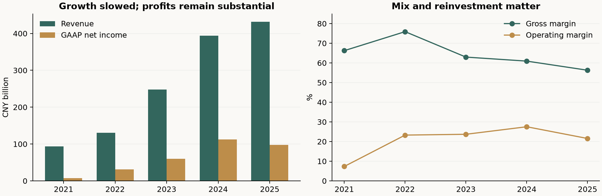
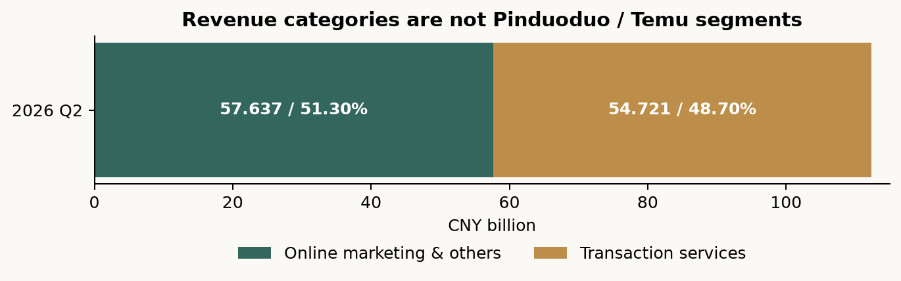
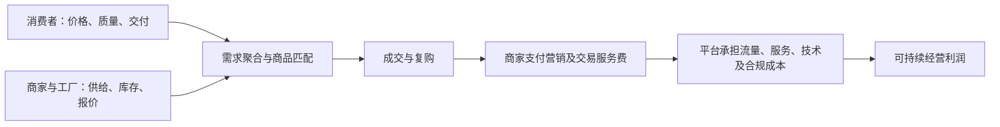

# PDD Holdings（NASDAQ:PDD）研究报告

**研究及资料截止：2026年11月19日16:30，北京时间；三季报发布前。** 行情采用11月18日美股正常交易收盘77.45美元/ADS，未采用盘后或隔夜价。按最近年报披露的法定股本代理计算，市值1,102.42亿美元，约7,350.50亿元人民币；TTM稀释EPS桥接估值约8.30倍，市值/归母净利约7.98倍。最新正式经营数据为2026Q2，最新审计年度为2025年。

一句话论文：拼多多将低价供给与大规模需求匹配，向商家收取营销和交易服务费；经营盈利已经存在，海外合规后的可持续利润和普通股东能分享到的资金，仍决定这份盈利值多少钱。

本文沿用既有「拼多多」目录及监控ID，没有另建英文公司档案。PDD Holdings Inc.曾名Pinduoduo Inc.，NASDAQ代码PDD；每份ADS代表4股A类普通股。本次未发现另一只已经上市、应合并定价的港股证券。[公司资料][profile]、[年报][20f]、[收盘价及公司概览][sa]、[独立行情][yahoo]。

---

## AI研究偏见自觉

**信息丰富度评级：集团财务A级；主站与Temu独立经济账B/C级。** 财报很多，不能消除分部、资金地点及资本分配上的信息缺口。AI研究局限性声明：本报告没有商户访谈、国别订单队列、独立复购验证或可汇出资金穿透；不把流量、GMV预测和集团盈利拼成一个未经披露的Temu利润数。本报告用于学习研究，不构成投资建议。

- [x] 将会计收入类别与经营平台区分，不把交易服务收入直接当作Temu收入。
- [x] 将现金、短投、受限资金和商户结算义务区分，不机械全额扣现金。
- [x] 使用审计年报修订后的利润，不混用早期业绩稿。
- [x] 同时检验「低估」与「资本回报无法兑现」两种解释。
- [x] 将三年定价与十年仓位压力测试并列，不用后者一票否决。

相对[10月31日研究](拼多多-research-20261031.md)，本次关键增量是：三季报日期已经官宣；11月17日欧委会新增初步认定；三年模型改用已披露稀释EPS桥接，避免法律股本代理给出偏高的每股盈利。历史研究保留原样，以下述口径为本次判断依据。

> 研究起点追问：我的确定性感受，来自已经验证的交易效率，还是来自低PE和大量公开材料？

---

## 第一步：核心数据总览

### 今天的资料边界

公司11月12日公告，2026Q3将在11月19日美股盘前发布，电话会为美东7:30，即北京时间20:30。取证截至本文时点，官方入口尚未显示Q3结果。**本报告是财报前研究，不含Q3业绩。** 当晚新披露可能改变估值起点、价格与动作。[正式预告][q3date]、[IR新闻目录][irnews]。

### 五年财务

下表金额均为人民币十亿元，1十亿元等于10亿元。净利为GAAP归母；简单FCF为经营现金流减购买设备、软件及无形资产，不等于可分红现金。2021现金及短投为取整值。

| 年度 | 收入 | 归母净利 | 毛利率 | 经营利润率 | 经营现金流 | 资本开支 | 简单FCF | 现金及短投 |
|---|---:|---:|---:|---:|---:|---:|---:|---:|
| 2021年 | 93.950 | 7.769 | 66.24% | 7.34% | 28.783 | 3.287 | 25.496 | 92.943 |
| 2022年 | 130.558 | 31.538 | 75.90% | 23.29% | 48.508 | 0.636 | 47.872 | 149.439 |
| 2023年 | 247.639 | 60.027 | 62.96% | 23.70% | 94.163 | 0.584 | 93.579 | 217.210 |
| 2024年 | 393.836 | 112.435 | 60.92% | 27.53% | 121.929 | 0.967 | 120.962 | 331.560 |
| 2025年 | 431.846 | 97.843 | 56.28% | 21.56% | 106.939 | 1.145 | 105.794 | 422.308 |

来源为[2023年报][20f23]、[2025审计年报][20f]及[StockAnalysis原币财务表][safin]；历史精确值保留在本次验证底稿。规模上升与利润率下降可以同时发生，2024年的高盈利不宜直接作为新常态。



### 最近四季度收入类别

金额同为人民币十亿元。季度数字采用各次公告；2025Q4仍标原未经审计公告，不能与审计全年无条件相加。

| 季度 | 营销及其他 | 交易服务 | 总收入 | 毛利率 | 归母净利 |
|---|---:|---:|---:|---:|---:|
| 2025Q3原公告 | 53.348 | 54.929 | 108.277 | 56.74% | 29.328 |
| 2025Q4原公告 | 60.010 | 63.902 | 123.912 | 55.49% | 24.541 |
| 2026Q1 | 49.936 | 56.293 | 106.229 | 55.86% | 12.547 |
| 2026Q2 | 57.637 | 54.721 | 112.358 | 57.26% | 27.182 |

[2025Q3][q325]、[2025Q4及全年初稿][q425]、[2026Q1][q126]、[2026Q2][q226]。公司仅披露一个电子商务经营分部，没有各平台独立毛利率；地域收入按付费商家所在地归属，不能推导海外消费者GMV占比。[年报分部附注][20f]、[SEC问询回复][secreply]。



Q2收入同比+8.05%，营销及其他+3.47%，交易服务+13.34%；营业利润27.764，同比增长+7.64%，营业利润率24.71%。归母净利却同比-11.61%，因为投资及其他损益也在影响利润；其中利息及投资净收益13.505、其他净损失7.399，不能直接把净利下降全归给Temu，也不能未经穿透将损失全部加回。Q2 Non-GAAP净利率25.36%，原有连续两季低于15%的研究红线未触发。[Q2原表][q226]。

### 三个必须解释的口径差异

1. **2025审计修订。** 初步年度净利99.364469、营业利润94.624061，审计年报分别为97.842539、93.102131，均减少1.521930；管理费用相应增加。营业利润差约1.63%，超过核验阈值，已追溯并采用审计值。本次未在所读材料找到足以解释新增费用性质的明确说明，不将其当作已证实的非经常项目。审计全年减前三季的Q4净利残差是23.019069，但它是推导值，不冒充单独已审计Q4。[初稿][q425]、[审计原表][20f]。
2. **TTM与现金流。** 用审计2025年加2026H1减2025H1，TTM收入450.775713、净利92.075539、经营现金流111.894690，与StockAnalysis人民币表一致。最新季度现金流简表未分列CapEx，数据库TTM CapEx与2025全年恰好同值，而固定资产净额已有变化；因此本报告不将数据库TTM FCF称为独立双核通过，收益率改用2025已审计FCF。[Q2][q226]、[独立现金流表][sacf]。
3. **现金范围。** 6月底现金128.918加短投327.496等于456.414；受限现金77.274未计入。应付商户109.924，另有其他非流动资产96.383，主要为定存及债券类资产。受限资金主要涉及买家付款待结算，既不能再加一次，也不能在未做完整资产负债桥前把商户应付款全额重复扣除。Macrotrends的“Cash on Hand”包括受限现金，与现金加短投不是同一字段。[Q2资产负债表][q226]、[年报附注][20f]、[独立资产负债表][sabs]、[Macrotrends现金][mtcash]。

> 段永平式追问：这些现金中，哪些是经营必须留下的，哪些最终能够服务普通股东？

---

## 第二步：生意本质分析

**这门生意的本质，是帮助商家用更低的总成本找到愿意复购的买家，再分享交易效率创造的收益。** 商家购买点击、展示等营销服务，以及交易相关服务；买家购买实物商品，支付并不全部成为平台收入。平台净额收费与京东式自营总额销售，收入和毛利率不能直接比较。[年报业务及收入确认][20f]。



| 环节 | 国内平台已验证之处 | Temu仍需验证之处 |
|---|---|---|
| 需求 | 低价心智与匹配可形成重复交易 | 合规税负后的到手价仍否有吸引力 |
| 供给 | 供给密度和运营可以规模化 | 当地责任、品类认证及卖家质量能否跟上 |
| 履约 | 第三方物流与结算生态可协作 | 本地仓、退货和库存会占用多少资金 |
| 收费 | 营销、交易服务已有集团盈利支持 | 海外扣流量、物流、退货和合规后贡献未披露 |
| 再投资 | 历史固定资产支出低 | 不能把2025低CapEx永久外推到海外本地化 |

复购依赖持续的性价比和信任，并非订阅合同或不可迁移的数据。商家也可多平台经营，广告费只有在商家取得可持续收益时才有持久性。规模增长若需要永久增加补贴、提高售后成本，经营杠杆会反向运作。

利润最重要的三个变量，是商家愿意为增量订单支付多少、获得这些订单的全成本是多少，以及平台为质量和跨境责任保留多少投入。毛利率下降可能来自交易服务和履约结构改变；不能仅凭毛利率判定护城河，但应要求经营现金和每股盈利共同验证。

> 段永平式追问：如果减少额外补贴，消费者和商家是否仍然愿意留下？

---

## 第三步：护城河评估

| 来源 | 强度判断 | 支持机制 | 可以推翻判断的证据 |
|---|---|---|---|
| 品牌及定价权 | 国内中强；提价权有限 | 低价心智降低购物搜索成本 | 同质供给下持续流失、补贴换不来复购 |
| 转换成本 | 弱 | 交易习惯有帮助，买卖双方仍可多平台使用 | 广告回报下降后商家迅速迁移 |
| 网络效应 | 中强且有条件 | 需求聚合吸引供给，供给密度改善匹配 | 劣质供给和商家亏损破坏循环 |
| 规模及成本优势 | 较强 | 订单密度、供应链组织和服务流程摊薄成本 | 合规、物流、退货抵消规模节约 |
| 技术及专利 | 组织能力中强；专利壁垒未证 | 推荐、风控、交易系统与运营协同 | 对手以相近成本达到同样转化与履约 |

2025研发16.4962十亿元，Q2研发4.567十亿元；投入真实，但没有数据证明算法领先若干年，也无法给AI项目计算独立投资回报。竞争者拥有技术和资金，复制难点在执行、供给关系和成本体系，而非某个不可获得的基础模型。[年报研发][20f]、[Q2研发][q226]。

过去五年，集团把规模变成了显著盈利，国内效率优势有证据；未来五年，海外质量、税务及信任成本可能使护城河更贵。不能把营收扩大直接称为护城河变宽。十年存续的条件，是持续降低完整交易成本，同时让商家赚钱、消费者放心。

> 巴菲特式追问：十年后仍能保护利润的，是难复制的效率，还是暂时的价格和规则差异？

---

## 第四步：逆向思考与风险清单

### 最新监管事实

| 日期 | 可核验事项 | 应怎样理解 |
|---|---|---|
| 2026-05-28 | 欧委会因DSA风险评估义务违规罚款2亿欧元 | 已作出罚款决定；不是仍仅调查 |
| 2026-10-26 | 欧委会接受Temu整改行动计划 | 四个月实施及后续独立审计；不代表撤罚或所有事项结案 |
| 2026-11-17 | 欧委会对非法商品风险缓解措施作出新的初步违规认定 | 涉及产品检查、审核和处罚机制；不是新增已确定罚款 |
| 2026-07-01起 | 欧盟低价值包裹临时关税生效 | ≤150欧元包裹按不同关税子目类别每类3欧元，并非每件实物3欧元 |
| 2026-06-24 | CBP以自身权限无限期暂停非国际邮政渠道的低值免税安排 | 不能以旧行政令争议推断免税自动恢复 |

来源：[5月正式决定][dsa-fine]、[10月整改][dsa-plan]、[11月新初步认定][dsa-new]、[欧盟理事会关税规则][eu-duty]、[美国Federal Register原件][cbp]。本次没有完整核验所有商品编码、原产地的当期适用税率，不给出一个包打天下的美国关税百分数；上表也不是完整法律意见。

11月17日是本次相比10月报告的实质风险增量：商品安全责任可能要求持续检测、追溯、下架和卖家治理，影响长期成本。它尚不足以证明Temu已经被禁止经营，也不足以直接计算集团利润损失。罚款、整改与新的程序应分别跟踪。

### 可能失败的路径

以下可能性是未来三至五年的主观定性判断，不是统计频率，各项重叠且不可相加。

| 失败路径 | 可能性 | 影响 | 可观测证据与处理 |
|---|---|---|---|
| 海外合规、关税及退货吞掉价格优势 | 中高 | 高 | 看最终执法、整改审计、履约成本与经营利润；增长不再自动加分 |
| 国内商家让利与补贴竞争长期压缩商业化 | 中高 | 高 | 营销收入、费用及经营现金持续背离，降低正常盈利假设 |
| 海外复购不足，获客长期依赖高投放 | 中 | 高 | 要求队列或可核验经营证据；下载量不能替代贡献利润 |
| 金融投资损失或低效留存使现金失去价值 | 中 | 高 | 投资结构、减值、关联安排、每股净资产及分配政策 |
| 产品质量损害消费者与商家信任 | 中 | 高 | 抽检、召回、投诉、下架及卖家流失 |
| SBC和股本变化抵消业务增长 | 中 | 中高 | 法定股本、托管奖励、稀释EPS和每股现金 |
| VIE失效、主要市场全面禁入 | 无可靠概率 | 极高 | 法律及准入实质变化；数值模型未完整覆盖 |

最强空方论点是：公司能够持续赚钱，但新增利润被消费者补贴、商家扶持、海外合规和长期留存资本吸收，外部股东无法促成合理分配，低PE便可能维持很久。最强多方反驳是：成熟供给组织创造的效率并不依赖永久免税，留存资本有机会换来长期竞争力；关键在新增资本回报证据，而非管理层承诺的长度。

历史类比可同时看eBay与Amazon：平台仍存续，不保证维持原有份额；长期低利润再投资，也不天然等于浪费。两种路径都存在，不能选择自己喜欢的结局套给PDD。这只是机制类比，不用于取终值倍数。[eBay年报入口][ebay]、[Amazon股东信][amazonletter]。

网络效应可能是正反馈，也可能在质量下降时变成负反馈；成本领先会引发竞争跟随；监管提高固定成本也可能淘汰弱者。以上模型给出待验证机制，不能直接替代事实。最可能的分析错误，是把商户资金和金融资产看成随时可分红的安全垫，或把集团利润当成Temu已经盈利的证据。

> 芒格式追问：若十年后公司仍盈利、资金更多，股东却始终拿不到合理回报，今天的便宜还成立吗？

---

## 第五步：管理层评估

陈磊、赵佳臻自2025年12月起担任联席董事长兼联席CEO。经营执行与资本配置应分开评价：前者有规模和盈利支持，后者仍受分部不透明、投资资产和缺少明确股东回报框架约束。[官网管理层][management]、[任命6-K][appointment]。

### 权益、投票权与任命权

| 主体 | 2026-03-18披露经济权益 | 投票及治理解释 |
|---|---:|---|
| 黄峥相关实体 | 24.8% | 不等于过去超级投票权比例 |
| 腾讯相关实体 | 13.8% | 大股东权益不等于其承诺保护小股东 |
| 合伙人相关实体 | 6.5% | 不能全部算作黄峥个人经济权益 |
| 陈磊 | 0.5% | 受益所有权含披露规定内可取得股份 |
| 赵佳臻 | 0.1% | 同上，不由持股比例直接推断动机 |

来源为[20-F受益所有权表及章程摘要][20f]、[同花顺同期转录表][holders]。双来源核对只能确认披露转录一致，不等于独立穿透登记，更不是11月实时名册。

年报所列5,693,585,848股全部为A类，B类为零。一般特别决议要求出席投票至少三分之二赞成；影响特定合伙人权利等条款则有95%门槛。合伙人不足五人，相关特殊任命/提名权尚未生效。黄峥实体加合伙人载体股数约31.27%，既不能当作其个人权益，也低于三分之一；旧材料中据此推定全员出席时可单独否决一般特别决议的表述不成立。特定95%条款另行判断。[治理原文][20f]。

### 用决策评价管理层

| 时间 | 决策 | 已见结果 | 研究评分 |
|---|---|---|---|
| 2021年 | 黄峥退出董事会、放弃超级投票权 | 降低直接个人任职依赖，不能据此断言其已无任何影响 | 经营传承正面，控制判断保持克制 |
| 2022年起 | 启动并扩大Temu | 全球业务已展开，独立回报仍未披露 | 执行较强，资本回报待证 |
| 2024—2026年 | 国内商家扶持与治理、海外本地化 | 增长及竞争力投入，与利润让渡同时存在 | 看后续每股经营现金，不只看规模 |
| 持续 | 留存资金并配置金融资产 | 增强缓冲，也带来投资波动和机会成本 | 缺少可检验回报门槛，评价中性偏谨慎 |
| 截至本报告 | 尚未找到新增正式现金分红或回购计划 | 股东回报缺少明确兑现路径 | 属于估值折扣，不能直接等同不诚信 |

[2021治理公告][huang2021]、[2022年报][20f22]、[2025年报][20f]、[Q2公告][q226]、[当前IR公告][irnews]。年报披露未支付现金股息、近期无派现计划；数据库的“buyback yield”仅为净股数指标，不能冒充正式回购授权。

2025 SBC约7.937十亿元，是股东经济成本；Non-GAAP加回不代表成本消失。分红不是优秀管理层的唯一标准，若能高回报再投资，留存资本合理；投资者需要看增量回报、投资损失和停止条件。创始人退出后业务仍运转，说明有组织能力；国际合规、继任与资本配置仍需制度性约束。

> 段永平式追问：如果两位CEO同时退休，什么制度能使效率、诚信和资本纪律继续存在？

---

## 第六步：行业与文明趋势

更高效的生产和商品分发有长期社会价值，但电商已不是只靠线上渗透率就能持续高增的早期行业。中国统计局2026年1—10月网上商品零售额107,274亿元，同比增长+2.9%；美国2026Q2季调零售电商销售额约3,402亿美元，同比增长+12.2%。两者是不同市场、不同期间的行业规模，不能相加充当Temu TAM，也不能乘一个主观份额当作公司收入。[中国统计局][nbs]、[美国人口调查局][census]。

国内增长更多依赖份额、交易效率和商家商业化，主要竞争者包括阿里、京东、抖音。缺少同期同口径官方份额，本报告不画精确份额饼图。海外Amazon Haul已展示大型平台可以跟进低价模式，Temu需要证明供给组织和合规后的完整成本优势。[Amazon官方Haul介绍][haul]。

从互联网平台到AI商品发现，技术可以降低翻译、客服、内容制作和匹配成本，也会降低竞争对手的成本。没有证据表明所有效率收益都会由PDD股东保留，本报告不给未单独披露收入的AI业务加独立估值。

供应链端的商家分散，不能抵消流量、支付、物流和监管节点相对集中所带来的议价及准入风险。当前缺少适合按平台、国家精确计算的集中度数据。未来真正的价值捕获点，是把制造、履约、质量与消费者信任组合成可持续服务；本地仓和本地供给提高了交付能力，也可能增加库存、资金与组织复杂度。

> 李录式追问：站在二十年后，留下的是可持续交易效率和信任，还是一段低价获客红利？

---

## 第七步：估值与安全边际

### 当前估值：先统一分母与币种

11月18日美元兑人民币收盘采用6.6676，另与三井住友银行同日参考交叉价6.6692核对，差约0.024%；两者时点不同，模型统一用前者，不预言未来汇率。[ERUK历史收盘][fx]、[SMBC参考价][fx2]。

| 指标 | 本报告计算 | 口径限制 |
|---|---:|---|
| 美元收盘价 | 77.45 | 11月18日正常交易时段 |
| ADS法定股本代理，十亿份 | 1.423396462 | 3月18日年报披露普通股除以4，非11月实时登记 |
| 市值，十亿美元 | 110.2421 | 股价乘法定ADS代理；数据商110.24一致 |
| TTM归母净利，人民币十亿元 | 92.075539 | 审计全年加减半年数 |
| TTM稀释EPS桥接，人民币/ADS | 62.21 | 66.00+26.90−30.69；近似滚动值，非单独审计TTM EPS |
| 稀释EPS折美元，美元/ADS | 9.3302 | 用同一现汇6.6676折算 |
| 稀释EPS口径PE | 8.30倍 | 后续三年模型使用此口径 |
| 市值/归母净利 | 7.98倍 | 与稀释EPS分母不同，不混称同一PE |
| PS | 1.63倍 | 平台净额收入；不与自营零售直接比较 |
| PB | 1.64倍 | 6月底股东权益447.787十亿元 |
| 2025简单FCF收益率 | 14.39% | 审计年度FCF除当前市值；并非TTM或股息率 |
| 2025 FCF再减SBC代理收益率 | 13.31% | 保守经济成本检查，非公司指引 |
| 扣现金短投加租赁的EV/收入代理 | 0.63倍 | 若金融资产并非全部多余，该指标偏低，不作为主要买入理由 |

原始数据：[年报][20f]、[Q2][q226]、[StockAnalysis统计][sastats]及[人民币财务][safin]。PEG数据库值约0.78，依赖预测盈利与增速，未取得统一可复算的增长分母，故不作为决策指标。

网站PE8.45及美元EPS9.17，与本报告8.30及9.3302的差异超过1%，已排查：其人民币稀释EPS约62.26，与本报告桥接62.21差约0.08%；网站62.26人民币EPS与9.17美元EPS隐含汇率约6.7895，接近Q2公告收入表隐含的6.7849；本报告统一用现汇6.6676。尚未取得数据商底层换算算法，故美元TTM只解释差异，精确核验使用人民币表。法律股本与期间加权稀释分母也不同。三年模型选择较保守的稀释EPS；十年总利润模型使用当前法定市值并扣未来摊薄假设，两套分母不冒充完全一致。

### 自身历史与同业参照

自身盈利从2024高利润率转为2025再投资期，低PE的一部分来自盈利周期及资本分配折扣。未取得经过审计修订、ADS与汇率统一的完整历史PE序列，本次不提供伪精确的历史分位，也不预设应恢复某个历史倍数。

| 公司 | 11月18日收盘，美元 | GAAP TTM PE | Forward PE |
|---|---:|---:|---:|
| PDD，数据商统一口径 | 77.45 | 8.45 | 6.76 |
| 阿里巴巴BABA | 84.37 | 19.26 | 10.59 |
| 京东JD | 24.92 | 15.23 | 6.88 |

[PDD][sastats]、[BABA][baba]、[JD][jd]。数据商倍数仅作披露，不冒充本报告独立重算；股价相同日，财务更新期不同，JD已纳入11月17日季报，另两家公司处于新季报窗口。盈利结构、投资收益与自营/平台模式差异较大，因此不以同业今日价格推导十年终值PE。

### 三年三情景：回答贵不贵

起点稀释EPS为9.3302美元；利润中包含金融资产收益，**不再另加净现金**。增长、退出PE及固定汇率都是研究假设；未来股息未计入。退出PE只用于三年市场定价情景，不充当十年永续倍数。

| 情景 | EPS年增速 | 三年退出PE | 三年后价格，美元 | 以人民币9%折现今日值，美元 | 三年价格年化回报 |
|---|---:|---:|---:|---:|---:|
| 乐观 | +8% | 14倍 | 164.55 | 127.06 | +28.56% |
| 基准 | +2% | 10倍 | 99.01 | 76.46 | +8.53% |
| 悲观 | -10% | 7倍 | 47.61 | 36.77 | -14.97% |

三年中性现值约76.46美元，接近77.45美元现价，单靠盈利倍数没有宽厚安全边际。原报告中性79.62美元变化主要来自采用稀释EPS及更新汇率，不是业务突然变差。三年后的99.01美元不等于今天价值，也不保证市场给到10倍。

### 经营现金与金融资产：另一种定价检查

为判断资金折价的重要性，另设一套替代模型：从营业利润95十亿元出发，按20%税率扣税，加非租赁折旧1，减CapEx5及增量营运资金2，正常FCFF为70。它已扣SBC和经营租赁费用，不包含金融投资收益；是假设，非公司指引或已经审计的“正常利润”。相对2025实际低CapEx提高资本需求，仍不能保证覆盖海外本地化全部需求。

用人民币r=9%折现十年逐期FCFF与永续现金流，再仅一次加入对现有金融资产打折后的余额。资产余额已净额考虑租赁、经营留存、可及性及风险折扣，不能另加456.414，也不加未来累计现金。它与前述含金融收益的PE模型互斥，不能相加。

| 情景 | 起点FCFF，十亿元 | 前/后五年增长 | 永续g | 加入现有余留资产，十亿元 | 每ADS价值，美元 |
|---|---:|---|---:|---:|---:|
| 悲观 | 45 | -3% / -2% | 0.0% | 200 | 65.01 |
| 基准 | 70 | +3% / +2% | 1.5% | 300 | 139.66 |
| 乐观 | 95 | +8% / +4% | 2.0% | 380 | 240.48 |

200/300/380是研究折扣额，不是已验证的即刻可分配资金。这套模型承认未来经营现金可以被合理配置及最终归属股东，因此比近端PE法更乐观。基准139.66美元只是条件价值，不能拿来宣称现价必然存在接近翻倍收益。

**反向DCF。** 当前人民币市值735.05十亿元，若认可余留资产300，零增长、r=9%时仅需每年正常FCFF39.15；若现有金融资产完全不给价值，则需66.15。将余留金融资产取值固定为300、起点FCFF70并假设永久同一增长时，价格可对应约-6.11%的永续衰减；这是静态等价检验，不是市场真实预测。它说明所谓低估，很大部分取决于资产能否归属，以及70的正常现金假设是否成立。

### 十年压力测试：只决定仓位能否加重

| 输入 | 本次假设及理由 |
|---|---|
| 币种与r | 经营预测为人民币名义现金流，r=9%；人民币合理区间6%—9%，主用上沿并沿用10月报告，不为通过测试下调 |
| Rf、β、ERP | Rf=1.7%、β=1、ERP=7.3个百分点，组成9%；Rf为仓库工具的固定参照，不冒充11月19日最新国债报价；ERP为研究要求回报假设 |
| 稳态增量ROIC | 20%；低于成熟轻资产平台可能呈现的存量回报，反映海外合规、本地化及再投资回报约束；不是已披露项目收益率 |
| 永续g | 悲观0%、基准1.5%、乐观2%；人民币基准不超过2%，不随r改变；它不是前十年增长 |
| 净股息/摊薄k | -0.5%/年；无已确认股息，预留未来净摊薄拖累，不将当前SBC全部加回利润 |
| 概率 | 悲观30%、基准50%、乐观20%；主观权重，不能解释为历史统计概率 |

终值PE仅采用 `(1−g/ROIC)/(r−g)`。三档分母分别9、7.5、7个百分点，均满足至少5个百分点。未来十年集团净利从92.075539十亿元出发，不另加现金或未来累计留存资金。

| 情景 | 十年净利年增速 | 2036利润，十亿元 | 永续g | 退出PE | 十年回报代理 |
|---|---:|---:|---:|---:|---:|
| 悲观 | -5% | 55.13 | 0.0% | 11.11倍 | -2.31% |
| 基准 | +3% | 123.74 | 1.5% | 12.33倍 | +7.08% |
| 乐观 | +8% | 198.78 | 2.0% | 12.86倍 | +12.77% |

工具将终值市值与今日市值计算几何价格回报，再直接加k，未模拟逐期股息和再投资；因此此处“IRR”是简化回报代理，并非完整现金流求根。概率加权均值亦不是保证可实现的组合复利回报。美元持有人的结果还受人民币汇率影响，不能将人民币回报直接当作美元承诺。

| r敏感性 | 期望回报代理 | 是否覆盖同档r | 解释 |
|---|---:|---|---|
| 7%，r−2pp | +8.62% | 通过 | 合理区间内；最窄分母5个百分点 |
| 9%，基准r | +5.40% | 未通过 | 合理区间内，只收紧仓位 |
| 11%，r+2pp | +3.00% | 未通过 | 区间外，仅供参考 |
| 8%，追加r−1pp | +6.88% | 未通过 | 合理区间内 |
| 10%，追加r+1pp | +4.12% | 未通过 | 区间外，仅供参考 |

**结论在人民币合理区间内随±2pp翻转，对折现率敏感，仓位建议必须降级。** 追加±1pp复核，8%与9%均未通过。不能拿7%通过就调低r买入，也不能用9%未过把其他维度全部否决。

常态关税、合规成本和资本低效进入经营情景；VIE失效、主要市场全面禁入没有可靠可量化概率，仍为未建模尾部风险，已在准出检查中显式标注，未藏入β或r。三档不覆盖全部灾难损失，也没有额外重罚、永久无法分配和极端汇率路径的逐项现金流。

### 估值分歧对账

三年PE法给出中性76.46美元，安全边际有限；经营FCFF加折扣资产给出基准139.66美元，显示条件价值空间；十年无派现、留存约束下期望回报仅5.40%，低于9%。前两者是**定价判断**，后者是**仓位压力测试**。

分歧主要来自：正常经营现金能否达到70、现有资产是否可以合理归属，以及价值通过何种方式在持有期内兑现。经营DCF赋予未来现金及时服务股东的经济价值，十年模型在持有期不假设派现，对拖延兑现更敏感。任何一套都不能独立证明其余模型错误。

综合生意质量、国内效率、管理层资本配置、海外风险、产业趋势与上述估值，维持**有条件小仓买入/合理小仓持有**，参考研究总仓上限3%；财报前首笔更严格限于0.5%，稳健执行等待今日Q3复核。总仓约束来自折现率敏感与未建模尾部风险；研究带上沿由90降至85美元，依据稀释EPS使三年价值下降及11月新增合规不确定性，并非仅因十年测试未通过。

> 巴菲特式追问：r错两个百分点，结论会翻转——所以我愿意承认价格有吸引力，但没有证据支持重仓。
>
> 段永平式追问：市场关闭五年时，只有能承受长期无分红、跨境监管及估值折扣的人，才适合持有这类小仓。

---

## 第八步：最终决策与行动清单

| 维度 | 结论 | 信心度 |
|---|---|---|
| 生意质量 | 集团已证明需求匹配可以产生显著利润；新增海外单位经济未证 | 中高 |
| 护城河 | 国内供给密度与成本组织有优势，转换成本低，海外责任变重 | 中 |
| 管理层 | 执行能力有证据；资本分配及资金可及性仍需折价 | 中 |
| 最大风险 | 海外合规持续成本、国内竞争与现金长期不回馈；尾部可永久损失资本 | 中低 |
| 文明趋势 | 效率和低价有价值，平台能保留多少价值并不确定 | 中 |
| 估值 | 三年中性76.46接近现价，现金模型有空间；十年5.40%低于r9%，±2pp在合理区间内翻转，限制仓位 | 中低 |

估值一格不是最终决策的唯一裁决。十年测试未覆盖r只能下调仓位，本文已经完成与三年和既有论文的分歧对账。

| 策略 | 具体建议 |
|---|---|
| 空仓者 | 当前77.45美元属于条件小仓研究范围；稳健者等今日Q3及新监管信息核验后再分批。能够承受相关风险者，财报前研究首笔参考不超过总资产0.5%，不建核心仓 |
| 持仓者 | 合理小仓可持有；超过3%参考上限者优先复核集中度，不以账面现金或跌幅作为加仓理由；本文不推定用户真实持仓 |
| 加仓信号 | 价位到达且主营利润、正常现金未持续恶化，Q3成本和投资损益可解释，无治理/准入红线；更大仓位还需独立盈利或明确资本回报证据 |
| 卖出信号 | 财务或治理事实破坏、主要市场实际禁入、经营现金持续恶化；高价同时缺乏模型增强时复核减仓，均非仅凭价格机械执行 |

| 美元价位 | 研究动作 | 附加条件 |
|---|---|---|
| 低于65 | 暂停机械抄底，先重新查论文 | 是否出现资金、治理或准入事实破坏 |
| 65—75 | 提高复核优先，条件成立再分批 | 不将越跌越便宜当作充分理由 |
| 75—85 | 有条件小额首笔/持有 | Q3核验；财报前≤0.5%，研究总仓≤3% |
| 85—110 | 现有合理小仓持有，新资金等待更强证据 | 不靠现金总额上调估值 |
| 110以上 | 不追价，复核资本配置与机会成本 | 若145以上且经营及分配无增强，评估降低权重 |

参考上限用于缺少个人资产、税务和风险预算信息时的研究纪律，不是为用户定制的组合比例。机会成本明确存在：如果长期只能取得十年基准约7%的价格回报、又无法合理分配现金，持有无风险资产或更透明的权益资产可能更合适。不能只因PDD较同业低PE，就忽略这种比较。

### 下一次必须核验什么

| 节点 | 检查事项 |
|---|---|
| 11月19日盘前及20:30电话会 | Q3收入类别、营业利润、投资与其他损益、完整现金桥、金融资产与股本；未披露Temu数据则继续留空 |
| 11月20日研究复检 | 把正式Q3并入估值并重跑三年、十年及抽检；这是研究日历，不冒充公司新增披露日 |
| 11月30日研究检查 | DSA期中风险评估覆盖期末、11月17日程序后续；覆盖期末不等于提交截止 |
| 2027年2月26日研究检查 | 10月26日后四个月的实施进展；落实后独立审计另核真实日期，不自动假设已完成 |

> 四大师共同追问：什么事实出现后，我会承认自己错了，并改变价格、盈利假设或仓位？

### 四位大师原话与方法延伸

以下均先核原文；仅段永平引文直接涉及PDD。其余是公开投资原则的应用，不代表他们研究、持有或推荐PDD，也不是冒充本人发言。

- 巴菲特：“In repurchase decisions, price is all-important.”——[2012股东信，印刷第20页][buffett]。方法延伸：回购要看价格和替代用途；不分红本身不能证明不诚信，留存资金也必须接受回报检验。
- 芒格：“It didn't require any new capital.”——[Acquired访谈，谈See’s的段落][munger]。方法延伸：应研究维持竞争力需要多少新增资本；海外本地化可能改变过去的资本轻特征。
- 段永平：“但是有风险的，我不推荐别人买。”——[2025年方三文访谈实录][duan]。同段同时肯定团队并将便宜建立在生意能够维持的前提上；不能将其立场歪成确定回避或确定重仓。本报告的条件小仓是作者判断，不借其身份为买入背书。
- 李录：“Investing is about intellectual honesty.”——[哥大《Graham & Doddsville》2013春季访谈，印刷第29页][lilu]。方法延伸：承认Temu经济账、资金地点和极端风险仍未知，不用13F或资料数量填补这些空白。

---

## AI分析置信度与投资确定性

AI分析置信度：集团已披露财务和事件日期较高；五年经营机制中等；Temu独立盈利、可分配资金与三至十年预测中低。投资确定性：中等偏低，主要取决于合规后的长期现金、商家生态及资本分配，不因A级资料量而提高。

充分数据支持的是收入类别、审计利润、Q2合并财务、当前披露股本与欧盟程序阶段。有限信息推理包括正常FCFF70、可归属资产300、长期增长、概率和仓位上限。仍需一手验证：海外国别贡献及复购、合规责任承担、实际跨境可汇出资金、最新CapEx明细、年度审计费用调整的性质，以及留存资本回报与分配的停止条件。三季报若继续不披露这些项目，不能将沉默解读为验证通过。

---

## 数据来源与审计记录

### 关键数据交叉验证记录

单位注明在行内；独立数据商通常转录发行人财务，独立来源不等于独立审计。2025Q3/Q4类别收入能逐项复核发行人原稿及转载，但本次未取得完整独立数据库复核；它们标为单一底层来源，不声称全部季度类别均已双源通过。下列差异均低于1%；超过阈值的审计修订、美元EPS及现金定义差异已在正文解释，未混作通过。

| 字段 | 官方来源原数 | 第二来源原数 | 结论 |
|---|---:|---:|---|
| 2025收入，百万元人民币 | 431845.713 | StockAnalysis 431846 | 一致 |
| 2025归母净利，百万元人民币 | 97842.539 | StockAnalysis 97843 | 一致 |
| 2025现金短投，百万元人民币 | 422308.269 | StockAnalysis 422308 | 一致；排除受限资金 |
| Q2现金短投，百万元人民币 | 456414 | StockAnalysis 456414 | 一致 |
| TTM收入，百万元人民币 | 450775.713 | StockAnalysis 450776 | 一致 |
| TTM归母净利，百万元人民币 | 92075.539 | StockAnalysis 92076 | 一致 |
| TTM经营现金流，百万元人民币 | 111894.690 | StockAnalysis 111895 | 一致 |
| 股本代理，ADS份数 | 1423396462 | [Schwab][schwab]约1423000000 | 一致；保留披露日期缺口 |
| 黄峥经济权益 | 24.8% | 同花顺24.8% | 同期表一致，非实时名册 |
| 腾讯经济权益 | 13.8% | 同花顺13.8% | 同期表一致，非实时名册 |

共享金融工具输出节选，完整参数、输入与结果见[PDD验证记录](PDD-验证记录-20261119.json)及[终值参数](PDD-估值参数-20261119.json)：

```text
市值验算 (Market Cap Verification)
  股价 (Price):       77.45 USD
  总股本 (Shares):    1.42B
  计算市值:           110.24B USD
  报告市值:           110.24B USD
  偏差:               0.00%
  ✅ 验证通过, 偏差仅 0.00%

交叉验证: Q22026_cash_short_investments (Cross-Validation)
  数据来源数: 2
  ✅ official            : 456,414.00 same_basis  (偏差 0.00%)
  ✅ independent         : 456,414.00 same_basis  (偏差 0.00%)
  ✅ 所有来源偏差 ≤ 1.0%, 数据一致
```

**审计准出。** 固定种子随机抽检二十项（含一项时间片段误识别），另补十九项历史、当前与模型核验，三十九项全部通过，零警告、零失败；假设项仅核参数一致性。详见本次[审计记录](PDD-审计记录-20261119.json)与[判决](PDD-审计判决-20261119.txt)。模型样本只能检验参数、口径和算术，不能认证预测；[终值口径准出](PDD-终值准出-20261119.txt)通过，保留VIE与全面禁入两项未建模警告。

自动跟踪沿用原「拼多多」target，并更新价带、Q3正式日期及复检事件。该标的已属重点标的，更新[重点标的看板](../重点标的看板.md)，不在[非重点标的跟踪表](../标的跟踪表.md)重复新增。配置校验与临时状态定点运行均通过，价格条件及事件可识别。临时运行仍提示既有thesis缺少可识别的下次检查字段；本次新报告复检已登记于events，保留旧论文，不声称已修复该历史字段缺口。本次不提交或推送，不修改正式机器运行状态，也未发送外部通知。

[20f]: https://www.sec.gov/Archives/edgar/data/1737806/000110465926050727/pdd-20251231x20f.htm
[20f23]: https://investor.pddholdings.com/static-files/e9586d93-bb1d-4e98-af8a-4e73b62350f2
[20f22]: https://www.sec.gov/Archives/edgar/data/1737806/000110465923049927/pdd-20221231x20f.htm
[q325]: https://investor.pddholdings.com/news-releases/news-release-details/pdd-holdings-announces-third-quarter-2025-unaudited-financial/
[q425]: https://investor.pddholdings.com/news-releases/news-release-details/pdd-holdings-announces-fourth-quarter-2025-and-fiscal-year-2025/
[q126]: https://investor.pddholdings.com/news-releases/news-release-details/pdd-holdings-announces-first-quarter-2026-unaudited-financial/
[q226]: https://investor.pddholdings.com/news-releases/news-release-details/pdd-holdings-announces-second-quarter-2026-unaudited-financial/
[q3date]: https://investor.pddholdings.com/node/9676/pdf
[irnews]: https://investor.pddholdings.com/news-releases/
[sa]: https://stockanalysis.com/stocks/pdd/
[profile]: https://stockanalysis.com/stocks/pdd/company/
[yahoo]: https://finance.yahoo.com/quote/PDD/
[safin]: https://stockanalysis.com/stocks/pdd/financials/
[sabs]: https://stockanalysis.com/stocks/pdd/financials/balance-sheet/
[sacf]: https://stockanalysis.com/stocks/pdd/financials/cash-flow-statement/
[sastats]: https://stockanalysis.com/stocks/pdd/statistics/
[mtcash]: https://www.macrotrends.net/stocks/charts/PDD/pdd-holdings/cash-on-hand
[holders]: https://basic.10jqka.com.cn/PDD/holder.html
[schwab]: https://www.schwab.wallst.com/Research/Public/stocks/summary/?symbol=PDD
[management]: https://investor.pddholdings.com/corporate-governance/management/
[appointment]: https://investor.pddholdings.com/static-files/43e7aee3-81e9-43ec-9106-3c4e2d8b79b4
[huang2021]: https://www.sec.gov/Archives/edgar/data/1737806/000110465921038019/a21-10044_1ex99d2.htm
[secreply]: https://www.sec.gov/Archives/edgar/data/1737806/000110465924103853/filename1.htm
[dsa-fine]: https://digital-strategy.ec.europa.eu/en/news/commission-fines-temu-eu200-million-breaching-digital-services-act
[dsa-plan]: https://digital-strategy.ec.europa.eu/en/news/commission-accepts-temus-corrective-measures-terminate-breach-digital-services-act
[dsa-new]: https://digital-strategy.ec.europa.eu/en/news/commission-preliminarily-finds-temu-breach-digital-services-act-failure-tackle-sale-illegal
[eu-duty]: https://www.consilium.europa.eu/en/press/press-releases/2026/02/11/council-gives-final-green-light-to-new-customs-duty-rules-for-small-parcels/
[cbp]: https://www.govinfo.gov/content/pkg/FR-2026-06-24/pdf/2026-12670.pdf
[nbs]: https://www.stats.gov.cn/sj/zxfbhjd/202611/t20261116_1965839.html
[census]: https://www.census.gov/retail/ecommerce.html
[haul]: https://www.aboutamazon.com/news/retail/amazon-haul-ultra-low-prices-under-10
[ebay]: https://investors.ebayinc.com/financial-information/annual-reports/default.aspx
[amazonletter]: https://www.aboutamazon.com/about-us/shareholder-letters
[baba]: https://stockanalysis.com/stocks/baba/statistics/
[jd]: https://stockanalysis.com/stocks/jd/statistics/
[fx]: https://www.exchangerates.org.uk/USD-CNY-spot-exchange-rates-history-2026.html
[fx2]: https://www2.smbc.co.jp/market/backnumber/fixing/pdf_daily/now/fixing2026111820261118.pdf
[buffett]: https://www.berkshirehathaway.com/letters/2012ltr.pdf
[munger]: https://www.acquired.fm/episodes/charlie-munger
[duan]: https://www.thepaper.cn/newsDetail_forward_31947522
[lilu]: https://business.columbia.edu/sites/default/files-efs/imce-uploads/Graham%20%26%20Doddsville%20-%20Issue%2018%20-%20Spring%202013_0.pdf
