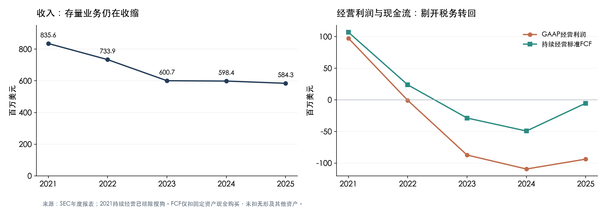
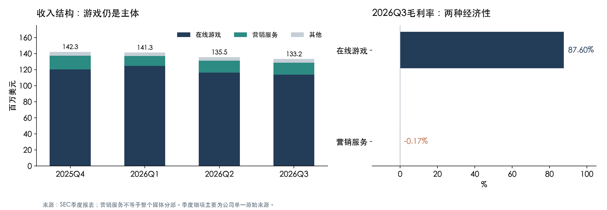

# 搜狐（SOHU）研究报告

**研究日与信息截止日：2026-11-25，北京时间。** 最新财务为2026年9月30日未经审计报表；年度审计数据至2025年末。行情采用11月24日美国常规盘收盘10.74美元，11月25日美股尚未开盘。除另注外，金额为百万美元，价格为美元/ADS。[S1] [S3] [S4]

上市主体是开曼注册的 Sohu.com Limited，NASDAQ:SOHU；1 ADS代表1普通股，与已退市的畅游CYOU、搜狗SOGO区别。沿用「搜狐」目录和触发ID。按2025末26,069,022股复算的**估值市值为279.981百万美元**，PS为0.507倍、PB为0.220倍。这不是已核验的11月实际股本和市值；回购后的最新精确股数仍缺口。[S1] [S2] [S3]

搜狐的价值仍集中于现金资产和畅游存量游戏；三季报证明回购继续执行，也显示游戏自然衰退与媒体变现压力。研究重点是现金能否在合理时间内成为少数股东回报。

## AI研究偏见自觉

**信息丰富度评级：B级。** 财报可研究性较高，但现金所在法律主体、可分配利润、新品留存和媒体投入回报披露有限。上市历史长，不能等同于资产兑现确定性高。

**AI研究局限性声明：** 本报告区分原始事实、二源数据库核对、单源细项和估值假设。Macrotrends页面受限，收入搜索摘要只能确认约数，主要改用SEC原件与StockAnalysis独立整理的数据；公司IR与SEC转载不算两个独立来源。季度分项、长期定存、最新实际股数与个人最终经济权益仍有二源缺口。数据抽检通过仅表示抽中项目的事实或算数核验通过，不代表这些缺口消失。

- [x] 没把账面现金当作可兑现价格底。
- [x] 没把一次性税务转回当作经常利润。
- [x] 同时考虑真实回购增厚和资本配置拖累。
- [x] 区分“资料充足”与“生意、治理、兑现可预测”。

相较[10月报告](搜狐-research-20261009.md)，本次加入Q3实绩与Q4指引，补足十年折现率翻转检查，并取消无可核验原话支持的“大师模拟点评”。旧报告保留作历史记录。

---

## 第一步：核心数据总览

### 五年财务地图

| 指标 | 2021 | 2022 | 2023 | 2024 | 2025 |
|---|---:|---:|---:|---:|---:|
| 收入 | 835.576 | 733.872 | 600.672 | 598.399 | 584.333 |
| 毛利率 | 75.51% | 73.90% | 75.73% | 72.29% | 77.50% |
| GAAP经营利润 | 97.472 | -0.873 | -87.310 | -109.401 | -93.805 |
| GAAP经营利润率 | +11.67% | -0.12% | -14.54% | -18.28% | -16.05% |
| 持续经营归母净利 | 69.274 | -17.343 | -65.805 | -100.269 | 394.095 |
| 持续经营CFO | 113.610 | 32.242 | -25.567 | -48.018 | -4.762 |
| 固定资产现金购买 | 6.718 | 8.506 | 3.225 | 1.315 | 0.576 |
| 持续经营标准FCF | 106.892 | 23.736 | -28.792 | -49.333 | -5.338 |
| 现金、短投及长期定存 | 1,587.301 | 1,437.247 | 1,348.887 | 1,235.715 | 1,181.339 |

来源为年度SEC原件与StockAnalysis；2021、2023持续经营口径需与终止经营分开，不能拿第三方总净利直接对比。广义现金含长期定存，独立平台只核到窄现金，细项仍有二源缺口。标准FCF=CFO减固定资产现金购买，2025再扣购入无形及其他资产9.081，广义再投入后为-14.419。新IP和内容不是免费获得，低固定资产CapEx不等于低再投资需要。[S2] [S5] [S6] [S16]

2025盈利主要来自税务会计变动：全年税前亏损49.523，却确认所得税收益443.609。两项重要转回为Toll Charge约199.0和畅游预提税递延负债283.6。后者对应境内利润在可预见未来再投资的政策，不能同时把税转回当经常利润、把相应现金当立即可分派资产。[S2]



### 最近四个季度

| 指标 | 2025Q4 | 2026Q1 | 2026Q2 | 2026Q3 |
|---|---:|---:|---:|---:|
| 总收入 | 142.260 | 141.284 | 135.540 | 133.243 |
| 营销服务收入 | 17.027 | 12.560 | 15.179 | 14.888 |
| 在线游戏收入 | 120.361 | 124.567 | 116.171 | 113.872 |
| 其他收入 | 4.872 | 4.157 | 4.190 | 4.483 |
| 毛利 | 107.074 | 111.476 | 106.584 | 101.679 |
| GAAP经营利润 | -66.042 | -6.732 | -18.299 | -18.280 |
| 持续经营归母净利 | 223.285 | -4.315 | 0.235 | -14.746 |
| 畅游经营利润（公司约数） | 45 | 65 | 55 | 58 |

季度分项以公司正式报表为准；独立数据库主要核总收入、利润及现金余额，未取得所有细项的独立二源。Q2持续经营净利仍含约13的税转回，另有终止经营收益0.734；Q3没有重复这一收益。Q4经营亏损包含商誉减值。[S1] [S7] [S8] [S9]

Q3收入同比下降26.04%；畅游利润环比回升，部分来自开发授权费减少，不能全部外推为长期效率提升。集团亏损与畅游利润的差额约-76.280，较Q2约-73.299更负；这只是非畅游及集团项目的算术残差，不能冒充季度媒体分部的精确损益或现金流。[S1]

Q4公司指引：营销服务收入13–14，游戏收入111–121，归母净亏损17–27。它没有给总收入或完整现金流指引；两项收入相加也不是总收入。[S1]

> 芒格式追问：去掉税转回和终止经营收益，集团本身能否持续产生可返还股东的钱？

---

## 第二步：生意本质分析

**一句话：老玩家为角色、社群和持续内容反复付费，畅游创造利润；搜狐把其中相当部分用于竞争激烈的媒体产品和获客。**

| 2025分部 | 收入 | 毛利 | GAAP经营利润 | 经济机制 |
|---|---:|---:|---:|---|
| 搜狐媒体 | 75.413 | 17.224 | -330.573 | 广告、订阅与直播等收入难覆盖研发、营销及其他费用 |
| 畅游，含17173 | 508.920 | 435.620 | 236.768 | 道具付费、游戏授权分成和游戏门户广告 |
| 合并 | 584.333 | 452.844 | -93.805 | 游戏盈利仍不足以覆盖其他投入 |

媒体经营亏损包含36.955商誉减值；剔除后仍为293.618，高于畅游全年经营利润。季度营销服务不是整个媒体分部，畅游也不等于在线游戏收入，两种分类不能混排。[S10]



玩家的角色成长、公会关系和既有装备构成复购动机。公司仍须更新内容、处理服务器生态、维护付费公平感，并支付IP、渠道、团队和推广成本。广告客户则能跨媒体调整预算，搜狐需要以效果或稀缺内容争取付费。

Q3游戏毛利率87.60%，营销服务毛利率-0.17%；集团76.31%的毛利率主要由游戏贡献，无法直接证明集团有强规模效应。2025研发费用247.507；Q3产品开发费用63.636，也不足以从会计费用中单独识别AI或新品投资回报。[S1] [S2]

真正移动利润的三个变量是：天龙系列的付费留存与付费强度；新产品是否在上线之后保留玩家；媒体费用能否下降到游戏现金流可以覆盖的水平。只看收入增长或高毛利率容易错过利润分配机制。

> 段永平式追问：好生意具体好在哪里？畅游的老玩家复购有价值，但合并持有媒体业务是否创造更多股东价值，仍需证明。

---

## 第三步：护城河评估

| 来源 | 可观察证据 | 强度与证伪条件 |
|---|---|---|
| 品牌、定价权 | 天龙老IP和搜狐品牌仍有识别度 | 游戏细分品牌中等，媒体定价权弱；须看付费留存与提价后的流水 |
| 转换成本 | 角色、装备、公会社群的累积 | 局部中等；账户和付费者持续下降会侵蚀它 |
| 网络效应 | 多人玩法、交易和社交关系 | 单款有效，尚不能外推为跨产品平台效应 |
| 规模效应 | 游戏运营高毛利、成熟团队 | 畅游存在，集团未体现持续盈利的成本优势 |
| 技术和授权 | 长线运营经验、软件与文学IP授权 | 有经验壁垒，但授权不是永久产权；AI经济优势未量化 |

Q3 PC月活账户260万、同比-4%，季度付费账户100万、同比-8%；手游月活140万、同比-24%，付费账户同比-25%。账户不是去重自然人，披露又经过约数处理，不能倒推出精确客单价。[S1]

2025天龙PC收入306.9，Legacy TLBB手游41.4；年报提示IP续约不确定性及腾讯独家运营发行关系。本次未取得可核对的授权届满年月，不虚构续约期限。老IP形成了存量粘性，也形成集中风险。[S2]

过去五年集团整体护城河趋窄，畅游的存量用户壁垒仍有价值。未来五年若新增玩家不足、产品老化或授权条件恶化，竞争者无需复制全部历史投入，也能逐步争夺用户时间。

> 巴菲特式追问：十年后还剩什么？应依靠留存、新品和现金数据回答，不能单凭品牌历史。

---

## 第四步：逆向思考与风险清单

**最强反方：现金可以真实存在，少数股东仍可能长期拿不到足够回报；游戏衰退若快于媒体止损，便宜会逐年变少。**

| 失败路径 | 主观概率等级 | 影响 | 先看什么 |
|---|---|---|---|
| 媒体投入长期抵消游戏现金流 | 高 | 资产池消耗、机会成本累积 | 分部费用、完整集团现金流、内容/IP现金购买 |
| 老游戏衰退且新品只在上线时冲量 | 中高 | 核心盈利来源缩小 | 付费账户、版本后留存、收入和利润的连续性 |
| 现有回购用尽后缺乏接续 | 中 | 折价缺少资本回报推动 | 新授权与实际执行、派息、净发行股数 |
| 跨境分派意愿、程序或税负阻碍 | 中高 | 兑现延迟或金额减少 | 法律主体、可分配利润、分派政策及税费 |
| 关联互贷回收与偿付不对称 | 无法可靠量化 | 资产回收弱于账面抵销想象 | Fox Financial双边余额与法律处理 |
| VIE、重大监管或上市地位失效 | 低至中，置信度低 | 极端回收损失 | 正式监管文件、审计与合约执行 |
| 私有化条件不利或迟迟不发生 | 条件性，不能估准 | 退出价格与时间不受小股东控制 | 正式交易文件及公平性程序 |

这些等级是判断，不能当实测事件频率。诉讼、税费和治理折让与极端VIE失效也不能重复扣损：前三年、十年兑现比例反映正常但受折价的可达价值；零回收尾部只演示异常整体失效。

门户转型、资产出售和私有化的历史路径都存在；搜狐自己出售搜狗的经历便表明资产可以变现，但变现不等于必然派现。代理问题说明管理层与小股东可能重视不同目标；沉没成本模型提醒已有投入可能延续。两者是解释框架，不能代替对管理者心理的事实判断。[S2]

多方最强回应同样需要保留：回购是实际花出去的钱，畅游仍有高利润，现金池没有出现与季度会计亏损等量的机械坍塌。最可能的分析错误是算对账面资产，却算错兑现时点；另一种错误是预先假定所有改善概率为零。

> 芒格式追问：聪明人为什么不买？他们可能无法控制等待期限，也缺乏改变资本配置的手段。

---

## 第五步：管理层评估

| 决策 | 已观察结果 | 对资本配置的评价 |
|---|---|---|
| 畅游私有化、搜狗出售 | 游戏留在集团，搜狗变成资产负债表资源 | 有重组和变现能力；不因此预设未来小股东退出价格 |
| 持续媒体投入 | 集团多年经营亏损 | 尚未证明投入能获得足够回报 |
| 回购与历史取消股份 | 年报披露在外股数减少 | 正面证据；必须同时扣现金成本，不能重复计收益 |
| 境内利润再投资政策 | 预提税递延负债转回 | 账面权益改善，可预见分配意愿偏弱；不是法律上永久禁分红 |
| 回购改为开放式 | 取消截止日，金额仍为150 | 延长执行可能性，不等于扩容或支出承诺 |

截至11月5日累计回购约1,010万ADS、成本134；相较8月6日约124，继续支出了约10，既有额度约剩16。最新正式公告中没有新增额度、分红或搜狐私有化方案；本报告不声称已穷尽未来可能性。[S1] [S2] [S9]

张朝阳兼董事长与CEO。年报披露截至2月20日实益持股11,462,100股、44.45%，含可行权期权和Photon股份；这不是其最终个人经济权益，实益投票/处分权也有共享因素。普通股每股一票，无依据将其写为双层超额票权。第三方“insider ownership 1.80%”的定义不同，不能拿来反驳实益持股，更不能混为一套经济权益数字。[S2] [S3] [S11]

2026年股东大会张朝阳仍获连任，同时存在大量withheld票；这反映股东意见保留，不足以证明控制权争夺。创始人依赖、交错董事会和分配选择限制小股东影响力。畅游异议股东诉讼已在2025年12月和解，不继续列为未决诉讼。[S2] [S12]

回购执行可验证，个人最终经济权益、媒体ROI、逐项目研发回报和未来分派意愿仍不可准确量化。因此不以模糊“创始人很努力”代替资本配置判断。

> 段永平式追问：CEO退休后，成熟游戏团队或能延续运营；现金分配和媒体战略是否改变，目前资料不足。

---

## 第六步：行业与文明趋势

中国游戏市场仍有增长，已核验H1行业收入1,884.5亿元、同比+12.17%，客户端452.88亿元、同比+27.92%。行业工委资料和现场报道相互印证。10月媒体另转述Q3行业收入925.22亿元、同比+5.11%；由于未取得可读协会原始Q3正文，只作低置信度背景，不用它计算搜狐精确市占率。[S13] [S14]

| 对手或替代品 | 竞争的资源 | 搜狐的挑战 |
|---|---|---|
| 腾讯、网易 | 玩家、新产品、渠道和运营人才 | 天龙存量必须靠持续内容守住，不能用行业TAM替代公司增长 |
| 短视频、社交与资讯平台 | 广告预算、创作者和用户时间 | 媒体需要可验证的获客和商业回报 |
| 视频订阅和直播服务 | 内容、付费意愿、注意力 | 增加内容供给不自动改善单位经济性 |

AI可能降低开发和内容成本，也可能增加竞争供给。年报已披露第三方大模型与内部AI技术应用，但没有足够量化数据证明搜狐获得独占利润优势。基准估值不加入“AI再造搜狐”的额外价值。[S2]

搜狐处于内容、IP与分发之间：老玩家和IP能留住一部分价值，大平台、授权方和用户也会分享收益。客户分散并不能消除产品/IP集中；腾讯既是合作渠道，也有竞争产品。本次未取得最新分部客户集中度和新品付费留存，不能把这些变量补成完整增长预测。

行业的长期数字娱乐需求是顺风，搜狐能否捕获新增利润是另一个问题。现有证据支持“有价值的存量游戏及资产”，不足以支持平台级长期复利叙事。

> 李录式追问：二十年后回看，新增价值到底归用户、渠道、IP所有者，还是搜狐股东？

---

## 第七步：估值与安全边际

### 先分清现金、资产锚和实际市值

| 当前估值指标 | 数值 | 口径 |
|---|---:|---|
| 核验收盘价 | 10.74 | 11月24日常规盘，StockAnalysis及FT行情摘要一致 |
| 估值市值 | 279.981 | 价格乘2025末26.069022百万股，非最新实际市值 |
| TTM收入 | 552.327 | 最近四个已披露季度加总 |
| PS | 0.507x | 固定旧股数估值口径 |
| 每股净资产 | 48.711 | Q3归母权益除同一股数 |
| PB | 0.220x | 不等同可分配资产折价 |
| 报表EPS对应PE | 1.349x | 第三方TTM EPS 7.96，受一次性税务收益扭曲 |
| 2025标准FCF收益率 | -1.91% | 不是最新TTM现金流收益率 |
| PEG | 不适用 | 缺乏稳定正的正常利润增长路径 |

StockAnalysis统计页仍用26.07百万股，资产表又列24.77百万股；后者与Q3季度加权平均24.765百万股接近，未证明为期末实股。本报告不把它用作当前股数。年末分母相对其后回购是保守选择，但前提是没有抵消的净发行；该前提仍需最新文件验证。[S1] [S2] [S3]

| Q3资产口径 | 金额 | 按固定股数每股值 | 用途 |
|---|---:|---:|---|
| 现金等价物+短期投资 | 823.962 | 31.607 | 可与独立数据库核对的窄口径 |
| 加长期定存后的现金池 | 1,154.868 | 44.300 | 长期定存330.906仍缺独立细项二源 |
| 现金池减全部负债 | 822.042 | 31.533 | 本文保守资产锚，非净现金定义、非清算底价 |

现金池较Q2下降6.864；不能将这一差额当FCF，因为回购、汇率、税务及金融资产周转均会影响余额。Q3未给完整集团现金流量表。[S1] [S7]

第三方净现金823.74仅采用窄现金、并将债务归类为约0.222；而2025年报曾列Fox Financial互贷应付34.123、应收33.924及租赁负债。Q3汇总表不足以证明互贷已经清偿，不能据此宣布“有息债务近零”。窄口径示意EV为-543.759、EV/TTM收入-0.984倍，只用于解释数据库快照；债务分类和可分配性缺口使它不能成为定价依据。正式资产模型直接减全部332.826负债，避免再重复扣互贷或已入账税项。[S1] [S2] [S3]

年报境内外现金分布只能描述年末，不能机械平移到Q3，更不能把境外银行存款等同上市母公司立即可派现金。账外未来税费、关停或交易费用仍可能发生，本模型通过兑现比例作粗略折让，没有精确逐项清算。[S2]

自身历史PE受搜狗处置、亏损及税务收益影响，比较意义低。2023–2025历史PS约0.56/0.71/0.81倍，本次0.507倍更低，但未统一复算历史股数，不据此计算估值分位。网易、微博的盈利质量、分红和债务安排与搜狐不同；未完成它们同日二源估值核验，不列貌似可比的精确现价PE，也不从同业PE推导终值。[S15]

### 三年：资产折价有没有足够厚

固定资产锚A=822.042、股数N=26.069022百万、美元要求回报r=10%。B为年度净现金消耗，包含经营、内容/IP投入、税费与现金收益的净结果；α为正常情景下可在股东价值中实现的比例，包含分配、税费、治理和退出折让，**不是事件概率**。均属研究假设，非公司指引。

三年每股现值=α×(A−3B)÷N÷(1+r)³。不加楼宇售价，不叠加整家畅游利润倍数；未来回购未预先计入收益，若发生须同时扣现金、调整股数。

| 三年情景 | 年净消耗B | 兑现比例α | 三年退出等价每股值 | 今日每股现值 | 10.74买入的情景年回报 |
|---|---:|---:|---:|---:|---:|
| 悲观 | 40 | 25% | 6.733 | 5.058 | -14.42% |
| 基准 | 10 | 50% | 15.191 | 11.413 | +12.25% |
| 乐观 | 0 | 80% | 25.227 | 18.953 | +32.93% |

基准B接近2025广义再投入后的净消耗量级，并非认为Q3亏损已经结束；完整现金流未更新是主要限制。悲观消耗参照历史压力，乐观要求费用止损和价值兑现。三年到期并无已确定退出交易，这些是条件情景。

现价较基准现值仅折让5.90%，对于兑现时间和治理不确定性仍薄。8–10美元条件评估带，对三年基准现值约有12.38%–29.91%折让；不保证十年停滞下的本金安全。

反向DCF：若每年消耗10，要让10.74获得10%年回报，三年末需实现剩余资产47.05%；等到十年则需100.58%。这不是证明市场愚蠢，而是说明市场必须相信更早回报、经营改善或接受更低回报。

按技能执行利润PE三情景适用性检验：将Q3持续经营亏损简单年化所得压力EPS约-2.263，工具输出负目标价。因此该方法不适用，本报告不用负目标价定资产价值，也不将季度年化当盈利预测。正式三情景由金融工具的十进制引擎补充计算，参数和结果存于[估值记录](assets-20261125/valuation.json)。

### 十年：仓位压力测试

| 参数 | 判断及限制 |
|---|---|
| 币种、r | 美元，r=10%；美元合理区间9%–11.5%。Rf=4.7%、β=1、ERP=5.3%是与仓库工具一致的模型参考，并非声称11月25日实时国债收益率 |
| 稳态增量ROIC | 条件性15%，只用于乐观经营恢复终值；集团当前亏损且缺稳定派息，无法用历史回报和派息夹定，置信度低 |
| 永续g | 悲观/基准/乐观0%/0%/2%，美元基准上限4%；改变r时不改变g |
| 第十年净经营利润 | 0/0/20；乐观20剔除存量现金利息、扣经营税费，不重复资本化现金收益 |
| 前十年净消耗、兑现 | B与α同三年假设；此前不派现、固定股数，无新增回购收益 |

只对经营利润使用永续倍数：PE=(1−g/ROIC)/(r−g)。完整期末值=α×[A−10B+净经营利润×PE]；IRR=(期末值÷估值市值)^(1/10)−1。现金资产不会随PE机械增减。乐观档假定前十年整体净现金流为零、终值时形成恢复利润，是离散的保守恢复路径，非逐年盈利预测。

| 十年情景，r=10% | 经营终值PE | r−g分母 | 期末可回收总值 | 今日每股现值 | 情景IRR |
|---|---:|---:|---:|---:|---:|
| 悲观 | 10.000x，利润为零 | 10个百分点 | 105.511 | 1.560 | -9.30% |
| 基准 | 10.000x，利润为零 | 10个百分点 | 361.021 | 5.339 | +2.57% |
| 乐观 | 10.833x | 8个百分点 | 830.967 | 12.289 | +11.49% |

为压力演示，三个正常情景给25%/50%/25%主观权重；以下“期望IRR”指情景IRR加权均值，**不是可实现的复合回报或事件频率预测**。另将25%/45%/20%分配给三档、10%给完全零回收尾部时，r=10%的均值为-8.87%；该尾部概率未经校准，不据其单点决定买卖。

| 完整资产模型敏感性 | 主观期望IRR | 相对IRR≥r | 悲观/基准/乐观分母 |
|---|---:|---|---|
| r=8% | +2.02% | 未覆盖；区间外，仅供参考 | 8/8/6个百分点 |
| r=10% | +1.84% | 未覆盖 | 10/10/8个百分点 |
| r=12% | +1.72% | 未覆盖；区间外，仅供参考 | 12/12/10个百分点 |
| r=9%，区间内补查 | +1.92% | 未覆盖 | 9/9/7个百分点 |
| r=11%，区间内补查 | +1.77% | 未覆盖 | 11/11/9个百分点 |

±2个百分点两端均超出美元合理区间，因此再查±1个百分点。**在9%/10%/11%有效样本内，完整资产压力测试未随r翻转，均未覆盖资本成本。** 这只收紧仓位，不单独构成观望或卖出的理由。

工具适用性说明：已执行`terminal_value.py flip`两次，但该命令将全部输入终值按PE比例缩放，直接放入现金资产IRR会算错。故仅对“剔除现金回收的经营终值组件”运行，按全部购入成本作机械反事实：悲观/基准利润为零，乐观为α×20；r=8%/10%/12%组件均值-75.47%/-76.17%/-76.70%，8%与12%均为区间外参考；r=9%/10%/11%为-75.85%/-76.17%/-76.45%，均未覆盖r、未翻转。**这些极低数值不是搜狐总股东IRR，不用于定价或定仓。** 正式压力表逐点重算固定现金与经营终值，并用`irr`核回收值；组件输出留在[原始工具记录](assets-20261125/terminal-checks.txt)。

### 估值分歧对账

三年资产法认为相对现价有小幅折让，基准年回报约+12.25%；十年等待模型期望约+1.84%，方向不同。前者回答“若较快兑现，贵不贵”，后者回答“兑现拖延后是否值得承担更大仓位”。分歧来自时间、持续消耗和正常价值实现比例，并非计算出了两个同等确定的目标价。

最终观望的独立依据是三年安全边际薄、媒体盈利弱、游戏用户衰退以及回购接续未明；不靠十年未过一票否决。已有合理研究小仓可有条件持有，十年压力将总仓参考收紧至1%以内；价格进8–10且经营和回报证据通过后，才讨论约0.25%–0.5%首笔。它是研究风险预算，非对用户实际持仓的推断。

未单独建模人民币汇率路径、具体私有化条款、最新各层级税费/法定留存/受限资金；未来新增负债、股本发行及ROIC偏差也会改变结果。α只能粗略折让，不能替代法律主体现金核查。

> 巴菲特式追问：r错两个百分点会翻转吗？有效币种样本内压力结论不翻转，但兑现年限及α的影响更大。
>
> 段永平式追问：股市关五年是否愿意持有？没有清晰回报路径时，只能按有限事件仓承担等待。

---

## 第八步：最终决策与行动清单

**结论：10.74美元观望新增；已有合理事件小仓可有条件持有、暂停加仓；不作为长期核心仓。保留8–10美元条件评估带。** 价格较10月锚点下降14.29%，资本回报执行有增量证据，但经营和分配机制尚不足以升级判断。

| 维度 | 结论 | 信心度 |
|---|---|---|
| 生意质量 | 畅游高利润，集团未稳定产生现金回报 | 中高 |
| 护城河 | 老IP与社群局部粘性，玩家衰退和新品接续约束 | 中 |
| 管理层 | 真回购值得肯定，媒体投入与分配意愿限制价值兑现 | 历史高、未来中低 |
| 最大风险 | 等待与消耗速度、IP集中、治理及尾部 | 风险存在高、概率低 |
| 文明趋势 | 数字娱乐有需求，不能自动转为搜狐份额与利润 | 中 |
| 估值 | 三年基准11.413，折让薄；十年压力1.84%未覆盖r，有效样本不翻转，只限仓 | 算数高、假设中低 |

估值与其余五个维度并列；十年压力不单独裁决买入、持有或回避。

| 策略 | 建议 |
|---|---|
| 空仓者 | 现价观望；8–10美元且下列条件通过后才研究分批，首笔约0.25%–0.5%，研究总参考≤1% |
| 持仓者 | 合理小仓有条件持有、不补跌；超出事件风险预算者复核集中度与机会成本，不推定用户有仓 |
| 加仓信号 | 实际回购/派息有接续，净股数可核；媒体非减值亏损连续改善；游戏留存与收入未结构恶化；下一完整现金流覆盖内容/IP再投入 |
| 卖出或减仓信号 | 现金消耗持续扩大且无费用调整，游戏利润衰退、回报停滞且无替代安排，重大关联/私有化条款损害小股东；先核事实再执行 |

| 价格带 | 行动含义 |
|---|---|
| 低于8美元 | 同属下行评估警报，先查永久损失；不自动更便宜、更该买 |
| 8–10美元 | 条件评估带；尚未取得下一完整现金流及回报接续证据，不是限价买单 |
| 高于10、低于15美元 | 观望新增，按经营与资本回报复核小仓 |
| 15美元及以上，模型未增强 | 不追高，复核超配和兑现假设；警戒不等于自动卖出 |

复检安排：2026-12-31人工核回购额度接续、执行与媒体/游戏最新证据；2027-03-31检查2026全年/Q4披露与完整现金流，若提前披露则提前核验。后者是研究日历兜底，非公司确认财报日。旧11月16日Q3预计检查已由11月9日正式公告和本次研究完成。

### 关于四位大师

已检查仓库内段永平、巴菲特、芒格、李录视角材料，均不足以提供他们本人针对搜狐的可核验立场。本报告的问题和分析框架不等于本人引语；不沿用旧稿缺原文支持的模拟发言。

| 人物 | 可核验资料状态 | 本次处理 |
|---|---|---|
| 巴菲特 | 未取得足够支持搜狐具体判断的一手原话 | 资料不足，不模拟代言 |
| 芒格 | 未取得足够支持搜狐具体判断的一手原话 | 资料不足，不模拟代言 |
| 段永平 | 未取得足够支持搜狐具体判断的一手原话 | 资料不足，不模拟代言 |
| 李录 | 未取得足够支持搜狐具体判断的一手原话 | 资料不足，不模拟代言 |

---

## AI分析置信度与投资确定性

**AI分析置信度：已披露财务中高、治理细节中、经营前景与兑现假设中低。实际投资确定性：低至中低。** 报表能核验，无法替代对资金分配、用户留存与等待期限的判断。

较充分证据：收入及经营亏损、税务转回、现金短投、历史回购、季度游戏账户趋势。有限信息推理：年度净消耗、α、十年恢复利润、ROIC、主观情景权重和仓位上限。

需要一手验证的问题：现金各法律主体的可分配余额与税费；回购用尽后的年度回报目标；天龙授权期限、付费留存和玩家结构；媒体产品、活动和AI的现金投入回报；Fox Financial双边余额及处理进展。可通过投资者关系答复、产品体验和玩家访谈补充，不能由AI补成事实。

本报告用于学习与研究，不构成投资建议。

---

## 数据来源与审计记录

### 主要信源

| 编号 | 来源与用途 |
|---|---|
| S1 | [2026Q3 SEC正式业绩及资产负债表][S1]，对应[公司IR PDF](https://investors.sohu.com/node/15146/pdf)；两者同一原始来源 |
| S2 | [2025 SEC 20-F][S2]：年度、税务、股数、治理、现金、IP及AI |
| S3 | [StockAnalysis统计][S3]、[资产表](https://stockanalysis.com/stocks/sohu/financials/balance-sheet/)，独立整理；股数和债务分类需纠偏 |
| S4 | [FT搜狐行情][S4]，11月24日10.74美元摘要；直页访问受限，价格另与StockAnalysis核对 |
| S5 | [2023 SEC 20-F][S5]：早年持续经营口径 |
| S6 | [StockAnalysis损益](https://stockanalysis.com/stocks/sohu/financials/income-statement/)、[季度损益](https://stockanalysis.com/stocks/sohu/financials/income-statement/?p=quarterly)、[现金流][S6]；2021现金流含已终止搜狗，须桥接 |
| S7 | [2026Q2 SEC公告][S7] |
| S8 | [2026Q1 SEC公告][S8] |
| S9 | [2025Q4 SEC公告][S9]及[2026Q2公司公告](https://investors.sohu.com/news-releases/news-release-details/sohucom-reports-second-quarter-2026-unaudited-financial-results) |
| S10 | [2025年报分部原表][S10] |
| S11 | [张朝阳2026年3月Form 3][S11]，与年报交叉仍非独立数据提供者 |
| S12 | [2026股东大会SEC结果][S12] |
| S13 | [游戏工委H1报告入口][S13]、[新华社现场报道](https://www2.xinhuanet.com/tech/20260731/c5593cc57b18411ab328cd3ed98b554c/c.html)；协会正文动态加载受限 |
| S14 | [每经Q3行业数据转述][S14]，低置信度补充，不作为精确份额依据 |
| S15 | [StockAnalysis历史比率][S15]；历史与同业仅作背景，不推导终值 |
| S16 | [2022 SEC 20-F][S16]：核2021现金资产分项 |

### 口径对账与来源缺口

| 项目 | 原件 | 独立对照 | 处理 |
|---|---:|---:|---|
| 2025收入 | 584.333 | 584.33 | 一致 |
| 2025归母净利 | 394.095 | 394.10 | 一致，税转回非经常 |
| Q3窄现金 | 823.962 | 823.96 | 一致 |
| 2025末股数，百万 | 26.069022 | 26.07 | 同年末近似一致，不代表11月股数 |
| 2025经营利润 | -93.805 | -56.85 | 第三方将36.955商誉减值重分类，采用原件GAAP |
| 2023归母净利 | 持续经营-65.805 | 总口径-30.38 | 终止经营收益35.426，统一持续经营后再比较 |
| 2021标准FCF | 持续经营106.892 | 总口径约-69.00 | 搜狗终止经营现金流差异，不当作数据一致 |
| 长期定存及季度分项 | 公司原件 | 二源未完整取得 | 单源标注，不伪称全部完成交叉验证 |
| 最新股数/个人经济权益 | 无充分时点披露 | 网站标签混用 | 明示缺口，不以推算替代事实 |

### 关键数据交叉验证记录

已运行金融严谨性工具的市值、二源交叉、估值指标及PE三情景检验；以下为实际输出节选，完整结果存于[金融核验记录](assets-20261125/financial-checks.txt)。工具的ROE是EPS除期末BVPS的简化口径，不能代表正常集团ROIC。

```text
  股价 (Price):       10.74 USD
  总股本 (Shares):    26.07M
  计算市值:           279.98M USD
  报告市值:           279.98M USD
  偏差:               0.00%
  ✅ 验证通过, 偏差仅 0.00%
```

十年参数末次audit已准出：美元r/g一致、各档分母至少5个百分点、离散风险归情景/尾部。已在本文列明人民币路径与私有化条款未单独建模。数据抽检已准出；误识别的日期、来源标号保留排除记录，固定种子补抽有效数据。结果和最终文件哈希见[抽检记录](assets-20261125/audit.json)；抽检对模型仅验证算数，不验证假设能否实现。

自动跟踪：沿用触发ID「搜狐」更新价格条件，保留历史链接和已完成节点；新增本次建议事件，10月事件接续关闭。价格进入区间只触发复核，事件保留人工检查，日常价格监控不自动扫描公告或执行交易。

[S1]: https://www.sec.gov/Archives/edgar/data/1734107/000119312526452512/d157642dex991.htm
[S2]: https://www.sec.gov/Archives/edgar/data/1734107/000119312526102990/d22394d20f.htm
[S3]: https://stockanalysis.com/stocks/sohu/statistics/
[S4]: https://markets.ft.com/data/equities/tearsheet/summary?s=SOHU%3ANSQ
[S5]: https://www.sec.gov/Archives/edgar/data/1734107/000119312524069620/d507223d20f.htm
[S6]: https://stockanalysis.com/stocks/sohu/financials/cash-flow-statement/
[S7]: https://www.sec.gov/Archives/edgar/data/1734107/000119312526341231/d165270dex991.htm
[S8]: https://www.sec.gov/Archives/edgar/data/1734107/000119312526227835/d172462dex991.htm
[S9]: https://www.sec.gov/Archives/edgar/data/1734107/000119312526041851/d48198dex991.htm
[S10]: https://www.sec.gov/Archives/edgar/data/1734107/000119312526102990/R39.htm
[S11]: https://www.sec.gov/Archives/edgar/data/1734107/000119312526112305/xslF345X06/ownership.xml
[S12]: https://www.sec.gov/Archives/edgar/data/1734107/000119312526392475/d159594d6k.htm
[S13]: https://www.cgigc.com.cn/details.html?id=08df1552-7845-4315-8ecf-cc5e05727e5c&tp=news
[S14]: https://www.nbd.com.cn/articles/2026-10-20/4610114.html
[S15]: https://stockanalysis.com/stocks/sohu/financials/ratios/
[S16]: https://www.sec.gov/Archives/edgar/data/1734107/000119312523084383/d415397d20f.htm
